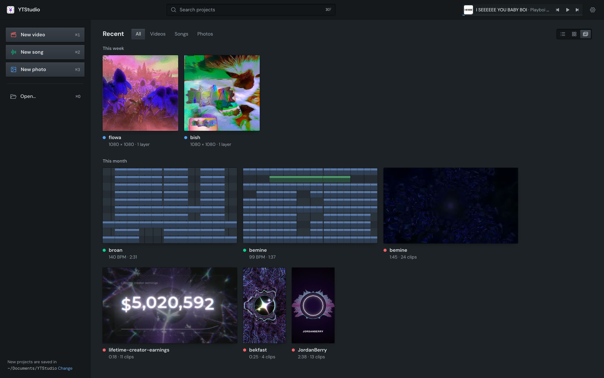
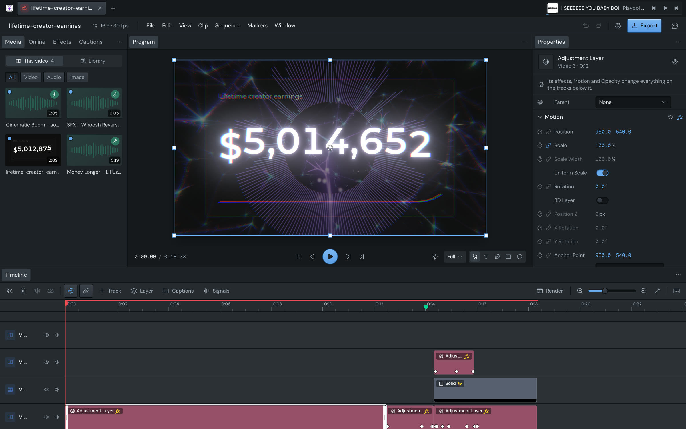
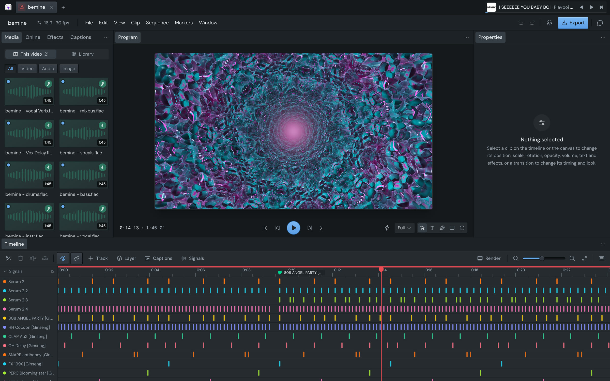
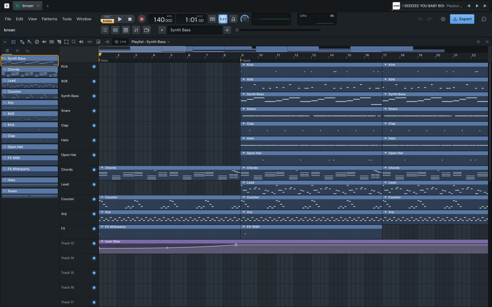
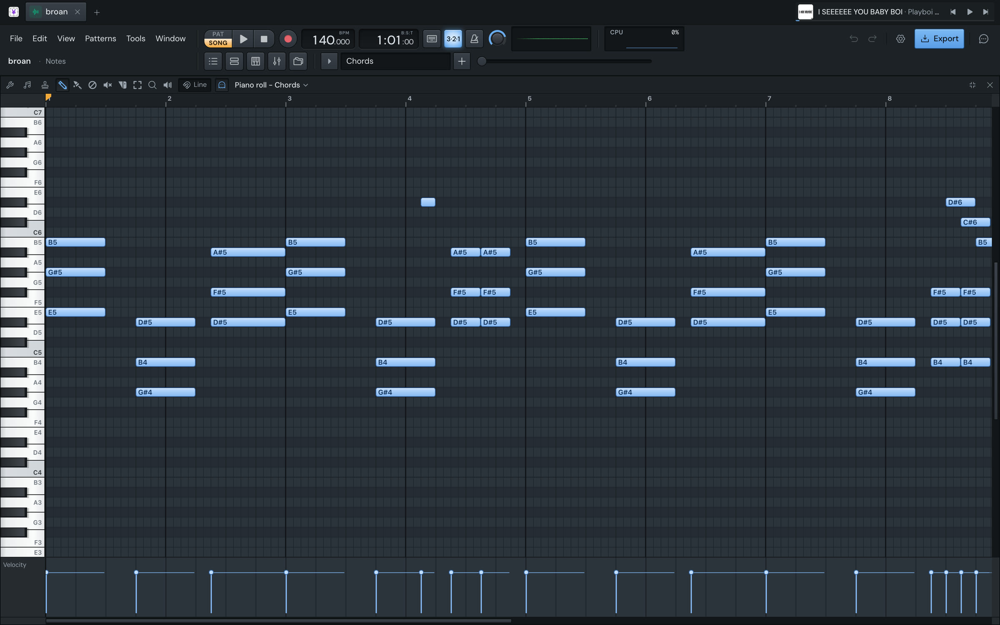
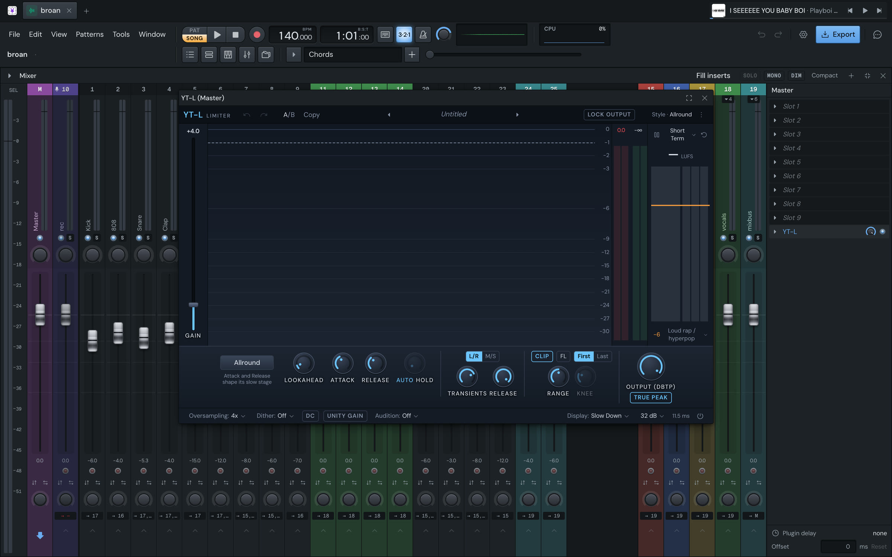
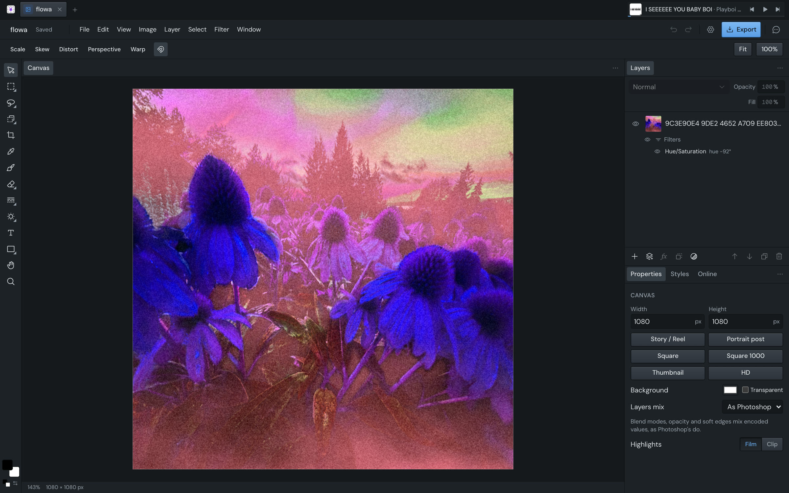
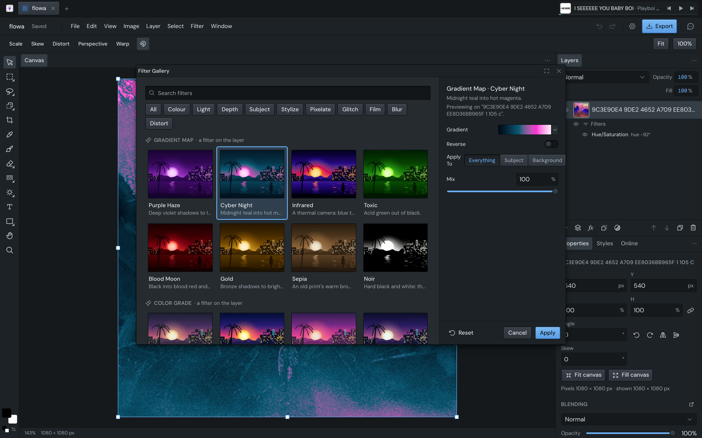
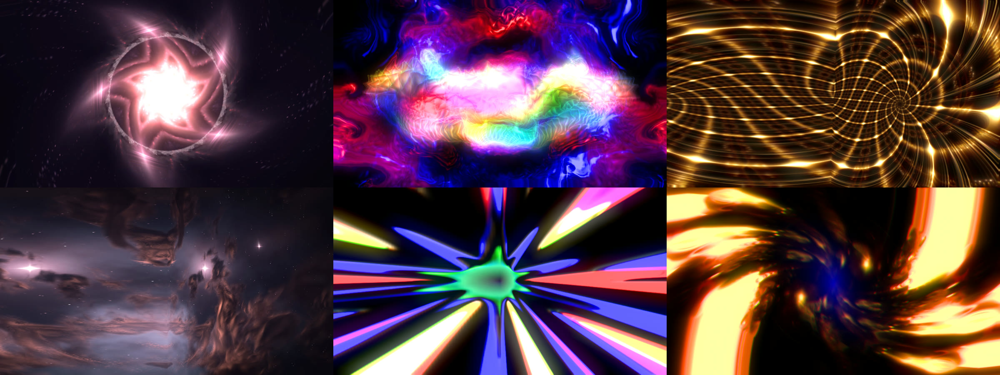

# YTStudio

A creative suite that runs on your own computer, in the browser or as a desktop app: a video editor modelled on
Premiere, a DAW modelled on FL Studio, and a photo editor modelled on Photoshop, with an audio-reactive visualizer
built in. Every project is a file of its own, and an AI assistant (your own Claude Code or Codex) can do anything you can.


*Home: every project, whatever the app, with live previews.*


*The video editor: timeline, Program monitor and keyframed effect controls, Premiere's way.*


*The visualizer: a 3D scene driven by a song's stems, each one a signal lane on the timeline.*


*The music suite: FL Studio's playlist, patterns and automation.*


*The piano roll.*


*The mixer, with YT-L, the built-in limiter, open on the master.*


*The photo editor: layers and non-destructive filters, on WebGPU.*


*The Filter Gallery: a look previewed on the layer before it's applied.*


*Now Playing: a full-window visualizer of whatever Spotify is playing, listening to the computer's sound live.*

```bash
pnpm install && pnpm dev   # http://localhost:5310 (needs ffmpeg)
```

The user guide is in [docs/guide.md](docs/guide.md).
