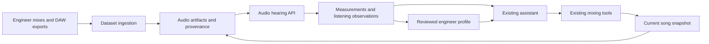

# Engineer datasets and audio hearing

Status: **Slice A of the [implementation checklist](implementation-backlog.md) is built** (the contracts, snapshot capture, the fixture collection and the three dataset/engine audits, below). [Slice B](render-and-measure.md) is also built: project-scoped immutable audio, durable cancellable passage renders, local measurements and MCP tools. [Slice C infrastructure and its hosted perception pilot](hosted-perception.md) are implemented; listening quality acceptance remains pending, and provider findings are withheld by default. [A first vocal comparison workflow](vocal-mix-workflow.md) implements part of D/E; their general delivery and later slices remain planned.
Research date: 2026-10-03. Provider capabilities and DAW compatibility must be verified again at implementation.

Update 2026-10-05: [the first local vocal comparison workflow](vocal-mix-workflow.md)
adds a D procedure and part of E, including two-passage native candidates,
audition playback and guarded apply/undo. B has also passed the real-audio MCP
verification described there. General D/E delivery and musical quality acceptance
remain pending.

Start with the [end-to-end audio engineering harness plan](audio-engineering-harness.md): it connects the existing Claude Code runtime, hosted hearing, ordinary-package ingestion, dataset retrieval, workflows, reversible candidate renders, evaluation, and optional training/self-hosting. This is the current delivery roadmap; the individual proposals below provide supporting detail.

The [implementation checklist](implementation-backlog.md) breaks that roadmap into dependent slices, each with concrete deliverables and acceptance criteria.

[Mixer insert setup with Jev](jev-mixer-setup.md) is implemented independently: classify Serum preset metadata and sample filenames into red instruments, blue bass/808s, and yellow drums, then assign named inserts and bus routing. It grows the mixer before recording/vocals and reuses existing setup tracks on later runs. Jev is text-only; live Serum 2 name/category extraction has been checked locally.

This proposal has two separately deliverable systems:

1. [Dataset ingestion](dataset-ingestion.md): accept finished mixes, audio exports, and DAW archives; preserve their provenance; produce reviewed, evidence-backed engineer profiles.
2. [Audio hearing API](audio-hearing-api.md): combine native audio perception with full-resolution measurements and expose the resulting evidence to the existing LLM through tools.

The dataset system can organize material before hearing is available. The hearing API can analyze the user's own song without an engineer dataset. Their shared contract is an immutable audio artifact, its timeline, and analysis evidence.

[Plugin settings research](plugin-settings-research.md) documents the preferred live-capture approach: export readable controls from the loaded source DAW/plugin, preserving native state and using targeted decoders only for gaps.

**Current constraint and research direction:** the user rejected asking the engineer to run capture tools. Live capture remains a researched option, not the selected contributor workflow. [Dataset research and downloads](dataset-research.md) compares existing settings datasets, prices/access, and the audited small downloads that can support a starter without extra work from the friend.

[Learning tasks](learning-tasks.md) separates hearing, effect behavior, human mixing decisions, and outcome evaluation. CL 1B has finished downloading and passed checksum/ZIP integrity checks; its inspected archive metadata labels ratio and threshold, not attack/release. It is stored separately from the small starter ZIP at `data/research-datasets/cl1b/Dataset.zip`.

## Proposed defaults

- Ingestion targets full DAW session capture: plugin parameters/state, arrangement/layout, routing, automation, referenced media, stems, and a finished mix. Reduced stem/reference submissions remain supported with explicit coverage.
- Local storage and analysis orchestration fit the current desktop/local-server architecture.
- Hosted audio perception comes first, with local measurements and a provider-independent API. Self-hosted inference is a later adapter, not a first-release prerequisite.
- The first product is reference-guided analysis and mixing. Custom model training is a later decision supported by held-out evaluation.
- FL Studio and Pro Tools get early full-session extraction feasibility checks, then adapters for a tested DAW/plugin matrix. Preserve native state and identify every gap rather than claiming universal plugin access.
- The audio hearing API returns evidence, uncertainty, and unavailable capabilities. It does not edit songs.

The user confirmed full session data capture, including plugin parameters and layout, and hosted-first hearing. Exact DAW/plugin versions, extractable fields, and the hosted provider remain to be established.

## Fit with this repository

The app uses React, a local Express server, shared TypeScript domain logic, and a JUCE/C++ music engine. Relevant existing seams:

| Existing component | Planned use |
| --- | --- |
| `shared/music/tools.ts` | Define assistant tools for analysis, comparisons, and profile retrieval |
| `src/suites/music/tools.ts` | Capture the correct chat/project context and call server analysis services |
| `server/music/engine.ts` | Render exact song snapshots and stems |
| `server/music/exports.ts` | Reuse rendering concepts without coupling analysis to user exports |
| `server/music/routes.ts` | Mount proposed dataset/hearing routes |
| `server/assistant/mcp.ts` | Expose the new suite tools through the existing MCP mechanism |
| `server/suites/music.ts` | Update the assistant's hearing instructions once working tools exist |
| `server/media-analysis.ts`, `server/music/wav.ts` | Reuse decoding and measurement infrastructure where appropriate |
| `server/storage.ts` | Add independent dataset, artifact, analysis, and profile paths |

Three existing constraints matter: tool results currently contain text/images, long tool calls depend on a tab bridge, and the current engine stops playback while exporting. The detailed plans address these explicitly.

## Earlier subsystem delivery order

The integrated harness roadmap above supersedes this earlier sequence where native DAW feasibility was treated as a prerequisite for the first product. The first useful vocal/beat loop can use ordinary audio and our built-in processors while bounded DAW extraction research continues.

| Stage | Deliverable | Gate before moving on |
| --- | --- | --- |
| 0 | Full-session capture feasibility, dataset specification, and hearing evaluation protocol | Target DAW/plugin access verified; engineer confirms export semantics |
| 1 | Local audio/archive ingestion, provenance, full-resolution measurements | Originals preserved; repeat imports deterministic; alignment problems surfaced |
| 2 | Standalone hosted hearing service with a replaceable provider adapter | Demonstrated capability on held-out mixing tasks; hosted cost/latency measured |
| 3 | Song analysis tools and reviewed engineer profiles | Every finding traceable; unsupported claims blocked; stale song reports labeled |
| 4 | Reference-guided, reversible mixing loop | Engineer prefers results to a baseline on held-out songs |
| 5 | Broader DAW/plugin coverage and optional training research | Verified format/API coverage and enough trustworthy paired material |

Stages 1 and 2 can be developed independently against the artifact/evidence contract. Full native DAW conversion, model training, and uninterrupted real-time listening are separate projects, not prerequisites for the first release.

Before implementation, obtain representative FL Studio and Pro Tools versions, one archive from each, several finished mixes, and preferably a few aligned raw/processed examples. There is no defensible calendar estimate for native session extraction or a quality promise for audio models until those checks are complete.
