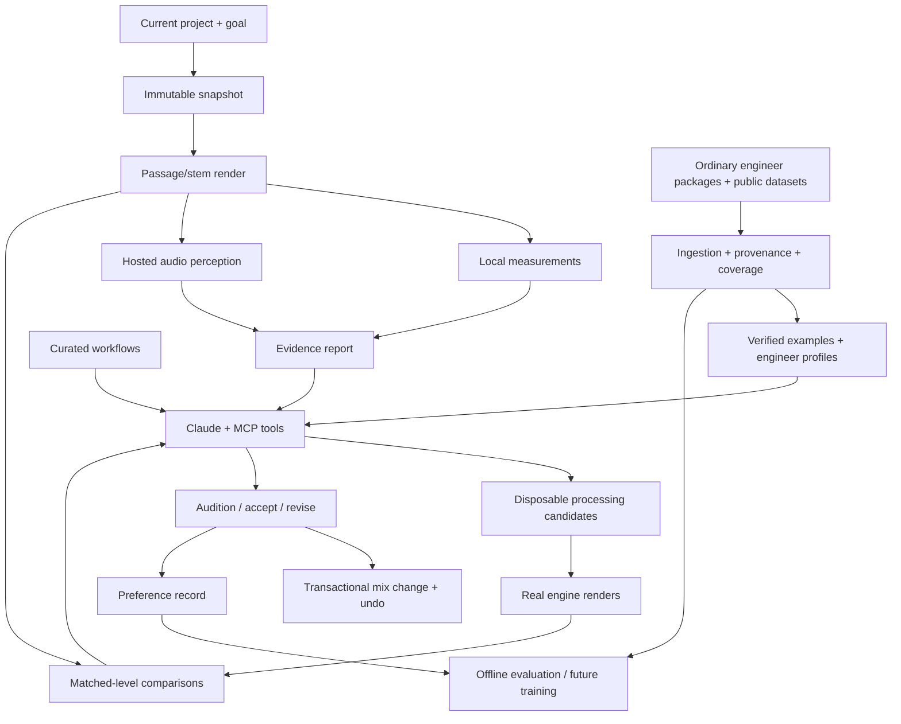

# End-to-end audio engineering assistant plan

Status: planning only. Application implementation and model training have not started.
Research checked: 2026-10-03 local time. The authorised CL 1B download finished and passed checksum and ZIP CRC validation on 2026-10-04 UTC.

This is the implementation roadmap connecting [ingestion](dataset-ingestion.md), [hearing](audio-hearing-api.md), [dataset research](dataset-research.md), and [learning tasks](learning-tasks.md). Where older documents propose contributor capture scripts, the current decision takes precedence: use public datasets, without requiring engineer packages, capture tools, or native plugin-parameter extraction. The corrected [Slice F checklist](implementation-backlog.md#slice-f-public-dataset-ingestion) takes precedence over older engineer-package sections below.

## 1. Product and first useful release

Build an assistant that can inspect a song, hear relevant passages through tools, make reversible mix changes, compare real renders, and explain decisions using evidence. Keep the current Claude Code agent runtime initially. Add an audio engineering harness around its MCP tools rather than rebuilding the agent loop first.

The first complete task is a vocal over a stereo beat: improve consistency and intelligibility while respecting the requested tone and preserving the beat. Support our built-in YT-C compressor and YT-EQ first because their controls already have readable units and editable tool interfaces. Broaden to full multitrack mixes, buses, automation, and supported external plugins after the closed loop works.

Success is a useful before/after result on an unfamiliar recording, with a reliable undo path. A detailed report by itself is not success. A lower peak or higher loudness by itself is not success either.

The finished experience should let the user:

1. Open/import vocals and a beat, or an existing song.
2. State a goal, optionally selecting a reference or engineer profile.
3. See the assistant identify passages to inspect and run analysis.
4. Audition a few processed alternatives at comparable loudness.
5. Keep, revise, or revert the chosen changes.
6. Review a concise explanation with links to the passages and settings that support it.

No promise of exact plugin reconstruction from a final mix. No requirement to train a general music model before the product works. Continuous real-time autonomous mixing is a later scope; version one uses short offline passages.

## 2. Decisions and existing architecture

| Decision | Initial choice | Why |
| --- | --- | --- |
| Agent runtime | Existing headless Claude Code adapter | Already integrated with chat, streaming, project context, MCP, interruption, and sessions |
| Hearing | Hosted native audio perception plus local DSP | Matches the user's hosted-first preference; preserves precise stereo measurements |
| Processing | Existing JUCE engine and built-in effects | Real renders give the actual effect of settings without training a neural processor |
| Human knowledge | Curated workflows plus searchable verified examples | Useful with a small dataset; avoids pretending annotations are universal best settings |
| Dataset storage | Local immutable files and manifests | Fits the desktop/local Express architecture; preserves original evidence |
| Autonomous experiments | Disposable candidates with bounded budgets | Prevents exploratory processing from overwriting the working mix |
| Custom training | After a benchmark identifies a specific weakness | Each training project must prove value against the untrained baseline |

Repository inspection shows `server/assistant/claude.ts` already starts `claude -p`, disables built-in tools and slash commands, uses only the editor MCP server, and runs in an empty workspace. `server/assistant/agent.ts` is the common provider boundary and also supports Codex. Retain that boundary.

The Claude Agent SDK is a future adapter option. It exposes the same underlying agent infrastructure, with programmable sessions and tools; migration is not itself an improvement to audio reasoning. Add an SDK adapter only when we can name the missing lifecycle/control feature and verify parity for cancellation, resume, progress, errors, and cost reporting. [Anthropic runtime overview](https://code.claude.com/docs/en/agent-sdk/overview)

Authentication/product packaging is a separate deployment decision. The existing local app uses the user's own agent executable. A hosted/commercial integration should use the appropriate API authentication: Anthropic's SDK documentation restricts offering claude.ai login/rate limits in third-party products without approval. Do not assume a personal subscription supplies a shared product backend. [Authentication guidance](https://code.claude.com/docs/en/agent-sdk/overview)

## 3. Four capabilities, one orchestrated workflow

| Capability | Input | Output | Initial implementation |
| --- | --- | --- | --- |
| Perception | Current audio and mix context | Timestamped observations and measurements | Hosted hearing adapter + DSP |
| Effect behaviour | Input audio, processor identity/state, proposed controls | Actual output and measured/audible differences | Engine renders; controlled datasets for verification |
| Mixing decisions | Goal, context, observations, current state, examples | Explicit hypotheses and bounded proposals | LLM + workflows + retrieval |
| Evaluation | Original/candidate audio, goal, listening conditions | Preference evidence, regressions, trade-offs | Matched-level A/B, measurements, expert/user review |

These are responsibilities, not a requirement for four models. Parameter inference from audio is a fifth possible research task, but is unnecessary for choosing and testing edits. It is often ambiguous and cannot certify what an engineer originally used.

The LLM receives compact evidence; the hearing service receives audio bytes. Putting a file path into the LLM context does not give it audio perception. A hosted model's opinion is an observation, not a physical measurement or an expert preference label.

## 4. Data and model flow

Do not feed every dataset row into every chat turn. Retrieval selects a small relevant set. Do not upload every source stem on every analysis: selected passages and the minimum relevant context should suffice, with caching and recorded transformations.

## 5. Dataset ingestion and evidence contracts

Accept folders/ZIPs containing FL Studio/Pro Tools projects, referenced media, rendered tracks/stems, and finished mixes. Other DAWs can enter as generic packages before native parsing exists. Preserve all source files; do not require a new donor export/capture workflow.

Import stages: identify files -> preserve hashes/originals -> discover songs and versions -> classify source roles -> resolve references -> validate audio -> establish pairings/alignment -> extract supported session metadata -> record coverage -> make examples eligible for specific uses.

An importer must record separately:

- Audio readiness: decodable, silent/empty, clipped, missing, or unsupported.
- Role: raw track, pre/post processing export, group stem, full mix, mastered reference, or unknown.
- Pairing confidence: verified shared source, reviewed match, heuristic suggestion, or unavailable.
- Structured session coverage: arrangement, routing, gains/pans, inserts, sends, automation, timing, and plugin identity/state.
- Parameter readability: exact readout, annotated, estimated, opaque preserved state, or unavailable.
- Reproduction readiness: media/plugin versions present, supported routing, render verified, or partial.
- Use permissions: local research, hosted analysis, retrieval/display, and training eligibility, independently.

FL Studio/Pro Tools native adapters remain feasibility work, not universal decoders. For a bounded tested version/plugin matrix, extract what is supported and preserve opaque blocks. A format parser cannot conjure missing media or turn arbitrary plugin blobs into named units. Our own engine can inspect compatible plugins loaded locally; that does not make every donor project compatible or every exposed parameter complete.

Do not infer track processing order from filenames, treat source-separated estimates as original stems, or assume two similarly named WAVs are aligned dry/wet pairs. Validate offsets, duration, fades, channel count, sample rate, gain staging, latency, and export tap points. Preserve uncertainty instead of inventing labels.

Start with content-addressed files and JSON manifests; use a small local index for searchable metadata when query volume requires it. A separate vector database is not a version-one prerequisite.

## 6. What each downloaded dataset contributes

| Resource | Initial role | Required preparation | What it cannot establish |
| --- | --- | --- | --- |
| MixParams | Searchable observed human EQ/compression choices | Resolve reuse terms; normalise per-plugin names/units; retain estimated/missing fields; join source audio where verified | Universal good settings, causation from final audio, or hip-hop vocal expertise |
| CL 1B | Offline compressor behaviour investigation and benchmark | Establish array structure, input/output mapping, units, alignment, signal coverage, and fixed settings | Best artistic choice; EQ behaviour; variable attack/release labels in this archive |
| MED selected material | Audio context and human evaluation | Verify song/mix identities, source roles, rating aggregation, and recording terms | Uniform exact plugin labels or a uniformly professional quality target |
| MixAssist | Optional dialogue/description examples | Confirm eligible usage and annotation/audio pairing | Validated critical listening or precise parameter estimation |
| MixologyDB example | Schema/example inspiration | Inspect its limited one-mix coverage | A substantial additional training collection |
| Friend's ordinary packages | Personal engineer reference/profile evidence | Import, preserve provenance, extract only supported controls, obtain verified comparisons | Complete numeric plugin settings when state is opaque |
| Future controlled EQ/compressor renders | Known transformations across our processors | Cleared sources, known units/versions/states, grouped splits, render validation | Human intent or musical preference without additional labels |

MixParams local audit: 2,345 rows, 13 song labels, 90 song/mix-label pairs, 395 vocal compression rows. Of those, 376 include threshold/ratio/attack/release entries, not necessarily verified units or direct exact readouts. Lead vocal compression coverage is 140 rows; the rest is predominantly background vocals. Split by source song rather than accepting the supplied splits as independent.

CL 1B local state: `data/research-datasets/cl1b/Dataset.zip` is 6,640,085,182 bytes. Published MD5 matched; SHA-256 is `d65385bb06f6416cae4f0bdcf0f71ca5b744097b8d33db4350375d30124e3b7e`. Every ZIP member passed CRC validation. Four members are two data pickles and two metadata pickles, totalling roughly 6.94 GB uncompressed. Static metadata inspection found 27 training label entries, one test entry, ratio/threshold fields, and 48 kHz. Raw ratio values include 73.3; physical mapping is unresolved. Initial data-header inspection finds an `inp` list and a first float64 array of 15,500,000 samples. That does not yet certify all arrays or paired output semantics.

No pickle has been executed and no array has been converted to a training corpus. During implementation, use a narrowly validated conversion in a disposable worker, or a restricted static decoder for the known NumPy layout; export only checked arrays and labels to a simple safe format. Conversion must preserve raw labels and fail on unexpected objects. Inspect a tiny verified sample before converting the full archive.

The earlier paper discussion concerned a later expanded experiment; it must not override the downloaded archive's actual labels. Full verification/audit evidence is in the local manifest and preliminary audit; [dataset source](https://zenodo.org/records/6497085).

## 7. Example representation and retrieval

Separate three record types:

1. **EffectExample:** source/output artifact IDs, plugin/device identity/version, complete known state, native and mapped controls/units, timing/alignment, input level, fixed controls, provenance.
2. **DecisionExample:** source context, engineer/session identity, goal if known, chain/routing/automation, controls, outcome references, quality/intent labels if present, missing fields.
3. **PreferenceExample:** goal/context, anonymised candidate order, level-match method, exact snapshot/settings, judge/source, choice/tie/uncertain, reason, and listening environment.

Never convert a human settings row automatically into an instruction or preference target. Never fill unknown intent with an LLM-generated rationale and call it engineer truth.

Retrieval initially filters instrument/role, plugin family, processing goal, evidence completeness, and approved use; then ranks textual/context similarity. Return perhaps 3-5 concise examples plus native values, units, caveats, provenance IDs, and source audio links when available. This count is an initial context budget, not a scientifically established optimum.

Exclude incompatible units/missing fields from executable proposals. Show weakly matched genres as weak matches. Human profiles should describe supported tendencies and exceptions rather than a single averaged chain. Unknown settings remain unknown. Audio embeddings may help broad matching later but must not be described as a validated engineer-style metric.

## 8. Skills and how Claude uses them

Versioned curated workflows describe triggers, prerequisites, steps, available tools, failure conditions, evaluation requirements, and stopping rules. They are instructions; raw waveform data and fitted weights are separate assets.

Initial workflows:

| Workflow | Procedure emphasis |
| --- | --- |
| Vocal consistency | Distinguish gain rides from compression; inspect peaks and quiet phrases; protect articulation |
| Vocal/beat balance | Listen in full context; evaluate masking; avoid unnecessary edits to the stereo beat |
| Vocal EQ | Identify the specific tonal issue; use controlled changes; inspect sibilance and thinness regressions |
| Compression audition | Inspect input level/chain; isolate the hypothesis; compare candidates at matched level |
| Reference comparison | Account for mastering/arrangement differences; compare relevant passages rather than copying curves |
| Mix evaluation | Check loudness bias, clipping, artifacts, multiple song sections, and the requested goal |
| Engineer reference | Retrieve supported examples; distinguish source evidence from inferred recommendations |

First use an application-owned workflow catalogue exposed through MCP (`list_mix_workflows`, `get_mix_workflow`). Include descriptions in the music instructions and load the full workflow on demand. This works with the current runtime's disabled file/shell tools and slash commands. It also keeps workflows usable by the existing alternate agent adapter.

Do not promise native `SKILL.md` discovery without changing the runtime. SDK skills require controlled filesystem discovery and the Skill capability; configure an application-owned directory and explicit skill scope if adopted. Do not load arbitrary donor archive instructions as skills. [SDK skills configuration](https://code.claude.com/docs/en/agent-sdk/skills)

A workflow can retrieve evidence and call audio tools; it cannot enforce transactional safety by prose alone. State validation, budgets, concurrency rules, and undo live in application services.

## 9. Exact capture, candidates, and undo

A snapshot includes the normalised project document, arrangement, automation, media hashes, sample rate/channel layout, tempo map, routing, plugin identity/state hashes, and render configuration. A render points to an immutable snapshot, not a mutable project ID alone.

Current `renderExport` stops playback and is tied to engine state. Initial release should disclose/pause during short renders and serialise access. Add an isolated render-engine process before promising uninterrupted experiments. Reloading plugin states alone may not restore a live processor's history; render with sufficient lead-in for compressor/reverb state and account for lookahead/latency/tails.

Create candidates from snapshots in a separate project/state namespace. A proposal specifies targeted controls and expected changes. Validate through the existing pure edits, normalisation, and native ranges. Never run speculative changes by repeatedly editing and reverting the user's live project.

Accepting a candidate performs one named transaction: verify the base document and affected plugin states still match, apply the intended patch, persist the resulting state, and retain the previous document and affected state files for undo. If the user edited in the meantime, recompute/review rather than overwriting. Do not replace unrelated tracks/state with the whole candidate snapshot.

Undo/redo must cover opaque plugin-state files as well as document changes; the existing document undo is not automatically enough. Verify effect removal, parameter edits, automation, routing, and state restoration separately. Cancellation must release the engine lock and leave the working project intact.

## 10. Hearing service and provider selection

Local measurement worker: peak/true-peak with documented method, clipping/nonfinite samples, windowed RMS and loudness where appropriate, crest factor, spectrum/band energy, stereo correlation/width, timing/alignment, and supported relative-level measures. Where gain-reduction telemetry is available from the actual processor, use it; do not infer exact GR from crest factor.

Hosted perception adapter: accepts authorised artifact passages and a task, prepares model-specific copies, asks targeted questions, validates response shape/time ranges, and returns observations, limitations, provider/model version, and evidence references. Keep full-resolution stereo originals and record any resampling/downmixing/time mapping. Avoid independently normalising loud/quiet phrases for tasks that assess dynamics.

Gemini native audio is the first hosted candidate to benchmark, because its official API supports audio-to-text understanding. This is a shortlist decision, not certification of subtle mix evaluation. Pin an actually available audio-capable model and measure task accuracy, latency, limits, preprocessing, and price before selection. [Google audio API](https://ai.google.dev/gemini-api/docs/audio)

Later self-hosted candidate: Qwen3-Omni through the same adapter contract. Evaluate the exact weights/processor/license, input fidelity, channel handling, GPU memory, and task performance; do not assume it runs efficiently on the user's Mac. [Qwen repository](https://github.com/QwenLM/Qwen3-Omni)

Keep capability flags per provider version. Stereo claims rely on preserved stereo measurements when a provider reduces channels. Unsupported or inconsistent observations stay unavailable/uncertain. Source separation is optional and marked derived; it does not recover ground-truth stems or plugin settings.

Response contract separates `measurements`, `observations`, `hypotheses`, `limitations`, `artifactRefs`, `snapshotId`, and `coverage`. Confidence begins as qualitative evidence strength, not a fabricated calibrated probability. A lack of detected problems is not an assertion that every passage was inspected.

## 11. Tool/API surface

Existing `get_song`, `get_mixer`, `get_pro_c`, `update_pro_c`, `get_pro_q`, and EQ edits remain useful. Their descriptions need to distinguish known settings from listening evidence. External plugin support starts read-only where native access is partial; arbitrary plugin control requires verified mappings.

Proposed additions:

| Tool | Input | Result / effect |
| --- | --- | --- |
| `capture_mix_snapshot` | Project context | Snapshot ID and coverage |
| `render_mix_passage` | Snapshot, range, taps/stems | Job ID; immutable audio artifacts |
| `get_audio_job` / `cancel_audio_job` | Job ID | Progress/result or cancellation |
| `analyse_audio` | Artifact IDs, task, goal/ranges | Job ID; evidence report |
| `compare_audio` | Baseline/candidate artifacts, goal, match policy | Job ID; relative evidence and limitations |
| `search_mix_examples` | Role/context/goal/filter | Eligible examples with provenance |
| `list_mix_workflows` / `get_mix_workflow` | Optional task / workflow ID | Curated workflow description/full procedure |
| `create_mix_candidate` | Base snapshot and targeted patch | Candidate ID; validated disposable state |
| `get_mix_candidate` | Candidate ID | Settings diff, audio/evidence references |
| `accept_mix_candidate` | Candidate and expected current revision | One undoable transaction or stale-state error |
| `discard_mix_candidate` | Candidate ID | Candidate lifecycle update |
| `record_mix_preference` | Comparison, choice/tie, optional reason | Preference record; no implicit training consent |
| `import_engineer_package` / `get_dataset_import` | Local authorised package / import ID | Job ID; coverage and unresolved pairings |
| `get_engineer_profile` | Engineer/version/context | Reviewed tendencies with evidence |

Long operations return job IDs quickly. Workers persist status/events and continue independently of chat polling. Route server-owned analysis/data jobs directly from the MCP dispatcher; retain the tab bridge for capturing current unsaved edits and applying UI/document changes. Current `AssistantService.callTool` requires a tab for every call, so this is an explicit dispatcher change, not existing behaviour.

API groups: `/api/music/audio-jobs`, `/api/music/audio-artifacts`, `/api/music/mix-candidates`, `/api/music/mix-workflows`, `/api/music/datasets`, and `/api/music/engineer-profiles`. Exact route names are proposed; keep IDs/project scope validated inside services. Audio sources are registered artifacts, not arbitrary filesystem paths supplied by the model.

Each request/result includes schema version, project scope, trace/run ID, source revision/snapshot, and input IDs. Jobs have durable stages, idempotency keys, cancellation, bounded retries, and failure messages. Mutations validate expected revision and permitted targets.

Current tool results support text/images. Return compact JSON-as-text evidence and artifact IDs; the UI serves audio audition directly. Do not assume the MCP transport or Claude can consume a new audio content block merely because the browser can play a WAV.

## 12. The autonomous mixing loop

Persist a `MixRun` independent of conversation history: goal, constraints, snapshot, selected passages, workflow version, evidence, examples, candidates, comparisons, budgets, and accepted transaction. Model context compaction must not erase this record.

State sequence:

`capture -> inspect -> hypothesise -> propose -> render -> compare -> revise or present -> accept/discard -> summarise`

1. Capture the intended project and identify the vocal/beat. When role is ambiguous, request the minimum clarification while independent inspection continues.
2. Select passages covering peaks, quiet lines, consonants, and a representative arrangement; record selection coverage. Start with roughly 10-20 second passages where usable, then verify additional sections.
3. Analyse raw/current vocal, full mix, and beat context. Separate recording defects from balance/dynamics issues.
4. Form an explicit hypothesis: for example, uneven phrase levels might need gain rides, while isolated peaks might need compression.
5. Retrieve relevant workflow/example evidence. Keep native parameter semantics and current input level visible.
6. Propose a small set of alternatives. Default pilot limit: three candidates and two revision rounds, with a configurable render/audio-call budget.
7. Render actual processor output with lead-in/tails; collect available telemetry and measurements.
8. Compare level-matched original/candidates in context. Preserve raw/unmatched versions for clipping/headroom checks. Randomise labels for preference testing and hide parameter identities from the evaluator where practical.
9. Check at least one additional passage before calling the candidate an improvement. Reject unsupported edits/artifacts or regressions against explicit constraints.
10. Present the best supported alternative, including a tie or no-change result when appropriate. Within the user's requested mixing action, apply reversible edits under the app's normal semantics; audition mode lets the user choose explicitly.
11. Store the final state/diff, short explanation, comparison evidence, and optional preference feedback.

Do not keep searching until a noisy evaluator eventually says yes. Stop on budget, low evidence, no useful difference, repeated failure, or goal satisfaction. Live user steering updates the run goal and invalidates comparisons that no longer answer it.

## 13. Evaluation before trusting automation

Build a benchmark with independent source recordings, varied vocal styles/input levels, stereo beats, and full multitrack context later. The downloaded 13-song settings collection is not sufficient coverage for modern vocal-on-beat generalisation. A pilot might use 20-30 cleared recordings; this is a practical starting proposal, not a statistical power claim.

| Evaluation | Check | Baseline |
| --- | --- | --- |
| Transport/state correctness | Snapshot provenance, exact targets, stale edits, cancel/restart, undo of plugin state | Existing manual tools |
| Measurements | Known tones/noise/dynamics/stereo fixtures and independently computed expectations | Established DSP/reference calculations |
| Perception | Known controlled tonal/dynamic changes, localisation, ambiguous/no-change cases | DSP-only descriptions |
| Effect behaviour | Held-out source/control combinations, alignment and level-dependent response | Actual plugin/device recordings |
| Decision quality | Blind matched-level goal preference, artifacts and no-change decisions | Current assistant, sensible fixed workflow, no processing |
| Dataset benefit | Remove retrieval/skill/profile components one at a time | Same loop without that component |
| User personalisation | Preference on unseen songs | Nonpersonalised workflow |

Suggested gates: zero known lost/cross-project edits in the release tests; every action auditable and undoable; provider perception materially useful on its declared tasks; no systematic preference for loudness-only changes; no statistically unsupported claim of superiority. Human preference experiments should retain ties, judge disagreement, confidence intervals, and all rejected candidates.

Song/recording-family splits apply across all crops, dry/wet pairs, mix variants, and generated controls. Never compare training and test clips from the same long source and call that generalisation. Compression modelling and musical preference have different metrics; waveform fit alone does not establish mixing quality.

Use CL 1B initially for inspecting label/response relationships and testing targeted behaviour claims. Do not score it as a multi-compressor, EQ, or human-decision benchmark. Verify source diversity and split relationships before reporting held-out results.

## 14. Training roadmap after the first loop

Choose a training objective only after a baseline failure is documented:

| Weakness | Possible training project | Data required | Deployment |
| --- | --- | --- | --- |
| Hearing misses specific dynamic/tonal changes | Small audio classifier/regressor or adapted encoder | Controlled transformations and reviewed perceptual labels | Hearing service adapter |
| Candidate search wastes time | Setting proposal/ranking model | Contextual source audio, native controls, actual rendered outcomes/preferences | Proposal helper, still verified by renders |
| Evaluator disagrees with engineers | Pairwise preference model | Blind matched-level comparisons, ties, goals, diverse judges | Advisory comparator with uncertainty |
| Retrieval finds irrelevant examples | Domain retrieval/reranking | Verified contextual example matches | Example library |
| Runtime fails structured procedures | Prompt/workflow revision first; later text fine-tuning if justified | Correct tool traces with held-out tasks | Agent behaviour, not waveform processing |
| Need hardware emulation specifically | Parameter-conditioned processor model | Verified paired CL 1B arrays/control mappings | Optional effect; separate from mixing assistant |

Do not fine-tune the main LLM on raw audio files or assume its API supports that objective. Keep trained audio components behind stable APIs. A preference model trained only on one user's choices personalises to that user; it is not an objective professional quality standard.

Controlled EQ generation should vary frequency/gain/Q/filter type using known versions and cleared sources. Compression generation should vary relevant controls, input levels, timing, sidechain and routing where appropriate. Balance no-change examples and plausible settings with failure cases. Preserve full state and source-family IDs. Neither project creates human-choice labels automatically.

## 15. Repository changes proposed for implementation

| Location | Planned responsibility |
| --- | --- |
| `shared/music/audio-intelligence.ts` (new) | Pure artifact/evidence/run/candidate contracts and validation helpers |
| `shared/music/tools.ts` | Proposed tool specs and constraints |
| `src/suites/music/tools.ts` | Unsaved-state capture, candidate acceptance, UI integration |
| `server/music/audio-intelligence/` (new) | Jobs, artifacts, measurements, perception adapters, comparisons, candidates |
| `server/music/datasets/` (new) | Importers, coverage, pairings, examples, indexes, profiles |
| `server/music/routes.ts` | Project-scoped API groups |
| `server/music/engine.ts` | Passage capture/render integration, serialisation, later isolated render worker |
| `engine/src/Host.cpp` and engine DSP as needed | Explicit parameter/telemetry/state capture improvements with verified coverage |
| `server/assistant/service.ts` and `mcp.ts` | Server-owned job dispatch, progress/results, project scoping |
| `server/suites/music.ts` | Evidence-aware instructions; revise the current blanket inability-to-hear statement only once tools work |
| `server/assistant/agent.ts` | Keep runtime-independent boundary; optional future SDK adapter |
| `src/components` / music suite views | Audio comparison player, candidate diffs, progress, dataset coverage and report UI |
| `server/storage.ts` | Artifact/job/dataset/run/state paths; keep research downloads out of source control |

All names are proposed and should follow surrounding conventions. Workers launch through `server/process.ts`, not ad hoc shell execution. Preserve the app's per-project and per-suite tool isolation and browser/desktop support.

## 16. Delivery phases and exit criteria

| Phase | Deliverable | Exit condition |
| --- | --- | --- |
| 0: research baseline | Verified downloads, representative cleared audio, CL 1B layout/units audit, provider benchmark spec, runtime/auth decision | No unresolved assumption presented as data truth; first fixture corpus ready |
| 1: audio evidence foundation | Immutable snapshots/artifacts, passage renders, local measurements, durable cancellable jobs | Evidence traces to the exact song/state; cancel/restart safe |
| 2: hosted ears | Perception adapter, validated observations, bounded uploads/costs, capability evaluation | Selected tasks pass held-out checks; DSP-only fallback works |
| 3: dataset/workflow library | Small verified MixParams subset, reviewed ordinary-package import, search, curated workflow retrieval | Examples traceable and eligible; missing units/opaque state cannot become executable settings |
| 4: vocal mixing loop | Built-in compressor/EQ candidates, real renders, A/B, transactional acceptance/undo | End-to-end task works on unfamiliar vocal/beat material |
| 5: product evaluation | Comparison UI, expert/user trials, profile evidence, cost/latency reporting | Demonstrated usefulness against baselines; regressions fixed |
| 6: broader compatibility | Tested DAW/version/plugin adapters, multi-track/bus/automation workflows, isolated render engine | Declared compatibility and reproduction evidence; unsupported packages still preserved |
| 7: optional learning | Targeted model training and/or preference personalisation | Measurable improvement on held-out tasks justifies ongoing compute/maintenance |
| 8: optional self-hosting | Compatible self-hosted hearing adapter | Same evidence/capability gates, with measured hardware/cost/latency |

Phases 1 and 2 can proceed independently against the artifact contract. Phase 4 depends on both usable hearing and safe candidate rendering. Universal DAW decoding, native SDK skills, custom model training, and self-hosting do not block the first useful loop.

Estimate calendar effort after Phase 0 confirms the provider/fixture/engine gaps. The largest engineering risks are trustworthy subtle listening, candidate renders with plugin state, and transactional restoration; the largest data risk is insufficient contextual labels. Do not hide these behind a premature delivery date.

## 17. Costs, operations, and rollout

Record cost per completed task, including failed attempts: agent usage + audio inference/uploads + render CPU/storage + retries. Pricing is provider/model-specific and should be retrieved at implementation; dataset access prices do not estimate inference bills.

Compute forecast from measured calls: `agent billed units × current rates + audio billed units × current rates + worker/storage charges`. Compare p50/p95 task latency and cost with a manual baseline. Pilot budgets cap candidates, passage seconds, hosted calls, total run duration, and storage; the service enforces limits even if the agent requests more.

Cache by artifact hash, transform, task/question, provider/model, measurement version, and workflow-relevant configuration. A different question or model version may invalidate reuse. Bound retention of temporary candidates and provider uploads; deletion must not erase source material required by accepted mix undo/evidence.

Persist job/run manifests for restart recovery. Separate imports/analysis from the real-time audio engine, monitor plugin crashes and provider errors, and support partial evidence without fake completion. Offline operation can retain DSP, example retrieval, and editing while hosted perception is unavailable, with clear capability reporting.

Release behind a music-suite feature flag: read-only analysis first, explicit candidate auditions second, bounded autonomous changes third. Collect preference records only with known provenance/usage scope. The UI should show listening coverage, audible comparisons and useful uncertainty, not expose implementation jargon in the mixing flow.

## 18. Implementation verification checklist

- Pure tests for parameter mappings, scope validation, alignment/time conversion, revision checks, run budgets, and eligibility filters.
- Real-engine fixtures for actual renders, telemetry, latency/tails/lead-in, plugin states, undo/redo, and cancelled exports.
- Fake-provider tests for malformed/timed-out/inconsistent hearing responses and durable job retry/restart.
- Assistant integration checks using the existing fake agents: project-scoped tools, workflow retrieval, status progress, stale acceptance and cancellation.
- Browser/music end-to-end checks for import coverage, candidate audition, matched-level playback, acceptance, undo and reopening projects.
- Desktop checks only for changed native-window/plugin behaviours; retain browser behaviour.
- Relevant repository-required typecheck/unit/e2e checks during implementation, plus held-out listening trials for quality claims.

This planning change needs document/reference validation and dataset integrity checks. It does not exercise application code; those implementation checks start with the corresponding code changes.

## 19. Concrete next implementation slice

After implementation is authorised, start with one existing song and built-in effects:

1. Add a snapshot/artifact contract and short passage render service with a durable job.
2. Return validated local measurements through one MCP analysis tool.
3. Add the hosted perception adapter and compare it against the same fixtures.
4. Add one application-owned vocal compression workflow and a small, verified reference subset.
5. Create two disposable candidates, render and compare them, then accept one as a single undoable edit.
6. Prove stale-state rejection and complete restoration, including plugin state, before extending the workflow.

That vertical slice proves the architecture end to end. Dataset conversion, broader ingestion, more workflows and custom training then grow around a working, testable loop.
