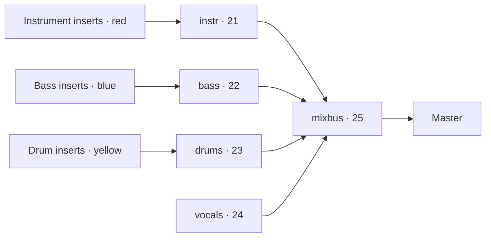

# Mixer insert setup with Jev

Status: implemented, with live Jev and Serum 2 metadata checks.
Research date: 2026-10-04.

## Implemented behavior

- The mixer has a **Fill inserts** button. On first use, enter a TypeSafe/Jev key; it is saved in the local app data directory with user-only permissions. `TYPESAFE_API_KEY` is also supported. No key is bundled or committed.
- Serum inserts are named after the current preset. Sample inserts use the original filename without its extension. Channel-rack display names remain unchanged.
- Jev receives Serum name/category or sample filenames. Explicit category/prefix conventions override uncertain predictions; **808 always maps to bass**. Other predictions below the provisional confidence threshold of 0.75 remain unresolved for manual selection. This threshold is an application policy, not a validated accuracy guarantee.
- The button opens a movable, resizable mixer setup window for review before applying. Click, Cmd/Ctrl-click, Shift-click, or drag to select sounds, then assign Instruments/Bass/Drums to the selection with the group buttons or keys 1/2/3. Search and a needs-group filter narrow the list; unresolved sounds start selected. Manual choices survive reclassification. The Jev key lives behind the settings gear once configured. Unsupported plugins remain unchanged. Missing Serum metadata can be supplied manually in the window.
- The first setup creates/reuses the screenshot's five right-docked buses. Existing uniquely named right-docked template buses can be adopted after checking that they are not source/recording tracks; custom incompatible output routing is refused.
- Sources are ordered **instruments → bass → drums**, then channel-rack order within each group. Unused untouched inserts are removed after filling, so the setup has no spare padding. New channels get only the inserts they need before the recording/vocal section. Existing recording/vocal controls and connections are preserved by stable ids, even when their displayed numbers change. Bus numbers follow the resulting compact layout.
- Subsequent runs reuse persistent channel/bus ownership in the saved song, preserve existing group choices when no explicit convention supersedes them, and add newly introduced channels without duplicates.
- One atomic commit makes the setup undoable. Project/document and metadata are checked again before applying; stale results are refused. Shared inserts and custom outputs produce a conflict with no partial document edit.

Implementation: `shared/music/mixer-setup.ts` (allocator, ordering, ownership, conventions); `server/music/mixer-setup.ts` (metadata, read-only Serum catalog, Jev validation/settings/endpoints); `src/suites/music/mixer/fill-inserts.tsx` (button/dialog/application). Ownership fields survive `normalizeMusicProject`.

The engine reads the current program name plus bounded Serum 2 `XferJson` metadata headers from AU state or JUCE's decoded VST3 component/controller state. The server resolves categories from Serum's local catalog when available. Default macOS catalog locations are supported; `SERUM_PRESET_DATABASE` selects another location. Catalog failures/ambiguous duplicate names fall back to name-only evidence. No synthesis payload is decoded or modified.

Validation includes pure allocation/routing tests (large racks, incremental order, template preservation, serialization and reruns), authenticated endpoint/metadata/key tests with a fixture catalog, real engine rendering through the buses, and a live button run using the starter-kit filenames followed by undo. A loaded local Serum 2 AU patch returned **`LD - PSY Lead` / `Lead`**; the VST3 metadata reader was also checked on its initialized patch. Other Serum versions/platforms may need manual metadata entry when their state/catalog differs.

The research and original delivery proposal below record how the implementation was selected; references to unverified extraction or planned modules describe that earlier stage. There is no persistent classification cache or automatic provider retry in this release; a failed call can be retried from the dialog.

## Requested behavior

Add a **Fill inserts** button to the mixer. It examines the current channel rack, classifies each supported sound, assigns it its own named mixer insert, colors the insert, and routes it through the corresponding bus.

| Role | Includes | Color | Bus |
| --- | --- | --- | --- |
| `instr` | Synths, leads, chords, pads, keys, arps and other melodic instruments that are not bass | Red | `instr` |
| `bass` | Bass, sub bass, and all 808-labeled sounds under the user's routing convention | Blue | `bass` |
| `drums` | Kick, snare, hi-hat, clap, percussion and other drum sounds | Yellow | `drums` |

Serum is the only supported instrument plugin initially. Drum and audio sample channels participate using their source filename as classification evidence, including sampler and audio clip channels. Other instrument plugins and files identified as vocals or otherwise outside the three roles are reported as skipped/unresolved rather than forced into a role.

The supplied screenshot shows right-docked buses at inserts 21–25: red `instr`, blue `bass`, yellow `drums`, green `vocals`, and teal `mixbus`. Match that layout on a new setup by reserving those positions and keeping source inserts in the scrolling middle. Leave recording insert 16 and existing vocal/recording routes alone. `vocals` is a template bus, not a fourth classification role in this release. If reserved positions are occupied, preserve their contents and report the conflict instead of overwriting them. Resolve all actual connections by stable track id, never by number or color alone.

Routing:

Source inserts route exclusively to their role bus, and role buses exclusively to mixbus. Remove the default direct-to-master connection on these managed tracks to avoid doubling the signal. Preserve unrelated tracks and sends, including sidechain links and effect returns; incompatible existing routing becomes a conflict to resolve rather than an automatic destructive rewrite.

## What Jev can do

TypeSafe's current model is `jev-1.13.0`. It supports text/JSON input only, **no audio, image, or video input**. A file path or opaque Serum state blob does not let it hear or identify a sound. [Models](https://docs.typesafe.ai/models), [State](https://docs.typesafe.ai/concepts/state).

A `choice` question returns a label, probabilities for all options, and confidence. Multiple questions can share a state and be evaluated independently in one API request. Use this for one role question per channel, with explicit channel ids in the instructions: question keys are not sent to the model. Send requests server-side to `POST https://api.typesafe.ai/v1/systemone`, authenticated with a server-held TypeSafe key. [Introduction](https://docs.typesafe.ai/introduction), [API reference](https://docs.typesafe.ai/api).

Pin the model version for evaluation and caching. Current published price is $0.042 per million input tokens, with output free; actual latency and task accuracy have not been measured here. Recheck pricing and limits at implementation. [Models](https://docs.typesafe.ai/models).

## Evidence and classification

Collect a compact record for each supported channel:

- Stable channel id, channel name and channel kind.
- Current Serum preset name, such as `SY_2`, as the primary classification input for Serum channels. Plugin identity identifies supported channels; channel names are optional supporting context. Read the actual current preset name even when it was selected inside Serum's own browser. Preset-name extraction must be verified on the installed Serum version/format.
- Serum preset category, if available, alongside the name. An explicit category is stronger role evidence than a terse prefix: melodic synth/lead/pad/chord categories map to `instr`, bass/sub categories to `bass`, and drum/percussion categories to `drums`. Read it from verified plugin metadata; do not invent a category from the name and report it as an extracted field. Category exposure through the host remains unverified.
- Source filename for drum and audio sample channels (sampler and audio clip channels), without uploading audio or full local paths. This is the user's selected classification input for samples; do not require audio analysis for them. Channel names can provide supporting context but must not replace the actual filename.
- Optional summarized musical context (pitched notes, register, rhythmic pattern), used as supporting context rather than proof of timbre.

Ask Jev for `instr`, `bass`, `drums`, or `unknown`. Define `unknown` as insufficient evidence, ambiguous role, or conflicting metadata; it does not create a bus. The user clarified that 808s belong to bass: apply that routing convention to all 808-labeled sounds, including `808 - To 909 BD Maker`. Distinguish a synth lead from synth bass. Do not equate “uses Serum” with `instr`: Serum can produce bass or percussion too.

Include preset naming conventions in the question criteria. For the user's `SY_2` example, treat the `SY` synth prefix as evidence for `instr`; add verified bass/drum prefixes from the user's actual preset collection during evaluation. Prefix conventions are context for Jev, not proof of a patch's sound or universal conventions across preset packs.

Send the rack metadata as state with one question per channel, using bounded batches when needed. Validate every returned channel, role, distribution, and confidence. Keep probabilities and model version with the result. Confidence policy must be tested on representative projects; no arbitrary threshold is claimed to guarantee correctness. Clearly generic names with no meaningful preset/sample evidence remain unresolved even if the model returns a confident guess.

Known classifications apply from the button in one undo step. Show unresolved channels with a simple role selector; corrections use the same insert allocator and routing logic. If the provider fails or results are malformed, keep the project unchanged and show a retryable error. Do not substitute a hidden keyword classifier and claim Jev succeeded.

If identifying unnamed/custom patches by their actual sound is required, add a separate audio perception stage that renders short channel excerpts and produces role evidence. Jev can consume the resulting text, but it cannot supply that hearing stage itself. This is a later dependency, separate from metadata-based insert setup.

## Repository fit and Serum gap

- `shared/music/types.ts`: channels already have `mixerTrack` and color; mixer tracks have names, colors, docks and sends.
- `shared/music/mixer.ts`: reuse track creation, track updates, channel routing and send validation. Add a pure classification-to-setup planner and application function.
- `src/suites/music/mixer/mixer-window.tsx`: button, progress/error state, and unresolved role corrections.
- `server/music/routes.ts`: project-scoped metadata/classification endpoint and server-owned provider adapter; no browser-held API key.
- `shared/music/engine.ts`, `engine/src/Host.cpp`: existing preset query reports host-saved preset names and plugin programs. `PluginHost::presets` omits program names when there is only one program, and `presetLabel` also hides that name. Reading Serum's internal patch name/category is **not verified**. Probe the installed Serum version and format before promising preset-based classification; report absent metadata honestly. A one-program name may itself be generic, so merely exposing it does not guarantee useful evidence.

Capture the rack identity before the request and reject stale results if relevant channels, samples, presets or routing changed while classification was running. Applying the setup must use the current project and commit atomically. Cache by classification evidence, model version and prompt version; preset changes invalidate the relevant record.

## Implementation sequence and acceptance

1. **Verify Serum metadata.** Test the actual installed Serum with a lead, pad, bass, percussion patch, renamed channel and unnamed instance. Record what preset fields the host genuinely exposes. This determines the coverage of the first release.
2. **Build deterministic setup logic.** Allocate one insert per supported channel, reserve/reuse the bus layout, color/name tracks, and create the routing graph. Reuse an existing source insert only when it belongs solely to that channel; shared inserts require conflict handling so effects are not silently reassigned. Store managed channel/bus identities for repeat runs. Never reuse an insert with custom controls, recording input, automation, effects, or non-default routing merely because its name is empty.
3. **Add Jev adapter.** Typed request/response validation, bounded timeout/retries, server key configuration, evidence cache and stale-result checking. No project mutation occurs inside the provider call.
4. **Wire the mixer button.** Clicking applies valid known roles, reports unsupported/unresolved channels, and supports manual corrections. Repeat clicks reuse managed inserts/buses, retain corrections, and add only new supported channels. Undo restores the entire setup change.
5. **Validate with meaningful cases.** Test exact source → role bus → mixbus → master paths, absence of doubled direct routes, no cycles, shared/occupied insert conflicts, reserved recording tracks, enough-channel overflow, repeated runs, undo, stale responses, timeouts and malformed outputs. Evaluate live Jev accuracy on user-labeled Serum/sample channels, including ambiguous 808s and generic names. Check real playback through the resulting graph.

This can ship independently of the larger audio engineering harness when names/preset metadata provide enough evidence. It does not require training a model or adding effect plugins to the inserts.

## Live API smoke test (2026-10-04)

One authenticated request to `jev-1.13.0` returned valid Choice answers for all 16 questions. The test supplied synthetic representative metadata, plus the user's `SY_2` example; it did not inspect a real project or extract Serum metadata. Expected labels were kept out of the request. All 16 choices matched the expected labels. This is a plumbing/prompt smoke test, not a measured production accuracy claim.

| Input | Choice | Confidence |
| --- | --- | --- |
| Serum preset `SY_2`, no category | `instr` | 0.79 |
| `BS Deep Sub`, category Bass | `bass` | 1.00 |
| `LD Neon`, category Lead | `instr` | 1.00 |
| `PD Air`, category Pad | `instr` | 1.00 |
| `Metal Hit`, category Percussion | `drums` | 1.00 |
| `Kick_07.wav` | `drums` | 1.00 |
| `Snare_Crisp.wav` | `drums` | 1.00 |
| `HH_Closed_03.wav` | `drums` | 0.99 |
| `Clap_Wide.wav` | `drums` | 1.00 |
| `808_Sub_Bass_C.wav` | `bass` | 1.00 |
| `808_Kick_01.wav` | `drums` | 1.00 |
| `Synth_Chord_Loop_Am_140.wav` | `instr` | 0.98 |
| Serum preset `Untitled` | `unknown` | 0.99 |
| `audio_001.wav` | `unknown` | 1.00 |
| `Female_Vocal_Lead.wav` | `unknown` | 1.00 |
| Serum preset `SY_2`, category Bass (precedence test) | `bass` | 0.99 |

The question explicitly supplied the user's SY synth naming convention and category precedence. `SY_2` alone returned probabilities `instr: 0.84`, `unknown: 0.14`, `bass: 0.02`, `drums: 0.00`. Naming conventions helped, but the result is weaker than an explicit category. API confidence and chosen-label probability are separate returned values.

Usage: 4,232 input tokens and 736 output tokens. At the documented input price, this request costs approximately $0.000178; no billing statement was inspected. The temporary test key was not saved in repository files. Remaining validation: real preset/sample names, Serum metadata extraction, and end-to-end mixer routing.

## Screenshot-name test (2026-10-04)

The user subsequently clarified the routing rule: **808 → bass**. This supersedes the first smoke test's generic 808-kick distinction.

Transcribed 34 visible Serum presets from the supplied screenshots: 17 BA/Bass, 7 808, and 10 ARP/Arpeggio presets. Tested each name alone and again with its visible category, plus the 9 visible rack labels, in one live `jev-1.13.0` request. Category and prefix routing rules were supplied, expected answers were excluded. All **77 choices matched the intended labels**: 34/34 names alone, 34/34 names with categories, and 9/9 rack-label outcomes. This is a small prompted test, not generalization accuracy; no actual audio was classified. The visible Serum browser confirms category and location fields exist in its UI, but does not establish host/API access to them.

Results:

- Every BA preset → `bass`; every 808 preset → `bass`; every ARP preset → `instr`.
- `808 arcade ...` → `bass`, but confidence was only 0.32 (bass probability 0.49).
- `HH 7 Minute...`, `CLAP Ambe...`, `KICK Dance...`, `OH Cold [Gi...`, `PERC analo...`, and `SNARE alwa...` → `drums`, confidence 0.98–0.99.
- `FX 199X [Gin...` → `unknown`: visible text does not establish a melodic or drum role.
- `Serum 2` → `unknown`: plugin identity alone is insufficient.

The rack screenshot contains truncated display labels, not the full filenames requested for the real feature. Full source filenames should be extracted in the implementation. Prefix/category matches are explicit user routing rules and should be enforced by application policy so a low-confidence 808 result does not defeat the requested bass assignment; reserve Jev inference for names without a decisive user rule.

Usage: 22,112 input tokens and 3,464 output tokens. Full per-case inputs, probabilities, and confidence are saved in [jev-screenshot-test-results.json](jev-screenshot-test-results.json); no key is included. This test used the temporary key supplied for testing, without saving it to repository files.
