# Pro-C

FabFilter's **Pro-C 3** compressor (released 15 January 2026), and what changed from **Pro-C 2** (2015), planned
as a stock effect of the music suite, as Pro-Q is. Built from FabFilter's own **Pro-C 3 online help** and its
PDF (`fabfilter.com/downloads/pdf/help/ffproc3-manual.pdf`, 47 pages: "the manual") and the **Pro-C 2 manual**
(`ffproc2-manual.pdf`, 37 pages: "the v2 manual"), both quoted in "…"; FabFilter's product pages, press
releases (2007, 2015, 2026) and screenshots; the Pro-C 2 automation parameter list (a REAPER/CSI dump); reviews
(Sound On Sound's Pro-C 3 review by Sam Inglis, April 2026; MusicTech; SOS news); the compressor literature
(Giannoulis, Massberg & Reiss's JAES tutorial above all; Floru; Zölzer's *DAFX*; Pirkle; Sanfilippo;
Signalsmith; JUCE); and the
manuals of the hardware the classic styles would copy (UREI 1176LN, Teletronix LA-2A, SSL G-series, Empirical
Labs Distressor). [Sources](#10-sources) are at the end.

**Vocals first.** Théo's main use is vocals (rap, trap, R&B, pop, hyperpop), so a second round of research went
into that, in its own document, **`pro-c-vocals.md`**: how 50-odd mix engineers compress lead vocals (their own
chains and settings), the eleven classic compressors they name (manuals, schematics, measurements), the ideas in
thirty-odd other compressors, and the modelling papers. What it changed here: the vocal section
([3.3](#33-on-vocals)), the classic models as a **Vintage** group of styles ([4](#4-classic-models-as-extra-styles)),
the vocal presets ([6](#6-the-factory-presets)), and the proposal and questions ([7](#7-proposed-for-vaudio),
[9](#9-open-questions-for-théo)).

Anything the sources don't give is marked **not stated**; anything worked out rather than read is marked
**(inferred)**; a value read off a screenshot is **(observed)**. FabFilter publishes no DSP details beyond the
manual's one-line descriptions, so [section 5](#5-how-it-works-the-dsp) is a reconstruction from the literature,
and every per-style number in it is ours, to be tuned by ear against the real plug-in.

The pictures in `img/pro-c-*` are FabFilter's own (the online help's and the product page's), © FabFilter,
kept here only as a private reference for building this app. Don't ship them, and don't copy FabFilter's
artwork: we copy how it works and how it's laid out, in our own visual style (as Pro-Q's window does).

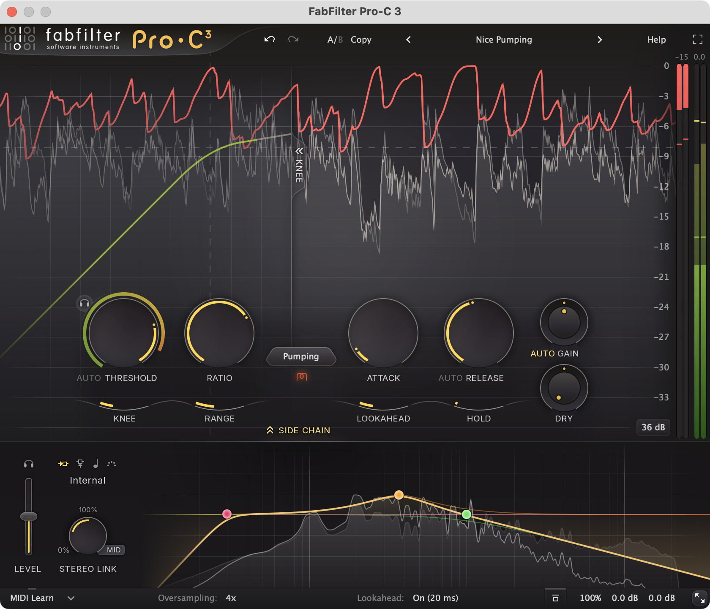

## Contents

1. [What it is](#1-what-it-is)
2. [The panel](#2-the-panel)
3. [The sound](#3-the-sound)
4. [Classic models as extra styles](#4-classic-models-as-extra-styles)
5. [How it works (the DSP)](#5-how-it-works-the-dsp)
6. [The factory presets](#6-the-factory-presets)
7. [Proposed for Vaudio](#7-proposed-for-vaudio)
8. [How it'd be built here](#8-how-itd-be-built-here)
9. [Open questions for Théo](#9-open-questions-for-théo)
10. [Sources](#10-sources)

---

## 1. What it is

- A **compressor**: it turns the sound down when it's loud, by an amount set by how far it's over a
  threshold (the ratio), at a pace set by the attack and release. Used to even out a performance (a vocal
  that's sometimes whispered and sometimes belted), to shape transients (a drum's attack let through or
  flattened), to glue a mix together, and as an effect (pumping, ducking under a kick).
- **One compressor with many characters**: "most compressors have the same set of classic controls, like
  Threshold, Ratio, Attack and Release. Yet they can sound very different, even when trying to match
  settings. This is because internally, all compressors work differently, using different detection
  algorithms, different topologies and different smoothing curves." Pro-C 3's 14 **styles** are those
  differences; its **Character** modes add the analogue colour ("especially in analog/hardware compressors,
  there can be more factors that contribute to the sound, like transformers or tubes"), on its own Drive and
  before or after the compression. "So you don't just get one compressor, you get many!"
- **What engineers reach for it for**: it *shows* the compression. A large scrolling display draws the
  input, the output and the gain reduction over time; a knee display draws the transfer curve with the
  current level moving along it; a ring round the Threshold knob shows the side chain's level. "The way the
  Pro-C shows you the compression is ingenious" (Tony Maserati, on FabFilter's product page). Add clean,
  program-dependent styles that sound good on anything, a side chain EQ with Pro-Q's shapes, mid/side, and
  parallel compression on a knob: an everyday compressor that also does the special jobs. SOS: "If there was
  only room for one compressor plug-in on my desert island, I know which one I'd take."

### History

| Version | Released | What came |
| --- | --- | --- |
| **Pro-C** | 14 Aug 2007 | Three styles, **Clean, Classic, Opto**, "different custom algorithms, knee curves and compressor topologies (feedback or feed-forward)"; "64-bit internal processing and guarantee zero latency throughput"; program-dependent attack and release; L/R or M/S with "completely customizable channel linking and routing"; external side chain with "steep 48 dB/octave low-pass and high-pass filters"; the animated level display and transfer curve; an Expert mode revealing the side chain options. $199. |
| **Pro-C 2** | 26 Aug 2015 | Five new styles, **Vocal, Mastering, Bus, Punch, Pumping**; Lookahead (up to 20 ms, switchable for zero latency), Hold (up to 500 ms), Knee 0–72 dB, Range, Mix 0–200%, oversampling up to 4×, variable stereo link with Mid, Side, M>S, S>M, a side chain EQ (low cut, high cut and a "Mid" band), Audition Triggering, threshold down to −60 dB, MIDI triggering, peak and loudness (EBU R128 Momentary) meters, three sizes and full screen. |
| **Pro-C 3** | 15 Jan 2026 | Six new styles, **Versatile, Smooth, Upward, TTM, Op-El, Vari-Mu** (14 in all, in three groups); **Character** modes (Tube, Diode, Bright) with Drive and Pre/Post; a six-band side chain EQ with every Pro-Q 4 shape (all-pass, brickwall), bands mid- or side-only; **Host Sync** triggering; **Auto Threshold**; a **Maximum Lookahead** setting (1 to 20 ms) for the latency; oversampling up to **32×**; Dolby Atmos up to 9.1.6; a new preset browser (search, tags, favourites); the Compact size; control from Pro-Q 4's Instance List. EUR 169 / USD 199 / GBP 149; GBP 72 from Pro-C 2. |

Pro-C 2 and 3 co-exist (installing one doesn't replace the other); Pro-C 3 opens v1 and v2 presets, but "any
automation data that has been written by a Pro-C 2 or Pro-C 1 instance cannot be read correctly by Pro-C 3".

### Pro-C 3 against Pro-C 2

| What | Pro-C 2 | Pro-C 3 |
| --- | --- | --- |
| Styles | 8, one list | 14 in three groups: **Modern** (Clean, Versatile, Smooth, Punch, Upward, TTM), **Classic** (Op-El, Vari-Mu, Classic, Opto), **Utility** (Vocal, Mastering, Bus, Pumping). The menu in the screenshot names the second group **Vintage** (observed) |
| Saturation | None | Character: Off, Tube, Diode, Bright; Drive; Pre / Post |
| Side chain EQ | Fixed: low cut, high cut and a "Mid" band (Bell, Low Shelf, High Shelf, Band Pass, Notch or Tilt) that is in **Auto Mode** by default ("a Bell curve with automatically chosen frequency, gain and Q settings", between the cuts, sharpening as they close in) | Up to six free bands, every Pro-Q shape, cuts to 96 dB/oct and Brickwall, each band stereo, mid or side |
| Trigger | Internal or external (In/Ext buttons), MIDI notes through MIDI Learn's menu | A selector: **Internal, External, Host Sync, MIDI** |
| Threshold | −60 … 0 dB | The same, plus **Auto Threshold** (and its Lock) |
| Lookahead | On / off in the bottom bar, up to 20 ms | **Maximum Lookahead** in the bottom bar: Off or 1 … 20 ms, so the latency is only what's needed |
| Oversampling | Off, 2×, 4× | Off, 2×, 4×, 8×, 16× ("CPU-intensive"), 32× ("Very CPU-intensive") (observed) |
| Side chain section | Shown by **Expert**; "the side chain settings are only in effect when the side chain section is visible" | Shown by **Side Chain**; the button glows yellow when any setting there "affects the sound", so they apply while hidden **(inferred)** |
| Sizes | Small, Medium, Large; a Display button hides the displays | Compact (no displays: horizontal meters), Small, Medium, Large |
| Dry / wet link | Alt-drag | "Improved reverse-linking of Dry and Wet level knobs" |
| Surround | Stereo and mono | Up to 9.1.6 |

---

## 2. The panel

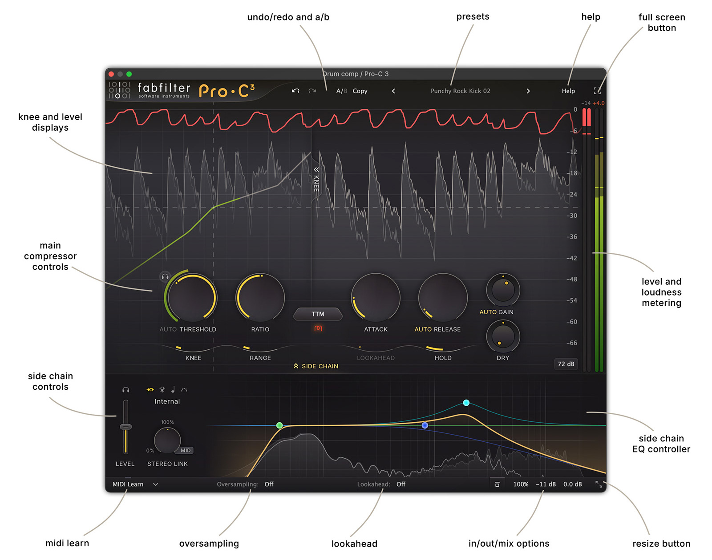

From top to bottom (Medium size, the default):

| Area | What's in it (left → right) |
| --- | --- |
| **Top bar** | FabFilter logo and the "Pro·C³" wordmark · **Undo** ↶ · **Redo** ↷ · **A/B** · **Copy** · preset **◂** · **preset name** · preset **▸** · **Help** · **Full Screen** ⛶ |
| **Level display** (the top two thirds) | the scrolling input (dark grey fill), output (light grey with a light line) and gain reduction (a red line, from the top edge down); the **knee display** over its left half (a transfer curve, white, green up to the current level), folded away by a **KNEE «** tab on its right edge; the dB scale at the right (0 at the top, −72 at the bottom at the 72 dB scale) |
| **Main controls** (floating over the display's lower part) | **Threshold** (with **Audition Triggering** 🎧 at its top left, **AUTO** and its lock under it, the side chain level meter round it) · **Ratio** · the **Style** button with the **Character** button under it · **Attack** · **Release** (with **AUTO**) · **Wet Gain** (small, with its pan ring, **AUTO GAIN** under it) over **Dry Gain** (small, with its pan ring). Under them, sliders drawn as arcs: **Knee**, **Range**, **Lookahead**, **Hold** |
| **Side Chain** button | centred under the controls; opens the side chain section below |
| **Meters** (right edge, full height) | gain reduction (red) and output (green, loudness over peak), and optionally input; peak readouts at the top (e.g. "−15", "0.0"); the **meter scale** button ("72 dB", "36 dB") at the bottom of the display |
| **Side chain section** | **Level** slider with **Audition** 🎧 · the trigger selector (four icons: Internal, External, Host Sync, MIDI) and its name · **Stereo Link** knob (0% … 100% … mode) with the **mode** button (MID) · the side chain **EQ controller** (with an analyzer behind it) filling the rest |
| **Bottom bar** | **MIDI Learn** and its ▾ menu · **Oversampling:** · **Lookahead:** (the maximum) · **Bypass** · the **output button** (Mix "100%", input "0.0 dB", output "0.0 dB") · **Resize** |

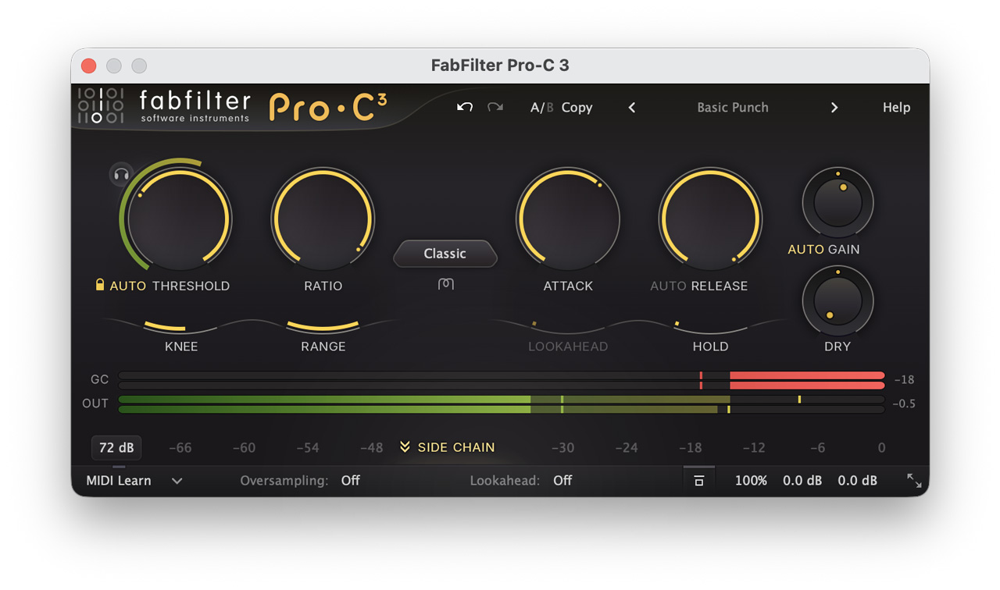

### 2.1 Knobs and sliders

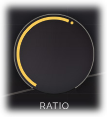

Every knob is a dark dome with a coloured arc from its start to its value (yellow), "light up when you move the
mouse cursor around", and shows a pop-up with the parameter's name and value on hover. Small knobs (Wet, Dry,
the output panel's) have a thin **pan ring** round them with a dot (centred at 12 o'clock).

| Gesture | What it does |
| --- | --- |
| Drag up / down | turns it; "reacts to the speed with which you are dragging, so if you move the mouse slowly, you make precise adjustments" |
| Mouse wheel | over any knob or pan ring |
| Double-click | type a value. "1k" = 1000 Hz, "A4" = 440 Hz, "C#3+13"; "2x" = +6 dB; "50%" = the knob's middle |
| Cmd-click (Ctrl on Windows; Alt in Pro Tools) | back to its default |
| Shift while dragging or wheeling | fine |
| Alt-drag (Shift in Pro Tools) | moves its **reverse-linked** partner the other way: **Threshold ↔ Character Drive** ("trade compression for saturation in one movement"), **Wet Gain ↔ Dry Gain**, **Input ↔ Output** level |

(Pro-C 2's knobs also had a **Rotate** mode: grab the arrow and drag round. Pro-C 3's manual lists three ways,
without it.)

### 2.2 The dynamics controls (the detection path)

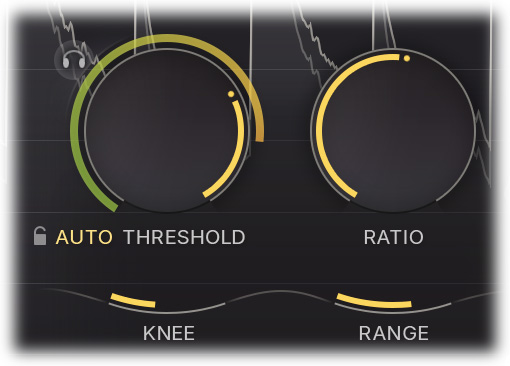

| Control | Range | Default | Scale | What it does |
| --- | --- | --- | --- | --- |
| **Threshold** | −60 … 0 dB (v2: "Extended Threshold range to −60 dB") | not stated | dB | "Above which side chain level the gain should be reduced." The ring round it is the **side chain level meter**: "the level of the filtered and possibly stereo-linked signal that is used for detection" (green, turning yellow as it nears the threshold, observed) |
| **Auto** (Threshold) | on / off | off (observed) | | "The threshold will work level-independent. So, triggering on a certain signal at different input levels, will result in the same amount of compression." For dialogue, "where some parts are often louder than others, while still requiring the same kind of dynamic processing". SOS: it lets you "control the micro-dynamics of a source independently of the macro-dynamics" |
| **Lock** (padlock, shown with Auto) | on / off | off | | "The current Auto Threshold setting is preserved while skipping presets" |
| **Audition Triggering** 🎧 | on / off | off | | Hear "on which parts of the audio Pro-C 3 is triggering and how much compression is taking place" (what's heard is **not stated**; we'd play what the compression takes away, section 5.1) |
| **Ratio** | 1:1 … ∞:1 | not stated | not stated | "At a ratio of 10:1, just one dB of output signal above the threshold remains for every 10 dB of input signal above the threshold." 1:1 is no compression; ∞ "letting Pro-C act as a limiter". In v2, "click on the small dots around the Ratio knob to jump to certain fixed ratio amounts" (which ones: not stated) |
| **Knee** | 0 dB (hard) … 72 dB (soft) | not stated | dB | "The 'roundness' of the compression around the threshold." "With very soft knee settings (> 60 dB), in combination with a fast Attack setting, you can achieve almost saturation-like effects" |
| **Range** | not stated (0 … at least 60 dB, **(inferred)** from the threshold's) | not stated | dB | "Limits the maximum amount of applied gain change that can be achieved. Compare this to the Ratio slider which scales the dynamics behavior instead" |

### 2.3 The time controls (smoothing, curves, mixing)

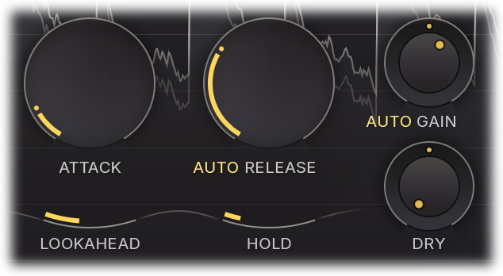

| Control | Range | Default | What it does |
| --- | --- | --- | --- |
| **Attack** | 0.005 ms … 250 ms | not stated | "How fast compression will kick in." "For transient-rich program material like drums, fast attack times are needed to minimize overshoot. For other program material, too short attack times may dull the sound or introduce audible distortion." "Program-dependent" |
| **Release** | not stated | not stated | "The time that the compressor takes to recover from gain reduction. The various compression styles in Pro-C 3 use different release models, and in most cases, the release time is very program-dependent. This means that Pro-C 3 recovers very quickly from compression after a transient, and quite slowly after longer periods of gain reduction" |
| **Auto** (Release) | on / off | off | "Adjusts the release time depending on the current amount of gain reduction, so this actually introduces an additional form of program-dependency. When Auto Release is used, the Release knob will adjust the overall effect of the auto release feature on the release time" |
| **Lookahead** | 0 … the Maximum Lookahead (at most 20 ms) | 0 (observed: dimmed while the maximum is Off) | "How much advance time Pro-C 3 will use to anticipate peaks in the audio signal. Using a bit of lookahead can help to preserve transients and results in much more transparent gain reduction." The latency is set by the bottom bar's **Maximum Lookahead** (Off, or 1 … 20 ms), not by this slider |
| **Hold** | 0 … 500 ms | 0 (observed) | "The time with which peaks in gain reduction will be prolonged. Applying a bit of hold time can help increase the transparency of gain reduction. With longer hold times, you can achieve nice pumping effects" |
| **Wet Gain** | not stated | 0 dB | Make-up gain, after the compression. Its **pan ring** "controls the balance between mid and side. This can be especially useful when applying make-up gain after mid-only or side-only compression" |
| **Auto** (Gain) | on / off | on (observed in every screenshot) | "Automatic make-up gain … depending on current settings for Threshold, Ratio, Knee and Attack." "Aware of mid-only or side-only processing": 100% mid-only compression gets make-up on the mid only. "The auto-gain algorithm doesn't actually measure loudness to determine which gain to apply. It just makes an educated guess" |
| **Dry Gain** | not stated (off … ) | off (observed) | "The amount of dry (uncompressed) input signal that is added to the output": parallel compression. It has a pan ring too (the v2 parameter list has **Dry Pan**) |

"Program-dependency": "Pro-C 3 will recover very fast from transients (fast changes/peaks), but will react quite a
bit slower after longer periods of gain reduction. Both the attack and release times are less or more
program-dependent, depending on the chosen compression style."

### 2.4 Style

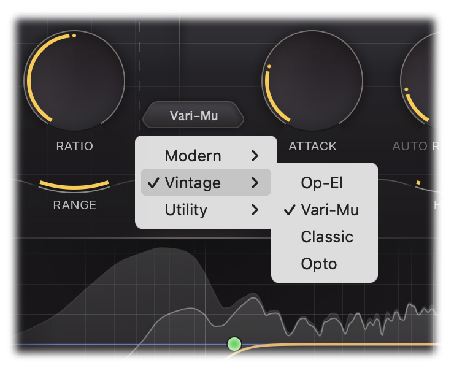

A click on the Style button opens a menu of three submenus (a tick on the current group and style). In
FabFilter's words:

| Style | Group | Since | What FabFilter says it is |
| --- | --- | --- | --- |
| **Clean** | Modern | v1 | "An allround, low distortion, feedforward, program dependent style" |
| **Versatile** | Modern | v3 | "Works great on any material. It's punchy at longer attack times but tight and smooth at shorter times" |
| **Smooth** | Modern | v3 | "Designed to stay smooth at all times, especially suitable for gluing with low ratio and longer times" |
| **Punch** | Modern | v2 | "Traditional, analog-like compression behavior, sounds good on anything!" |
| **Upward** | Modern | v3 | "Pumping, upward compression (increasing the level when it drops below the threshold), like Saturn's much praised Dynamics knob, but with more control over its behavior" |
| **TTM** | Modern | v3 | "To The Max multiband mayhem … combines upwards and downwards compression on multiple bands, making the input signal louder when it's quiet and quieter when it's loud. In this style the threshold effectively becomes a target level. The knee then controls the blending between the two stages" |
| **Op-El** | Classic | v3 | "Effortless opto-like tube compression, smooth and warm" |
| **Vari-Mu** | Classic | v3 | "A classic variable mu topology, offering smooth and colorful feedback compression" |
| **Classic** | Classic | v1 | "A vintage, feedback, very program dependent style" |
| **Opto** | Classic | v1 | "A relatively slow, very soft knee, more linear opto style" |
| **Vocal** | Utility | v2 | "A very effective algorithm to bring vocals to the front of your mix. It works with automatic knee and ratio settings, so compressing your lead vocal is as easy as choosing the right threshold" |
| **Mastering** | Utility | v2 | "Designed to be as transparent as possible, introducing as little harmonic distortion as possible, while still being able to catch those fast transients" |
| **Bus** | Utility | v2 | "Especially great for bus processing, or for adding a pleasant glue to your drums, mixes or tracks" |
| **Pumping** | Utility | v2 | "Deep and over-the-top pumping, great for drum processing or EDM" |

The manual adds two notes:

- **Vari-Mu** is feedback ("detection happens on the output of the compressor instead of on the input …
  attack typically reacts very fast, but smooths as soon as target compression levels are reached"), and it
  "uses vacuum tubes (i.e. remote cutoff tubes) to apply compression, instead of adjusting the output gain
  value based on a ratio-scaled difference with the threshold. A result of this topology, is that the
  effective ratio will vary depending on the input level, a sort of built-in soft knee character." Its
  Ratio "determines the amount to drive the remote cutoff tubes with"; "the sweet spot for input level of
  the Vari-Mu algorithm is the −12 to +3 dBFS range"; "when driven very hard, the tubes will simply clip,
  meaning that there is a maximum amount of compression that can be achieved". Its side chain Level "has a
  very different effect than adjusting the threshold". SOS: it "brings Fairchild goodness to the party".
- **TTM** works "on three seperate bands (with crossovers at roughly 90 Hz and 2.5 kHz)". "The threshold for
  the downward compression stages is simply set to the current, main threshold level. However, the
  threshold for the upward compression stages lies at a band-specific setting below the main threshold. So
  for the TTM style, the threshold knob allows you to change the relationship between the upwards and
  downwards stages, where higher values mean more upwards compression and lower values mean more downwards
  compression." The side chain EQ "will also have an audible effect on the loudness of the different
  bands", since the bands work independently.

What the Ratio and Knee do in **Vocal** ("automatic knee and ratio settings") is **not stated**: whether
they're greyed out or still trim the automatic values. (Ours greys them out: section 7.)

### 2.5 Character

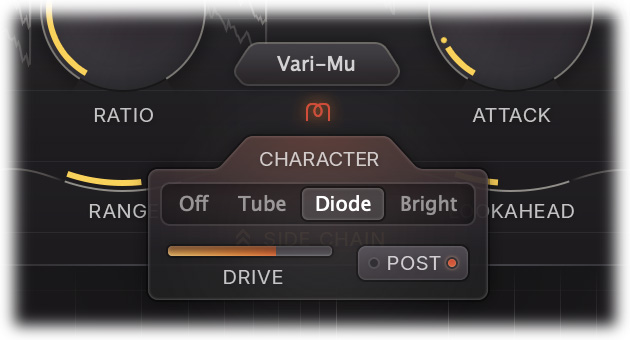

The small button under the Style button (a red horseshoe icon while a mode is on, observed) opens a panel:

| Control | Choices / range | Default | What it does |
| --- | --- | --- | --- |
| **Character mode** | Off, Tube, Diode, Bright | Off | "The type of analog saturation, color and drift … All three options have their own character and introduce different harmonics and coloring." The mouse wheel over the button steps through them |
| **Drive** | a slider, units not stated | not stated | "The level at which the saturation circuit is driven internally which affects the amount of saturation and harmonics." Reverse-linked with Threshold |
| **Routing** | Pre / Post | **Post** | "Post … will nicely saturate transients that remain when applying compression with higher attack values. When set to Pre, the signal and peaks in the input will be saturated before compression, which results in a wholly different character" |

SOS: "None sounds obviously distorted even at full Drive settings, but they can add a welcome touch of hair to a
soft-sounding or tame source." What "drift" is (slow random movement of gain or timing, as analogue parts
wander, **(inferred)**) is **not stated**.

### 2.6 The side chain section

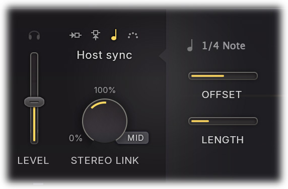

| Control | Range | What it does |
| --- | --- | --- |
| **Side Chain** button | show / hide | Shows the section. "If any of these advanced features has a non-default setting that affects the sound … the button will clearly indicate this with a yellow glow and text", with an icon for a non-default trigger |
| **Level** | not stated (a vertical slider) | "The level of the incoming trigger signal", for a soft input; with the circular meter round Threshold to set it. In Vari-Mu, driving it is different from moving the threshold |
| **Audition** 🎧 | on / off; click, or click and hold to listen while held | "Listen to the filtered and stereo-linked signal that will be used to trigger compression." Internal and External only |
| **Trigger** | **Internal** (default), **External**, **Host Sync**, **MIDI** | What the compressor triggers on: its input; the host's side chain input; "a generated pulse, synched to host tempo"; "incoming MIDI note on messages … If at least one note is on, the compressor behaves as if a 0 dBFS signal is entering the side chain" |
| **Sync** (Host Sync) | a note value (seen: "1/4 Note"); SOS: "whole notes and 16th notes" | The pulse's rate |
| **Offset** (Host Sync) | 50% … 200% | Scales the sync speed, "which makes it possible to achieve dotted or triplet effects" |
| **Length** (Host Sync) | % of the sync period | The pulse's length |
| **Stereo Link** | 0% … 100%, then on to 100% of a mode | First half: "from 0% (fully unlinked, channels operate independently) up to 100% (fully linked, resulting in the same gain reduction for both channels)". Past 100%, towards mid-only or side-only |
| **Link mode** (MID) | **Mid, Side, M>S, S>M** | At the knob's end: "Mid: only trigger on, and apply compression to, the mid signal. Side: … the side signal. M>S: trigger on the mid signal but only apply compression to the side signal. S>M: trigger on the side signal but only apply compression to the mid signal" |

**The side chain EQ** (Pro-C 3): up to six bands, "all the shapes you already know from Pro-Q, including All
Pass filters. The low- and high pass filters support slopes up to 96 dB/oct and also the Brickwall slope." Each
band stereo, mid or side. It works as Pro-Q's display does: drag the yellow curve to make a band (a preview of
its shape shows), double-click the background (the shape depends on where); click a dot to select, drag a
rectangle, Cmd-click to add, Shift-click for a range; drag to move frequency and gain (gains of several scaled
together), the wheel for Q (slope, in steps, on cuts), Cmd-drag vertically for Q, Alt-wheel for "dynamic range",
Cmd-wheel for gain, Shift fine, Alt-drag to constrain, Alt-click to bypass, Cmd+Alt-click to change the shape,
Alt+Shift-click to change the slope, double-click a dot to type (Tab steps Frequency, Gain, Q), right-click for
the band menu (placement, Copy, Paste; the background's menu copies all bands). A floating parameter display by
the selected dot shows frequency, gain and Q with bypass, delete and a menu. Behind it, an analyzer of the side
chain "uses a 4.5 dB/oct tilt setting". Full screen enlarges it.

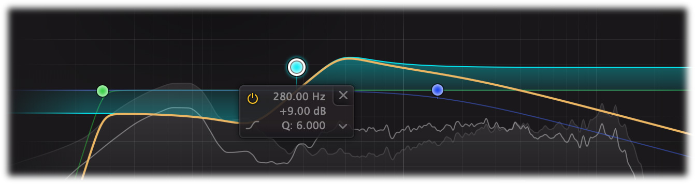

### 2.7 Displays and meters

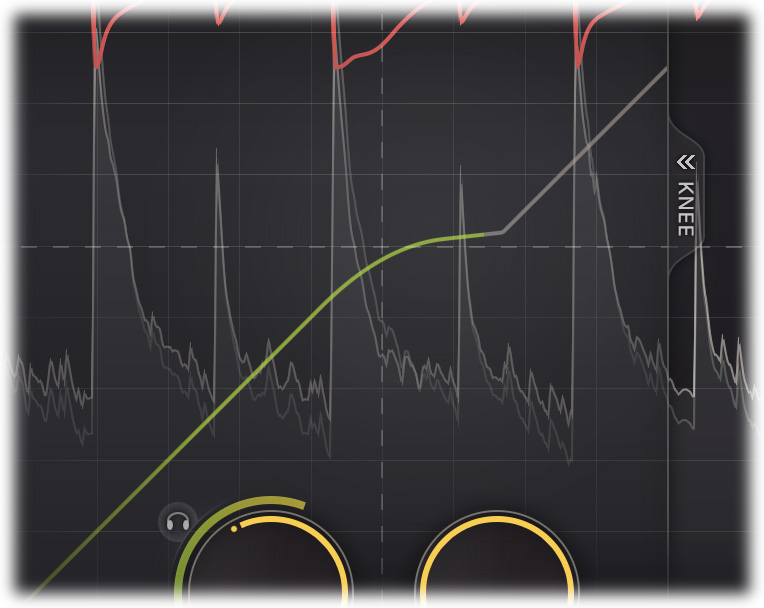

- **The knee display**: "the input/output relationship, visualizing the Threshold, Ratio, Knee and Range
  settings. The horizontal axis … is the input signal level, and the vertical axis is the output level, both
  in dB. When running audio through the plug-in, the white transfer curve will turn green, indicating the
  current input level." Shown or hidden by its **KNEE** tab; remembered for new instances. Its dB scale is
  the level display's: the threshold is the horizontal dashed line on both (observed).
- **The level display**: "The input is shown in dark grey, while the output is light grey with a light
  stroke … The gain reduction itself is shown as a red line" (hanging from the top edge, observed). It
  scrolls from right to left, the newest at the right edge **(inferred**: the meters are on the right**)**;
  the scroll speed is **not stated**.
- **The meter scale** (the button at the display's bottom right): 9 dB ("precise mastering") to 90 dB
  ("general mixing and bus processing"); one scale for the knee display, the level display and the meters;
  remembered for new instances. Values seen: 36 dB, 72 dB.
- **Meters**: gain reduction and output, input optional (Help menu › Show Input Level); "the read-outs above
  the level meters show the highest measured peak value. Click the readout to reset it." The input and output
  meters show "the loudness level (per channel) on top of the peak level … Momentary mode of the EBU R128 /
  ITU-R 1770 standards. The peak indicators floating above the loudness levels show the combined Momentary
  loudness of all channels together." A clip indication "does not imply distortion in Pro-C 3: it can handle
  levels above 0 dBFS easily".

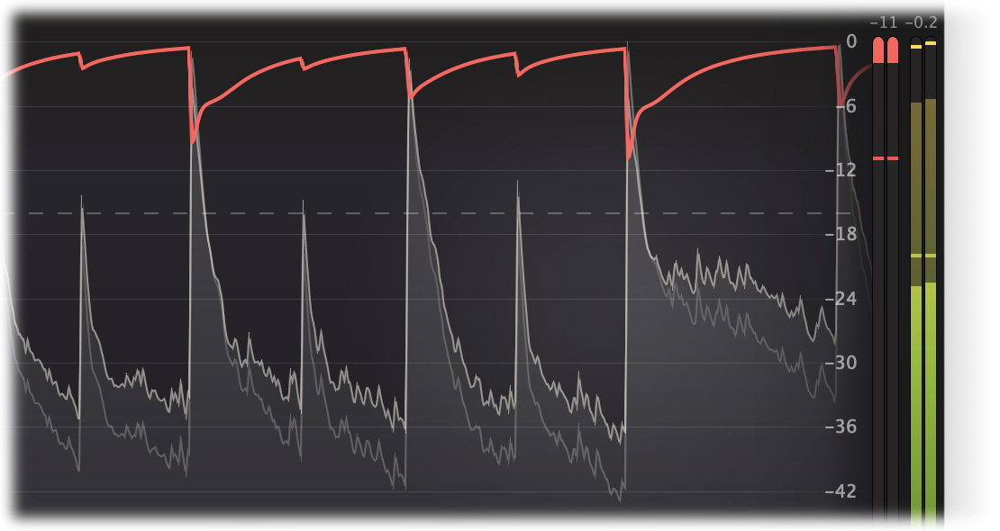

### 2.8 The bottom bar and the output panel

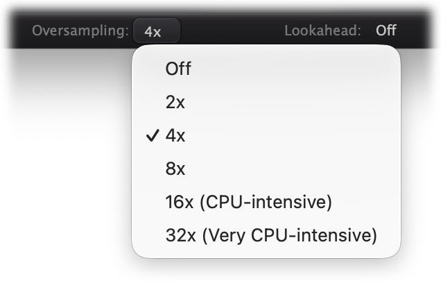

| Control | Choices | What it does |
| --- | --- | --- |
| **MIDI Learn** ▾ | | See [2.10](#210-presets-ab-undo-midi-learn) |
| **Oversampling** | Off, 2×, 4×, 8×, 16× (CPU-intensive), 32× (Very CPU-intensive) | "Sudden changes can introduce a small amount of aliasing … Oversampling is a way to reduce that aliasing by running the internal process at a sample rate that is a multiple of the host's sample rate." Needed "when using lower Attack and Release and/or higher Ratio and Range settings, or when you have a character mode enabled and are driving the circuit significantly". It "introduces a small latency, in addition to lookahead latency". "Start with 2x or 4x" |
| **Lookahead** (Maximum) | Off, 1 … 20 ms | The most lookahead the slider can use, and so the latency. "Do you need to use zero-latency processing? Set Oversampling and Maximum Lookahead to Off" |
| **Bypass** | | "Guaranteed to work correctly when using lookahead or oversampling (compensating for the latency of the plug-in) and also applies soft bypassing to avoid clicks." Dims the display; a red line on the button |
| **Output button** | shows Mix, input and output ("100%  0.0 dB  0.0 dB") | Hover opens the panel (click makes it stay). Drag, wheel or double-click the text to change a value |
| ↳ **Input Level / Pan** | knob with pan ring | "Level and L/R panning of the input signal before any processing … an alternative to changing the threshold" |
| ↳ **Output Level / Pan** | knob with pan ring | "Level and L/R panning of the final output signal" |
| ↳ **Mix** | 0% … **200%** | "Mix between the dry and processed signals, scaling the overall dynamic and static gain changes. Because the Mix slider ranges from 0% to 200%, you can also choose to increase overall gain processing instead of fading it out!" |
| **Resize** | Compact, Small, Medium (default), Large; Scaling › | Compact "will hide the level- and knee displays, and just show horizontal level meters. This way, Pro-C 3 looks and feels more like a traditional compressor." The size becomes the default; VST3 resizes by its edges |
| **Full Screen** (top bar) | | Fills the screen ("Esc" leaves), at a larger scaling |

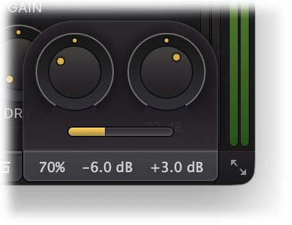

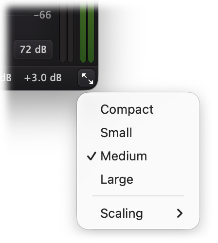

Mix (0–200%) and **Dry Gain** are two different things: Mix scales the *gain change* (one signal path, nothing
to comb), Dry adds the *uncompressed signal* back (parallel compression) **(inferred** from their
descriptions**)**.

### 2.9 What it doesn't do

- **No gate or expander** below the threshold (only Upward and TTM act down there, and they raise it); no
  de-esser mode (FabFilter sells Pro-DS for that; a side chain EQ boost at 5–8 kHz makes Pro-C a wideband
  de-esser at best); no multiband outside TTM (Pro-MB).
- **No envelope or curve editing**: the transfer curve is only what Threshold, Ratio, Knee and Range make.
- **No numeric gain reduction history** beyond the level display and the meters' peak readouts.
- The **Help** menu has the help file, interactive hints (product page: "extensive help file with interactive
  help hints") and Show Input Level; the rest **not stated**.

### 2.10 Presets, A/B, undo, MIDI Learn

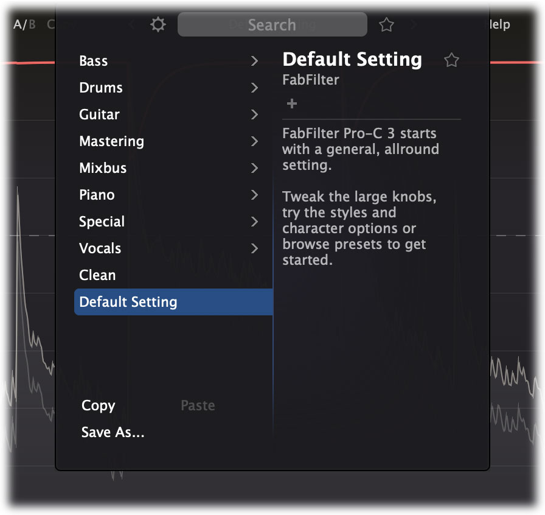

- **The preset button** shows the preset's name, dimmed once it's changed. ◂ ▸ step through them. A click opens
  the **browser**: folders (factory: **Bass, Drums, Guitar, Mastering, Mixbus, Piano, Special, Vocals**, then
  **Clean** and **Default Setting** at the top level, observed), the current one highlighted; a details panel
  with author, tags and a description (editable; + adds a tag); **Search** (type to search; filters on folder,
  name or tag); favourites (a star); arrow keys, Enter loads and closes, → loads and stays, Esc closes, [ and ]
  load the previous and next; **Copy** / **Paste** and **Save As…** at the bottom; Options (Type To Search,
  Enable MIDI Program Changes, Save As Default, open a preset from elsewhere). Right-click the preset button:
  Favorite, Save (overwrite, asks first), Save As, Copy, Paste. "Default Setting … is loaded automatically when
  FabFilter Pro-C 3 is started" ("a general, allround setting", its description, observed).


- **Undo / Redo**: "Every change to the plug-in (such as dragging a knob or selecting a new preset) creates a
  new state in the undo history." Changes from MIDI or automation make none.
- **A/B**: switches between two states ("before switching, the current state of the plug-in is saved"); **Copy**
  copies the active state to the other and then disables itself.
- **MIDI Learn** (below): the window dims, each learnable control gets a balloon with its CC; click a control (a red
  square marks it), move a hardware control. ▾: Enable MIDI, Clear (each association or all), Revert, Save.
  "Enable MIDI" also turns MIDI triggering off.
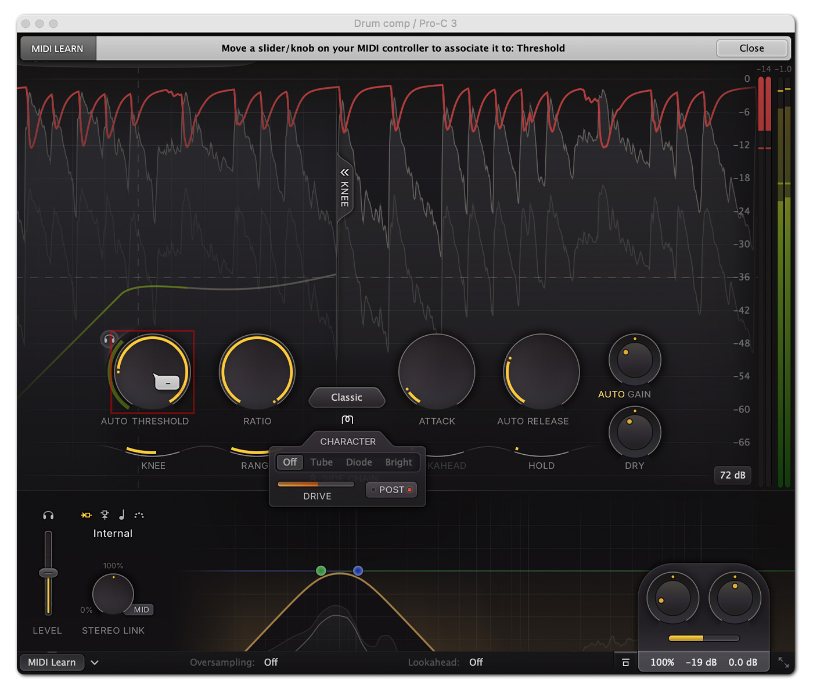

- The **automation parameters** (Pro-C 2's, from the CSI dump; Pro-C 3 adds its new ones, list not found): Style,
  Threshold, Ratio, Knee, Range, Attack, Release, Auto Release, Lookahead, Hold, Wet Gain, Wet Pan, Dry Gain, Dry
  Pan, Auto Gain, Side Chain Expert Mode, Side Chain Input, Side Chain Level, Stereo Link, Stereo Link Mode, Side
  Chain Low Enabled / Frequency / Slope, Side Chain Mid Auto / Enabled / Frequency / Gain / Q / Shape, Side Chain
  High Enabled / Frequency / Slope, Audition Side Chain, Audition Triggering, Mix, Input Level, Input Pan, Output
  Level, Output Pan, Bypass, Oversampling, Lookahead Enabled, Midi State, Meter Scale, Display Enabled, Knee
  Display Enabled. "Smart Parameter Interpolation for smooth parameter transitions" and "sample-accurate
  automation" (product page).

---

## 3. The sound

### 3.1 What each control does to the sound

In the words a producer uses, for a compressor in general. Words in quotes without a source named are the
usual studio vocabulary, not citations; the rest are attributed.

| Setting | Heard as |
| --- | --- |
| **Threshold / gain reduction** | How much is evened out. 2–4 dB on the loud phrases is "controlled but natural"; 6–10 dB is "upfront, pinned"; past that, "squashed", "lifeless", and every breath and room tone comes up with the make-up gain. The 1176's manual: it "is most transparent when doing gain reduction of 4 dB or less" |
| **Ratio** | Low (1.5–3:1): "glue", "levelling", the sound still moves. 4–8:1: "controlled", "in your face". 10:1 and up: "limiting", the peaks flattened, a "wall" |
| **Knee** | Hard: the compressor "grabs" at the threshold, audibly. Soft: it eases in, "transparent", "you don't hear it working"; very soft with a fast attack ("> 60 dB") is "almost saturation-like" (Pro-C's manual) |
| **Attack** | Slow (10–30 ms+): the transient gets through before the gain comes down: "punch", "snap", "click on the kick". Fast (< 1 ms): transients flattened: "dull", "small", "lifeless", and on low notes "distortion" as the gain follows each cycle. "For transient-rich program material like drums, fast attack times are needed to minimize overshoot. For other program material, too short attack times may dull the sound or introduce audible distortion" (manual) |
| **Release** | Fast: "loud", "dense", "aggressive", tails and room come up between notes ("breathing"); too fast on bass: "fuzzy", "grainy". Slow: "smooth", "even", but a loud hit holds the next notes down ("ducking", "dropouts"). Timed to the tempo, the gain "breathes" with the groove; "taken to its extremes it is referred to as pumping" (FabFilter Learn) |
| **Hold** | Smoother gain on low notes; long, a deliberate pump |
| **Lookahead** | Peaks caught without the click of a fast attack: "transparent", "no overshoot"; too much and the gain dips *before* the hit ("sucks in", a pre-echo of ducking) |
| **Dry (parallel)** | "Body and density without losing the transients": the loud peaks of the dry sound stay, the quiet detail of the crushed sound comes up under them ("New York compression") |
| **Side chain high-pass** | The bass stops pumping the whole sound; a vocal's plosives and proximity boom stop triggering it |
| **Stereo link** | Linked: the image stays put. Unlinked: louder than linked, but a loud event on one side "shifts the image" to the other |
| **Mid / side** | Mid only: the centre (lead vocal, kick, bass) controlled, the width left alone |

### 3.2 Each style, in a producer's words

What FabFilter says (section 2.4), what reviewers heard, and what each should sound like in our version. The
"how" column is **(inferred)**: the mechanisms that give that character in the literature; section 5.13 turns
them into numbers.

| Style | Should sound | How (inferred) |
| --- | --- | --- |
| **Clean** | The reference: does what the knobs say, adds nothing, never smeary. Fine on anything | Feedforward, log-domain smooth-decoupled peak detector, mild program-dependent release |
| **Versatile** | "Punchy at longer attack times but tight and smooth at shorter times": the attack knob changes the curve's shape, not only its speed | An attack whose shape moves from an RC (exponential, lets the start through) at long settings to a second-order smooth curve at short ones |
| **Smooth** | "Stay smooth at all times": no flutter, no grab, glue at 1.5–2:1 and slow times | Second-order (critically damped) smoothing on attack and release; RMS-weighted detector; wide minimum knee |
| **Punch** | "Traditional, analog-like … sounds good on anything": a bit of transient through, a bit of grab, the "analogue" feel | Analogue RC detector (linear domain, before the gain computer), so the attack lags and lets the first milliseconds through, release slowing as it nears unity |
| **Upward** | Quiet parts come up: detail, room, tails, breaths; "pumping"; it "can easily get out of hand", but works well in parallel (SOS) | Gain *above* unity below the threshold, at the ratio, limited by Range; a floor under which nothing is raised |
| **TTM** | OTT's sound: everything loud and close, bright, hyper-compressed, "mayhem" | Three bands (90 Hz, 2.5 kHz), each downward over the threshold and upward under a lower one |
| **Op-El** | An LA-2A: slow, warm, "smooth and warm", "quite a strong sonic identity even when used without the saturation" (SOS) | Feedback; an opto cell model (fast to ~half, then slow, with memory); a soft, level-dependent ratio; tube colour |
| **Vari-Mu** | A Fairchild / Manley: thick, smooth, the more it's driven the more it compresses and the more it colours, never brick-wall | Feedback; a remote-cutoff tube's gain curve (effective ratio rising with level), clipping when driven hard |
| **Classic** | "Vintage", "very program dependent": a hardware feedback compressor, rounder and less exact than Clean | Feedback, peak/RMS hybrid detector, strong dual release |
| **Opto** | "Relatively slow, very soft knee, more linear": a gentle leveller, hard to make sound bad | Opto release (two-stage) without Op-El's colour; very soft fixed minimum knee; detection in the linear domain |
| **Vocal** | Brings a vocal forward with one knob: loud words held, quiet ones untouched, no grab on consonants | Automatic knee and ratio: ∞:1 with a knee that widens as it works, so the ratio grows with how far over (2:1 at the threshold, limiting at the knee's top); RMS-weighted detector; dual release |
| **Mastering** | Inaudible except that peaks are caught: no added harmonics, no low-frequency smear | Peak detector with hold (no cycle-following), second-order smoothing, lookahead encouraged |
| **Bus** | "Glue": the parts of a mix or a kit move together, a little density, the SSL-bus sound | Feedforward VCA-style, RMS-weighted detector, soft knee, SSL-like dual auto release |
| **Pumping** | "Deep and over-the-top": every hit ducks everything, and the level swells back audibly before the next | Hard-hitting peak detector, no program dependency (every hit the same), a release that starts slow and finishes fast, so the swell is heard |

### 3.3 On vocals

Théo's main use. From the engineers' own session walk-throughs (`pro-c-vocals.md` section 1, 50-odd chains,
mostly Sound On Sound's *Inside Track*), what a vocal compressor is asked to do:

- **Stages, not one big squeeze.** Almost every documented chain has two to four compressors in series, each
  doing little: "Instead of completely smashing things with one compressor, I will compress lightly in stages"
  (Teezio, Chris Brown). The usual roles: **control, then colour, then a ceiling** (a limiter last for "in
  your face": CLA's L1 for "spit and attitude", Brathwaite's L2).
- **Fast first, slow second.** A FET or fast VCA catching peaks, then an opto or tube levelling the phrase:
  Tom Elmhirst (Adele) runs an 1176 "fast attack, fast release" into a CL 1B "slow attack, slow release, more
  evening out the level"; Manny Marroquin puts a Neve at 3:1 before his CL 1B because its attack "is not as fast
  or pronounced". Mike Shipley: "I'm using both an 1176 and an LA2 on his voice, which is not unusual for me."
- **The 1176's vocal setting is 4:1, a slow-ish attack and the fastest release**: CLA ("attack 3, release 7 …
  a relatively slow attack and the fastest possible release"), Dan Grech-Marguerat ("attack on 1 and the
  release on 7 with a 4:1 ratio makes anything sound very full"), Ben Baptie ("allows the vocal to breathe").
  An 1176's slowest attack is 0.8 ms: "slow" lets the consonant's first edge through.
- **Rap and R&B: tracked through a CL 1B, mixed with a clean, program-dependent compressor.** "Neve 1073 →
  Tube-Tech CL 1B" is the tracking chain of Derek Ali (Kendrick Lamar), Seth Firkins (Future), Teezio, Rob
  Bisel (SZA), Mike Dean and others, with Auto-Tune before anything. At the mix, Waves' Renaissance Compressor
  is in fifteen of the chains ("it doesn't sound like compression to me", Stuart White; Maserati: "nearly 7:1 …
  where she's not hitting the threshold her voice is gaining by 5 dB"), RVox in nine.
- **Parallel crush blended under the dry vocal**, 10–20 dB of reduction: Koen Heldens (Trippie Redd, ~10 dB),
  Clint Gibbs (Doja Cat, ~20 dB), Illangelo (The Weeknd, "slamming it"). Pro-C's Dry knob is this, in one
  instance.
- **The lows don't drive it**: cut before it or in its side chain (CLA ~70 Hz, Evan LaRay ~100 Hz, George
  Seara's side chain ~70 Hz; Heldens: "to prevent compressor triggering").
- **Tone from compression, level from riding**: "you try to get the overall tone for the whole record with the
  compressors, and then you're chasing the faders" (CLA). "If you're constantly moving the fader … you need to
  look at your compression" (Elmhirst).

**How much** (as documented): a colour stage 1–2 dB; general vocal compression ≤ 5 dB on the peaks at 2–4:1
(Paul White); a heavy serial chain ~6 dB a stage (Mike Senior); a tracking CL 1B 4–5 dB (Tube-Tech's own vocal
setting); a parallel crush 10–20 dB.

**Starting points**, each from a source (the presets of section 6 are these; the Vintage styles are section 4's):

| Job | Style | Gain reduction | Ratio | Attack | Release | Other | From |
| --- | --- | --- | --- | --- | --- | --- | --- |
| First stage: catch the peaks, add attitude | FET 76 | 3–6 dB on peaks | 4:1 | slow-ish (dial 1–3: ~0.8–0.25 ms) | fastest (dial 7: 50 ms) | SC high-pass 80 Hz | CLA, Grech, Baptie, Heldens |
| Second stage: level the phrase | Opto 2A | 3–6 dB, steady | (~3–4:1, the cell's) | (~10 ms, the cell's) | (60 ms to half, then seconds) | Peak Reduction only | Elmhirst, Shipley, the LA-2A manual's "4 to 8 DB of compression continuously" |
| One smooth stage (the tracking sound) | Opto Tube | 4–5 dB | 3–4:1 | ~30 ms | ~0.6 s (Manual) | — | Tube-Tech's vocal setting; Marroquin's CL 1B at 4:1, medium attack |
| Clean control, rap and R&B (the RComp role) | Vocal, or Clean + Auto Release | 4–7 dB | (auto) or 4–7:1 | 3–10 ms | auto | SC high-pass 100 Hz | Maserati, Ali, Firkins, Tillie |
| Grit and presence | Distress | 6–12 dB on loud lines | 6:1 | dial 5 | dial 4 | Det HP, Dist 2 | Empirical Labs' vocal setting; Ali ("grit and presence at the top") |
| In-your-face rap (parallel) | FET 76, All, Dry 0 dB | 10–20 dB | All | dial 7 | dial 7 | Wet −12 dB, blend by Wet | Heldens, Gibbs, Illangelo |
| Backing vocals, sit behind | Bus | 3–6 dB | 2–4:1 | 10–30 ms | auto | mid only on a stereo stack | Seara's SSL 2:1, Schaeffer's SSL 4:1 slow / fast |
| Detail and breaths up (careful) | Upward, in parallel | — | 1.5–2:1 | | | Range 6 dB, the floor on | Pro-C's own; no engineer source (1.5) |

- **What goes wrong on vocals**, and where it's handled: sibilance pushed up by the make-up gain (the
  compressor holds the vowels, not the "s": a side chain dip at 5–8 kHz, or a de-esser after; Mike Senior's
  fast Fairchild-into-1176 needed one); breaths and mouth noise raised between phrases (slower release, less
  reduction, less make-up; upward styles raise them by design); plosives and proximity boom triggering big dips
  (side chain high-pass); distortion on low notes with fast times (the compressor "responds to individual cycles
  of the input waveform", Paul White: hold, program-dependent release); "the life's been squeezed out" (Spike
  Stent: stages, Range, Mix).
- **Théo's quick chain, Auto-Tune into a heavy OTT**: no engineer in the survey puts OTT on a lead vocal (the
  one documented use is on a reverb return). It sounds finished at once because it raises everything quiet in
  three bands, and costs later for the same reason: breaths, room and hiss come up with the voice. The
  presets' quick version of "finished" is instead **Vocal – Rough Mix** (section 6): the Vocal style pushed
  to 6–8 dB with Tube character and a little Dry under it, dense and upfront at once without lifting the
  gaps, and zero latency, so it can be sung through.

### 3.4 What bad compressors sound like, and why

So we avoid each one; the remedy is where it's built (section 5).

| Fault | Heard as | Cause | Remedy |
| --- | --- | --- | --- |
| **Low-frequency distortion** | Bass and kick go "fuzzy", "grainy" | With fast times the gain follows each cycle of a low note: the gain signal has the note's frequency in it, so the product has harmonics. Giannoulis et al. measure THD in the tens of percent at low frequencies with a 1 ms attack, 15 ms release | Smooth decoupled detector (gentler attack/release corner); **hold** of about a low cycle on peak styles; program-dependent release (fast only after transients) |
| **Aliasing** | "Harsh", "gritty", "cheap digital" on fast settings or with saturation | The gain change multiplies the audio: the output's bandwidth is the audio's plus the gain's. A hard knee or a hard attack/release switch has a wide spectrum, which folds back. Saturation adds harmonics above Nyquist | Oversampling (the gain computed at the high rate); a gain curve with continuous derivatives (smooth detector; soft knee corners even at Knee 0) |
| **Clicks and zipper noise** | Ticks when a knob is turned or automated | A threshold, ratio or make-up step reaches the gain at once (with a fast attack, nothing slows it) | Every parameter glides per sample (section 5.14) |
| **Overshoot** | The first millisecond of each hit spits through | Any attack time lets the start through | Lookahead; Mastering's peak path |
| **Pre-ducking** | The level dips *before* a hit | Too much lookahead, or lookahead without matching smoothing | Lookahead shaped so the gain arrives at the peak, not before (section 5.8) |
| **Unwanted pumping** | The whole sound ducks with the kick or bass | A full-range key is dominated by the low end | Side chain high-pass; Stereo link; slower attack |
| **Breathing** | Noise, room and breaths swell between phrases | Fast release plus make-up gain | Program-dependent release; Range; less make-up |
| **Image shift** | The stereo image leans with a loud event on one side | Unlinked channels | Link (100% by default) |
| **Comb filtering in parallel** | Hollow, phasey with Dry up | The dry path not delayed by the wet's latency (lookahead, oversampling filters) | The dry path is delayed by exactly the latency; oversampling filters linear-phase (section 5.11) |
| **Level jumps** | Switching a style or turning Threshold makes it louder or quieter | No make-up, or a make-up that guesses badly | Auto Gain, the same formula in every style's curve |
| **Inconsistent sound** | The export sounds unlike playback | Processing that depends on the block size (a gain worked out per block) | Per-sample processing on a fixed grid; tested identical across block sizes (section 8.8) |
| **CPU spikes in silence** | Dropouts after a loud part ends | Denormal numbers in the detector's decaying state | Flush-to-zero (`juce::ScopedNoDenormals`) and snapping tiny states to 0 |
| **The ratio isn't the label** | 10:1 that sounds like 3:1 | A feedback loop with the feedforward law: its effective ratio is 2 − 1/R at most | Feedback styles use k = R − 1 (section 5.7) |

---

## 4. Classic models as extra styles

Should our Pro-C also offer the compressors vocal engineers name, the 1176, the LA-2A, the CL 1B, the
Distressor, the dbx 160 and the 33609, as styles? FabFilter went that way itself in Pro-C 3 (Op-El is
"opto-like tube compression", which SOS hears as LA-2A-like; Vari-Mu is SOS's "Fairchild goodness"), but
**FabFilter never names a hardware unit** in its documentation. The proposal (section 7) is **yes, as a fourth
group, "Vintage"**, and, because the survey says vocal chains are built on exactly these units (`pro-c-vocals.md`
1.2), **the two of the classic vocal chain (FET → Opto 2A) in the first build**. Each is the same engine with a
table, as every style is: a topology, a detector, a curve, a time law and a colour. The research behind every
number is `pro-c-vocals.md` section 2; what isn't measured anywhere is marked **(inferred)** and tuned by ear.

### 4.1 How a Vintage style differs: the unit's knobs

The units have no threshold: their **Input drives into a fixed threshold**, and the ratio button or the time
dial *is* their character. Every model of them (UA, Arturia, Slate, Softube, Kiive) keeps that, and Arturia and
Kiive link the Output to the Input so driving harder compresses harder without getting louder. So, in a
Vintage style:

| Control | Becomes |
| --- | --- |
| **Threshold** | Labelled **Input** (−48 … +24 dB of drive into the unit's fixed threshold; turning it up compresses more). Stored as the threshold (`threshold = −Input`) so automation, presets and the assistant's tools keep one shape |
| **Wet Gain** | Follows Input inversely while **Link** is on (the default, Arturia's): the level stays put as the compression changes. Auto Gain is off in Vintage styles (the link does its job) |
| **Ratio** | Snaps to the unit's positions and shows its labels ("4", "8", "12", "20", "All"; "1:1" … "Nuke") |
| **Attack, Release** | Show the unit's dial (the 1176's 1–7, fastest at 7; the Distressor's 0–10) mapped to its range on a log scale; the milliseconds on hover and in the tooltip. The 1176's Attack has its **Off** position (no compression, the circuit's colour only) |
| **Knee** | Greyed: the unit's curve (drawn on the knee display) |
| **Range, Lookahead, Hold, Mix, Dry, side chain, link** | As in every style (none of the units had them; they're why a plug-in is better), but off in the Vintage presets |
| **Style's own switches** | In a small row under the Style button: FET's **All**; Opto 2A's **Compress / Limit** and **Emphasis**; Opto Tube's **Fixed / Manual / Fix-Man**; Distress's **Detector**, **Audio** and **British**; VCA 160's **Over Easy** and **Auto**; Diode 609's **Limiter** |

The other way, keeping Pro-C's Threshold, Ratio and Knee with the units' ranges, is simpler but loses what
makes the units quick to use. A decision for Théo (section 9).

### 4.2 FET (after the UREI / UA 1176)

| | |
| --- | --- |
| Loop, detector | Feedback (UA: "the sidechain circuit samples the signal level after the gain reduction"), full-wave **peak**, a branching (not smoothed) detector, so at the fastest times the gain follows the waveform's ripple as the hardware's does. That ripple is also why its ratio on a steady sine measures "much higher than what is selected on the front panel" while "on transients the ratios are very close to those indicated" (Berners & Abel, UA): it should fall out of the model, not be added |
| Threshold | Fixed per ratio, **higher with the ratio**: 0, +4.7, +7.9, +9.1 dB at 4, 8, 12, 20:1 (from one measured 1176LN: compression starting at −17.5, −12.8, −9.6, −8.4 dBm) |
| Curve | Soft knee hardening with the ratio: 10, 8, 6, 4 dB at 4, 8, 12, 20:1 **(inferred**, from "the soft-knee response hardens as ratios increase"**)**. After a transient the ratio creeps up ("the ratio will always increase a bit after the transient", UA): the slope `s` rises by up to 0.05 over 300 ms of sustained reduction **(inferred)** |
| Attack | 20 µs … 800 µs (dial 7 … 1, log); Off below 1 |
| Release | 50 ms … 1.1 s (dial 7 … 1, log); program-dependent, as UA describes its model: "three features … A fast release-time, a slow release-time, and a transition-time. The fast release time is the effective release time after transients; the slow release time is the release time after sustained high-RMS signals. The transition time expresses how long the signal must be 'in compression' before the slow release time comes into effect". Our `K` (2.5) with the program-dependency's `τd` as that transition (~0.5 s, **(inferred)**) |
| All buttons | A plateau rather than a slope ("Where 4:1 is a gentle slope, All-Button is more like severe plateau!"): ratio ~16:1 with the curve flattening past 6 dB over; the attack's first 1–2 ms delayed (the "reverse look-ahead"); release ×1.5 with an overshoot on recovery; the bias change as a much larger distortion (Moore measured 18–32% IM against 2–3% at 20:1) |
| Colour | Distortion growing with reduction and **with the release's speed** (Moore: it "drops sharply" from release 6 down; fastest attack with slowest release is ~20 dB cleaner than the reverse), worse on lows: most of it comes for free from the branching detector following the cycles; on top, a soft asymmetric stage (2nd > 3rd) at 0.05% idle; a +0.5 dB tilt above 5 kHz while compressing ("a slightly bright character … a subtle spectral tilt") |
| Its presets | **Vocal – FET Catch**: Input for 3–6 dB, 4:1, attack 3, release 7, SC HP 80 Hz (CLA, Grech, Baptie). **Vocal – All Buttons Parallel**: All, attack 7, release 7, Dry 0 dB, Wet −12 dB (Gibbs, Illangelo) |

### 4.3 Opto 2A (after the Teletronix LA-2A)

| | |
| --- | --- |
| Loop, detector | Feedback; **no rectifier**: the panel's light is the audio itself (a one-pole on `|x|`), and it lights more for highs (the panel "depends upon the applied voltage and frequency": +3 dB at 10 kHz built in **(inferred)**) |
| Peak Reduction | The Input knob, labelled so: the side chain's gain into a fixed threshold (UA: "the greater the gain of this circuit, the lower the threshold"). Output (Gain) after it, with the link. What it does across its range has been fitted to the hardware (Yu & Fazekas 2025, a feedforward compressor fitted to the SignalTrain LA-2A recordings, Compress): at 40, 70 and 100, threshold −13, −20, −35 dB; ratio 5.4, 4.3, 3.7 (*lower* as it's pushed); attack τ 14, 1.8, 0.45 ms; release τ 214, 116, 111 ms. Our cell, run over that data, should land near those numbers (a test, 8.8) |
| Curve | **Compress**: ~10 dB soft region, the ratio rising from ~3:1 to near-limiting ("the input increases an additional 20 DB, but the output increases less than 1 DB", 1966). **Limit**: the same, the knee halved. "In practice … subtle" |
| Emphasis | R37 as a switch-and-amount: 0 … 10 dB more reduction at 15 kHz than below 1 kHz (a side chain high shelf, 1966 figures). Andrew Scheps' "air" trick is Emphasis at full on a parallel copy |
| The cell | Section 5.13's opto cell, with two changes from the measurements: **a two-stage attack** (Stroe's built T4 cells; Moore's six LA-2As: 63% within ~125 ms, all by ~1.1 s): half the light's effect in τ ≈ 10 ms, the other half in τ ≈ 0.5 s **(inferred**, the split to tune**)**; and its release checked against three points: 63% back within ~0.15 s after a 300 ms burst, ~0.6–1.6 s after 5 s (Stroe 1.6 s, Moore's mean 0.9 s) |
| Colour | Tubes and transformers, not the cell ("causes no wave form or harmonic distortion"): idle 0.2% at 0 dBFS rising to ~0.9% at +6, **odd harmonics growing while compressing** (Moore: 2–2.6% under reduction, 3rd at −32 dB) |
| Its presets | **Vocal – Opto Level** (second stage): Peak Reduction for 3–6 dB, Compress, no Emphasis ("4 to 8 DB of compression continuously"). **Vocal – Air** (parallel): Limit, Emphasis 10 dB, Dry 0 dB, an SC high-pass |

### 4.4 Opto Tube (after the Tube-Tech CL 1B)

| | |
| --- | --- |
| Loop, detector | Feedforward **(inferred**: the make-up "has no influence on the threshold", and the ratio is a real control**)**; the opto cell, its times scaled by the knobs |
| Threshold | A real one, "defined as the point where the gain is reduced by 1 dB": a ~10 dB soft knee placed so 1 dB of reduction lands on the knob's value |
| Ratio | **2:1 … 10:1, continuous** |
| Times | Attack 0.5 … 300 ms, Release 0.05 … 10 s (the cell's speeds scaled to them). **Time mode**: **Fixed** (1 ms, 50 ms), **Manual** (the knobs), **Fix / Man**: two detectors, the larger reduction winning: a fast one (1 ms / 50 ms) and a slow one that only starts once the level has stayed over the threshold for longer than the **Attack** (which becomes that delay, as Softube's model says), then releases at the Release. A short peak decays in 50 ms; a held phrase holds |
| Colour | Clean push-pull tubes: odd harmonics, 0.1% at 0 dBFS, rising gently with level |
| Its presets | **Vocal – Tracking Opto**: 4–5 dB, ~3.5:1, Manual, attack ~30 ms, release ~0.6 s (Tube-Tech's vocal setting: "attack 2 o'clock, release 10 o'clock"). **Mix – Fix/Man Glue**: 3–4 dB in Fix / Man |

This is the smoothest of the vocal styles and the one the survey says rap and R&B vocals are tracked through,
so it's the default of the zero-latency tracking preset.

### 4.5 Distress (after the Empirical Labs Distressor)

| | |
| --- | --- |
| Loop, detector | Feedback ("this is a feedback compressor, and does not use a Threshold control", Empirical Labs); peak; a gentle bass "sponge": the detector's lows slowed so fast attacks don't crackle on bass |
| Input and ratio | Input into a fixed threshold **per ratio** ("each 'ratio mode' … sets both the threshold and the ratio"). Curves **(inferred** from the manual's descriptions**)**: **1:1** none (colour only); **2:1** a 30 dB parabolic knee; **3:1** a 20 dB one; **4:1** and **6:1** knees of 12 and 8 dB whose ratio keeps rising past ~8 dB ("starts to really grab and hold a vocal in place"); **10:1 Opto** the opto cell, release up to 20 s; **20:1** near-hard; **Nuke** ∞:1 with its own **logarithmic release** ("lets off quickly at first and then slows … a big part of the Distressor's sound"): two exponentials, 60% at the knob's τ and 40% at 8 × it |
| Times | Attack 0 … 10: 50 µs … 30 ms; Release 0 … 10: 50 ms … 3.5 s; both log; faster at 2–4:1 ("time constants are dependent on ratio") |
| Detector | Norm, **HP** (6 dB/oct at ~90 Hz: stops "p's and b's"), **Band** (+6 dB around 6 kHz: "makes unit overreact to harsh mids"), HP + Band |
| Audio | Norm, **HP** (80 Hz Bessel, 18 dB/oct, after the distortion), **Dist 2** (an asymmetric stage, mostly 2nd harmonic, its drive rising with the reduction: 0.05 … 3% THD), **Dist 3** (a symmetric tape-like clip, 3rd and 2nd, 0.1 … 20%), each with or without HP |
| British | The FET's all-buttons behaviour on any ratio |
| Colour | Clean mode 2nd-dominant, 0.025 … 0.3% |
| Its presets | **Vocal – Distress Grit**: 6:1, attack 5, release 4, Detector HP, Audio HP + Dist 2, 3–12 dB (Empirical Labs' vocal setting; Derek Ali's "grit and presence at the top"). **Vocal – Distress Aggressive**: 6:1, attack 3, release 1, Dist 2, 12–20 dB on loud lines. **Vocal – Nuke Parallel**: Nuke, Dry 0 dB (Brauer's parallel Distressor) |

### 4.6 VCA 160 (after the dbx 160 family)

| | |
| --- | --- |
| Loop, detector | Feedforward ("free of the instability of excessive loop gain … infinite compression"); **true RMS**, whose own averaging is the timing |
| Times | **Auto** (the 160): attack faster the bigger the jump, 15 / 5 / 3 ms for 10 / 20 / 30 dB (`τA = 15 ms × (10 dB / Δ)^1.6`, fitted to dbx's three figures **(inferred)**), release a **constant rate**, 120 dB/s; the Attack and Release knobs greyed. **Manual** (the 165): attack 1 … 400 dB/ms, release 10 … 4000 dB/s, as rates |
| Curve | **Hard** (the 160) or **Over Easy** (~10 dB, the threshold "half-way into compression"); ratio to ∞ (Mix 200% for the 160X's over-compression) |
| Colour | Almost none: 2nd 0.05%, the 3rd only from RMS ripple on fast lows (it falls "with slower time constants, higher frequencies and lower compression ratios", which a real RMS detector gives by itself) |
| Its presets | **Vocal – VCA Crush**: Auto, hard, 6:1, 6–10 dB (Ari Morris: "The 160 really crushes the vocals"; UA: "in-your-face 'thwack'") |

### 4.7 Diode 609 (after the Neve 33609)

| | |
| --- | --- |
| Loop, detector | Feedback, **two stages on one gain element**: a compressor, its make-up, then a limiter reading the made-up output |
| Compressor | Threshold (Input); ratio 1.5, 2, 3, 4, 6; a soft knee reaching the ratio 5–10 dB over ("the true ratio is only attained > 5 dB above the threshold"); attack **Fast 3 ms** or **Slow 6 ms with a 100 Hz first-order side chain high-pass** ("preferred for percussive and plosive sounds"); recovery 100, 400, 800, 1500 ms, **a1** (100 ms → 2 s) and **a2** (50 ms → 5 s), program-dependent (AMS Neve's figures) |
| Limiter | Its own threshold (the style's **Limiter** control, off by default), attack 2 / 4 ms, recovery 50 … 800 ms, a1, a2 |
| Colour | The diode bridge's: Pines' model of a balanced bridge (odd harmonics), whose distortion **peaks at 3–7 dB of reduction and falls on either side** (Berners: "THD levels approaching 10%" there at extreme levels; ours tuned far milder, ~1–2% at −6 dBFS **(inferred)**), with antiderivative antialiasing; transformers' colour even when not compressing |
| Its presets | **Vocal – Diode Catch** (Marroquin's first stage): 3:1, Fast, a1, 3–5 dB |

### 4.8 What Pro-C 3's own vintage styles get from the measurements

- **Bus** (the SSL G): the threshold moves with the ratio ("decreasing the RATIO setting lowers the effective
  threshold", SSL: −3 dB at 2:1, 0 at 4:1, +2 at 10:1 **(inferred)**); the knee near-hard at 10:1 and ~6 dB at
  2:1 (Thompson & Heilemann's measured G384); Auto release as SSL's two stacked networks, **100 ms short, 12 s
  long** (the table in 5.13 had a 1.2 s network: changed).
- **Op-El** and **Opto** keep 5.13's cell; Opto 2A gets the two-stage attack (4.3).
- **Vari-Mu**: the gain law can come from Raffensperger's measured 6386 curve (`pro-c-vocals.md` section 4)
  instead of 5.13's power law, and its time constants from the Fairchild's six positions (0.2 / 0.4 ms attack;
  0.3, 0.8, 2, 5 s release; two automatic positions), offered as its Release knob's detents.

### 4.9 Whether to

- **For**: these units are what vocal engineers name (the survey's 50 chains, `pro-c-vocals.md` 1.1); an
  "1176 into LA-2A" chain is a known recipe that Théo or the assistant can ask for by name; each is a table in
  the same engine, so the cost is tuning, not new DSP (except Distress's two distortions, Fix / Man's second
  detector and the Diode colour, each a small block); Pro-C 3 already has two of them in disguise.
- **Against**: "modelled on" claims invite comparison with UA's and Waves' emulations, which are measured on
  real units; we can't measure hardware, so ours are *in the spirit of* the units, built from their manuals and
  published measurements, and named for what they are ("FET 76", "Opto 2A", "Opto Tube", "Distress", "VCA 160",
  "Diode 609", as Arturia names its own: "Comp FET-76", "Comp DIODE-609"). The units' names are trademarks
  (UA, Teletronix, Tube-Tech, Empirical Labs, dbx, AMS Neve) and appear only in the docs.

---

## 5. How it works (the DSP)

FabFilter publishes nothing of Pro-C's internals beyond the manual: which styles are feedforward or feedback
(Clean feedforward; Classic and Vari-Mu feedback; Opto, Bus, Punch, Vocal, Mastering, Pumping and the
modern ones **not stated**), that times are program-dependent, that Auto Release depends on the amount of
gain reduction, that Auto Gain depends on "Threshold, Ratio, Knee and Attack", that oversampling and
lookahead add latency, and the TTM and Vari-Mu notes. So this section is **the best-known methods from the
literature**, chosen to give each style the character FabFilter describes. Every number in it is ours
**(inferred)** unless a source is named.

### 5.0 Conventions

| Thing | Convention |
| --- | --- |
| Levels | dBFS. A level is `20·log10(max(abs(x), 10⁻⁶))`, so the floor is −120 dB. An RMS detector is calibrated to read **a sine's peak** (its mean square doubled), so switching a style between peak and RMS detection doesn't move the threshold by 3 dB (the convention Pro-Q's dynamic bands use here) |
| Gain reduction | `GR ≥ 0` dB is the amount turned down; an upward style's boost is a negative GR. The gain applied is `10^(−GR/20)` |
| Ratio | Carried as the **slope** `s = 1 − 1/R` (0 at 1:1, 1 at ∞:1). Lines between automation points are straight in `s`, and ∞ needs no special case (as Faust's `ratio2strength`) |
| Time constants | **τ is the 63% time** (Giannoulis et al.): a one-pole `y += (1 − α)(x − y)` with `α = exp(−1/(τ·fs))`, its 10–90% rise `τ·ln 9 ≈ 2.2τ`. The Attack and Release knobs are τ. (FabFilter doesn't say what its milliseconds measure. JUCE's `BallisticsFilter` uses a 2π convention, MATLAB a 10–90% one: we write ours down and test it) |
| Rates | Every α is computed from seconds at the rate the stage runs at (the oversampled rate inside the oversampled part). Nothing depends on the block size |

### 5.1 The signal flow

```
                          ┌─────────────────────── the key (what it listens to) ───────────────────────┐
 Internal: the input ─┐   │                                                                            │
 External: a track  ──┼──►│ SC Level ─► SC EQ (≤ 6 bands) ─► link / M-S ─► delay D − L ─► [up N×] ─►   │
 Host Sync: pulses ───┤   │   detector (peak / RMS) ─► gain computer ─► ballistics (attack, release,   │
 MIDI: notes ─────────┘   │   hold, program dependency) ─► lookahead shaping ─► GR(t) ──────┐          │
                          └─────────────────────────────────────────────────────────────────┼──────────┘
                                                                                            │ × Mix (0–200%)
 input ─► Input level/pan ─► delay D ─► [up N×] ─► Character Pre ─► × 10^(−GR/20) ─► Character Post ─► [down N×]
                     │                                                    (per channel, or M / S)          │
                     │                                                                  Wet gain (+ Auto) │
                     │                                                                  M/S balance ring  │
                     │                                                                                   (+)─► Output level/pan ─► out
                     └─► delay (D + oversampling latency) ─► Dry gain, pan ───────────────────────────────┘
```

- `D` is the **Maximum Lookahead** in samples (0 when Off), `L ≤ D` the Lookahead slider's. The audio is
  always `D` late, the key `D − L`: the detector hears `L` ahead. The latency (`D` plus the oversampling
  filters') doesn't change when the slider moves, only when the maximum does (as Pro-C 3's bottom bar).
- A **feedback** style closes a loop from after the gain back into the detector (section 5.7).
- **Audition** replaces the output with the key after the EQ and link; **Audition Triggering** with what the
  compression takes away, `x·(1 − g)` **(inferred)**. Both are live (not in the song, not in an export).

### 5.2 The key

- **Internal**: the input after Input level/pan (and after Character when it's Pre, so compression reacts to
  the saturated sound, **(inferred)**).
- **External**: another mixer track's sound (section 8.3), aligned to the input sample for sample by delay
  compensation.
- **Host Sync**: a 0 dBFS rectangular pulse, one per `P = note × (Offset / 100%)` of song time, `Length%` of
  `P` long, locked to the song's position (bars from the song's start) while playing. Stopped: no pulses.
  SOS hears it as "instant French house".
- **MIDI**: while any note is on, a 0 dBFS key ("as if a 0 dBFS signal is entering the side chain"). Our
  effects get no MIDI yet (section 7).
- **SC Level**: a gain on the key, ±36 dB **(ours)**. In Vari-Mu it's the drive into the tubes.
- **SC EQ**: up to 6 bands, Pro-Q's shapes and slopes, each stereo, mid or side, run as Pro-Q's Zero Latency
  filters (analog sections matched to digital ones, as SVFs: `EqDesign`), at the base rate, on the key only.
  Zero latency: the key's filters needn't be linear-phase (nobody hears them).

### 5.3 Level detection

Per key channel `k`, the level `ℓ` in dB, a blend of a peak and an RMS reading by the style's `ρ`:

```
peak:   ℓp = 20·log10(|k|)                                  (per sample; the ballistics do the smoothing)
RMS:    m  = αr·m + (1 − αr)·k²,   αr from τ_rms (5–20 ms)
        ℓr = 10·log10(2·m)                                   (a sine reads its peak)
level:  ℓ  = (1 − ρ)·ℓp + ρ·ℓr
```

The one-pole mean square is Giannoulis et al.'s RMS detector (a true windowed RMS would add `M/2` samples of
latency). A VU-style average-rectified reading is not used.

**Crest factor** (for Auto Release, Giannoulis, Massberg & Reiss 2013, τ = 200 ms, one α for both so the peak
is never under the RMS):

```
pk² = max(k², α·pk² + (1 − α)·k²)
ms  = α·ms + (1 − α)·k²
C   = sqrt(pk² / ms)                       (√2 for a sine, 1 for a square, high for drums)
```

### 5.4 The gain computer

The static curve: how much to turn down at level `ℓ`, given the threshold `T`, slope `s = 1 − 1/R`, knee width
`W` (dB, split equally around `T`) and Range `G` (dB). Giannoulis et al.'s soft knee (their Eq. 4), written as
gain reduction:

```
o = ℓ − T
GRc(ℓ) = 0                          if o ≤ −W/2
       = s·(o + W/2)² / (2W)        if |o| < W/2
       = s·o                        if o ≥ W/2              (W = 0: the hard knee)
```

Then **Range** limits it with a corner of the same kind (the knee display bends back to slope 1 past it, as
Pro-C's does, observed):

```
Wg = max(1 dB, min(W, G))
GR(ℓ) = GRc                                   if GRc ≤ G − Wg/2
      = G − (G + Wg/2 − GRc)² / (2·Wg)        if |GRc − G| < Wg/2
      = G                                     if GRc ≥ G + Wg/2
```

**Upward** (Upward and TTM's upward stages): a boost below a threshold `Tu`, slope `su`, limited to `G` of
boost, faded out under a floor so silence and noise aren't raised (`F = Tu − 40 dB`, the boost faded to 0
over the 12 dB above `F`, **(ours)**):

```
GRu(ℓ) = −min(G, su·knee(Tu − ℓ)) · fade(ℓ)
```

**Vocal's automatic knee and ratio**: Giannoulis, Massberg & Reiss (2013) show that with `R = ∞` the knee
width alone "can access the whole range of compression ratios": at the threshold the slope is 2:1, and
limiting starts at `T + W/2`. So Vocal runs `s = 1` with a knee that follows the program: the more it has been
compressing, the wider (gentler) the knee **(ours)**:

```
Ḡ = one-pole of GR, τ = 1.5 s
W = clamp(12 + 1.5·Ḡ, 12, 30) dB
```

A word just over the threshold is barely touched (2:1 or less), a shouted one held hard; a vocal pushed into
heavy compression gets a softer curve, so it never sounds clamped. The Ratio and Knee knobs are greyed out
(section 7). A steady signal's curve is the fixed point of `GR = GRc(ℓ; W(GR))`, which the TypeScript model
finds by iteration for the knee display and the tests.

**Auto Threshold** (Pro-C 3): the threshold rides the key's long-term level, so the same knob setting
compresses a quiet and a loud take alike **(ours**, the shape of Pro-Q's Auto threshold here**)**:

```
La = asymmetric one-pole of ℓr (rising τ = 1 s, falling τ = 3 s), frozen while ℓr < −60 dBFS
Teff = T + (La − Lref),   Lref = −18 dBFS
```

A take that averages −18 dBFS behaves as if Auto were off. The knee display draws `Teff` while it plays.

### 5.5 Ballistics: attack, release, hold

Giannoulis et al.'s recommendation, which we follow: **the detector in the log domain, after the gain
computer**. The gain computer works on the instant level; the attack and release smooth the *gain reduction*
in dB. Their reasons: no attack lag, the knee works at any time setting, and the release is exponential in dB,
so its time doesn't depend on how much was compressed ("sounds smoother"). Of their peak detectors, the
**smooth decoupled** one has a gentler attack-to-release transition (less distortion: their THD measurements),
at the cost of a release that measures about `τR + τA`:

```
x  = GR(ℓ)                                                         target, dB
y1 = max(x, αR·y1 + (1 − αR)·x)        release stage (peak follower that releases towards x)
yL = αA·yL + (1 − αA)·y1               attack stage
```

We take `τR' = max(τR − τA, τR/2)` for `αR`, so the measured release is the knob's (Giannoulis et al. 2013 do
the same subtraction). Upward styles mirror it (the "attack" is how fast a boost is taken away when the sound
gets loud).

**Hold** (0–500 ms): `y1` is held at its last peak for `H` before it may fall:

```
if x ≥ y1:          y1 = x,  h = H
else if h > 0:      h -= 1                          (y1 stays)
else:               y1 = αR·y1 + (1 − αR)·x
```

**Program-dependent release** ("recovers very quickly from compression after a transient, and quite slowly
after longer periods of gain reduction"): the SSL and Fairchild did it with two release networks; we fold it
into one time constant that lengthens with how long the compressor has been working **(ours)**:

```
d  += (c − d)·(1 − exp(−1/(τd·fs))),   c = 1 while x > 1 dB (over the threshold now), else 0
                                       (τd: rising 0.5 s, falling 2 s; so d doesn't grow while releasing)
τR,eff = τR · (1 + (K − 1)·d)
```

`K` is the style's (1: none, Pumping; 2: Clean; 4: Classic). A snare hit (d ≈ 0) releases at the knob's
time; a sustained vocal phrase (d → 1) at `K` times it.

**Auto Release** ("adjusts the release time depending on the current amount of gain reduction … the Release
knob will adjust the overall effect"): deeper compression releases more slowly, light compression quickly,
and spiky material faster than dense material (Giannoulis et al. 2013's crest-factor rule, `τ ∝ 2/C²`)
**(ours)**:

```
τR,auto = τR · (0.25 + 1.75·min(1, yL / 18 dB)) · clamp(2 / C², 0.25, 1)
```

then the program dependency on top. At 0 dB of reduction the release is a quarter of the knob's; at 18 dB
and more, twice it.

**Second-order smoothing** (Smooth, Mastering, Versatile at short times): the attack stage is two one-poles
in series at `τA/2` each (critically damped: no overshoot, a continuous derivative, so less distortion and
aliasing: Sanfilippo's argument for cascaded smoothers). Its 63% time is about `1.15τA`, so `τA` is scaled
by 0.87 to keep the knob's meaning.

**Pumping's release** isn't exponential: it starts slow and finishes fast, so the level is heard to swell
back up before the next hit. From where the release began (`G0`, at time `t0`):

```
u = (t − t0) / Trel,   Trel = 2.3·τR          (the exponential's 90% time)
GR = G0 · (1 − u²·(3 − 2u))   for u < 1        (smoothstep), else 0
```

A new attack (the target above `yL`) starts it again from the current value.

### 5.6 Two worked examples

A −10 dBFS square wave (|x| is the same every sample: the cleanest test signal, section 8.8) into Clean at
`T = −20`, `R = 4` (`s = 0.75`), `W = 12`, Range 60, Auto Gain off:

```
o = 10 ≥ W/2  →  GR = 0.75 × 10 = 7.5 dB        output −17.5 dBFS
```

At `ℓ = −22` (`o = −2`, inside the knee): `GR = 0.75 × (−2 + 6)² / 24 = 0.5 dB`. At `ℓ = −26` (`o = −6`):
`GR = 0`. The knee display draws exactly this function, and section 8.8 tests the engine against it.

A step from −40 to −10 dBFS with `τA = 10 ms`: `yL` reaches `0.632 × 7.5 = 4.74 dB` at 10 ms, `6.75 dB`
(90%) at 23 ms. A step back down with `τR = 100 ms` (d ≈ 0): 63% of the way back to 0 dB at 100 ms.

### 5.7 Feedforward and feedback

```
 feedforward:   x ──┬──────────────► × ──► y          feedback:   x ──────────► × ──┬──► y
                    └─► detect ─► GC ┘                                         ▲      │
                                                                               └ GC ◄─┴ detect
```

- **Feedforward** (Clean and most): the detector hears the input. The ratio is exact, ∞:1 is possible,
  lookahead is possible, and an external key is natural. Giannoulis et al. recommend it ("more stable and
  predictable").
- **Feedback** (Classic, Op-El, Vari-Mu; the LA-2A and 1176): the detector hears the output, so the more it
  compresses the less it hears, and it settles. With a hard knee, Giannoulis et al. give the feedback law
  `GR = (R − 1)·(ℓout − T)`. Above threshold `ℓout = ℓin − (R − 1)(ℓout − T)`, so `ℓout − T = (ℓin − T)/R`:
  the ratio is `R` only if the loop gain is `k = R − 1` (Floru, THAT Corp: feedback `CR = k + 1`,
  feedforward `CR = 1/(1 − k)`). Two consequences: **∞:1 is impossible** (infinite loop gain; we cap feedback
  styles at `k = 30`, ~31:1), and the loop **speeds the ballistics up by the ratio** ("the log integrator time
  constant is divided by the factor (k + 1)", Floru): a feedback compressor at 8:1 attacks and releases about 8
  times faster than its knobs, which is part of why feedback styles feel "very program dependent" and soft.
  We keep that (it's the character) and say so in the knob's tooltip.
- **The digital loop**: a one-sample delay in the loop (`ℓout[n−1]`) oscillates when the attack is near
  instant and `k > 1`. We solve the loop **implicitly** each sample instead: with the attack stage
  `yL = αA·yL[n−1] + (1 − αA)·GR(ℓin − yL)`, the unknown is `yL`; with a hard knee the active branch is linear
  (closed form), with a soft knee two Newton steps from last sample's value converge (the curve is smooth
  and monotone). Unconditionally stable at any attack and ratio. **(ours)**
- **External key with a feedback style** (Pro-C allows both; what it does is **not stated**): the detector
  hears the key *after the current gain*, `k·g[n−1]`, Giannoulis et al.'s "alternate feedback" (the SSL bus
  compressor's slave VCA). The key's ducking then settles as a feedback compressor's would.
- **Vari-Mu's loop**: no ratio law at all; the gain is a remote-cutoff tube's (section 5.13).

### 5.8 Lookahead

Delay alone isn't enough: with the audio `L` late and the same ballistics, the gain comes down `L` early and
the peak arrives after it has started to recover (Rudrich's note on lookahead limiters). The gain must be
*shaped* to arrive with the peak: Signalsmith's limiter design (a moving maximum of the reduction over the
lookahead, then a moving average no longer than it), on the gain reduction after the ballistics **(ours**,
for a compressor**)**:

```
h[n]   = max(GR[n − L .. n])                       moving maximum over L + 1 samples (constant time per sample)
GRla[n] = box(box(h, 0.582·L), 0.418·L)[n]         two cascaded moving averages, lengths summing to L
```

A peak entering the key at sample `p` is held from `p` to `p + L`; the two boxes turn that into an S-shaped
ramp from `p` that reaches the full reduction exactly at `p + L`, when the delayed audio's peak plays. The
boxes are linear-phase, never overshoot, cost the same at any length, and stop −13 dB (one) to −68 dB (four)
of the gain signal's high frequencies; two are enough here (the ballistics already smooth it). After the
peak, the moving maximum holds it for `L` more, so the Hold setting is reduced by `L` (never below 0). At `L = 0` the stage is
skipped. **The latency is exactly `D`** (whole samples at the base rate), reported to delay compensation.

What lookahead buys: a fast attack's click without its distortion. With `L` many times `τA` (the test: 0.1 ms
and 5 ms), a step's first millisecond no longer overshoots the curve by more than 0.5 dB (section 8.8, test 7). Too much and the gain
visibly dips before the hit on the level display ("pre-ducking"): that's the slider's job, not a bug.

### 5.9 Stereo link and mid / side

- **Link** 0–100% (`λ`), in dB, before the gain computer: `ℓi' = (1 − λ)·ℓi + λ·max(ℓL, ℓR)`. At 100% both
  channels get the louder one's level, so the same reduction ("resulting in the same gain reduction for both
  channels"); at 0% they're independent. (Linking the levels rather than the gains is the same for styles
  without feedback, and keeps one gain computer per channel.)
- **Past 100%** (`μ`, 0–1 over the knob's second half) it moves to the mode's mid/side processing **(ours**,
  the manual gives only the ends**)**. With `M = (L + R)/2`, `S = (L − R)/2`:

  | Mode | The key's level | Gain on M | Gain on S |
  | --- | --- | --- | --- |
  | Mid | `(1 − μ)·max(ℓL, ℓR) + μ·ℓM` | `GR` | `(1 − μ)·GR` |
  | Side | `(1 − μ)·max(ℓL, ℓR) + μ·ℓS` | `(1 − μ)·GR` | `GR` |
  | M>S | `(1 − μ)·max(ℓL, ℓR) + μ·ℓM` | `(1 − μ)·GR` | `GR` |
  | S>M | `(1 − μ)·max(ℓL, ℓR) + μ·ℓS` | `GR` | `(1 − μ)·GR` |

  then `L = M' + S'`, `R = M' − S'`. At `μ = 0` this is exactly 100% linked stereo (one gain on M and S is one
  gain on L and R), so the knob is continuous across 100%.
- A mono track (both sides the same) is unaffected by the link.

### 5.10 Make-up: Wet, Auto Gain, Dry, Mix

- **Wet Gain** (−36 … +36 dB, **ours**) after the compression; its **pan ring** `p` (−1 … 1) balances mid
  against side: `M × min(1, 1 − p)`, `S × min(1, 1 + p)` **(ours)**.
- **Auto Gain** (Pro-C: from "Threshold, Ratio, Knee and Attack", "an educated guess", mid/side aware). The
  literature: MATLAB's auto make-up is the curve's whole reduction at 0 dBFS, `−(T − T/R)`, which overshoots
  on real material; Giannoulis et al. (2013) estimate the *average* reduction as half of it, `T(1 − 1/R)/2`.
  Ours, a static guess like Pro-C's (it never measures, so it never pumps) **(ours)**:

  ```
  M = ½ · GR(0 dBFS) · a(τA)                 GR with the knee and Range (the static curve above)
  a(τA) = 1 − 0.3 · clamp(log(τA / 0.1 ms) / log(2500), 0, 1)   longer attacks let more through: less make-up
  ```

  In Upward it's a cut of half the boost at −30 dBFS; in TTM none (the threshold is the target level). In
  Mid / Side / M>S / S>M at `μ`, the make-up goes where the compression went (scaled by the same `1 − μ`).
  Auto Threshold changes `T` with the program but Auto Gain uses the knob's `T`, so the make-up doesn't move.
- **Dry Gain** (off, −∞ … +36 dB, with an L/R pan ring, **ours**): the input, delayed by the whole latency
  (lookahead and oversampling filters), added to the output: parallel compression with no comb filtering,
  since the oversampling filters are linear-phase (section 5.11).
- **Mix** (0–200%) scales **the gain change in dB**, dynamic and static: the change `Δ = Wet + M − GR` becomes
  `mix × Δ`. 50% halves the compression and the make-up; 200% doubles both: the slope `s` doubles, so a 2:1
  (`s` 0.5) becomes ∞:1 beyond the knee and a 4:1 (`s` 0.75) over-compresses (louder in, quieter out). One
  signal path, so nothing combs **(inferred** from "scaling the overall dynamic and static gain changes"**)**.
  The Character saturation isn't scaled.

### 5.11 Oversampling

- **Why**: the output is the audio *times* the gain, so its spectrum is the audio's convolved with the
  gain's; a fast attack, a hard knee's corner or a hard attack/release switch gives the gain a wide spectrum,
  and what lands above Nyquist folds back. Saturation adds harmonics above it too. Pro-C: needed "when using
  lower Attack and Release and/or higher Ratio and Range settings, or when you have a character mode enabled
  and are driving the circuit significantly".
- **What runs oversampled**: the detector, gain computer, ballistics, lookahead shaping, the gain itself and
  Character, so the gain signal has room for its bandwidth. The key's EQ and the delays run at the base rate
  (cheaper; nothing nonlinear there).
- **The filters**: linear-phase half-band FIRs, cascaded (2× per stage), **integer latency** at the base rate
  so delay compensation and the Dry path line up exactly. JUCE's `dsp::Oversampling` has them
  (`filterHalfBandFIREquiripple`, maximum quality: transition 0.10 / 0.12 of the band, stopbands −90 dB up /
  −75 dB down plus 10 dB per further stage, `setUsingIntegerLatency (true)`) for 2× … 16×. The polyphase IIR
  option has less latency but isn't linear-phase, so a Dry path couldn't match it: not offered **(ours)**.
- **Choices**: Off, 2×, 4×, 8×, 16× (Pro-C 3 also has 32×; JUCE stops at 16×; section 7). The latency is
  JUCE's `getLatencyInSamples()` (whole, with integer latency on), measured and reported; section 8.8 nulls it.
- **Time constants** inside are computed at `N·fs`; the lookahead and hold lengths in base samples × `N`.

### 5.12 Character (Pro-C 3)

Three saturations with a Drive (0 … 100%, `+0 … +24 dB` into the shaper, the output turned down by about
the same so a change of drive is not mostly a change of level), Pre or Post the gain, all oversampled.
FabFilter says only "different harmonics and coloring" and "drift"; ours **(ours)**:

| Mode | Shaper (`G` the drive gain) | Heard as |
| --- | --- | --- |
| **Tube** | `y = (tanh(G·x + b) − tanh(b)) / G'`, `b = 0.2` (asymmetric: even harmonics, mostly the second), then a 5 Hz DC blocker | Warm, thicker lows and mids; the triode's soft, one-sided bend |
| **Diode** | `y = x / (1 + abs(G·x)^p)^(1/p) · G/G'`, `p = 2.5` (symmetric: odd harmonics, a firmer knee) | Edgier, "solid-state", more bite |
| **Bright** | `y = x + d · ½ · tanh(G · HP2k(x)) / G'` (a parallel exciter: harmonics made only from what's over 2 kHz) | Air and presence without more low-mid weight |

**Drift**: a slow random wander (0.2–2 Hz, filtered noise) of the gain stage by ±0.05 dB and of the time
constants by ±3%, scaled by Drive; seeded by the effect's id and the song position so a render is the same
every time (as PanMan's Random). **Pre**: saturates the input and the internal key before the gain;
**Post** (the default): saturates what's left of the transients after it.

### 5.13 The styles, as numbers

Every style is the same blocks with a table of values **(ours**, tuned by ear against Pro-C 3 before it's
called done**)**. `ρ` is the detector's RMS share, `τrms` its window; "attack" and "release" the stage shapes
of 5.5; `K` the program-dependent release factor; the time scale multiplies the knobs' τ (a style can be
inherently slower).

| Style | Loop | `ρ` / `τrms` | Curve | Attack | Release | `K` | Time scale | Colour |
| --- | --- | --- | --- | --- | --- | --- | --- | --- |
| Clean | FF | 0 | as set | one-pole | smooth decoupled | 2 | ×1 | none |
| Versatile | FF | 0.3 / 5 ms | as set | one-pole at long τA → second-order at short (blend over 2–10 ms) | smooth decoupled | 2.5 | ×1 | none |
| Smooth | FF | 0.7 / 10 ms | knee ≥ 6 dB | second-order | second-order | 3 | ×1.5 | none |
| Punch | FF, **analogue detector**: an RC on the rectified key in the linear domain, before the gain computer (Pirkle's analogue-style detector), so the attack lags and the first milliseconds get through | 0.2 / 3 ms | as set | RC | RC, slowing towards unity | 2 | ×1 | none |
| Upward | FF | 0.5 / 10 ms | upward below `T`, Range = most boost, floor `T − 40` | one-pole (taking boost away) | one-pole (bringing it) | 1 | ×1 | none |
| TTM | FF, 3 bands (Linkwitz-Riley 4th order at 90 Hz and 2.5 kHz), each with the key split the same way | 0.5 / 10 ms | per band: down over `T`, up under `T − Δb` (Δ 30 / 24 / 30 dB, low / mid / high), the knee crossfading the two stages; upward slope = ratio's | one-pole, bands ×2 / ×1 / ×0.5 | one-pole, same scales | 1 | ×1 | none |
| Op-El | FB | 0.5 / 10 ms | knee ≥ 12 dB, ratio rising with level (the knob is the most) | the opto cell (below) | the opto cell | — | ×1 | Tube, fixed 0.2% at 0 dBFS |
| Vari-Mu | FB, tube gain law | 0.8 / 20 ms | `GR = 20·log10(1 + (v/V0)^1.5)`, `v` = the drive (Ratio and SC Level) times the output's rectified level; most reduction ~18 dB; the tube clips softly past +3 dBFS | one-pole (×0.3: "reacts very fast") | dual, `K` 4 | 4 | ×1 | Tube (even), rising with reduction |
| Classic | FB | 0.4 / 5 ms | as set (feedback law) | one-pole | smooth decoupled | 4 | ×1 | none |
| Opto | FF, smoothing in the **linear** domain ("more linear") | 0.5 / 10 ms | knee ≥ 18 dB | the opto cell, light attack ×3 ("relatively slow") | the opto cell | — | ×1 | none |
| Vocal | FF | 0.6 / 8 ms | `R = ∞`, automatic knee 12–30 dB (5.4) | one-pole | smooth decoupled | 3 | ×1 | none |
| Mastering | FF, plus an inner 10 ms hold on the peak stage (no cycle-following on bass) | 0 | as set | second-order | second-order | 2 | ×1 | none |
| Bus | FF (SSL: "the side-chain per se has a 'feed-back' topology" fed from a feedforward point, a mirrored VCA; FF keeps the ratio exact) | 0 (the SSL's "true peak full wave detector") | the threshold moving with the ratio, the knee near-hard at 10:1 and ~6 dB at 2:1 (section 4.8) | one-pole | smooth decoupled; with Auto Release, the SSL's two stacked networks, 100 ms and 12 s (section 4.8) | 4 | ×1 | none |
| Pumping | FF | 0 | as set | one-pole, ×0.5 | smoothstep (5.5), no program dependency | 1 | ×1 | none |

The **Vintage** styles (FET 76, Opto 2A, Opto Tube, Distress, VCA 160, Diode 609) are tables of the same kind,
with their units' own controls: section 4.

**The opto cell** (Op-El, Opto, and Opto 2A, which adds a two-stage attack: section 4.3) **(ours**, from UA's description, Moore's
measurements and Eichas & Zölzer's optocoupler measurements: a cell that turns on in ~5 ms and off ~100 times
slower**)**: the gain computer's target (dB) lights a panel `Λ` (a one-pole, τ = the attack, ~10 ms in Op-El),
and the cell follows the light in two parts, the slow one with a memory of how long and how hard it has been
lit:

```
F  follows Λ:  rising τ 5 ms,  falling τ 20 ms                       the fast part
S  follows Λ:  rising τ 5 ms,  falling τS = 0.2 s + 1.8 s · e         the slow part
e  follows min(1, Λ / 10 dB):  rising τ 2 s, falling τ 10 s           exposure (the memory), 0 … 1
GR = 0.5·F + 0.5·S
```

After a 100 ms burst of 10 dB, `e` ≈ 0.05: half the reduction is gone in about 40 ms and 95% of it in about
0.7 s. After 5 s of 10 dB, `e` ≈ 0.92: half goes in about 70 ms and 95% takes about 4.3 s. That's the LA-2A's
"approximately 0.06 seconds for 50% release, 0.5 to 5 seconds for complete release depending upon the amount
of previous reduction". The Release knob scales both falling times (×0.25 … ×4, centred).

### 5.14 Parameter changes without clicks

- Lanes set controls at the start of each 256-sample slice (`Sequencer::applyLanes`), and a song edit sets
  them at once: a threshold step that reached the gain directly would click with a fast attack. So every
  continuous control **glides per sample**: Threshold, Ratio (as `s`), Knee, Range, Wet, Dry, Mix, SC Level,
  Drive, the link, Input and Output, each a one-pole of 20 ms (Pro-Q's band glide). Times (Attack, Release,
  Hold) glide in log over 20 ms. Pro-C's "Smart Parameter Interpolation" is the same idea.
- Gains (Wet, Dry, Output) glide in dB, then become linear.
- A **style change** crossfades: the old style's gain and the new one's are both computed for 30 ms and
  blended in dB (two gain paths for that moment), so switching styles while playing doesn't jump.
- Discrete settings that change the latency (Maximum Lookahead, Oversampling) are song edits that make a new
  song with new delay compensation; the engine fades the effect's output out and in over 5 ms around the swap.
- **Enable / bypass**: the slot's bypass skips the effect (all built-in effects do); Pro-C's own bypass is the
  slot's. The state is reset on re-enable (as Pro-Q's `skipped()`).

### 5.15 Real time, denormals, sample rates

- **Audio thread**: no allocation, locks or I/O. Delay lines, moving-maximum and box buffers, the
  oversamplers' buffers are sized on the message thread when a song is parsed, for the longest block, the
  largest `D` (20 ms) and the largest factor, and kept with the effect's state across songs (`Registry`).
- **Denormals**: the decaying states (`y1`, `yL`, `m`, the opto cell, filter memories) go denormal in
  silence; the engine's `process` already runs under `juce::ScopedNoDenormals` (FTZ/DAZ on x86, FZ on ARM);
  states under 10⁻¹⁵ (or GR under 10⁻⁶ dB) are also snapped to 0 so silence after a loud part costs nothing
  and reports exactly 0 dB.
- **Sample rates**: every α from seconds and the stage's rate; lengths (lookahead, hold, RMS windows) in
  seconds rounded to samples; filters designed per rate (`EqDesign`). The same settings sound the same at
  44.1, 48 and 96 kHz (tested at two rates).
- **Determinism**: processing is per sample; nothing depends on the block size or the thread (the export runs
  stages on several cores). Drift's randomness is seeded.

### 5.16 Cost

Per channel per sample at the base rate, roughly **(estimated)**: two `log10`/`exp10` (or fast `log2`/`exp2`
approximations accurate to 10⁻⁴ dB), the RMS one-pole, the gain computer's branches, two to four one-poles,
the moving maximum (amortised O(1)), two boxes (O(1)), a multiply: about 60–100 flops. A stereo Pro-C at 48
kHz, oversampling off: well under 1% of a core. Each doubling of oversampling doubles the inner part and adds
the half-band filters (~30–60 multiplies per sample per stage, polyphase): 4× ≈ 5–8× the cost of 1×, 16× ≈
25–35×. The side chain EQ: one SVF per section per channel (Pro-Q's cost). TTM: three of everything plus the
crossovers. The level display's telemetry: a max and min per channel per slice.

### 5.17 Latency, all of it

```
latency = D + oversampling filters        D = round(Maximum Lookahead × fs)  (0 when Off)
```

Reported to `Song::compensate` when the effect is enabled; the dry path inside (Dry Gain) is delayed by the
same; Lookahead slider moves change nothing. Zero when both are off, as Pro-C: "Do you need to use
zero-latency processing? Set Oversampling and Maximum Lookahead to Off."

---

## 6. The factory presets

FabFilter publishes no list. What's known:

- **Folders** (observed in the Pro-C 3 browser): **Bass, Drums, Guitar, Mastering, Mixbus, Piano, Special,
  Vocals**, then **Clean** and **Default Setting** at the top. Each preset has an author, tags and a
  description; "Default Setting" is "a general, allround setting" ("Tweak the large knobs, try the styles and
  character options or browse presets to get started").
- **Names seen**: "Default Setting", "Clean", "Punchy Rock Kick 02", "Nice Pumping", "Basic Punch".
- Old presets load from the **V1** and **V2 Preset Folder** submenus.

**Ours** (proposed; by what they're for, vocals first, each one setting the sound and never the side chain
source). The vocal ones are the survey's settings (`pro-c-vocals.md` 1.1, 2), named by their job; every vocal
preset keeps **Maximum Lookahead and Oversampling off**, so it adds no latency and can be recorded through
(Auto-Tune goes before it, as in every rap chain of the survey).

| Preset | Style | Settings | From |
| --- | --- | --- | --- |
| Default Setting | Clean | −18 dB, 4:1, knee 6, 10 ms / 100 ms, Auto Gain | |
| **Vocal – Rough Mix** | Vocal | 6–8 dB, attack 1 ms, Auto Release, SC high-pass 100 Hz, Dry −12 dB; Tube Post 30% once Character comes (phase 2) | The quick "finished" vocal to write over, in place of a heavy OTT (3.3) |
| **Vocal – FET Catch** | FET 76 | 4:1, attack 3, release 7, Input for 3–6 dB, SC high-pass 80 Hz | CLA, Grech-Marguerat, Baptie: the first stage |
| **Vocal – Opto Level** | Opto 2A | Compress, Peak Reduction for 3–6 dB | The LA-2A's "4 to 8 DB of compression continuously": the second stage after FET Catch |
| **Vocal – Tracking Opto** | Opto Tube | ~3.5:1, Manual, 30 ms / 0.6 s, 4–5 dB | Tube-Tech's vocal setting; the rap and R&B tracking compressor |
| **Vocal – Clean Control** | Clean | 5:1, knee 12 dB, 16 ms, 160 ms, Auto Release, SC high-pass 100 Hz | The RComp role in the rap chains (Ali, Firkins, Maserati, Tillie); RComp's defaults and its 6 dB-below knee |
| **Vocal – Upfront** | Vocal | SC high-pass 120 Hz, Auto Release | Pro-C's one-knob lead vocal |
| **Vocal – Distress Grit** | Distress | 6:1, attack 5, release 4, Detector HP, Audio HP + Dist 2 | Empirical Labs' vocal setting; Ali's "grit and presence at the top" |
| **Vocal – VCA Crush** | VCA 160 | Auto, hard knee, 6:1, 6–10 dB | Ari Morris's dbx 160 |
| **Vocal – Diode Catch** | Diode 609 | 3:1, Fast, a1, 3–5 dB | Marroquin's Neve before his CL 1B |
| **Vocal – Parallel Crush** | FET 76 | All, attack 7, release 7, Dry 0 dB, Wet −12 dB | Heldens (~10 dB), Gibbs (~20 dB), Illangelo: blend by Wet |
| **Vocal – Air** | Opto 2A | Limit, Emphasis 10 dB, SC high-pass 300 Hz, Dry 0 dB, Wet −15 dB | Andrew Scheps' parallel "air" vocal |
| Vocal – Gentle Level | Opto | 2–4 dB of slow levelling, no colour | |
| Vocals – Backing Glue | Bus | Mid only, 2:1, 30 ms, Auto release | Seara's SSL 2:1 |
| Vocal – Breath Lift | Upward | Range 6 dB, the floor on, Mix 50% | (no engineer source: careful, it raises breaths) |
| Kick – Punch | Punch | Attack 20 ms: the click through | |
| Snare – Smack | Classic | Fast release, a little Diode | |
| Drums – Bus Glue | Bus | 4:1, 30 ms, auto release, 2–3 dB | |
| Drums – Parallel Smash | Clean | ∞:1, 0.1 ms, Dry 0 dB | |
| Bass – Even | Opto | Steady low end | |
| 808 – Control | Mastering | Hold 20 ms (no cycle-following), SC high-pass off | |
| Mix Bus – Glue | Bus | 2:1, slow, 1–2 dB | |
| Master – Transparent | Mastering | 1.5:1, knee 24, Lookahead 5 ms, 4× | |
| EDM – Pump 1/4 | Pumping | Host Sync 1/4, Length 50% | |
| Sidechain – Duck to Kick | Clean | External, ∞:1, 1 ms / 150 ms (pick the kick's track) | |
| Upward – Detail | Upward | Room and tails up | |
| TTM – To The Max | TTM | OTT-style mayhem | |

The classic two-stage vocal is two presets in two slots: **FET Catch, then Opto Level** (Elmhirst, Shipley:
"not unusual"). The assistant's `add_vocal_compression` makes the pair in one step (8.7). Presets on styles
that come in a later phase (section 7) come with them.

---

## 7. Proposed for Vaudio

> **Built (2026-10-02)**, everything in one pass at Théo's request ("a very versatile, all-in-one
> compressor"): all 21 styles (Pro-C 3's 14, Vox, the six Vintage ones), Character, the side chain EQ, the
> external key and Host Sync, lookahead, oversampling, Auto Threshold / Release / Gain, Match, the
> assistant's tools with `add_vocal_compression`. Where the build differs from this plan, found by
> measuring it (`scripts/pro-c-sheet.ts` draws every style's curve, gain over a phrase and colour):
>
> - **A feedback style's detector branches** (one state, the attack rising and the release falling: the
>   detector's capacitor), solved each sample. The decoupled follower of 5.5, holding the loop's target,
>   held an onset's first, loud moment and overshot.
> - **Opto styles run feedforward** at the loop's ratio: a cell (light, fast part, slow part) inside a
>   loop with a gain up to 30 would ring.
> - **Upward and Vox's gate hear RMS**: sample by sample, a waveform's zero crossings dip under Upward's
>   floor and collapsed its boost.
> - **VCA 160's attack time is set by the step it starts on**, not by what's left of it (which made its last
>   dB take seconds).
> - The internal key is the input before Character Pre; drift isn't built; Match measures RMS, not LUFS.
>   MIDI triggering and 32× are still out (as planned).
> - Cost, measured: 0.3–0.5% of a core a stereo instance at 48 kHz, 1.6% at 4×, 5.5% at 16×.

### Decided (to check with Théo)

Not talked through with Théo yet (2026-10-02, planned at his request: "really deep research … everything"). What
we'd choose, to check:

- **A stock effect of ours**, chosen from an effect slot's picker (Built in → Pro-C), as Pro-Q is. Its
  settings are **in the song** (`MixerEffect.proC`: every change undone, the assistant reads and sets it);
  the engine runs it natively. The real Pro-C 3 can still be loaded as a plugin beside it.
- **Its look is FabFilter's**, as Pro-Q's is: the dark level display, the yellow knob arcs, the red gain
  reduction line, the green-lit knee curve, in every theme; colours as theme tokens (Pro-Q's `--eq-*` plus a
  few `--comp-*`). FabFilter's layout, our drawing (no FabFilter artwork or logo).
- **The engine knows no style**: TypeScript turns a style into its blocks' values (section 5.13; as EchoBoy's
  modes are decided in TypeScript), so a style is data, and tuning one is a TypeScript change with a test.
- **A TypeScript model of the gain path** (`proCModel`: detector, gain computer, ballistics, lookahead, at
  1×) is the oracle: the knee display draws its static curve, the unit tests pin it, and the engine is tested
  against it sample by sample (as Pro-Q's engine is tested against `bandSections`). **Keep the two in step.**
- **External side chain, FL's way**: the source is a mixer track that sends to this one (at any level; 0% is
  FL's "sidechain only"); picking a track that doesn't send yet makes that 0% send, in the same undo step.
  The key is the source's sound after its fader, at full level whatever the send's knob, delay-compensated to
  the sample (section 8.3).
- **Latency as Pro-C 3's**: fixed by Maximum Lookahead (Off, 1 … 20 ms) and oversampling, never by the
  Lookahead slider; reported to delay compensation; the Dry path delayed to match.
- **Defaults** (Pro-C's aren't stated): Clean, Threshold −18 dB, Ratio 4:1, Knee 6 dB, Range 40 dB, Attack 10
  ms, Release 100 ms, Auto Release off, Lookahead 0 (maximum Off), Hold 0, Auto Gain **on**, Wet 0 dB, Dry
  off, Mix 100%, Link 100% (stereo), trigger Internal, no side chain bands, Character Off (Drive 30%, Post),
  Oversampling Off, Input and Output 0 dB.
- **Ranges** where Pro-C's aren't stated (ours): Range 0 … 60 dB; Release 5 ms … 5 s; Wet −36 … +36 dB; Dry
  off, −36 … +36 dB; SC Level −36 … +36 dB; Input and Output −36 … +36 dB; Drive 0 … 100% (0 … +24 dB).
  The knobs' tapers: Threshold linear in dB; Ratio along `s` with the dots at 1.5, 2, 3, 4, 6, 10, 20, ∞;
  Attack and Release logarithmic; Knee, Range, Hold, Lookahead linear.
- **Vocal** greys out Ratio and Knee (its automatic curve is drawn on the knee display).
- **Audition** and **Audition Triggering** are live (the `compAudition` command), not saved, never exported,
  as Pro-Q's band solo is.
- **Vocals first** (from `pro-c-vocals.md`):
  - **The Vintage group** (section 4), with the units' own knobs (Input into a fixed threshold, Output linked,
    the ratio buttons, the time dials), the classic vocal chain's two styles (**FET 76**, **Opto 2A**) and the
    tracking one (**Opto Tube**) in the first build.
  - **Zero latency on every vocal preset** (Maximum Lookahead and Oversampling off), so a vocal can be
    recorded through it, after Auto-Tune.
  - **Match**, a measured make-up learnt once: pressed while playing, it listens to the input's and the
    output's momentary loudness for up to 10 s (or until stopped) and sets Wet Gain so they're equal, then
    stops (Bitwig's Learn Make-up Gain, TDR's Equal Loudness Trim). Auto Gain stays Pro-C's static guess,
    which never pumps; Match is for when the guess is wrong ("auto gain occasionally off", MusicTech on
    smart:comp 2). A live measurement, so an engine command (`compMatch`), its result one song edit.
  - **`add_vocal_compression`**, the assistant's set-up of the two-stage vocal in one undo step (8.7).

### What we'd build first, and what later

| Phase | What |
| --- | --- |
| **1. The compressor** | The window (level display, knee display, meters with momentary loudness, Compact), every main control, Auto Threshold / Release / Gain, Lookahead with Maximum Lookahead, Hold, Wet / Dry / Mix, Input / Output; **Pro-C 2's eight styles** (Clean, Classic, Opto, Vocal, Mastering, Bus, Punch, Pumping) and **the three vocal Vintage styles** (FET 76, Opto 2A, Opto Tube: section 4, with the units' knobs); Match; the six-band side chain EQ (Pro-Q's code), Level, Audition, Link and the four M/S modes; **Internal, External (the new side chain routing) and Host Sync** triggers; oversampling Off / 2× / 4× / 8×; presets (the vocal ones first), A/B, Copy / Paste; automation; the assistant's tools with `add_vocal_compression`; the TypeScript model and the offline tests |
| **2. Pro-C 3's additions** | Versatile, Smooth, Op-El, Vari-Mu, Upward, TTM; Character (Tube, Diode, Bright, Drive, Pre / Post, drift); 16×; Audition Triggering; **Distress** (its Detector, Audio and British switches; the two distortions) |
| **3. If wanted** | **VCA 160** and **Diode 609**; MIDI triggering once effects can take MIDI (or a rack channel's notes as the key, section 9); a "compress to N dB" helper for the assistant |

### Where Vaudio differs

| What | Pro-C 3 | Vaudio |
| --- | --- | --- |
| Look | FabFilter's artwork | FabFilter's layout and dark look in our drawing, our tokens |
| External side chain | The host's side chain input (Pro Tools' key input, Logic's menu…) | A mixer track that sends to this one, chosen in the window; the 0% send made for you |
| MIDI triggering | Note-ons as a 0 dBFS key | Not yet: effects get no MIDI |
| MIDI Learn | Yes | No (no MIDI input yet); every continuous control can be automated |
| Oversampling | Up to 32× | Up to 8× first, 16× later (JUCE's stages); 32× not planned |
| Surround, Atmos | Up to 9.1.6 | Stereo |
| Lookahead | Automatable | Set by hand or by the assistant (a song edit); not an automation target, since moving it moves where the gain lands |
| Undo | The plug-in's own | The app's: every change one step |
| Presets | Files, folders, tags, favourites, MIDI program changes | Factory presets (ours), Copy / Paste, A/B |
| Sizes | Compact, Small, Medium, Large, scaling, full screen | The window resizes freely and fills the desktop (double-click its title); Compact is a toggle |
| Instance List | Pro-Q 4 shows Pro-C 3 | The mixer and the assistant are ours |
| Internals | Not published | Ours from the literature (section 5); tuned by ear, not measured against Pro-C |
| Classic units | Two in disguise (Op-El, Vari-Mu), no unit named | A Vintage group of six, after the units vocal engineers name, with their own knobs (section 4) |
| Make-up | Auto Gain (a static guess) | The same, plus Match (measured once) |

---

## 8. How it'd be built here

### 8.1 The files

| File | What's in it |
| --- | --- |
| `shared/music/types.ts` | `MixerEffect.proC?: ProC`; `ProCState`, `ProCStyle` (the 14), `ProCTrigger` (`internal`, `external`, `sync`; `midi` later), `ProCLinkMode` (`mid`, `side`, `midToSide`, `sideToMid`), `ProCBand` (Pro-Q's band fields, numbered 1..6, placement stereo / mid / side), `ProCControl`; `AutomationTarget` `{ kind: "proC"; effect; control }` |
| `shared/music/pro-c-presets.ts` | `PRO_C_PLUGIN` (`vaudio:pro-c`), `isProC`, constants and ranges (`PRO_C_CONTROLS`), the style tables (section 5.13), `DEFAULT_PRO_C`, the factory presets, `normalizeProC` (every field clamped, unknown styles to Clean, bands validated as Pro-Q's) |
| `shared/music/pro-c.ts` | The edits (`updateProC`, `setProCStyle`, `loadProCPreset`, A/B, `editProCBands`, `setProCSidechain`); `engineProC` (what the engine plays: the style resolved into blocks, `s` for the ratio, seconds for times, Auto Gain worked out, the key's track index); the static curve `staticCurve(settings, level)` and `autoGain(settings)` |
| `shared/music/pro-c-model.ts` | The reference model of the gain path at 1× (`proCModel(key, settings, rate) → GR per sample`): the oracle for the knee display, the unit tests and the integration tests |
| `shared/music/pro-c.test.ts`, `pro-c-model.test.ts` | The unit tests (8.8) |
| `shared/music/compile.ts` | `EngineEffect.proC`; the key's index; lanes `kind: "comp"` |
| `shared/music/mixer.ts` | `setEffect` makes a `DEFAULT_PRO_C`; `removeMixerTracks` clears side chain sources that go; `pasteTrackState` keeps them only if the send still exists |
| `shared/music/project.ts` | `normalizeProC` wired into effect normalisation; the automation target's validation |
| `engine/src/ProC.h`, `ProC.cpp` | `comp::Settings` (parsed on the message thread), `comp::State` (per effect, kept across songs: delays, detectors, oversamplers, the opto cell, the telemetry ring), `comp::Registry` |
| `engine/src/CompDsp.h` | The blocks, header-only, small: level detectors, gain computer, smooth decoupled / second-order / RC / smoothstep stages, the moving maximum and boxes, the opto cell, the shapers |
| `engine/src/Song.cpp`, `Song.h` | Parse `proC`; `Track::Effect::comp`, `compSettings`, `key` (source track index) and `keyLine` (its `DelayLine`); `compensate` adds Pro-C's latency and works out each key's delay |
| `engine/src/Sequencer.cpp`, `.h` | `runProC` (the slot's mix as the others), `setCompControl` for lanes |
| `engine/src/Engine.cpp`, `Protocol.cpp` | `compWatch`, `compAudition` commands; `EngineTransport.proCs` |
| `server/music/engine.ts`, `fake-engine.mjs` | The commands; the stand-in answers them and reports a plausible telemetry |
| `server/music/pro-c.integration.test.ts` | The offline tests (8.8) |
| `src/suites/music/pro-c/` | The window (8.6) and `tool-edits.ts` |
| `src/suites/music/mixer/inspector.tsx`, `ui.ts`, `workspace.tsx`, `tools.ts`, `automation/controls.ts` | The picker's Built in item, the window id (`proC:<effect>`), opening it, tool handlers, automatable controls |
| `src/themes/studio.css` | `--comp-*` tokens (gain reduction red, input and output greys, knee white and live green), beside `--eq-*` |

The document, sketched (names to settle when it's built; units as the window shows them):

```ts
interface ProCState {
  style: ProCStyle;                     // "clean" | "classic" | "opto" | "vocal" | "mastering" | "bus" | "punch" | "pumping" | …
  threshold: number;                    // dB, −60 … 0
  autoThreshold: boolean;
  slope: number;                        // the ratio as s = 1 − 1/R: 0 (1:1) … 1 (∞:1); JSON has no Infinity
  knee: number;                         // dB, 0 … 72
  range: number;                        // dB, 0 … 60
  attack: number; release: number;      // seconds (0.000005 … 0.25; 0.005 … 5)
  autoRelease: boolean;
  lookahead: number; hold: number;      // seconds (0 … maxLookahead; 0 … 0.5)
  wet: number; wetPan: number;          // dB; −1 … 1 (mid ↔ side)
  autoGain: boolean;
  dry: number | null; dryPan: number;   // dB or null (off); −1 … 1
  character: { mode: "off" | "tube" | "diode" | "bright"; drive: number; post: boolean };
  sidechain: {
    trigger: "internal" | "external" | "sync";
    track: string | null;               // the external source (a mixer track id)
    level: number;                      // dB
    link: number;                       // 0 … 2: 0–1 stereo link, 1–2 towards the mode
    linkMode: "mid" | "side" | "midToSide" | "sideToMid";
    bands: ProCBand[];                  // ≤ 6, Pro-Q's shapes
    sync: { note: string; offset: number; length: number }; // "1/4"…; 0.5 … 2; 0 … 1
  };
  input: number; inputPan: number; output: number; outputPan: number; mix: number; // dB, −1 … 1, 0 … 2
  vintage: {                            // the Vintage styles' own switches (section 4); ignored by the others
    link: boolean;                      // Output follows Input
    allButtons: boolean;                // FET 76
    limit: boolean; emphasis: number;   // Opto 2A: Compress / Limit; R37, 0 … 10 dB
    timeMode: "fixed" | "manual" | "fixMan"; // Opto Tube
    detector: "norm" | "hp" | "band" | "hpBand"; audio: "norm" | "hp" | "dist2" | "dist3" | "dist2hp" | "dist3hp";
    british: boolean;                   // Distress
    overEasy: boolean; auto: boolean;   // VCA 160
    limiter: number | null;             // Diode 609's limiter threshold, dB, or off
  };
  oversampling: 1 | 2 | 4 | 8 | 16;
  maxLookahead: number;                 // seconds: 0 (Off) or 0.001 … 0.02
}
interface ProC extends ProCState {
  other: ProCState;                     // A/B's other state
  slot: "a" | "b";
  preset: string | null;                // the preset last loaded (its name is dimmed once edited)
  view: { knee: boolean; scale: number; compact: boolean }; // as Pro-Q keeps its display range in the song
}
```

### 8.2 What's decided where

| TypeScript (`shared/music/`) | The engine (`engine/src/`) |
| --- | --- |
| What a style is (the table in 5.13 → blocks and values) | The blocks, per sample |
| The ratio as `s`, times in seconds, the knob tapers | Detection, the gain computer, ballistics, lookahead, gain, Character |
| Auto Gain (a static formula: `autoGain`) | Auto Threshold and Auto Release (they follow the sound) |
| The static curve the knee display draws (`staticCurve`, and Vocal's fixed point) | The live level on it, and the effective threshold |
| The side chain EQ's sections (Pro-Q's `bandSections` for the curve drawn) | The same sections in `EqDesign` (already in step with TypeScript) |
| The key's source (a track index), whether it's valid | The key's delay (only it knows the plugins' latencies) |
| Host Sync's pulse settings | Where the song is (`gross::Clock`) and the pulses on it |
| Automation lanes in engine units (Auto Gain's make-up derived on the lane, as EchoBoy's derived lanes) | Gliding every control per sample |

### 8.3 The external side chain (new routing)

What exists: a send (`MixerSend { to, level }`) adds a track's post-fader sound into a later track's buffer,
level 0 is kept as a silent link ("sidechain only", FL's), `canSend` refuses loops, `compileSong` orders the
tracks so senders run first and `Song::stages` groups them for the export's threads; `Song::compensate` delays
each path into a track to its latest arrival. No effect can hear another track yet ("Sidechain inputs to
plugins later", `docs/fl-studio/mixer.md`). FL's model, which we follow: "Sidechain only to this track" makes
an unheard send; "available sidechain tracks are labeled by their Track name when a plugin's sidechain
selector is Right-Clicked"; "Fruity Limiter's compression envelope will now be controlled by the sidechain
Mixer track rather than the audio passing through Fruity Limiter's own Mixer track"; the send's knob sets what
is heard, not the key ("you can change any 'send' into a 'sidechain' (only) link by manually setting the
volume to 0").

```
 Insert 2 (kick) ─► effects ─► fader ─► buffer₂ ──send 100%──────────────► Master
                                           ├──send 0% (sidechain only) ──► Insert 5 (adds nothing)
                                           └──key: read, delayed by keyDelay ──┐
                                                                               ▼
 Insert 5 (bass) ─► [slot 1: Pro-Q, Linear Phase: 3072 smp] ─► [slot 2: Pro-C, key = Insert 2] ─► fader ─► Master

   keyDelay = arrival₅ + 3072 − out₂ ≥ 0
```

**The document**: `ProC.sidechain = { trigger, track: string | null, level, link, linkMode, bands, sync }`.
`track` is kept even when its send is removed (re-adding the send brings the key back; the window says "Insert 2
doesn't send here: Send"); `normalizeProC` nulls it when the track no longer exists or is the effect's own.

**The edits** (`shared/music/pro-c.ts`, tested): `setProCSidechain(song, effectId, trackId)` sets `trigger:
"external"` and `track`, and if `trackId` doesn't send to the effect's track, adds a send at level 0 with
`setSend`. Refused (same song back) when `canSend` refuses it (the effect's track feeds the source: a loop).
One commit, one undo step. `removeMixerTracks` sets `track: null` on Pro-Cs whose source goes.

**Compiling**: `EngineEffect.proC.key = index of the source in EngineSong.tracks`, only when the trigger is
external and a send from it to this track exists (so the source is an earlier track); otherwise `null`.
Sends at level 0 stay in the compiled song (they order the tracks); the engine skips adding a send whose
gain is 0 on both sides of a block.

**The engine**:

- `Song::parse`: an effect's `key` is kept only if it's an earlier track that sends to this one (a song that
  doesn't keep to it can't make the engine read a buffer that isn't ready).
- `Song::compensate`: for each keyed Pro-C, `keyDelay = arrival[t] + Σ(latency of the enabled effects before
  its slot) − out[s]`, never negative (the source's send makes `arrival[t] ≥ out[s]`); a `DelayLine` of that
  length (`Delay.h`), handed on to the next song while its length stays the same, so edits don't empty it.
  Pro-C's own latency is added to its track's delay like Pro-Q's.
- `Sequencer::runTrack`: a keyed Pro-C reads the source track's buffer pair (its post-fader sound for this
  block: the source ran in an earlier stage and nothing writes its buffer after its fader) through its key
  line. A source with no buffer (nothing reaches it) is a silent key.
- **The export's threads**: a stage's tracks run at once and touch only their own buffers; the keyed track is
  in a later stage than its source, and only *reads* the source's finished buffer, so parallel and
  one-thread renders stay identical (tested).
- **Muting the source** silences the key (its buffer is post-fader); the "ghost kick" is a kick track whose
  send to the master is off and which sends 0% to the bass **(inferred** for FL**)**.

**The window**: the trigger selector's External opens a menu of the tracks that send here (by number and
name, as FL's right-click), then "Other tracks…" (all the others; picking one makes the 0% send); a track
that would make a loop is greyed. The assistant does the same with `set_pro_c_sidechain`.

**The stand-in engine** (`fake-engine.mjs`) accepts `proC` effects with keys and reports their telemetry.

This routing is the general one: once it's built, any effect of ours (a gate, Pro-Q's dynamic bands' external
side chain, a future limiter) and hosted plugins' side chain buses (VST3 aux inputs, through `runEffect`) can
use it.

### 8.4 The engine

- **`comp::Settings`** (from `EngineProC`, message thread): the blocks and values, the key index, the bands
  (designed with `EqDesign` there), the latency, the dry buffer for the slot's mix. Lanes change its controls
  on the audio thread (`Sequencer::setCompControl`), and every control glides in the state (5.14).
- **`comp::State`** (per effect id, `comp::Registry`, the export makes its own): input and key delay lines
  (`D` = 20 ms at most, allocated once), the SC EQ's SVF memories, the detectors, ballistics, the moving
  maximum's and boxes' buffers, `juce::dsp::Oversampling` per factor (made on the message thread the first time
  a factor is used, kept), the opto cell, the gliding controls, the telemetry ring, and the style crossfade's
  second path.
- **`process(settings, clock, key, left, right, n)`**: per sample as in section 5.1; `clock` is
  `gross::Clock` (Host Sync); `key` the source's pointers or null.
- **Telemetry** (for watched windows only: `compWatch`, as Pro-Q's `eqWatch`): every 256 samples (5.3 ms at
  48 kHz) a point `{ in, out, gr }` (the slice's input and output peaks, its largest reduction) into a
  single-producer ring; plus the key's level (the Threshold ring), the effective threshold, the input's
  current level (the knee display's dot), peak meters and momentary loudness (K-weighting per ITU-R BS.1770,
  400 ms). The message thread drains the rings into each transport event (`EngineTransport.proCs[effect]`,
  ~8 points each at 25 events a second). Unwatched Pro-Cs measure nothing.
- **Commands**: `compWatch { effects }`, `compAudition { effect, mode: "off" | "key" | "triggering" }`,
  `compMatch { effect }` (Match: measure the input's and output's momentary loudness while playing, up to
  10 s; the result comes back as an event and the tab commits it as Wet Gain, one undo step).

### 8.5 Automation

`AutomationTarget { kind: "proC"; effect; control }`, `ProCControl`: `threshold`, `ratio`, `knee`, `range`,
`attack`, `release`, `hold`, `wet`, `dry`, `mix`, `sidechainLevel`, `drive`, `input`, `output`, and Opto 2A's
`emphasis`. Lanes `kind:
"comp"` in the engine's units, inside ±64 as every lane must be: dB as dB (Threshold −60 … 0), the ratio as
`s` (0 … 1), times as `log2` of seconds, Dry as a linear gain, Mix as 0 … 2. With Auto Gain on, a moving
Threshold, Ratio, Knee, Range or Attack also moves the make-up: `compileSong` derives a `makeup` lane from the
settings at each tick (EchoBoy's lanes are made the same way, from the controls that move them). Not
automatable: Style, Lookahead, the maximum, oversampling, the trigger and source, the bands (the bands could
follow Pro-Q's per-band targets later). Knobs take a `target` (`SongKnob`'s) for Create automation clip.

### 8.6 The window

`src/suites/music/pro-c/`, built as Pro-Q's:

| File | What |
| --- | --- |
| `pro-c-window.tsx` | The window (`MusicWindow`, resizable, Compact toggle): top bar (undo / redo are the app's; A/B, Copy, presets), the display with the controls over it, the side chain section, the bottom bar |
| `display.tsx`, `draw.ts` | The level display (a canvas scrolling right to left at a fixed seconds-per-pixel, input fill, output fill and line, the red gain reduction from the top) and the knee display (the static curve from `staticCurve`, white, green up to the live level, the threshold's dashed line); drawn each frame something moves |
| `geometry.ts` | The meter scale (9 … 90 dB), dB ↔ pixels, the time axis, the knee display's axes; tested |
| `controls.tsx`, `knob.tsx` | The knobs: Pro-Q's knob with the arc; the Threshold's level ring; Wet / Dry with pan rings; the arc sliders (Knee, Range, Lookahead, Hold); Alt-drag reverse links (Threshold ↔ Drive, Wet ↔ Dry, Input ↔ Output) |
| `style-menu.tsx`, `character-panel.tsx` | The three-group menu, the Character pop-over (the wheel over its button steps the modes, as Pro-C's) |
| `sidechain.tsx` | Level slider and its meter, Audition, the trigger selector with the source menu, Host Sync's Sync / Offset / Length, the Link knob with its mode button |
| `sidechain-eq.tsx` | The side chain EQ: Pro-Q's display, band dots, curves, parameter display and gestures (`pro-q/display.tsx`, `pointer.ts`, `parameter-display.tsx`), limited to six bands, with the key's analyzer behind it (tilt 4.5 dB/oct) |
| `meters.ts` | Gain reduction, output (and input) meters with peak hold readouts and momentary loudness; reuses the mixer's falling (`mixer/meter.ts`) |
| `history.ts` | The telemetry points kept outside React for smooth scrolling (as Auto-Tune's `pitch-history.ts`) |
| `actions.ts`, `store.ts` | Presets, A/B, Copy / Paste, audition; open windows, Compact, the meter scale, the knee display shown |
| `tool-edits.ts` | The assistant's edits (8.7) |

### 8.7 The assistant's tools

At parity with the window:

| Tool | What it does |
| --- | --- |
| `get_pro_c` | Every setting, the style's description, the static curve at a few levels ("−30 → −30, −20 → −20, −10 → −17.5…"), the side chain (source by number and name, whether its send exists), the latency, and while playing the current gain reduction and the key's level |
| `update_pro_c` | Any settings by name (`style: "vocal"`, `threshold: -24`, `ratio: 4`…), a preset by name, A/B |
| `set_pro_c_sidechain` | Trigger (internal / external / sync), the source track (by id, number, "master" or name: `findTrack`), Host Sync's note, offset and length, link and mode; makes the 0% send |
| `set_pro_c_bands` | The side chain EQ's bands (as `set_pro_q_bands`) |
| `add_vocal_compression` | The engineers' two-stage vocal in one step, on a track (by `findTrack`): a **FET 76** with Vocal – FET Catch then an **Opto 2A** with Vocal – Opto Level in the first free slots after any Auto-Tune and Pro-Q already there (or the one-stage **Tracking Opto**, or **Rough Mix**, by `kind`), each with its Input set for a target reduction if the track has played (the engine's level, as `compMatch` measures); returns the effect ids. Built from the mixer's own edits, so it's one undo step |
| `add_mixer_effect` | Takes "Pro-C" |
| `add_automation` | Its controls ("proc threshold", "proc ratio"…) |

Labels in `describeToolCall`, icons in the steps. Errors say what exists ("Insert 7 doesn't exist; tracks are
Master, Insert 1 'Kick', Insert 2 'Vocal'").

### 8.8 Tests

**Unit tests** (vitest, `shared/music/`):

| What | Pass |
| --- | --- |
| `staticCurve`: hard knee, soft knee (W 6, 24, 72), Range, ∞:1, upward, at −80 … +6 dB | Equal to the equations of 5.4 within 10⁻⁹ dB; continuous (no step > 10⁻⁶ dB between levels 10⁻³ dB apart) and its slope continuous across the knee and the range corner |
| Vocal's fixed point | Converges in ≤ 30 iterations at every level; monotonic |
| `autoGain` | The formula (5.10) for a grid of settings; mid / side scaling |
| `proCModel` vs closed forms | One-pole attack and release on steps: the 63% point at τ (to the sample); smooth decoupled release ≈ the knob's within 3%; hold exact |
| `engineProC` | Each style's table; ratio → `s`; times in seconds; key index only with a send |
| `normalizeProC` | Round trip; clamps; unknown style → Clean; bad bands dropped; a source that's gone → null |
| Edits | Same song back when nothing changes; `setProCSidechain` makes one 0% send, refuses a loop; removing the source track clears it |
| Compile | Lanes in range (±64); the derived make-up lane when Auto Gain and Threshold are automated |
| Presets | Every factory preset normalises to itself |

**Offline integration tests** (`server/music/pro-c.integration.test.ts`: the real engine, `--offline`, 48 kHz
unless said, as Pro-Q's). The cleanest signal for a compressor is a **square wave** (|x| the same every
sample: peak and level detectors see a pure step, and the gain is `out[n] / in[n]` exactly, sample by sample);
sines for the RMS styles. Oversampling off unless said (a square through the half-band filters rings).

| # | Test | Set-up | Measure | Pass |
| --- | --- | --- | --- | --- |
| 1 | **Static curve** | Clean; T −20; R 1.5, 4, ∞; W 0, 6, 24, 72; Range 12 and 60; squares from −60 to 0 dBFS in 1 dB steps (and 0.25 dB inside the knee), 1 s each | GR = −20·log10(out/in) over the last 100 ms of each | Within **0.1 dB** of `staticCurve` everywhere, the knee included |
| 2 | **Every style's curve** | Each style, sines (RMS styles) or squares, 2 s each | The same | Within 0.1 dB of `staticCurve(style)` (feedback styles: the solved loop; Vocal: its fixed point) |
| 3 | **Attack** | Clean; a square stepping −40 → −10 dBFS; τA 0.1, 1, 10, 100 ms; release 2 s | GR(t) per sample from the step | The 63.2% point at τA ± max(2%, 1 sample); every sample within **0.05 dB** of `proCModel` |
| 4 | **Release** | Clean, τA 0.1 ms; −10 → −40 after a 10 ms burst (d ≈ 0.02), and after a 3 s one (d ≈ 1); τR 10, 100, 1000 ms | The 63.2% point of the return | After 10 ms: τR ± 3%; after 3 s: K·τR ± 5% (K = 2); every sample within 0.05 dB of the model |
| 5 | **Hold** | A burst; Hold 100 ms | GR after the burst ends | Within 0.05 dB of its peak for 100 ms ± 1 sample, then releasing |
| 6 | **Latency is exact** | Maximum Lookahead 10 ms (480 samples); the same click on two tracks, one through Pro-C (T 0 dB, no compression), the other inverted | The master's sum | Reported latency 480; residual ≤ **−120 dBFS**. The same at 2×, 4×, 8× (latency 480 + the filters') |
| 7 | **Lookahead catches** | Square burst −40 → 0 dBFS; T −20; ∞:1; τA 0.1 ms; L 5 ms (control: L 0) | The output's peak | ≤ −19.5 dBFS with L 5 ms; the control overshoots (proves the test can fail) |
| 8 | **No zipper noise** | 1 kHz sine at −6 dBFS; τA 0.01 ms, τR 10 ms; Threshold automated −30 → −10 dB over 2 s in straight segments (and Ratio, Wet, Dry, Mix in turn) | The per-cycle gain; the spectrum (Hann, 2¹⁶) | Second difference of the per-cycle gain ≤ 0.01 dB; nothing outside 1 kHz ± 40 Hz above **−90 dBFS** |
| 9 | **Stereo link** | Left: square at −6; right: square at −30; T −20, R 4 | Each side's gain | Link 0%: right's gain 1 within 10⁻⁶; 100%: right's GR = left's within 0.01 dB; 50%: the curve at the blended level within 0.05 dB |
| 10 | **Mid / side** | Mid mode at the knob's end; a pure side signal (L = −R) over threshold; then a pure mid one | The output | Side untouched (null ≤ −120 dBFS); mid compressed as Clean mono within 0.05 dB. M>S and S>M likewise |
| 11 | **External side chain** | A 100 Hz tone on Insert 1 with Pro-C (∞:1, τA 0.01 ms, L 0); impulses every beat on Insert 2, sending 0% to Insert 1, as its key; then a Linear Phase Pro-Q (Low: about 3344 samples at 48 kHz) before the Pro-C | GR onsets | At each impulse's sample within **1 sample**, with and without the Pro-Q; the master's kick unchanged by the 0% send (null −120 dBFS); a muted source: no compression |
| 12 | **Host Sync** | 120 BPM, 1/4, Length 50%, Offset 100%, song mode from bar 1, across a loop wrap | GR onsets | On each beat's sample within 1 sample; an export equals playback |
| 13 | **Oversampling** | Diode Character (phase 2) at full drive, or Clean at τA 0.005 ms / τR 5 ms / ∞:1 / T −30, on a 9 kHz sine at −3 dBFS | The aliased components (e.g. 45 kHz folded to 3 kHz) | At 4× at least **40 dB** lower than at 1× |
| 14 | **Auto Gain** | Clean, T −20, R 4, W 0, τA 10 ms; a −60 dBFS square (under the threshold) | out / in | `autoGain` within 0.01 dB |
| 15 | **Mix and Dry** | Mix 0%: output vs input; Mix 200%: GR; T 0 dB, Wet 0, Dry 0 dB, Maximum Lookahead 10 ms, 4× | | Mix 0: equal to the delayed input within −120 dBFS; 200%: 2 × GR within 0.05 dB; Dry: exactly 2 × the delayed input (+6.02 dB, no comb) within −120 dBFS |
| 16 | **Feedback is stable** | Classic; τA 0.005 ms; R 20; square bursts | The gain sample to sample | No oscillation (no sign-alternating gain steps for more than 2 samples); the static slope 1/R within 0.2 dB per 10 dB |
| 17 | **Program dependency** | Clean (K 2) and Classic (K 4) | Release after 50 ms and after 3 s bursts | ≤ 1.1 × τR after 50 ms; ≥ 0.9·K × τR after 3 s |
| 18 | **The opto cell** | Opto (phase 1) and Op-El (phase 2), Release centred; 10 dB of reduction for 100 ms, then for 5 s | Release | 50% released in 35–75 ms both times; 95% released in 0.4–1.0 s after 100 ms, in 3–5 s after 5 s; within 0.05 dB of the model |
| 19 | **Blocks and threads** | One song rendered with blocks of 64 and of 2048; the export one-thread and parallel | Sample by sample | Identical (max difference 0) |
| 20 | **Sample rates** | Tests 1 and 3 at 44.1 and 96 kHz | | The same tolerances |
| 21 | **Silence** | A 0 dBFS burst, then 20 s of silence | The reported GR; the state | Exactly 0 dB by 10 s; never a NaN or infinity in any test's output |
| 22 | **Audition** | Key audition; a +12 dB bell at 1 kHz on the key; pink noise | The output's response | The Pro-Q curve within 0.1 dB at 10 frequencies |
| 23 | **Style switch** | Clean → Classic while compressing 10 dB | The gain per sample | No step over 0.5 dB between samples during the 30 ms crossfade |
| 24 | **TTM's bands** (phase 2) | Range 0 (no gain change) | The response | Flat within 0.01 dB (the crossovers sum to an all-pass) |
| 25 | **FET's threshold moves with the ratio** | FET 76, a fixed Input; sines stepped −40 → 0 dBFS at 4, 8, 12, 20:1 | Where 1 dB of reduction begins | 4.7, 7.9 and 9.1 dB (± 1 dB) above 4:1's (the measured 1176LN) |
| 26 | **FET's program dependency** | UA's test signal (Berners & Abel): a 10 ms transient, 500 ms low, 2 s at +8 dB, 2 s low | The release after the transient and after the long part | Faster after the transient (≤ 0.6×), as Moore measured on three units |
| 27 | **FET's distortion follows the release** | 50 Hz and 1 kHz sines, ~7 dB of reduction, 20:1; release 7 and 1 | THD | 50 Hz far above 1 kHz at release 7; at release 1, the 3rd harmonic ≥ 15 dB lower than at 7 |
| 28 | **Opto 2A against the hardware** | Peak Reduction 40, 70, 100; the fitted compressor of Yu & Fazekas run over the same noise bursts | The two outputs' gain curves | Within 1.5 dB over the bursts (an average fit can't do better: theirs has one release) |
| 29 | **Opto 2A's memory** | 10 dB of reduction for 300 ms, 1 s, 5 s | The release to 63% | 0.1–0.3 s, 0.3–1.2 s, 0.6–1.6 s (Stroe's cells, Moore's six LA-2As); and the attack: 63% within 40–130 ms, 95% within 0.6–1.2 s |
| 30 | **Opto Tube's Fix / Man** | A 20 ms burst and a 2 s phrase, Attack (the delay) 100 ms, Release 2 s | The release | After the burst: 50 ms (± 10%); after the phrase: 2 s (± 10%) |
| 31 | **Distress's Nuke** | A burst into Nuke, Release 5 | The release's shape | Two slopes: 60% gone at τ, then the rest at 8τ (± 10%) |
| 32 | **VCA 160's timing** | Steps of 10, 20 and 30 dB over the threshold, Auto | Attack to 63%; the release's slope | 15, 5 and 3 ms (± 20%); release a straight line in dB at 120 dB/s (± 5%) |
| 33 | **Match** | Clean, 6 dB of reduction on pink noise, Auto Gain off, Match pressed for 5 s | Momentary loudness in and out after | Within 0.5 LU |

**End to end** (`e2e/music.spec.ts`): add Pro-C from Built in, its window opens; turning Threshold changes the
song and undoes; picking a side chain source that doesn't send makes the 0% send (one undo step); a fake
assistant's `update_pro_c` is seen in the window.

### 8.9 What's reused

| From | For |
| --- | --- |
| `EqDesign` (`Svf`, `matched`), `pro-q-filters.ts` | The side chain EQ: the same shapes, the same code, already tested against each other |
| Pro-Q's window (`display.tsx`, `pointer.ts`, `parameter-display.tsx`, `band-menu.tsx`, `knob.tsx`, `--eq-*`) | The side chain EQ's display and gestures; the knobs; the dark look |
| `Spectrum` | The key's analyzer |
| `Delay.h` `DelayLine` | The key's delay, handed on across songs |
| `gross::Clock` | Host Sync |
| The `Registry` pattern (Gross Beat, Auto-Tune, EchoBoy, Pro-Q, PanMan) | `comp::Registry`: state across songs by effect id; the export's own |
| PanMan's seeded chance | Drift's repeatable randomness |
| EchoBoy's derived lanes | The make-up lane under Auto Gain |
| Auto-Tune's `pitch-history.ts` | The level display's history outside React |
| The mixer's `meter.ts` falling, `canSend` / `setSend`, `findTrack` | Meters; the 0% send; naming the source |
| `juce::dsp::Oversampling` | Oversampling (2× … 16×, linear phase, integer latency) |

---

## 9. Open questions for Théo

The ones that change what's built first are at the top.

1. **What compressors do you reach for on vocals now** (CLA-76, LA-2A, RComp, RVox, Pro-C 2, a Distressor
   model, FL's Fruity Limiter…), and what do you like or miss in them? The survey says rap and R&B mixes are
   built on RComp, an 1176 and a CL 1B or LA-2A (`pro-c-vocals.md` 1.2); your answer decides which styles are
   tuned first and against what.
2. **The Vintage group** (section 4): build it, and the first three (FET 76, Opto 2A, Opto Tube) in the first
   build (proposed)? Or Pro-C's own styles first and the units later?
3. **The units' knobs or Pro-C's** in a Vintage style: Input into a fixed threshold with Output linked, the
   ratio buttons and the 1–7 dials (proposed: quick, and how every model of them works), or Pro-C's Threshold,
   Ratio and Knee with the units' ranges?
4. **Names**: "FET 76", "Opto 2A", "Opto Tube", "Distress", "VCA 160", "Diode 609" (Arturia's way), or the
   units' own names (trademarks), or names of our own? And the plug-in itself: "Pro-C" in the picker, as
   "Pro-Q"?
5. **The default style** when you add it: Clean (Pro-C's "allround" default), Vocal, or a vocal Vintage style?
6. **Rough Mix in place of OTT**: a quick "finished" vocal preset to write over (Vocal style, 6–8 dB, Tube
   colour, a little Dry: section 3.3). Worth trying against your Auto-Tune → OTT before we go further?
7. **`add_vocal_compression`**: the assistant setting up FET → Opto (or one Tracking Opto) on a vocal track in
   one step. Wanted, and should it set the Input for a target amount (it can measure the track's level)?
8. **Match** (a measured make-up, learnt once): wanted, or is Auto Gain enough?
9. **Scope of the first build** otherwise: Pro-C 2's eight styles first, Pro-C 3's six and Character after
   (proposed); or all at once?
10. **The side chain key**: the source's sound after its fader at full level whatever its send knob (FL's,
    proposed), so muting the source silences the key? Or before its fader?
11. **Picking a source that doesn't send yet** makes the 0% send for you (proposed): fine, or should it only
    list tracks that already send, as FL's selector does?
12. **MIDI triggering**: wait for MIDI to reach effects, or let a rack channel's notes be the key now (a "ghost
    kick" pattern with no audio)?
13. **Oversampling**: up to 8× first and 16× later is enough? (Pro-C 3 has 32×.)
14. **Character**: Tube, Diode and Bright are our own designs (Pro-C's aren't published or measured here). Good
    enough, or wait to tune against Pro-C 3 by ear first?
15. **The look**: FabFilter's dark look in every theme, as Pro-Q's (proposed), or the app's theme? The Vintage
    styles in the same window (proposed), or each with a face of its own?
16. **An assistant helper**: should the assistant be able to "compress this vocal by about 4 dB" (it would need
    the track's level, which the engine could measure on request), beyond setting knobs? (Item 7 needs the same.)
17. **Audition Triggering**: play what the compression takes away (proposed), or something else?
18. **Lookahead as an automation target**: leave it out (proposed: moving it moves where the gain lands), as
    Pro-C allows it?
19. **A vocal stem to tune against**: one of your dry vocals (and, if you have them, the same through the
    compressors you like) would make the tuning concrete; never shipped.

---

## 10. Sources

The vocal research (the engineers, the classic units, the other compressors, the modelling papers) has its own
sources: `pro-c-vocals.md` section 5.

**FabFilter**

- Pro-C 3 online help: https://www.fabfilter.com/help/pro-c/using/overview, `/intro/fabfilterproc3`,
  `/intro/quickstart`, `/using/knobs`, `/using/dynamicscontrols`, `/using/timecontrols`,
  `/using/styleandcharacter`, `/using/sidechainsection`, `/using/displays`, `/using/oversampling`,
  `/using/fullscreenandresize`, `/using/instancelist`, `/using/outputoptions`, `/using/midilearn`,
  `/using/undoredo`, `/presets/loadingpresets`, `/presets/savingpresets`, `/support/upgrading`,
  `/support/externalsidechaining` (all under https://www.fabfilter.com/help/pro-c/)
- Pro-C 3 manual (PDF): https://www.fabfilter.com/downloads/pdf/help/ffproc3-manual.pdf
- Pro-C 2 manual (PDF): https://www.fabfilter.com/downloads/pdf/help/ffproc2-manual.pdf
- Pro-C 3 product page: https://www.fabfilter.com/products/pro-c-3-compressor-plug-in
- Pro-C 2 product page (archived 13 Jan 2025):
  http://web.archive.org/web/20250113125104/https://www.fabfilter.com/products/pro-c-2-compressor-plug-in
- Press releases: Pro-C (14 Aug 2007) https://www.fabfilter.com/press/1187103600/fabfilter-releases-fabfilter-pro-c-compressor-plug-in;
  Pro-C 2 (26 Aug 2015) https://www.fabfilter.com/press/1440572940/fabfilter-releases-fabfilter-pro-c-2-compressor-plug-in;
  Pro-C 3 (15 Jan 2026) https://www.fabfilter.com/press/1768467600/fabfilter-releases-fabfilter-pro-c-3-compressor-plugin-and-updates-fabfilter-pro-q-4;
  news https://www.fabfilter.com/news/1768435200/fabfilter-releases-pro-c-3-compressor-plug-in
- Screenshots: https://www.fabfilter.com/help_pages/pro-c/images/ (`overview@2x.jpg`, `dynamicscontrols@2x.jpg`,
  `timecontrols@2x.jpg`, `stylebutton@2x.jpg`, `characterpanel@2x.jpg`, `sidechaincontrols@2x.jpg`,
  `sidechaineq@2x.jpg`, `kneedisplay@2x.jpg`, `leveldisplay@2x.jpg`, `nodisplays@2x.jpg`, `oversampling@2x.jpg`,
  `outputoptions@2x.jpg`, `presetbrowser@2x.jpg`, `knobs@2x.jpg`…) and
  https://cdn-b.fabfilter.com/img/products/pro-c-3-screenshot.jpg
- FabFilter Learn: https://www.fabfilter.com/learn/compression/basic-compressor-controls,
  https://www.fabfilter.com/learn/compression/side-chain-compression/
- Pro-C 2's automation parameters (REAPER/CSI dump):
  https://raw.githubusercontent.com/FunkybotsEvilTwin/CSI_Install/main/CSI/Surfaces/SSL_Nucleus_2/FXZones/AutoGeneratedFXZones/VST3__Pro-C_2__FabFilter_.zon

**Reviews and news**

- Sam Inglis, "FabFilter Pro-C 3", Sound On Sound, April 2026: https://www.soundonsound.com/reviews/fabfilter-pro-c-3
- "FabFilter unveil Pro-C 3", Sound On Sound: https://www.soundonsound.com/news/fabfilter-unveil-pro-c-3
- Emily Swingle, MusicTech, 16 Jan 2026: https://musictech.com/news/gear/fabfilter-pro-c-3/
- Synthtopia, 21 Jan 2026: https://www.synthtopia.com/content/2026/01/21/fabfilter-releases-fabfilter-pro-c-3-compressor-plug-in/
- Gearnews: https://www.gearnews.com/fabfilter-pro-c-3-studio/
- KVR: https://www.kvraudio.com/news/fabfilter-releases-pro-c-3---compressor-update-with-6-new-algorithms-and-immersive-support-65884

**Compressor DSP**

- D. Giannoulis, M. Massberg, J. D. Reiss, "Digital Dynamic Range Compressor Design: A Tutorial and Analysis",
  JAES 60(6), 2012: https://web.archive.org/web/2022id_/http://www.eecs.qmul.ac.uk/~josh/documents/2012/GiannoulisMassbergReiss-dynamicrangecompression-JAES2012.pdf
  (AES: https://aes2.org/publications/elibrary-page/?id=16354)
- D. Giannoulis, M. Massberg, J. D. Reiss, "Parameter Automation in a Dynamic Range Compressor", JAES 61(10),
  2013: https://web.archive.org/web/2022id_/http://eecs.qmul.ac.uk:80/~josh/documents/2013/Giannoulis%20Massberg%20Reiss%20-%20dynamic%20range%20compression%20automation%20-%20JAES%202013.pdf
  (AES: https://aes2.org/publications/elibrary-page/?id=16965)
- Z. Ma, B. De Man, J. D. Reiss, "Intelligent Multitrack Dynamic Range Compression", JAES 63(6), 2015:
  https://web.archive.org/web/2022id_/http://www.eecs.qmul.ac.uk/%7Ejosh/documents/2015/Ma%202015%20-%20Intelligent%20Multitrack%20Compression.pdf
- F. Floru, "Attack and Release Time Constants in RMS-Based Feedback Compressors", AES preprint 4703, 1998:
  https://thatcorp.com/datashts/AES4703_Attack_and_Release_Time_Constants_I.pdf
- U. Zölzer (ed.), *DAFX*, 2nd ed., chapter 4 code (M. Holters): https://www.dafx.de/DAFX_Book_Page_2nd_edition/M_files_chap04.zip
- W. Pirkle, *Designing Audio Effect Plugins in C++*, ASPiK FX objects: https://github.com/willpirkleaudio/ASPiK
- D. Sanfilippo, "Envelope following via cascaded exponential smoothers for low-distortion peak limiting and
  maximisation" (IFC-22): https://github.com/dariosanfilippo/LimiterClass
- Signalsmith Audio, "Limiter", "Cascaded box filter smoothing", "Constant-time peak hold" (2022):
  https://signalsmith-audio.co.uk/writing/2022/limiter/,
  https://signalsmith-audio.co.uk/writing/2022/cascaded-box-filter-smoothing/,
  https://signalsmith-audio.co.uk/writing/2022/constant-time-peak-hold/
- D. Rudrich, "Look-ahead limiter": https://github.com/DanielRudrich/SimpleCompressor/blob/master/docs/lookAheadLimiter.md;
  CTAGDRC: https://github.com/p-hlp/CTAGDRC
- MATLAB `compressor`: https://www.mathworks.com/help/audio/ref/compressor-system-object.html
- Faust `compressors.lib`: https://raw.githubusercontent.com/grame-cncm/faustlibraries/master/compressors.lib
- JUCE: `dsp::Oversampling` https://docs.juce.com/master/classdsp_1_1Oversampling.html and
  https://raw.githubusercontent.com/juce-framework/JUCE/master/modules/juce_dsp/processors/juce_Oversampling.cpp;
  `BallisticsFilter` https://raw.githubusercontent.com/juce-framework/JUCE/master/modules/juce_dsp/processors/juce_BallisticsFilter.cpp;
  `SmoothedValue` https://docs.juce.com/master/classSmoothedValue.html; `ScopedNoDenormals`
  https://raw.githubusercontent.com/juce-framework/JUCE/master/modules/juce_audio_basics/buffers/juce_FloatVectorOperations.cpp
- L. de Soras, "Denormal numbers in floating point signal processing applications": http://ldesoras.free.fr/doc/articles/denormal-en.pdf
- ITU-R BS.1770-4 (loudness, true peak): https://web.archive.org/web/2020id_/https://www.itu.int/dms_pubrec/itu-r/rec/bs/R-REC-BS.1770-4-201510-I!!PDF-E.pdf
- F. Eichas, U. Zölzer, "Modeling of an Optocoupler-Based Audio Dynamic Range Control Circuit", Proc. SPIE 9948,
  2016: https://www.hsu-hh.de/ant/wp-content/uploads/sites/699/2017/10/Eichas-Modeling-of-an-optocoupler-based-audio-dynamic-range-control-circuit-99480W.pdf
- A. Moore, "Objective Analysis and Perceptual Evaluation of LA-2A Compressors and Vocal Recordings"
  (Huddersfield): https://pure.hud.ac.uk/ws/portalfiles/portal/140787498/AAM.pdf
- R. Simionato, S. Fasciani, arXiv 2408.12549: https://arxiv.org/pdf/2408.12549
- C. J. Steinmetz, J. D. Reiss, "Efficient neural networks for real-time modeling of analog dynamic range
  compression", AES 152: https://arxiv.org/abs/2102.06200; A. Hawley et al., "SignalTrain", AES 147:
  https://arxiv.org/abs/1905.11928
- Sound On Sound, "Advanced compression techniques", parts 1 and 2:
  https://www.soundonsound.com/techniques/advanced-compression-techniques-part-1,
  https://www.soundonsound.com/techniques/advanced-compression-techniques-part-2; "Compressor topology":
  https://www.soundonsound.com/sound-advice/compressor-topology
- Wikipedia, "Dynamic range compression", "Pumping (audio)":
  https://en.wikipedia.org/wiki/Dynamic_range_compression, https://en.wikipedia.org/wiki/Pumping_(audio)

**The hardware**

- Universal Audio 1176LN manual: https://media.uaudio.com/assetlibrary/1/1/1176ln_manual.pdf
- Universal Audio LA-2A manual: https://media.uaudio.com/assetlibrary/l/a/la-2a_manual.pdf; UA, "LA-2A
  Collection tips and tricks": https://www.uaudio.com/blogs/ua/la-2a-collection-tips-tricks
- Wikipedia, "1176 Peak Limiter", "LA-2A Leveling Amplifier": https://en.wikipedia.org/wiki/1176_Peak_Limiter,
  https://en.wikipedia.org/wiki/LA-2A_Leveling_Amplifier
- A. Moore, "All Buttons In", *Journal on the Art of Record Production*:
  https://www.arpjournal.com/asarpwp/all-buttons-in-an-investigation-into-the-use-of-the-1176-fet-compressor-in-popular-music-production/
- Sound On Sound, SSL XLogic G-Series Compressor review: https://www.soundonsound.com/reviews/ssl-xlogic-g-series-compressor;
  Waves SSL G-Master Buss Compressor manual: https://assets.wavescdn.com/pdf/plugins/ssl-g-master-buss-compressor.pdf;
  SSL Native Bus Compressor 2 manual: https://r2.gear4music.com/media/90/905182/download_905182.pdf;
  SonicScoop: https://sonicscoop.com/new-gear-review-ua-ssl-4000-g-bus-compressor-collection/; mixanalog,
  "Compressor topology explained": https://blog.mixanalog.com/compressor-topology-explained
- Empirical Labs Distressor manual: https://www.empiricallabs.com/wp-content/uploads/distressor_manual.pdf

**FL Studio**

- Mixer, "Internal Mixer Track Routing & Sidechaining": https://www.image-line.com/fl-studio-learning/fl-studio-online-manual/html/mixer.htm
- Fruity Limiter (its SIDECHAIN selector): https://www.image-line.com/fl-studio-learning/fl-studio-online-manual/html/plugins/Fruity%20Limiter.htm
- Ours: `docs/fl-studio/mixer.md`

**This repo** (the architecture this is designed into): `CLAUDE.md` ("The music suite", "The audio engine"),
`docs/fabfilter/pro-q.md`, `pro-q-3-manual.md`, `pro-q-3-dsp.md` (dynamic EQ, §7), `docs/soundtoys/panman.md`,
`echoboy-dsp.md`, `docs/antares/auto-tune.md`; `engine/src/ProQ.cpp` (`State::detect`: the dynamic bands'
detector), `Song.cpp` (`compensate`, `stages`), `Sequencer.cpp` (`mixTracks`, `runTrack`), `shared/music/mixer.ts`
(`canSend`, `setSend`), `compile.ts`.
