# Pro-DS: a de-esser for Vaudio

FabFilter's **Pro-DS** (the de-esser), researched to be built as a stock effect of ours, as Pro-Q was. The
sources: FabFilter's own **Pro-DS help** (the online help and its PDF, `ffprods-manual.pdf`, 35 pages, the
same text; "the manual"), the plug-in itself (**version 1.32**, built 16 April 2026: its read-me, the
parameter names in its binary, its help hints and its nine factory preset files, all read from FabFilter's
free installer without installing it), the product page, and reviews (Sound On Sound, Computer Music via
MusicRadar, MusicTech, Production Expert). How sibilance is told apart from everything else isn't published
by FabFilter; that part is reconstructed from the phonetics of fricatives, patents and papers on automatic
de-essing, and how other de-essers describe themselves. Everything is linked in [Sources](#sources).

How sure each statement is:

| Mark | Meaning |
| --- | --- |
| (none), or "…" | FabFilter's manual, help hints or product page. Quotes are theirs |
| **(decoded)** | Read from the factory preset files or the plug-in's parameter list (see [the presets](#the-factory-presets)) |
| **(observed)** | Read off a screenshot |
| **not stated** | No source says |
| **(inferred)** | Worked out here, from the sources, measurements others published, or the literature. A design, to check by ear |

The last sections are ours: [proposed for Vaudio](#proposed-for-vaudio), [how it'd be built](#how-itd-be-built),
[tests](#tests) and [open questions](#open-questions-for-théo).

The pictures in `img/` are FabFilter's own (the help's screenshots), © FabFilter, kept here only as a
private reference for building this app. Don't ship them, and don't copy FabFilter's artwork: we copy how it
works and how it's laid out, in our own visual style.

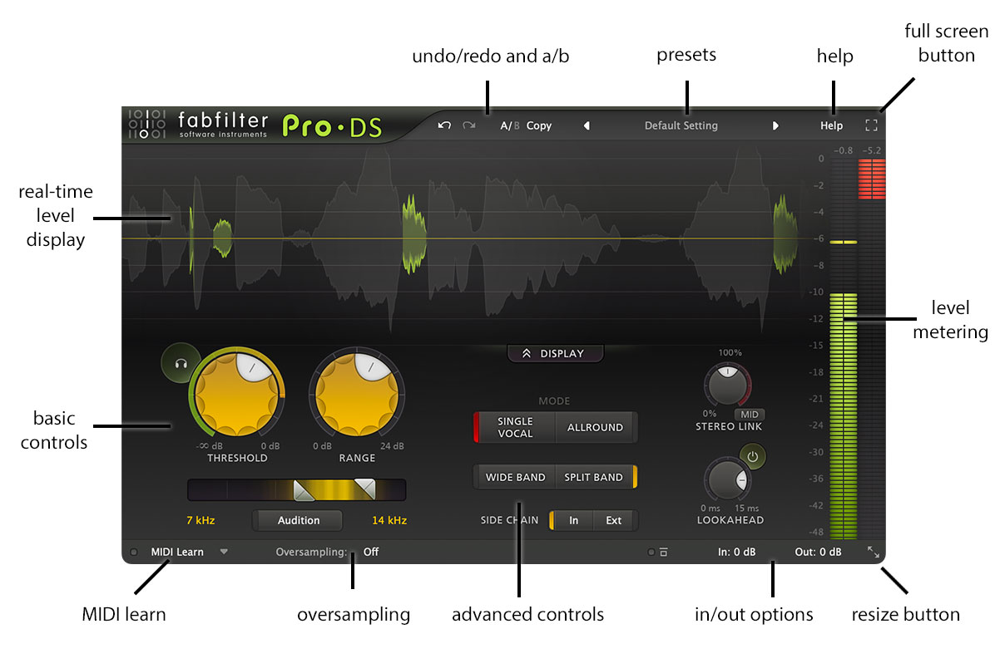

---

## Contents

1. [What it is](#what-it-is)
2. [The panel](#the-panel)
3. [The factory presets](#the-factory-presets)
4. [The sound](#the-sound)
5. [How it works: the DSP](#how-it-works-the-dsp)
6. [Other de-essers, and what to borrow](#other-de-essers-and-what-to-borrow)
7. [Proposed for Vaudio](#proposed-for-vaudio)
8. [How it'd be built](#how-itd-be-built)
9. [Tests](#tests)
10. [Open questions for Théo](#open-questions-for-théo)
11. [Sources](#sources)

---

## What it is

- **A de-esser**: it turns down the "s", "sh", "t" and "ch" sounds of a vocal when they're too loud, and
  leaves the rest of the voice alone. "Even when using the best microphones, pre-amps and converters, 's' and
  't' sounds can easily get over-accentuated during post-processing like compression, saturation or limiting."
- **Two detectors**: **Single Vocal**, "a highly intelligent detection algorithm, which splits sibilance
  from non-sibilance", for one voice; **Allround**, the classic de-esser ("triggering only depends on the
  frequency range … in combination with the Threshold setting"), for mixes, drums and "high-frequency
  limiting of any material".
- **Two ways to turn it down**: **Wide Band** (the whole signal dips while the sibilant lasts) or
  **linear-phase Split Band** (only the highs above a split dip).
- **What else is there**: Threshold and Range, the detection band (2–20 kHz) with a spectrum in it,
  look-ahead up to 15 ms, stereo linking with mid-only or side-only processing, an external side chain,
  oversampling (2×, 4×, linear phase), two audition buttons, a scrolling level display that shows where it
  worked, meters, presets, undo, A/B, MIDI Learn, resizing.

**History.** Released in autumn **2012** (the product page quotes a KVR user from October 2012; Sound On
Sound and Computer Music reviewed it in January 2013, MusicTech in February; the exact date is **not
stated**). It has had no major version
since: the 1.x updates added formats (AAX 64-bit, CLAP, Apple Silicon), Retina, any sample rate (1.05),
sizes and full screen (1.20), and in **1.30** a place in Pro-Q 4's instance list (with Pro-C 3 and Pro-G).
One update matters to us: **1.11 "made the Band Processing and Lookahead Enabled parameters
non-automatable, to prevent automation from changing the latency during playback."** **1.32** (April 2026)
is current on 2 October 2026; no Pro-DS 2 is on FabFilter's download page. There's an iPad version.

**Why engineers reach for it.** Reviews agree on three things: the detection ("I rarely have to tweak the
threshold for it to grab only the 'S' sounds", Modwheel 2026; "a more intelligent ability to detect and
respond to sibilants, in a way that's independent of input level", Sound On Sound); the transparency (on a
female vocal it "gave the most natural results of any plug-in" Sound On Sound tried; MusicTech: "natural",
"one of the most powerful de-essers … one of the easiest to use", 10/10); and the display ("the visual
feedback you get from Pro DS is far better than any competing product", Sound On Sound; "more visual feedback
than any de-esser we've ever used, and it's no gimmick", Computer Music). The criticisms are its price and,
from MusicTech, "no shelving band mode". Sound On Sound's caveat applies to every de-esser: with hours to
spend, hand automation still wins.

**What makes it work** (inferred from the above): a detector that decides *whether* a moment is sibilance
separately from *how loud* it is, so one setting holds across a whole take; look-ahead, so the front of the
"s" is caught; a split that's linear phase, so the untouched band is exactly the input; and a display that
shows every decision, so the user trusts it.

---

## The panel

One window, from top to bottom **(observed)**:

```
┌───────────────────────────────────────────────────────────────────────────────────────┐
│ [logo]          ↶ ↷   A/B  Copy    ◀  Default Setting  ▶            Help   ⛶          │ top bar
├──────────────────────────────────────────────────────────────────────────┬────┬────┤
│                                                                          │ out│ GR │
│      real-time level display: the input in grey, scrolling;              │ lvl│    │ meters, with
│      where it de-essed, highlighted in green                             │    │    │ read-outs on top
│                                       [ ⌃ DISPLAY ]                      │    │    │
│  (🎧)  THRESHOLD   RANGE        MODE: [SINGLE VOCAL|ALLROUND]   STEREO LINK│    │    │
│         (big)      (big)              [WIDE BAND|SPLIT BAND]    (knob)[MID]│    │    │
│   [▕▔▔▔▔◤═══◥▔▔▔▔▕]  filter bar  SIDE CHAIN [In|Ext]            LOOKAHEAD ⏻│    │    │
│   7 kHz [Audition] 14 kHz                                        (knob)    │    │    │
├──────────────────────────────────────────────────────────────────────────┴────┴────┤
│ ○ MIDI Learn ▾     Oversampling: Off                         ○ ▭   In: 0 dB  Out: 0 dB  ⤡ │ bottom bar
└───────────────────────────────────────────────────────────────────────────────────────┘
```

### Basic controls

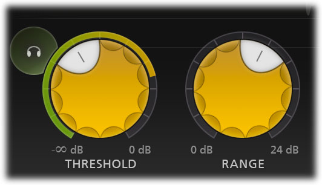

| Control | Range | Default | Scale | What it does |
| --- | --- | --- | --- | --- |
| **Threshold** | −∞ … 0 dB | knob at 40 % of its travel **(decoded)**; the dB value is **not stated** | **not stated** (not linear in dB: −∞ is at one end) | "The threshold of the side-chain level above which the de-esser will trigger and apply gain reduction." In Single Vocal, "you can lower the Threshold all the way to −INF dB. This reduces the dynamic range of the gain reduction: all sibilance will then be reduced by (roughly) the same amount (specified by Range)" |
| **Range** | 0 … 24 dB | **6 dB (decoded)** | not linear: 6 dB sits a little past the middle **(observed)** | "Simply scales the detected gain reduction so that it stays within a desired range, with a maximum of 24 dB" |
| **Audition Triggering** (headphones, top left of Threshold) | off / on | off | | "Hear on which parts of the audio Pro-DS is triggering and how much de-essing is taking place." Production Expert calls it "monitor only removed audio events": what's heard is what's taken away **(inferred: input minus output)** |
| **Mode** | Single Vocal / Allround | **Single Vocal (decoded)** | | Single Vocal: the "intelligent" detector, for one voice. Allround: level in the band only, "for processing entire mixes", "high-frequency limiting" |
| **Side-chain filter**: High-Pass and Low-Pass Frequency (two handles on one bar) | 2 kHz … 20 kHz each | **7 kHz and 14 kHz (decoded)** | logarithmic (stored as log10(f / 2 kHz), 0..1) **(decoded)** | "The frequency range on which Pro-DS will trigger … (Normal vocal s-sounds usually have frequencies around 8 to 10 kHz)." "Tuned in such a way that you can really zoom in on very specific frequencies, without having to adjust the Threshold knob too much" (how: **not stated**). Their slopes: **not stated**. The closest the two have been set in a factory preset is 9 and 11 kHz (a quarter octave) **(decoded)** |
| **Audition Side Chain** (button under the bar) | off / on | off | | "Listen to the signal that is used for triggering": the filtered, linked (or mid or side) detection signal |

The filter bar has **a real-time spectrum analyser in it** that "lights up" the strong frequencies of the
side chain, "after it has been filtered as indicated by the sliders" (Sound On Sound: it "glows more or less
brightly depending on how much energy there is"). The band between the handles is drawn bright yellow, the
rest dark **(observed)**.

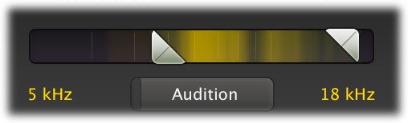


### Advanced controls

| Control | Range | Default | What it does |
| --- | --- | --- | --- |
| **Processing** (Band Processing) | Wide Band / Split Band | **Wide Band (decoded)** | Wide: "lower the overall gain of the audio when sibilance is detected". Split: "only high frequencies will be attenuated. The split frequency is determined automatically according to the chosen high-pass sidechain filtering setting" (exactly where: **not stated**). "With single vocals, Wide Band mode generally sounds most transparent"; Split for "full mixes, or more complex audio". Split adds latency. Not automatable since 1.11 |
| **Side Chain** | In / Ext | In | Ext: trigger on the plug-in's side-chain input, "for example, when de-essing heavily processed/distorted vocals, you could use the original 'clean' vocal track" |
| **Stereo Link** | 0 % … 100 % … Mid-only / Side-only (one knob) | **100 % (decoded: the knob's middle)** | "The first half of the knob's range sets stereo linking from 0 % (fully unlinked, channels operate independently) up to 100 % (fully linked, resulting in the same gain reduction for both channels). When turning the knob even further, you will eventually process only the mid-signal … or only the side-signal." What happens between 100 % and the end: **not stated** |
| **Stereo Link Mode** (small button under the knob) | Mid / Side | **Mid (decoded)** | Which one the second half goes to. Mid-only de-esses a centred lead vocal and leaves the stereo content; side-only de-esses wide backing vocals and leaves the lead |
| **Lookahead** | 0 … 15 ms | **12 ms (decoded)** | "Start de-essing up to 15 ms before the trigger audio level actually exceeds the threshold … Often, when de-essing vocals, a lookahead value of about 10 ms is optimal … Leaving a bit of the initial transient untouched might help to preserve a 'natural' s-sound" |
| **Lookahead Enabled** (power button by the knob) | off / on | **on (decoded)** | Off with Wide Band and no oversampling: **zero latency**. On: "the latency will be 15 ms" whatever the knob, "plus a small additional latency if oversampling or split-band processing is used". Not automatable since 1.11 |
| **Oversampling** (bottom bar menu) | Off / 2× / 4× | Off **(decoded)** | "Linear-phase" oversampling of "the internal de-essing process" against the aliasing of fast gain changes: "you need it more when the de-esser is triggered often, and when using higher Range settings". Adds latency |
| **Input** level and pan (bottom bar) | **not stated** (seen −7 dB) | 0 dB, centre | Before everything, the side chain included. Click: its knobs appear; drag on the button: change it; Alt-drag: the output moves the opposite way |
| **Output** level and pan | **not stated** (seen +6 dB) | 0 dB, centre | After the de-essing |
| **Bypass** (bottom bar) | | | "Guaranteed to correctly compensate the latency … soft bypassing to avoid clicks" |

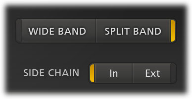
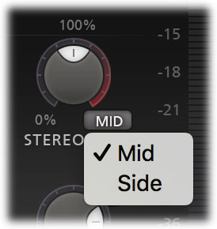
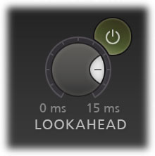
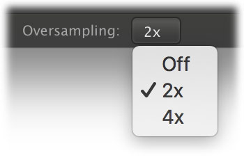
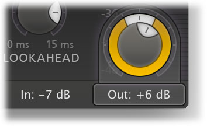

**Latency, measured by others**: 0 samples without look-ahead (Wide, no oversampling); 15 ms with it; one
Bitwig user measured **26.6 ms at 44.1 kHz** (settings not given). 26.6 − 15 = 11.6 ms ≈ 512 samples, which
would be a split-band FIR's half length, oversampling's filters, or both **(inferred)**.

### Displays and meters

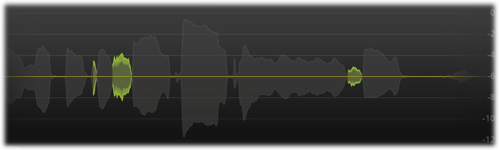

- **The real-time level display** (the top, about two thirds of the width): "the incoming audio signal (after
  the input gain has been applied), while highlighting the parts that are actually affected … The unaffected
  parts are always dimmed and semi-transparent. The highlighted parts show the reduced gain in light green,
  and the resulting gain in darker green." It scrolls (Sound On Sound: "from left to right"; its time span:
  **not stated**). The envelope is drawn mirrored about a horizontal centre line, with a dB scale shared with
  the meters beside it (0, −2 … −12 over the display) **(observed)**; a thin yellow line across it in some
  pictures is **not explained** (the threshold, **inferred**). The **Display** button hides it "in case you
  find it distracting while listening".
- **The detection input meter**: "the circular side-chain level meter around the Threshold knob shows the
  level of the filtered and possibly stereo-linked signal that is used for detection". A green arc grows
  from the −∞ end; a thin yellow arc runs outside it **(observed; the yellow is not explained)**.
- **The spectrum** in the filter bar (above).
- **Output level and gain reduction meters** (right edge, one scale 0 … −48 dB): the output in green, the
  gain reduction in red hanging from the top; a yellow peak marker; "above the meter is a dB read-out,
  showing the maximum level that has been detected. You can reset it by simply clicking on it". Over 0 dBFS
  the meter shows clipping until clicked; "the actual audio is not clipped within Pro-DS".

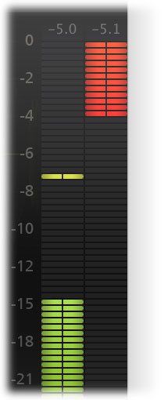
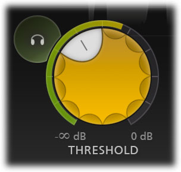

### Knobs, mouse and keys

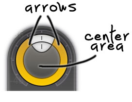

All FabFilter knobs: **vertical drag** (speed-sensitive: slow is fine), **rotate** by the arrow (farther
from the knob is finer), **mouse wheel**, **double-click to type** ("1k" for 1000 Hz, "A4" for 440 Hz,
"C#3+13", "2x" for +6 dB, "50%" for the knob's middle). **Cmd-click** resets to the default, **Shift** is
fine adjustment, **Alt-drag** moves linked knobs together (input against output). Knobs light up under the
pointer and a parameter display pops up with name and value. Escape leaves full screen. Anything more
(dragging the filter bar's band as a whole, keys of its own): **not stated**.

### Top bar, presets, A/B, undo, MIDI Learn, sizes


- **Undo / Redo**: "every change to the plug-in (such as dragging a knob or selecting a new preset) creates
  a new state"; changes by MIDI or automation don't.
- **A/B** switches between two states (each kept as it was left); **Copy** copies the active one to the
  other, then greys out until they differ.
- **Presets**: ◀ ▶ step through the menu; the name dims once edited. The menu has the factory presets in
  folders, Save As, and Options (Save As Default, Open Other Preset, Restore Factory Presets, Change Preset
  Folder, Refresh, Enable MIDI Program Changes). Right-click the name: Save, Save As, Copy, Paste (1.31).
  Presets are `.ffp` files in `Documents/FabFilter/Presets/Pro-DS`; drag-and-drop a preset file onto the
  window (1.31).
- **MIDI Learn** (bottom left): click it, touch a control, move a MIDI controller. Its menu: Enable MIDI,
  Clear, Revert, Save.
- **Sizes**: Small, Medium (default), Large, Extra Large; a Scaling submenu (e.g. 150 %, 300 % on Retina);
  **Full Screen**; free resizing by the edges in VST3. Chosen sizes become the default for new instances.
- **Help**: the manual and interactive help hints.

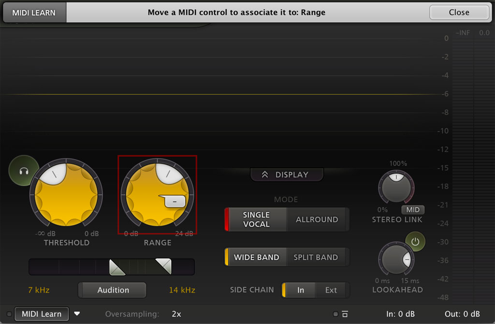
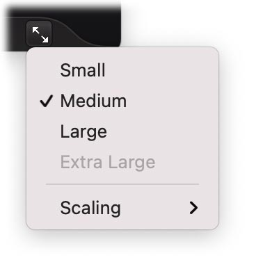

### The parameter list

From the plug-in binary and the preset files **(decoded)**: a preset is `FPSr`, version 2, then 20 floats in
this order. The names come from the binary; the order is the order there, checked against the values.

| # | Parameter | Stored as | Automatable |
| --- | --- | --- | --- |
| 0 | Mode | 0 Single Vocal, 1 Allround | yes |
| 1 | Threshold | 0..1 (knob position) | yes |
| 2 | Range | dB | yes |
| 3 | Band Processing | 0 Wide Band, 1 Split Band | **no** (1.11) |
| 4 | Stereo Link | 0..1: 0.5 is 100 % linked, 1 is fully mid- or side-only | yes |
| 5 | Stereo Link Mode | 0 Mid, 1 Side | yes |
| 6 | Lookahead | ms | yes |
| 7 | Lookahead Enabled | 0 / 1 | **no** (1.11) |
| 8 | Audition Triggering | 0 / 1 | yes |
| 9 | Side Chain Input Signal | 0 Normal input, 1 External | yes |
| 10, 11 | High-Pass, Low-Pass Frequency | log10(f / 2000 Hz), 0..1 | yes |
| 12 | Audition Side Chain | 0 / 1 | yes |
| 13 – 19 | A "Midi State" entry, then Oversampling (Off, 2×, 4×), Input Level, Input Pan, Output Level, Output Pan, Bypass | | yes |

---

## The factory presets

Nine, in two folders plus the default **(decoded)**. "Classic" is FabFilter's word for Allround ("the highly
intelligent Single Vocal and classic Allround modes").

| Preset | Folder | Mode | Processing | Band | Range | Link | Lookahead | Threshold knob | Purpose (inferred from the name) |
| --- | --- | --- | --- | --- | --- | --- | --- | --- | --- |
| **Default Setting** | | Single Vocal | Wide | 7 – 14 kHz | 6 dB | 100 % | 12 ms, on | 40 % | Any vocal |
| **Female Wide Band** | Single Vocal | Single Vocal | Wide | 7 – 14 kHz | 6 dB | 100 % | 12 ms | 40 % | A female vocal |
| **Female Split Band** | Single Vocal | Single Vocal | Split | 7 – 14 kHz | 6 dB | 100 % | 12 ms | 40 % | The same, lows untouched |
| **Male Wide Band** | Single Vocal | Single Vocal | Wide | 6 – 14 kHz | 6 dB | 100 % | 12 ms | 40 % | A male vocal (lower esses) |
| **Male Split Band** | Single Vocal | Single Vocal | Split | 6 – 14 kHz | 6 dB | 100 % | 12 ms | 40 % | |
| **Classic 10k Wide Band** | Single Vocal | Allround | Wide | 9 – 11 kHz | 6 dB | 100 % | 12 ms | 58.8 % | The classic narrow de-esser at 10 kHz |
| **Classic 10k Split Band** | Single Vocal | Allround | Split | 9 – 11 kHz | 6 dB | 100 % | 12 ms | 58.8 % | |
| **High End Transient Limiting** | Mastering | Allround | Split | 5 – 20 kHz | 6 dB | 80 % | 15 ms | 60 % | The mastering trick: limit the highs, then lift them with a shelf |
| **Vocal De-essing in Music** | Mastering | Allround | Split | 9 – 13 kHz | 6 dB | **Mid-only** | 15 ms | 76.7 % | A centred lead vocal inside a finished mix |

Every factory preset uses Range 6 dB and no oversampling.

---

## The sound

### What a good de-esser sounds like

The "s" is still an "s": crisp, the word still readable, but it no longer spits, stings or whistles; on
headphones it stops poking out of the mix. You don't hear it work. The vowels keep their air and brightness,
the level between words doesn't move, and breaths and the "t" of a word keep their edge. Turned up, it
should go from "smooth" to "a little soft" gradually, and never to a lisp before the Range is well past what
the vocal needs.

| Setting | What it sounds like |
| --- | --- |
| **Single Vocal, Wide Band, Range 3 – 6 dB** | The whole voice dips during each sibilant. Inaudible as a dip, because during an "s" there's almost nothing else of the voice to hear; the most natural on a dry lead vocal |
| **Single Vocal, threshold −∞** | Every sibilant comes down by the same Range, loud or soft: the "s" sounds stay in one consistent relation to the vowels, whatever the singer's distance from the mic |
| **Split Band** | Only the hiss above the split comes down; a voiced "z" keeps its buzz, and whatever plays under the voice (reverb, a beat, other voices) doesn't duck |
| **Allround, Split, a wide band (5–20 kHz), mastering** | A high-frequency limiter: cymbal and hi-hat peaks and harsh transients are tamed, the steady top end stays; with a shelf boost after it, a mix gets brighter without getting harsher (FabFilter's "brighten up" trick) |
| **Mid-only on a mix** | The centred lead's esses come down; the stereo cymbals and reverb don't |
| **More look-ahead (10–15 ms)** | The front of the "s" is caught too: smoother, but the "s" can lose its start and sound slightly soft |
| **Less or no look-ahead** | The first millisecond or two passes: more natural, more "t-s"; with heavy Range a small tick can be heard |

### What a bad de-esser sounds like, and why

| Fault | What you hear | Cause | How ours avoids it |
| --- | --- | --- | --- |
| **Lisping** | "s" turns to "th": "thingle" for "single", the singer sounds like "you have removed their two front teeth" (Waves' manual) | Too much reduction. What tells /s/ from /θ/ ("th") is mostly the spectral peak and the sibilant's loudness against the vowel (Jongman et al.): bring the level down 10–15 dB, or carve out its peak and leave a flat hiss, and the cue is gone **(inferred)** | Range caps the reduction (6 dB by default); the reduction keeps the sibilant's spectral shape (a dip of the whole band, never a notch at its peak) |
| **Dullness** | The vocal loses its air and presence, as if a low-pass were on it | False triggers: bright vowels, breaths and "air" set it off; or a split set too low, or a low threshold in a level-only detector ("lowering the threshold too much will result in a muffled sound", Waves) | Single Vocal's classifier ignores voiced sound; the side chain starts at 2 kHz; Split never touches what's under it |
| **Pumping, ducking** | The vowel after an "s" starts quiet and swells; on a mix, the whole track dips with every "s" | Release too slow (the gain is still coming back when the vowel starts); Wide Band on material that isn't one voice | The look-ahead hold ends the reduction exactly where the sibilant ends, then a fast release (≈ 15 ms); Split for anything but one voice |
| **Chatter** | A long "sh" flutters | The gain reduction rides the noise's own fluctuations: attack and release faster than the noise's envelope | The detector's level is smoothed over a few ms, release slows down on long sibilants, the classifier holds its decision through an event |
| **Late catch** | "t-sss": the front of each "s" sticks out | No look-ahead and a detector that needs time to decide | Look-ahead covers the detector's decision time |
| **Clicks, crackle, grit** | A tick at each onset, a fizz on the "s" | Gain changed too fast (audible as a click, and as aliasing: the gain's sidebands fold past Nyquist) | The gain glides (≥ 0.5 ms ramps); see [oversampling](#oversampling-and-aliasing) |
| **Phasiness around the split** | A hollow, swirly band near the crossover while it works | IIR crossovers whose bands don't sum back to the input when one band is turned down | Linear-phase, complementary split: the low band is the input's |
| **Pre-echo** | A soft "pre-hiss" before an "s" or a hit | A long linear-phase crossover rings before transients when its high band is turned down | The crossover's kernel is short (≈ 10 ms) and gentle (24 dB/oct) |

Where it goes in the chain: after compression and EQ (they bring sibilance up), before saturation or
exciters (Mike Senior, Sound On Sound). Many engineers de-ess twice, gently: once before the compressor,
once after **(inferred from common practice; not from a primary source here)**.

---

## How it works: the DSP

FabFilter publishes none of its internals beyond the manual's words ("64-bit internal processing",
"program-dependent compression/limiting", "linear-phase split band", "linear-phase oversampling", "Smart
Parameter Interpolation", "sample-accurate automation"). Everything below is a design: the literature's best
methods, fitted to what the manual says Pro-DS does. All of it is **(inferred)** unless a source is given.

### The signal flow

```
                 input gain, pan
 in L,R ──►──────────┬──────────────────────────────────────────────────────────┐
                     │                                                          │
            DETECTION (sees the sound early)                             AUDIO (delayed by D)
                     │                                                          │
       [L/R, or M/S in the knob's second half]                          delay line, D samples
                     │                                                          │
     side-chain filter: HP ─ LP (2–20 kHz)  ──► Audition Side Chain             │
                     │                                                          │
        level (dB) ──┼──► Single Vocal features ─► sibilance c (0..1)           │
                     │          (fixed bands, not the user's)                   │
                     ▼                                                          │
        gain computer (threshold, range, mode) ─► target t (dB, per channel)    │
                     │                                                          │
        stereo link (max of the channels' targets, by the link amount)          │
                     │                                                          ▼
        look-ahead shaping: hold W, ramp W, delay D − W ─► release ─► g ──► × g  (Wide)
                                                                       │   or
                                                                       └─► LP + g·HP  (Split,
                                                                           linear-phase, complementary)
                                                                                │
                                                     Audition Triggering: x(n−D) − y(n) (what's removed)
                                                                                │
                                                [M/S back to L/R] ─► output gain, pan ─► out
```

Each part below. Times are in seconds and frequencies in Hz throughout, turned into samples and
coefficients from the sample rate when the effect is prepared, so it behaves the same at 44.1, 48 or 96 kHz.

### Where sibilance is

| Sound | Where its energy is | Source |
| --- | --- | --- |
| /s/ (English) | Spectral peak ≈ 6.8 kHz, spectral mean ≈ 6.1 kHz (averages across its speakers; from the paper's tables, not re-checked here: the abstract linked gives no numbers) | Jongman et al. 2000 |
| /ʃ/ ("sh") | Peak ≈ 3.8 kHz, mean ≈ 4.2 kHz (same caveat) | Jongman et al. 2000 |
| Sibilants in general | "Usually focused somewhere in a region from 4–10 kHz" | Mike Senior, Sound On Sound |
| Vocal "s" | "Usually … around 8 to 10 kHz" | Pro-DS manual |
| Male "ess" 4.5 kHz, male "shh" 3.4 kHz, female "ess" 6.8 kHz (up to 9 kHz), female "shh" 5.1 kHz ("averaging a large number of voices"); "Sweat" ≈ 6 kHz, "Sugar" ≈ 4 kHz | | Waves DeEsser manual |
| Sibilants "mainly consist of frequencies in the range of 2 kHz to 8 kHz" | | Linhard et al. (DAGA 2017) |

Other things that live there, which a de-esser shouldn't touch (all **inferred**, and why the tests below
synthesise them): **hi-hats and cymbals** (noise-like too, but with a sharp attack under a millisecond, an
exponential decay, and energy that goes on flat to 16–20 kHz where an "s" falls away above ≈ 12 kHz);
**breaths** (noise, but 20–30 dB quieter and lower, mostly below 4 kHz); **bright vowels** (periodic: their
high harmonics sit on top of a strong voiced low end); **"t", "k", "p" bursts** (a few ms of broadband
noise; de-essing them a little is fine, as Waves' "shh" presets say of "hard consonants").

### Allround: the classic detector

The level of the side-chain band, against a threshold, through a limiter-like curve.

1. **The side-chain filter.** A high pass and a low pass at the two handles, each 4th-order Butterworth
   (24 dB/oct), as matched-SVF sections (our `EqDesign` `matched` + `Svf`, which glide without zipper when
   the handles move). The slopes are ours: Pro-DS's aren't stated. The low pass is skipped at 20 kHz.
2. **The level.** Power of the filtered signal, smoothed by a one-pole with a short time constant
   (τ_det = 2 ms: fast enough to follow an "s" onset, slow enough not to ride every noise grain), in dB as a
   sine's peak, as Pro-Q's dynamic bands do:

   ```
   p[n]   = p[n−1] + (x_sc[n]² − p[n−1]) · (1 − e^(−1/(τ_det·fs)))
   L[n]   = 10·log10(2·p[n] + 1e−20)                     dB (a full-scale sine reads 0)
   ```

3. **The gain computer** (log domain, as Giannoulis, Massberg and Reiss recommend), an infinite-ratio
   limiter with a soft knee of width K = 6 dB, capped at the Range:

   ```
   o = L − T                                              overshoot (dB)
   t = 0                          if o ≤ −K/2
     = (o + K/2)² / (2K)          if |o| < K/2             (the quadratic knee)
     = o                          if o ≥ K/2
   t = min(t, Range)                                      target gain reduction (dB, ≥ 0)
   ```

   So the band is held at the threshold ("high-frequency limiting"), never by more than Range. The ratio is
   ours: Pro-DS's is **not stated** ("program-dependent compression/limiting").

### Single Vocal: telling sibilance from everything else

What FabFilter says: it "splits sibilance from non-sibilance"; it's "independent of input level" (Sound On
Sound); at a threshold of −∞ "all sibilance will then be reduced by (roughly) the same amount". So the
detector has two separate outputs: **whether** this moment is sibilance (a confidence c, 0..1) and **how
loud** the side chain is (the same L as Allround). The gain reduction is the Range scaled by both:

```
t = Range · c · min(1, max(0, L − T) / S)          S = 6 dB: full Range from 6 dB over the threshold
```

At T = −∞ the second factor is 1 and every sibilant gets `Range · c`: exactly the manual's behaviour. Range
"simply scales the detected gain reduction", as the manual puts it.

**How to decide c.** The published methods that tell sibilance apart (Dolby's two patents; Linhard et al.;
Wolters et al. 1998, cited by them) all use a few cheap spectral features compared with soft thresholds,
not a trained model:

| Feature | What it says | In the literature |
| --- | --- | --- |
| **High band against the whole** | A sibilant's energy is nearly all above 2–4 kHz; a vowel's is below | Dolby US 11,322,170: the sibilance band's energy over the previous broadband envelope, against 70 %. Linhard: band powers over the total, against −10 and −6 dB |
| **Zero-crossing rate** | Noise centred high crosses zero often; a voiced vowel seldom | Dolby US 11,322,170: ZCR against 0.3 (per sample), through a sigmoid from 0.25 to 0.35, multiplying the gain reduction |
| **Spectral centroid** | Where the spectrum's centre of mass is | Dolby US 10,867,620 |
| **Spectral peakiness** (1 − geometric / arithmetic mean of band powers: one minus spectral flatness) | Annoying sibilance has a peak; cymbals and broadband noise are flat | Dolby US 10,867,620 (SSPM) |
| **Spectral flux** in the sibilance band | Sibilant spectra change fast | Dolby US 10,867,620 |
| **Long-term relative level** | Sibilance against the speaker's own long-term non-sibilant level | Dolby US 10,867,620 (SRLR): what makes it level-independent |

Ours uses six features, each turned into a soft score by a `smoothstep` between two values (no hard
switching, so nothing chatters), multiplied together:

```
smoothstep(x; a, b) = 0 below a, 1 above b, 3u² − 2u³ between (u = (x − a)/(b − a)); a > b reverses it.

Fixed analysis bands (not the user's), per detection channel, matched SVFs:
  E_low   80 Hz – 1.5 kHz band pass (2nd order each side)      the voiced body of the voice
  E_k     9 third-octave band passes, 2.5 … 16 kHz (Q 4.3)      the high spectrum's shape
  E_hf    Σ E_k                                                 (2.2 – 18 kHz)
  E_air   E_12.5k + E_16k ;  E_sib = E_4k … E_10k
  each a power envelope, τ = 3 ms;  E_hf also with τ = 0.3 ms for the onset

Every hop (1 ms):
  voiced  = 10·log10(E_low / E_hf)             dB
  zcf     = zero crossings of the 80 Hz-high-passed signal over the last 5 ms / (2 · 5 ms)   Hz
  peaky   = 1 − (Π E_k)^(1/9) / (Σ E_k / 9)    over the 9 bands (0 flat … 1 one band)
  air     = 10·log10(E_air / E_sib)            dB
  rise    = L_hf,fast(now) − L_hf,fast(2 ms ago)   dB

  c_raw = smoothstep(voiced; +10, 0)           unvoiced: the high band is as loud as the body or louder
        · smoothstep(zcf; 2000, 3500)          noise centred above ≈ 2–3.5 kHz ("sh" too)
        · smoothstep(peaky; 0.10, 0.30)        a shaped hiss, not flat noise
        · smoothstep(air; 0, −8)               rolls off above 12 kHz, as voices do and cymbals don't
        · smoothstep(rise; 24, 12)             not a sub-millisecond attack (a hit)
        · smoothstep(L_hf; −70, −60)           not silence or room tone
```

The numbers are starting points, to set on recordings of real vocals (Théo's own, and the hi-hat test
signals): **(inferred)**, every one.

**Holding the decision.** A sibilant is an event of 50–250 ms. Smooth c_raw with a fast rise (1 ms) and a
slower fall (20 ms), and once c has passed 0.5 in an event, hold it until E_hf has fallen 12 dB under the
event's peak: a long "sh" doesn't flicker as its features wander. The ≈ 3–5 ms the features need to settle
is why look-ahead matters so much in Single Vocal (and why Pro-DS defaults to 12 ms): it hides the decision
time.

**Optional, later**: a voicing test by YIN's aperiodicity (our Auto-Tune already runs YIN every ≈ 2.7 ms)
would separate a voiced "z" (sibilant noise on top of a pitched buzz) better than the energy ratio, which
calls a loud "z" half-voiced. Measure first.

**Why not simply a narrow band, as a classic de-esser?** A level-only detector can't tell a loud "s" from a
loud vowel's bright harmonics, or from a hi-hat leaking into the vocal mic, if they're as loud in the band.
Every feature above is a ratio or a shape, so none depends on the absolute level: that's the "independent
of input level" Sound On Sound heard.

### The side-chain level the threshold sees

The manual says the filter bar is "tuned" so that narrowing it doesn't need the threshold moved much; how is
**not stated**. Two designs, to choose between by ear:

1. **The band's power** (simple, what Allround de-essers do; a narrower band reads lower).
2. **The loudest third-octave in the band**: `L = max over the analysis bands between the handles` (and a
   partial band at each edge, weighted by how much of it is inside), since the analysis bands are there
   anyway. A sibilant's peak band reads the same however the handles close around it: zooming in doesn't move
   the threshold.

We'd start with 2 for both modes **(inferred)**; the ring meter shows the same L.

### Stereo: link, mid-only, side-only

Detection runs per channel (left and right, or mid and side). Let v be the knob, 0..2 in our units
(Pro-DS stores 0..1; its middle, 100 % linked, is our 1).

```
v ≤ 1 (L/R):     t_L, t_R per channel;  m = max(t_L, t_R)
                 t_L' = t_L + v·(m − t_L),  t_R' = t_R + v·(m − t_R)
                 (v = 0: independent;  v = 1: the same reduction on both)

v > 1 (M/S):     u = v − 1  (0..1);  M = (L + R)/2,  S = (L − R)/2
                 mid-only:  detect on (1 − u)·linked L/R power + u·M power;  t → t_M = t,  t_S = (1 − u)·t
                 side-only: the same with M and S swapped
                 L_out = M' + S',  R_out = M' − S'
```

Equal gains on M and S are equal gains on L and R, so at u = 0 the M/S path is exactly the linked L/R one and
the knob moves continuously from one to the other. Encoding with /2 and decoding by sum (Pro-Q's
convention, `pro-q-3-dsp.md` §8) keeps a mono signal at unity through a mid-only de-esser.

### Look-ahead, attack, release

The detector sees the input as it comes; the audio is delayed by D samples. With look-ahead W ≤ D (the knob,
in samples), the reduction must start W before the sibilant reaches the output and last until it has
passed. The ramp is never shorter than R = max(W, 0.5 ms) (see *Minimum ramp* below):

```
a[n] = max(t[k]) for k in [n − R, n]                 sliding maximum (a monotonic deque, O(1) per sample)
b[n] = (1/R) · Σ a[k] for k in [n − R + 1, n]        a moving average: a straight ramp R samples long
g_dB[n] = b[n − (D − W)]                              the ramp ends R − W samples after the sibilant's first
```

With W ≥ 0.5 ms (so R = W), the drawing below holds exactly.

Timing, for a sibilant from input sample k0 to k1 (its audio leaves at k0 + D … k1 + D):

```
  t (detector)       ____|‾‾‾‾‾‾‾‾‾‾‾‾‾‾‾‾‾|________          k0 … k1
  a (held W)         ____|‾‾‾‾‾‾‾‾‾‾‾‾‾‾‾‾‾‾‾‾‾‾|___          k0 … k1 + W
  b (ramped W)       ____/‾‾‾‾‾‾‾‾‾‾‾‾‾‾‾‾‾‾‾‾‾\__          up k0 … k0 + W, down k1 + W … k1 + 2W
  g (delayed D − W)  ___________/‾‾‾‾‾‾‾‾‾‾‾‾‾‾‾‾‾‾‾‾\___    full from k0 + D, starts to fall at k1 + D
  audio out          _______________|‾‾‾‾‾‾‾‾‾‾‾‾‾‾‾‾‾‾‾|__  k0 + D … k1 + D
```

The full reduction arrives on the sibilant's first sample and starts to leave on its last. Then:

- **Release**: after the ramp, a one-pole in dB that only slows the fall (`r = b if b > r, else r + (b − r)·(1 − e^(−1/(τ_r fs)))`),
  program-dependent: τ_r = 15 ms after a short event, rising to 60 ms after one longer than 150 ms
  (τ_r = 15 + 45·clamp((duration − 50 ms)/100 ms, 0, 1) ms). Short "s" sounds let go at once, so the next
  vowel isn't ducked; a long "sh" doesn't flutter at its end. Weiss's DS1 does the same from the ratio of
  peak to RMS ("after short duration peak the faster release will be applied"). Mike Senior uses about
  10 ms.
- **Without look-ahead** (W = 0, D = 0 in Wide Band): a one-pole attack in dB, τ_a = 0.3 ms, then the same
  release.
- **Minimum ramp**: the ramp R is at least 0.5 ms whatever the knob says. With the knob at 0 (W = 0) the gain
  is delayed by the whole D, so its 0.5 ms ramp starts on the sibilant's first sample: no look-ahead, but no
  step either (a gain step is a click, and a fast one aliases).
- **Latency is fixed by the switches, not the knob** (as Pro-DS: 15 ms whenever Lookahead Enabled is on), so
  automating Lookahead never changes the latency; only the gain's delay `D − W` changes, which is free.

When Split Band adds the crossover's delay C, the audio's delay is D = (look-ahead on ? 15 ms : 0) + C, and
the gain is delayed to match: with look-ahead off, W = 0 and the gain is delayed by C (the crossover's delay
isn't used as extra look-ahead, so "off" means off).

### Wide Band and Split Band

**Wide Band**: `y[n] = x[n − D] · 10^(−g_dB[n]/20)`. When nothing triggers, g_dB is exactly 0 (flush
anything under 1e−6 dB to 0) and `y` is `x` delayed, sample for sample.

**Split Band**, linear phase and complementary, so the untouched band is the input's own. One linear-phase
low pass `h` (odd length N, delay C = (N − 1)/2); the high band is what the low pass leaves:

```
xd = x[n − D]                         the delayed input
lo = (h ∗ x)[n − (D − C)]             the low band, as delayed as xd
hi = xd − lo                          the high band: lo + hi = xd exactly
y  = xd − (1 − g)·hi                  = lo + g·hi
```

Written as `xd − (1 − g)·hi`, `y` *is* `xd` when g = 1, bit for bit: the null test passes whatever the
kernel. This is Lipshitz and Vanderkooy's subtractive linear-phase crossover, and what Weiss's DS1 does ("the
other [band] is delayed by the same amount … This mode is completely transparent if no gain reduction is
applied").

**The kernel.** Zero-phase magnitude `A(f) = 1 / (1 + (f/fc)^4)`: −6 dB at fc, 24 dB/oct on both sides, and
`1 − A(f)` is the high band's (amplitude-complementary, so the two always sum to 1 with no bump). Sampled on
an FFT grid, turned to time, centred and windowed (Blackman), exactly as Pro-Q's `kernelFromResponse` makes
its linear-phase kernels. N = the odd number nearest 10.7 ms·fs (513 taps at 48 kHz: C = 256 samples,
5.3 ms). It's short on purpose: a long kernel rings before transients when the high band is turned down
(pre-echo).

**The split frequency** "is determined automatically according to the chosen high-pass" (not stated how).
Ours: fc = HP / √2, half an octave under the high-pass handle, so the whole band the detector listens to is
in the high band (at the handle the high band's weight is 0.8 rather than 0.5) **(inferred)**. A new HP
designs a new kernel on the message thread; the audio thread crossfades `lo` from the old kernel to the new
one over a block (the null still holds: `y = xd − (1 − g)·(xd − lo_mix)`).

**Cost**: a 513-tap FIR per channel is ≈ 1000 multiply-adds per stereo sample, ≈ 50 M/s at 48 kHz; with
`juce::FloatVectorOperations` (SIMD) it's well under 1 % of a core. A direct-form FIR adds no latency of its
own, unlike `Convolver`'s partitions.

**A zero-latency split (an option, later)**: `y = x − (1 − g)·HP_iir(x)` with any IIR high pass still nulls
exactly when g = 1, with no delay at all. While it works it's a dynamic high shelf whose phase shifts near
the corner (not exactly "LP + g·HP"); FabFilter doesn't offer it.

### Oversampling and aliasing

Multiplying by a moving gain spreads each frequency into sidebands as wide as the gain's own bandwidth; what
goes past Nyquist folds back. With a 0.1 ms attack the gain's bandwidth is a few kHz, so 18–20 kHz content
can fold to audible frequencies. FabFilter's answer is 2× / 4× linear-phase oversampling of "the internal
de-essing process".

Ours, at first, limits the gain's bandwidth instead: every gain change is at least a 0.5 ms ramp (its
spectrum falls fast above ≈ 2 kHz), so only content within ≈ 2 kHz of Nyquist can fold, at the level of a
sideband 30+ dB down **(inferred)**. A test measures it (below); if aliasing is above −90 dB of the input at
heavy settings, add 2× by a polyphase half-band FIR (linear phase, ≈ 30 taps, ≈ 0.3 ms latency) around the
gain stage.

### Smoothing parameter changes

| Parameter | How it changes without a click |
| --- | --- |
| Threshold, Range | In dB, one-pole, 20 ms (they act through the gain, which is ramped anyway) |
| HP, LP | log2 of the frequency glides over 20 ms; the SVFs' coefficients glide per sample (Pro-Q's `Svf::lerp`) |
| Lookahead | The gain's delay `D − W` changes: crossfade the old and new gain over 10 ms |
| Stereo link | Its v glides over 20 ms |
| Mode | Both detectors run while it changes; c crossfades over 20 ms |
| Processing (Wide ↔ Split) | Both outputs computed, crossfaded over 10 ms (same delay when the song already has the split's latency; otherwise the song is made again, as any latency change) |
| Lookahead Enabled | Changes the latency: the song is made again and delay compensation follows, as Pro-Q's mode does. Not automatable |
| Input, Output | dB, 20 ms |

### Real time, denormals, CPU

- Everything allocated when the state is made for a sample rate (`ds::Registry::get(id, rate)`): the delay
  lines for 15 ms + C at that rate, the sliding-max deque and moving-average ring for 15 ms, the FIR's history,
  the display's ring. Settings are parsed and kernels designed on the message thread and handed over by
  atomic exchange (as `Convolver::offer`); the audio thread never allocates, locks or does I/O.
- `juce::ScopedNoDenormals` around `process`; every power envelope floored at 1e−20; the moving average's
  running sum in double, re-summed exactly every second against drift.
- Per stereo sample, detection ≈ 2 × (4 side-chain biquads + 12 analysis biquads + envelopes) ≈ 200
  multiply-adds, features once per millisecond; Split adds ≈ 1000 (SIMD). Comfortably under 1 % of a
  modern core per instance at 48 kHz **(inferred estimate; measure in the export's workers)**.
- Its state is kept across songs by effect id, so a song sent mid-play (every edit) doesn't restart the
  detector or empty the delay lines.

---

## Other de-essers, and what to borrow

What engineers name in 2024–2026 lists and reviews: **Pro-DS** ("industry standard", first in Modwheel's
2026 ranking, "probably the most comprehensive de-esser out there", Production Expert 2026),
**oeksound soothe2** (not a de-esser but reached for as one), **Waves Sibilance**, **Sonnox SuprEsser**,
**Weiss DS1-MK3 / Deess**, **iZotope RX / Nectar**, and newer ones (Wavesfactory Re-Esser, Antares Vocal
De-Esser). The lists are opinion; no blind comparison was found.

| De-esser | How it detects | How it turns down | Latency | Worth borrowing |
| --- | --- | --- | --- | --- |
| **Waves DeEsser** (Renaissance, the classic) | Side-chain filter, HighPass or BandPass at Freq; "energy detector" into a "hard knee compressor" | Wideband or Split (high band only) | 0 | Its presets' frequencies (male 4.5 kHz, female 6.8 kHz…) as starting points; nothing else Pro-DS lacks |
| **Waves Sibilance** (2018) | "Organic ReSynthesis": the voice broken into "pitch, formant, amplitude, carrier"; "Sibilance uses the Formant Weight element for detection and manipulation". Detection Width 0–100 | Mode 0–100 blends Wide (whole range of the detected sound) into Split (above 4 kHz) | 529 samples (12 ms) with Lookahead at 44.1/48 kHz, 0 without; a Live version | The continuous Wide↔Split blend; the threshold drawn as two lines on the waveform. Not its resynthesis |
| **oeksound soothe2** | "A dynamic resonance suppressor": analyses the spectrum for resonances, "applies reduction automatically", per frequency; Depth, Sharpness, Selectivity, Attack, Release (faster at high frequencies), soft / hard mode | Many narrow, moving notches | Its Resolution / Oversample settings trade CPU for time and frequency resolution | Its **Delta** monitor (= our Audition Triggering), and the idea of a "spectral" mode (below). Its manual's de-essing advice: lower Selectivity for broadband esses, higher for whistling ones |
| **iZotope RX / Nectar De-ess** | Threshold **Relative** ("determines the level of speech and sets the threshold relatively to that level", the default) or **Absolute** (dBFS) | **Classic** (a broadband gain envelope) or **Spectral** ("a multiband compressor with dozens of bands", above a Cutoff; Spectral Flattening, Tilt) | | **A Relative threshold** (below). Spectral flattening is a lisp risk (it flattens the sibilant's shape) |
| **Sonnox Oxford SuprEsser** | A "floating threshold" that "automatically adapts to your performance's dynamic range"; a side-chain EQ with listen | Split-band (dynamic EQ on the band) or full-band; attack and release; Low Latency, Standard and High Resolution modes | Mode-dependent (not stated) | The floating threshold, again: users like not re-setting it per section |
| **Weiss DS1-MK3** (hardware, now a Softube plug-in "1:1 code port") | Peak and RMS (Peak … 800 ms), release chosen by their ratio; release delay; threshold, ratio (1000:1 to 1:5), soft knee | Full band, or a linear-phase crossover (high, band or low pass) where "one of the bands is compressed, the other is delayed by the same amount … completely transparent if no gain reduction is applied"; M/S | "Overall delay" with "preview" (look-ahead), internally at 88.2 / 96 kHz | Confirms the design: delayed complementary band, look-ahead by delay, program-dependent release |
| **SPL De-Esser** | "Auto Threshold"; Male / Female | "The detected sibilance is mixed back into the main signal phase-inverted so that only the S-sounds are cancelled" | | One knob ("S-Reduction") is a good assistant control; phase cancellation itself no |
| **Wavesfactory Re-Esser** (2025) | "Separating sibilance from the tonal elements" | Two layers, each with its own level and effects; crossfades before and after each sibilant | Depends on its Smoothing | Not for v1; shows where de-essing is going (separate, then process) |
| **Eventide SplitEQ** | "Structural Split": transient ("noise, pops, mic plosives, vocal sibilance, attacks") against tonal | An 8-band EQ on each stream | | An EQ, not a de-esser; the transient/tonal split is a different idea |
| **Antares Vocal De-Esser** | "AI-trained"; shows soft sibilants in blue, hard in orange | Separate controls for soft and hard | | Two classes of sibilant, if ours ever needs it |
| **Unfiltered Audio** | No de-esser found in its catalogue (not researched further) | | | |
| **iZotope Tonal Balance Control, Slate Fresh Air** | Not de-essers (a target-curve meter; a high-frequency exciter) | | | No |

**What we borrow** (and what not):

- **A "what it removes" spectrum**: yes, in v1. The filter bar's analyser (Pro-DS's) shows the side chain;
  ours draws, over it, the spectrum of what's been taken away (the triggered audio's delta), in the
  highlight green. It's what soothe2's and Sibilance's displays give that Pro-DS's doesn't, and it costs
  one more `Spectrum` ring.
- **A Relative threshold**: later, and only for Allround. Single Vocal at a low threshold is already
  level-independent; Allround on a vocal isn't, and a threshold that follows the voice's long-term level
  (RX's Relative, SuprEsser's floating threshold, Dolby's SRLR) would make it so. Open question.
- **A soothe-style spectral mode**: later, as a third Processing choice, **Spectral**. It falls out of what's
  built: a bank of complementary linear-phase bands (each band = the difference of two linear-phase low
  passes, so they sum to the delayed input exactly and the null test still holds), each turned down by how
  far it stands above a smoothed spectral envelope while the detector says "sibilance". Not v1: it's where
  lisping comes from if it flattens the sibilant's shape, and it needs its own listening.
- **Wide↔Split blend** (Sibilance's Mode knob): no. Two clear choices are easier to hear and explain.
- **External side chain**: when the mixer gives effects side-chain inputs (Pro-Q is waiting for it too).

---

## Proposed for Vaudio

Not yet talked through with Théo (2026-10-02, from his request for "really deep research … everything"
before building). What's proposed, to check with him:

- **Ours, as Pro-Q is**: a stock effect chosen from an effect slot's picker (Built in → Pro-DS), its settings
  **in the song** (`MixerEffect.proDs`: undone, saved, read and set by the assistant), the engine running it
  natively. The real Pro-DS can still be loaded as a plugin beside it.
- **Its look is FabFilter's family, as Pro-Q's is**: the dark display, the yellow knobs, the green
  highlight, in every theme (a plugin's window keeps its own look), as theme tokens: `--eq-*` for what it
  shares with Pro-Q (background, panel, bars) and `--ds-*` for its own (`--ds-knob`, `--ds-trigger`,
  `--ds-trigger-dark`, `--ds-envelope`, `--ds-filter-band`, `--ds-meter-out`, `--ds-meter-gr`). Plain colours
  (canvases read them).

### First (v1)

| Part | What |
| --- | --- |
| Detection | Single Vocal (the classifier above) and Allround; HP and LP 2–20 kHz with the side chain's spectrum and the removed spectrum |
| Controls | Threshold (−∞, −60 … 0 dB), Range (0 … 24 dB), Mode, Processing (Wide / linear-phase Split), Lookahead (0 … 15 ms) and its switch, Stereo Link (0 … 100 % … Mid- or Side-only) and its mode, Input and Output (level, pan) |
| Monitoring | Audition Triggering (what's removed) and Audition Side Chain: live, not in the song, never exported (as Pro-Q's solo) |
| Display | The scrolling level display (grey input, light green where reduced, darker green the result), the threshold's ring meter, output and gain-reduction meters with click-to-reset read-outs, the Display button |
| Presets | FabFilter's nine (by what they do, with our names where theirs are generic) and a few of ours (below); A/B and Copy; the app's undo |
| Automation | Threshold, Range, HP, LP, Lookahead, Stereo Link, Input, Output (song mode, as all automation) |
| Assistant | `get_pro_ds`, `update_pro_ds`; `add_mixer_effect` takes "Pro-DS"; `add_automation` its controls |
| Window | Resizable, fills the desktop on a double-click of its title, as Pro-Q's |

### Later

External side chain (with the mixer's side chains); Oversampling 2×/4× (only if the aliasing test asks for
it); a Relative threshold for Allround; the Spectral processing mode; a zero-latency split; YIN voicing in
the classifier; MIDI Learn (with the app's MIDI input); saving one's own presets.

### Defaults

Single Vocal, **Threshold −30 dB**, Range 6 dB, Wide Band, HP 7 kHz, LP 14 kHz, Lookahead 12 ms on, Stereo
Link 100 %, Mid, In / Out 0 dB centred: FabFilter's Default Setting, with the threshold's value ours (theirs
isn't published; −30 dB catches a sung "s" at ordinary levels **(inferred)**). Latency at the defaults:
15 ms, as Pro-DS's.

### Our presets

FabFilter's nine as listed (Default; Female and Male, Wide and Split; Classic 10k Wide and Split; High End
Transient Limiting; Vocal De-essing in Music), plus, ours:

| Preset | Settings | For |
| --- | --- | --- |
| **Sh and S** | Single Vocal, Split, 3.5 – 12 kHz, Range 6 dB | Voices whose "sh" bites as much as their "s" |
| **Gentle** | Single Vocal, Wide, 6 – 14 kHz, Range 3 dB, threshold −∞ | A light, even touch on every sibilant, any level |
| **Hard Rap Vocal** | Single Vocal, Split, 5 – 14 kHz, Range 10 dB, Lookahead 10 ms | A bright, compressed, upfront vocal (Théo's genre) |
| **Backing Vocals (Sides)** | Single Vocal, Split, 6 – 14 kHz, Side-only | Wide doubles and harmonies, the lead left alone |
| **Hi-Hat Tamer** | Allround, Split, 7 – 20 kHz, Range 6 dB, link 100 % | A drum bus whose hats are too loud |

### Where Vaudio differs

| What | Pro-DS | Vaudio |
| --- | --- | --- |
| Look | FabFilter's artwork | The app's window, in FabFilter's colours (as Pro-Q) |
| External side chain | Yes | Not yet: effects have no side-chain inputs |
| Oversampling | Off / 2× / 4× | Not in v1: gain changes are band-limited instead (tested) |
| Threshold's scale | −∞ … 0 dB, mapping not published | −∞, then −60 … 0 dB, linear in dB from −60 |
| Stereo link's second half | "Eventually" mid- or side-only, the path not stated | A continuous blend, exact at both ends (above) |
| Split frequency | "Determined automatically" from the HP | Half an octave under the HP |
| Audition buttons | Parameters (saved, automatable) | Live, not in the song (as Pro-Q's solo) |
| A "what it removes" spectrum | No | Yes, over the side-chain spectrum |
| Undo, A/B | Its own | The app's undo; A/B in the song (as Pro-Q's) |
| MIDI Learn, program changes | Yes | No: automation instead |
| Presets | Save your own, folders, `.ffp` | Factory presets; Copy / Paste of the whole effect |
| Sizes | Small … Extra Large, scaling, full screen | Resizes freely, fills the desktop |
| Bypass | Its own, latency kept | The slot's: an off effect has no latency (the song is made again, as Pro-Q's) |
| Mix | None | The slot's mix knob, its dry sound held back by the latency (as Pro-Q) |
| Instance list | In Pro-Q 4's | No |

---

## How it'd be built

The same shape as Pro-Q and PanMan. Names: `PRO_DS_PLUGIN` (`vaudio:pro-ds`), `MixerEffect.proDs`, the
engine's namespace `ds`, lanes of kind `ds`.

### The document (`shared/music/types.ts`, `shared/music/pro-ds-presets.ts`)

```ts
/** Pro-DS's settings (`docs/fabfilter/pro-ds.md`), in their own units. */
export interface ProDsState {
  mode: "singleVocal" | "allround";
  /** dB, -60..0; null is -∞ (every sibilant by the Range, in Single Vocal). */
  threshold: number | null;
  /** dB, 0..24: the most it turns down. */
  range: number;
  processing: "wide" | "split";
  /** Hz, 2000..20000: the band it listens to; lowPass at least a sixth of an octave over highPass. */
  highPass: number;
  lowPass: number;
  /** ms, 0..15; and whether look-ahead is on (on: 15 ms of latency, whatever `lookahead` is). */
  lookahead: number;
  lookaheadOn: boolean;
  /** 0..2: 0..1 links the channels (1 is 100 %), 1..2 goes on to mid-only or side-only. */
  stereoLink: number;
  linkMode: "mid" | "side";
  /** dB (-24..24) and -1..1, before (the side chain too) and after. */
  input: number;
  inputPan: number;
  output: number;
  outputPan: number;
}

export interface ProDs extends ProDsState {
  /** The other A/B state, and which is shown. */
  other: ProDsState;
  ab: "a" | "b";
  /** The preset last loaded (dimmed once edited), and whether the level display shows. */
  preset: string | null;
  display: boolean;
}
```

- **Validated** by `normalizeProDs` (in `project.ts`'s `normalizeMusicProject`, as `normalizeProQ`): clamped
  ranges, `lowPass ≥ highPass · 2^(1/6)`, unknown modes to the default, absent fields to the defaults.
- **`pro-ds-presets.ts`**: the plugin ref, `isProDs`, `DEFAULT_PRO_DS`, the ranges (`DS_CONTROLS`: each
  automatable control's min, max, unit, taper), the presets.
- **`pro-ds.ts`** (tested): the edits (`updateProDs` for any fields, `loadDsPreset`, `swapDsAB`,
  `copyDsAB`), each returning the same song when nothing changes; `splitFrequency(highPass)`;
  `dsLatencySamples(state, rate)` (the tab's view of the latency, for display); and **`engineProDs`**, what
  the engine plays:

```ts
/** What the engine gets for a Pro-DS (`EngineEffect.ds`): everything in the engine's units. */
interface EngineProDs {
  mode: 0 | 1;
  threshold: number;      // dB; -200 for -∞
  range: number;          // dB
  split: boolean;
  highPass: number;       // Hz
  lowPass: number;        // Hz
  crossover: number;      // Hz (splitFrequency)
  lookahead: number;      // s
  lookaheadOn: boolean;
  link: number;           // 0..2
  linkSide: boolean;
  inGain: [number, number];  // the input's left and right gains (level and pan as gains)
  outGain: [number, number];
}
```

What's decided in TypeScript: the units, the pan law (Pro-Q's output pan), the split frequency, the
threshold's −∞, the presets. What's the engine's: everything that hears the sound (the detector, the
classifier's numbers, the gain's shaping, the FIR's design from `crossover`). The classifier's constants
live in C++ (they're DSP, tuned by listening and by the tests), named and commented in one place.

### Automation (`compile.ts`, `automation.ts`)

`AutomationTarget` `{ kind: "proDs"; effect: string; control: DsControl }`,
`DsControl = "threshold" | "range" | "highPass" | "lowPass" | "lookahead" | "stereoLink" | "input" | "output"`.
Lanes `kind: "ds"` in the engine's units, inside ±64 as every lane: threshold in dB (−60 … 0; a curve
reaching the bottom sends −64, read as −∞), range in dB, the frequencies as log2(f / 1 kHz) (1 … 4.3),
look-ahead in ms, the link 0 … 2, the gains in dB. Set at each slice's start (256 samples), as all lanes, so
live and export sound the same. **Mode, Processing and Lookahead Enabled aren't automatable** (the last two
change the latency: Pro-DS 1.11's reason; Mode is a switch that would click between detectors).

### The engine (`engine/src/ProDS.h`, `ProDS.cpp`, and a `Classifier.h` if it grows)

- **`ds::Settings`** parsed from `slot["proDs"]` in `Song::parse` (beside Pro-Q's branch), with the
  crossover kernel designed there for its `State` and handed over (as `eq::Settings::parse` does) and the
  latency worked out: `round(0.015·fs)` if look-ahead is on, plus C if split.
- **`ds::State`** (one per effect id, `ds::Registry`; the export makes its own, as every native effect):
  input gains; M/S; the side-chain filters and analysis bands (`Svf`, coefficients from `EqDesign`'s
  `matched`); the envelopes, features and classifier; the gain computer; link; look-ahead shaping (sliding
  max, moving average, gain delay); release; the audio delay line; the split FIR (direct form, SIMD), its
  kernel swapped by atomic exchange and crossfaded; Audition (an atomic mode: off, triggering, side chain);
  output gains; `mixDry` for the slot's mix, the dry sound held back by the latency (Pro-Q's). `skipped()`
  when bypassed, so it starts clean when it's back.
- **Latency** reported to `Song::compensate` (`delay += effect.dsSettings->latency` for an enabled one, as
  Pro-Q's line).
- **Lanes**: `Song::Lane::Kind::ds`, set by `Sequencer::setDsControl` (as `setPanControl`).
- **Commands**: `dsAudition { effect, mode }` (live), `dsWatch { effects }` (as `eqWatch`: only open windows
  measure spectra). `fake-engine.mjs` answers both.
- **What it says** in each transport event (`EngineTransport.deEssers`, by effect id), kept small:

```ts
interface EngineDsState {
  /** Since the last event, a column per 5 ms: the input's peak, the output's peak (dB), the gain
   *  reduction (dB, ≥ 0), the side chain's level (dB) and the sibilance (0..1), flattened, oldest first. */
  columns: number[];
  /** The output's peaks (dB) and the most gain reduction since the last event. */
  out: [number, number];
  reduction: number;
  /** While watched: the side chain's spectrum and what was removed, at the analyzer's frequencies (dB). */
  spectrum?: number[];
  removed?: number[];
}
```

About 8 columns an event at 25 events a second; the export reports nothing. The spectra use Pro-Q's
`Spectrum` (rings written on the audio thread only while watched, measured on the message thread) and its
`SpectrumGrid` frequencies, cut to 1–20 kHz for the bar.

**Before adding it**: `Song::parse` already takes a registry per native effect (five); a sixth is the moment to
gather them in one `NativeEffects` struct passed by reference, so the next plugin is one line.

### The window (`src/suites/music/pro-ds/`)

| File | What |
| --- | --- |
| `pro-ds-window.tsx` | The window, opened from the slot's name: top bar (presets ◀ ▶, A/B, Copy), the display, the controls, the meters, the bottom bar (In, Out, Display) |
| `level-history.ts` | The columns, outside React, timed for smooth scrolling and late by the output's latency (as Auto-Tune's `pitch-history.ts`) |
| `draw.ts`, `geometry.ts` | The display (mirrored envelope, grey; light and dark green where reduced), the ring meter, the meters' falling, the filter bar (band, handles, spectra); its maths tested |
| `filter-bar.tsx`, `pointer.ts` | The HP / LP handles: drag one; drag the band between them to move both (ours); double-click a handle to type ("7k"); the drag drawn through the edit it commits, committed once |
| `actions.ts` | Presets, A/B, Copy, Audition (the commands), Display, reset of read-outs |
| `store.ts` | Open windows; each one's audition and read-outs |
| `tool-edits.ts` | The assistant's edits (below) |

The knobs are Pro-Q's (`pro-q/knob.tsx`: the FabFilter look, the text entry with "1k" and "2x", the
automation menu) in a larger size for Threshold and Range. The meters fall as PanMan's LEDs and the mixer's
(`meter.ts`). Every automatable knob is a `SongKnob` with its `target`.

### The assistant (`shared/music/tools.ts`, `src/suites/music/pro-ds/tool-edits.ts`)

- `get_pro_ds { effect }`: its settings, in words and numbers, and, if it's been playing, what it did lately
  (how often it triggered, its average and largest reduction over the last seconds).
- `update_pro_ds { effect, ...any fields, preset? }`: a pure `(song, input) => { song, text }`, errors that
  name the allowed values ("processing must be wide or split").
- `add_mixer_effect` takes "Pro-DS" (and "de-esser"); `add_automation` takes "ds threshold", "ds range",
  "ds high pass", "ds low pass", "ds lookahead", "ds stereo link", "ds input", "ds output".
- A label in `describeToolCall` and an icon in the tool steps.

### What's reused

| From | What |
| --- | --- |
| Pro-Q (`EqDesign`, `Svf`) | Matched filter sections for the side chain and the analysis bands, gliding coefficients |
| Pro-Q (`kernelFromResponse`, `Convolver::offer`'s hand-over pattern) | The split's linear-phase kernel, designed off the audio thread |
| Pro-Q (`Spectrum`, `SpectrumGrid`, `eqWatch`) | The filter bar's spectra |
| Pro-Q's dynamic band (`State::detect`) | The power envelope in dB as a sine's peak, the soft knee |
| Pro-Q (`mixDry`, output pan, A/B edits, the window's frame, `knob.tsx`, `--eq-*`) | Dry mix with latency, output stage, A/B, look |
| Auto-Tune (`pitch-history.ts`; YIN, later) | The display's history outside React; voicing |
| PanMan / mixer meters | LED-like falling meters |
| Every native effect | The registry by effect id, `skipped()`, the export's own registry, lanes on the 256-sample grid |

---

## Tests

### Pure (vitest, beside the code)

- `pro-ds.test.ts`: `normalizeProDs` (ranges, the HP / LP order and gap, unknown values, missing fields);
  every edit returns the same song when nothing changes; A/B and Copy; presets load and validate; `engineProDs`
  (−∞ as −200, the split frequency, pans as gains); `dsLatencySamples` at 44.1, 48 and 96 kHz.
- `compile.test.ts`: lanes of kind `ds` in the engine's units, the threshold's −∞ at the curve's bottom.
- `pro-ds/geometry.test.ts`: the display's dB mapping, the filter bar's log scale and handle hits, the meter
  fall.
- `pro-ds/tool-edits.test.ts`: `update_pro_ds` and its errors, `add_automation`'s names.

### Offline, through the real engine (`server/music/pro-ds.integration.test.ts`)

Built as `auto-tune.integration.test.ts` is: the test writes WAVs as a sampler channel's media, a Pro-DS on
its mixer track, made with the app's own edits; renders offline at 48 kHz (and 44.1 / 96 where said); reads
the WAV back. Latency `D` is read from the engine (the song's latency) and checked separately; every other
comparison aligns the output by it.

**The test signals** (seeded, so every run is the same):

| Signal | How it's made |
| --- | --- |
| **Vowel** | A sung /a/ at 200 Hz: harmonics with Auto-Tune's test's formant levels (F1 730, F2 1090, F3 2440 Hz), continued up to 12 kHz falling 12 dB/oct above 4 kHz (so it has some real "air" for the detector to resist), normalised to −14 dBFS RMS |
| **"s"** | White noise through a 4th-order high pass at 4 kHz, a peak of +10 dB at 7 kHz (Q 1.5) and a 2nd-order low pass at 12 kHz; 150 ms with a 20 ms raised-cosine rise and 30 ms fall; RMS 6 dB under the vowel's |
| **"sh"** | The same at 3.8 kHz (high pass at 2 kHz, low pass at 8 kHz) |
| **Word** | vowel 500 ms, "s" 150 ms, vowel 500 ms, joined with 10 ms crossfades ("a-s-a") |
| **Closed hi-hat** | White noise high-passed at 7 kHz (4th order), attack 0.5 ms, exponential decay τ = 30 ms, peak level in the 4–12 kHz band equal to the "s"'s |
| **Open hi-hat / ride** | 40 inharmonic partials from 3 to 16 kHz (random, seeded) plus noise above 6 kHz, attack 1 ms, τ = 400 ms, same band level |
| **Breath** | Pink noise low-passed at 3 kHz, 300 ms, 25 dB under the vowel |

**What's measured, and what passes**:

| # | Test | Measure | Pass |
| --- | --- | --- | --- |
| 1 | **The "s" comes down by Range** (Single Vocal, Wide, T −30, Range 6, look-ahead 10 ms) | 20·log10(RMS out / RMS in) over the "s" from 25 ms after its start to 35 ms before its end | −6.0 ± 0.5 dB |
| 2 | **The vowel is untouched** (same run) | The same over each vowel, leaving out 30 ms next to the "s" (the ramps) | within ±0.1 dB |
| 3 | **Level independence** (Single Vocal, T −∞) | Test 1 with the whole word at −20 dB and at +0 dB relative | each −6.0 ± 0.5 dB; the two within 0.3 dB of each other |
| 4 | **Range scales** | Test 1 at Range 3, 12, 24 | −3, −12, −24 dB, each ± 0.5 dB (± 1 at 24) |
| 5 | **Split: the low band is untouched while it works** | Output and input low-passed offline (8th-order Butterworth at the crossover ÷ 4, where the split's high band weighs 1/257), compared sample by sample through the "s" | difference RMS ≤ −50 dB of the low band's (≈ 0.03 dB) |
| 6 | **Split: the high band comes down** | Both high-passed offline (8th order) at the crossover × 2, where the high band weighs ≥ 16/17, RMS over the "s" | between −5.4 and −6.1 dB |
| 7 | **Null when nothing triggers** (Allround, T 0 dB, the word at −6 dBFS peak; and Range 0 at T −∞) | max \|out[n + D] − in[n]\| over the whole render, Wide and Split | ≤ 1e−6 (−120 dBFS) |
| 8 | **Latency is exact** | One-sample impulse of 0.5 at n0 (Allround, T 0, so it passes untouched), look-ahead off / on × Wide / Split, at 44.1, 48 and 96 kHz | the output's peak at exactly n0 + D; D = 0, 15 ms, C, 15 ms + C (rounded to samples); `EngineStatus` reports the same D |
| 9 | **Compensated in the mix** | Pro-DS on track 1, a click on track 2 at the same tick, both to the master | the two clicks land on the same sample (cross-correlation peak at lag 0), live render and export |
| 10 | **Look-ahead timing** | An "s" with a 1 ms rise, look-ahead 10 ms: the gain (out / in over 0.5 ms windows) against the onset | ≥ 90 % of Range at the onset ± 0.5 ms; < 10 % before onset − 10.5 ms. Look-ahead off: < 50 % of Range 0.2 ms after the onset |
| 11 | **Release doesn't duck the next vowel** | Test 1's vowel after the "s", 15 ms … 45 ms after the "s" ends | within ±0.3 dB of the dry vowel from 15 ms on; within ±0.1 dB from 45 ms on |
| 12 | **Rejects hi-hats in Single Vocal** | The vowel held 2 s with closed hats every 125 ms (16 hits), then the ride every 500 ms; the same threshold as test 1 | the largest reduction over any hat or ride hit ≤ 1.0 dB (Single Vocal); and **the same file in Allround reduces ≥ 3 dB on every hit** (so the hats were loud enough to fool a level-only detector: the test means something) |
| 13 | **Rejects breaths and bright vowels** | The breath, and the vowel alone at +12 dB | reduction ≤ 0.5 dB |
| 14 | **Catches "sh" when the band includes it** | "a-sh-a", HP 3 kHz | −6.0 ± 1 dB over the "sh"; with HP 7 kHz less than −2 dB (the band excludes it) |
| 15 | **Stereo link** | An "s" in the left only, the vowel in both: link 0 % / 100 % | 0 %: right within ±0.1 dB; 100 %: right reduced as the left, ± 0.2 dB |
| 16 | **Mid-only, side-only** | Vowel in the middle, an "s" panned hard left; mid-only (v = 2) | side (L − R)/2 of out against in: within ±0.1 dB; with side-only, the mid within ±0.1 dB |
| 17 | **Sample-rate independence** | Tests 1, 2, 10 at 44.1 and 96 kHz | the same results within 0.3 dB and 0.1 ms |
| 18 | **No click on parameter jumps** | Threshold jumped from 0 to −∞ mid-"s" by an edit (song sent) and by automation | the largest sample-to-sample step of out ≤ that of in + 0.01 |
| 19 | **Aliasing** | A 19 kHz sine at −6 dBFS plus the "s" (Range 24, look-ahead off: the fastest gain) | energy outside 19 kHz ± 2.5 kHz and outside the "s"'s own band at most −90 dB re. the sine; if it fails, add 2× oversampling |
| 20 | **Slot mix** | Mix 0 | nulls against the input delayed by D (≤ 1e−6) |
| 21 | **Live equals export** | Test 1 with threshold automation, played offline as live and exported | identical to 1e−6 |

Test 12 is how "rejects hi-hats" is made measurable: the same file, the same threshold, the two modes; one
must fire and the other not. When the classifier is tuned on real recordings, add a few seconds of a real
vocal with hi-hat bleed (Théo's, with permission) as a fixture, with the same two-mode check.

### End to end (`e2e/music.spec.ts`)

Add a Pro-DS from an effect slot's picker, open its window, turn Threshold (an undo step), switch to Split
(the latency shown changes), press Audition (the fake engine records the `dsAudition` command), load a
preset, and the assistant's `update_pro_ds` from the fake Claude.

---

## Open questions for Théo

1. **Name and look**: "Pro-DS" in FabFilter's colours, as Pro-Q? Or a name of ours ("De-Esser") in the app's
   own look, since it isn't a clone of a sound (FabFilter's detector isn't published: ours is our design)?
2. **The default threshold**: −30 dB (catches most sibilance; louder or quieter takes need a turn), or
   **−∞** (Single Vocal then reduces every sibilant by the Range, whatever the level: no setting needed, but
   a false detection gets the full Range)?
3. **Look-ahead on by default** (15 ms of latency, as FabFilter's default; caught cleanly), or off (zero
   latency for recording through it, the front of each "s" passing)?
4. **A Relative threshold** for Allround (following the voice's level, as RX and SuprEsser): wanted, or keep
   Pro-DS's absolute one?
5. **The Spectral mode** (soothe-like, per frequency): worth building after v1, or is Pro-Q's dynamic band
   enough for resonances?
6. **Oversampling**: leave it out unless the aliasing test fails, or include 2× / 4× anyway, as Pro-DS has it?
7. **A vocal to tune on**: can the detector be tuned on a few of your raw vocal takes (and one with hi-hat
   bleed), kept as private test fixtures?
8. **External side chain**: should the mixer's side-chain inputs to effects come before this (it'd serve
   Pro-Q's dynamic bands too), or after?

---

## Sources

FabFilter:
- FabFilter Pro-DS help (PDF manual, 35 pages): https://www.fabfilter.com/downloads/pdf/help/ffprods-manual.pdf
- Online help, the pages used: https://www.fabfilter.com/help/pro-ds/using/overview ,
  https://www.fabfilter.com/help/pro-ds/using/basiccontrols , https://www.fabfilter.com/help/pro-ds/using/advancedcontrols ,
  https://www.fabfilter.com/help/pro-ds/using/metering , https://www.fabfilter.com/help/pro-ds/using/oversampling ,
  https://www.fabfilter.com/help/pro-ds/using/midilearn (screenshots: `https://www.fabfilter.com/help_pages/pro-ds/images/<name>@2x.jpg`)
- Product page: https://www.fabfilter.com/products/pro-ds-de-esser-plug-in
- Download page (current versions): https://www.fabfilter.com/download ; the installer read (not installed):
  https://cdn-b.fabfilter.com/downloads/ffprods132.dmg (its ReadMe.txt version history, factory presets
  `FactoryPresets/*.ffp`, parameter names and help hints in the binary)

Reviews and use:
- Sam Inglis, "FabFilter Pro-DS", Sound On Sound, January 2013: https://www.soundonsound.com/reviews/fabfilter-pro-ds
- Computer Music, "FabFilter Pro-DS review", MusicRadar, 29 January 2013: https://www.musicradar.com/reviews/tech/fabfilter-pro-ds-570358
- MusicTech, "Pro-DS Review", 5 February 2013: https://musictech.com/reviews/7993/
- Production Expert, "FabFilter Pro-DS: We Explore The Advanced Features": https://www.production-expert.com/production-expert-1/fabfilter-pro-ds-we-explore-the-advanced-features
- Production Expert, "The Best De-Esser Plugins for Vocals and Dialogue", 5 May 2026: https://www.production-expert.com/production-expert-1/the-best-de-esser-plugins-for-vocals-and-dialogue
- Modwheel, "7 Best De-Esser Plugins for Transparent Vocal Mixing", 4 January 2026: https://modwheel.net/vocals/best-de-esser-plugins
- Sage Audio, "Top 10 De-Essers": https://www.sageaudio.com/articles/top-10-de-essers
- Mike Senior, "Techniques for vocal de-essing", Sound On Sound, May 2009: https://www.soundonsound.com/techniques/techniques-vocal-de-essing
- KVR forum, "Plugin latency overview" (Pro-DS 26.6 ms at 44.1 kHz): https://www.kvraudio.com/forum/viewtopic.php?t=407732

Other de-essers:
- Waves DeEsser manual: https://www.waves.com/1lib/pdf/plugins/deesser.pdf
- Waves Sibilance user guide: https://images.equipboard.com/uploads/item/manual/71554/waves-sibilance-manual.pdf ; product page: https://www.waves.com/plugins/sibilance
- Joseph Nilo, "Waves Sibilance explained": https://josephnilo.com/blog/waves-sibilance-explained/
- oeksound soothe2 manual: https://www.oeksound.com/manuals/soothe2
- iZotope RX 9 De-ess: https://s3.amazonaws.com/izotopedownloads/docs/rx9/en/de-ess/index.html
- Sonnox Oxford SuprEsser: https://sonnox.com/products/oxford-supresser
- Weiss DS1-MK3 operating instructions: https://weiss.ch/wp-content/uploads/2022/07/DS1-MK3-Manual.pdf ; product page: https://weiss.ch/products/pro-audio/ds1-mk3/ ; Softube: https://www.softube.com/plug-ins/weiss-ds1-mk3
- SPL De-Esser: https://spl.audio/en/spl-produkt/de-esser/
- Wavesfactory Re-Esser: https://www.wavesfactory.com/audio-plugins/re-esser/
- Eventide SplitEQ: https://www.eventideaudio.com/plug-ins/spliteq/

DSP and phonetics:
- G. Cengarle, A. Mateos Solé, B. G. Crockett (Dolby), "Audio de-esser independent of absolute signal level",
  US 11,322,170 B2 (2022): https://patents.google.com/patent/US11322170B2/en
- K. Li, D. Gunawan (Dolby), "Sibilance detection and mitigation", US 10,867,620 B2 (2020): https://patents.google.com/patent/US10867620B2/en
- K. Linhard, P. Bulling, A. Wolf, "Frequency Domain De-Essing for Hands-free Applications", DAGA 2017: https://pub.dega-akustik.de/DAGA_2017/data/articles/000071.pdf
  (it cites M. Wolters, M. Sapp, J. Becker-Schweitzer, "Adaptive algorithm for detecting and reducing sibilants
  in recorded speech", AES 104th Convention, 1998)
- A. Jongman, R. Wayland, S. Wong, "Acoustic characteristics of English fricatives", JASA 108(3), 2000,
  doi:10.1121/1.1288413: https://pubmed.ncbi.nlm.nih.gov/11008825/
- D. Giannoulis, M. Massberg, J. D. Reiss, "Digital Dynamic Range Compressor Design — A Tutorial and
  Analysis", JAES 60(6), 2012: https://www.eecs.qmul.ac.uk/~josh/documents/2012/GiannoulisMassbergReiss-dynamicrangecompression-JAES2012.pdf
  (archived: http://web.archive.org/web/20251203183410/https://www.eecs.qmul.ac.uk/~josh/documents/2012/GiannoulisMassbergReiss-dynamicrangecompression-JAES2012.pdf)
- Linkwitz–Riley crossovers (why IIR splits don't null): https://en.wikipedia.org/wiki/Linkwitz%E2%80%93Riley_filter
- S. P. Lipshitz, J. Vanderkooy, "A Family of Linear-Phase Crossover Networks of High Slope Derived by Time
  Delay", JAES 31(1/2), 1983 (the subtractive crossover; cited from memory, not fetched)
- Our own: `docs/fabfilter/pro-q-3-dsp.md` (matched filters, SVFs, dynamic bands, M/S convention, linear-phase
  kernels), `docs/fabfilter/pro-q.md`, `docs/soundtoys/panman.md`, `docs/antares/auto-tune.md`.
