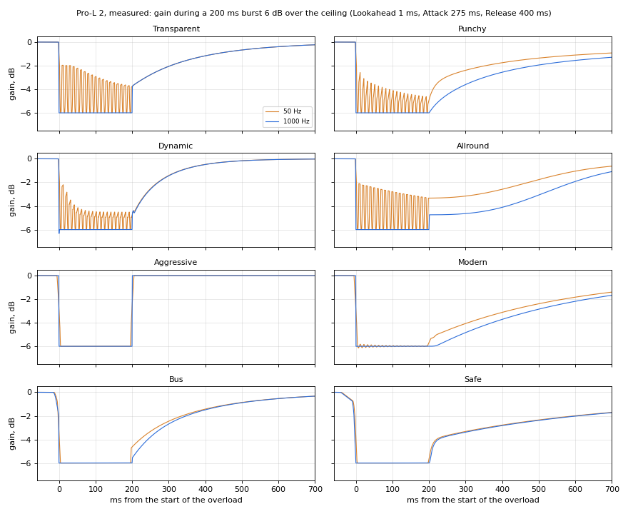
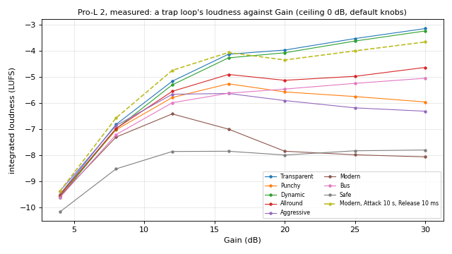

# Pro-L: the second round of research

The research behind the second version of our limiter's design (`pro-l.md`). The first round (2 October 2026) read
Pro-L 2's manual and built a DSP design from the literature. Then Théo asked for more: "a high-quality limiter …
something like Pro-L", researched as deeply as the compressor and the reverb were, and then "make this more versatile
than Pro-L … the most goated limiter ever". He uses it three ways:

- on **loud masters** (rap, trap, R&B, pop, hyperpop, about −8 to −4 LUFS);
- on **streaming masters** (−14 LUFS, −1 dBTP);
- on **vocals and buses** (a vocal chain's peak catcher, 808s, the drum bus).

He also wanted a **clipper stage inside** the limiter, and agreed to measuring the real Pro-L 2 (its trial) offline.

So Pro-L 2 is now the baseline to beat, not the target. This document has five parts:

1. [What engineers do](#1-what-engineers-do): about 75 mastering and mix engineers in these genres, in their own
   words. Their chains, how much each stage takes, how loud real records are, streaming in 2026, codec overshoot.
2. [Pro-L 2, measured](#2-pro-l-2-measured): the real plug-in run offline on test signals. Its latencies, how each
   style moves the gain, its distortion, its linking, its true peak, its filters and dither. Some of this corrects
   the first round.
3. [What other limiters do](#3-what-other-limiters-do): Ozone (and its patent), Waves L1–L4, Weiss, Sonnox, DMG
   Limitless, Elevate, TDR Limiter 6, Elephant, Uni-L, Matchering's Hyrax, the DAWs' own. What they do that Pro-L 2
   doesn't, and what users complain about.
4. [Clippers and broadcast processors](#4-clippers-and-broadcast-processors): the clipper plug-ins, Orban's patents
   (where "loud and clean" was invented), clipping DSP (curves, anti-aliasing, perception).
5. [What the literature adds](#5-what-the-literature-adds): open-source limiters read at source level, patents,
   release laws, smoothing, stereo and multiband maths, codecs, the perception of limiting. Several of these were
   checked numerically.

What it changes in the design is in `pro-l.md` itself: §4 (the styles), §5 (the DSP), §6 (the presets), §7 (the
proposal), §8 (how it's built) and §9 (the questions).

**How sure each statement is.** Quotes in "…" are the source's own words. **(inferred)** is our reasoning.
**(secondary)** is someone's report of a source. **(measured)** is our measurement of the real Pro-L 2 (§2).
**(checked)** is a numerical check of maths, not of a product. **(unverified)** is from memory.

**Limits.**
- The session's shared web-search budget ran out part-way. Later sources were read by fetching known pages:
  manuals, patents, source code, Sound On Sound's *Inside Track* series, platform help pages.
- Gearspace, Reddit, Mix With The Masters, the AES e-library and docs.izotope.com (Ozone 12) refused automated
  reading. So forum opinion is thin, and mastering engineers' course settings and hyperpop producers' own words are
  missing.
- The working notes (about 1 MB, with every quote and URL) were kept outside the repository. The sources that matter
  are cited here.

The pictures `img/pro-l-measured-*.png` are ours (our measurements of Pro-L 2), not FabFilter's.

---

## 1. What engineers do

### 1.1 Mastering engineers: the final stage

| Engineer | Records | Final stage | Numbers, words | Source |
| --- | --- | --- | --- | --- |
| **Idania Valencia** (Sterling) | Charli XCX *Brat* | **Pro-L 2, then Ozone Maximizer 7** ("the other one doing the rest of the job") | "What I like about the FabFilter is that it just works. It sounds very transparent … what I like about the Maximizer is that, I feel it gives you that power" | [MusicRadar](https://www.musicradar.com/artists/producers-engineers/idania-valencia-charli-xcx-brat) |
| **Chris Gehringer** (Sterling) | Dua Lipa "Houdini", Rihanna, Drake | Ozone 11 (in the box), formerly analogue into a GML or Prism A-D | "I just try to make it as loud as I can until I hear it distort and then back it down a little." Edits "individual sections individually to fix distortion … that the limiter is causing" | [SOS](https://www.soundonsound.com/people/chris-gehringer-sterling-sound), [MusicRadar](https://www.musicradar.com/news/dua-lipa-houdini-mastering) |
| **Dave Kutch** | Beyoncé *Lemonade*, Missy Elliott | Sonnox Oxford Limiter, "half of my compression … especially for Hip Hop and R&B" | Sets it by Input Gain, fixes pumping with Release: "If I notice the vocals getting too compressed or if the mix starts pumping, I'll adjust the Release" | [Sonnox](https://sonnox.com/articles/dave-kutch-the-mastering-palace-and-the-power-of-sonnox-plugins/) |
| **Bernie Grundman** | *Thriller* onwards | Analogue, then a digital brickwall (Lavry) | **−0.1 dBFS** sample-peak ceiling; "two, or even three types of dynamic control" | [delamar](https://www.delamar.de/musikproduktion/analog-vs-digital-mastering-bernie-grundman-interview-10603/) |
| **Brian "Big Bass" Gardner** | Dr. Dre, Eminem | Compression, "very little" limiting | "Some limiters will deceive you and you won't hear them suck, but they will still be holding back desirable transients" | [Mix](https://www.mixonline.com/recording/brian-gardner-365144) |
| **Colin Leonard** (SING) | Bieber, 21 Savage, Lil Baby | Analogue and a patented process; **no digital limiter for loudness** | Asks for the mix's "final limiter you are using just for volume" bypassed | [SonicScoop via SING](https://www.singmastering.com/2014/11/02/sonicscoop-magazine-article-with-colin-leonard-master-plan-sing-mastering-atlanta/) |
| **Glenn Schick** | Future, Migos, Gucci Mane | **Pro-L** and Pro-Q 2, "indispensable" | Future's masters are "not nearly as hot as some other releases" (his mixer) | [FabFilter](https://www.fabfilter.com/artists/glenn-schick) |
| **Dale Becker** | Billie Eilish, SZA, Taylor Swift | **Waves L4** | "for producers who just need a tool to make things loud, whether aggressive or clean" | [Waves](https://www.waves.com/plugins/l4-ultramaximizer) |
| **Em Mancini** | Kendrick Lamar | Ozone: … → **Maximizer with Soft Clip** → **RX De-clip last** | De-clip after the limiter "only treating the parts that are distorting" | [iZotope](https://www.izotope.com/en/learn/mastering-with-em-mancini-and-ozone) |
| **Chris Athens** | Drake *Views* | EQ, compression, **clipping** | "limiters have a tendency to choke the kick drum and the low-end … It's sort of a 2 dimensional sound to me" | [Audiofanzine](https://en.audiofanzine.com/mastering/editorial/articles/exclusive-interview-with-chris-athens.html) |
| **Howie Weinberg** | Nirvana, Beastie Boys | Pro-L 2 (top three), Weiss DS1; tested L4 against "4 or 5 other limiters" | "most of the time L4 wins" | [FabFilter](https://www.fabfilter.com/artists/howie-weinberg), [Waves](https://www.waves.com/plugins/l4-ultramaximizer) |
| **Ricardo Sangiao** | chart #1s | Pro-L 2; made its preset "Hip Hop Mastering RS" | "so far this plugin is the undisputed winner" | [FabFilter](https://www.fabfilter.com/artists/ricardo-sangiao) |
| **Ryan Schwabe** | Baauer, rap, EDM | Converter-style clipping (his Gold Clip) "first in chain or just before your final limiter" | Modern knee ≤ +2.5 dB of non-linear gain, Classic ≤ +6 dB; "anti-overshoot" after downsampling | [Gold Clip manual](https://www.schwabedigital.com/s/GoldClip.pdf) |
| **Justin Weis** (counterpoint) | | Clips only at the very end | "I gave up on using clipping for Hip Hop years ago" (the lows distort) | [forum](https://realgearonline.com/thread/10371/clipping) |
| **Ian Shepherd** (counterpoint) | | | No louder than **−10 LUFS short-term** at the loudest moments, true peaks ≤ −1 | [Production Advice](https://productionadvice.co.uk/how-loud/) |

What they agree on:
- Two or three dynamics stages, each doing little (Valencia, Grundman).
- The limiter is chosen for its colour and movement, not only control (Gehringer: "the best colour, the best vibe and
  the best movement").
- Release is the musical control (Kutch).
- The low end is where it breaks first (Athens, Weis).
- What the limiter breaks is repaired by hand afterwards (Gehringer's section edits, Mancini's De-clip).

### 1.2 Mixers who master, or hand over a limited mix

Most rap is mastered by its mixer, or from a mix whose limiter came off at the last moment. Sound On Sound's *Inside
Track* (Paul Tingen) is the densest primary source: the engineer opens the session and names each plug-in.

| Engineer (record) | Final stage | Numbers, words |
| --- | --- | --- |
| **Ethan Stevens** (Metro Boomin *Heroes & Villains*) | Ozone 9 → **Pro-L 2** (approvals only); Lavry converter clipped on purpose | Pro-L 2 "doing a **4dB** boost". "My mixes are so loud that they clip the Lavry, and I really like the way it does this" |
| **Joseph Colmenero** (Lil Tecca) | MixCentric (its Drive "an excellent clipper") → **Pro-L 2** | Approvals at **−9 LUFS**; "I am always looking for that clipping thing!" |
| **Maddmix** (21 Savage) | … → **Event Horizon** (a clipper) → **Pro-L** | "the Pro‑L is there to keep the signal in check" |
| **Jeremie Inhaber** (Meghan Trainor) | … → **StandardCLIP → Pro-L 2** | Pro-L 2 adds "just one dB"; the clipper "is about the groove, affecting how the kick hits, how the snare hits" |
| **Jesse Ray Ernster** (Burna Boy) | **Pro-L 2 (2–3 dB) → StandardCLIP (+1.6 dB)** (the rarer order) | Both off for mastering |
| **Curtis Douglas** (*KPop Demon Hunters*) | SSL G (attack 0.1 ms) → **Flatline 2** (hard clipper) → **Ozone IRC IV** | Clipper "sometimes … doing nothing, and other times … knocking off three or four dB". "**The clipper gives the limiter a more consistent level.**" Tries "upwards of eight different limiters on every single song" |
| **Kevin "Black Pearl" McCloskey** (DaBaby) | Ozone ≈ −9 dB threshold (approvals), "−1dB or thereabouts" for mastering | "you have to over-exaggerate the punch before the limiter, because limiting will take some of the punch and depth out." Mimics "the FL Studio limiter sound, which has a particular distortion" |
| **Clint Gibbs** (Doja Cat "Say So") | Ozone Maximizer **Transient** mode (chosen over Pro-L 2 for the kick) | 2–3 dB; 1 dB less for mastering |
| **Manon Grandjean** (Dave *Psychodrama*, mixed and mastered) | **L2** → SSL comp → **L3** → … → Ozone Maximizer → Culture Vulture → **L2** | The bus "peaks at **+3**" before the plug-ins, on purpose; the first L2 takes the kick's peaks |
| **Koen Heldens** (Trippie Redd) | Ozone 10 Maximizer | 2–3 dB, **true peak on, −0.5 dB** ceiling |
| **Jason "Cheese" Goldberg** (YoungBoy) | **L2 → L3 (five bands) → HG-2 → L2 → Ozone** | four stages |
| **Stuart White** (Beyoncé) | AOM Invisible Limiter at 8–16× with a unity-gain bypass, off when printing | "‑7 LUFS on a mix easily … my kick is not going to push down the 808, and the kick and 808 are never going to take the vocal down" |
| **Austin Seltzer** (Puremix) | Orange or Gold Clip instead of limiter work | 1–3 dB of clipping "transparent". On limiters: "A sub hits big sub, it ducks and like sucks your vocal and instruments with it" |
| **Zach Nahome** | Gold Clip instead of heavy limiting | "You can get volume without having to smash transients. It's clipping them, but you don't get pumping" |
| **Rob Kinelski** (Billie Eilish "bad guy") | … → **Pro-L 2, preset "EDM-Aggressive and Tight"** | sub keyed from the kick, 20:1 |
| **Jonathan Low, Mitch McCarthy, Josh Gudwin, Peter Nappi** (Swift, Rodrigo, Bieber, Gayle) | **Oxford Inflator → Pro-L 2 / Ozone** | "The L2 and Inflator are there for volume" (Nappi) |
| **Noah "40" Shebib, Teezio, KD Davis, Matt Schaeffer** and others | A limiter on approval mixes only | 40: "I take the L2 off when I send the track to mastering" |

All from [SOS Inside Track](https://www.soundonsound.com/techniques) (one article per record), [Puremix](https://www.puremix.com/blog/why-your-mix-bus-limiter-is-killing-your-low-end).

Counted across §1.1–1.2: Pro-L / Pro-L 2 about 20 times, Ozone Maximizer 12, Waves L2 10, L1 7 (mostly vocals and
drums), Oxford Inflator before the limiter 7, L3 4, AOM Invisible Limiter 4, DMG Limitless 3. Clippers: StandardCLIP,
Gold Clip, Orange Clip, Event Horizon, Flatline 2, KClip, converters (Lavry, Burl).

### 1.3 Clippers: where and how much

- **Where.** The dominant order is **clip, then limit** (Maddmix, Inhaber, Douglas, Colmenero; Orange Clip's manual:
  "right before your final limiter"). The rarer order is limit, then clip (Ernster). Some clip instead of limiting
  (Seltzer, Nahome), or clip the converter (Stevens, Bozzi's *TPAB* through a Lavry Gold).
- **FabFilter's users have asked for one in Pro-L 2.** "a lot of producers use a clipper before Pro L2" (forum, Dec
  2023). FabFilter: "We'll definitely keep it in mind for a future Pro-L update!" ([forum](https://prod.fabfilter.com/forum/add-comment?id=7521))
- **How much:**
  - **0–3 dB** of clipping (Orange Clip's guidance; Seltzer's "transparent" 1–3 dB); 1.6 dB (Ernster); 0 to 3–4 dB
    varying with the song (Douglas); 2–3 dB on a kick (BTS's mixer).
  - Each limiter **1–4 dB**; in all, 6–10 dB over stages that each do little.
- **Why, in their words:**
  - to make the limiter's job steady ("a more consistent level", Douglas);
  - the groove ("how the kick hits", Inhaber);
  - no pumping on the sub (Seltzer, Nahome);
  - **because the beat was made through one**: "The beat was made in FL Studio, which has a limiter on by default,
    and I was essentially trying to mimic that" (McCloskey); producers "refused to send mix engineers stems because it
    would miss the glue from their master bus" (Matt Cohn, on [Orange Clip's page](https://www.schwabedigital.com/orangeclip)).
- **Which curve:** FL Studio's soft clip (Orange Clip 3 sells a "mathematically … identical" copy of "the unique stock
  clipper found in one of the most legendary digital audio workstations"); converter curves (Gold Clip's Modern,
  Classic, Hard); hard clip. Sound On Sound: clip transients, not pitched sustain ("Snare drums, hi-hats and cymbals
  are usually better candidates").

### 1.4 Limiters on vocals: why rap chains end in an L1 or L2

`pro-c-vocals.md` found several rap vocal chains ending in Waves L1 or L2. In the engineers' words, **mostly for colour,
not peak control**:

- Chris Lord-Alge: "The L1 adds some spit and attitude to the vocal. It makes it bark a little harder … It works almost
  like an EQ, rather than a compressor."
- Seth Firkins (Future): "It really is just bringing out the top end, to make the vocals stand out."
- Leslie Brathwaite (Pharrell): the L2 "puts the vocals more in your face".
- Andrew "VoxGod" Bolooki (Lil Nas X): "having the L2 hit really hard at the end of the effects chain for every single
  vocal track."
- The one peak-control reason: Evan LaRay (Cardi B): "the vocal was still peaking too much once she began rapping
  loudly, so I put on the L1 to control that."

No settings are published. **(inferred)** The "L1 sound" is a fast, hard, not oversampled brickwall on a dense voice: odd
harmonics and some aliasing on the consonants, heard as "top end", "spit", "bark". So a vocal limiter needs two
characters: a clean peak catcher (Pro-L 2 "just kissing", Ari Morris) and a deliberately edgy one.

### 1.5 808s and drum buses

- **The 808 often arrives already clipped** by the producer's FL Studio master. Mixers keep that sound or recreate it
  (Avid Lo-Fi "as a clipper": McCloskey; Orange Clip), rather than clean it.
- **Harmonics on a copy**, low-passed: Colmenero keeps the producers' distortion but low-passes it at 6.5 kHz, 48 dB/oct:
  "I want fuzz, not hair!"
- **The kick ducks the sub** (Kinelski's 20:1; a keyed Soothe).
- **A limiter as a ceiling on kick and sub** (Illangelo's L2) or a peak catcher on the drum bus (Grandjean's L2).
- **Drums are clipped 2–4 dB** for crunch and transient control (Inhaber, Grant Boutin: "I tend to clip all my drums").

### 1.6 How loud real records are

From the Dynamic Range Database (user logs; **est.** values are LUFS estimated from DR-meter RMS, (inferred)), iZotope's
analyses and Mastering The Mix's:

| Release | Integrated LUFS | Peaks |
| --- | --- | --- |
| Playboi Carti *Whole Lotta Red* (2020) | est. −6.5 … −7.5 (album); "New Tank" est. −3.5 … −5 | sample **−0.01** on every track |
| Ken Carson *More Chaos* (2025) | "Money Spread" est. −2 … −4 (**DR0**) | |
| Travis Scott *UTOPIA* (CD) | ≈ −7 album; "FE!N" ≈ −5 | full scale on 17/19 tracks |
| 100 gecs *10,000 gecs* | "One Million Dollars" est. −3.5 … −4.5 (DR1) | full scale 8/10 |
| Charli XCX *BRAT* | "365" ≈ −5; album ≈ −6.5 … −7.5 | sample −0.01 … −0.10 |
| Kendrick Lamar *TPAB* | −7.6 … −9.9 measured | true peak up to **+2.16**, 16/16 tracks over 0 |
| Dua Lipa "Levitating" | **−5.94** | TP **+2.35** |
| Billie Eilish "BIRDS OF A FEATHER" / "WILDFLOWER" | **−9.3 / −11.9** | TP **−0.36 / −0.45** (true-peak safe) |

[DR database](https://dr.loudness-war.info/), [iZotope mastering trends](https://www.izotope.com/en/learn/mastering-trends).

- **The 2024 Billboard Global 200 top 10** (54 songs, iZotope): integrated **−8.3 ± 1 LUFS**, short-term max 2–4 LU
  higher, **80 % over 0 dBTP**, half between 0 and +0.75.
- **(inferred)** Trap, rage and hyperpop run 2–3 dB hotter than chart pop (−3.5 to −7 LUFS); their loudest tracks
  (DR0–2) are clipped, not limited. Releases are finished at a fixed sample-peak ceiling (−0.01 to −0.3 dBFS), so they
  ship at **+1 to +2.5 dBTP**. The deliberate true-peak-safe exceptions are few (Billie Eilish 2024).

### 1.7 Streaming in 2026, and codec overshoot

| Platform | Reference | Turns quiet tracks up? | Advice |
| --- | --- | --- | --- |
| **Spotify** Normal | −14 LUFS | only as far as 1 dB of headroom allows | "below −1dB TP"; louder than −14: "below **−2dB** to avoid extra distortion" |
| **Spotify** Loud | −11 LUFS | yes, with a limiter: "engage at −1 dB (sample values), with a 5 ms attack time and a 100 ms decay time" | |
| **Spotify** web player, speakers, TVs | no normalisation | | |
| **Apple Music** Sound Check | −16 (secondary; Apple publishes none) | | "leave at least 1 dB of headroom"; "levels that don't show overs on PCM can still cause clipping when encoded" |
| **YouTube** | ≈ −14 | no (down only) | |
| **TIDAL** | −14 | no | album mode |

[Spotify](https://support.spotify.com/artists/article/loudness-normalization/),
[Apple Digital Masters](https://www.apple.com/apple-music/apple-digital-masters/docs/apple-digital-masters.pdf),
[EBU Tech 3343/3344](https://tech.ebu.ch/docs/tech/tech3344.pdf) (−2 dBTP before a codec).

**Codec overshoot, measured** (7 October 2026, synthetic dense masters at −6 to −10 LUFS through Apple's own AAC encoder
(`afconvert`), libopus, LAME and ffmpeg, decoded to float, read at 16×; orders of magnitude only):

| Codec | Rise in true peak |
| --- | --- |
| Apple AAC 256 (Apple Music) | +0.7 to +1.5 dB |
| Opus 160 / 96 / 64 | +0.9 to +1.9 / **+2.6 to +4.2** |
| MP3 320 / 128 | +0.5 to +0.8 / +1.1 to +2.0 |
| ffmpeg's own AAC 128 | +2.6 to +5.0 (a poor encoder: never preview with it) |

- The rise **doesn't shrink as the ceiling drops**: a −1 dBTP loud master decodes from AAC 256 at about 0 dBTP, a −2 at
  about −1.2. That's Spotify's "−2 dBTP if louder than −14", in numbers.
- **Clipping into the limiter doubles or triples the decoded overshoot** at equal loudness (ffmpeg AAC 128: +0.9 →
  +4.3 dB at −8 LUFS), because about four times as many samples sit at the ceiling. A pure limiter at −1 dBTP kept
  every tested codec under 0 dBTP down to −10 LUFS (checked, §5).
- A sample-peak limiter at −1 dBFS left **+2.8 to +3.0 dBTP**.
- **A short 4× detector under-read** a clipped, bright master by up to 1.3 dB; BS.1770's own 4× filter by 0.76 dB. Thomas
  Lund (TC Electronic): a 4× detector can under-read by 0.7 dB; codec overshoot reaches +5.3 dB at MP3 64 kbps
  ([EBU Technical Review 2007](https://tech.ebu.ch/docs/techreview/trev_310-lund.pdf)).

### 1.8 Does loud still win?

- A −7 LUFS master is turned down 7 dB on Spotify, YouTube and TIDAL. Loudness only "wins" where nothing normalises:
  normalisation off, Spotify's web player and speakers, DJ software, **and the approval chain itself**: Shepherd's poll,
  "75 percent said they turned normalisation off" ([SOS](https://www.soundonsound.com/node/4930103)).
- Denser masters sound louder at equal LUFS (Shepherd: "we perceive them as having different loudness").
- Against: Apple ("can make tracks actually sound weaker"), codec distortion, SOS's blind test (3–6 dB quieter versions
  scored the same).

**(inferred)** Loud masters are a real, documented practice in Théo's genres. The tool should get there as cleanly as
possible and show honestly what normalisation and codecs will do. It shouldn't refuse, and it shouldn't preach.

### 1.9 What goes wrong, in their words

| Problem | Said | Cause | What they do |
| --- | --- | --- | --- |
| **The sub makes everything duck** | "A sub hits big sub, it ducks and like sucks your vocal" (Seltzer) | One gain for the whole spectrum, driven by the sub | Clip the transient instead; duck the sub from the kick; filter what the limiter hears (Douglas) |
| **The kick and lows are choked** | "choke the kick drum and the low-end" (Athens) | Look-ahead dips under each kick | Clipping; mono below 60 Hz; a Transient mode |
| **Bass distortion** | "I gave up on using clipping for Hip Hop" (Weis); a too-fast release follows "the amplitude waveform of low‑frequency signals" (Hugh Robjohns) | The gain moves within the 808's cycle | Clip only short transients; program-dependent release; split the lows |
| **Unpredictable distortion bursts** | "unpredictable moments of distortion" (Douglas); Gehringer's section edits | Isolated peaks drive the limiter far past its usual depth | A clipper first; local repair |
| **Lost punch** | "lost a lot of the bounce, dynamic and punch" (LaPorta) | Look-ahead attack, stacked peak control | Less limiting, more clipping; transient emphasis |
| **Harsh "hair" on clipped 808s** | "I want fuzz, not hair!" (Colmenero) | High harmonics and aliasing | Low-pass the distortion; oversample the clipper |
| **Codec crunch** | Spotify: louder tracks "more susceptible to extra distortion" | §1.7 | −2 dBTP for loud lossy masters; encode, then check |
| **Loudness fools the ear** | BTS's mixer keeps references level-matched "so my ears are not being fooled" | | Unity-gain or level-matched bypass |

### 1.10 What it adds up to

| Job | Output | Ceiling | How | Per stage |
| --- | --- | --- | --- | --- |
| **Loud master** | −4 to −8 LUFS | sample peak −0.01 to −0.3 dBFS (so +1 to +2.5 dBTP), or −0.5 / −1 dBTP | clip → limit, often a saturator or Inflator before, often two limiters | clip 0–3 dB (to 4), each limiter 1–4 dB |
| **Streaming master** | −14 (−16 Apple), or ≤ −10 LUFS short-term | **−1 dBTP**; −2 dBTP when louder than −14 | a transparent limiter, true-peak detection ≥ 8× | 1–3 dB |
| **Vocals, buses** | | none needed (not the last stage) | vocal: a "kissing" peak catcher, or an edgy L1-like one; drums: clip 2–4 dB; 808: clip, keep the fuzz under ~6.5 kHz | vocal 1–3 dB |

The practices to make easy:

1. **A clipper before the limiter, in the same plug-in** (and the reverse order possible).
2. **Several stages, each doing little**, each with its own meter.
3. **Two ceiling philosophies, honestly labelled**: true peak (−1 dBTP, −2 for loud lossy masters) and the
   "release style" sample-peak ceiling (−0.01 to −0.3 dBFS), with the true peak always shown.
4. **The low end handled on purpose**: what the limiter hears, a release the 808's cycle can stand, optionally a split.
5. **Delta listening per stage, and level-matched comparison.**
6. **"For approval" and "for mastering"** in one place: at least 14 engineers limit only their approval mixes and take
   the limiter off (or back it off 1 dB) for the master.
7. **Character choice**: transparent; punchy; near-clip; an edgy vocal limiter.
8. **Delivery checks**: LUFS-I, short-term max, PLR, true peak (≥ 8×), what each platform will do, and a check with
   real encoders.
9. **Never silently reach for a target**: engineers set the amount by ear ("until I hear it distort and then back it
   down"). A "to target" helper suggests; it doesn't apply.

---

## 2. Pro-L 2, measured

### 2.1 How it was measured

FabFilter's trial of **Pro-L 2 2.26** (the current version; the VST3 installed into `~/Library/Audio/Plug-Ins/VST3`)
was run offline through Spotify's `pedalboard` (a VST3 host for Python), at 48 kHz stereo, on signals made for the
purpose: DC and sine bursts, steady sines, two-tone signals, clipped drums, clipped noise, and a trap loop made from the
starter kit with synthesised 808s and a pad. Nothing was played. The probe is
**`scripts/fabfilter-probes/pro_l.py`** (its groups: latency, carriers, release, thd, static, loudness, music, link,
overshoot, filters, dither); it writes JSON and charts to `data/fabfilter-probes/pro-l/`.

- pedalboard compensates the plug-in's reported latency, so output and input line up sample for sample.
- **The gain is measured as out / in** wherever the input isn't near a zero crossing, interpolated between. A limiter
  that doesn't oversample *is* a time-varying gain, so this is exact (a −152 dB null below the ceiling, §2.5).
- True Peak Limiting was off unless said, so the sample-peak behaviour is what's seen.

Everything in this section is **(measured)**.

### 2.2 Parameters, ranges, tapers and defaults

Read from the plug-in's parameter list (this replaces several "not stated" and "observed" entries in `pro-l.md` §2):

| Parameter | Range | Taper | Default |
| --- | --- | --- | --- |
| Gain | 0 to 30 dB | linear | 0 dB |
| Style | the eight | | **Modern** |
| Lookahead | 0 to 5 ms | linear | **0.18 ms** |
| Attack | 0 to 10 s | **10 s × raw⁴** (1 ms at 0.1, 16 ms at 0.2, 256 ms at 0.4, 625 ms at 0.5) | **275 ms** |
| Release | 0 to 10 s | **6.859 s × raw³** up to 5 s (at 0.9), then on to 10 s | **400 ms** |
| Channel Link Transients / Release | 0 to 100 % | linear | **75 % / 100 %** |
| Oversampling | Off, 2x … 32x | | **Off** |
| True Peak Limiting | on / off | | **on** |
| Output Level | −30 to 0 dB | linear | **0 dB** |
| Dithering, Noise Shaping | Off, 16 … 24 bits; None, Basic, Optimized, Weighted | | Off; Optimized |
| Filter DC Offset, Unity Gain, Audition Limiting, Side Chain Triggering | on / off | | off |
| Lock Output | | | Locked |
| Loudness target | −60 to 0 LUFS | 0.1 LU steps | −14 |

Also automatable (it's in the list): the meter scale, display mode, loudness time scale, scale, origin, target,
recording (pause), auto-reset, true-peak metering. So **Pro-L 2's own Default Setting is Modern at a 0 dBTP true-peak
ceiling with oversampling off**.

### 2.3 Latency

| Style | Off | 2x | 4x | 8x | 16x | 32x |
| --- | --- | --- | --- | --- | --- | --- |
| **True Peak off** | | | | | | |
| Transparent, Punchy, Allround | 496 | 593 | 535 | 507 | 493 | 487 |
| Dynamic | 992 | 961 | 839 | 779 | 749 | 735 |
| Aggressive, Bus | 2896 | 2993 | 2935 | 2907 | 2893 | 2887 |
| Modern | 2880 | 3105 | 3111 | 3115 | 3117 | 3119 |
| Safe | 2640 | 2865 | 2871 | 2875 | 2877 | 2879 |
| **True Peak on** | | | | | | |
| Transparent, Punchy, Allround | 731 | 626 | 562 | 532 | 517 | 510 |
| Dynamic | 1227 | 994 | 866 | 804 | 773 | 758 |
| Aggressive, Bus | 3131 | 3026 | 2962 | 2932 | 2917 | 2910 |
| Modern | 3115 | 3138 | 3138 | 3140 | 3141 | 3142 |
| Safe | 2875 | 2898 | 2898 | 2900 | 2901 | 2902 |

Samples at 48 kHz. Read:
- **Lookahead never changes it** (0 and 5 ms give the same latency in every combination).
- Transparent, Punchy and Allround: **256 samples + 5 ms** at any rate (476 at 44.1 kHz, 496 at 48, 736 at 96).
  Dynamic is twice that. These are the "old four".
- **Modern 60 ms, Safe 55 ms**, at every rate; **Aggressive and Bus ≈ 60 ms** (2896 at 48 kHz, 2681 at 44.1, 5536 at
  96). The first round guessed Bus at 55 ms and Aggressive at 8 ms: Aggressive is one of the long ones.
- **True peak** adds 235 samples (4.9 ms) with oversampling off, but **only about 25 with it on**: with oversampling,
  true peak is taken care of in the oversampled path.
- The old four's latency *falls* as oversampling rises (their stages are counted in oversampled samples), Modern's and
  Safe's rises slightly.

### 2.4 How each style moves the gain

**When reduction starts before a peak** (a burst 6 dB over the ceiling, Lookahead 1 ms; ms before the burst):

| Style | DC | 50 Hz | 100 Hz | 1 kHz |
| --- | --- | --- | --- | --- |
| Transparent, Punchy, Dynamic, Allround | 0.9 | 1.5 | 0.8 | 0.8 |
| **Aggressive** | **49** | **5.1** | **2.8** | 0.9 |
| **Modern** | 0.9 | **4.8** | **2.4** | **0.3** |
| Bus | 50 | 11 | 12 | 13 |
| Safe | 49 | 35 | 36 | 37 |

**The adaptive ramp.** Starting the same 50 Hz overload at different phases shows what Aggressive and Modern do: the gain
starts falling **about half a period of the waveform before the peak** (10 ms at 50 Hz, 5 ms at 100 Hz) and reaches the
full reduction exactly on the peak, whatever the phase. Never shorter than the Lookahead knob, never longer than about
50 ms (DC). Modern is also **spectrally aware**: when the same overload begins with an abrupt step (a broadband click),
it switches to a ~0.7 ms ramp, while Aggressive keeps 10 ms. The first round guessed exactly this rule for Modern ("at
least half the period of the overload's lowest strong frequency"); it holds, and Aggressive does it too.

**Between the half-cycles of a bass note** (the chart above, orange):
- **Transparent, Punchy, Dynamic and Allround let the gain bounce back between the half-cycles** of a sustained 50 Hz
  overload: from −6 dB on each crest up to −2 or −3 dB between them. That's the gain moving within the bass's cycle, the
  first round's "bass distortion" (§2.5 measures it).
- **Aggressive, Modern, Bus and Safe hold the gain flat** on a sustained bass (Modern with a ripple of ±0.15 dB).

**The release** (recovery after a 200 ms 1 kHz burst):

| Style, knobs | to 1 dB | to 0.1 dB |
| --- | --- | --- |
| Transparent, Release 400 ms, Attack 0 / 275 ms / 10 s | 293 / 228 / **0.6** ms | 723 / 659 / 0.8 ms |
| Transparent, Release 0, Attack 0 | 28 ms | 67 ms |
| Modern, Release 0 or 10 ms, Attack ≤ 275 ms | **395 ms** | 871 ms |
| Modern, Release 400 ms, Attack 275 ms | 692 ms | 1548 ms |
| Modern, Release 400 ms, Attack 10 s | 175 ms | 1031 ms |
| **Aggressive, any Attack and Release** | **0.3 ms** | 0.6 ms |

- **Transparent's release stage is exactly the first round's model**: with Attack at 10 s the slow stage is off and
  a short peak recovers in under a millisecond; at Attack 0 the recovery follows Release (to 1 dB in about 0.73 ×
  Release).
- **Modern never recovers faster than about 400 ms**, even at Release 0. Its Attack barely matters below 275 ms.
- **Aggressive ignores Attack and Release.** It has no release stage: the same adaptive ramp on both sides of every
  peak (on DC, a symmetric 50 ms ramp down and up).
- **Short bursts recover differently** (DC bursts, Lookahead 1 ms, Attack 275 ms, Release 400 ms): Transparent recovers
  from a 2 ms burst to 1 dB in 0.7 ms, from a 20 ms one in 106 ms, from a 200 ms one in 291 ms. The release stage only
  charges on what's longer than about the Attack time, as Jonathan Jetter found.
- **Modern digs deeper than the ceiling needs on a DC step**: 6.55 dB at 20 ms and 6.95 dB at 50 ms for a 6 dB
  overload, then settles. Dynamic over-reduces by 0.4–0.5 dB at the onset (its "emphasis", applied before limiting, so
  the limiter takes it back off a constant overload).

### 2.5 Distortion

**Below the ceiling, every style is bit-transparent**: the trap loop at gain 0 (peaks −1 dBFS) nulls at **−152 dB** in
every style. A 1 kHz sine's static curve is a hard wall: exactly the input up to 0 dB, exactly 0 dB above, in every
style. So **Pro-L 2 has no knee**, Bus doesn't compress under the ceiling and Dynamic adds nothing to sounds under it.
The first round's Allround knee and Bus's sub-ceiling RMS compression were wrong.

**THD+N of a steady sine** (dB re the fundamental, default knobs, oversampling Off; 4x changes only the 5 kHz column):

| Style | 40 Hz | 100 Hz | 250 Hz | 1 kHz | 5 kHz (Off / 4x) | IMD: 50 Hz + 3 kHz at −20 dB |
| --- | --- | --- | --- | --- | --- | --- |
| **+6 dB over** | | | | | | |
| Transparent | **−21** | −21 | −21 | −26 | −40 / −64 | −13 |
| Punchy | −26 | −27 | −29 | −46 | −66 / −86 | −17 |
| Dynamic | −24 | −24 | −24 | −29 | −40 / −64 | −15 |
| Allround | −21 | −22 | −23 | −36 | −59 / −85 | −14 |
| Aggressive | none | none | none | none | −38 / −62 | **−10** |
| Modern | −73 | −83 | −94 | −110 | −53 / −62 | −38 |
| Bus | none | none | none | none | −52 / −69 | −27 |
| Safe | none | none | none | none | none | **−71** |
| **+12 dB over** | | | | | | |
| Transparent | −18 | −18 | −18 | −24 | −40 / −64 | −10 |
| Aggressive | none | none | none | none | −38 / −62 | **−4** |
| Modern | −74 | −83 | −94 | −107 | −50 / −62 | −38 |

"none": below −135 dB. Read:
- **The old four distort bass by about 10 %** (−21 dB at +6 dB, −18 at +12): the gain bouncing between half-cycles.
- **Aggressive, Bus and Safe have no distortion at all on a steady sine** (their gain holds), and **Modern almost none**.
- **But two tones tell another story.** With a quiet 3 kHz riding on a loud 50 Hz (the hats on an 808), Aggressive is
  the worst of all (−10 dB at +6, −4 dB at +12): it limits each crest of the composite waveform. That's its
  "near-clipping". Safe is the cleanest (−71 dB), Modern a good compromise (−38 dB).
- At 5 kHz without oversampling, every style but Safe distorts (−38 to −66 dB): the samples' peaks move from cycle to
  cycle. 4x oversampling buys 20–25 dB there.

### 2.6 Loudness against Gain

On the trap loop (4 bars at 140 BPM; kick, snare and clap, hats with a roll, an 808 line, a pad; peak −1 dBFS,
−13.2 LUFS), with Pro-L 2's own default knobs and a 0 dB ceiling:

| Gain | 4 | 8 | 12 | 16 | 20 | 25 | 30 dB |
| --- | --- | --- | --- | --- | --- | --- | --- |
| Transparent | −9.5 | −6.8 | −5.2 | −4.1 | −4.0 | −3.5 | −3.2 |
| Aggressive | −9.4 | −6.9 | −5.7 | −5.6 | −5.9 | −6.2 | −6.3 |
| **Modern** | −9.6 | −7.3 | **−6.4** | −7.0 | −7.8 | −8.0 | **−8.1** |
| Safe | −10.2 | −8.5 | −7.9 | −7.8 | −8.0 | −7.8 | −7.8 |
| Modern, Attack 10 s, Release 10 ms | −9.4 | −6.6 | −4.8 | −4.1 | −4.4 | −4.0 | −3.7 |

**Loudness is not monotonic in Gain.** Modern peaks at +12 dB and then gets *quieter* as Gain rises (2 LU quieter at
+30 dB); Aggressive peaks near +16, Bus and Punchy level off. Its release stage reduces more the harder it's pushed. With
the release stage out of the way (Attack 10 s, Release 10 ms) Modern reaches −3.7 LUFS. Pushing Pro-L 2 for loudness can
make a master quieter and more pumped at once, which is a trap for a user turning one knob.

**At matched loudness** (the loop pushed to −9 and −7 LUFS; "punch" is the kick's and snare's first 6 ms against the
next 74 ms, relative to the input; "residue" is what's left after the best gain per 20 ms, i.e. fast gain motion and
clipping):

| To −7 LUFS | Gain | True peak | Kick punch Δ | Snare punch Δ | Residue | Residue > 4 kHz |
| --- | --- | --- | --- | --- | --- | --- |
| Transparent | 7.7 | +1.25 | −1.8 | −1.7 | −21.9 | −42.9 |
| Punchy | 8.1 | +1.37 | −1.6 | −1.7 | −24.0 | −44.3 |
| Aggressive | 7.7 | +1.48 | −1.9 | −1.7 | −21.7 | −41.2 |
| Modern | 8.9 | +1.35 | −2.0 | −1.6 | −21.5 | −40.3 |
| Bus | 8.5 | +1.45 | −1.5 | −1.8 | −25.3 | −45.3 |
| Safe | (can't reach −7) | | | | | |
| Hard clip, 4x oversampled | 6.9 | +0.77 | −1.8 | −1.2 | −21.6 | −37.5 |
| tanh clip, 4x | 8.7 | −0.13 | −2.2 | −2.7 | −19.7 | −32.5 |

- A hard clipper reaches the same loudness with **0.8–2 dB less gain** than any style, keeps the snare's punch better,
  and has the lowest true peak, at the price of **3–8 dB more high-frequency residue**: the engineers' trade (§1.3).
- A tanh soft clipper is worse than a hard one on every count here: TDR's warning that soft knees "reach deeper into
  the signal" (§4).
- **Without true peak limiting, every style's true peak lands +1.2 to +1.5 dB over its 0 dB ceiling** on this loop.

### 2.7 Linking, true peak, filters, dither

**Linking.** A quiet channel's reduction while the other has +6 dB bursts (Release link 0):

| Transients link | 0–20 % | 30 % | 40 % | ≥ 50 % |
| --- | --- | --- | --- | --- |
| reduction in the quiet channel (of 6 dB) | 0 | 1.9 | 4.2 | 6.0 (full) |

The same in Transparent and Modern. So **the knob is not linear**: nothing below about 20 %, full linking from 50 %, so
its default 75 % is fully linked for a 6 dB overload. With Transients at 0 and Release at 100 %, a 20 ms burst still
takes 1.0 dB (Transparent) or 1.5 dB (Modern) off the quiet side, and a 300 ms burst 4.0 / 5.4 dB: the release stage.
In Safe, the Release link alone links everything (Safe is all release stage).

**True peak.** +12 dB of hard material into a −1 dBTP ceiling, True Peak Limiting on, Lookahead 0 (dB over the
ceiling):

| Material, style | Oversampling | Sample peak | BS.1770's meter | An ideal reconstruction (32×) |
| --- | --- | --- | --- | --- |
| clipped drums, Transparent | Off / 4x / 32x | −0.04 / −0.01 / −0.01 | −0.01 / −0.00 / −0.00 | **+0.11 / +0.27 / +0.28** |
| clipped drums, Modern | Off / 4x / 32x | −0.03 / −0.02 / −0.02 | −0.01 / −0.00 / −0.00 | **+0.27 / +0.37 / +0.30** |
| clipped noise, Transparent | Off / 4x / 32x | −0.04 / −0.04 / −0.04 | −0.03 / −0.03 / −0.03 | **+0.35 / +0.31 / +0.35** |
| the loop, Transparent | Off / 4x / 32x | −0.04 / −0.01 / −0.00 | −0.00 / **+0.02 / +0.04** | +0.14 / +0.13 / +0.16 |
| the loop, Modern | Off / 4x / 32x | −0.00 / −0.00 / −0.00 | −0.00 / −0.00 / −0.00 | +0.22 / +0.12 / +0.16 |

- **Pro-L 2 holds its ceiling by BS.1770's meter** (within 0.04 dB), not by an ideal reconstruction: **+0.1 to
  +0.37 dB over**, even at 32x oversampling. The first round's design holds both (its detector takes the BS.1770 phases
  *and* a finer interpolator; `pro-l.md` §5.9's checks: ≤ −0.006 dB by an ideal reconstruction with oversampling on).
  That's one measurable way ours beats it.
- With True Peak Limiting **off**, its true peaks reach +5.5 dB over the ceiling on clipped drums at oversampling Off,
  and +1.6 to +2.0 dB at 4x.
- It leaves a 0.035 dB sample-peak margin under the ceiling with oversampling off and TP on.

**Oversampling filters** (a low-level impulse through Transparent): the same at every factor: **±24 samples** long
(0.5 ms each side), −0.1 dB at 20.9 kHz, −3 dB at 22.75 kHz, linear phase (the pre-ring holds −22.7 dB of the
energy). Shorter and gentler than the first round's 127-tap first stage.

**DC filter**: −5.1 dB at 1 Hz, −1.9 at 2 Hz, −0.4 at 5 Hz, −0.1 at 10 Hz: a first-order high-pass at about **1.5 Hz**
(Ozone's is 1 Hz). The first round's 5 Hz was too high.

**Dither** (16 bits; noise per octave against flat TPDF):

| Shaping | 63 Hz | 250 Hz | 2 kHz | 4 kHz | 8 kHz | 12 kHz | 16 kHz | 20 kHz | total |
| --- | --- | --- | --- | --- | --- | --- | --- | --- | --- |
| None (TPDF) | 0 | 0 | 0 | 0 | 0 | 0 | 0 | 0 | −96.3 dBFS |
| Basic | −6.8 | −6.0 | −6.7 | −8.4 | −3.9 | +2.4 | +5.8 | +6.8 | −92.8 |
| Optimized | −12.0 | −11.4 | −11.0 | −9.0 | −5.0 | −2.3 | +11.7 | +14.4 | −85.7 |
| Weighted | −12.2 | −11.7 | −17.3 | −23.1 | −3.3 | −0.1 | +19.3 | +22.2 | −78.0 |

These are the curves ours should match (`pro-l.md` §5.11 picked published filters by FabFilter's descriptions; they're
close in shape).

### 2.8 What the measurements change

1. **Pro-L 2's styles differ only in how the gain moves**: no knee, no sub-ceiling compression, no emphasis below the
   ceiling.
2. **The old four (Transparent, Punchy, Dynamic, Allround) distort bass by about 10 %**: their gain moves within the
   bass's cycle. **The new four (Aggressive, Modern, Bus, Safe) don't**, at the cost of ~55–60 ms of latency.
3. **The adaptive ramp is half a period of the waveform at the peak** (Aggressive, Modern), bounded by the Lookahead
   knob and about 50 ms; Modern also shortens it for clicks.
4. **Aggressive has no release stage; Modern's release has a ~400 ms floor; Safe and Bus ramp over tens of ms.**
5. **Loudness isn't monotonic in Gain** (Modern, Aggressive, Bus).
6. **True peak holds by BS.1770's meter but not by an ideal reconstruction** (+0.1 to +0.37 dB).
7. **The link knob is effectively a switch between 20 % and 50 %.**
8. Defaults, tapers, latencies, the DC filter and the dither curves are now known numbers.

The targets for ours are the same tests, run on our engine (`pro-l.md` §8.9): zero bass distortion in every style that
claims transparency, IMD at or under Modern's, a ceiling held by an ideal reconstruction, loudness monotonic in Gain.

---

## 3. What other limiters do

### 3.1 iZotope Ozone Maximizer (Ozone 12, September 2025)

- **IRC modes**: IRC Low Latency; IRC 1 ("reacting quickly to transients … more slowly to steady bass tones"); IRC 2
  (transients "sharper and clearer"); IRC 3 ("the most aggressive limiting by using an advanced psychoacoustic
  model"; styles Pumping, Balanced, Crisp, Clipping, which "constrain the release"); IRC 4 ("shaping the spectrum …
  limits frequency bands that contribute most to these peaks … dozens of psychoacoustically spaced bands"; styles
  Classic, Modern, Transient); **IRC 5** (Ozone 12): **four bands**, "the bands that contribute the most to overall
  peak levels get to be attenuated first"; "Can this produce a tonal shift? Yes" (Alexey Lukin).
  [Ozone 12 help](https://docs.izotope.com/ozone12/en/maximizer.html), [Inside Ozone 12](https://www.izotope.com/en/learn/inside-ozone-12).
- **The patent behind IRC 3 and 5**: **US 9,225,310 B1** (Lukin, priority 2012, in force to about **2034**). Per frame,
  "6 to 8 individual amplitude envelopes are constructed … spanning the whole range of available characteristics" from
  clipping to the slowest; each is applied, its distortion compared against a masking model (PEAQ's ear model plus a
  tonality index and raised masking around transients; "the human ear has low sensitivity to short-term (less than
  6 ms) distortions"), and "the most aggressively limited signal whose distortion score is still below a
  user-specified audibility threshold is chosen". [Google Patents](https://patents.google.com/patent/US9225310B1/en).
  **We can't copy this generate-and-test method while it's in force.**
- **Character** 0–10, "Clipping (0.0) to Very Slow (10.0)": one knob for attack, look-ahead and release.
- **Soft Clip** (Ozone 10+): before the limiter, 4× oversampled, Amount = wet/dry, shapes Light / Moderate / Heavy
  starting at −3 / −9 / −30 dB, "up to 6 dB of extra level". **Upward Compress** (Ozone 11+): level-matched parallel
  upward compression before the limiter. **Transient Emphasis** before limiting. **Stereo Independence**, split into
  Transient and Sustain. **Delta** (includes the clipper's and upward compressor's work, excludes Gain/Output).
  **Learn Input Gain** to a target LUFS (5 s; "should not be used to meet loudness compliance standards"). **Codec
  Preview** (MP3 in Ozone 12). DC filter at 1 Hz.
- Complaints: IRC 3–5's CPU and latency ("latency delay is insane", KVR); tonal shift in IRC 4 and 5; opaque controls
  (no times shown); hot defaults.

### 3.2 Waves L1, L2, L3, L4

- **L2**: look-ahead 64 samples (≈ 1.5 ms), which is its latency; **ARC** auto release recalculated every sample; sample
  peak only; its manual warns fast releases distort bass. Its manual also warns that a high-pass after heavy limiting
  "can add several dB of peak".
- **L3**: five bands, one limiter distributing attenuation across them (the "Peak Limiting Mixer"), per-band
  **Priority**; 80 ms latency; L3-LL with phase-compensated crossovers.
- **L4 (September 2025)**, the classic product closest to our plan: an **adaptive clipper** and adaptive release, each
  set by a ×0.1–×10 multiplier on an adaptive base; five modes; upward expansion; true peak; up to 16× oversampling;
  LUFS meters; gain match and delta; **clipping stays per-channel even when the limiter is stereo-linked**; latency up
  to 305 samples at 44.1 kHz. Dale Becker and Howie Weinberg use it (§1.1). [Waves](https://www.waves.com/plugins/l4-ultramaximizer).

### 3.3 Weiss (DS1-MK3, MM-1)

The clearest published account of program-dependent release ([DS1-MK3 manual](https://weiss.ch/wp-content/uploads/2021/12/download-weiss-ds1mk3-manual.pdf)):
- **two release times**, the fast one used when the peak/RMS ratio says transients and the slow one otherwise,
  "Average" setting the RMS window;
- **Release Delay** (a hold): with look-ahead the side chain sees a sound end before the gain stage does, so release
  starts early and dents the tail. Weiss's scope plots show it;
- **"overall delay" vs "preview"**: a fixed latency for the session, the look-ahead varying beneath it (what our design
  does).
- MM-1: styles with an Amount, and M/S "Wide" and "De-ess" styles.

### 3.4 Sonnox Oxford Limiter v3

Internal headroom and a slow attack, then **Enhance / Safe Mode** (a soft-clip stage catching what escapes; "5–6 dB
perceived gain"), then **Auto Comp**, a separate true-peak correction whose corrected overs the meter shows greyed
out. Latency 141 / 227 / 415 samples at single / double / quad rates. Its old reconstruction meter "will under-report"
true peak and is deprecated. Complaints: Enhance distorts unpredictably on sparse, low-heavy material
([SOS](https://www.soundonsound.com/reviews/sony-oxford-limiter)). Sonnox and Fraunhofer's **Pro-Codec** (now
discontinued) previewed up to five codecs with difference listening, ABX and a predicted post-decode overshoot.

### 3.5 DMG Limitless, Newfangled Elevate, TDR Limiter 6 GE, Voxengo Elephant

- **DMG Limitless** ([manual](https://dmgaudio.com/dl/DMGAudio_Limitless_Manual.pdf)): **two limiters**, a transient
  limiter whose release equals its look-ahead and a dynamic one with a musical release, with a **Dynamics** control
  sharing the work: "it is better to take 1 dB off with two limiters than 2 dB off with a single limiter", because one
  release serving both leaves "holes … dips in level following every transient". Up to **six bands**: a solver "per-sample
  solves to find the gentlest possible adjustments that will prevent clipping", **Separation** 0–200 % (wideband →
  dynamic EQ → "errant bands work harder") and **Weighting** (prefer cutting lows or highs). Release shape blends log
  and inverse-log. A pre-limiter clipper with five shapes and up to 64× oversampling. True peak with **"Use ITU
  Filter"**: "designed to guarantee matching the ITU 1770 True Peak measurement".
- **Newfangled Elevate**: **26 bands** (linear-phase triangles on the mel scale), an optimiser "every sample";
  **Adaptive Gain** ("number of dB by which each band can stray from the others"); per-band Transient Emphasis into a
  **Spectral Clipper** ("the large low frequencies don't crowd out the finer detail frequencies"). Its maker: "I
  wouldn't bother using it for real-time use" (its CPU). No LUFS meter.
- **TDR Limiter 6 GE** ([manual](https://docs.tokyodawn.net/limiter-6-ge-manual/)): six reorderable modules (an RMS
  compressor, a peak limiter, an **HF limiter**, a **clipper** with knee and multiband Separation, a true-peak output
  protection), each with its own M/S; an equal-loudness bypass. Its caution about knees: "Soft knees reach deeper into
  the signal … they often end up producing more audible side-effects."
- **Voxengo Elephant**: about a dozen algorithms; **Dynamic Release Control** ("adjusts limiter's release envelope so
  that it better resembles the original unlimited sound's release form … reduces harmonic distortion"); release shape
  including an S-curve; true peak only with oversampling.

### 3.6 Newer ones, and the DAWs' own

- **Tone Projects Uni-L** (May 2026): **three stages**, slow limiter → fast limiter → clipper, a Balance between them,
  and **crossovers that keep the lows out of the fast and clip stages** ("Fast Above", "Clip Above"); a transient
  section deciding whether a transient is limited, clipped or let through.
- **Matchering's Hyrax** (open source): reduction is never less than each sample needs, whatever the smoothing; release
  is the larger of a fast (7 Hz) and a very slow (0.27 Hz) envelope.
- **Airwindows ClipOnly2**: samples below the threshold pass untouched; only the samples where a clip starts and ends are
  rewritten.
- **The Sonnox Inflator curve** (as reverse-engineered by users): raises lower levels while peaks stay exactly at full
  scale. Seven engineers put it before their limiter (§1.2).
- **DAWs**: every recent rebuild added **true peak and a soft-clip option** (Ableton 12.1's Limiter: Standard / Soft
  Clip / True Peak, M/S with a continuous link, Lookahead 1.5 / 3 / 6 ms; Studio One's Softclip and TP; Cubase's
  Maximizer Soft Clip and **Recover** (a fast first release); Avid Pro Limiter's Character). **FL Studio's Maximus** has
  two release knobs (accelerating and decelerating), a saturator before each band and a **Master Mid Mode** (the mid band
  drives the master limiter, so the 808 doesn't). **Fruity Limiter**'s SAT knob is saturation into the limiter.
  **Logic's Adaptive Limiter** works out an "Optimal Lookahead" and offers to apply it.

### 3.7 Ideas worth taking (ranked for Théo's use)

1. **A clipper stage built in, before the limiter** (every product above; FabFilter's own users asked). With its own
   meter and delta.
2. **Keep the 808 from ducking the mix** without pumping: a hold for bass (§5), and later a band split in detection or
   gain (IRC 5, L3, Limitless, Elevate, Uni-L's "Fast Above", Maximus's Master Mid Mode).
3. **Two stages that share the work, visibly** (Limitless's Dynamics, Uni-L's Balance, Weiss's dual release): ours
   already has two; show both, with their meters.
4. **Transient and sustain stereo linking** (Ozone) **and M/S** (Ableton, TDR, Weiss), per-channel clipping under a
   linked limiter (L4).
5. **True peak in every mode, matching BS.1770 exactly** (DMG's "Use ITU Filter"), and better (§2.7).
6. **Delta per stage, gain-matched bypass, unity gain** (everyone).
7. **Delivery tools**: per-platform normalisation preview, a codec check with real encoders and decoded true peak
   (Pro-Codec, MasterCheck, Ozone), a target LUFS that suggests Gain (Ozone's Learn, never silent).
8. **Styles that show their parameters** (Limitless's "Copy to Manual"; KVR users complain Pro-L's "attack" is really a
   hold and its lookahead isn't drawn).
9. **Release shape and Recover** (Elephant, Limitless, Cubase, Maximus).
10. **An HF limiter before the main one** (TDR, OD Limen): hats and esses stop setting the whole mix's gain.
11. **An upward / "inflate" stage before the limiter** (Ozone Upward Compress, Inflator, L4's upward expansion), as a
    density control.
12. **A low-latency mode with the same controls** for vocals and buses (IRC LL, Ableton's fixed 1.5 ms).

### 3.8 What users complain about

- The sub pumping the whole mix (single-band limiters).
- Transients dulled at high reduction; "too clean / no punch".
- Distortion with short times; inter-sample peaks when look-ahead is short.
- Latency and CPU (true peak, high oversampling, multiband, psychoacoustic modes).
- Opaque styles and controls; names that don't say what they do ("attack" that's a hold).
- Missing pieces that send people to another plug-in: clipper, multiband, M/S, codec preview, character.
- "True peak" switches that only meter, or don't guarantee conformance; level-matching that's slightly off.
- Clippers pushed past a dB or two: "less musical and louder in a painful kind of way" (DMG, secondary).

---

## 4. Clippers and broadcast processors

### 4.1 The clipper plug-ins

**Every serious clipper has the same skeleton**: drive → an *oversampled* curve → downsample → output gain → an optional
hard "ceiling" at the host rate, to catch the few tenths of a dB the downsampling filter puts back. KClip, StandardCLIP,
Newfangled Saturate, Venn Free Clip and VladG Limiter №6 all have one, and every maker warns it aliases if it does real
work.

| Clipper | Shapes | Oversampling | Notes |
| --- | --- | --- | --- |
| Kazrog **KClip 3** | Smooth (+ Soften), Crisp (a "famous blue" converter), Tube, Tape, Germanium, Silicon, Guitar Amp, Broken Speaker | 2–32×, separate for render | multiband (4), delta "irrespective of the Mix", gain-compensated |
| SIR **StandardCLIP** | Soft Clip, Soft Clip Pro (the top 6–24 dB squeezed 2:1), Hard Clip, Ratio 2:1 | up to **256×**, user filter | Output Gain Assistant (sets output so no sample exceeds) |
| Ozone **Soft Clip** | Light / Moderate / Heavy (−3 / −9 / −30 dB) | 4× fixed | wet/dry Amount |
| VladG **Limiter №6** / TDR | knee in dB | 4×, **"GR" mode oversamples only the gain change** | 3 bands at 160 Hz and 6.4 kHz |
| Venn **Free Clip** (GPL) | hard, quintic x − (256/3125)x⁵, cubic x − (4/27)x³, tanh, algebraic, arctan | zero-stuff + 12th-order Butterworth | the exact curves, from its source |
| Schwabe **Gold Clip / Orange Clip** | converter Modern / Classic / Hard; Orange: FL's curve, knee −51.8 to 0 dB, default −4.4 | 4–16×, anti-overshoot | |
| Newfangled **Saturate / Elevate** | spectral clipper, "Detail Preservation" | | clips loud tones, keeps quiet ones |

**Converters** (the analogue ancestors). Lavry's "soft saturation" is linear to −6 dBFS, then the top 6 dB fitted into 3.
Prism's Overkiller is a "super soft clip" up to 12 dB past full scale. Why converter clipping sounds good is inferred,
not sourced: it clips at the converter's 64–256× internal rate, and its own filter removes the harmonics.

### 4.2 Orban's broadcast processors: where "loud and clean" was invented

FM and AM processors (Orban Optimod, Telos Omnia, Stereo Tool) have pushed for the most loudness at the least audible
distortion since the 1970s. Their patents are **expired** and describe their methods precisely
([Google Patents](https://patents.google.com/?inventor=Robert+A+Orban)):

- **Distortion-cancelling clipper** (US 4,208,548, 1977–80; Optimod 8100A): clip, take the **clippings** (input minus
  output), **low-pass them** (2.2 kHz for FM, 1.8 kHz for AM), and **add them back** to the delayed clipped signal. The
  clipper's distortion below the cut-off is cancelled by 30–40 dB: it then acts only where the highs mask it. The
  catch, in Orban's own later patent (US 5,168,526): the bass is "reassembled at its original peak level", so something
  smooth must limit the lows.
- **Overshoot compensator** (US 4,249,042, US 4,460,871): extract what exceeds the ceiling with a centre clipper,
  band-limit it with a response rising near the cut-off (to restore the height of overshoots whose harmonics the filter
  removed), subtract it from the delay-matched signal, then a "hardly ever active" safety clipper.
- **Bass clipper**, below the final clipper and **inside the crossover**: the Optimod 8700i's "usually set between 2 dB
  and 5 dB below the threshold of the final limiter", so the crossover's own low-pass removes its harmonics. Without it
  the bass "pinches off" or "punches holes" in the mids and highs riding on it. **For 808 music this is the clipping
  problem.**
- **Multiband clipping done right** (US 4,412,100): "one clipper after each compressor in a multiband compressor" makes
  "distortion build up even faster than … a single clipper". Each band's clipper must sit *between* two halves of that
  band's filter.
- **Look-ahead limiting vs clipping** (US 5,737,434; the 8700i manual): "a hard clipper has a wideband gain control
  signal and thus introduces sidebands that are far removed in frequency from their associated Fourier 'carriers'". A
  look-ahead limiter whose gain is smoothed to about 200 Hz (a 4 ms hold, a third-order filter) keeps its sidebands
  within ±200 Hz, masked above about 770 Hz. So: **the limiter for the slow part, the clipper only for the last few dB
  of the fastest peaks.**
- **The oversampled differential clipper** (US 6,337,999): upsample ×16, clip, **decimate only the clippings**, subtract
  them from the delayed input. The programme never passes through the resampling filters; below the threshold the
  output is bit-exact. **Band-limited steps** (US 6,937,912): anti-aliased clipping by placing band-limited corrections
  at the interpolated crossing (the BLAMP idea, §4.3).
- **Modern broadcast clippers are psychoacoustic**: Orban MX ("a psychoacoustic model, sort of like a codec", ~265 ms of
  delay), Omnia.9 ("distortion masking clipper"), Stereo Tool ("removes (almost) any distortion that is audible by
  humans - but nothing else!"). And Omnia: "There is NO distortion masking used at the record mastering level." That's
  an opening.

### 4.3 Clipper DSP

- **A curve's smoothness sets how fast its harmonics fall** (checked): a hard clip −12 dB/octave; C1 knees (cubic,
  sine, quadratic) −18; C2 knees (quintic smoothstep, the first round's tanh join) −24; analytic curves (tanh, atan,
  x/√(1+x²)) exponentially. At heavy drive every curve tends to a square wave (−6 dB/octave), so for a mastering
  clipper's few dB, **the knee's continuity decides the high-order spectrum**.
- **Asymmetric curves make a level-dependent DC** (checked: tanh with a bias gives DC following the envelope, heard as
  thump). A colour, not a peak control.
- **Aliasing** (checked, a 1.25 kHz sine 12 dB into a hard clip, worst alias): naive 1× −43 dB; 4× −73; 16× −98;
  **first-order ADAA at 4× −94**, about plain 16×. "ADAA combined with 4x oversampling makes aliasing practically a
  non-issue even for a hard clipper" (Vicanek). ADAA alone at 1× buys only 6–8 dB and droops the top (its linear part is
  a two-sample average: −2 dB at 10 kHz at 48 kHz).
- **Applied to the residue** x − f(x) instead of to f, ADAA is exactly 0 whenever both samples are below the knee
  (inferred): unclipped audio stays bit-exact.
- **A clipper is never true-peak safe on its own** (checked): pink noise clipped at 4× then decimated still reads
  **+0.8 to +3.2 dB** over the clip level, growing with drive. A band-limited squared wave gives back its fundamental,
  4/π (+2.1 dB) above the flat top. **The clip stage needs a true-peak stage after it.**
- **Perception**: the GedLee metric (curvature of the transfer curve, weighted by cos²(πx/2)) correlated r = 0.95 with
  listeners, while THD and IMD showed "no significant relationships" ([Geddes and Lee](http://www.gedlee.com/Papers/Distortion_AES_II.pdf)).
  It favours a knee that's **smooth and close to the ceiling**. Hard clipping becomes audible past about **0.3 % of
  samples clipped** (Moir 1981, secondary). Perception-based clipping (Defraene et al., IEEE TASLP 2012: a
  masking-weighted projection, real time) beats soft clipping, which slightly beats hard, on PEAQ and Rnonlin.

### 4.4 What our clipper stage should be

A **clip stage inside the limiter, before the look-ahead stages, at the limiter's oversampled rate** (`pro-l.md` §5.7):

- **Clip Range**: the clipper's level above the ceiling (0 to +6 dB, plus Off). The limiter takes the first Clip Range
  dB of every peak and the clipper everything beyond. At 0 the clipper does all the peak work and the limiter only
  cleans overshoot ("clip to 0, then limit"); at +3 the limiter takes the body and the clipper the crack.
- **Shapes**: Hard; **Smooth** (default; a C2 knee 0–6 dB); Soft (x/√(1+x²), colour); **Converter** (Lavry-style 2:1
  top); and an **FL-style** curve, once it's measured (§9 of `pro-l.md`).
- **Anti-aliasing**: always clip at ≥ 4×, with first-order ADAA on the residue. With the limiter's oversampling Off, the
  stage oversamples by itself as Orban's **differential** clipper (only the clippings are resampled).
- **Bass** (optional): a bass clipper 2–5 dB lower, embedded in a complementary split, so its harmonics don't spray into
  the mids.
- **Clean** (optional, 0–100 %): Orban's distortion cancelling (the clippings below ~2.2 kHz added back, the limiter
  taking those peaks instead).
- **Clip delta**, per-channel or M/S clipping, and meters: clip reduction, **the share of samples clipped** (against
  the 0.3 % line), the residue's loudness.

---

## 5. What the literature adds

### 5.1 The hold, not the ramp, cures bass distortion

The distortion of a limiter on sustained bass comes from **the release between half-cycles** (the gain rising between
crests and pulled down again: a ripple at twice the bass frequency). Lengthening the attack ramp, as the first round's
Modern did, doesn't remove it. **A hold-min window extended *backwards* by at least half the bass period makes the
gain on a steady bass exactly constant**, at **no latency cost** (the window is in the past). Checked (a sine 6 dB over,
1 ms Hann ramp):

| | release 5 ms | 50 ms | 300 ms |
| --- | --- | --- | --- |
| 40 Hz, no hold | −16.6 dB THD | −26.7 | −39.2 |
| 40 Hz, ¼ period hold | −25.6 | −34.1 | −46.3 |
| 40 Hz, **½ period + 1 ms** | **−170** | −170 | −170 |

This is what Pro-L 2's new styles do (§2.4–2.5), and what zita-dpl1 / x42 dpl (a 500 Hz low-passed demand, held ~16 ms),
LazyLimiter ("will not start fading up if it needs to be down at least the same amount soon") and IRC 1 ("more slowly
to steady bass tones") point at. On a *decaying* 808 a hold makes the hold-min a staircase, so the gain is no longer
constant; a 12 ms hold with a 10 ms release was as clean as a 100 ms release and slightly louder (checked).

**An adaptive hold**: half the period of the overload's lowest strong frequency (from the zero crossings of a 150 Hz
low-passed side chain), so drums keep a near-zero hold and their loudness, bass gets a constant gain.

### 5.2 Release before the kernel

The first round applied the release *after* the smoothing kernel. The moment the release takes over, the gain's slope
jumps: a kink whose spectrum falls only 12 dB/octave. Applying it to the hold-min **before** the kernel keeps the
no-overshoot guarantee (every value the kernel averages is still ≤ the requirement) and removes the kink: **15–45 dB
less gain modulation above 5 kHz** (checked). Signalsmith's limiter is built this way
([article](https://signalsmith-audio.co.uk/writing/2022/limiter/), [`envelopes.h`](https://github.com/Signalsmith-Audio/dsp)).

### 5.3 Kernels and minimum filters that cost O(1)

- A Hann kernel can't be computed by running sums: at 32× with 5 ms it's about 7 700 taps a sample. **A stack of 3–4
  box filters** (running sums, Signalsmith's optimal length ratios) costs a few adds at any length, has **sidelobes
  21 dB lower than Hann** with four boxes, can change length per sample (for the adaptive ramp), and stays drift-free
  with integer sums or a reset at the buffer's wrap. The first round's CPU budget silently assumed this.
- **Lemire's "3 comparisons per sample" is amortised**: one sample can pop the whole deque. Signalsmith's `PeakHold`
  (constant work per sample) or van Herk / Gil–Werman (branch-free, SIMD) are steadier; at 16–32× the hold-min can run
  at a control rate (the minimum over a window is the minimum of chunk minima; zita does chunks of 8–32).

### 5.4 Stereo: M/S "side first" keeps the guarantee

With M = (L+R)/2, S = (L−R)/2 and gains gM, gS, the ceiling holds at a sample iff **gM·|M| + gS·|S| ≤ C**: linear and
monotone in both gains, so the look-ahead construction extends to the pair. A "side first" policy lowers gS (to a floor,
say −9 dB) before gM moves: wide synths narrow for an instant instead of ducking the vocal, kick and 808. On a wide chord
stack over a mono 808: **+0.34 dB overall, +0.43 dB in the centre**, both at exactly the ceiling (checked). Not in
Pro-L 2.

### 5.5 Multiband: one constrained problem, always followed by a wideband stage

Every vendor that discloses anything solves the band gains centrally (L3's Peak Limiting Mixer, Limitless's solver,
Elevate's per-sample optimisation, IRC 5's "biggest contributor first"). For one violating sample, with a_k the band's
contribution to the peak and w_k its priority, the weighted projection is
**g_k = 1 − (S − C)·(a_k/w_k) / Σ_j(a_j²/w_j)** (bands opposing the peak clamped to 1, then recomputed): biggest
contributors and lowest priority cut most. But **the constraint isn't monotone** in the band gains (lowering a band that
opposes the peak raises it), so no per-band smoothing can guarantee the ceiling: **a wideband brickwall must always
follow**. The band stage decides *where* the reduction goes; a clamp keeps each band within ±Δ dB of the wideband gain
(Elevate's Adaptive Gain, Limitless's Separation) to bound the tonal shift. Crossovers: linear-phase complementary FIR
(the sum is a pure delay); Linkwitz–Riley's phase rotation alone can raise peaks by several dB. The cheapest useful case
for trap is **two bands, an 808 band below ~120 Hz**.

### 5.6 Codecs, HF, phase

- **Nothing may shift phase after the true-peak stage**: a 16 kHz minimum-phase low-pass after a limiter added +2.5 dB
  of true peak (checked); the L2 manual says up to 4 dB, Orban up to 6.
- **High frequencies are where true peaks come from**: a sine's inter-sample excess is 20·log10(1/cos(πf/fs)), +6.3 dB
  at 15 kHz at 44.1 kHz. An HF limiter (a dynamic high shelf) before the clipper cuts both true-peak work and codec
  trouble (TDR, Orban: "perform high frequency limiting on overcooked source material").
- **Codec safety is an offline check**, because overshoot jumps non-monotonically: encode with the destination's real
  encoders (on macOS, Apple's own AAC through `afconvert`, and `afclip` for inter-sample clips), decode, measure,
  trim, re-check. A live **peak density** readout (the share of samples within 0.5 dB of the ceiling) is a cheap
  real-time proxy for codec risk.

### 5.7 Release laws

At matched loudness on a synthetic trap loop, none of the program-dependent release laws tried (busy fraction, crest
factor, an LA-2A-like memory, fixed) clearly moved off the trade-off curve between distortion and pumping; the holds
moved it a little (checked, crude). Worth offering, as voicings rather than as one "best" law: LazyLimiter's hold rule,
Weiss's peak-vs-RMS dual release, Calf's release towards the average peak's need, a release shape (log, linear,
S-curve), and Hyrax's max-of-two-envelopes. Tune by ear and by a perceptual metric, not by these numbers.

### 5.8 Perception and objective tests

- Heavy limiting lowers preference even at matched loudness (Croghan et al. 2012, secondary); bass distortion is
  masked by the mids, mid and high distortion isn't (Vickers 2010, [PDF](https://www.sfxmachine.com/docs/loudnesswar/loudness_war.pdf)).
- Usable automated metrics: GstPEAQ's sub-scores (modulation difference, noise-to-mask), ViSQOL v3, HAAQI; Rnonlin and
  GedLee for a clipper's curve.
- The comparison plan against Pro-L 2 (`pro-l.md` §8.9) uses the probe of §2 on both: ceiling by an ideal
  reconstruction, decoded true peak per codec, bass THD, probe-tone sidebands, the gain curve read directly, transient
  retention, pumping, loudness reachable before audible distortion, bit-exactness below threshold, block-size
  determinism, and a blind loudness-matched A/B with Théo deciding.

### 5.9 Patents (not legal advice)

| Patent | What | Status |
| --- | --- | --- |
| Orban US 4,208,548; 4,460,871; 4,412,100; 5,737,434; 6,337,999; 6,937,912 | distortion-cancelling clipper, overshoot compensator, multiband clipping, look-ahead clipper, differential clipper, band-limited steps | **expired**: free to use |
| iZotope US 9,225,310 | generate candidate gain envelopes, score their distortion with a masking model, keep the most aggressive inaudible one | **in force to ~2034**: don't copy |
| TC Electronic US 9,559,650 | a brickwall on windowed loudness | **in force to ~2034–35**: avoid |
| Dolby US 8,521,314 | hierarchical Total → Channel → Band constraints | **in force to ~2028–29**: a plain clamp of band gains around a wideband gain is generic |
| Waves L3's Peak Limiting Mixer, iZotope IRC 4/5 | | **not found**: check before shipping a multiband optimiser |

---

## Sources

The main ones, by part (each table above links its own):

- **Engineers**: Sound On Sound's *Inside Track* series (one article per record, [index](https://www.soundonsound.com/techniques));
  MusicRadar, Mix, Puremix, FabFilter's and Waves' artist pages; [Dynamic Range Database](https://dr.loudness-war.info/);
  [iZotope's mastering trends](https://www.izotope.com/en/learn/mastering-trends); [Spotify](https://support.spotify.com/artists/article/loudness-normalization/),
  [Apple Digital Masters](https://www.apple.com/apple-music/apple-digital-masters/docs/apple-digital-masters.pdf),
  [EBU R 128, Tech 3343, 3344](https://tech.ebu.ch/); [Lund 2007](https://tech.ebu.ch/docs/techreview/trev_310-lund.pdf).
- **Pro-L 2 measured**: FabFilter Pro-L 2 2.26 (trial), [pedalboard](https://github.com/spotify/pedalboard),
  `scripts/fabfilter-probes/pro_l.py`.
- **Other limiters**: the manuals of [Ozone 12](https://docs.izotope.com/ozone12/en/maximizer.html), Waves L1–L4,
  [Weiss DS1-MK3](https://weiss.ch/wp-content/uploads/2021/12/download-weiss-ds1mk3-manual.pdf), Sonnox Oxford Limiter,
  [DMG Limitless](https://dmgaudio.com/dl/DMGAudio_Limitless_Manual.pdf), [Newfangled Elevate](https://www.newfangledaudio.com/elevate),
  [TDR Limiter 6 GE](https://docs.tokyodawn.net/limiter-6-ge-manual/), [Voxengo Elephant](https://www.voxengo.com/files/userguides/VoxengoElephant_en.pdf),
  [Ableton Live 12](https://www.ableton.com/en/live-manual/12/live-audio-effect-reference/), [FL Studio Maximus](https://www.image-line.com/fl-studio-learning/fl-studio-online-manual/html/plugins/Maximus.htm);
  [US 9,225,310](https://patents.google.com/patent/US9225310B1/en); Matchering's source.
- **Clippers and broadcast**: KClip, StandardCLIP, Gold/Orange Clip ([PDF](https://www.schwabedigital.com/s/orangeclip.pdf)),
  Venn Free Clip's source; Orban's patents (US 4,208,548, 4,249,042, 4,460,871, 4,412,100, 5,168,526, 5,737,434,
  6,337,999, 6,937,912) and the Optimod 8700i manual; Telos Omnia; Stereo Tool's documentation.
- **DSP**: Parker, Zavalishin and Le Bivic (DAFx-16); Bilbao, Esqueda, Parker and Välimäki (IEEE SPL 2017); Esqueda,
  Bilbao and Välimäki (IEEE TSP 2016); Vicanek's notes; Geddes and Lee (AES 2003); Defraene et al. (IEEE TASLP 2012);
  Lemire (2006); Signalsmith's limiter; zita-dpl1 and x42 dpl; Faust's `compressors.lib` and LazyLimiter; LSP Limiter;
  Airwindows; Giannoulis, Massberg and Reiss (JAES 2012); Vickers (AES 2010).
