# Pro-L

FabFilter's **Pro-L 2**, the true peak limiter, planned as a stock effect of ours in the music suite, **YT-L**
(Built in → YT-L; its id `vaudio:pro-l` and its files `pro-l*`, as YT-C's are `vaudio:pro-c` and `pro-c*`), as Pro-Q is, and made **more versatile than Pro-L 2**: a clip stage inside, no bass distortion, mid-side,
a ceiling held by any measure, delivery tools. Nothing here is built yet: this is the plan, written before building.

**Two rounds of research.** The first (2 October 2026) built this document from
FabFilter's own **Pro-L 2 manual** (the PDF, `fabfilter.com/downloads/pdf/help/ffprol2-manual.pdf`, 49 pages,
the same text as the online help at `fabfilter.com/help/pro-l`: "the manual"), its screenshots (below), the
Pro-L 1 manual (whose style descriptions carry starting values the Pro-L 2 manual dropped), FabFilter's
press releases and forum answers from FabFilter staff, reviews (Sound On Sound, Mix, Computer Music /
MusicRadar), engineers' measurements (Jonathan Jetter's tests of its time constants), the standards its
meters follow (ITU-R BS.1770-5, EBU R 128, EBU Tech 3341 and 3342) and the DSP literature on look-ahead
limiting, true peak detection, oversampling and noise shaping. The second (7 October 2026), in
**`pro-l-research.md`**, asked how engineers in Théo's genres limit and clip (rap, trap, pop, hyperpop: loud masters,
streaming masters, vocals and buses), **measured the real Pro-L 2** offline (`scripts/fabfilter-probes/pro_l.py`),
surveyed every other serious limiter and clipper and the broadcast processors, and read the literature further. What
it changed: §2's unknown defaults (now measured), the styles (§4), the DSP (§5: the hold, the order of the release, the
kernels, the clip stage, mid-side, latency), the presets (§6), the proposal (§7), the build (§8) and the questions (§9).
Quotes in "…" are the sources' own words. [Sources](#sources) at the end, with URLs.

**Is there a newer Pro-L?** No. As of 2 October 2026 the current version is **Pro-L 2 2.26** (16 April 2026,
a bug-fix release for all FabFilter plug-ins). There is no Pro-L 3: a user thread ("Pro-L3 idea") exists on
FabFilter's forum, and in October 2024 a FabFilter staff member answered a request for a lower-latency mode
with "We'll definitely take a look at this when Pro-L is getting an update." Meanwhile FabFilter released
Pro-Q 4 (December 2024) and Pro-C 3. This document is based on Pro-L 2 throughout.

**How sure each statement is**, marked where it matters:

| Tag | Meaning |
| --- | --- |
| **[FF]** | FabFilter says so: the manual, the product page, press releases, FabFilter staff on its forum. |
| **[std]** | A standard says so (ITU-R BS.1770-5, EBU R 128, Tech 3341, Tech 3342). |
| **[observed]** | Read off FabFilter's screenshots. |
| **[user]** | Someone measured or reported it on the real plug-in (reviews, forums, blogs). It can be wrong. |
| **[measured]** | Measured on the real Pro-L 2 2.26 (its trial), offline: `pro-l-research.md` §2. |
| **[inferred]** | Worked out here from the above; consistent with everything found, not confirmed. |
| **[checked]** | Checked numerically here (Python / NumPy / SciPy, scripts described in [§5.16](#516-how-the-checked-claims-were-checked)). Proves the maths, not that Pro-L does the same. |
| **[ours]** | A decision for Vaudio's version, not a claim about FabFilter's. |
| **not stated** | No source found says. |

The pictures in `img/pro-l-*` are FabFilter's own screenshots from its online help, © FabFilter, kept here
only as a private reference for building this app. Don't ship them, and don't copy FabFilter's artwork: we
copy how it works and how it's laid out, in our own visual style.

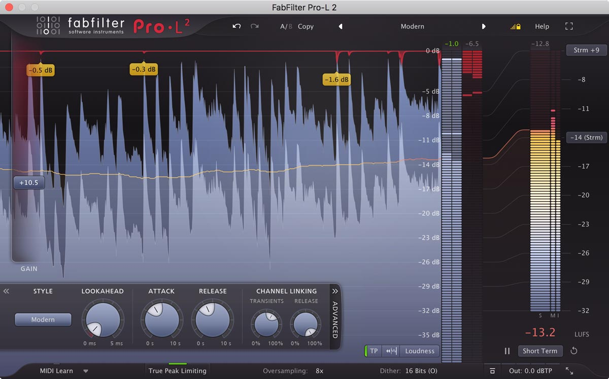

## Contents

1. [What it is](#1-what-it-is)
2. [The panel](#2-the-panel)
3. [The sound](#3-the-sound)
4. [The styles](#4-the-styles)
5. [How it works: the DSP](#5-how-it-works-the-dsp)
6. [The factory presets](#6-the-factory-presets)
7. [Proposed for Vaudio](#7-proposed-for-vaudio)
8. [How it'd be built here](#8-how-itd-be-built-here)
9. [Open questions for Théo](#9-open-questions-for-théo)
10. [Sources](#sources)

---

## 1. What it is

- **A brickwall limiter**: it turns a sound up (the **Gain** slider) while never letting it past a ceiling
  (the **Output Level**), so a mix gets louder without clipping. "The Gain slider is the most important
  control: it adds gain to the incoming signal to make it louder, while limiting to the maximum output level
  specified in the bottom bar." **[FF]**
- **A true peak limiter**: with True Peak Limiting on, the ceiling holds for the waveform a D/A converter (or
  an MP3/AAC encoder) rebuilds between the samples, not only for the samples. **[FF]**
- **A loudness meter**: EBU R 128 / ITU-R BS.1770-4 (Momentary, Short Term, Integrated, Loudness Range, true
  peak), with targets for streaming and broadcast, so the same window says how loud the master is and how loud
  it will play. **[FF]**
- **Eight "styles"** (limiting algorithms): "One is not better than the other; they are all great, and they
  all go very loud if you want them to." Some are meant to be invisible, some to add punch, glue or grit. **[FF]**
- Mainly for the **master** (the last plug-in of a master, before dithering), also for **buses and single
  tracks**: Punchy "works miracles on single tracks, like vocals, bass or guitar", Bus is "especially nice
  for (drum) bus processing and individual tracks". **[FF]**

### History and lineage

| When | What |
| --- | --- |
| 21 Oct 2010 | **Pro-L** announced: four styles (Transparent, Punchy, Dynamic, Allround), adjustable look-ahead, attack and release, "separate, freely adjustable channel linking for both the transient and release stages", "up to four times linear-phase oversampling", inter-sample peak metering, K-System scales, dithering with three noise shapings. EUR 169. **[FF]** |
| 5 Dec 2017 | **Pro-L 2**: four new styles (Modern, "the new 'best for all' default", Aggressive, Bus, Safe), true peak limiting, EBU R 128 loudness metering, up to 32x oversampling, surround, DC offset filter, external side chain triggering, Unity Gain, Audition Limiting, the peak labels on the display. EUR 169 / USD 199. **[FF]** |
| Dec 2021 | "All plug-ins updated, Dolby Atmos support for Pro-Q 3 and Pro-L 2" (now up to 9.1.6). **[FF]** |
| Dec 2023 | CLAP format for every FabFilter plug-in. **[FF]** |
| 16 Apr 2026 | 2.26, the current version. **[FF]** |

The limiting algorithms were developed with **Niklas Silén (bManic)**, who "developed the Transparent,
Dynamic and Modern limiting styles and was very influential in the general design of Pro-L version 1 and
2". **[FF]** Pro-L 1 still installs beside Pro-L 2; Pro-L 2 reads its presets but not its automation ("the
feature set of Pro-L 2 has changed fundamentally"). **[FF]**

### Why engineers reach for it

- **It's clean when pushed.** Reviewers call Modern "highly transparent and natural-sounding, even with very
  high loudness" (Mix) and "the new Pro-L go-to for transparency" (Computer Music). **[user]**
- **Choice of character in one plug-in**, from Safe (classical, acoustic) to Aggressive (EDM, metal). **[FF]**
- **The display shows what it does**: a scrolling picture of the sound before and after, the gain reduction
  hanging from the top, and labels on the deepest dips. You see when you've overdone it. **[FF]**
- **Everything for delivery in one place**: true peak ceiling, loudness to a target, oversampling, dither.

### What makes it sound the way it does

Two stages working together **[FF]**: a fast **transient** stage that looks ahead (Lookahead, 0–5 ms) and
catches peaks, and a slower **release** stage that "responds to the average dynamics of the incoming audio"
(Attack, Release, 0–10 s). The style changes "both the lookahead, attack and release characteristics of the
limiting algorithm" (FabFilter staff) **[FF]**, and how much latency it needs. The rest (oversampling, the
true peak stage) is about keeping it clean at the top. How each part works, and how we'd build it, is in
[§5](#5-how-it-works-the-dsp).

---

## 2. The panel

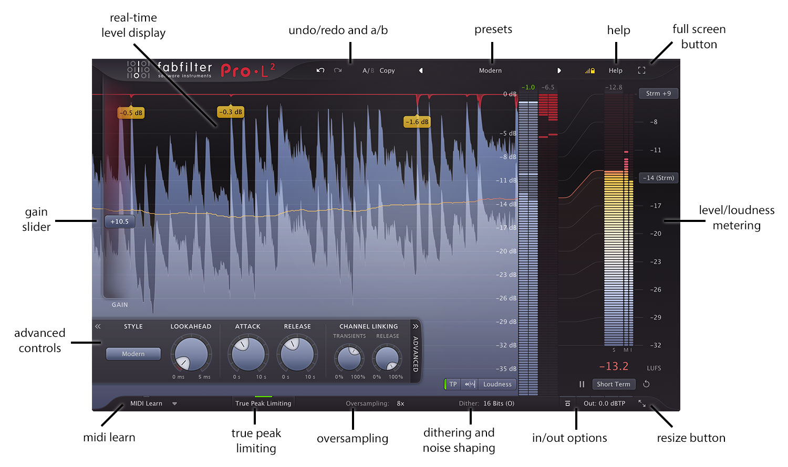

### 2.1 Layout

From the screenshots **[observed]** (Medium size, about 1200 × 750 at 2x):

```
┌────────────────────────────────────────────────────────────────────────────────────────────────────┐
│ fabfilter Pro·L²   ↶ ↷   A/B  Copy    ◀  preset name  ▶    [lock output]   Help   [⛶]              │ top bar
├───┬──────────────────────────────────────────────────────┬────────┬────┬───────────────────────────┤
│ G │ the real-time level display, newest at the right:    │ 0 dB   │ GR │ Max M / S       [scale]   │
│ A │   input (light blue-grey), output (dark blue),       │ −5     │    │   ┃┃┃  loudness meter     │
│ I │   gain reduction (red, hanging from the top),        │ −8     │    │   ┃┃┃  (a big bar and two │
│ N │   the loudness curve (a thin line),                  │ …      │    │   ┃┃┃  thin: S, M, I)     │
│   │   amber peak labels on the deepest dips              │ output │    │ LRA ⊏          [target]   │
│ ▮ │ ┌ « STYLE  LOOKAHEAD  ATTACK  RELEASE  LINKING » ┐   │ meter  │    │   −13.2 LUFS              │
│   │ │ [Modern]   ( )      ( )     ( )    ( )   ( )  │A   │ L  R   │    │ ‖  [Short Term]  ↺        │
│   │ └───────────────────────────────────────────────┘    │        │    │                           │
│   │                  [TP] [display mode] [meter scale]   │        │    │                           │
├───┴──────────────────────────────────────────────────────┴────────┴────┴───────────────────────────┤
│ MIDI Learn ▾ │ True Peak Limiting │ Oversampling: 8x │ Dither: 16 Bits (O) │ ⏻ │ Out: 0.0 dBTP │ ⤡ │ bottom bar
└────────────────────────────────────────────────────────────────────────────────────────────────────┘
```

- The **display** fills the window; the **Gain slider** is a tall strip on its left edge; the **Advanced**
  panel slides out over the bottom of the display from the **ADVANCED** tab ("click the Advanced button right
  under the Gain slider", the vertical tab at its right edge); the **meters** sit at the right; the
  **loudness panel** opens beside them when the meter scale is Loudness. **[FF]** **[observed]**
- The look **[observed]**: a dark blue-grey display, a lighter blue-grey for the input, a darker saturated
  blue for the output, a translucent red for gain reduction, yellow-amber peak labels with dark text, round
  lavender-grey knobs with a white pointer cap and a dark ring of ticks (the house FabFilter knob, as
  Pro-Q's), white labels in capitals, a red "Pro·L²" wordmark.

### 2.2 Top bar


| Control | What it does |
| --- | --- |
| **Undo / Redo** | "Every change to the plug-in (such as dragging a knob or selecting a new preset) creates a new state in the undo history." Changes from automation or MIDI make none. Disabled when there's nothing to undo or redo. **[FF]** |
| **A/B** | Switches between two states; the active letter is bright. "Before switching, the current state of the plug-in is saved, so if you click this button twice, you are back at the first state." **[FF]** |
| **Copy** | Copies the active state to the other. "After clicking Copy, the button disables itself to show that both states are equal." **[FF]** |
| **◀ preset ▶** | The preset's name (a click: the preset menu); the arrows load the previous / next. The name dims once the preset is changed. Right-click: Save, Save As (and Copy / Paste of the settings, used to move from Pro-L 1). **[FF]** |
| **Lock Output** | The small level-and-padlock icon right of the presets (yellow in every screenshot **[observed]**). "When enabled, the current values of the Gain, Output Level, DC Offset Filtering, Unity Gain, True Peak Limiting, Oversampling, Dithering and Noise Shaping parameters will be preserved while loading presets." **[FF]** |
| **Help** | The help, interactive hints, version, licence. **[FF]** |
| **Full Screen** | Fills the screen; Esc leaves. **[FF]** |

The preset menu's **Options**: Save As Default, Open Other Preset, Restore Factory Presets, Change Preset
Folder, Enable MIDI Program Changes (bank / program numbers shown before each name). Presets are `.ffp`
files in `Documents/FabFilter/Presets/Pro-L 2`, subfolders as categories. **[FF]**

### 2.3 The Gain slider

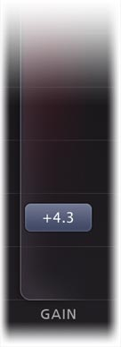

| | |
| --- | --- |
| Range | **0 to +30 dB** (the Compact view's Gain knob reads "0 dB … 30 dB") **[observed]** |
| Default | **0 dB** **[measured]**; linear taper |
| What it does | "Adjusts the threshold of limiting and the increase in output gain at the same time." **[FF]** The sound is turned up by Gain, then limited to the Output Level. |
| Mouse | Click anywhere on it and drag; the wheel; "if you click on the slider background and move the mouse slowly, you make more precise adjustments"; double-click to type. Its value floats in a small box on the strip ("+10.5"). **[FF]** |
| Alt-drag | "The Gain slider is reverse-linked to the Output Level parameter, so holding down the Alt key … while increasing the gain, will decrease the output level with the same amount": hear the limiting without the level change. **[FF]** |
| Look | A narrow strip with a dark red glow that rises with the gain **[observed]** |

### 2.4 The Advanced panel

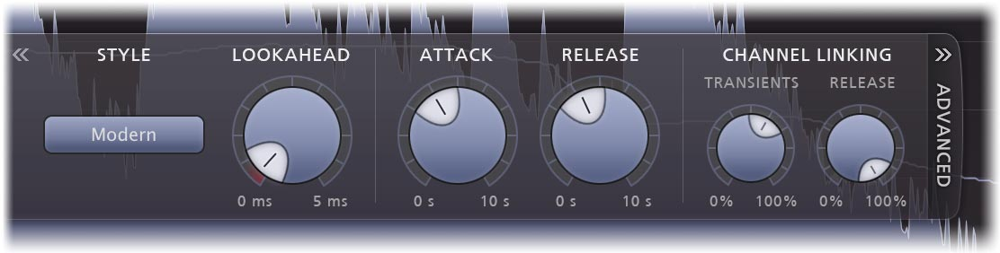

| Control | Range | Default | Scale | What it does |
| --- | --- | --- | --- | --- |
| **Style** | Transparent, Punchy, Dynamic, Allround, Aggressive, Modern, Bus, Safe | **Modern** **[FF]** | a button with a menu | The limiting algorithm ([§4](#4-the-styles)). The new four "need more latency than others". **[FF]** |
| **Lookahead** | **0 to 5 ms** **[observed]** | **0.18 ms** **[measured]** | linear **[measured]**; a short red arc at the very start of its ring **[observed]**, presumably the "less than 0.1 ms" zone that "will approximate 'hard clipping'" **[inferred]** | "The look-ahead time for the initial 'transient' stage": time to see a peak coming. Short: "preserving transients better and increasing the apparent loudness, but at the expense of possible distortion". Long: "safer, but less loud, and transients might appear to get lost in the mix a little more." **[FF]** |
| **Attack** | **0 to 10 s** **[observed]** | **275 ms** **[measured]** | **10 s × raw⁴** (1 ms at a tenth of the knob, 256 ms at 0.4, 625 ms half way) **[measured]** | How soon the slower release stage sets in. "Shorter attack times will allow the release stage to set in sooner." **[FF]** |
| **Release** | **0 to 10 s** **[observed]** | **400 ms** **[measured]** | **6.859 s × raw³** to 5 s (at 0.9), then on to 10 s **[measured]** | How much the release stage holds. "Longer release times will cause it to have more effect." **[FF]** |
| **Channel Linking: Transients** | **0 to 100%** | **75%** **[measured]** | the knob is linear, its effect isn't: nothing below about 20 %, full linking from 50 % at 6 dB of reduction **[measured]** | Linking of the transient stage between left and right. "It often works well to choose less than 100% here." **[FF]** |
| **Channel Linking: Release** | **0 to 100%** | **100%** **[measured]** | linear | Linking of the release stage; "it is best to start with 100% which will completely link the channels." **[FF]** |

"In general, short attack times and long release times are safer and cleaner, but they can also cause pumping
and reduce clarity. On the other hand, long attack times and short release times can increase apparent
loudness and presence, but at the expense of possible distortion." **[FF]**

Pro-L 1's manual gave starting points per style, dropped from Pro-L 2's **[FF, Pro-L 1]**:

| Style | Lookahead | Attack | Release |
| --- | --- | --- | --- |
| Transparent | < 0.5 ms | 50–200 ms | 200–1000 ms |
| Punchy | > 1.0 ms | about 250 ms | about 500 ms |
| Dynamic | < 0.5 ms | half way | half way |
| Allround | about 0.5 ms | about 250 ms | about 500 ms |

In the mono version the linking knobs are disabled; on surround tracks they gain a second half of their
range (see [§2.10](#210-surround-midi-learn-side-chain)). **[FF]**

### 2.5 The bottom bar and the output panel

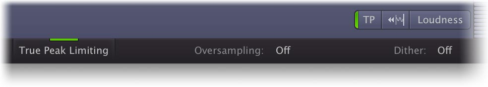

| Control | Values | What it does |
| --- | --- | --- |
| **MIDI Learn ▾** | | See [§2.10](#210-surround-midi-learn-side-chain). |
| **True Peak Limiting** | on / off (a green line on its top edge when on **[observed]**) | "The true peak output is ensured not to exceed the currently set Output Level in dBTP." The output readout then says "dBTP". Adds "about 5 ms" of latency. **[FF]** |
| **Oversampling** | Off (the default **[measured]**), 2x, 4x, 8x, 16x (CPU-intensive), 32x (Very CPU-intensive) **[observed]** | Runs the limiter at a multiple of the rate to cut aliasing and inter-sample peaks. "We recommend 4x or possibly 8x oversampling for normal use"; 16x and 32x for offline renders. Linear-phase: "a very slight pre-ring". **[FF]** |
| **Dither** | the panel: Dither Off, 24, 22, 20, 18, 16 bits; Noise Shaping Basic, Optimized, Weighted **[FF]** | The button reads e.g. "16 Bits (O)". TPDF dither, "2-bit peak-to-peak". **[FF]** |
| **Global Bypass** ⏻ | | "Guaranteed to correctly compensate the latency of the plug-in and it also applies soft bypassing to avoid clicks." The display dims; a red light on the button. **[FF]** |
| **Out: 0.0 dBTP** | | The output button: a click opens the output panel; dragging it vertically sets the ceiling; double-click types it. **[FF]** |
| **Resize** ⤡ | Compact, Small, Medium (default), Large; Scaling submenu | See [§2.9](#29-sizes-compact-view-full-screen). |

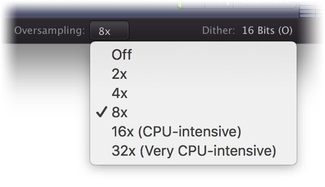
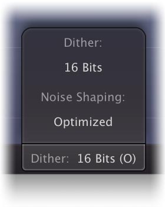
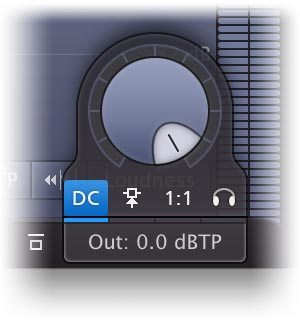

The **output panel** (it pops up above the output button) **[FF]**:

| Control | Range / default | What it does |
| --- | --- | --- |
| **Output Level** (a large knob) | −30 to 0 dB (dBTP with True Peak Limiting) **[observed]**; factory presets "were saved with a default output level of 0.0 dB" **[FF]**; the Default Setting is 0.0 dBTP with True Peak Limiting **on** **[measured]** | The ceiling: "the desired maximum output level for the limiter". |
| **DC** (Filter DC Offset) | off | "Gentle DC offset filtering, which removes a possible DC bias in the input signal … avoids unnecessary and asymmetrical limiting." Blue when on **[observed]**. Its corner is about **1.5 Hz**, first order (−5.1 dB at 1 Hz, −0.1 dB at 10 Hz) **[measured]**. |
| **Side Chain Triggering** (antenna icon) | off | The external side chain drives the detector instead of the input: for **stem mastering**, a stem limited exactly as the full master was ("use Pro-L 2 on the stem channel, while feeding the original (unmastered, unlimited) master to its side chain input"). |
| **1:1** (Unity Gain) | off | "Automatically sets the Output Level to the inverse of the current Gain, so you can listen to the effect of limiting in relation to the input signal." A yellow light; the output meters turn yellow; "all metering still shows levels as if the normal Output Level is applied." Temporary by design. |
| **Headphones** (Audition Limiting) | off | "Subtracts the processed output from the input audio to audition the 'delta' signal: the actual gain reduction that is being applied." |

**What Output Level to choose** **[FF]**: with True Peak Limiting and True Peak Metering on, "set the Output
Level to the maximum allowed value (e.g. −1.0 dBTP for EBU R128)"; "−1.0 dBTP and −2.0 dBTP" for EBU R 128 and
ATSC A/85; Spotify and YouTube −1.0 dBTP; "when mastering for CD or iTunes, you're safe with −0.1 dBTP"; never
above 0.0 dBTP. "In most cases, choosing 4x oversampling in combination with a minimum lookahead time of 0.1
ms, keeps inter-sample peaks within the range of 0.1 dB."

### 2.6 Metering

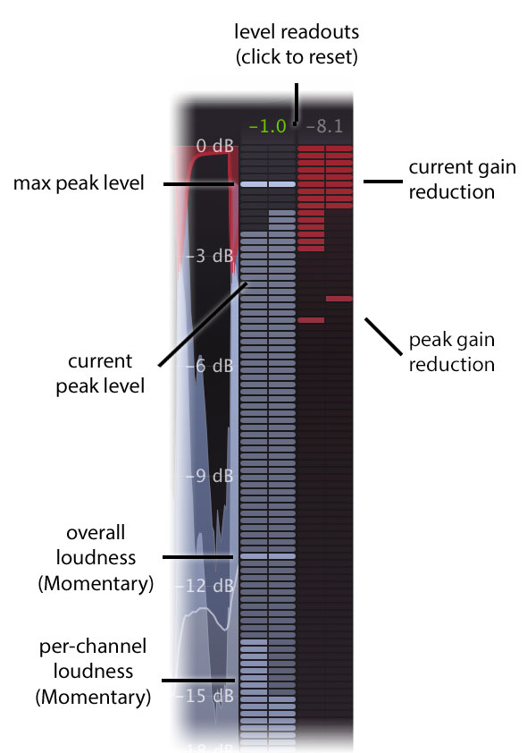

Right of the display **[FF]** **[observed]**:

- **The output meter**: one bar per channel. It shows **peak and RMS at once**: the RMS "follows the
  Momentary specification of the EBU R128 standard" (K-weighted, 400 ms), per channel and as one combined
  level (a lighter segment and a marker), the peak as the lit bar, the **maximum peak** as a held line.
- **The gain reduction meter**: red bars hanging from the top, one per channel; its peak held as a line.
- **The readouts above them**: the maximum output peak and the maximum gain reduction ("−1.0", "−8.1"); "click
  on the level text to reset the reading." The peak readout is **green** when it's a true peak reading;
  "it will turn orange when true peak levels exceed the current Output Level and red when exceeding 0 dBTP."

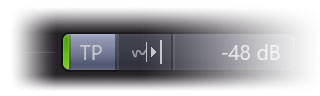

- **TP** (left of the meter scale button; a green light when on): **True Peak Metering**, the output meter
  reading true peaks per ITU-R BS.1770. "We recommend to always turn on true peak metering." Readings of
  different compliant meters can differ by "0.1 or 0.2 dBTP"; FabFilter's "use high internal oversampling and
  have been verified with all test audio as provided by ITU".

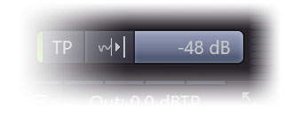

**Meter Scale** (the button reading "−48 dB" or "Loudness") **[FF]**:

| Scale | What it shows |
| --- | --- |
| **16 dB** | "Showing the top 5 dB of input, output and gain reduction meters in the linear upper part of the metering": the most detail where limiting happens. |
| **32 dB** | "The best of both worlds." |
| **48 dB** | "A general overview of input and output levels." |
| **K-12, K-14, K-20** | Bob Katz's K-System: the 0 mark at −12, −14 or −20 dBFS (= 85 dB SPL when calibrated), peak and RMS, a red "loud" zone at the top. K-12 for broadcast, K-14 "the majority of commercial recordings", K-20 film, classical, dynamic mixes. |
| **Loudness** | Opens the loudness panel ([§2.7](#27-the-loudness-panel)). |

"All three general scales have linear precision in the upper part": the top few dB take more of the
height (the overview's labels: 0, −5, then every 3 dB **[observed]**). The same scale is the display's.
Metering settings are left alone by presets, saved with the session, and "any change you make is automatically
saved as the default setting". **[FF]**

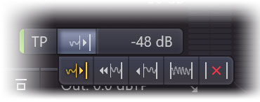

**The real-time level display** **[FF]**: input (grey / light blue), output (dark blue), gain reduction (red)
and loudness (thin line), scrolling; "gain reduction peaks are highlighted with yellow peak level readings".
**Display Mode** (the waveform-and-arrow icon beside TP):

| Mode | Behaviour |
| --- | --- |
| **Slow Down** | Moves slowly; "once the incoming audio reaches the rightmost display edge, the display quickly scrolls back to make room for new audio." Its icon is yellow when chosen **[observed]**. |
| **Fast** | Pro-L 1's: "moves fairly quickly at a steady pace." |
| **Slow** | The same, slower: more history; good with Short Term loudness. |
| **Infinite** | "Shows all incoming audio since the interface was opened or this mode was selected, increasing the density each time the display fills up"; good with Integrated. |
| **Off** | No display (a red ✕). |

The scroll speeds of Fast and Slow are **not stated**.

### 2.7 The loudness panel

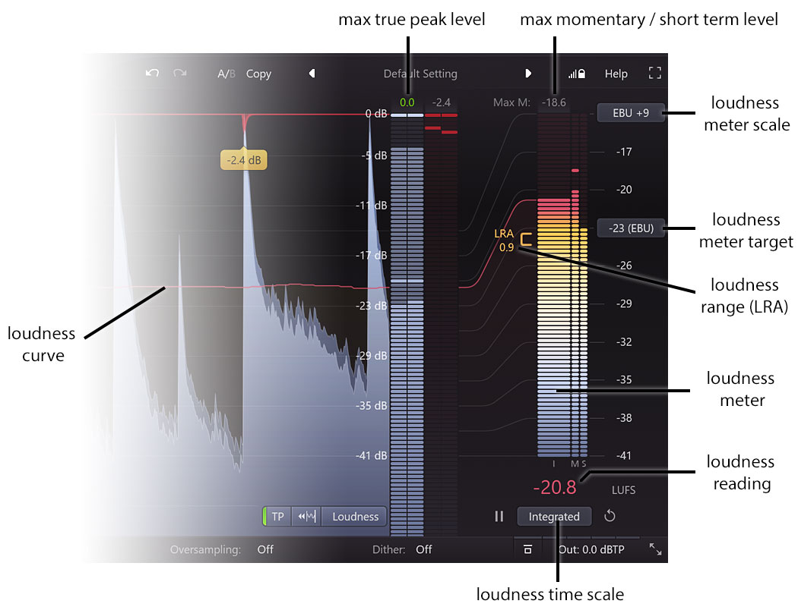

Opened by Meter Scale → Loudness. It follows ITU-R BS.1770-4 and EBU R 128 ("also supporting ATSC A/85 and
TR-B32"), always gated. **[FF]**

| Part | What it does |
| --- | --- |
| **Loudness Meter Target** (button on the scale, e.g. "−14 (Strm)", "−23 (EBU)") | The target in LUFS: **−9** ("commonly used for audio CDs"), **−14** ("roughly the target level used by streaming services like Spotify, iTunes or YouTube"), **−23** (EBU R 128), **−24** (ATSC A/85, TR-B32), or **Custom**. "Roughly speaking, the loudness target is the desired value for the Integrated loudness measurement." **[FF]** There are no per-platform presets. |
| **Loudness Meter Scale** (top button, "Strm +9", "EBU +9") | +9 or +18 LU above the target (EBU mode's "+9" and "+18" scales when the target is −23); its menu switches absolute (LUFS) or relative (the target reads 0). **[FF]** |
| **Loudness Time Scale** (bottom button) | **Momentary**, **Short Term** or **Integrated**: the one drawn large; the other two are thin bars beside it (labelled S, M, I). **[FF]** |
| **Loudness reading** | The chosen time scale in big digits ("−13.2 LUFS"). **[FF]** |
| **Max M / Max S** | Above the meter: the maximum momentary or short-term loudness; with Integrated chosen, a button picks which. **[FF]** |
| **LRA** | With Integrated chosen, the Loudness Range, drawn as an orange bracket beside the bar with its value ("LRA 0.9"). **[FF]** **[observed]** |
| **Pause ‖ / Reset ↺** | Either side of the time scale button. Reset also resets the peak and gain reduction readings. **Auto-Reset** (in the time scale menu) resets when the host starts playing. **[FF]** |
| **Loudness curve** | The loudness over time in the display, a thin line; because the loudness meter and the display use different scales, "curved lines indicate how the scales are related to each other". **[FF]** |

**Its colours** **[observed]** (nothing in the manual): the bars are pale blue-white well under the target,
turn yellow then orange as they reach it, and red above it; the target's tick is the orange one. The reading
takes the colour of where it is: "−13.7" at a −14 target is orange, "−13.2" and "−12.2" at −14 and "−20.8" at
−23 are red. So orange is within a small band of the target and red is over it; the band's width is **not
stated** (between 0.3 and 0.8 LU from these four screenshots **[inferred]**). The loudness curve is drawn in
the reading's colour (orange or red) **[observed]**.

How FabFilter says to use it **[FF]**: for EBU R 128, the −23 target, Integrated "with a tolerance of +/− 1 LU",
True Peak Limiting and Metering on, Output −1 dBTP; for ATSC A/85, −24 and −2 dBTP; for Spotify, −14 and −1
dBTP. "We recommend to combine integrated loudness metering with the Infinite display mode." LKFS and LUFS
"are essentially the same".

Not in Pro-L 2 **[FF, by absence]**: the **PLR** (peak-to-loudness ratio, the maximum true peak less the
integrated loudness), short-term LRA history, a loudness history export, per-platform target presets.

### 2.8 Knobs, text entry and keys

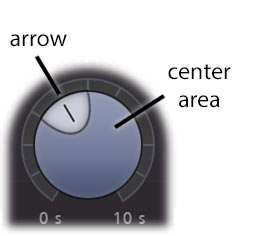

| Gesture | What it does **[FF]** |
| --- | --- |
| Drag the centre up / down | Turns it; slow drags are finer ("the knob reacts to the speed with which you are dragging"). |
| Drag the arrow (pointer) around | Rotate mode; further from the knob is finer. |
| Wheel | Turns it. |
| Double-click | Types a value. "2x" types +6 dB, "50%" the middle of the range, "1k" 1000 (frequencies). |
| Cmd-click (Ctrl on Windows; Alt in Pro Tools) | Resets to the default. |
| Shift + drag or wheel | Fine. |
| Alt + drag | Moves linked knobs together (Gain and Output, the opposite way). |
| Hover | The knob lights up; a value pop-up with its name. |

### 2.9 Sizes, Compact view, full screen

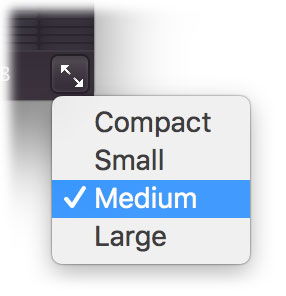
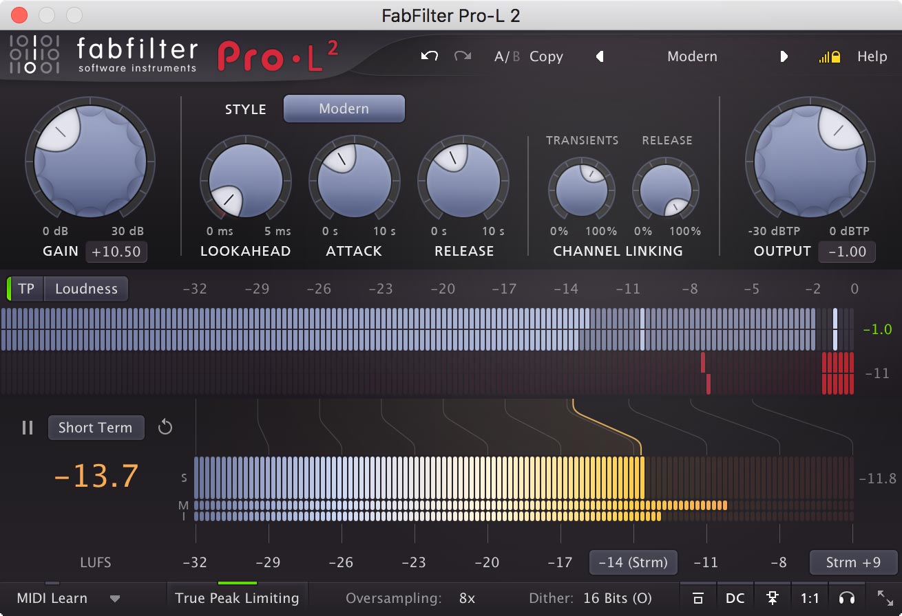

- **Sizes**: Compact, Small, Medium (default), Large, each remembered as the default for new instances; a
  **Scaling** submenu; VST3 resizes by its edges; **Full Screen** (Esc leaves). **[FF]**
- **Compact** "doesn't offer the real-time level display, but its level meters have more detail … and it
  offers a large Output knob." **[FF]** The screenshot **[observed]**: a row of knobs (a big **Gain** 0–30 dB
  with its readout, Style button, Lookahead, Attack, Release, the two link knobs, a big **Output** −30–0 dBTP
  with its readout), then horizontal meters (output L/R with the true peak readout, gain reduction under it),
  then the loudness bars horizontally (S large, M and I thin), the big reading on their left, the target and
  scale buttons under them. Gain and Output can also be dragged on their readouts.

### 2.10 Surround, MIDI Learn, side chain

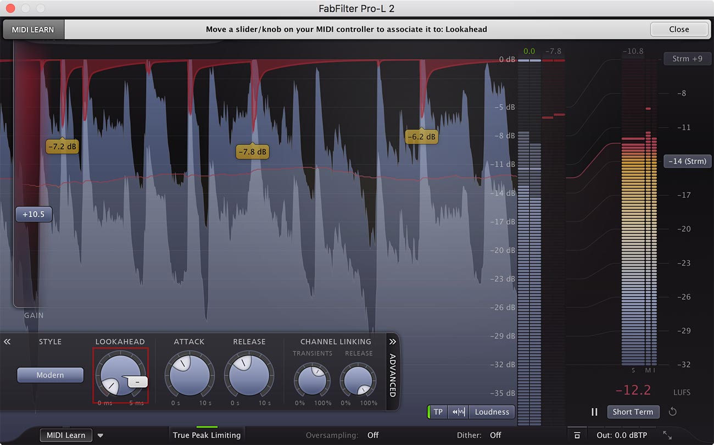

- **MIDI Learn**: the window dims, each controllable parameter shows its controller number; touch a control
  (a red square marks it), move a MIDI controller; Close or the button again to leave. Its menu: Enable MIDI,
  Clear (one or all), Revert, Save. **[FF]**
- **Surround** (up to 9.1.6): every channel on the output meter; the link knobs get a second half of their
  range, from "100% Stereo, 0% All" to "100% Stereo, 100% All" (every channel triggered by the loudest); **C**
  links the centre channels to their stereo pairs, **LFE** brings the LFE into the all-channel linking; both
  off by default. **[FF]**

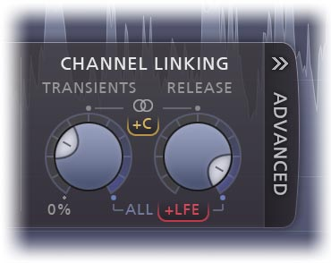
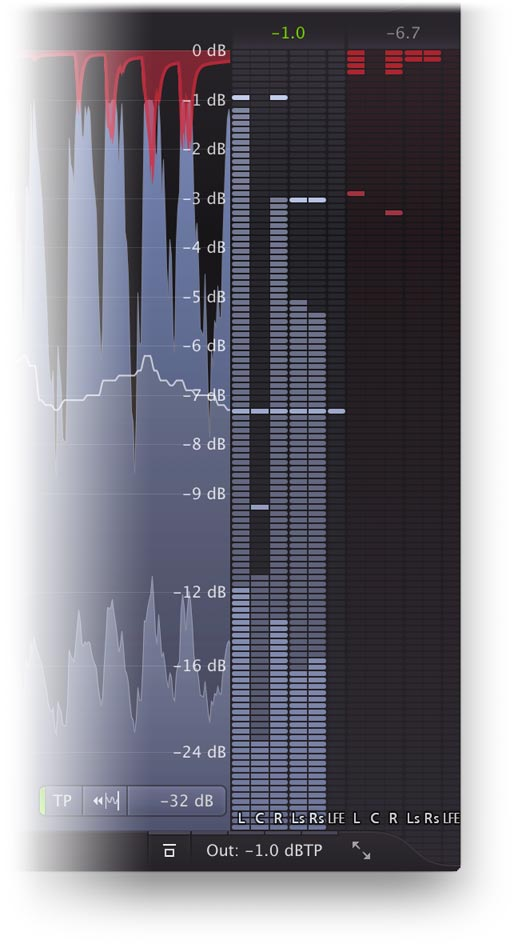

- **External side chain**: Side Chain Triggering in the output panel (above). **[FF]**

### 2.11 What can be automated

Every parameter, by the host and by MIDI Learn ("any MIDI controller with any plug-in parameter") **[FF]**;
"Smart Parameter Interpolation" (the product page) **[FF]**. The parameter list itself is **not stated**.

---

## 3. The sound

### 3.1 What a good limiter sounds like

In a producer's words: louder, and otherwise **the same**. Up to about 3 dB of peak reduction on a mixed master,
a good limiter is close to inaudible: the drums keep their snap, the bass its weight, the stereo image doesn't
move, the reverb tails don't swell. Past that, the choice of style is the choice of **how** it gives way:

- the attack of each drum hit softens (Safe, long lookahead), or stays sharp but gains a little grit
  (Aggressive, very short lookahead);
- the space between hits fills up and breathes in time with the beat (Punchy, Bus, long release), or stays
  even (Transparent, Modern).

Reviewers' rule of thumb: "5–6 dB typically starts to sound compressed" (a guide, **[user]**). Typical
master gain reduction for modern pop and EDM is far more; the styles exist so that the price is one you chose.

### 3.2 The styles, by ear

From FabFilter's descriptions **[FF]** and reviews **[user]**:

| Style | Sounds like | For |
| --- | --- | --- |
| **Transparent** | "Stay true to the original sound and feel as much as possible, avoiding pumping effects and coloring." | Most programme, "especially on rock and pop music". The low-latency one. |
| **Punchy** | "The most apparent. When pushed, it becomes quite punchy and will introduce a bit of pumping." Fairly safe on distortion. On rock vocals it "smoothly reined in dynamics … without squashing the life out it" (Mix). | Single tracks: "vocals, bass or guitar", "a nice edge to beat-oriented music". |
| **Dynamic** | "By enhancing transients before actually applying limiting, this algorithm excels in preserving the original punch and clarity." | Rock; "surprisingly well on other types". |
| **Allround** | "A good balance between loudness and transparency" (Pro-L 1: "very 'safe', minimizing distortion while still going as loud as possible"). | Almost anything. |
| **Aggressive** | "An aggressive yet smart, near-clipping style of limiting." Loud, dense, a little grit on the hits. | EDM, trance, "rock, metal or pop". |
| **Modern** | "The new standard for all-purpose, transparent limiting. It can achieve very high loudness and allows for very near-zero lookahead settings, while still sounding extremely clean and natural." | The default; masters of every kind. |
| **Bus** | "Not meant to be transparent, rather the opposite. Think glue, pump or squash!" On drum room mics pushed to "14 to 17 dB of gain reduction on peaks" (Mix). | Drum buses, single tracks. |
| **Safe** | "No distortion ever." Its goal "is not loudness". | "Delicate acoustic and/or classical music, or individual instrument tracks." |

### 3.3 What each setting does to the sound

| Setting | Lower | Higher |
| --- | --- | --- |
| **Gain** | Peaks touched only | Louder and denser; past a few dB the style's character shows |
| **Lookahead** | Sharper transients, louder, risk of distortion; under 0.1 ms it's nearly clipping (harmonics, aliasing, inter-sample peaks) | Cleaner, "safer, but less loud"; transients "lost in the mix a little more" (the gain dips before the hit, so its attack is softened) |
| **Attack** | The release stage holds even short peaks: cleaner, more pumping | Short peaks are only the transient stage's: louder, more present, more risk of distortion |
| **Release** | The release stage lets go quickly: louder, risk of distortion on bass | It holds: smoother, more pumping, less clarity |
| **Link: Transients** | A peak in one channel is cut in that channel only: louder, and "almost inaudible" for short peaks; the image may shift on hits | Both channels cut alike: image steady |
| **Link: Release** | The image can wander as each side recovers on its own | Steady image (start at 100%) |
| **Oversampling** | Off: faster limiting aliases and makes inter-sample peaks | 4x–8x: cleaner tops, higher true peak headroom; slight pre-ring, CPU |

### 3.4 What bad limiters sound like, and why

| Artefact | What you hear | Cause | How to avoid it (Pro-L's way, and ours) |
| --- | --- | --- | --- |
| **Bass distortion** | Fuzz on sustained bass and 808s, a "farty" low end | The gain moves within one cycle of the bass (a 40 Hz cycle is 25 ms): fast release or short attack amplitude-modulates the waveform, adding harmonics and sidebands | A **hold** of half the bass's period (Auto Hold), which makes the gain on a sustained bass constant at no latency; Pro-L 2's Aggressive, Modern, Bus and Safe hold it flat, its Transparent, Punchy, Dynamic and Allround don't (−21 to −26 dB THD on 40 Hz, **[measured]**) ([§5.5](#55-the-transient-stage)) |
| **Pumping / breathing** | The mix ducks on every kick and swells back; reverb and room "breathe" | The release is slow enough to be heard as a level movement, in time with the loudest element | A short transient release for isolated peaks; a release stage that charges only on sustained overloads (Attack); linked release |
| **Transient dulling** | Drums lose snap, the mix gets "smaller" | Long lookahead: the gain starts falling before the hit, so its first milliseconds are turned down most | Shorter lookahead; Dynamic's transient emphasis; Modern's adaptive ramp (short ramps for short peaks) |
| **Clipping grit, aliasing** | Harsh, papery highs, inharmonic "sizzle" | A near-instant gain change is a waveshaper: it makes harmonics, and those above half the rate fold back as inharmonic tones | Oversampling (2x–32x), so the harmonics fall above the audible band and are filtered out; soft rather than hard clipping where it's wanted |
| **Inter-sample overs** | Crackle on cheap D/A converters, distortion after MP3/AAC encoding | The samples are under the ceiling but the waveform between them is not (up to +3 dB on a quarter-rate tone, more in theory) | True peak limiting ([§5.9](#59-true-peak-limiting)) |
| **Image shift** | Hits pull the stereo image to one side | Unlinked gain reduction on a peak in one channel | Linking (transients a little under 100%, release 100%) |
| **Modulated cymbals** | The kick turns the hats and cymbals down with it | One gain for the whole spectrum: the bass's peaks decide the level of the highs | A matter of degree in a single-band limiter: less gain reduction, or a clipper or multiband stage before it. Pro-L is single-band (nothing in its manual or controls mentions bands **[inferred]**) |
| **Clicks on edits** | A click when a control moves | Gain or ceiling jumping between samples | Every control glides ([§5.13](#513-parameter-changes-sample-rate-denormals-determinism)) |
| **Quantisation distortion** | Grainy fades at 16 bits | Truncating to 16 bits without dither | TPDF dither, optionally noise-shaped ([§5.11](#511-dither-and-noise-shaping)) |

### 3.5 The master and the vocal bus

- **On the master** (its main use): last in the chain, after any EQ and bus compression; Modern (or
  Transparent, Allround), True Peak Limiting on, 4x–8x oversampling, ceiling −1 dBTP for streaming, Gain up
  until the integrated loudness is where you want it or the sound starts to give; dither only if exporting to
  16 bits and only here. FabFilter's own recommended workflow. **[FF]**
- **On a vocal bus**: a peak catcher after the compressor, so consonants and shouted words don't poke out and
  the vocal can sit louder. Punchy is FabFilter's pick for vocals **[FF]**; Safe for a delicate one. A few dB of
  reduction on the loudest syllables, a lookahead of 1–3 ms (a plosive's attack is short), Attack around
  100–250 ms and Release around 100–300 ms so the release stage smooths phrases without pumping the reverb,
  both links at 100% (a vocal is centred; its stereo reverb shouldn't move), no true peak limiting (it's not
  the last stage), oversampling off or 2x. **[ours]** On a track being recorded through its effects, every
  millisecond of the limiter's latency is heard by the singer: pick a low-latency style (ours: Spit at about
  1 ms, Transparent and Punchy at 5 ms; Pro-L 2's Transparent is 10.3 ms **[measured]**) and leave True Peak and
  oversampling off. **[ours]**
- **For "spit"**: rap engineers end vocal chains in a Waves L1 or L2 hit hard, for colour more than control
  ("spit and attitude … almost like an EQ", Chris Lord-Alge; `pro-l-research.md` §1.4). Ours is the Spit style
  (§4.2). **[ours]**

---

## 4. The styles

### 4.1 Pro-L 2's styles, measured

What FabFilter says: "Choosing a style affects both the lookahead, attack and release characteristics of the limiting
algorithm"; the four new styles "need more latency" **[FF]**. What they actually do, measured on the real plug-in
(`pro-l-research.md` §2) **[measured]**:

| Style | Latency (48 kHz, Off, TP off) | Ramp before a peak | Between a bass note's half-cycles | Release | Bass THD (+6 dB, 40 Hz) | IMD (50 Hz + 3 kHz) |
| --- | --- | --- | --- | --- | --- | --- |
| **Transparent** | 496 (256 + 5 ms) | the Lookahead knob | the gain bounces back | a fast transient release; the slow stage per Attack / Release | −21 dB | −13 dB |
| **Punchy** | 496 | the knob | bounces | slower transient release (the pump) | −26 | −17 |
| **Dynamic** | 992 | the knob, 0.4–0.5 dB extra at the onset | bounces | moderate | −24 | −15 |
| **Allround** | 496 | the knob | bounces | holds, then an S-shaped release | −21 | −14 |
| **Aggressive** | 2896 (≈ 60 ms) | **half a period of the waveform at the peak** (≥ knob, ≤ ~50 ms) | flat | **none**: the same adaptive ramp back up (0.3 ms for 1 kHz) | none | **−10** (−4 at +12 dB) |
| **Modern** | 2880 (60 ms) | half a period; **~0.7 ms for a click** | flat (±0.15 dB) | a slow stage with a **~400 ms floor** | −73 | −38 |
| **Bus** | 2896 (≈ 60 ms) | ~12 ms (sines), 50 ms (DC) | flat | smooth, ~200–400 ms | none | −27 |
| **Safe** | 2640 (55 ms) | ~35 ms (sines), 50 ms (DC) | flat | slow | none | **−71** |

Every style is bit-transparent below the ceiling and a hard wall above it: no knee, no compression under the ceiling,
no emphasis on sounds under it. The first round's Allround knee and Bus's RMS compressor were wrong. And Pro-L 2's
**loudness isn't monotonic in Gain** in Modern, Aggressive or Bus: past about +12 dB, Modern gets quieter as Gain rises
(`pro-l-research.md` §2.6).

### 4.2 Ours

**Our styles keep Pro-L 2's names** (engineers know them: Kinelski's "EDM-Aggressive and Tight", Sangiao's "Hip Hop
Mastering RS") **and what each is for, and fix what the measurements show is wrong with them**. One more is added for
vocals. A style is data, not code, as EchoBoy's styles are **[ours]**. The blocks a style sets (explained in §5):

- **Reserve**: look-ahead the style keeps beyond the Lookahead knob (its latency).
- **Ramp**: the gain's descent before a peak: the knob's length, or **adaptive** (half the period of the waveform at
  the peak, between the knob and the reserve; short for clicks), drawn by a box-stack kernel (§5.4).
- **Hold**: how long the gain stays down after a peak (§5.5). **Auto** is half the period of the overload's lowest
  strong frequency, so a sustained bass gets a constant gain (no distortion) and a drum hit none (its loudness). Every
  style has the Hold control; the style sets its default.
- **Transient release**: how fast the transient stage lets go, from *fast* (an isolated peak) to *slow* (a busy
  passage), or **symmetric** (the adaptive ramp back up: Aggressive).
- **Release stage**: how strongly it charges, its **floor** (the shortest recovery), and its **shape** (exponential, or
  an S-curve with a release delay: Allround). Its strength is capped so that **loudness always rises with Gain**
  (Pro-L 2's doesn't).
- **Emphasis**: transient emphasis before the limiter (Dynamic).

| Style | Reserve | Ramp | Hold default | Transient release | Release stage | Extras | Starting values: Lookahead / Attack / Release | For |
| --- | --- | --- | --- | --- | --- | --- | --- | --- |
| **Transparent** | 0 | the knob | Auto | 10 → 60 ms | ×1, exponential | | 0.5 ms / 150 ms / 500 ms | masters, a few dB; the low-latency master style |
| **Punchy** | 0 | the knob, ≥ 1 ms | Auto | 40 → 150 ms (the pump) | ×1 | | 1.5 ms / 275 ms / 400 ms | vocals, bass, beat music |
| **Dynamic** | 2 ms | the knob | Auto | 10 → 60 ms | ×1 | emphasis: onsets up to +3 dB | 0.3 ms / 250 ms / 250 ms | rock, live drums |
| **Allround** | 0 | the knob, ≥ 0.5 ms | Auto | 15 → 100 ms | ×1, **S-curve with a 100 ms release delay** (Weiss) | | 0.5 ms / 275 ms / 400 ms | when unsure |
| **Aggressive** | 25 ms | the knob, both sides; a **bass stage** (10 ms) | Auto | symmetric (no release stage) | none | | 0.1 ms / – / – | EDM, trap, near-clipping density |
| **Modern** | 25 ms | the knob; a **bass stage** (10 ms) | Auto | 5 → 80 ms, two-sided | ×1, floor 300 ms, capped for monotonic loudness | | 0.18 ms / 275 ms / 400 ms | the default; masters of every kind |
| **Bus** | 45 ms | ≥ 12 ms; a bass stage (20 ms) | 15 ms | 50 → 300 ms | ×1 | | 2 ms / 30 ms / 300 ms | drum bus, glue and pump |
| **Safe** | 35 ms | 35 ms (box stack) | 20 ms | 80 ms (its release stage does the rest) | ×1, never under 80 ms | | 5 ms / 0 s / 1 s | acoustic, classical, delicate vocals |
| **Spit** (new) | 0, **Lookahead 0–1 ms** | the knob (0.05 ms by default) | 0 | 1 → 5 ms | none | oversampling Off in its presets | 0.05 ms / – / 3 ms | the L1 / L2 "spit and attitude" on a vocal, a drum bus; ~1 ms of latency |

Why these **[ours]**:

- **Auto hold in every style but Spit.** The old four's bass distortion (−21 dB, about 10 %) is the gain bouncing between
  half-cycles. A hold of half a period removes it entirely at no latency (`pro-l-research.md` §5.1). Anyone who wants
  Pro-L 2's old grit sets Hold to 0.
- **A bass stage for Aggressive, Modern and Bus**: Pro-L 2's two ramp half a bass period before each peak (measured);
  ours limit the low end (below 150 Hz) over a longer ramp of its own while the crack of a hit keeps the knob's
  short one, and Auto Hold keeps a held bass note's gain still. The same aim, a construction that keeps the
  guarantee simply (§5.5). A **25 ms reserve instead of 60**: both are half Pro-L 2's latency.
- **No release stage stronger than ×1** (built 2026-10-07): a stronger one (the first plan's ×1.3 for Punchy and Bus)
  turns the sound down more than Gain turns it up, which is Pro-L 2's loudness trap.
- **Modern's release floor stays** (300 ms, near the measured 400) because that's its smoothness; its strength is capped
  so that more Gain is never quieter.
- **Allround's S-shaped release** (measured: it holds, then lets go along an S) is Weiss's Release Delay: the release
  starts only when the sound has really ended, so tails aren't dented.
- **Spit** is the edgy vocal limiter the engineers reach for (Lord-Alge, Firkins, Brathwaite, Bolooki): a fast, hard,
  not oversampled brickwall. Its harshness is the point; the window says so.
- **Bus** keeps its slow ramps and pump; no sub-ceiling compression (Pro-L 2 has none).

Choosing a style leaves Lookahead, Attack, Release and Hold where they are (they're separate parameters, as in
Pro-L 2); the starting values are where the presets of §6 start and what the style menu's hint and the assistant
suggest. The window shows what the current style does in plain numbers (its ramp, hold, release and latency), as DMG's
"Copy to Manual" and KVR's complaints about Pro-L's opaque styles ask **[ours]**.

---

## 5. How it works: the DSP

The first round designed the parts FabFilter describes, each by the best-known method. The second round measured
Pro-L 2 and read further (`pro-l-research.md`); what changed is marked **(changed)**.

Conventions: `fs` is the host rate, `k` the oversampling factor, `fo = k·fs` the rate the limiter runs at. Gains are
linear unless written in dB; "reduction" is a positive number of dB. `C` is the ceiling (Output Level) as a linear
amplitude.

### 5.0 The conclusions in brief

1. **Two stages, one guarantee.** A fast look-ahead *transient stage* alone guarantees the ceiling; a slow *release
   stage* only ever adds reduction, so it shapes the sound without risking the ceiling. Measured on Pro-L 2: this is how
   Transparent behaves exactly (`pro-l-research.md` §2.4).
2. **Look-ahead without overshoot is a theorem**: take the lowest gain any sample needs over a window, smooth it with
   any non-negative kernel no longer than the look-ahead, delay the sound: no output sample can exceed the ceiling
   ([§5.4](#54-look-ahead-without-overshoot)) **[checked]**.
3. **(changed) A hold, not a longer ramp, removes bass distortion**: a hold-min window extended backwards by half the
   bass's period makes the gain on a sustained bass constant, at no latency ([§5.5](#55-the-transient-stage)).
4. **(changed) Every "only lowers" curve goes before the kernel** (the transient release, the release stage): the same
   guarantee, 15–45 dB less gain modulation above 5 kHz **[checked]**.
5. **(changed) The kernel is a box stack**, O(1) a sample at any length, 21 dB lower sidelobes than Hann.
6. **(new) A clip stage before the look-ahead stages** ([§5.7](#57-the-clip-stage)), at ≥ 4× with anti-aliasing on its
   residue, bit-exact below its knee.
7. **(new) M/S "side first" linking keeps the guarantee** ([§5.3](#53-the-gain-computer-linking-and-mid-side)).
8. **An oversampled limiter must end with a stage at the host rate**, and **true peak is only as good as its
   detector**: ours holds the ceiling by BS.1770's meter *and* by an ideal reconstruction; Pro-L 2 holds only the
   first (+0.1 to +0.37 dB over by an ideal reconstruction, measured).
9. **Latency is fixed per style, oversampling and true peak**, never by the Lookahead knob (Pro-L 2's too, measured),
   and roughly half Pro-L 2's for the adaptive styles.
10. **(new) Loudness rises with Gain**, always (a test, §8.9).

### 5.1 The signal flow

```
 in (L, R)
   │
 [DC filter]                          optional, first-order high-pass at 1.5 Hz (Pro-L 2's, measured)
   │
 × Gain                               0..+30 dB, glides
   │
 upsample ×k                          linear phase (Off: k = 1)
   │
 [Dynamic: transient emphasis]        in the audio path
   │
 CLIP STAGE (§5.7)                    optional: shaves what exceeds ceiling + Clip Range; at ≥ 4×, ADAA on the
   │                                  residue; below 4× its own differential ×4 stage
   ├───────────► detector at fo: |x| per channel, or |M| and |S| (§5.3)
   │                  │
   │             gain computer: demand per channel (or the M/S pair)
   │                  │
   │        ┌─────────┴──────────┐
   │   link: transients     link: release
   │        │                    │
   │   hold-min over        RELEASE STAGE (at fs)
   │   reserve + Lookahead  follower of the demand
   │   + Hold (backwards)        │
   │        │                    │
   │   transient release ── min ─┘          (both only lower the curve: before the kernel)
   │        │
   │   kernel: box stack, length = ramp (the knob, or adaptive)
   │        │
 delay D ──► × g
               │
         downsample ×k                linear phase
               │
         LAST STAGE at fs             sample-peak catch (k > 1), or the true peak stage, twice (TP on)
               ├──────────► meters: peak / true peak, GR per stage, % clipped, peak density, RMS, loudness
               │
         × Unity Gain                 (the meters are fed before it)
               │
         Audition: All / Clip / Limiter   delayed input − output, or one stage's share
               │
         dither                       TPDF, noise shaping
               │
              out
```

- Gain is applied before everything, so Gain *is* the threshold: with Gain at +6 dB and the ceiling at −1 dB, anything
  over −7 dBFS at the input is reduced (by the limiter, and by the clipper above −7 + Clip Range).
- Only the gain curve needs the look-ahead: the audio is delayed by `D` (the style's reserve + 5 ms) while the gain is
  computed from the undelayed signal. The Hold looks *backwards*, so it costs nothing.
- The release stage runs at `fs` and is interpolated to `fo`; it's min'd into the transient stage's curve before the
  kernel, aligned so the kernel centres it.

### 5.2 Levels, the ceiling, Unity Gain, Audition, the DC filter

- **Ceiling**: `C = 10^(Output/20)`; with True Peak Limiting it's in dBTP (the true peak stage enforces it), without it
  in dBFS (sample peaks). **[FF]** The true peak is always *shown* (the loudness panel and the output meter), even when
  the ceiling is a sample-peak one: the "release style" ceilings of real records (−0.01 to −0.3 dBFS) put them at +1 to
  +2.5 dBTP, and the user should see it (`pro-l-research.md` §1.6) **[ours]**.
- **Unity Gain**: the output is multiplied by `10^(−Gain/20)` after the limiter, so the limited sound plays at the
  input's level; the meters keep showing the levels as if Unity Gain were off. **[FF]**
- **Audition** (changed): **All** is Pro-L's: (the input, delayed by the whole latency, through the same oversampling
  filters and Gain) − (the output, before Unity Gain), i.e. exactly what was removed. **Clip** is the clip stage's
  residue alone, and **Limiter** what the look-ahead stages removed after it; Clip + Limiter = All. Each is heard at the
  limited level (KClip's and Flatline's "delta", the engineers' habit, `pro-l-research.md` §1.3) **[ours]**.
- **DC filter** (changed): a first-order high-pass at **1.5 Hz**, as Pro-L 2's measures (−5.1 dB at 1 Hz, −0.1 dB at
  10 Hz); `y[n] = x[n] − x[n−1] + R·y[n−1]`, `R = exp(−2π·1.5/fs)`. The first round's 5 Hz was too high. It's at the
  input, so it never adds overshoot after the limiter (a high-pass after a limiter raises its peaks).

### 5.3 The gain computer, linking and mid-side

Per channel `c`, at `fo`, the reduction needed for the sample to sit at the ceiling:

```
r_c[n] = max(0, 20·log10(|x_c[n]| / C))           (dB; 0 when under the ceiling)
```

**L/R linking** (as the first round): with link `λ` (0..1) for a stage, each channel's demand moves towards the louder
channel's in dB:

```
r_link[n] = max_c r_c[n]
d_c[n]    = r_c[n] + λ·(r_link[n] − r_c[n])
```

At 100 % both channels get the larger demand; at 0 % each its own; 50 % is the geometric middle **[ours]**. Linking can
only *add* reduction, so it never threatens the ceiling. The transient stage uses `λ_transients`, the release stage
`λ_release` (= Ozone's Transient / Sustain stereo independence). **Pro-L 2's own knob, measured, isn't linear**: no
linking below about 20 %, full linking from 50 % (at 6 dB of reduction) **[measured]**. Ours is linear in dB, so the
whole range does something; its default 75 % is a real three-quarter link **[ours]**.

**(new) Mid-side, side first.** With `M = (L+R)/2`, `S = (L−R)/2` and gains `gM`, `gS` (`L' = gM·M + gS·S`,
`R' = gM·M − gS·S`), and since `max(|a+b|, |a−b|) = |a| + |b|`, the ceiling holds at a sample iff

```
gM·|M| + gS·|S| ≤ C
```

which is linear and monotone in both gains: lowering either never hurts. So the look-ahead construction extends to the
pair: per sample choose a feasible `(gM, gS)`, hold-min and smooth each, and the averaged pair is still feasible
**[checked]**. The policy, **side first**: lower `gS` down to the **Side floor** (0 to −18 dB, default −6) before `gM`
moves; past the floor both move together. Wide synths narrow for an instant instead of the vocal, kick and 808 ducking:
+0.34 dB overall, +0.43 dB in the centre on a wide chord stack over a mono 808, both at exactly the ceiling
(`pro-l-research.md` §5.4). It also helps mono compatibility. The window's stereo mode is **L/R** (with the two links)
or **M/S** (with the Side floor; the two link knobs aren't used) **[ours]**. Not in Pro-L 2.

### 5.4 Look-ahead without overshoot

The requirement on the gain applied to sample `n` is `g[n] ≤ q[n] = min(1, C/|x[n]|)` (from `d_c` in dB). The design
(Signalsmith's, after many before it) **[checked]**:

```
m[n] = min( q[n−L−H], …, q[n] )                       hold-min over L+1+H samples (undelayed signal; H looks back)
m'[n] = min( m[n], released[n] )                       every "only lowers" curve: transient release, release stage
s[n] = Σ_{j=0..R} w[j] · m'[n−j]                       a kernel w[j] ≥ 0, Σ w = 1, length R + 1 ≤ L + 1 (the ramp)
y[n] = s[n] · x[n−L]                                   the sound delayed by L
```

**Why it can't overshoot**: each `m[n−j]` for `0 ≤ j ≤ L` is a minimum over a window that contains `n − L`, so every
term is `≤ q[n−L]`, and so is their weighted average: `|y[n]| ≤ C`. The same holds for windows longer than the kernel
(the hold, forwards or backwards), for a kernel that changes from one sample to the next, and for any curve that only
ever *lowers* `m` before the kernel. It holds exactly in floating point up to rounding.

**(changed) The kernel: a box stack.** A Hann kernel can't be computed by running sums; at 32× with 5 ms it's about
7 700 taps a sample. A cascade of box filters (moving averages, each a running sum) is non-negative, its step response
monotonic, its total length exactly `R + 1`, and it costs a few adds a sample whatever `R` is:

| Kernel | Layers' lengths (of the total) | Sidelobes | Cost |
| --- | --- | --- | --- |
| box² (a triangle) | ½, ½ | −27 dB | 2 running sums |
| box³ | 0.40408, 0.33485, 0.26107 | (between) | 3 |
| **box⁴** (default) | 0.30794, 0.27370, 0.22913, 0.18922 | **21 dB lower than Hann** | 4 |

(Signalsmith's optimal ratios.) Its length can change per sample, which the adaptive ramp needs. The running sums are
made exact (no drift) by summing integers (gains in fixed point, rounded *down*, so averages stay `≤ q`) or by
restarting at each buffer wrap **[ours, from Signalsmith]**. Hann or Blackman remain as fixed-length shapes where the
length is short (the host-rate stages).

**(changed) The sliding minimum.** Lemire's wedge does at most 3n comparisons for n samples, but one sample can pop the
whole deque. Signalsmith's `PeakHold` (three regions with incremental suffix minima: constant work per sample, and its
length can change live) or van Herk / Gil–Werman (branch-free, vectorisable over channels) are steadier. At 16–32× the
hold-min runs at a control rate: the minimum over a window is the minimum of per-chunk minima (chunks of 8–32 samples at
`fo`, zita-dpl1's approach), with one chunk added to the hold **[ours]**.

What the parts do to the sound:

- **The kernel is the attack's shape** and its length the descent's length. Very short ramps approach clipping
  ("less than 0.1 ms will approximate 'hard clipping'" **[FF]**).
- **The hold keeps the gain down** between close peaks (the hits of a roll) and through a bass note's cycle (§5.5).
- **A variable kernel** (the adaptive ramp) is a box stack whose length changes per sample; any length up to `L + 1`
  keeps the guarantee.

### 5.5 The transient stage

The ceiling's guardian. Per channel (or for M and S), on the linked demand:

1. **The requirement** `q = 10^(−d/20)`.
2. **(changed) Hold-min** over the style's reserve + Lookahead *ahead* and the **Hold** *behind*.
3. **The transient release** (before the kernel):
   ```
   rel[n] = min( m[n],  rel[n−1] + (1 − rel[n−1])·(1 − e^(−1/(τ·fo))) )
   ```
   **Program-dependent** **[inferred]**: `τ` moves between the style's *fast* and *slow* times with how busy the last
   100 ms were (`b`, the fraction of it over 0.5 dB of reduction; `τ = τ_fast·(τ_slow/τ_fast)^b`). Aggressive's is
   **symmetric**: the gain rises along the mirror image of its adaptive ramp (Pro-L 2's Aggressive, measured: 0.3 ms
   after a 1 kHz burst, 50 ms after DC).
4. **The release stage's curve** (§5.6), min'd in.
5. **The kernel**, of the ramp's length.

**The Hold, and why it's the cure for bass distortion (changed).** On a sustained bass, the requirement dips once per
half-cycle. Without a hold, the gain rises between the crests and is pulled down at the next: a ripple at twice the
bass frequency, multiplying the bass (harmonics) and everything riding on it (sidebands). That's Pro-L 2's
Transparent at −21 dB THD on a 40 Hz overload (about 10 %) **[measured]**. Lengthening the ramp doesn't remove it. **A
hold-min window reaching back at least half the bass's period makes the gain on a steady bass exactly constant**:

| 40 Hz, 6 dB over | release 5 ms | 50 ms | 300 ms |
| --- | --- | --- | --- |
| no hold | −16.6 dB THD | −26.7 | −39.2 |
| hold ½ period + 1 ms (13.5 ms) | **−170** | −170 | −170 |

**[checked]** (`pro-l-research.md` §5.1). It costs no latency (the window is in the past). **Hold = Auto** sets it per
overload: half the period of the lowest strong frequency of what's overloading, estimated from the zero-crossing
intervals of a 150 Hz low-passed copy of the side chain over the window, plus the ramp, clamped 0–25 ms. A drum hit gets
a near-zero hold (keeping its loudness), an 808 a constant gain. A manual Hold (0–50 ms) is Weiss's **Release Delay**
(a hold after the look-ahead, so the release doesn't dent the end of a sound) **[ours, after zita-dpl1, LazyLimiter,
Weiss]**. On a *decaying* 808 the hold-min becomes a staircase (a new, lower step each half cycle): a 12 ms hold with a
10 ms release was as clean as a 100 ms release, and slightly louder **[checked]**.

**The bass stage** (Aggressive, Modern, Bus; as built). Pro-L 2's Aggressive and Modern ramp **half the period of the
waveform at the peak** (10 ms for a 50 Hz 808, the knob's 0.1–0.5 ms for a snare's crack; measured). A per-peak ramp
length is hard to square with the guarantee (a kernel's taps must all see the peak it's guarding). So ours has a
second stage on the same construction, fed by the low end alone (a 150 Hz low-pass of the sound): its ramp is long
(10 ms; Bus 20 ms), its hold Auto, and its gain is min'd with the main stage's. A bass overload is then turned down
smoothly over 10 ms by the bass stage, and the main stage, with its short ramp, only takes what's left (the click on
top). The main stage alone still guarantees the ceiling; the bass stage only lowers the gain **[ours]**. With Auto
Hold, a held 40, 60 or 100 Hz note 6 dB over the ceiling comes out with its harmonics under −80 dB in every style but
Spit (§8.9).

**Safe** has no transient release: its release stage (with a 35 ms box stack in front, so it still can't overshoot)
does everything.

### 5.6 The release stage

FabFilter: "a slower 'release' envelope stage that responds to the average dynamics of the incoming audio. The Attack
and Release knobs control how quickly and heavily the release stage sets in." **[FF]** Measured on Pro-L 2's
Transparent: with Attack at 10 s a peak recovers in 0.6 ms whatever the Release; at Attack 0 the recovery follows Release
(to 1 dB in about 0.73 × Release); a 2 ms burst recovers to 1 dB in 0.7 ms, a 200 ms one in 291 ms **[measured]**. The
design that does exactly this: a slow follower `u` (dB of reduction, per channel after release linking) of the demand
`d`, charged by Attack, discharged by Release (Giannoulis, Massberg and Reiss's smooth branching detector):

```
αA = e^(−1/(A·fs)),  αR = e^(−1/(R·fs))
if d[n] > u[n−1]:  u[n] = αA·u[n−1] + (1 − αA)·d[n]·κ        charge (κ: the style's strength, ≤ 1.3)
else:              u[n] = αR·u[n−1] + (1 − αR)·d[n]           discharge
g_release[n] = 10^(−u[n]/20)
```

- A peak shorter than Attack hardly charges `u`: the transient stage handles it and lets go at its own pace. A long
  overload charges `u`; when it ends, `u` holds the reduction and lets go at Release.
- **(changed)** `g_release` is min'd into the transient stage's curve *before* the kernel, delayed to line up with the
  audio (a ring of `D·fs` values) and centred under the kernel.
- **The floor** (Modern 300 ms, Safe 80 ms): `R` is never below it.
- **The shape**: exponential (the follower), or Allround's **S-curve**: a release delay (the reduction held for 100 ms
  after the overload ends), then a raised-cosine return over Release.
- **(new) Monotonic loudness.** Pro-L 2's Modern gets quieter past +12 dB of Gain (its release stage reduces more the
  harder it's pushed) **[measured]**. Ours caps the release stage's reduction at the transient stage's *peak* demand over
  the last Release time minus a margin that grows with the Gain (so more Gain always yields more output); the exact law
  is to be tuned against §8.9's test, which checks it on hard material in every style **[ours]**.
- Options for later (none clearly beat this law on objective proxies, `pro-l-research.md` §5.7): Weiss's dual release
  chosen by peak-to-RMS ratio, LazyLimiter's "don't rise if the coming window needs as much", Hyrax's max of a fast and a
  very slow envelope, a Release Shape control (log, linear, S-curve).

### 5.7 The clip stage

**(new)**, replacing the first round's Aggressive-only soft clipper. Engineers clip before they limit (`pro-l-research.md`
§1.3), FabFilter's users asked for a clipper in Pro-L 2, and every other modern limiter has one. Ours runs **inside the
limiter, at the oversampled rate, before the look-ahead stages**, so the limiter (and the final true peak stage) catch
what it can't guarantee: a clipper alone is never true-peak safe (+0.8 to +3.2 dB over its level after decimation,
**[checked]**).

**Its level.** The clipper sits at **ceiling + Clip Range** (0 to +6 dB; Off). The limiter takes the first Clip Range dB
of every peak and the clipper everything beyond: at 0 the clipper does all the peak work and the limiter only cleans its
overshoot ("clip to 0, then limit"); at +3 dB the limiter takes a peak's body and the clipper its crack. **Default when
switched on: +1.5 dB** (Orban keeps the final clip within 0.5–1 dB; iZotope ~0.5–0.8 dB; engineers 0–3 dB) **[ours]**.

**Its order.** **Clip, then limit** (the default, above), or **limit, then clip**: the limiter's ceiling is then
ceiling + Clip Range and the clipper sits *at* the ceiling, after the limiter (at the oversampled rate, before the
downsampler and the last stage, so true peak still holds when it's on). That's FL Studio 2026's default master, the
Emphasizer, measured: a limiter holding the level 1.07 dB over full scale, then a hard clip at 0 dBFS
(`pro-l-research.md` §2.9), and Ernster's limiter → clipper chain. Clip Range is the gap between the two stages in
either order **[ours]**.

**Its shapes** (`Lc` the clip level; every curve odd-symmetric and exactly linear below its knee, so the stage is
bit-exact under it):

| Shape | Curve | Harmonics fall | Why |
| --- | --- | --- | --- |
| **Hard** | `min(|x|, Lc)` | −12 dB/octave | the loudest and most transparent on transients (TDR, StandardCLIP, the shootout) |
| **Smooth** (default) | linear to `T = Lc − K`, then a C2 smoothstep knee `y = T + w(u − u³ + u⁴/2)`, `u = (|x| − T)/w`, `w = 2K`, flat at `Lc`; **Knee K 0–6 dB** (default 1.5) | −24 dB/octave | smooth and close to the ceiling, what the GedLee metric rewards; TDR's warning argues for a narrow default |
| **Soft** | `Lc·v/√(1 + v²)`, `v = x/Lc` (no linear region) | exponential | saturation for colour (Ozone's Heavy, the Inflator's family) |
| **Converter** | linear to `Lc − 6 dB`, the top 6 dB fitted into 3 (2:1 in dB), a C2 join to `Lc` | ≈ −24 dB/octave | Lavry's "soft saturation", StandardCLIP's Soft Clip Pro, KClip's Crisp |
| **FL** | Fruity Soft Clipper's, measured: linear to `T = Lc·10^(−K/20)`, then `y = Lc − (Lc − T)·e^(−(|x| − T)/(Lc − T))`; **Knee K** default **2.145 dB** (FL's own: T = 0.7812 of full scale) | −18 dB/octave (C1) | the sound trap beats are made through; FL runs it without oversampling, ours anti-aliased (identical on 808s: FL's aliasing there is −147 dB; cleaner on hats and snares) (`pro-l-research.md` §2.9) |

Not offered: asymmetric, tape or tube curves. They make a DC that follows the envelope (heard as thump), so they're a
colour, not a peak control.

**Anti-aliasing.** The clip runs at `fo ≥ 4×` with **first-order ADAA on the residue** `r(x) = x − f(x)`:

```
R(x) = x²/2 − F(x)                                   (F: the curve's antiderivative, F(0) = 0)
r̄[n] = (R(x[n]) − R(x[n−1])) / (x[n] − x[n−1])      fallback when |Δx| < 1e-5: r((x[n] + x[n−1])/2)
out[n] = x[n−½] − r̄[n]                               (the half-sample delay absorbed by the residue path's filter)
```

`R` is exactly 0 in the linear region, so **ADAA of the residue is exactly 0 whenever both samples are below the knee**:
unclipped audio is untouched bit for bit, and ADAA's half-sample delay and treble droop apply only to the clippings.
First-order ADAA at 4× is about plain 16×: the worst alias of a 1.25 kHz sine 12 dB into a hard clip is −94 dB
**[checked]**. **When the limiter's oversampling is Off or 2×**, the clip stage oversamples by itself as **Orban's
differential clipper** (US 6,337,999, expired): upsample ×4 (or ×2 more), clip with ADAA, **decimate only the
residue**, subtract it from the delayed input. The programme never passes through its filters **[ours]**.

**Stereo.** Per channel in L/R mode (even when the limiter is linked, as Waves L4 does: clipping linked would duck the
quiet side for a one-sided crack); on M and S in M/S mode.

**Its meters**: the clip reduction (peak and average), the **share of samples clipped** over the last 3 s against the
0.3 % line where hard clipping becomes audible (Moir, via Defraene), and the residue's loudness relative to the
programme's.

**Later**, from the broadcast processors (`pro-l-research.md` §4.2):

- **Bass clip**: a bass clipper 2–5 dB below the main one, embedded in a complementary split at 80–200 Hz (low =
  LP(x), high = delayed x − low) with a gentle low-pass after it, so its harmonics don't spray into the mids (Orban's
  bass clipper; the 808 problem).
- **Clean** (0–100 %): Orban's distortion cancelling for mastering: add back `Clean × LPF_2.2kHz(residue)`, so the
  clipper acts only on the highs (cracks, hats, sibilance) and the restored low and mid peaks go to the look-ahead
  limiter. "There is NO distortion masking used at the record mastering level" (Omnia): nobody offers this.
- **Smart clip**: a masking-weighted clipper (Defraene et al. 2012: a projected gradient per frame, real time, ~12 ms of
  latency), the published way to beat hard and soft clipping on PEAQ.

**Latency**: none at `k ≥ 4` beyond half a sample at `fo` (absorbed); the differential stage at `k < 4` adds its filters'
delay (~0.5 ms), fixed. Its knobs never change the latency.

**Dynamic's emphasis** **[ours]**: an onset detector (a fast peak follower, 1 ms / 20 ms, against a slow one,
20 ms / 200 ms, in dB); where the fast exceeds the slow by `e` dB, the audio is boosted by `min(3, e/2)` dB, scaled by how
much the limiter is reducing, gliding over 1 ms; the 2 ms reserve lets the boost begin with the onset. Measured on
Pro-L 2's Dynamic: 0.4–0.5 dB extra reduction at the onset of a constant overload, and nothing below the ceiling.

### 5.8 Oversampling

**Why**: a gain that changes fast is a modulation, and modulation by a fast curve (or clipping) makes
frequencies above half the rate, which fold back as inharmonic tones (aliasing). At `fo = k·fs` they land
above the audible band and the decimation filter removes them. It also makes the detector's samples close to
the true waveform (at 4x the worst under-read of a 0.45 fs tone is 0.55 dB; at 8x 0.14 dB; 16x 0.03 dB:
BS.1770's table, `20·log10(cos(π·f/k))`) **[std]**.

**The filters** **[ours]**: linear-phase, as Pro-L's ("up to 32x linear-phase oversampling") **[FF]**, as a
cascade of 2x half-band FIR stages (half-band filters have every other tap zero: half the work):

| Stage | Taps | Passband / stopband (of its input rate's Nyquist) | Stopband |
| --- | --- | --- | --- |
| 1 (fs ↔ 2fs) | 127 | to 0.45 fs / from 0.55 fs | −120 dB |
| 2 (2fs ↔ 4fs) | 31 | to 0.45 fs / from 1.55 fs | −120 dB |
| 3 and on | 15 | (wide transition: the content is already low) | −110 dB |

Content between 0.45 and 0.5 fs aliases only into 0.5–0.55 fs and back into the transition band, above 20 kHz
at 44.1 kHz. Each stage's delay is `(taps − 1)/2` samples at its rate; up and down together, at the host rate:
stage 1 = 63 samples, stage 2 ≈ 7.5, stage 3 and on ≈ 1.75, 0.9, 0.4: **2x ≈ 63, 4x ≈ 71, 8x ≈ 73, 16x ≈
74, 32x ≈ 74 samples (≈ 1.5 ms at 48 kHz)**. Lengths are chosen so the total is a whole number of samples
(or a short fractional delay makes it one, as JUCE's `useIntegerLatency` does) **[ours]**.

JUCE's `dsp::Oversampling` has the same structure (2x stages up to 16x, `filterHalfBandFIREquiripple` for
linear phase) and could be used for up to 16x; 32x needs a fifth stage of our own. Its "maximum quality"
filters are close to the table above **[inferred]**.

**Pro-L 2's own filters, measured**: the same at every factor, ±24 samples long (0.5 ms each side), −0.1 dB at
20.9 kHz, −3 dB at 22.75 kHz **[measured]**: shorter and gentler than the table above. Ours keep the steeper first stage
(flat to 20 kHz at 44.1 kHz); the latency difference is about 1 ms.

**Pre-ring**: a linear-phase filter rings before a transient as much as after: "a very slight pre-ring … so
small that it's inaudible" **[FF]**. With stage 1's transition at 0.45–0.55 fs the ringing is at ~22 kHz and
under −60 dB after a few samples **[inferred]**.

**Why the last stage at `fs` is needed** **[checked]**: limiting at 4x to sample peaks at `C`, then
decimating, on hard material:

| Material | Lookahead | Output sample peak | Output true peak |
| --- | --- | --- | --- |
| Clipped drums (+12 dB into a clipper) | 0.1 ms | +0.66 dB over | +1.34 dB over |
| Clipped drums | 1 ms | +0.08 dB over | +0.68 dB over |
| Clipped white noise | 1 ms | +0.78 dB over | +0.86 dB over |
| A 0 dBFS sweep | 1 ms | +0.00 dB | +0.13 dB over |

The decimation filter removes the gain curve's sidebands and the waveform changes between the samples it
keeps. So after downsampling, the output goes through a last stage at `fs`: a **sample-peak catch** (the
same look-ahead limiter, 0.5 ms Hann, hold 1 ms, on the output's own sample peaks; exact by §5.4) when True
Peak Limiting is off, the **true peak stage** when it's on. Pro-L 2: "the actual output level now always
respects the ceiling that was set, either measured in sample levels or true peak levels" **[FF]**.

### 5.9 True peak limiting

**What a true peak is** **[std]**: "the maximum (positive or negative) value of the signal waveform in the
continuous time domain"; BS.1770's Annex 2 measures it by 4x oversampling with an order-48, four-phase FIR
(12 taps a phase; the coefficients are printed in the Recommendation), the absolute value, the maximum.
"Higher sampling rates and over-sampling ratios are preferred"; at 96 kHz 2x is enough. EBU Tech 3341 adds
tolerances (+0.2/−0.4 dB) and nine test signals (fs/4, fs/6, fs/8 tones at chosen phases, a +3 dBTP tone,
a single fs/4 period inside an fs/6 tone at four sub-sample offsets).

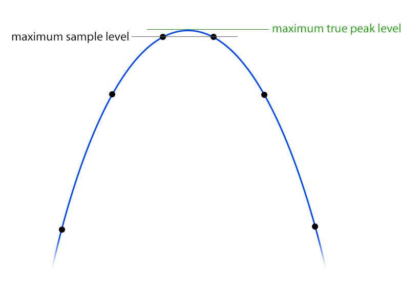

**Pro-L's two parts** **[FF]**: "The limiting process will detect true peaks that already exist in the
input signal, and reduce them appropriately. Any true peak overshoot introduced by the ultra-fast limiting
process itself, will be smoothly attenuated afterwards." Extra latency: "about 5 ms".

**Ours** **[ours]**:

1. **In the main stage**: with oversampling the detector's samples at `fo` already track the true peaks;
   without it, the main stage's detector reads the true peak of the input (the detector below) instead of
   `|x|`.
2. **The true peak stage**, at `fs`, after the decimator, twice in a row:
   - **detector** (as built): per gap between samples `j` and `j+1`, the most of the two samples, BS.1770's
     four points in it (so a BS.1770 meter can never read more than we saw), and an 8x Kaiser-windowed sinc
     (128 taps a phase, β = 10) at `j + 1/8 … j + 7/8`; **every** point that's higher than its neighbours is refined
     by the parabola through it (the samples' own points too: the gaps beside lend them a neighbour each). Without
     refining at the samples, a peak just beside one was missed by up to 0.08 dB;
   - **requirement** `q = min(1, C_int/peak)` with `C_int` **0.03 dB** under the ceiling (what the detector and
     the passes can still miss: measured, below), spread to the 8 samples either side;
   - **look-ahead** 1 ms: hold-min, Hann ramp, a fast release (5 ms), §5.4.
   - The second pass sees only what the first pass's own gain changes left: its gain changes are tiny, so its
     own residual is second-order.

**As built** (`server/music/pro-l.integration.test.ts`: +12 dB of clipped drums and clipped noise into −1 dBTP,
4x, Transparent, Modern, Aggressive): BS.1770's meter reads −0.030 dB (the margin) everywhere; a 16x Kaiser sinc
(β 14, 128 taps a phase) at most **+0.017 dB** (Aggressive, clipped noise), +0.004 dB or less otherwise (with a
0.02 dB margin, Aggressive on noise read +0.027). Pro-L 2, the same way: +0.1 to +0.37 dB (`pro-l-research.md`
§2.7). With oversampling off, on material with energy up to half the rate, "true" depends on the reconstruction, as
the checks below found.

**Checked** before building (48 kHz, ceiling −1 dBTP, references: the BS.1770 filter, and an independent 32x Kaiser
sinc with 256 taps a phase, β = 14) **[checked]**:

| Experiment | Result |
| --- | --- |
| The BS.1770 filter on Tech 3341's tests 15–23 | Within the tolerance: −6.22, −5.98, −6.31, −6.03, +3.03, −0.02, +0.04, −0.12, −0.18 dBTP (expected −6, −6, −6, −6, +3, 0, 0, 0, 0). The 32x reference: −6.02 ×4, +2.99, +0.06 ×4 |
| The BS.1770 filter over-reads | A 0 dBFS sweep: +0.22 dB over the 32x reference; a band-limited square: +0.18 dB. Its passband isn't flat near 20 kHz: a limiter checking only with an ideal interpolator would fail a BS.1770 meter by 0.2 dB. Hence the ITU phases in our detector |
| Interpolators disagree near Nyquist | Clipped drums and clipped noise (energy right up to fs/2): an 8x interpolator with 48 taps a phase reads 0.6 dB under a 16x one with 128. "True peak" there depends on the reconstruction filter: Pro-L's "differences of 0.1 or 0.2 dBTP between different true peak meters are not unusual" **[FF]** |
| One pass, detector equal to the reference, 1 ms ramp | Up to +0.06 dB over (noise, clipped drums: 7 dB of true peak reduction); 2 ms: +0.013 dB |
| Two passes, same | ≤ +0.0012 dB (1 ms), ≤ +0.0001 dB (2 ms) |
| Cheaper detectors, on hard material band-limited to 0.47 fs (as after the decimator), two 1 ms passes, no margin | Overshoot by the 32x reference: 8x/64 taps +0.087 dB; 8x/128 +0.083; 16x/64 +0.027; 4x/96 with the parabola +0.040; **8x/64 with the parabola +0.017; 8x/128 with the parabola +0.004**. The grid's under-read, not the gain's movement, is what's left |
| **Ours** (8x/128 + parabola + ITU phases, two 1 ms passes, 0.01 dB margin), band-limited hard material | BS.1770 meter: **−0.0100 dB** (exactly the margin) on everything; 32x reference: **≤ −0.0057 dB**: under the ceiling by both |
| The same, full band (oversampling off, clipped drums and clipped noise as they are) | BS.1770: −0.0100 dB; 32x reference: **+0.28 / +0.39 dB**: the near-Nyquist disagreement above, not the limiter |
| Sample-peak catch | −0.0000 dB over on everything |

So: **with oversampling on (2x or more), the output's true peak stays under the ceiling by BS.1770's meter
and by an ideal reconstruction**. **Pro-L 2, measured** on the same kinds of material (+12 dB into −1 dBTP, TP on):
within 0.04 dB by BS.1770's meter, but **+0.1 to +0.37 dB over by an ideal reconstruction**, even at 32x
(`pro-l-research.md` §2.7) **[measured]**. With oversampling **off**, on input that already has
energy at half the rate (clipped, square, noise), "true" depends on the interpolator: we guarantee it by
BS.1770's filter and our detector, and an ideal reconstruction may read up to ~0.5 dB more. That is why
FabFilter: "we highly recommend to use oversampling in combination with true peak limiting" **[FF]**. The
window says so when TP is on and oversampling off **[ours]**.

**Its latency** **[ours]**: per pass, the 1 ms look-ahead (48 samples at 48 kHz), the detector's half-length
(64 samples at the host rate) and the spread (8): 2 × (48 + 64 + 8) = **240 samples = 5.0 ms at 48 kHz**,
Pro-L's "about 5 ms" **[FF]**.

### 5.10 Latency

What Pro-L 2's is, measured (`pro-l-research.md` §2.3): Transparent, Punchy, Allround 256 samples + 5 ms (10.3 ms at
48 kHz); Dynamic twice that; Modern 60 ms, Safe 55 ms, Aggressive and Bus about 60 ms, at every rate; never the Lookahead
knob; true peak +4.9 ms with oversampling off, about +0.5 ms with it on.

Ours, fixed by the style, oversampling and true peak (never by Lookahead, Hold, Attack, Release or the clip stage's
knobs) **[ours]**:

```
latency = round((reserve + lookahead range)·fs)   + oversampling (0 when Off, ≈ 63–74 samples)   + last stage
          main stage (lookahead range: 5 ms; Spit: 1 ms)                                           (0 if k = 1 and TP off;
                                                                                                     sample catch 0.5 ms if k > 1;
                                                                                                     true peak stage 240 samples at 48 kHz)
          + the clip stage's differential filters when it's on and k < 4 (~0.5 ms)
```

At 48 kHz (samples / ms):

| Style | Off, TP off | 4x, TP off | 4x, TP on | Pro-L 2, Off / 4x TP |
| --- | --- | --- | --- | --- |
| Spit | 48 / 1.0 | 143 / 3.0 | 359 / 7.5 | (none) |
| Transparent, Punchy, Allround | 240 / 5.0 | 335 / 7.0 | 551 / 11.5 | 496 / 562 |
| Dynamic | 336 / 7.0 | 431 / 9.0 | 647 / 13.5 | 992 / 866 |
| Aggressive, Modern | 1440 / 30.0 | 1535 / 32.0 | 1751 / 36.5 | 2880–2896 / 2962–3138 |
| Safe | 1920 / 40.0 | 2015 / 42.0 | 2231 / 46.5 | 2640 / 2898 |
| Bus | 2400 / 50.0 | 2495 / 52.0 | 2711 / 56.5 | 2896 / 2962 |

Every style is under Pro-L 2's in every column. Our true peak stage costs more than Pro-L 2's (240 samples, against
about 25 when oversampling is on) because it holds the ceiling by an ideal reconstruction too, running twice at the host
rate, while Pro-L 2's only meets BS.1770's meter (§5.9); the shorter reserves more than pay for it. On a vocal or a bus
true peak is off anyway.

The engine reports it to `Song::compensate`, as Pro-Q and Auto-Tune do; a change of style, oversampling or true peak
remakes the song with the new delay. A Lookahead change within the style's range moves only where the ramp starts.

### 5.11 Dither and noise shaping

What Pro-L does **[FF]**: Dither Off / 24 / 22 / 20 / 18 / 16 bits; TPDF noise, "2-bit peak-to-peak" (the sum
of two independent uniform values of ±½ LSB: triangular over ±1 LSB, the standard choice: it makes the
quantisation error's mean and variance independent of the signal); three noise shapings: **Basic** ("lowers
the overall noise floor a few dB, at the cost of increasing noise levels for frequencies above 6 kHz"),
**Optimized** ("an even lower overall noise level, but noise frequencies above 10 kHz are boosted more
extremely"), **Weighted** ("according to the ear's sensitivity … at low listening levels … designed to be used
at 44.1 kHz"). Use it "only … as the final stage", once.

**How** **[ours]**: an error-feedback quantiser, per channel, at the end:

```
v = x[n] − Σ_k h_k·e[n−k]          (the shaped error fed back)
y = Q(v + tpdf)                    (Q: round to the bit depth's step, 2^−(bits−1))
e[n] = y − v                       (the error of the quantiser, dither included)
```

The noise's spectrum is `|1 − H(e^jω)|²` times the white TPDF noise. The filters are published ones (the set
SoX ships, from Lipshitz, Vanderkooy and Wannamaker's papers), picked by matching FabFilter's descriptions
**[inferred]**:

| Shaping | Filter `h` (44.1 kHz) | Why it matches |
| --- | --- | --- |
| **Basic** | Lipshitz's 5-tap "minimally audible" `2.033, −2.165, 1.959, −1.590, 0.6149` | moderate dip in the mid band, rise above ~6–8 kHz |
| **Optimized** | improved E-weighted, 9 taps `2.847, −4.685, 6.214, −7.184, 6.639, −5.032, 3.263, −1.632, 0.4191` | deeper dip, a steep rise above ~10 kHz |
| **Weighted** | F-weighted (Wannamaker), 9 taps `2.412, −3.370, 3.937, −4.174, 3.353, −2.205, 1.281, −0.569, 0.0847` | the ear's threshold curve at low level; made for 44.1 kHz (so is Pro-L's) |

**Pro-L 2's curves, measured** (16 bits, noise per octave against flat TPDF; `pro-l-research.md` §2.7): Basic −6 to
−8 dB to 4 kHz, +7 dB at 20 kHz; Optimized −11 to −12 dB to 2 kHz, +14 dB at 20 kHz; Weighted down to −23 dB at 4 kHz,
+22 dB at 20 kHz. The filters above have these shapes; they're tuned to them within 2 dB per octave (§8.9) **[ours]**.

At 48 kHz the 44.1 kHz filters are close (their curves shift up 9%); SoX has 48 kHz sets for some
(Gesemann's `2.2374, −0.7339, …`); above 48 kHz, shaping moves the noise above 24 kHz and is simple to
redesign (or fall back to flat TPDF) **[inferred]**. The error feedback must be clamped (a large `h` gain
with a clipped output can run away): clip `v` to ±1 and reset `e` on overload **[inferred]**.

**Relation to the export**: the export already dithers to 16 bits through ffmpeg (`aresample` with
Shibata noise shaping) when asked. Dithering twice only adds noise **[FF]**: when a master Pro-L dithers, the
export's dither must be off (and the export's gain 1, or the 16-bit grid is lost). See
[§8.8](#88-how-it-relates-to-the-export).

### 5.12 Loudness metering

All from ITU-R BS.1770-5 and EBU Tech 3341 / 3342 **[std]**, on the output (after the limiter, before Unity
Gain and dither) **[inferred]**:

**K-weighting at any rate.** The ITU gives the two biquads only at 48 kHz ("implementations at other sampling
rates will require different coefficient values … the same frequency response"). The standard derivation
(libebur128's) from the analog prototypes, a high shelf and a high pass:

```
shelf:  f0 = 1681.974450955533 Hz, G = 3.999843853973347 dB, Q = 0.7071752369554196
        K = tan(π·f0/fs), Vh = 10^(G/20), Vb = Vh^0.4996667741545416, a0 = 1 + K/Q + K²
        b = [(Vh + Vb·K/Q + K²), 2(K² − Vh), (Vh − Vb·K/Q + K²)] / a0
        a = [1, 2(K² − 1)/a0, (1 − K/Q + K²)/a0]
high pass:  f0 = 38.13547087602444 Hz, Q = 0.5003270373238773, K = tan(π·f0/fs)
        b = [1, −2, 1],  a = [1, 2(K² − 1)/(1 + K/Q + K²), (1 − K/Q + K²)/(1 + K/Q + K²)]
```

At 48 kHz this gives `1.53512485958697, −2.69169618940638, 1.19839281085285 / −1.69065929318241,
0.73248077421585` and `−1.99004745483398, 0.99007225036621`: the ITU's tables to every printed digit; a 0 dBFS
997 Hz sine in one channel reads −3.010 LKFS (the ITU: −3.01) **[checked]**. The K-weighting's gain at 997 Hz is
+0.691 dB at 48 kHz, +0.694 at 44.1 and +0.674 at 96 kHz **[checked]**: rates differ by 0.02 dB, inside every
tolerance.

**The measurements.** Squares of the weighted signal are summed per channel into **100 ms sub-blocks**
(`round(0.1·fs)` samples), weighted by `G_i` (1.0 for L and R; 1.41 for surrounds) **[std]**:

| Measure | How | Updated |
| --- | --- | --- |
| **Momentary** M | the last 4 sub-blocks (400 ms), ungated: `−0.691 + 10·log10(Σ_i G_i·z_i)` | every 100 ms (≥ 10 Hz, Tech 3341) |
| **Short-term** S | the last 30 sub-blocks (3 s), ungated | every 100 ms |
| **Integrated** I | every 400 ms block (75% overlap: one per 100 ms, i.e. each M value) since the reset, gated: absolute −70 LUFS, then relative −10 LU below the absolute-gated mean of power | every 100 ms (≥ 1 Hz) |
| **LRA** | the S values (one per 100 ms, ≥ 10 Hz) since the reset, gated at −70 LUFS and −20 LU, then the 95th percentile minus the 10th (Tech 3342's MATLAB) | every 100 ms; flagged unsettled for the first 60 s (Tech 3341) |
| **Max M / Max S** | the largest M and S since the reset | |
| **Max true peak** | the true peak detector (§5.9) on the output, since the reset | |
| **PLR** ([ours], not in Pro-L) | max true peak − I | |

**No allocation on the audio thread**: Integrated needs every block since the reset and LRA every S value; an
hour is 36 000 of each. Both go into **histograms** of fixed size (libebur128's histogram mode): bins of
0.01 LU from −70 to +10 LUFS (8000 bins), each holding a count and (for I) the sum of the blocks' powers, so
the gated mean is exact except for the blocks in the one bin the relative gate falls in (all counted in or
all out: it only matters if many blocks sit within 0.01 LU of the gate, and even then by hundredths of an LU)
and LRA's percentiles are read to 0.01 LU **[inferred]**. 2 × 8000 × 16 bytes = 256 KB per instance, allocated
with it. The audio thread updates the bins and, every 100 ms, recomputes I and LRA (a scan of 8000 bins: a few
microseconds) and publishes them through atomics **[ours]**.

**Pause and reset**: pause stops adding blocks (I, LRA, the maxima) but the meters keep moving; reset empties
the histograms, the maxima and the peak and gain-reduction readings; auto-reset happens when play starts.
**[FF]**

**The output meter's RMS**: per channel, the Momentary (K-weighted, 400 ms) of that channel alone, and the
combined one **[FF]**; the peaks by the sample or true peak detector depending on TP. **K-System scales**: the
meter's 0 mark moved to −12, −14 or −20 dBFS. Katz's own K-meters use unweighted (flat) RMS, and Pro-L 1's
RMS was a 2000 ms average **[FF, Pro-L 1]**, but Pro-L 2's RMS is the Momentary loudness in every scale
**[FF]**, so ours is too.

**Conformance** (what the tests check, §8.9): Tech 3341's tests 1–6 and 9–23 within ±0.1 LU (true peak
+0.2/−0.4 dB), Tech 3342's 1–4 within ±1 LU. The two "authentic programme" tests of each (7–8, 5–6) need the
EBU's files.

### 5.13 Parameter changes, sample rate, denormals, determinism

- **Gain, Output and Clip Range** glide (a one-pole in dB, 10 ms) **[ours]**; Pro-L has "Smart Parameter Interpolation"
  **[FF]**. The ceiling and the clip level travel with the sound: the requirement for a sample is computed with the
  levels at the time it enters, and applied when it leaves `D` later, so a falling ceiling never lets a sample through
  above itself **[inferred]**.
- **Lookahead** glides at most 0.05 ms per 10 ms; **Hold** changes the hold-min's backward length (PeakHold's live
  `set`).
- **Attack, Release, links, Side floor, shape, knee** take effect at once (they change rates, weights and curves, not
  levels; the clip curve's change is per sample, so it can't click beyond the curve itself).
- **Style, oversampling, true peak, stereo mode** change the latency or the core: a new core is built on the message
  thread and handed over by atomic exchange; the old one is faded out over 10 ms and returned to be deleted, as Pro-Q's
  convolvers are; the song is remade with the new delay **[ours]**.
- **Sample-rate independence**: every time is in seconds and turned into samples at the rate it runs at; the K-weighting,
  the true peak detector's factor and the dither filters are chosen per rate.
- **Denormals**: `ScopedNoDenormals`; followers floored.
- **Determinism**: everything per sample with state carried between blocks; nothing depends on the block size, so live,
  offline and export render the same samples, and the parallel export is identical to one thread. Automation lanes at
  the 256-sample slices like every other lane.

### 5.14 CPU budget

Per channel per host sample, roughly **[inferred]** (changed: the kernels are box stacks and the minimum a PeakHold, so
the limiter's cost no longer grows with the look-ahead's length):

| Part | Multiply-adds |
| --- | --- |
| Oversampling up + down, 4x (half-band stages) | ~ 200 |
| Clip stage at `fo` (curve, antiderivative, a division) | ~ 15 × k (60 at 4x) |
| Limiter at `fo` (detector, linking, PeakHold, release, box⁴, multiply; the minimum at a control rate above 8x) | ~ 25 × k (100 at 4x, ~400 at 32x) |
| Release stage at `fs` | ~ 15 |
| True peak stage ×2 | ~ 2200 |
| Loudness and meters | ~ 30 |

At 4x with true peak, ~2.6 k operations a sample: a few per cent of a core with SIMD.

### 5.15 What feeds the display and the meters

Per 10 ms "column": the input's peak (after Gain), the output's peak, the largest **clip** reduction and the largest
**limiter** reduction (the transient and release stages' share apart), and M and S. The meter values: output peak or
true peak per channel, momentary RMS, gain reduction per stage, I, LRA, Max M / S, max true peak, PLR, **the share of
samples clipped**, **the peak density** (the share of samples within 0.5 dB of the ceiling over 400 ms, a live proxy for
codec risk), max gain reduction. To the tab in each transport event (25 a second) for the Pro-Ls whose window is open,
as Pro-Q's analyzer does. Peak labels are found in the tab from the columns **[ours]**.

### 5.16 How the [checked] claims were checked

Python 3.9, NumPy 2.0, SciPy 1.13, at 48 kHz. Not committed (they're not tests of our code; the tests are in
§8.9):

- **K-weighting**: the formulas above at 48 kHz compared with BS.1770-5's Tables 1 and 2 (identical to 14
  digits); `scipy.signal.freqz` at 997 Hz for 44.1, 48 and 96 kHz; 5 s of a 0 dBFS 997 Hz sine in one
  channel through `lfilter`, the loudness formula (−3.0103 LKFS).
- **BS.1770's interpolator**: the printed 48 coefficients as four 12-tap phases; Tech 3341's signals 15–23
  synthesised as the document says (19's amplitude 1.41; 20–23 made at 4·fs, low-passed with a 511-tap Kaiser
  FIR and decimated at offsets 0–3); the reference a 32x Kaiser-windowed sinc, 256 taps a phase, β = 14,
  through `upfirdn`.
- **Hard material**: drum hits (noise bursts with 30 ms decays and a pitch-swept kick, four a second)
  clipped after +12 dB; white noise at 0.5 RMS clipped at ±1.5; a band-limited 3.1 kHz square (four
  harmonics, peak 1.2); a quarter-rate sine at +3 dBTP; a 20 Hz–20 kHz sweep at 0 dBFS; 3 s each, 5 ms fades
  and silence around them (without them, the reference's own ringing on the cut ends reads as overshoot).
- **The stage**: §5.4's construction with `sliding_window_view` minima, a Hann kernel, spreads of 0–8
  samples, one or two passes; the overshoot read as the reference's maximum over the ceiling. Detectors: 4x,
  8x and 16x Kaiser sincs of 48–128 taps a phase, with or without a three-point parabola at each local
  maximum, always with the four BS.1770 phases and the samples themselves. "Band-limited" material went
  through a 1023-tap Kaiser low-pass flat to 0.45 fs and −114 dB from 0.485 fs, standing in for the
  decimator's output.
- **Oversampled limiting**: `resample_poly` 4x up (Kaiser β = 10), §5.4's stage on sample peaks at 4x
  (lookahead 0.1 and 1 ms), `resample_poly` down; sample and true peaks of the result.

---

## 6. The factory presets

**Pro-L 2's**: the list isn't published; most are by outside engineers (bManic, Stephan Muesch, Ricardo Sangiao);
names seen in sessions: "Hip Hop Mastering RS", "EDM-Aggressive and Tight" **[FF]** **[user]**.

**Ours** **[ours]**, from the engineers' numbers (`pro-l-research.md` §1.10). Gain is left at 0 dB (the user sets how
loud); delivery settings only where a preset is about delivery ("—" leaves them as they are, with Lock Output on).
"Clip" is Clip Range / shape:

| Preset | Style | Lookahead / Attack / Release / Hold | Clip | Stereo | Ceiling | Target | For |
| --- | --- | --- | --- | --- | --- | --- | --- |
| **Default Setting** | Modern | 0.18 ms / 275 ms / 400 ms / Auto | off | L/R 75 / 100 % | **−0.1 dBFS sample peak** (true peak shown), 4x | −14 | anything |
| Master: Streaming −14 | Modern | 0.5 ms / 150 / 300 / Auto | off | L/R | −1.0 dBTP, 4x | −14 | Spotify, YouTube, TIDAL |
| Master: Streaming Loud | Modern | 0.5 / 150 / 300 / Auto | +2 dB Smooth | L/R | **−2.0 dBTP**, 4x | −10 | louder than −14, headed for lossy |
| Master: Chart Pop | Modern | 0.3 / 200 / 300 / Auto | +2 dB Smooth, knee 1.5 | L/R | −1.0 dBTP, 4x | −8 | pop (−8.3 LUFS is the 2024 norm) |
| Master: Trap Loud | Punchy | 0.5 / 275 / 300 / Auto | +3 dB FL | L/R | −0.1 dBFS sample (TP shown), 4x | −6 | trap, rap: clip → limit |
| Master: FL (Emphasizer) | Punchy | 0.5 / 275 / 50 / Auto | **limit, then clip**: +1 dB Hard | L/R | −0.1 dBFS sample (TP shown), Off | −6 | FL 2026's default master, as measured: a limiter 1 dB over, a hard clip at the ceiling |
| Master: Rage / Hyperpop | Aggressive | 0.1 / – / – / Auto | +1 dB Hard | L/R | −0.01 dBFS sample, 4x | −4 | Carti, Ken Carson, 100 gecs |
| Master: Wide | Modern | 0.3 / 275 / 400 / Auto | +2 dB Smooth | **M/S, side floor −6** | −1.0 dBTP, 4x | −8 | wide hyperpop and pop choruses |
| Master: Clean | Transparent | 1 ms / 150 / 500 / Auto | off | L/R | −1.0 dBTP, 4x | −12 | ballads, R&B, dynamic masters |
| Master: 808 Control | Modern | 1 ms / 400 / 400 / Auto | off | L/R 100 / 100 % | — | — | sub-heavy beats, the bass stays clean |
| Master: Rock Punch | Dynamic | 0.3 / 250 / 250 / Auto | off | L/R 80 / 100 % | — | — | rock, live drums |
| Master: Allround | Allround | 0.5 / 275 / 400 / Auto | off | L/R 80 / 100 % | — | — | when unsure |
| Master: Classical and Acoustic | Safe | 5 ms / 0 / 1 s / 20 ms | off | L/R 100 / 100 % | — | — | delicate, dynamic music |
| Approval Mix | Modern | 0.3 / 275 / 400 / Auto | +1 dB Smooth | L/R | −0.3 dBFS sample, 4x | −9 | client bounces; off for mastering |
| Vocal: Peak Catcher | Punchy | 2 ms / 150 / 200 / Auto | off | L/R 100 / 100 % | — (TP off, Off) | — | after the vocal compressors |
| Vocal: Spit | Spit | 0.05 ms / – / 3 ms / 0 | off | L/R 100 / 100 % | — (TP off, Off) | — | the L1 "spit and attitude", hit hard |
| Vocal: Smooth | Safe | 5 ms / 0 / 300 / 20 ms | off | L/R 100 / 100 % | — (TP off, Off) | — | ballads, spoken word |
| 808: Clip | Transparent | 0.5 / 275 / 100 / Auto | **0 dB FL** (the clipper does the work) | L/R 100 / 100 % | — (TP off, 4x) | — | an 808 or sub bus |
| Drum Bus: Glue | Bus | 2 ms / 30 / 300 / 15 ms | off | L/R 100 / 100 % | — (TP off) | — | drum bus, a few dB |
| Drum Bus: Crunch | Bus | 1 ms / 10 / 150 / 15 ms | +1 dB Soft | L/R 100 / 100 % | — (TP off) | — | clipped, crunchy drums |
| Kick and Sub Ceiling | Transparent | 1 ms / 275 / 200 / Auto | off | L/R 100 / 100 % | — (TP off) | — | a maximum for kick and 808 |
| Broadcast EBU R 128 | Transparent | 1 ms / 150 / 500 / Auto | off | L/R 100 / 100 % | −1.0 dBTP, 4x | −23 | TV, radio (Europe) |
| Broadcast ATSC A/85 | Transparent | 1 ms / 150 / 500 / Auto | off | L/R 100 / 100 % | −2.0 dBTP, 4x | −24 | TV (US) |
| CD Master | Modern | 0.5 / 275 / 400 / Auto | off | L/R | −0.1 dBTP, 8x, 16 bits (O) | −9 | a 16-bit master |

---

## 7. Proposed for Vaudio

Revised 2026-10-07 after the second round of research and the measurements, from Théo's ask: "more versatile than Pro-L
… the most goated limiter ever", for loud masters, streaming masters, vocals and buses, with a clipper stage inside.

### 7.1 Decided, to confirm

- **A stock effect of ours, named YT-L** (Théo, 2026-10-07), chosen from an effect slot's picker (Built in → YT-L), as
  YT-EQ is: its settings **in the
  song** (`MixerEffect.proL`), the engine running it natively. The real Pro-L 2 can still be loaded as a plugin beside it.
- **Pro-L 2's window and workflow, plus what it lacks**: the display, the Gain strip, the Advanced panel, the meters and
  the loudness panel, the output panel; then the clip stage, Hold, M/S, per-stage meters and audition, delivery tools.
- **Its look is FabFilter's, as Pro-Q's is** (`--eq-*` surfaces, `--lim-*` colours, plain colours for the canvases).
- **The clipper is off on a new YT-L** (Théo, 2026-10-07): the limiter alone, the clip stage one click away (its
  default Clip Range +1.5 dB once on).
- **The default ceiling is −0.1 dBFS, sample peak** (Théo, 2026-10-07): where trap and hyperpop releases are
  finished (`pro-l-research.md` §1.6). True Peak Limiting is off by default, the true peak is always shown beside it,
  and the streaming and broadcast presets switch it on (−1 or −2 dBTP).
- **Nine styles as tables** (§4.2): Pro-L 2's eight, re-measured and fixed, and Spit.
- **The ceiling is never exceeded**, by construction: sample peaks always; true peaks by the BS.1770 meter *and* by an
  ideal reconstruction whenever oversampling is on (Pro-L 2: the meter only). The true peak is always shown.
- **No bass distortion in any style that claims to be clean** (Auto Hold), **loudness that rises with Gain** (Pro-L 2's
  doesn't), **IMD at or under Pro-L 2's Modern** in the transparent styles: measured by the same probe on both (§8.9).
- **Latency is fixed** by the style, oversampling and true peak, and at or under Pro-L 2's in every style (half for the
  adaptive ones); the Lookahead knob turns inside it.
- **The meters run whether the window is open or not**; the display's columns only for open windows.
- **The slot's mix knob** works (the dry delayed to match); below 100 % the ceiling no longer holds and the window says so.
- **No external side chain, MIDI Learn or surround** in the first version; every continuous control is automatable.

### 7.2 First, then later

| First | After the core | Later |
| --- | --- | --- |
| The nine styles; Gain, Output, Lookahead, Attack, Release, **Hold (Auto)**, both links | **Bass clip** in the clip stage | **Multiband**: 2 bands (an 808 band below ~120 Hz) then 3–4, a weighted projection of the band gains with a tonal-drift clamp, always followed by the wideband stages |
| **The clip stage**: Clip Range, Hard / Smooth / Soft / Converter / **FL**, knee, **order** (clip then limit, or limit then clip), ADAA, the differential stage | **Clean** (Orban's distortion cancelling) | A masking-weighted **Smart clip** |
| **Stereo: L/R or M/S side first** with the Side floor | An **HF limiter** (a dynamic high shelf) before the clip stage | An **upward / "inflate"** density stage before the limiter |
| True Peak Limiting; oversampling Off to 16x (32x later: JUCE's oversampler stops at 16x) | **Normalised listen**: the output turned to each platform's level (Spotify's rules, its Loud limiter) to hear it as listeners will |  |
| DC filter, Unity Gain, **Audition All / Clip / Limiter** | An **Analyze** render: the song's I, LRA, max true peak and gain reduction at the current settings, without playing it, and **Gain to target** (suggested, never silent; the assistant's too) | Stems through the master's limiter (§8.8) |
| Dither (24 … 16 bits) with Basic, Optimized, Weighted (matched to Pro-L 2's measured curves) | **A codec check in the export**: encode with real encoders (Apple AAC 256 through `afconvert`, Opus, LAME), decode, report the decoded true peak, suggest a trim | Release-law options (dual peak/RMS, Release Shape) |
| The display, peak labels, the loudness curve, **GR per stage** | **Per-platform targets** in the loudness panel, with what each will do to the master (turn down, turn up within headroom, Spotify Loud's limiter) | An **Approval / Master** pair in the export: the master rendered with and without its limiter |
| The meters: 16 / 32 / 48 dB, K-12 / 14 / 20, Loudness; **PLR, % clipped, peak density** | | Compact view |
| Loudness: M, S, I, LRA, Max M / S, targets, +9 / +18, absolute / relative, pause, reset, auto-reset | | Saving presets of one's own |
| Presets (§6), Lock Output, A/B, Copy, the app's undo; automation of every continuous control; tools | | |

### 7.3 Where Vaudio differs from Pro-L 2

| What | Pro-L 2 (measured where marked) | Ours |
| --- | --- | --- |
| Clipper | none (users put one before it) | a clip stage before or after the limiter: five shapes (one is FL Studio's, measured), ADAA, bit-exact below its knee, its own meters and delta |
| Bass distortion | −21 dB THD on 40 Hz in Transparent / Allround (**measured**) | Auto Hold: none in any style but Spit |
| Loudness against Gain | not monotonic in Modern, Aggressive, Bus (**measured**) | monotonic, tested |
| True peak | holds by BS.1770's meter; +0.1 to +0.37 dB over by an ideal reconstruction (**measured**) | holds by both |
| Latency | 10.3 ms (Transparent) to ~60 ms (Modern, Aggressive, Bus) at 48 kHz, TP off (**measured**) | 1 ms (Spit), 5 ms (Transparent) to 50 ms (Bus) |
| Linking | two knobs; effectively a switch between 20 % and 50 % (**measured**) | two knobs, linear in dB; **M/S side first** |
| Styles | eight, opaque | nine, each showing its ramp, hold, release and latency |
| Audition | the whole delta | All, Clip or Limiter |
| Meters | output, GR, loudness | the same, plus GR per stage, PLR, % clipped, peak density; per-platform previews later |
| External side chain, surround, MIDI Learn | yes | no (automation instead) |
| Mix | none | the slot's mix knob (warned about) |
| Undo, presets, sizes | its own | the app's undo; factory presets; the window resizes freely; Compact later |

---

## 8. How it'd be built here

**Built so far** (2026-10-07): step 1, the engine core: `engine/src/ProL.h/.cpp` (the stages, the bass stage,
Auto Hold, the release stage, Dynamic's emphasis, the DC filter, Unity Gain, the slot's mix), `Lookahead.h` (the
sliding minimum, the box stack, a stage), `TruePeak.h` (the passes); the document, its validation and
`engineProL` (`shared/music/pro-l*.ts`); its offline tests. Not yet: the clip stage, M/S, Audition, the meters,
dither, the window, presets, automation's TypeScript side, the assistant's tools.

The same shape as Pro-Q and PanMan: the document and what it means in TypeScript, the sound in C++, the window in React.

### 8.1 The document

```ts
// shared/music/types.ts
export const PRO_L_STYLES = ["transparent", "punchy", "dynamic", "allround", "aggressive", "modern", "bus", "safe", "spit"] as const;
export type ProLStyle = (typeof PRO_L_STYLES)[number];
export const PRO_L_CLIP_SHAPES = ["hard", "smooth", "soft", "converter", "fl"] as const;
export type ProLClipShape = (typeof PRO_L_CLIP_SHAPES)[number];

/** Pro-L's sound: what A/B swaps and presets set. Levels in dB, times in seconds, links 0..1. */
export interface ProLState {
  style: ProLStyle;
  gain: number;            // 0..30
  output: number;          // −30..0 (dBTP with truePeak)
  lookahead: number;       // 0..0.005 (Spit: 0..0.001)
  attack: number;          // 0..10
  release: number;         // 0..10
  hold: number | null;     // 0..0.05; null: Auto
  stereo: "lr" | "ms";
  linkTransients: number;  // 0..1
  linkRelease: number;     // 0..1
  sideFloor: number;       // 0..−18 dB (M/S)
  clip: boolean;
  clipRange: number;       // 0..6 dB above the ceiling
  clipShape: ProLClipShape;
  clipKnee: number;        // 0..6 dB (Smooth, FL)
  clipOrder: "first" | "last";   // clip then limit (default), or limit then clip at the ceiling (FL's Emphasizer)
  truePeak: boolean;
  oversampling: 1 | 2 | 4 | 8 | 16 | 32;
  dither: 0 | 16 | 18 | 20 | 22 | 24;   // 0: off
  noiseShaping: "none" | "basic" | "optimized" | "weighted";
  dcFilter: boolean;
  unityGain: boolean;
  audition: "off" | "all" | "clip" | "limiter";
}

/** How it meters and shows (left alone by presets and A/B, as Pro-L's metering settings are). */
export interface ProLMeter {
  scale: "16" | "32" | "48" | "k12" | "k14" | "k20" | "loudness";
  truePeakMeter: boolean;
  display: "slowDown" | "fast" | "slow" | "infinite" | "off";
  target: number;                 // LUFS
  timeScale: "momentary" | "shortTerm" | "integrated";
  loudnessRange: 9 | 18;
  relative: boolean;
  maxOf: "momentary" | "shortTerm";
  autoReset: boolean;
}

export interface ProL extends ProLState {
  preset: string;
  lockOutput: boolean;
  ab: "a" | "b";
  other: ProLState | null;
  meter: ProLMeter;
}
// MixerEffect.proL?: ProL, on an effect whose plugin is PRO_L_PLUGIN ({ id: "vaudio:pro-l", name: "YT-L", format: "Vaudio" }).
```

Bypass is the slot's `enabled` (the engine fades it; its latency stays in the compensation). Validated by
`normalizeProL` (or it's dropped on load and save). A "normalised listen" (later) is the tab's, never the song's, so
it can't reach an export.

### 8.2 The files

| File | What |
| --- | --- |
| `shared/music/pro-l-presets.ts` | `PRO_L_PLUGIN`, `isProL`; every control's range, default and taper (`PRO_L_CONTROLS`; Attack and Release with Pro-L 2's own tapers, 10 s × raw⁴ and 6.859 s × raw³, so a value typed reads the same in both); the **style tables** (§4.2); the clip shapes; the loudness targets; the presets (§6); `DEFAULT_PRO_L`; `normalizeProL`. Tested. |
| `shared/music/pro-l.ts` | `findProL`, `editProL`, `updateProL`, `loadProLPreset` (Lock Output), `switchProLAB` / `copyProLAB`, `engineProL` (the style's table resolved, the release stage's cap, controls in engine units), `proLLatencySeconds`, `describeProLStyle` (what the window and the assistant say a style does: its ramp, hold, release, latency). Tested. |
| `shared/music/loudness.ts` | A plain TypeScript BS.1770-5 / Tech 3341 / 3342 meter and true-peak reader: the **independent reference** the integration tests measure with. Tested against Tech 3341 / 3342's signals. |
| `shared/music/compile.ts` | `EngineEffect.proL`; lanes `kind: "limiter"`. |
| `engine/src/ProL.h/.cpp` | `limit::Settings`, `limit::State` (per effect id: the core, the meters), `limit::Registry`. The chain of §5.1. |
| `engine/src/Lookahead.h` | The look-ahead limiter of §5.4: PeakHold (forward and backward windows, live length), the box-stack kernel (variable length), the transient release, the adaptive ramp's period estimate. Pure DSP, used three times (main stage, sample catch, true peak stage). |
| `engine/src/Clipper.h` | The clip stage (§5.7): the curves and antiderivatives, ADAA on the residue, the differential ×4 stage. |
| `engine/src/Oversampler.h/.cpp` | The half-band cascade (2x … 32x, linear phase, integer latency). Reusable. |
| `engine/src/TruePeak.h/.cpp` | The detector of §5.9. Reusable by the export. |
| `engine/src/Loudness.h/.cpp` | The meter of §5.12. Reusable by the export. |
| `engine/src/Dither.h` | TPDF and the error-feedback quantiser with the shaping tables by rate. |
| `engine/src/Song.cpp`, `Sequencer.cpp`, `Engine.cpp`, `Export.cpp` | Parse `vaudio:pro-l`; `Song::compensate` adds its latency; `Sequencer::runProL` (the dry held back for the slot's mix) and its lanes; the `proL` command (reset, pause, resume a meter); `limiters` in transport events and in `render`'s answer; the export's own registry. |
| `server/music/fake-engine.mjs` | Answers `proL`; sends made-up `limiters` readings. |
| `src/suites/music/pro-l/` | `pro-l-window.tsx`, `display.tsx` + `draw.ts` (the scrolling picture, GR per stage, the loudness curve, peak labels), `meters.ts`, `history.ts`, `labels.ts`, `geometry.ts`, `clip-panel.tsx` (the clip stage's controls and its transfer curve, traced live), `actions.ts`, `store.ts`, `tool-edits.ts`. |
| `src/suites/music/fabfilter/` | **New, shared with Pro-Q**: the FabFilter knob, the top bar, the bottom bar's buttons. |
| `src/themes/studio.css` | `--lim-*` tokens (input, output, clip reduction, limiter reduction, label, loudness low / near / over, target). |
| `scripts/fabfilter-probes/pro_l.py` | **Exists**: measures Pro-L 2; gains a mode that runs the same signals through our engine's offline render, so the two print side by side (§8.9). |
| Tests | `shared/music/pro-l.test.ts`, `loudness.test.ts`, `server/music/pro-l.integration.test.ts`, `e2e/music.spec.ts`. |

### 8.3 What's decided where

| In TypeScript (tested, the song's) | In the engine (C++, the sound's) |
| --- | --- |
| What each style *is* (its table), presets, defaults, ranges, tapers, the release stage's cap | Every sample: oversampling, the clip stage, detection, linking and M/S, the hold, both stages, the kernel, the true peak stage, dither |
| The ceiling, Gain, Clip Range and Unity in dB; times in seconds | Times turned into samples at the rate it runs; the latency in samples |
| Which noise shaping, which bit depth, which clip shape | The shaping coefficients, the curves' antiderivatives |
| The meters' scales, colours, targets, labels (drawing) | The measurements |
| Automation curves sampled into lanes | Lanes applied per 256-sample slice |

### 8.4 The engine's state and the audio thread

- **By effect id** (`limit::Registry`): a song edit doesn't empty its delay lines or reset its meters; the export makes
  its own registry.
- **The core** (delay lines, PeakHolds, box sums, oversampler, true peak rings: sized by style, oversampling and rate) is
  built on the message thread when those change, handed over by atomic exchange, faded over 10 ms, and returned to be
  deleted, as `Convolver::offer` does. The **meters** live in the State, outside the core.
- **Nothing on the audio thread allocates, locks or does I/O.**
- **Sizes**: the largest ring is Bus at 32x: 55 ms × 32 × 48 kHz ≈ 84 000 samples a channel; the hold's backward window
  adds at most 50 ms; under 3 MB in all.

### 8.5 Latency and compensation

`Song::compensate` adds `effect.limSettings->latency` for an enabled Pro-L, as it does `eqSettings->latency`. A style /
oversampling / true peak / stereo-mode change makes the song again with the new delay. The slot's dry sound is held
back by the same amount. `songLatency` keeps the playhead in time; the export trims it.

### 8.6 Automation, events, the window

- **Automation**: `AutomationTarget` `{ kind: "proL"; effect: string; control: ProLControl }`, `ProLControl = "gain" |
  "output" | "lookahead" | "attack" | "release" | "hold" | "linkTransients" | "linkRelease" | "sideFloor" | "clipRange" |
  "clipKnee"`; lanes `kind: "limiter"` in the engine's units, set at each slice's start; the engine glides them.
  `e2e/music.spec.ts` right-clicks every slider of the window (as for every built-in).
- **Transport events**: `EngineTransport.limiters?: Record<effectId, EngineLimiterState>`: the meter values (§5.15) for
  every Pro-L, and the columns since the last event for those watched (`limWatch`).
- **The window** (FabFilter's layout, §2.1): the display with the Gain strip on its left, the Advanced panel (Style,
  Lookahead, Attack, Release, **Hold**, the links or the **Side floor**, the **stereo mode**), a **Clip** panel beside it
  (on, Clip Range, shape, knee, the transfer curve with the signal traced on it, the clip meters), the meters and the
  loudness panel at the right, the bottom bar with the output panel. The style's numbers (ramp, hold, release, latency)
  under its name.

### 8.7 The assistant's tools

| Tool | Kind | What |
| --- | --- | --- |
| `get_pro_l` | look | Its settings and what its style does in numbers, its latency, and the readings: I, S, M, LRA, Max M / S, max true peak, PLR, GR per stage, % clipped, peak density. |
| `update_pro_l` | edit | A patch (every field of §8.1), or a preset by name (respecting Lock Output). Errors name the allowed values. |
| `reset_pro_l_meter` | action | Reset (or pause, resume) its loudness measurement. |
| `add_mixer_effect` | (exists) | Takes "YT-L". |
| `add_automation` | (exists) | Takes "limiter gain", "limiter output", "limiter clip range", … |
| after the core: `analyze_pro_l` | action | The song rendered offline through it: I, LRA, max true peak, GR over time. With it, the assistant suggests the Gain for a target in two or three tries (loudness rises with Gain, §5.6). |

### 8.8 How it relates to the export

- **`preventClipping` / `exportGain`** turns a whole render down until its loudest *sample* is at −0.3 dBFS. With a
  Pro-L at −1 dBTP last on the master nothing changes; with a "release style" sample ceiling (−0.01 to −0.1 dBFS: how
  trap and hyperpop records ship, and YT-L's default) it would undo the ceiling the user chose. So **when the master's
  last enabled effect is a YT-L, `exportGain` only acts above 0 dBFS** (required by the default ceiling) **[ours]**.
- **Dither**: dither once, last: when a master Pro-L dithers, the export's own is off.
- **Codec check** (after the core): the export encodes its mix with the destination's real encoders (Apple AAC 256
  through `afconvert` on macOS, libopus, LAME; never ffmpeg's own AAC), decodes to float, reports the decoded true peak
  and `afclip`'s on-sample and inter-sample clips, and suggests a trim; three tries at most.
- **Approval / Master pair** (later): the export renders the master with and without its limiter in one go, the most
  common manual step in these genres (`pro-l-research.md` §1.10).
- **Stems** through the master's limiter (later): the master Pro-L's gain curve applied to every stem (exact while the
  processing is only gain: not with the clip stage or Dynamic's emphasis).
- **Reporting**: the export's job can show the render's I, LRA and max true peak with the same `Loudness` and `TruePeak`
  code.

### 8.9 Offline tests, with pass criteria

`server/music/pro-l.integration.test.ts`, the real engine offline, at 48 kHz and, where marked, 44.1 and 96 kHz,
measured **in TypeScript with `shared/music/loudness.ts`**. "Hard material" is synthesised in the test (clipped drums,
clipped noise, a band-limited square, a +3 dBTP quarter-rate tone, a 0 dBFS sweep, the probe's trap loop), pushed with
Gain +12 dB. The probe's signals (`scripts/fabfilter-probes/pro_l.py`) are reused so the numbers compare with Pro-L 2's
in `pro-l-research.md` §2.

| # | What | Setup | Pass |
| --- | --- | --- | --- |
| 1 | **Sample ceiling** | Hard material × 9 styles × oversampling {Off, 4x, 32x} × lookahead {0, 0.1 ms, max} × ceiling {0, −0.1, −1 dB} × clip {off, 0 dB Hard, +2 dB Smooth} × stereo {L/R, M/S}; TP off | Max \|sample\| ≤ ceiling + 0.0001 dB, every case |
| 2 | **True peak, BS.1770** | The same with TP on | ≤ ceiling + 0.001 dB by the Annex 2 filter |
| 3 | **True peak, ideal reconstruction** | TP on, oversampling ≥ 2x | ≤ ceiling + 0.02 dB by a 16x Kaiser sinc (Pro-L 2: +0.1 to +0.37) |
| 4 | **True peak, oversampling off** | TP on, Off, band-limited material | Independent 16x ≤ ceiling + 0.02 dB |
| 5 | **Latency exact** | An impulse at −20 dBFS, every style × {Off, 2x, 4x, 32x} × TP × clip on / off, at 44.1 / 48 / 96 kHz | As reported, to the sample; in time with a dry track |
| 6 | **Untouched below the threshold** | A −20 dBFS sweep, the trap loop at Gain 0 (peaks −1 dBFS), clip on at Range 0 | Off, TP off: a null ≤ −120 dB (Pro-L 2: −152 dB); oversampled: within ±0.01 dB to 20 kHz |
| 7 | **Bass: no distortion** | Sines at 30, 40, 60, 100 Hz, 6 and 12 dB over, every style but Spit, Hold Auto | THD ≤ −80 dB (Pro-L 2's Transparent: −21 dB; Modern −73 dB) |
| 8 | **Bass under the mids** | 50 Hz 6 dB over plus 3 kHz at −20 dB | Sidebands of 3 kHz: Transparent, Modern, Safe ≤ −40 dBc; Aggressive is near-clipping by design (Pro-L 2's: −10) |
| 9 | **Loudness rises with Gain** | The trap loop and hard material, Gain 0 → 30 dB in 2 dB steps, every style | Integrated loudness never falls by more than 0.05 LU from one step to the next (Pro-L 2's Modern falls 1.7 LU) |
| 10 | **The release stage** (Jetter's tests) | A 1 kHz tone at −12 dBFS with 1 ms clicks 6 dB over every 500 ms; Transparent | Attack 10 s: back within 0.5 dB < 30 ms after a click; Attack 0: the recovery grows with Release |
| 11 | **Program-dependent release** | The click alone, then a sustained 60 Hz overload | The recovery after the sustained one at least 3× slower |
| 12 | **Hold** | A 1 kHz burst 6 dB over for 50 ms; Hold 0 / 20 ms | With 20 ms, the reduction stays within 0.1 dB of full for 20 ms after the burst |
| 13 | **Clip stage** | A 1.25 kHz sine 12 dB into a Hard clip at 4x; a −20 dBFS sweep with the clip on | Worst alias ≤ −90 dBc; below the knee the residue is exactly 0 (bit-exact output, Off) |
| 13b | **The FL shape** | The ramp of `fl_studio.py`'s test file through the clip stage alone (FL shape, its default knee, Clip Range 0, limiter at a ceiling 6 dB higher) | Within 0.001 of Fruity Soft Clipper's measured curve (`pro-l-research.md` §2.9) at every level |
| 14 | **M/S keeps the centre** | A wide chord stack over a mono 808 | Side first: the M gain stays at 0 dB until the S gain reaches the floor; the ceiling holds (row 1) |
| 15 | **Linking** | A peak in the left only, 6 dB over | 0 %: the right untouched; 100 %: the same reduction; 50 %: half in dB (± 0.5 dB) |
| 16 | **Unity Gain** | Gain +6 dB | A tone under the ceiling comes out at the input's level within 0.01 dB |
| 17 | **Audition** | Hard material, clip on | All + output = the delayed input after Gain (−90 dB Off / −60 dB oversampled); Clip + Limiter = All |
| 18 | **DC filter** | A tone with +0.1 DC | Mean < 0.0005 after 2 s; 20 Hz within 0.05 dB |
| 19 | **Dither** | 16 bits, each shaping | Integers ± 1e-6; TPDF variance ½ LSB² ± 5 %; each shaping within 2 dB of Pro-L 2's measured octave curve (`pro-l-research.md` §2.7) |
| 20 | **EBU Tech 3341, 3342; true peak meter** | Their signals, synthesised | M, S, I within ±0.1 LU; LRA ±1 LU; true peak +0.2 / −0.4 dB |
| 21 | **Meter reset, pause, auto-reset** | | I reflects only what was measured while running |
| 22 | **Block size and threads** | Blocks of 64, 512, the export (2048, parallel and one thread) | Identical samples |
| 23 | **Edits don't click** | Gain and Clip Range automated over a beat; Attack changed mid-play | No step over 0.05 in the output's high-passed difference |
| 24 | **Speed** | 32x, TP, clip, Modern, a minute of stereo | ≥ 10× real time |

Pure tests (vitest): `normalizeProL`, presets and Lock Output, A/B, `engineProL` (every style resolved; latencies),
`loudness.ts` against Tech 3341 / 3342, the meter geometry, peak labels, the tools' edits. **e2e** (`music.spec.ts`):
add Pro-L, open its window, drag Gain, see the meters move (the fake engine's readings), switch style and A/B, turn the
clip stage on, undo, Create automation clip on every knob, the TP-without-oversampling note.

**Against Pro-L 2** (not a pass/fail test; `pro_l.py` run on both, printed side by side): bass THD, IMD, the gain curves
per style, loudness against Gain, latency, ideal true peak, transient retention and the matched-loudness residue. And a
blind, loudness-matched A/B on short loops with Théo deciding.

### 8.10 What's reused

- **Pro-Q**: the window's structure and look, its knob and top bar (to share in `src/suites/music/fabfilter/`), the
  registry pattern, `Convolver::offer`'s hand-over, `mixDry`, the watch idea, the integration test's harness.
- **Auto-Tune**: keeping fast readings outside React for a scrolling canvas; reporting latency.
- **Pro-C**: its knee display (for the clip stage's transfer curve), its `--comp-*` approach to a dark display.
- **The engine**: `ScopedNoDenormals`, the lanes, `Workers`, `DelayLine`'s ring, `Resampling.h`'s Kaiser maths.
- **New and reusable**: `Oversampler`, `Clipper`, `TruePeak`, `Loudness`, `Lookahead`.

---

## 9. Open questions for Théo

Answered on 2026-10-07: its name is **YT-L**; the default ceiling is **−0.1 dBFS sample peak** (§7.1); **multiband
later**, as proposed (§7.2); **the clipper is off on a new YT-L**, one click to turn on (§7.1); **an FL clip shape**:
yes, measured on FL Studio 2026 (§5.7, `pro-l-research.md` §2.9), a choice among the shapes, not the default.

1. **Delivery tools first or later?** The codec check in the export (Apple's AAC encoder is on every Mac),
   per-platform previews and a normalised listen ("hear it as Spotify will") are proposed right after the core.
2. **More measurements?** Waves L4, Ozone 12 and DMG Limitless have trials (Ozone and Waves need accounts), and TDR
   Limiter 6 GE has a free edition.
3. **Latency on vocals.** Spit is ~1 ms and Transparent 5 ms with oversampling off: enough to record through, or should
   every style have a low-latency switch?
4. **Earlier questions still open**: a limiter on new songs' master (FL Studio's template has one); Unity Gain and
   Audition saved in the song or the tab's; FabFilter's dark look in every theme (proposed) or the app's; a Compact view.

---

## Sources

FabFilter:

- FabFilter Pro-L 2 manual (PDF, 49 pages): <https://www.fabfilter.com/downloads/pdf/help/ffprol2-manual.pdf>
- Online help, the same text with the screenshots: <https://www.fabfilter.com/help/pro-l>; pages used:
  [overview](https://www.fabfilter.com/help/pro-l/using/overview),
  [knobs](https://www.fabfilter.com/help/pro-l/using/knobs),
  [advanced settings](https://www.fabfilter.com/help/pro-l/using/advancedsettings),
  [true peak limiting](https://www.fabfilter.com/help/pro-l/using/truepeaklimiting),
  [metering](https://www.fabfilter.com/help/pro-l/using/metering),
  [loudness metering](https://www.fabfilter.com/help/pro-l/using/loudnessmetering),
  [oversampling](https://www.fabfilter.com/help/pro-l/using/oversampling),
  [dithering](https://www.fabfilter.com/help/pro-l/using/dithering),
  [output options](https://www.fabfilter.com/help/pro-l/using/outputoptions),
  [surround](https://www.fabfilter.com/help/pro-l/using/surround),
  [full screen and resizing](https://www.fabfilter.com/help/pro-l/using/fullscreenandresize),
  [MIDI Learn](https://www.fabfilter.com/help/pro-l/using/midilearn),
  [undo, redo, A/B](https://www.fabfilter.com/help/pro-l/using/undoredo),
  [loading presets](https://www.fabfilter.com/help/pro-l/presets/loadingpresets)
- The screenshots in `img/pro-l-*`: <https://www.fabfilter.com/help_pages/pro-l/images/> (`overview@2x.jpg`,
  `advancedpanel@2x.jpg`, `loudness@2x.jpg`, `metering@2x.jpg`, `compact@2x.jpg`, `fabfilterprol2@2x.jpg`,
  `output@2x.jpg`, `oversampling@2x.jpg`, `dithering@2x.jpg`, `displaymode@2x.jpg`, `meterscale@2x.jpg`,
  `truepeaks@2x.gif`, `truepeaklimiting@2x.jpg`, `truepeakmetering@2x.jpg`, `gainslider@2x.jpg`,
  `knobs@2x.jpg`, `undoredo@2x.jpg`, `resize@2x.jpg`, `midilearn@2x.jpg`, `surroundchannellinking@2x.jpg`,
  `surroundmeters@2x.jpg`)
- The second round of research, with the measurements of Pro-L 2 and every source behind them: `pro-l-research.md`;
  the probe: `scripts/fabfilter-probes/pro_l.py`, through Spotify's pedalboard <https://github.com/spotify/pedalboard>
- FabFilter Pro-L (version 1) manual: <https://www.fabfilter.com/help/ffprol-manual.pdf>
- Product page: <https://www.fabfilter.com/products/pro-l-2-limiter-plug-in>
- Downloads (version 2.26, 16 April 2026): <https://www.fabfilter.com/download>
- Press: "FabFilter announces Pro-L limiter plug-in" (21 Oct 2010):
  <https://www.fabfilter.com/press/1287648000/fabfilter-announces-pro-l-limiter-plug-in>; "FabFilter releases
  FabFilter Pro-L 2 true peak limiter plug-in" (5 Dec 2017):
  <https://www.fabfilter.com/press/1512462600/fabfilter-releases-fabfilter-pro-l-2-true-peak-limiter-plug-in>;
  the press list: <https://www.fabfilter.com/press>
- News: <https://www.fabfilter.com/news>; "All plug-ins updated, Dolby Atmos support for Pro-Q 3 and Pro-L 2":
  <https://www.fabfilter.com/news/1639393200/all-plug-ins-updated-dolby-atmos-support-for-pro-q-3-and-pro-l-2>
- Forum, "Pro-L2 latency" (2018–2024, answers by Floris, Frederik and Ralph of FabFilter):
  <https://www.fabfilter.com/forum/topic/3116/pro-l2-latency>
- Forum, "Pro L2 'Style' question" (2018, answer by Floris of FabFilter):
  <https://www.fabfilter.com/forum/topic/3152/pro-l2-style-question>
- Forum, "Pro-L3 idea" (a user's thread; seen in search results, not read):
  <https://www.fabfilter.com/forum/topic/7925/pro-l3-idea>

Reviews and engineers:

- Eric James, "FabFilter Pro-L 2", Sound On Sound, April 2019: <https://www.soundonsound.com/reviews/fabfilter-pro-l-2>
- Michael Cooper, "Review: FabFilter Pro-L 2", Mix, 7 September 2018: <https://www.mixonline.com/technology/review-fabfilter-pro-l-2>
- Computer Music, "FabFilter Pro-L 2 review", MusicRadar, 13 May 2018: <https://www.musicradar.com/reviews/fabfilter-pro-l-2>
- Luke Goddard, "FabFilter Pro-L 2 for music mastering in 2026: which style and why it matters", Production
  Expert, 2026: <https://www.production-expert.com/production-expert-1/fabfilter-pro-l-2-for-music-mastering-in-2026-which-style-and-why-it-matters>
- Jonathan Jetter, "Understanding Time Constants in FabFilter Pro-L 2": <https://www.jonathanjetter.com/blog/fabfilter-prol2-timeconstants>
- "FabFilter Pro-L 2 Review & Guide", Sound Under Control, 4 June 2025: <https://soundundercontrol.com/2025/06/04/fabfilter-pro-l-2-review/>
- KVR product page: <https://www.kvraudio.com/product/pro-l-2-by-fabfilter>

Standards and delivery:

- ITU-R BS.1770-5 (11/2023), "Algorithms to measure audio programme loudness and true-peak audio level":
  <https://www.itu.int/dms_pubrec/itu-r/rec/bs/R-REC-BS.1770-5-202311-I!!PDF-E.pdf>
- EBU R 128 (2023), "Loudness normalisation and permitted maximum level of audio signals": <https://tech.ebu.ch/docs/r/r128.pdf>
- EBU Tech 3341 (v4, 2023), "Loudness Metering: 'EBU Mode' metering to supplement EBU R 128 loudness
  normalization": <https://tech.ebu.ch/docs/tech/tech3341.pdf>; its test signals: <https://tech.ebu.ch/loudness>
- EBU Tech 3342 (v4, 2023), "Loudness Range: a measure to supplement EBU R 128 loudness normalization":
  <https://tech.ebu.ch/docs/tech/tech3342.pdf>
- Spotify for Artists, "Loudness normalization": <https://support.spotify.com/us/artists/article/loudness-normalization/>
- Apple, "Apple Digital Masters" (the 1 dB headroom advice, `afclip`):
  <https://www.apple.com/apple-music/apple-digital-masters/docs/apple-digital-masters.pdf>

DSP:

- Geraint Luff (Signalsmith Audio), "Designing a straightforward limiter", 2022:
  <https://signalsmith-audio.co.uk/writing/2022/limiter/>
- Daniel Lemire, "Streaming Maximum-Minimum Filter Using No More than Three Comparisons per Element", 2006:
  <https://arxiv.org/abs/cs/0610046>
- Dimitrios Giannoulis, Michael Massberg, Joshua D. Reiss, "Digital Dynamic Range Compressor Design: A Tutorial
  and Analysis", JAES 60(6), 2012 (the smooth branching peak detector, the soft knee; not re-read for this
  document): <https://www.eecs.qmul.ac.uk/~josh/documents/2012/GiannoulisMassbergReiss-dynamicrangecompression-JAES2012.pdf>
- Julian D. Parker, Vadim Zavalishin, Efflam Le Bivic, "Reducing the Aliasing of Nonlinear Waveshaping Using
  Continuous-Time Convolution", DAFx-16: <https://www.dafx.de/paper-archive/2016/dafxpapers/20-DAFx-16_paper_41-PN.pdf>
- Julius O. Smith III, "DC Blocker", Introduction to Digital Filters (CCRMA): <https://ccrma.stanford.edu/~jos/filters/DC_Blocker.html>
- JUCE, `dsp::Oversampling`: <https://docs.juce.com/master/classdsp_1_1Oversampling.html>
- libebur128 (the K-weighting at any rate, the histogram mode): <https://github.com/jiixyj/libebur128> (`ebur128/ebur128.c`)
- SoX, the noise-shaping filters (Lipshitz, F-weighted, improved E-weighted, Gesemann, Shibata):
  <https://github.com/chirlu/sox/blob/master/src/dither.c> (a mirror of SoX's source); after S. P. Lipshitz,
  J. Vanderkooy, R. A. Wannamaker, "Minimally Audible Noise Shaping", JAES 39(11), 1991, and R. A. Wannamaker,
  "Psychoacoustically Optimal Noise Shaping", JAES 40(7/8), 1992 (not read here; cited through SoX)
