# FabFilter Pro-Q 3: what it does and how it's used

The reference for our clone of **FabFilter Pro-Q 3** (the equalizer), as a stock effect in the music suite. It
covers what Pro-Q 3 does, how the user works it (every control, mouse gesture and key), and how it looks.
The DSP maths has its own document; numeric DSP facts found along the way are gathered in
[DSP facts seen in the manual](#dsp-facts-seen-in-the-manual).

**Sources.** Mostly FabFilter's own **Pro-Q 3 manual** (PDF, `fabfilter.com/downloads/pdf/help/ffproq3-manual.pdf`,
50 pages, the same text as the online help archived at `web.archive.org/web/2023/https://www.fabfilter.com/help/pro-q/...`;
the live help now describes Pro-Q 4). Quotes in "…" are the manual's own words. The rest comes from:
- the manual's screenshots (in `img/`, listed [at the end](#screenshots));
- the plug-in's **automation parameter list** (a REAPER/CSI dump of the VST3's parameters);
- the `.ffp` preset format as reverse-engineered by perivar's PresetConverter (enum orders, value ranges, a saved
  default state);
- FabFilter forum answers from FabFilter staff, the product page, the press release (29 Nov 2018) and reviews
  (Sound On Sound, MusicManta, Music Guy Mixing).

Anything marked **(unverified)** couldn't be confirmed from a primary source. **(Pro-Q 4)** marks what's only
documented for its successor and may or may not hold for Pro-Q 3. **(observed)** means read off a screenshot.

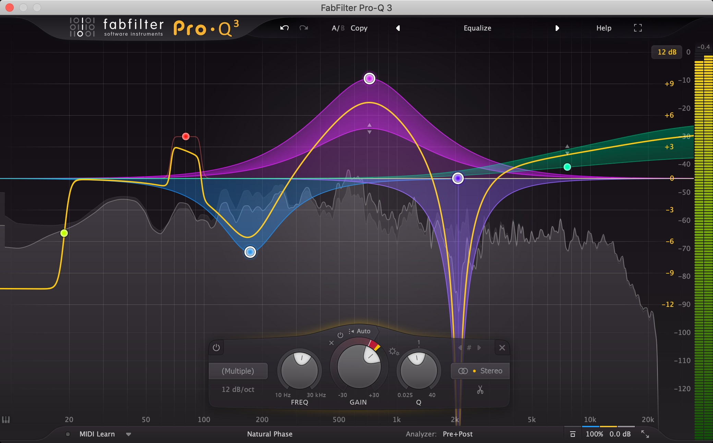

---

## Contents

1. [The whole window](#1-the-whole-window)
2. [Knobs (every knob in the plug-in)](#2-knobs)
3. [The EQ display](#3-the-eq-display)
4. [Bands: the parameters](#4-bands-the-parameters)
5. [Filter shapes and slopes](#5-filter-shapes-and-slopes)
6. [Creating, selecting and editing bands with the mouse](#6-creating-selecting-and-editing-bands-with-the-mouse)
7. [The EQ parameter display (the hover pop-up)](#7-the-eq-parameter-display)
8. [The band controls (the floating panel)](#8-the-band-controls)
9. [The band menu (right-click)](#9-the-band-menu)
10. [Dynamic EQ](#10-dynamic-eq)
11. [Solo (band listen)](#11-solo)
12. [Stereo placement (L / R / M / S) and split](#12-stereo-placement)
13. [Surround and Dolby Atmos (noted only)](#13-surround-and-dolby-atmos)
14. [Display range and horizontal zoom](#14-display-range-and-horizontal-zoom)
15. [Piano display](#15-piano-display)
16. [Processing mode and latency](#16-processing-mode-and-latency)
17. [Spectrum analyzer](#17-spectrum-analyzer)
18. [Spectrum Grab](#18-spectrum-grab)
19. [Collision detection and external spectra](#19-collision-detection-and-external-spectra)
20. [EQ Match](#20-eq-match)
21. [Output options (bypass, phase, Auto Gain, Gain Scale, output level, pan, meter)](#21-output-options)
22. [Top bar: undo/redo, A/B, presets, Help, full screen](#22-top-bar)
23. [Sizes, scaling and full screen](#23-sizes-scaling-and-full-screen)
24. [MIDI Learn](#24-midi-learn)
25. [Keyboard and mouse reference (cheat sheet)](#25-keyboard-and-mouse-reference)
26. [The automation parameter list](#26-the-automation-parameter-list)
27. [The look: colours and drawing](#27-the-look)
28. [DSP facts seen in the manual](#dsp-facts-seen-in-the-manual)
29. [Unverified / open questions](#unverified--open-questions)
30. [Screenshots](#screenshots)

---

## 1. The whole window

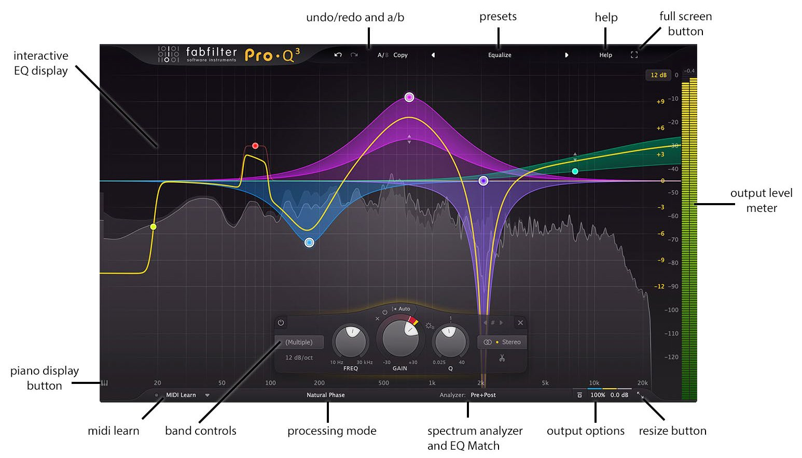

"The interactive EQ display fills the whole plug-in window, and lets you create and adjust EQ bands using the
mouse. When you create or select bands, the band controls will appear, floating above the display, positioned
under the selected bands."

From top to bottom:

| Area | What's in it (left → right) |
| --- | --- |
| **Top bar** (dark, overlaid on the top of the display) | FabFilter logo + "Pro·Q³" wordmark (top-left, on a darker tab with a curved edge) · **Undo** ↶ · **Redo** ↷ · **A/B** (the active letter bright, the other dim) · **Copy** · preset **◂** · **preset name** (centre, e.g. "Equalize", "Default Setting") · preset **▸** · **Help** · **Full Screen** ⛶ |
| **EQ display** (the whole middle) | the analyzer (behind), the grid, the band curves, the thick yellow overall curve, the band dots; the **display range button** ("12 dB") at the top-right; the **yellow EQ dB scale** just left of the **grey analyzer dB scale** on the right; the **output level meter** at the far right, full height, with a peak readout at its top ("-0.4"); the **frequency scale** along the bottom edge, just above the bottom bar; the **piano display button** (keyboard icon) at the bottom-left corner of the display |
| **Band controls** | a floating panel at the bottom of the display, under the selected band(s); only shown while bands are selected |
| **Bottom bar** | **MIDI Learn** (with an LED dot before it) + its **▾ menu** · **Processing Mode** button (e.g. "Natural Phase", "Linear Phase – Very High" ⚠) · **Analyzer:** button ("Pre+Post") · **Global Bypass** button · **output button** (shows Gain Scale and output level, "100%  0.0 dB", with three coloured state lines above it) · **Resize** button (↖↘ arrows) at the far right |

The bottom bar and top bar are thin (≈ one line of text each, observed), and the display runs under both: the
top bar's controls sit over the display's top edge.

---

## 2. Knobs

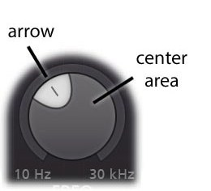

"They will light up when you move the mouse cursor around to indicate that you can adjust them. The moment you
move the mouse cursor over a knob, a parameter value display will pop up, which shows the name and the current
value of the parameter." Knobs are grey domes with a white "arrow" tab (a lighter cap with a tick) at their
edge, inside a dark ring that shows the range (observed).

All knobs support four ways of control:

| Mode | How |
| --- | --- |
| **Vertical** | "Click on the center area of a knob and drag up or down to rotate it. The knob reacts to the speed with which you are dragging, so if you move the mouse slowly, you make precise adjustments." (velocity-sensitive) |
| **Rotate** | "Grab the arrow of the knob and drag it around. By moving the mouse cursor further away from the knob while dragging it, you can make precise adjustments." |
| **Mouse wheel** | over any knob, and over the panning rings (and the dynamic range ring) |
| **Text entry** | double-click a knob, type a value |

Modifiers and tips:
- **Reset to default:** Ctrl-click (Windows) / **Cmd-click** (macOS). (Pro Tools: Alt-click.)
- **Fine:** hold **Shift** while dragging vertically or using the wheel. (Pro Tools: Ctrl/Cmd-drag.)
- **Linked knobs:** hold **Alt** (Pro Tools: Shift) while dragging one to move the linked one too, "in the opposite
  direction". In Pro-Q 3 that's **Gain ↔ Dynamic range** ("trade gain for dynamic range").
- **Text entry shortcuts:**
  - frequencies: `1k` = 1000 Hz, `2k`, `100`; **note names** `A4` = 440 Hz, `C#3+13` (note + cents), `D#5 +13`;
  - dB values: `2x` = +6 dB ("the value that corresponds to two times louder");
  - any value: a **percentage** of the knob's travel, `50%` = exactly the middle.
- On iOS (touch): drag up/down only, second finger = fine, **double-tap = reset**, press and hold = type a value.

---

## 3. The EQ display

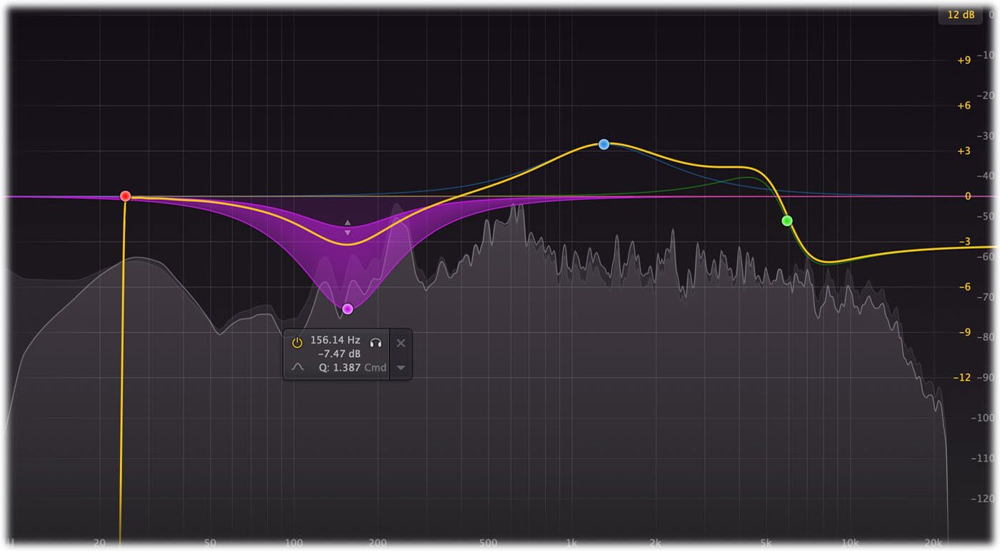

- "The thick yellow curve shows the overall frequency response and dynamic behavior of the equalizer." It moves
  live with dynamic bands.
- Each band has a **dot** (its handle) and its own **curve** in the band's colour. Selected bands are
  highlighted: their curve is **filled** (translucent band colour between the curve and 0 dB) with a brighter
  outline; unselected bands are drawn as a thin line in their colour, no fill (observed).
- **Two dB scales:** "the yellow scale corresponds to the EQ band curves and yellow overall curve. The gray scale at
  the far right is used by the spectrum analyzer and output level meter."
- **Frequency axis:** logarithmic, labelled 20, 50, 100, 200, 500, 1k, 2k, 5k, 10k, 20k (observed). "Even though
  frequencies above 20 kHz are generally inaudible, the display extends to 30 kHz so you can put filters above
  this limit." The left end is about 10 Hz (observed: the first gridline left of "20" is 10 Hz).
- **Grid:** thin vertical lines at every 1-2-…-9 × decade (major ones brighter at the labelled values), horizontal
  lines at the yellow scale's steps (observed).
- **Frequency on hover:** "When you hover over the display, or move the mouse slowly, the frequency under the mouse
  cursor is shown in the frequency scale at the bottom of the display" (e.g. "239.2 Hz" replacing the labels near
  the cursor; with the piano display on, the key under the cursor is highlighted and labelled). Toggle: Help menu ›
  **Show Frequency On Hover** (on by default).
- **Bypassed bands** are dimmed. **Global bypass** dims the whole display.
- Bands from a preset whose stereo placement/speakers don't exist on this track (e.g. a Left band on a mono track)
  are shown **disabled** and don't process.

---

## 4. Bands: the parameters

Up to **24 bands**. Each band slot has these parameters (names are the automation parameters'):

| Parameter | Range | Default | Scaling / step | Notes |
| --- | --- | --- | --- | --- |
| **Used** | off / on | off | | whether the slot holds a band (bands are created/deleted, not shown/hidden) |
| **Enabled** | off / on | on | | per-band bypass (off = bypassed, dimmed) |
| **Frequency** | **10 Hz – 30 kHz** (knob labels, preset format, Pro-Q 4 manual). The Pro-Q 3 manual's text says "between **5 Hz** and 30 kHz" (unverified: probably a typo) | 1000 Hz for an empty slot (preset format); a new band takes the frequency where it was made | logarithmic (stored as log2 Hz in presets) | display shows 2 decimals: "542.53 Hz", "126.14 Hz" |
| **Gain** | **−30 … +30 dB** | 0 dB | linear in dB | used by Bell and the shelving shapes (and Flat Tilt: see §5); display "+9.14 dB" |
| **Dynamic Range** | **−30 … +30 dB** ("possibly limited by the gain setting limits", i.e. gain + range stays within ±30, unverified) | 0 dB (= not dynamic) | dB | negative = compression (cut when loud), positive = expansion (boost when loud). Bell and shelving shapes only |
| **Dynamics Enabled** | off / on | on | | the "bypass dynamics" button |
| **Threshold** | custom dB, or **Auto** | **Auto** | (range unverified; MusicRadar shows −26 dB, the manual's screenshot −20.0) | Auto: "constantly adjusting to the level of the current, band-limited trigger signal" |
| **External Side Chain** | off / on | off | | trigger on the side-chain input instead of the band-limited plug-in input; shown only with a custom threshold |
| **Q** | **0.025 – 40** | **1** ("the value 1 to correspond to the default bandwidth") | logarithmic (unverified) | display "Q: 1.971" (3 decimals). Not adjustable at a 6 dB/oct slope |
| **Shape** | Bell, Low Shelf, Low Cut, High Shelf, High Cut, Notch, Band Pass, Tilt Shelf, Flat Tilt (enum 0–8, in this order) | Bell | | see §5 |
| **Slope** | 6, 12, 18, 24, 30, 36, 48, 72, 96 dB/oct, **Brickwall** (enum 0–9) | 12 dB/oct (observed on every new Bell; MusicManta: "a default setting of 12 dB/octave") | | Brickwall only for Low Cut and High Cut |
| **Stereo Placement** | Left, Right, Stereo, Mid, Side (enum 0–4, in this order) | Stereo | | stereo tracks only |
| **Speakers** | a set of surround speakers | all but LFE | | surround only (§13) |
| **Solo** | off / on | off | | momentary, from the solo button (§11) |

Band numbering: "When creating new bands, they will be numbered 1, 2, 3 and so on. But when you delete a band, the
others won't renumber, in order to ensure that currently written automation in your host still controls the
correct band." A new band probably takes the lowest free number (unverified). **A band's colour follows its
number** (FabFilter staff: "The filters are created in chronological order. A number has a matching color.").

Not a band parameter, but per instance and not automatable: **Gain-Q interaction** (§8). "Pro-Q remembers the last
Gain-Q interaction setting that you've chosen and will use this for new instances."

---

## 5. Filter shapes and slopes

The shape button's list, in the manual's order (which is also the enum order):

| # | Shape | The manual | Gain? | Q means | Dynamic? |
| --- | --- | --- | --- | --- | --- |
| 1 | **Bell** | "the traditional parametric EQ shape and probably the most versatile of them all" | yes | bandwidth (1 = default) | yes |
| 2 | **Low Shelf** | "to boost or attenuate low frequencies" | yes | shape of the shelf: "the internal Q values are chosen such that they result in a good range of shelf shapes" (higher Q gives a resonant overshoot/dip at the corner, unverified wording) | yes |
| 3 | **Low Cut** | "to cut all sound below the filter frequency" | no | resonance at the cutoff (unverified wording) | no |
| 4 | **High Shelf** | "to boost or attenuate high frequencies" | yes | as Low Shelf | yes |
| 5 | **High Cut** | "to cut all sound above the filter frequency" | no | resonance | no |
| 6 | **Notch** | "to cut a small section of the spectrum" | no (always a full cut) | width | no |
| 7 | **Band Pass** | "to isolate a section of the spectrum" | no | width | no |
| 8 | **Tilt Shelf** | "to tilt the spectrum around a certain frequency" | yes | shape of the transition | (unverified: "Bell and Shelving filter types" may include it) |
| 9 | **Flat Tilt** | "to tilt the spectrum using a flat curve, around a certain frequency"; product page: "a flat tilting correction curve over the whole audible frequency spectrum" | yes (its tilt amount; the Pro-Q 3 manual's "only used for Bell and Shelving" predates it; Pro-Q 4's manual lists Flat Tilt) (unverified) | (unverified) | not in Pro-Q 3 (product page: "Bell and Shelf shapes") |

Slopes: "The slope button below the shape parameter sets the steepness of the filter from 6 dB/octave to 96
dB/octave (and even up to Brickwall for Low Cut and High Cut filters). In Pro-Q, the slope not only applies to the
usual Low Cut and High Cut filters, but to all filter shapes! … you can make ultra-narrow Bell or Notch filters or
very steep Shelving filters."

| Slope list | 6 · 12 · 18 · 24 · 30 · 36 · 48 · 72 · 96 dB/oct · Brickwall |
| --- | --- |
| Shown as | "12 dB/oct" text under the shape button (it's a button: click for the list) |
| Brickwall | Low Cut and High Cut only |
| 6 dB/oct | first order: "The Q cannot be adjusted when a 6 dB/octave slope is used" |
| Minimum per shape | (unverified for Pro-Q 3) Pro-Q 4: "Bell and Notch filters have minimum slope of 12 dB/oct, Low Cut, High Cut and Band Pass filters go all the way down to 0 dB/oct, while all other slopes use 6 dB/oct" (Pro-Q 4 has continuous slopes; Pro-Q 3 has only the list above) |

Shortcuts: **Ctrl+Alt-click** (Cmd+Alt on macOS) a dot steps its **shape**; **Alt+Shift-click** a dot steps its
**slope** (direction and wrap-around unverified).

---

## 6. Creating, selecting and editing bands with the mouse

### Creating bands

- "To add a new EQ band, simply **click on the yellow overall curve and drag** it up or down."
- "Alternatively, **double-click** or **Ctrl-click (Command-click on macOS)** on the display background."
- Hold **Alt** while creating (Alt+drag the curve, Alt+double-click, Alt+Cmd-click) "to create a **dynamic band**
  instead of a normal band" ("initialized with a dynamic range instead of normal gain").
- **The shape depends on where:** "Do you need a **Notch** curve? Just double-click in the **far low area** of the
  display [the bottom]. Want a **Low Cut** or **High Cut** filter? Double-click in the **far left** or **far right**
  areas. **Shelving** filter? **Drag the yellow curve at the left or right end** of the display." Elsewhere: Bell.
  - The exact zones aren't documented (unverified). MusicManta: "a low shelf EQ when creating a band below
    30 Hz, a high shelf above 10kHz, and a bell EQ in between" (for dragging the curve), "a default setting of 12
    dB/octave, and 0.3 Q for the shelf or 1.0 Q for bell EQ bands" (third-party, unverified).
  - A double-clicked Bell takes the frequency and gain under the pointer (unverified but implied by "Double-clicking
    above or below the 0 dB line to create a new band instantly", Music Guy Mixing).
- 24 bands at most.
- Touch: drag the result curve or double-tap the background.

### Selecting

| Gesture | Effect |
| --- | --- |
| click a band's dot **or the coloured area around it** | select it (alone) |
| drag on the background | **rubber-band rectangle** selects the bands inside it ("adjacent bands") |
| **Ctrl-click** (Cmd on macOS) another dot | add/remove it (multi-select) |
| **Shift-click** a dot | select "a consecutive range of bands" (from the last selected, in display order) |
| click the background | deselect all (hides the band controls) |

### Adjusting

| Gesture | Effect |
| --- | --- |
| **drag a selected dot** | frequency (horizontal) and gain (vertical) of **all selected bands**: frequencies move in parallel; "the gain of all selected bands will be **scaled relative to each other**" (proportional, not offset) |
| drag a gainless band's dot vertically (Low/High Cut, Notch, Band Pass) | changes its **Q** (from the manual's solo section: dragging these "has the same effect as dragging the normal, changing both Frequency and Q") |
| **mouse wheel** over a curve, or while dragging | **Q** of the selected bands (or the hovered one): narrower/wider |
| **Ctrl/Cmd + vertical drag** | Q of all selected bands (instead of gain) |
| **Alt + wheel** | **dynamic range** (makes the band dynamic) |
| **Ctrl/Cmd + wheel** | **gain** |
| **Alt+Ctrl + wheel** (Alt+Cmd on macOS) | linked: gain and dynamic range in opposite directions ("trading gain for dynamic range") |
| **Shift** while dragging or wheeling | fine |
| **Alt** while dragging | **constrain** to horizontal (frequency) or vertical (gain, or Q with Ctrl/Cmd) |
| drag the **dynamic range indicator** (the small ▲▼ handle at the end of a dynamic band's range) up/down | dynamic range |
| **Alt-click** a dot | toggle the band's **bypass** |
| **Ctrl+Alt-click** (Cmd+Alt) a dot | change its **shape** (next) |
| **Alt+Shift-click** a dot | change its **slope** (next) |
| **double-click a dot** | type values into its EQ parameter display; **Tab** steps Frequency → Gain → Q |
| **right-click a dot** | the band menu (§9) |
| drag far up/down past the display range | "the range will expand automatically as needed" (Help › Auto-Adjust Display Range) |

Touch (iOS): drag bands; rectangle by dragging the background; second finger = fine; **double-tap and drag = Q**;
press and hold a dot = band menu; press and hold a value = type it; press and hold the spectrum until it turns
blue = Spectrum Grab.

---

## 7. The EQ parameter display

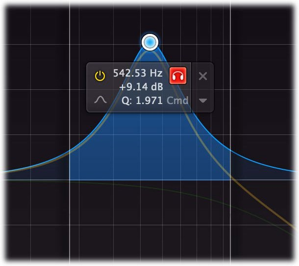

"Next to each EQ band's dot in the display, the EQ parameter display shows the exact parameter values for the EQ
band, along with quick controls to bypass or delete a band, enter solo mode, and change its shape." It pops up when
the mouse moves **near** a band (not only on click).

Layout (observed), a small dark rounded box beside the dot:

```
 [⏻]  542.53 Hz   [🎧]  [×]
       +9.14 dB
 [∧]  Q: 1.971 Cmd       [▾]
```

| Element | Does |
| --- | --- |
| ⏻ (yellow when on) | the band's bypass |
| frequency / gain / Q | values; **double-click one to type** it. The grey "Cmd" after Q is a hint: Cmd-drag adjusts Q |
| shape icon (∧ for Bell…) | change the shape (click: list, unverified) |
| headphones (red background when active) | **solo**: click and hold (§11) |
| × | delete the band |
| ▾ (the triangular menu button) | the band menu (§9) |

With the piano display on, the frequency also shows as a note with cents. Toggle the whole thing: Help menu ›
**Show EQ Parameter Display**.

---

## 8. The band controls

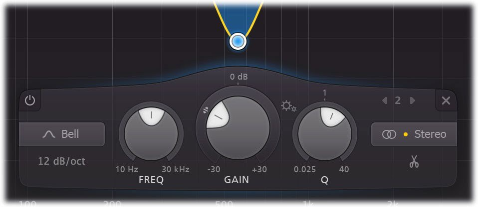
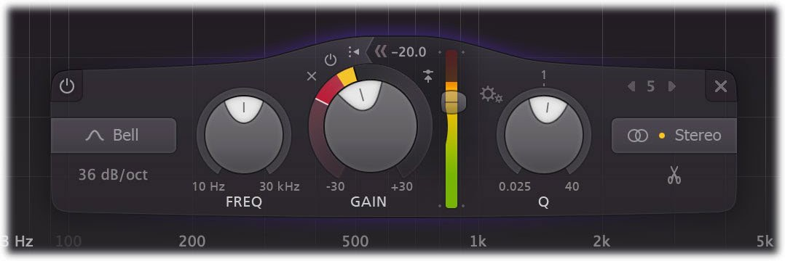

"When you select EQ bands in the interactive EQ display, the floating band controls will automatically appear,
right under the selected bands at the bottom of the display." The panel is a dark rounded slab whose top edge rises
in a hump over the Gain knob, with a soft glow in the selected band's colour (yellow when several are selected,
observed). From left to right:

| Control | Where | What it does |
| --- | --- | --- |
| **Bypass** ⏻ | top-left corner | bypass the selected bands; "a red light glows in the bypass button" |
| **Shape** button ("∧ Bell", "(Multiple)") | left | the shape list (§5) |
| **Slope** ("12 dB/oct") | under the shape button | the slope list |
| **FREQ** knob | | 10 Hz … 30 kHz (labels under it); several bands: "adjusted in parallel" |
| **GAIN** knob (the biggest) | centre | −30 … +30 dB, "0 dB" label under its bottom tick; a centre-detented bipolar knob (observed) |
| **Dynamic range ring** | around the Gain knob | −30 … +30 dB; see §10. Shown as a red arc for the range, with the live dynamic gain change as a yellow bar on it |
| **Clear dynamics** × | top-left of the ring | range → 0 dB (static band again) |
| **Bypass dynamics** ⏻ | top-left of the ring | red light when bypassed |
| **Auto threshold** ("⁝◂ Auto") | above the ring | toggles auto/custom threshold; custom reveals the threshold slider, and the label becomes the threshold value (e.g. "-20.0") |
| **Threshold slider** | vertical, right of the Gain knob | custom threshold; its track shows the trigger level as a meter (green → yellow → red) |
| **External side chain** | top of the threshold slider | trigger on the side-chain input |
| **Gain-Q interaction** ⚙ | between Gain and Q | analog-style: "the Q automatically gets a bit narrower when gain is increased, and … a little gain is added when the Q gets very narrow". **Bell only**. Remembered for new instances |
| **Q** knob | | 0.025 … 40, a "1" label at the top tick |
| **◂ n ▸** (previous / band number / next) | top-right | step through the bands "in the order in which they currently appear in the display" (by frequency); the number identifies the band for automation; "#" with several selected |
| **Delete** × | top-right corner | remove the selected bands (Undo restores) |
| **Stereo placement** ("⊚ • Stereo") | right | §12 (on surround: the speaker panel, §13) |
| **Split** ✂ | under the placement button | split the selected bands into L+R (or M+S) copies |

- With several bands selected, every knob moves all of them (frequencies in parallel; gains scaled relative,
  as dragging does, unverified for the knob).
- Hold **Alt** while turning Gain or the dynamic range ring to change them "in a reverse-linked way".
- Deselect all (click the background) to hide the panel.
- Double-click any knob to type.

---

## 9. The band menu

Right-click a band's dot, or click ▾ in its EQ parameter display (touch: press and hold the dot). It acts on the
**selected bands** (FabFilter staff: "select all points, right click on one of them and choose 'Invert Gain'").

Items confirmed by the manual, FabFilter staff or reviews:

| Item | Does | Source |
| --- | --- | --- |
| **Make Dynamic** | gives the band a dynamic range with auto threshold | manual |
| **Invert Gain** | flips the sign of gain (and dynamic range) of the selected bands | manual, staff |
| **Split** | as the scissors | Music Guy Mixing |
| **Reset Placement/Speakers** | resets stereo placement and speakers so bands disabled by this track's layout work again (the manual calls it "the band's curve menu") | manual |
| "various band settings" | "a quick way to modify the EQ band while you're working in the display" | manual |

The rest of its contents and order is **unverified**. From memory of the plug-in, it also holds the shape list, the
slope list, the stereo placement list, bypass, delete, and probably solo and the Gain-Q interaction toggle.
(Pro-Q 4 adds **Copy/Paste** of bands, with a menu on the display background; Pro-Q 3 has no right-click menu on
the background as far as found, unverified.)

---

## 10. Dynamic EQ

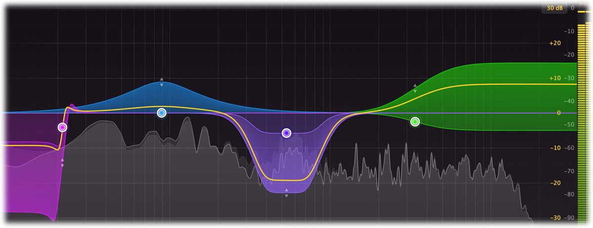

"Any of Pro-Q's bands (with Bell or Shelf shapes) can be made dynamic, at any slope, with perfect analog matching
and in Linear Phase mode." "Dynamic EQ changes the gain of an EQ band dynamically, depending on the level of the
input signal." The dynamic controls "are only exposed when you actually start using them".

**Making a band dynamic:**
1. turn the **dynamic range ring** around the Gain knob to a positive or negative value;
2. **Alt + wheel** over a band in the display;
3. band menu › **Make Dynamic**;
4. create it dynamic: **Alt** + drag the curve / double-click / Cmd-click.

**Controls:**

| Control | Behaviour |
| --- | --- |
| Dynamic range ring | −30 … +30 dB. Negative = compression, positive = expansion. "The current dynamic gain change is shown as a yellow bar inside the ring, on top of the dynamic range that is indicated in red." |
| Dynamic range indicator in the display | a small ▲▼ handle at the far end of the band's range (where the gain goes when fully triggered); drag up/down |
| Auto threshold button | default **auto**: the threshold follows the band-limited trigger signal. Click for **custom** threshold (shows the slider) |
| Threshold slider | "The level of the trigger signal is shown in the slider, making it easy to find the correct threshold." "A soft knee is used internally … so it can start triggering a little bit below the selected threshold value." |
| External side chain | only with a custom threshold; the side chain is **not** band-limited or M/S encoded ("to give maximum flexibility") |
| Bypass dynamics | the band stays at its static gain; the ring shows inactive; red light |
| Clear dynamics | range to 0 dB for all selected bands |

- **No attack/release/ratio/knee controls**: "attack, release and knee all depend on the processed audio, the
  frequency range of the EQ band and the current dynamic range" (program dependent).
- "Internally, the dynamic EQ process will trigger on a band-limited version of the plugin's input, according to the
  frequency range the band works on" (and M/S encoded per the band's placement).
- In the display, a dynamic band is drawn as **two curves** (its static gain and gain + range) with the region
  between them filled in the band's colour, and the ▲▼ handle at the range's end; the yellow overall curve moves
  with the live gain (observed).
- Linear Phase: dynamic EQ works only for resolutions **up to High**; at Very High or Maximum a **⚠ warning sign**
  appears next to the Processing Mode button and dynamics don't work ("simply lower the resolution").
  "The attack and release response will be slightly different" in Linear Phase.

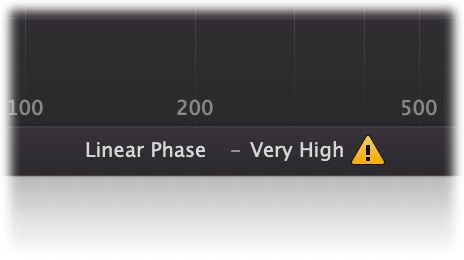

---

## 11. Solo

"Click and hold the solo button (with the headphones icon) to enter solo mode for the current EQ band. The other EQ
bands will dim, just like the yellow overall curve." While held:
- **drag horizontally** = the band's frequency; **drag vertically** = the **solo listening level** (the global
  Solo Gain parameter);
- Bell and shelves: **Ctrl/Cmd + drag** changes **Q**; gainless shapes (cuts, Notch, Band Pass): dragging changes
  frequency and Q, as dragging the dot does;
- release to leave solo (momentary).

What's heard: "you don't hear the effect of the EQ band itself, but instead you will hear the part of the frequency
spectrum that is being affected by that band" (a band-pass around it, its width from frequency and Q, and shown in
the display: the soloed region is highlighted, the rest dimmed, observed). For **Low Cut / High Cut**: "you will hear
the frequencies that are being cut away instead of the frequencies that pass". "Solo mode aims to expose the parts
of the incoming audio that matter to the current EQ band."

---

## 12. Stereo placement

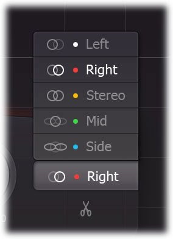
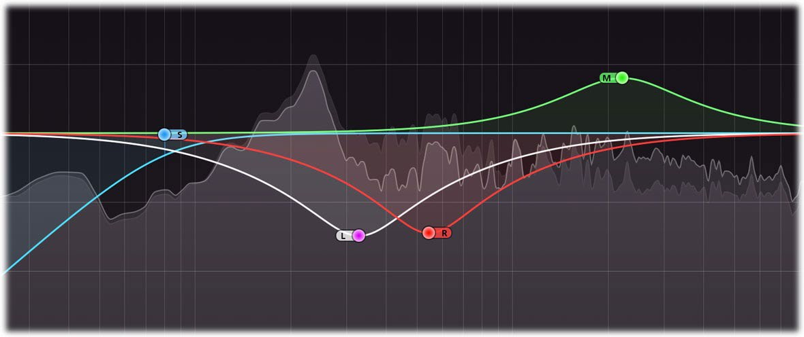

On stereo tracks each band has a **stereo placement**: **Left, Right, Stereo** (default), **Mid, Side**. The menu
shows each with an icon (two overlapping circles, the active part drawn) and a coloured dot:

| Placement | Colour of its result curve and label |
| --- | --- |
| Stereo | yellow (the normal overall curve) |
| Left | **white** |
| Right | **red** |
| Mid | **green** |
| Side | **blue** (light blue) |

- "The EQ display will **group curves that work on the same channels**, to visualize the resulting adjustments":
  besides the yellow overall curve, there's one result curve per placement in use, in its colour (observed).
- A non-stereo band's dot gets a small **tag** with its letter ("L", "R", "M", "S") in the placement's colour
  (observed).
- **Split** (✂, or the band menu): "duplicate the selected band, making two identical copies, one operating only on
  the left channel and one operating on the right channel" (M+S if the band was Mid or Side, unverified).
- On mono tracks: no placement, no output pan.
- Linear Phase with both L/R-specific and M/S-specific bands runs **two stages** (L/R then M/S), doubling the
  latency.

---

## 13. Surround and Dolby Atmos

Noted only (not for our clone). Up to 9.1.6 (the press release said 7.1.2 at launch). The placement button opens a
**speaker panel** (rows: All/LFE toggle, Center, L/R, Ls/Rs, … LFE; plus the L/R/S/M/S choice for the selected
speakers); default all speakers except LFE; the meter shows every channel with labels; no output pan.

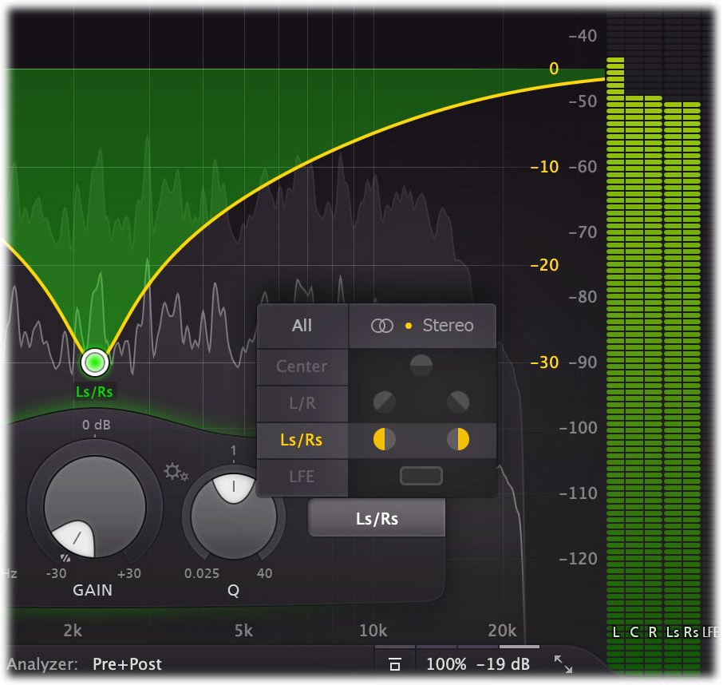

---

## 14. Display range and horizontal zoom

**Display range** (the yellow scale), from the button at the top of the yellow scale (top-right of the display):

| Range | For | Yellow scale labels (observed) |
| --- | --- | --- |
| ±3 dB | mastering | (unverified: ±1, ±2, ±3) |
| ±6 dB | mastering | (unverified) |
| **±12 dB** (default) | mixing | +9, +6, +3, 0, −3, −6, −9, −12 |
| ±30 dB | mixing | +20, +10, 0, −10, −20, −30 |

- The 0 dB line sits at the same height whatever the range; the analyzer's grey scale (0 at the top, then −10 …
  −120 in 10 dB steps for a 120 dB range) lines up with it (observed: grey −40/−50 sits by yellow 0).
- Auto-expands while a drag goes past it (Help › **Auto-Adjust Display Range**, on by default).

**Horizontal zoom**, by dragging the frequency scale (bottom of the display, just above the bottom bar):
- drag **up/down** = zoom in/out **at the frequency clicked**;
- while zoomed, drag **left/right** = scroll;
- **double-click** the scale = back to the full range.

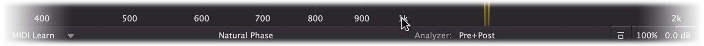

---

## 15. Piano display

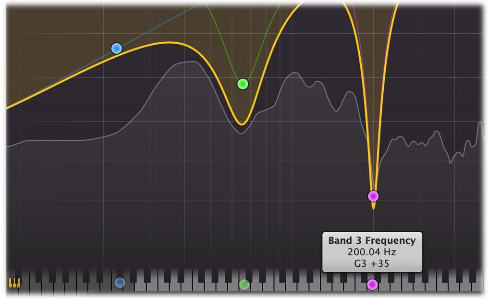

- The **piano display button** (keyboard icon, bottom-left of the display, above the bottom bar) swaps the
  frequency scale for a **piano keyboard** along the bottom of the display. "The highlighted keys correspond to an
  88-keys grand piano layout, ranging from A0 (27.5 Hz) to C8 (4186.01 Hz)" (keys outside it are drawn dimmer).
- Each band has a **dot on the keyboard** (its colour): **click** it to quantise the band's frequency to the nearest
  note; **drag** it to move the frequency in note steps.
- Values then also show as notes with cents ("200.04 Hz / G3 +35"; the tooltip "Band 3 Frequency").
- C4 is middle C (Roland convention), A4 = 440 Hz.
- The key under the mouse is highlighted with a small note label (Help › Show Frequency On Hover).

---

## 16. Processing mode and latency

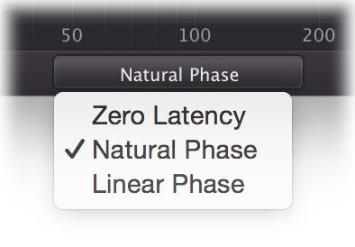

The **Processing Mode** button (bottom bar) opens: **Zero Latency**, **Natural Phase**, **Linear Phase**.

| Mode | The manual |
| --- | --- |
| **Zero Latency** | "matches the magnitude response of analog EQ'ing as closely as possible, obviously without introducing any latency. It is Pro-Q's most efficient processing mode" (small deviation above 18 kHz) |
| **Natural Phase** | "not only perfectly matches magnitude response of analog EQing, but also closely matches the analog phase response … without introducing noticable pre-ring or long latency" (it has some latency; how much is unverified) |
| **Linear Phase** | phase untouched; latency and possible pre-ring; a **Processing Resolution** choice appears |

Linear Phase resolutions (latency at 44.1 kHz; in other rates the latency in samples changes to keep about the same
ms):

| Resolution | Latency (samples @ 44.1 kHz) | ms | Advice |
| --- | --- | --- | --- |
| Low | 3072 | ~70 | "Use only with low Q settings, or when only changing the mid-high part" |
| **Medium** | 5120 | ~116 | "we recommend to use this in general" |
| High | 9216 | ~209 | high Q in the low end |
| Very High | 17408 | ~395 | |
| Maximum | 66560 | ~1509 | "possible pre-echo problems" |

- The button reads e.g. "Linear Phase – Very High" (with ⚠ when dynamic bands can't run, §10).
- Default mode: **Zero Latency** (in the default state found; FabFilter's screenshots show both Zero Latency and Natural Phase,
  unverified as "the" default). Default resolution: Medium (unverified).
- "Changing EQ band frequencies in Linear Phase mode sounds just as smooth as when using the other modes, no zipper
  effects whatsoever."

---

## 17. Spectrum analyzer

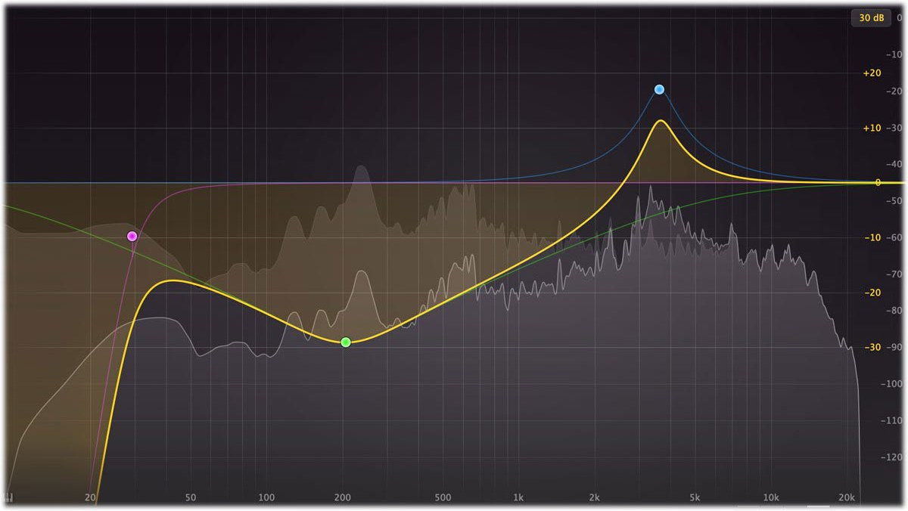
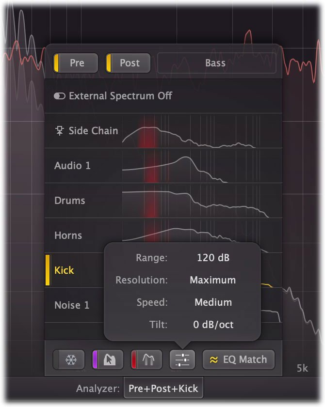

The **Analyzer** button in the bottom bar ("Analyzer: Pre+Post", "Pre+Post+Kick", "Off") **opens its panel on
hover**; **click** it to make the panel **sticky**, click again to hide it.

The panel (observed, top to bottom):
- **Pre** and **Post** toggle buttons (with a yellow LED stripe when on), then the **instance name** label (e.g.
  "Bass": defaults to the host track's name, **double-click** to rename).
- The **external spectrum list**: "External Spectrum Off" (a switch), "Side Chain" (with the side-chain icon), then
  every other Pro-Q 3 instance by name, each row with a miniature of its spectrum; the chosen one has a yellow
  marker. Collision areas glow red in the list's miniatures.
- Bottom row of buttons: **Freeze** ❄ · **Spectrum Grab** (pointer-on-peak icon, purple LED) · **Show Collisions**
  (peaks icon, red LED) · **Settings** (sliders icon) · **≈ EQ Match**.
- **Settings** (hover or click) opens a small panel: Range, Resolution, Speed, Tilt.

| Setting | Values | Default |
| --- | --- | --- |
| Pre (pre-EQ spectrum) | on/off | on |
| Post (post-EQ spectrum) | on/off | on |
| External spectrum | off / Side Chain / another instance | off |
| **Range** | 60 dB, **90 dB**, 120 dB | 90 dB |
| **Resolution** | Low (1024 points), Medium (2048), High (4096), Maximum (8192) | High (in the default state found, unverified) |
| **Speed** (release) | Very Slow, Slow, **Medium**, Fast, Very Fast (unverified list; "Medium" seen) | Medium (unverified) |
| **Tilt** (around 1 kHz) | dB/oct; probably 0, 1.5, 3, 4.5, 6 (unverified: the parameter's stored default is index 3, and "0 dB/oct" is shown in a screenshot) | **4.5 dB/oct** ("results in a natural looking spectrum, resembling best how loudness is perceived") |
| Freeze | on/off; **hold** the button = freeze until released | off |
| Spectrum Grab | on/off | **on** |
| Show Collisions | on/off | on (unverified) |

- Resolution: "Higher resolution settings allow more precision in the low-frequency area, but because more incoming
  samples are needed … the update rate will be lower which generally results a slower attack time."
- **Freeze**: "the spectrum stops falling and builds up a maximum over time"; a **blue line** on top of the
  Analyzer button shows it.
- Global bypass disables the analyzer (the plug-in handles no audio).
- Analyzer settings aren't changed by loading presets but are saved with the song.
- Drawing (observed): the **pre** spectrum is a darker grey filled area; the **post** spectrum a lighter grey filled
  area with a thin light outline, in front; the **external** spectrum a light **red outline**. The grey dB scale on
  the far right is the analyzer's.

---

## 18. Spectrum Grab

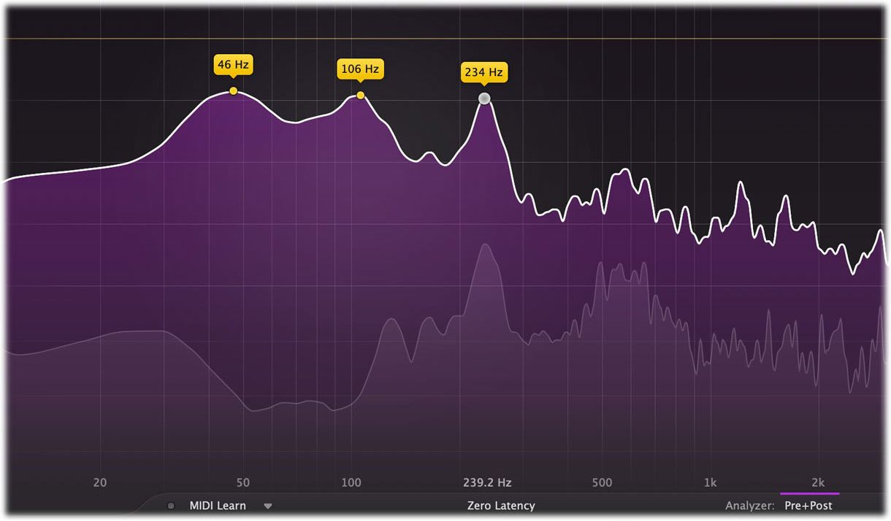

- With Pre or Post on and Spectrum Grab enabled, **hover over the spectrum for a few seconds**: Pro-Q enters Spectrum
  Grab mode. "Existing EQ bands will be dimmed while the spectrum freezes." The spectrum turns **purple** with a
  **white outline** (the post spectrum) (observed); a purple line shows on top of the Analyzer button.
- "The most important peaks in the signal will show a label with their frequency (or note value when the piano
  display is enabled)": yellow rounded labels ("46 Hz", "106 Hz") with a yellow dot on the peak; the peak under the
  pointer gets a grey/white handle (observed).
- **Grab a peak and drag**: creates a band there. "In Spectrum Grab mode, only **Bell** filters are created, and an
  appropriate Q is determined automatically." On release the display returns to normal with the new band selected.
- **Permanent** Spectrum Grab: click and **hold** in the spectrum area "until the highlight becomes **blue**"; then
  several peaks can be grabbed; click the background (not the curve) to leave.
- Works best with Post on; with Pre only, the grabbed peak doesn't visibly drop.

---

## 19. Collision detection and external spectra

- External spectrum: the side-chain input, or **the post-EQ spectrum of any other Pro-Q 3 instance** (no routing
  needed); drawn with a light red outline.
- **Show Collisions**: "the main analyzer will highlight areas of the spectrum (using a **red glow**) where
  frequencies may collide with frequencies of the currently selected external spectrum, possibly causing auditory
  masking issues." The list of external spectra shows the same highlighting per instance. "Merely an indication."
  Best with High or Maximum resolution for the lows.
- Help › **Use Accessible Colors** swaps the dark red for a brighter colour.

---

## 20. EQ Match

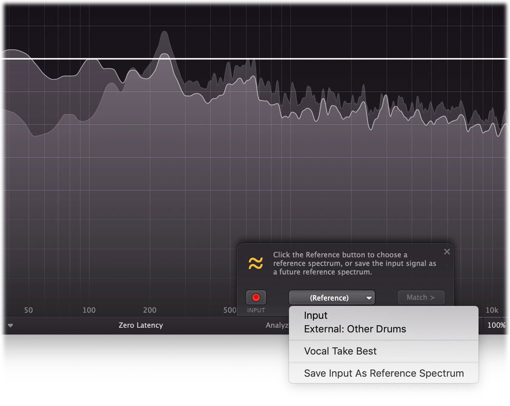
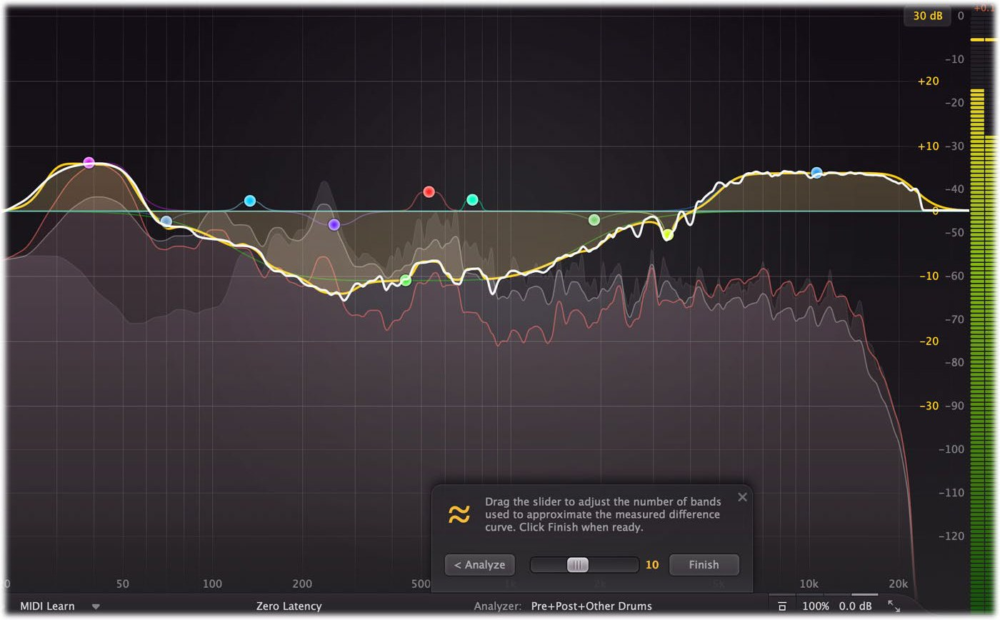

Opened by **≈ EQ Match** in the analyzer panel: a panel at the bottom of the display (≈ icon, an instruction text,
a close ×). Two steps.

**Step 1, analyse.** It starts listening to the plug-in input at once ("INPUT" record button, red when recording).
The **(Reference)** drop-down:
- **Input** (record the reference from the main input at another point of the song; toggle Record/Pause to build
  each);
- **External: <name>** (side chain, or another instance's post spectrum; analysed at the same time as the input);
- saved **reference spectra** by name;
- **Save Input As Reference Spectrum** (available in every instance afterwards).

Spectra average over time ("normally this doesn't take more than 30 seconds"). When both are valid, "a thick white
line that shows the difference" appears and **Match >** becomes enabled. No audio → a warning.

**Step 2, match.** Pro-Q proposes bands; a **slider** sets how many (number shown in yellow, e.g. 10): more bands
match smaller details. **< Analyze** goes back; **Finish** (or clicking outside the panel) adds the bands for good.
EQ Match uses the analyzer's resolution.

---

## 21. Output options

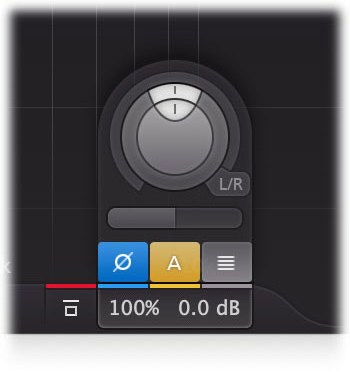

At the right of the bottom bar: the **Global Bypass** button, the **output button** ("100%  0.0 dB": Gain Scale
and output level), and the Resize button. Hovering the output button pops up a panel (click it to make it sticky):

| Control | Range | Default | Notes |
| --- | --- | --- | --- |
| **Global Bypass** | on/off | off | latency-compensated, **soft** (no clicks); display dims; a **red line** on top of the bypass button |
| **Phase Invert** (⌀) | on/off | off | button turns **blue**; blue line on top of the output button |
| **Auto Gain** (A) | on/off | off | "an educated guess based on the current EQ settings, and is not a dynamic process"; v3 adds "channel weighting and an estimated correction of dynamic gain"; button turns **yellow**; yellow line on top of the output button. Default changeable by saving the default preset |
| **Output Level Metering** (≡) | show/hide | shown | the meter at the far right; grey line on top of the output button (observed) |
| **Gain Scale** slider (horizontal, under the knob) | **0 – 200%** (forum, for Pro-Q 2; unverified for 3) | 100% | scales gain **and dynamic range** of Bell and shelving bands only ("a bell cut of 6dB will be a bell cut at 3dB when using 50% scale", staff, forum) |
| **Output Gain** (the large knob) | **−∞ … +36 dB** | 0 dB | |
| **Output Pan** (the ring around it, stereo only) | L … R (−100 … +100%, unverified) | centre | relative level of L/R, or M/S |
| **Output Pan Mode** ("L/R" label on the ring, stereo only) | L/R, M/S | L/R | |

- **Drag the output button vertically** to change the output gain (or the gain scale: which half is grabbed decides,
  unverified) without opening the panel; double-click the knobs to type.
- "Pro-Q 3 has unlimited internal headroom and will never clip itself"; the meter shows clipping only as a warning.
- Output meter (observed): segmented vertical bars, one per channel, green rising to yellow, peak hold readout at
  the top ("-0.4").

---

## 22. Top bar


| Control | Behaviour |
| --- | --- |
| **Undo** ↶ | "Every change to the plug-in (such as dragging a knob or selecting a new preset) creates a new state in the undo history." Disabled when there's nothing to undo |
| **Redo** ↷ | steps forward again |
| **A/B** | switches between two states; "Before switching, the current state of the plug-in is saved"; the active letter is highlighted |
| **Copy** | copies the active state to the inactive one, then disables itself (both are equal) |
| **◂ preset ▸** | previous/next preset in the menu; the centre button shows the preset name, **dimmed when modified**; click = presets menu (check mark on the current one); **right-click** = Save (overwrite, asks first) / Save As |
| **Help** | the Help menu (below) |
| **Full Screen** ⛶ | fills the screen; Esc or the button again exits |

Changes made by MIDI or host automation don't create undo states.

**Presets menu:** factory presets in folders (subfolders = categories); **Save As…**; **Options ›** Save As Default
(the "Default Setting" preset loaded on startup), Open Other Preset, Restore Factory Presets, **Enable MIDI Program
Changes** (shows "(bank/program)" before names), Change Preset Folder; **V1 Preset Folder**, **V2 Preset Folder**
(old Pro-Q presets load). Factory presets include "Default Setting", "Flat 7 Bands" (for control surfaces) and
"Equalize" (seen). Files are `.ffp` in `Documents/FabFilter/Presets/Pro-Q 3`.

**Help menu** items named in the manual: **Show EQ Parameter Display**, **Show Frequency On Hover**,
**Auto-Adjust Display Range**, **Use Accessible Colors**, **Enter License**, **Deauthorize**, **About**. Others
(the help file, interactive help hints, check for updates, website) are unverified. FabFilter plug-ins have
"interactive help hints" (hover descriptions); their exact form in Pro-Q 3 is unverified.

---

## 23. Sizes, scaling and full screen

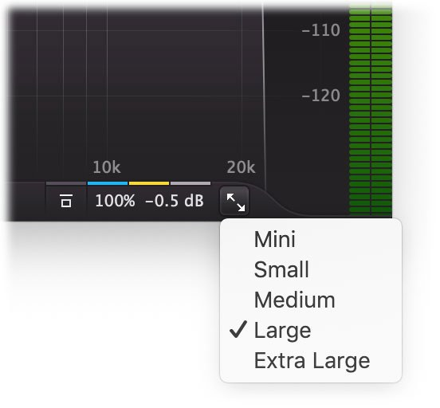
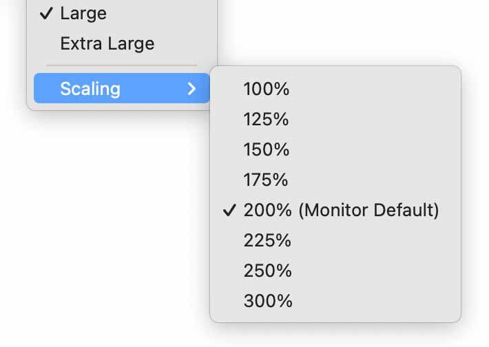
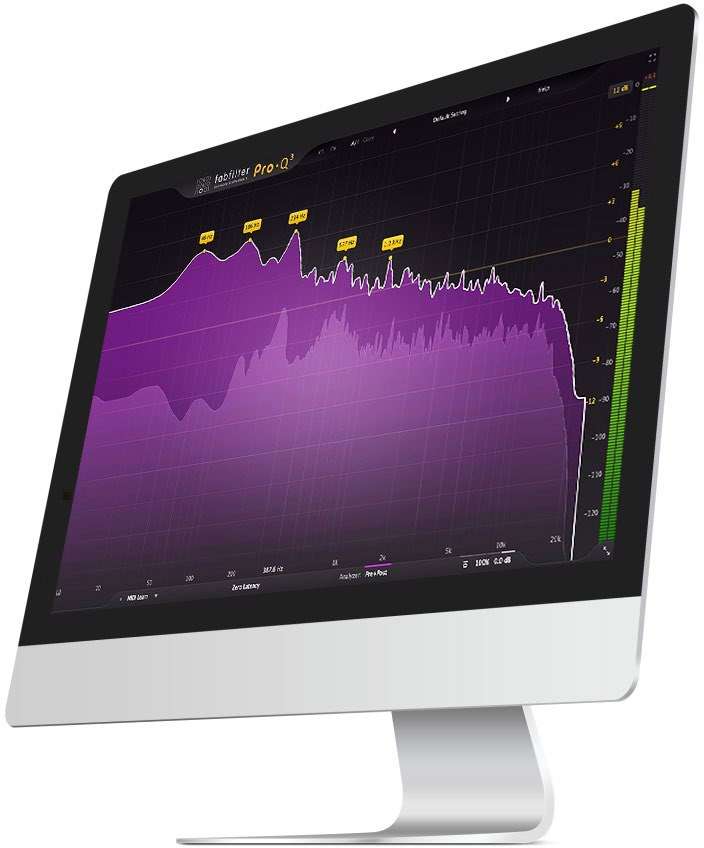

- **Resize** button (far right of the bottom bar): **Mini** ("equal to the AUv3 default plug-in size on iOS"),
  **Small**, **Medium** (default), **Large**, **Extra Large**. The chosen size becomes the default for new instances.
  Sizes too big for the screen are greyed out.
- **Scaling** submenu: 100, 125, 150, 175, 200 (Monitor Default), 225, 250, 300%. Remembered separately for normal
  and full screen and per monitor type (Retina / regular). Full screen picks a larger scaling automatically.
- VST3: free resizing by dragging the window edges.
- **Pixel sizes: unverified.** Observed: FabFilter's press screenshot at @2x is 2080 × 1292 including a 22-pt
  macOS title bar, i.e. a content area of about **1040 × 624 points** (aspect ≈ 5:3); which size that is isn't stated.
- Band controls need room: at small sizes (AUv3) they may not show; everything is still reachable from the display
  and the band menu.

---

## 24. MIDI Learn

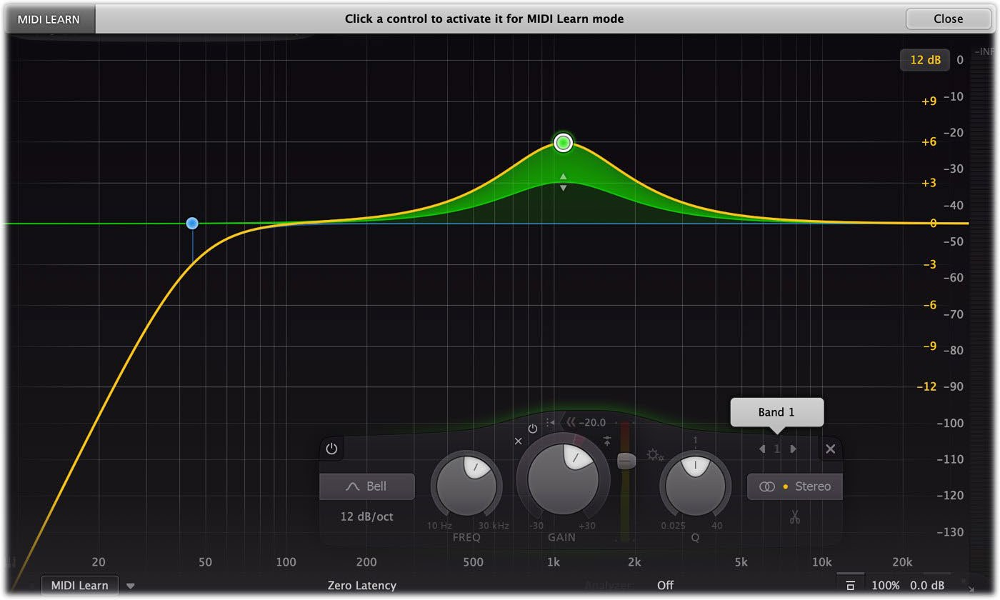

- **MIDI Learn** button (bottom-left) enters learn mode: the interface dims, learnable controls are highlighted with
  a small balloon showing their CC number; a header bar replaces the top bar: "MIDI LEARN | Click a control to
  activate it for MIDI Learn mode | Close".
- Click a control (a **red square** marks it), then move a hardware controller. Re-using a CC silently replaces.
- **Per band or active band:** click a band's dot first to learn "Band 1 Frequency" etc.; without a band, controls
  learn for the **Active Band** (works only while the UI is open). The band-name drop-down switches between them.
  In active-band mode, buttons can map to previous/next band and delete (triggered by CC value 127 after a lower
  value).
- ▾ menu: **Enable MIDI**, **Clear** (submenu: each association, or all), **Revert**, **Save** (saved on close
  anyway).
- Presets by MIDI Program Change + Bank Select (opt-in, presets menu).

---

## 25. Keyboard and mouse reference

macOS names (Windows: Ctrl for Cmd).

**Display**

| Input | Effect |
| --- | --- |
| drag the yellow curve | new band (shelf at the ends) |
| double-click / Cmd-click background | new band (Notch at the bottom, Low/High Cut at the far left/right) |
| Alt + any of those | new **dynamic** band |
| click dot / its coloured area | select |
| Cmd-click dot | add to selection |
| Shift-click dot | select a range |
| drag background | rectangle select |
| click background | deselect all |
| drag dot | frequency + gain of the selection (gains scaled relative) |
| Cmd + drag | Q (vertical) |
| Alt + drag | constrain to one axis |
| Shift + drag / wheel | fine |
| wheel | Q |
| Cmd + wheel | gain |
| Alt + wheel | dynamic range |
| Alt+Cmd + wheel | gain ↔ dynamic range, reverse-linked |
| drag ▲▼ indicator | dynamic range |
| Alt-click dot | bypass band |
| Cmd+Alt-click dot | next shape |
| Alt+Shift-click dot | next slope |
| double-click dot | type values (Tab: Freq → Gain → Q) |
| right-click dot | band menu |
| hover still over spectrum | Spectrum Grab |
| click-and-hold spectrum until blue | permanent Spectrum Grab |
| drag frequency scale up/down / left/right / double-click | zoom / scroll / reset |
| hold solo button + drag | frequency (x), solo level (y); Cmd: Q |

**Knobs**: drag (velocity-sensitive), drag the arrow (rotary; further away = finer), wheel, double-click = type,
Cmd-click = reset, Shift = fine, Alt = linked (Gain ↔ dynamic range).

**Keys**: **Esc** leaves full screen; **Tab** steps the fields while typing values; Enter confirms (unverified);
**Delete/Backspace** deleting the selected bands and **Cmd+A** selecting all are **unverified** (no source found; a
2023 forum feature request asks for key shortcuts to step bands and solo, so those don't exist).

---

## 26. The automation parameter list

From the VST3 (Reaper/CSI dump), 13 per band × 24 bands = 312, then the globals (index 312…333), then per-band
External Side Chain (334…357) and extended speaker masks (358…381):

| Index | Parameter | Values | Default in a saved default state |
| --- | --- | --- | --- |
| 13·b + 0 | Band *n* Used | 0/1 | 0 |
| +1 | Band *n* Enabled | 0/1 | 1 |
| +2 | Band *n* Frequency | 10 Hz – 30 kHz | 1000 Hz |
| +3 | Band *n* Gain | −30 … +30 dB | 0 |
| +4 | Band *n* Dynamic Range | −30 … +30 dB | 0 |
| +5 | Band *n* Dynamics Enabled | 0/1 | 1 |
| +6 | Band *n* Threshold | dB, or 1 = Auto | Auto |
| +7 | Band *n* Q | 0.025 – 40 | 1 |
| +8 | Band *n* Shape | 0 Bell, 1 Low Shelf, 2 Low Cut, 3 High Shelf, 4 High Cut, 5 Notch, 6 Band Pass, 7 Tilt Shelf, 8 Flat Tilt | Bell |
| +9 | Band *n* Slope | 0…9 = 6, 12, 18, 24, 30, 36, 48, 72, 96, Brickwall | (see §4) |
| +10 | Band *n* Stereo Placement | 0 Left, 1 Right, 2 Stereo, 3 Mid, 4 Side | Stereo |
| +11 | Band *n* Speakers | mask | (all) |
| +12 | Band *n* Solo | 0/1 | 0 |
| 312 | Processing Mode | 0 Zero Latency, 1 Natural Phase, 2 Linear Phase | 0 |
| 313 | Processing Resolution | 0 Low … 4 Maximum | 1 (Medium) |
| 314 | Gain Scale | (×, 1 = 100%) | 1 |
| 315 | Output Level | dB | 0 |
| 316 | Output Pan | | 0 |
| 317 | Output Pan Mode | L/R, M/S | 0 |
| 318 | Bypass | 0/1 | 0 |
| 319 | Output Invert Phase | 0/1 | 0 |
| 320 | Auto Gain | 0/1 | 0 |
| 321 | Analyzer Show Pre-Processing | 0/1 | 1 |
| 322 | Analyzer Show Post-Processing | 0/1 | 1 |
| 323 | Analyzer External Spectrum | −1 = none, else an index | −1 |
| 324 | Analyzer Range | 0 60 dB, 1 90 dB, 2 120 dB | 1 |
| 325 | Analyzer Resolution | 0 Low … 3 Maximum | 2 (High) |
| 326 | Analyzer Speed | index | 2 |
| 327 | Analyzer Tilt | index | 3 (= 4.5 dB/oct if the list is 0/1.5/3/4.5/6, unverified) |
| 328 | Analyzer Freeze | 0/1 | 0 |
| 329 | Analyzer Show Collisions | 0/1 | 1 |
| 330 | Spectrum Grab | 0/1 | 1 |
| 331 | Display Range | 0 3 dB, 1 6 dB, 2 12 dB, 3 30 dB | 2 (12 dB) |
| 332 | Receive Midi | 0/1 | 0 |
| 333 | Solo Gain | dB | 0 |

(The "default state" column is the 22 global values a DAW wrote into a default preset, per perivar's
PresetConverter; they agree with the manual where it states defaults: 90 dB range, Spectrum Grab on, 12 dB display.)
"Smart Parameter Interpolation for smooth parameter transitions" and "sample-accurate automation of all parameters"
(product page).

---

## 27. The look

General (observed from FabFilter's screenshots): a very dark, slightly purple-tinted near-black display with a
subtle vertical gradient; thin grey grid lines; light grey sans-serif labels (FabFilter's own rounded font for the
logo); controls are soft grey 3D domes and dark rounded buttons with gentle drop shadows; panels float with a soft
coloured glow.

**Colours sampled** from the press screenshot (approximate, sRGB):

| Element | Colour |
| --- | --- |
| Display background (top / lower) | `#161218` / `#2d292e` (the analyzer's area gets lighter toward the bottom) |
| Top bar | `#0f0c12` |
| Bottom bar | `#252226` |
| Band controls panel | `#282429` |
| Knob face | `#585659` |
| Overall curve, yellow scale labels, "12 dB" text, selection glow | yellow `#ffcc26` |
| Pre spectrum fill | dark grey `#302d32`-ish; post spectrum lighter grey with a light line |
| Grey analyzer scale labels | `#6f6b70` |
| Output meter | green `#205c0a`…bright green, rising to yellow at the top |
| Collisions | dark red glow (brighter with Use Accessible Colors) |
| External spectrum | light red outline |
| Spectrum Grab | purple fill `#502457` (lighter toward the top) with a white outline, yellow `#ffc000` peak labels |
| Bypass light | red; Phase Invert blue; Auto Gain yellow; Freeze blue line |

**Band colours.** Each band number has a fixed colour (staff). Confirmed by screenshots where the number is visible:
**band 1 green** (`#48fc38`), **band 2 blue** (`#2694f6`), **band 5 violet** (`#6700ff`). The other colours seen
(order unverified): red `#ff2023`, magenta `#dd2cff`, cyan `#00c3ff`, teal `#00ffbd`, yellow-green `#d3ff00`,
light green `#92e589`. A band's dot is a solid disc in its colour with a dark edge; **selected**, it's bigger with
a **white ring**; the curve fill is the colour at low opacity with a brighter edge line.

---

## DSP facts seen in the manual

For the DSP document; these come from the manual unless said:
- 24 bands; frequency 10 Hz – 30 kHz (manual text: 5 Hz); gain ±30 dB; Q 0.025 – 40 with **Q = 1 the default
  bandwidth**; shelf Q values are mapped internally to "a good range of shelf shapes"; slopes 6–96 dB/oct on all
  shapes plus Brickwall on cuts; Q has no effect at 6 dB/oct.
- **Bell Q fit (derived by us from the manual's plot):** the plot "Bell filter at 15 kHz, +24 dB, default Q, 44.1
  kHz" reads about +3.7 dB at 3 kHz, +7.3 dB at 5 kHz, +16 dB at 10 kHz. An analog RBJ-style peaking filter
  matches that with **Q ≈ 0.707**, so Pro-Q's displayed Q 1 behaves like a classic Q of 1/√2 at +24 dB (whether the
  mapping depends on gain is unverified).
- Zero Latency: matches analog magnitude except "a small deviation above 18 kHz" (the plot: at 22 kHz Zero
  Latency stays ~+18.5 dB where analog is ~+16.3 dB; a standard bilinear EQ falls to 0 dB at Nyquist).
- Natural Phase: matches analog magnitude and (nearly) phase; "a very small, inaudible deviation above 20 kHz".
- Linear Phase latencies: 3072 / 5120 / 9216 / 17408 / 66560 samples at 44.1 kHz (scaled with rate to keep ms);
  L/R + M/S bands = two stages, double latency; parameter changes have no zipper noise.
- Dynamic EQ: detection on a band-limited (and per-placement M/S-encoded) input; soft knee (triggers a little below
  threshold); program-dependent attack, release and knee depending on the audio, the band's frequency range and the
  range; Auto threshold tracks the trigger level; works in Linear Phase only up to High resolution.
- Gain-Q interaction (Bell only): Q narrows as gain rises; a little gain added at very narrow Q.
- Gain Scale multiplies Bell/shelf gains (and dynamic ranges); 50% halves a 6 dB cut.
- Auto Gain: a static estimate from the EQ curve, with channel weighting and an estimate of dynamic gain.
- Analyzer: FFT sizes 1024/2048/4096/8192; tilt pivot 1 kHz, default 4.5 dB/oct; release speeds; freeze = max hold.
- Output: −∞…+36 dB; unlimited internal headroom (floating point, never clips); soft global bypass.
- Solo: a band-pass of the region the band affects; for cuts, the part removed.

---

## Unverified / open questions

- Frequency minimum: 10 Hz (knobs, preset format, Pro-Q 4 manual) vs "5 Hz" (Pro-Q 3 manual text).
- Exact zones where a double-click makes a Notch / Low Cut / High Cut, and where a curve drag makes a shelf
  (third-party: shelves below 30 Hz / above 10 kHz).
- Default Q of a new shelf (third-party says 0.3) and default slopes of new cuts (12 dB/oct seen on Bells).
- Which shapes allow 6 dB/oct (Pro-Q 4: Bell and Notch start at 12).
- Whether Tilt Shelf can be dynamic; whether Flat Tilt uses the Gain knob/Gain Scale in Pro-Q 3 (Pro-Q 4 says yes).
- The full band menu (items and order) beyond Make Dynamic, Invert Gain, Split, Reset Placement/Speakers.
- Keyboard: Delete/Backspace, Cmd+A, arrow keys, Enter.
- Threshold range; Solo Gain range; Output Pan range/units; Gain Scale range (0–200% is Pro-Q 2's).
- Analyzer Speed list and Tilt list; default resolution (High in the saved state found).
- Default processing mode (Zero Latency in the saved state found) and Natural Phase's latency.
- Interface sizes in pixels (only ≈1040 × 624 pt of one screenshot).
- The full band colour order (only 1 green, 2 blue, 5 violet confirmed).
- Whether Shift-click "consecutive range" counts in frequency order (likely) and how Alt-drag picks its axis.
- Help menu items beyond the seven named; the form of the interactive help hints.
- How the new band's number is chosen after deletions (lowest free number, likely).

---

## Screenshots

All in `docs/fabfilter/img/` (from FabFilter's manual and press kit):

| File | Shows |
| --- | --- |
| `pro-q-3.jpg` | the whole window, @2x (press kit) |
| `overview-annotated.jpg` | the whole window with FabFilter's labels |
| `window-medium.jpg` | the whole window in a macOS window |
| `knob.jpg` | a knob's arrow and centre area |
| `eq-display.jpg` | the display with the EQ parameter pop-up |
| `band-controls.jpg` | the band controls of a Bell |
| `dynamic-eq-display.jpg`, `dynamic-band-controls.jpg` | dynamic bands in the display; the dynamic controls (ring, threshold slider, side chain, Auto) |
| `dynamic-linear-phase-warning.jpg` | the ⚠ next to "Linear Phase – Very High" |
| `solo-parameter-display.jpg` | the EQ parameter display during solo |
| `stereo-display.jpg`, `stereo-placement-menu.jpg` | L/R/M/S curves and tags; the placement menu |
| `surround-panel.jpg` | the speaker panel |
| `piano-display.jpg` | the keyboard scale and its band dots |
| `processing-mode-menu.jpg`, `plot-magnitude.jpg`, `plot-phase.jpg` | the mode menu; FabFilter's analog-matching plots |
| `analyzer.jpg`, `analyzer-panel.jpg`, `frequency-zoom.jpg` | the analyzer; its panel with settings; the frequency scale and bottom bar |
| `spectrum-grab.jpg`, `spectrum-grab-button.jpg` | Spectrum Grab with peak labels; its button |
| `eq-match-analyze.jpg`, `eq-match-result.jpg` | EQ Match's two steps |
| `output-options.jpg` | the output panel (pan ring, gain knob, gain scale slider, ⌀ / A / ≡) |
| `midi-learn.jpg` | MIDI Learn mode |
| `resize-menu.jpg`, `scaling-menu.jpg`, `full-screen.jpg` | sizes, scaling, full screen |
| `undo-redo-ab.jpg` | undo, redo, A/B, Copy |

## Sources

- FabFilter Pro-Q 3 manual (PDF): https://www.fabfilter.com/downloads/pdf/help/ffproq3-manual.pdf
- Pro-Q 3 online help (archived): https://web.archive.org/web/2023/https://www.fabfilter.com/help/pro-q/using/eqdisplay
  (and `/using/ios` for touch)
- Pro-Q 3 product page (archived): https://web.archive.org/web/2023/https://www.fabfilter.com/products/pro-q-3-equalizer-plug-in
- Press kit and release: https://www.fabfilter.com/downloads/press/fabfilter-pro-q.zip
- Pro-Q 4 help (for comparison): https://www.fabfilter.com/help/pro-q/using/bandcontrols
- Parameter list: https://github.com/FunkybotsEvilTwin/CSI_Install (`VST3__Pro-Q_3__FabFilter_.zon`)
- Preset format: https://github.com/perivar/presetconverter-cloudflare (`app/utils/preset/FabfilterProQ3.ts`)
- Forum: band colours https://prod.fabfilter.com/forum/add-comment?id=7775 · Invert Gain
  https://prod.fabfilter.com/forum/topic/6831/invert-all-pro-q-3 · gain scale range
  https://prod.fabfilter.com/forum/topic/2748/inverse-gain-scale-in-proq2-and-maybe-promb · shortcut request
  https://prod.fabfilter.com/forum/topic/7532
- Reviews: https://www.soundonsound.com/node/4920054 · https://www.musicmanta.com/reviews/fabfilter-pro-q-3-in-depth-review
  · https://www.musicguymixing.com/fabfilter-pro-q-3-review/ · https://www.musicradar.com/how-to/how-to-dial-in-dynamic-eq
