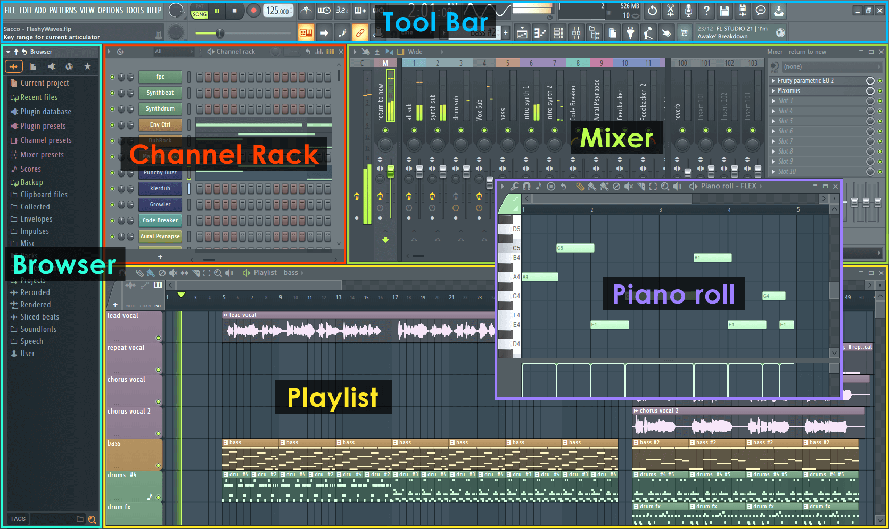
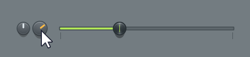
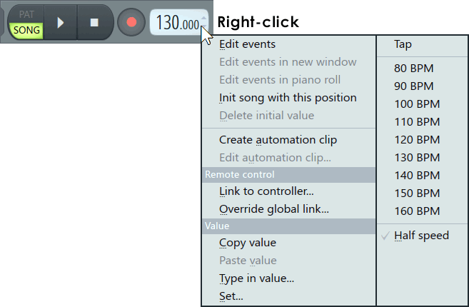

# FL Studio reference

The music suite is modelled on FL Studio: **when in doubt about how something should behave or look, it
should do what FL Studio does**, the way the video editor follows Premiere Pro. These documents are what
"what FL Studio does" means, so that nobody has to work from memory. Read the one for the panel you're
about to touch before changing it, and correct it when you learn it's wrong.

- [channel-rack.md](channel-rack.md): the Channel Rack, the step sequencer, the graph editor and the
  Channel Settings window. Ends with where Vaudio differs today and what to change.
- [piano-roll.md](piano-roll.md): the Piano roll's tools, selecting, the time selection, snap, the event
  editor, ghost notes and every shortcut. Ends with where Vaudio differs.
- [toolbar.md](toolbar.md): the main toolbar across the top (transport, tempo, position, pattern
  selector, window buttons, the hint bar, the meters). Ends with where Vaudio differs.
- Playlist, mixer, browser: not written yet. Write each one before its phase is built.

Where the music suite is and the order of what's next: [../music-suite.md](../music-suite.md).

## Where this comes from

1. **The FL Studio online manual** (Image-Line), the primary source. Pages are at
   `https://www.image-line.com/fl-studio-learning/fl-studio-online-manual/html/<page>.htm`:
   `channelrack`, `chansettings`, `chansettings_main`, `chansettings_sampler`, `chansettings_misc`,
   `basics_interface`, `basics_shortcuts`, `basics_workflow`, `toolbar_panels`, `envsettings_general`,
   `songsettings_settings`, `pianoroll`, `playlist`, `mixer`, `browser`. It describes the current version
   (FL Studio 2025), which is what we follow.
2. **Théo**, who has used FL Studio for years: where he says it works a certain way, that wins, and the
   text says "(Théo)". His own screenshots go in `img/user/`.
3. Nothing else. If a behaviour is neither in the manual nor confirmed by Théo, it's marked
   **(unverified)**: check it before building on it.

The pictures in `img/` are the manual's own screenshots, © Image-Line, kept here only as a private
reference for building this app. Don't ship them, and don't copy FL Studio's artwork into the product:
we copy how it works and how it's laid out, in our own visual style.

## How FL Studio is put together

Five things, all windows on one desktop:

| Window | What it is | Key |
| --- | --- | --- |
| **Channel Rack** | The instruments (one row each), and the step sequencer for the current pattern | F6 |
| **Piano roll** | The notes of one channel in the current pattern | F7 |
| **Playlist** | The arrangement: pattern clips, audio clips and automation clips on tracks | F5 |
| **Mixer** | Where every channel's audio goes: inserts, effects, levels, routing | F9 |
| **Browser** | Files, samples, presets and plugins, to drag into the others | Alt+F8 |

Above them is the **toolbar**: menus, the transport (pattern/song switch, play, stop, record, tempo),
the pattern selector, snap, shortcuts to each window, CPU and memory, and the **hint bar**, which says
what's under the pointer and what each mouse button would do there.

### The model (what makes it FL Studio)

- **Channels are instruments, not tracks.** The rack holds every instrument of the project. A channel is
  a sampler, a plugin instrument, an audio clip or an automation clip.
- **A pattern has notes for any of the channels.** Every pattern can play every channel. The rack and the
  piano roll always show the *current* pattern (the pattern selector, on the toolbar).
- **A step is a note.** The step sequencer and the piano roll are two views of the same notes: a step is
  a note of minimal length on the sixteenth-note grid.
- **The playlist's tracks aren't bound to anything.** Any clip (a pattern, audio, automation) can go on
  any track.
- **Each channel is routed to a mixer track** by number (the master by default). Several can share one.
- **Pattern mode and song mode**: play loops the current pattern, or plays the playlist.

### Windows

- Every panel is a **floating window** on FL Studio's desktop: a title bar to drag it by, a menu arrow at
  its top-left, close (and sometimes minimise/maximise) at its top-right, and edges to resize.
- Windows **snap together** when dragged near each other (Alt while dragging turns that off).
- F5–F9 **show and hide** the main windows; Esc closes the focused one; F12 closes them all;
  Ctrl+Shift+H arranges them.
- Any window can be **detached** from the desktop (its menu → Detached) to put it on another screen.
- **Plugins and channel settings open as their own windows.** With "Auto select linked modules" on (the
  default), opening one plugin window closes the previous one; Alt+click keeps the others open.

### Controls, everywhere

- **Knobs and sliders**: drag up/down with the left button. **Ctrl** while dragging (or both buttons) is
  fine adjustment. Some pause at their default; **Shift** stops that.
- **Reset**: Alt+click, or click with the middle button, or right-click → Reset.
- **Right-click a control** opens its menu. It's the same menu all over the program (below, the tempo's,
  which adds tempo presets on the right): Edit events, Init song with this position, Create automation
  clip, Link to controller, then **Copy value, Paste value, Type in value, Set**. Knobs start the menu
  with **Reset** (Théo).

  

- **Number displays (LCDs)**, like the pattern length or a mixer track number: drag up/down on them, or
  click their top or bottom edge to step by one.
- **The left button does, the right button undoes or asks.** Left-click adds or turns on; right-click
  removes or turns off, or opens a menu where there's nothing to remove. This holds in the step
  sequencer, the piano roll and the playlist, and is the habit to preserve above all.
- **Menus**: a small arrow at the top-left of each window opens that window's menu.

### The look

Take the layout and the hierarchy from these; the artwork is theirs.

- Flat, dark blue-grey panels (title bars a little darker than their bodies), thin dividers, no chrome.
- Small, dense controls: a knob is about 20 px, a row about 30 px. It's a tool for a big screen.
- Colour means something: green lights for "on", the channel's own colour on its button, and the step
  buttons' two alternating colours that mark the beats.
- Text is small and light-on-dark; values appear in the hint bar rather than next to every control.
