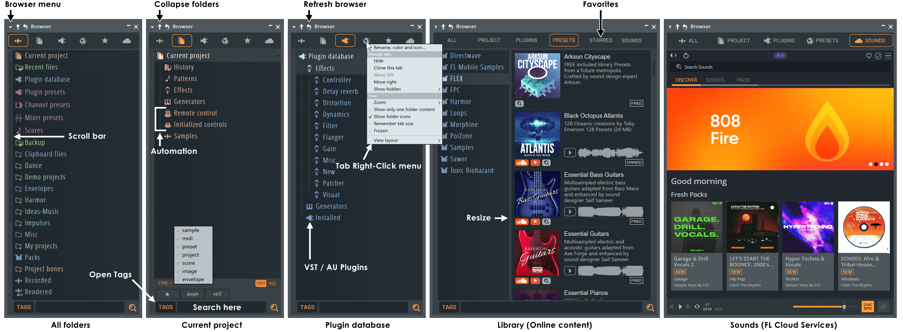
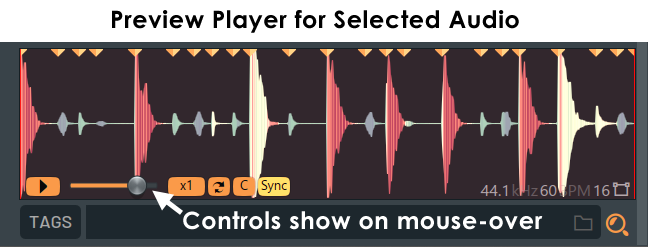
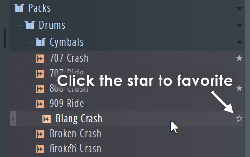
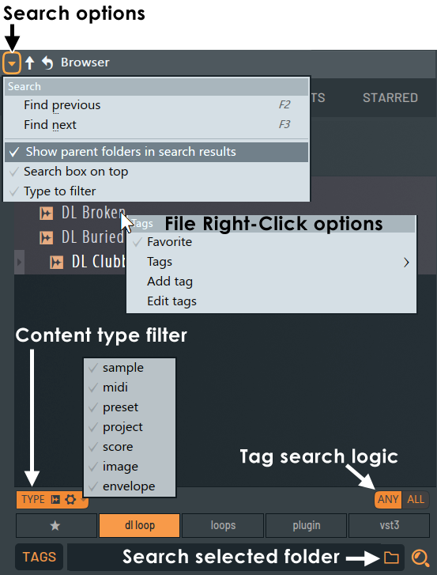

# The Browser

How FL Studio's Browser works, from the manual (`browser.htm`, `envsettings_files.htm`) and Théo. See
[README.md](README.md) for the sources and for what holds everywhere (windows, menus, the left button does
and the right button undoes).

FL's Browser does a lot (plugins, presets, the project's history, FL Cloud's shop). **We build only a part
of it**: the user's own folders, searched and previewed well. The last sections are ours:
[where Vaudio differs](#where-vaudio-differs) and [what to decide](#to-decide-with-théo).

## What it is

- A panel of **tabs** over a **tree** of folders and files, to find things and drag them into the other
  windows. **Alt+F8** shows and hides it.
- By default it's **docked on the left** of FL's desktop, full height. It can be undocked (dragged by its
  "Browser" title), docked right, auto-hidden (it slides in when the mouse comes to the edge) or detached
  onto another screen. Its width is dragged at its right edge.
- **It's FL's, not the project's**: the folders, favourites and tabs are the same in every project.

### The tabs

| Tab | What it shows |
| --- | --- |
| **All** | Every folder: FL's own (Current project, Recent files, Plugin database, Plugin presets, Channel presets, Mixer presets, Scores, Backup, Clipboard files, Packs…) then the user's extra folders |
| **Current project** | The open project's history (undo steps), patterns, effects and generators with their automatable controls, remote control, initialised controls, and the samples it uses |
| **Plugin database** | The installed VST/AU plugins, and the favourites the plugin picker is made from |
| **Presets** (online library) | Image-Line's preset packs, some for sale |
| **Starred** | The favourites (files starred anywhere) |
| **Sounds** | FL Cloud's online sample library (a shop, with its own search, tags, BPM and key) |

Tabs can be renamed, coloured, hidden, cloned and reordered, and a **search can be saved as a tab**.

## Folders

- **Adding a folder**: **drag it from Finder onto the Browser**, or File settings (F10) → *Browser extra
  search folders* (30 or more), by picking a folder or typing its path. The Browser shows the folder's own
  name unless a name is given. The user's folders are shown in **green**.
- They're **global settings**, not the project's. FL also searches them for a project's missing samples.
- FL warns to add **parent folders only** (subfolders are included) and **never a drive's root**: it slows
  everything down.
- Only folders the user added can be removed; FL's own can't.

### The tree

- **Click a folder** to open or close it. By default **only one folder's content shows at a time**
  ("Show only one folder content", a tab option: opening one closes the others).
- **Ctrl+Up** closes every folder ("Collapse structure", also a button at the top).
- **Ctrl+R** reads the folders again ("Reread structure", also a button): FL doesn't notice new files by
  itself.
- **Backspace** goes back to the previous folder or item, **Shift+Backspace** forward again.
- A folder's right-click: Expand all, Collapse all, Open in new tab, Change colour, Change icon, **Open** (in
  Finder).
- Tab options: zoom (Compact to Massive, or **Shift+wheel**), folder icons, the sample's waveform, file
  extensions, unknown file types, sort by name, type, date or group.
- A name too long for the panel pops out in full under the pointer.

## Previewing

- **Clicking an audio file plays it**: wav, mp3, m4a, ogg (and FL's own). **Only its first 5 seconds**
  by default (the menu's "Full sample preview" turns that off). **Alt+click** plays it to the end.
  **Shift+click** plays from where the pointer is let go (on the waveform).
- The **preview player** at the bottom shows the selected file's waveform. Its controls appear when the
  mouse is over it: play, volume, speed (×½, ×1, ×2), loop, key and **Sync** (play a loop at the project's
  tempo, from the tempo the file says it's at).
- Previews go to the master, not through a channel.

## Using a file

- **Drag it** onto the Channel Rack (a new channel; onto a channel's button: replace its sample), the
  Playlist (an audio clip; onto a track's header: a new channel), a mixer track, the desktop, Edison…
  **Alt** while dragging keeps the new channel's window shut.
- **Enter**: replace the selected channel with the selected file.
- **Shift+Up / Shift+Down**: select the previous or next file **and send it to the selected channel** at
  once. This is how you audition kicks *in the beat*: the pattern keeps playing while the channel's sample
  changes under it.
- **Middle-click** a file: load it into the selected channel.
- **Right-click a file**: **Send to selected channel or focused plugin**, **Open in new channel**, Open in
  new sampler channel / Slicex / Fruity Slicer / Granulizer, Edit in audio editor (Edison) / pitch
  corrector / time warper, **Open parent folder**, **Locate file**, **Favorite**, Tags, Add a tag, Edit
  tags, Delete file.

## Favourites and tags

- A **star** shows on a file when the mouse is over it; clicking it adds the file to the **Starred** tab
  (also right-click → Favorite, for several selected files at once). Clicking it again removes it.
- The Starred tab can show the favourites' parent folders too.
- **Tags**: any words ("Kick, 808, C#"), added from the right-click menu. The search can filter by tags
  (Any or All of the chosen ones).

## Searching

- The search box is at the **bottom** of the Browser (or the top: a menu option). **Ctrl+F** searches every
  folder; **Shift+F** only the selected folder (the folder icon in the box).
- **F3 / F2** jump to the next and previous match; matches are shown **in the tree, with their parent
  folders opened** ("Show parent folders in search results").
- "Type to filter" filters while typing (otherwise on Enter).
- Wildcards (`syt*`, `s*us`) and AND, OR, NOT. **Alt+F** is an exact phrase.
- A **type filter** (sample, MIDI, preset, project, score, image, envelope) and **tag chips** under the box.
- **Indexing** (on by default) keeps an index of the user's and FL's folders, made at startup for the
  folders that changed, so searches are deep and fast. Without it, search only looks in the selected
  folder.

## Keys

| Key | What it does |
| --- | --- |
| Alt+F8 | Show or hide the Browser |
| Ctrl+F / Shift+F | Search everywhere / in the selected folder |
| F3 / F2 | Next / previous match |
| Alt+F | Find an exact phrase |
| Up / Down | Select the previous / next item |
| Shift+Up / Shift+Down | Select the previous / next item and send it to the selected channel |
| Enter | Replace the selected channel with the selected item |
| Backspace / Shift+Backspace | Back / forward through the folders visited |
| Ctrl+Up | Close every folder |
| Ctrl+R | Read the folders again |
| Shift+wheel | Zoom |

## Where Vaudio differs

Théo (2026-10-01): **the browser is for his own folders, nothing else**. FL's way of moving through
folders and its file search are what he likes; no plugins, generators, presets or default kits. On top of
it: **a good search, a good preview, favourites, solid shortcuts and menus** (send to the selected channel
and the like). He works in the desktop app, so dropping a folder from Finder is enough to add one; the
plain browser (`pnpm dev`) needn't add folders.

| What | FL Studio | Vaudio |
| --- | --- | --- |
| What it shows | Many tabs: FL's folders, the project, plugins, presets, online sounds | **The user's folders**, with **Favourites** on top. No tabs to start with |
| Adding a folder | Drag from Finder, or File settings | Drag from Finder onto the Browser (the desktop app gives the dropped folder's path), referenced where it is, never copied. Removed from its right-click |
| Global | Yes | Yes: one list for every project, kept by the server (`data/music/browser.json`) |
| Which files | Every type FL knows | **Audio files only** to start with (wav, aiff, flac, mp3, ogg, m4a) |
| New files | Seen after Ctrl+R | Seen by themselves (the server watches the folders); Ctrl+R stays |
| One folder open at a time | The default | Several folders open (the tree you'd expect); Ctrl+Up closes them all |
| Search | Wildcards and Booleans; results in the tree; F3 to step | **Search as you type** (Théo: a flat list) across every folder, typo-tolerant, ranked (the name before the path), the words in any order ("kick 808" finds `808 Kit/Kick 3.wav`). Results are a flat list with each one's folder, walked with the arrows like the tree. No wildcards or Booleans |
| Preview | Click: 5 s; Alt+click: all | **Click, or arrowing onto it (Théo: yes): the whole file**, cut off by the next one; Space or Esc stops it. A waveform of the selected file with its playhead; clicking in it plays from there |
| Preview player | Volume, speed, loop, key, Sync | Volume to start with. Sync, key and loop later |
| Long files | Played from disk | Played **from disk** by the engine (a preview voice, not `SampleCache`), so hearing a whole song costs no memory. The playlist's audio clips will play the same way |
| Shift+Up/Down | Next file, sent to the channel | The same: audition samples in the playing beat (stopped, the file is previewed too). All the files tried are one undo step: undo brings back the sample from before |
| Enter, middle-click | Replace the selected channel | The same, to the first selected sampler; with none (or a plugin channel) selected, a new channel, selected so the next file goes there. Clicking a file only plays it |
| Using a file | Drag onto many places | Drag onto the rack (a new channel, where it's dropped; several files, a channel each), a channel's button or settings window (replace its sample), the Piano roll (its channel's sample; a plugin channel's: a new channel) or the desktop (a new channel). The playlist when there is one. The file is copied into the project's media then, once: trying it again reuses the copy |
| File menu | Many editors and channel types | Send to selected channel, Open in new channel, Favourite, Show in Finder |
| Favourites | Files, in the Starred tab | Files and folders, at the top of the tree. A favourite folder is a **shortcut**: it jumps to the folder where it is in the tree (Théo) |
| Tags | Free tags, filtered in the search | Not yet. Favourites only |
| Docking | Docked left by default | A window, but **it lives on the left** (Théo never moves it): full height, against the left edge, only its right edge resizes it. Its title bar doesn't move it unless it's pulled well away, and it snaps back to the left when let go near it. The other windows treat its right edge as the desktop's (sticking, maximising, half-screen), like FL's docked Browser |
| The assistant | — | `search_samples`, `list_samples` (the folders, favourites, a folder), `preview_sample`, `load_sample` (new channels, or a sampler's sample), `add_sample_folder`, `star_sample` |

## Decided with Théo

2026-10-01: a window kept on the left (only its width changes), search results as a flat list, a favourite
folder as a shortcut into the tree, arrowing onto a file plays it, and several files selected at once
(⌘+click, Shift+click) dragged onto the rack become one channel each. All built.

Still to do, when they fit: tags, the preview's speed, key and tempo sync, Backspace through the folders
visited, and dropping onto the playlist (once there is one). Samples tried and left (Shift+Up/Down) stay in
the project's media: nothing removes unused media yet.
