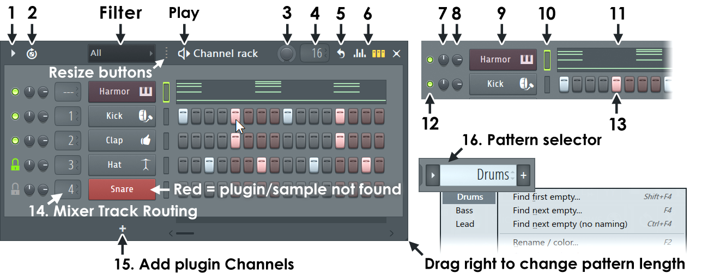
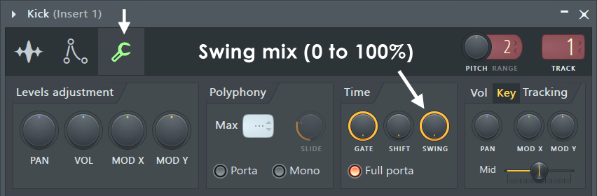
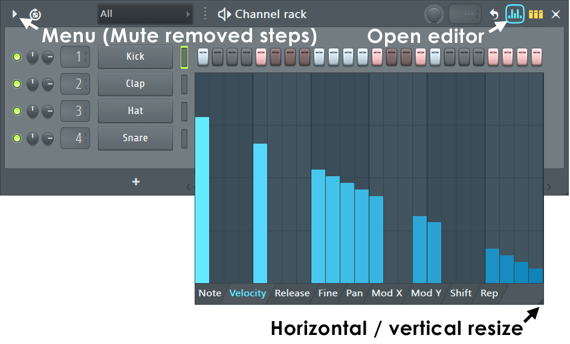
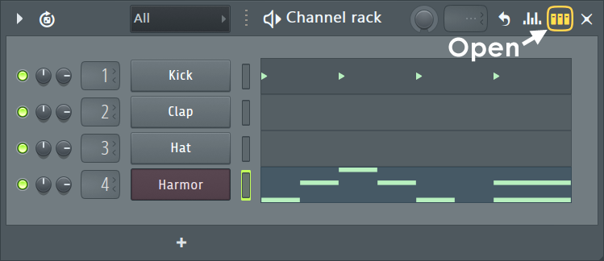
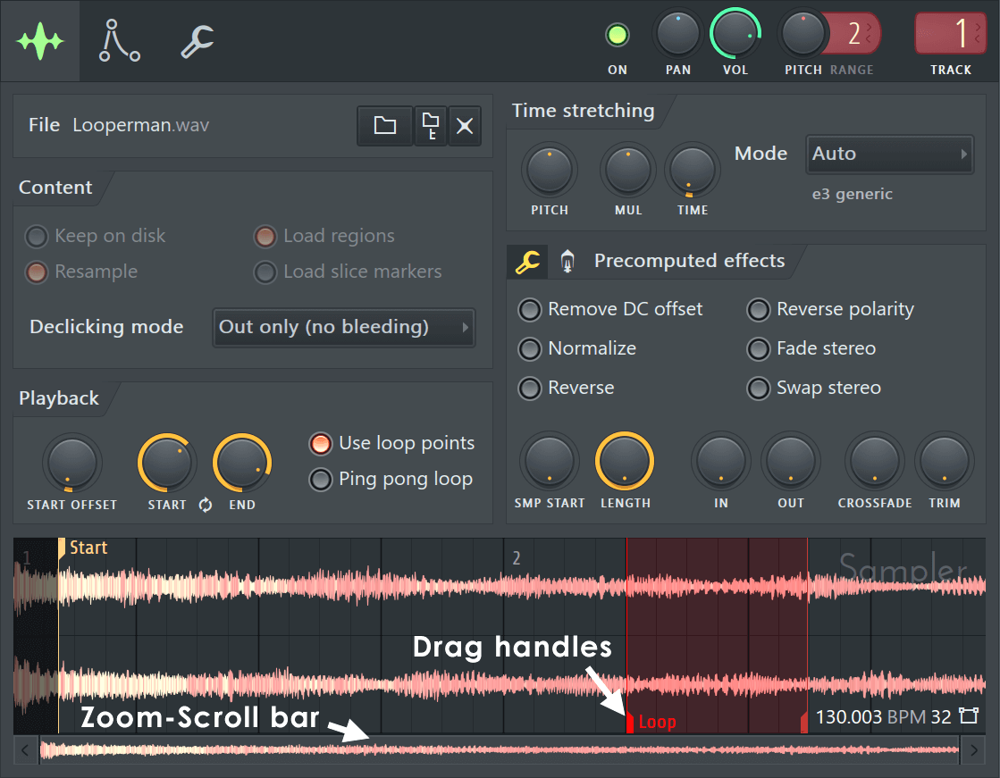
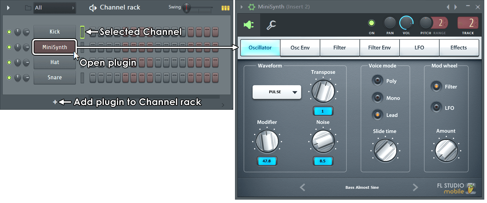

# The Channel Rack

How FL Studio's Channel Rack, step sequencer, graph editor and Channel Settings window work, from the
manual (`channelrack.htm`, `chansettings*.htm`, `basics_shortcuts.htm`) and from Théo. See
[README.md](README.md) for the sources and for what holds everywhere (knobs, menus, windows).

The last two sections are ours: [where Vaudio differs today](#where-vaudio-differs-today) and
[open questions](#open-questions).

## Anatomy

The rack is a window. Its **title bar**, left to right:

| # | Control | What it does |
| --- | --- | --- |
| 1 | Menu arrow | The Channel Options menu (see [below](#the-racks-menu)) |
| 2 | Loop Starter | FL Cloud loop generator. **Not for us.** |
| – | Filter ("All") | Which group of channels is shown. Page Up/Down change it |
| – | Resize grip (dots) | Drag to change the width of the channel buttons |
| – | Play icon + "Channel rack" | The title; the window is dragged by this bar |
| 3 | Swing knob | Global swing |
| 4 | Pattern length (LCD) | Length in steps, or Auto |
| 5 | Loop icon | Channel looping modes |
| 6 | Graph editor icon | Opens the graph editor under the rows (Ctrl+K) |
| – | Step / piano roll view icon | Switches rows between step buttons and a piano roll preview |
| – | × | Closes the window (F6 brings it back) |

Each **row** is one channel, left to right:

| # | Control | What it does |
| --- | --- | --- |
| 12 | Mute light | Green = on. Click mutes; right-click offers Solo |
| 7 | Pan knob | The channel's pan |
| 8 | Volume knob | The channel's volume |
| 14 | Mixer track (LCD) | Which mixer track it's routed to; "---" is the master. Shown with Alt+M |
| 9 | Channel button | The channel's name, in its colour. Opens its settings; right-click for its menu |
| 10 | Channel selector | The thin light after the button: lit green when selected. Its inside flashes when the channel plays |
| 13 | Steps | One button per sixteenth note. Or, for a channel with a piano roll, a preview of its notes (11) |

Under the rows: **+** (15) adds a channel, and a horizontal scrollbar appears when there are more steps
than fit. The window's **height follows the number of channels**.

## The steps

- **One button is a sixteenth note.** The default is 4 beats × 4 steps = **16 steps**, one bar of 4/4.
- **Left-click turns a step on. Right-click turns it off.** A left-click on a step that's already on
  does nothing: it doesn't toggle. (This is the default, "Use both mouse buttons in step sequencer";
  with it off, the left button toggles.)
- **Dragging paints**: hold the left button and sweep across steps to turn them all on; hold the right
  button and sweep to turn them all off. (Théo; the manual only describes clicks.)
- **Beats are coloured in pairs**: steps 1–4 and 9–12 are grey, 5–8 and 13–16 are red-brown. An unlit
  step is a dark, recessed button in its beat's colour; a lit one is a pale, raised key (pale blue-grey
  on the grey beats, pink on the red ones). This is how you read where the beats are.
- **No note-off.** A step plays the whole sample; to cut a sound, use "Cut self", a zero-velocity step, or
  the piano roll.
- **"Mute removed steps"** (rack menu): when on, a step turned off keeps its note, muted, so its velocity
  and pitch come back if it's turned on again.

### Pattern length

- **Drag the bottom-right corner (or right edge) of the rack to the right to show more steps**, and back
  to show fewer. This is how you make a pattern longer: there's no dropdown.
- The **LCD (4)** shows the length in steps. Dragging it sets it (1 to 512 steps); right-clicking it
  offers lengths in bars. Set to **Auto**, the pattern is as long as the last bar with anything in it.
- The default length for new patterns is a project setting.
- More than 512 steps: use the piano roll.

### Swing

- The title bar's knob delays **every second step** (the even sixteenths: 2, 4, 6...), lengthening the odd
  ones. It's a multiplier, 0 to 100 %.
- Each channel has its own swing mix (Channel Settings → Misc → Time → Swing), 100 % by default, which
  multiplies the global one: 0 % there keeps a channel straight.

## The row's controls

### Mute light (12)

- **Click**: mute / unmute.
- **Right-click**: a menu with **Solo** (choosing it again un-solos, which unmutes everything). It's a
  menu so that more can live there.
- **Ctrl+click** or **Alt+click**: solo / un-solo directly.
- **Shift+click**: lock the state.
- Keys: **1…0** mute the first ten channels, **Ctrl+1…0** solo them.
- "Restore previous state after solo" (a general setting): un-soloing brings back the mutes there were
  before, rather than unmuting everything.
- Mute only silences the step sequencer and piano roll; playing the channel live still sounds.

### Pan and volume (7, 8)

- The channel's own pan and volume, before the mixer.
- **A sampler's volume starts at 78 %**, which plays the sample 5.2 dB quieter than the file, for
  headroom. 100 % is the file's own level.
- They're ordinary knobs: drag, Ctrl for fine, Alt+click or middle-click to reset, right-click for the
  control menu (Reset, Copy value, Paste value, Type in value, Create automation clip...).

### Channel button (9)

- **Click**: opens (or closes) the channel's window: the **Channel Settings** for a sampler, the plugin's
  own interface for a plugin. Opening one closes the previous one, unless Alt is held.
- **Ctrl+click**: hear the channel, without opening anything.
- **Right-click**: the channel's menu:
  - Piano roll · Graph editor
  - Rename, recolor and icon… · Random color · Change color · Change icon
  - Load sample · Cut self · Show waveform preview
  - Insert ▸ · Replace ▸ (a plugin from the favourites) · Patcherize · Clone · Delete
  - Cut · Copy · Paste (the channel's notes in this pattern)
  - Fill each 2 steps · Fill each 4 steps · Fill each 8 steps · Advanced fill…
  - Rotate left · Rotate right (Shift+Ctrl+←/→)
  - MIDI channel through · Receive notes from ▸ · Burn MIDI to ▸
- **A red button** means the channel's sample or plugin can't be found.
- **Dropping an audio file on a channel button replaces that channel's sample.** Dropping it anywhere
  else on the rack adds a new sampler channel. (Théo.)
- **Shift+mouse wheel** over a button moves the channel up or down.

### Channel selector (10)

- **Click**: select this channel only (or deselect it).
- Ours (Théo): a selected channel's selector is outlined, and it lights up fully while the channel makes a
  sound, so the rack shows what's playing. Its target is wider than the light, so it's easy to hit.
- **Right-click**: add it to, or take it out of, the selection.
- **Right-click and drag down** the selectors: select several.
- **Double-click**: select all.
- **Up/Down arrows** select the channel above/below; with Shift they extend the selection.
- **Alt+Up/Down** move the selected channels. Alt+C clones them, Alt+Del deletes them, Alt+Z zips them
  (a compact row), Alt+U unzips, Alt+G groups them, Ctrl+L routes them to free mixer tracks.
- The selection is what Cut/Copy/Paste (Ctrl+X/C/V) act on, what the graph editor shows, and what a MIDI
  keyboard plays.

### Mixer track (14)

- Drag up/down to choose the mixer track. "---" is the master. Shown or hidden with Alt+M.
- The same control is on the Channel Settings window (TRACK).

### Add (15)

- **+** under the rows opens the list of favourite instruments, with "More plugins…" for all of them. The
  new channel goes at the bottom (into the filter group shown).

## Graph editor

- Opened by its icon on the title bar (Ctrl+K), or "Graph editor" in a channel's menu. It sits under
  the rows, its columns lined up with the steps, and shows **the selected channel**.
- Tabs along the bottom choose the property: **Note, Velocity, Release, Fine (pitch, ±100 cents), Pan,
  Mod X, Mod Y, Shift (start offset, up to a step), Rep (repeats)**.
- **Drag up/down in a column** to set its value; sweep across columns to draw.
- **Ctrl+drag** one column scales them all together.
- **Right-click and drag** from one column to another ramps the values between them.
- **Alt+click** (or Alt+drag across) resets columns.
- Its bottom-right corner resizes it both ways.

## Step view and piano roll preview

- A channel whose notes aren't plain steps shows a **miniature of its piano roll** in place of step
  buttons. It can't be edited there: click it to open the piano roll, right-click to open it at the spot
  clicked. Lighter and darker blocks mark the bars.
- The title bar's last icon switches all rows between the two views.

## The Channel Settings window (sampler)

A window of its own (FL's "plugin wrapper"), titled with the channel's name and its mixer track, with a
menu arrow, preset arrows, minimise and close. Along its top:

- **Tabs** (icons): the sample settings (shown), envelopes / instrument, miscellaneous.
- **ON** (mute light; right-click → Solo), **PAN**, **VOL**, **PITCH** with its **RANGE** in semitones,
  and **TRACK** (the mixer track; drag to set, click its label for the next free one).

The **sample tab**:

- **File**: the sample's name (click: reveal it in the file system), load, locate in the browser, remove.
- **Content**: Keep on disk, Resample, Load regions, Load slice markers; **Declicking mode** (default "Out
  only": a 10 ms fade-out).
- **Playback**: Start offset, Loop start / end, Use loop points, Ping pong loop.
- **Time stretching**: PITCH, MUL, TIME, and a mode (Resample, Stretch, the Elastique ones...).
- **Precomputed effects** (they rewrite the sample; not automatable): Remove DC offset, **Normalize**,
  **Reverse**, Reverse polarity, Fade stereo, Swap stereo; knobs for sample start, length, fade in, fade
  out, crossfade, trim. A second page: boost, clip, EQ, ring modulation, cutoff, resonance, reverb, stereo
  delay, pitch bend ("pogo").
- **The waveform** across the bottom, with draggable start and loop handles and a zoom/scroll bar. Click
  it to hear the sample; drag it out to drop the sample elsewhere (the playlist, another channel).

The **envelope tab**: volume, pan, filter and pitch each have an ADSR envelope and an LFO. A sampler
plays its whole sample after the note ends **unless the volume envelope is on**.

The **misc tab**: polyphony (max, mono, portamento, slide), time (gate, shift, swing), velocity and
keyboard tracking, **cut groups** (Cut / Cut by: a closed hat cutting an open one; "Cut self" is 1 by 1),
arpeggiator, echo, and the root note (C5 by default) and key range on a small keyboard.

Plugins use the same window: their own interface in the body, the same top strip (ON, PAN, VOL, PITCH,
TRACK) above it.

## The rack's menu

From the arrow at the top-left. What matters to us, in its order:

- **Add one ▸** (favourite instruments; More plugins…)
- Select unused channels · **Clone selected** (Alt+C) · **Delete selected** (Alt+Del) · **Move selected
  up / down** (Alt+↑/↓) · Sort by ▸ · Group selected (Alt+G) · Color selected ▸
- Mute selected · Unmute selected · Transpose selected… · Set swing mix for selected ▸
- Assign selected to free mixer tracks (Ctrl+L)
- Zip selected (Alt+Z) · Unzip all (Alt+U)
- **Auto resize ▸** (Off, Minimum height, Maximum height)
- Channel button width ▸ (100 % to 400 %) · Channel name alignment ▸
- **Mute removed steps**
- Show mixer track selectors (Alt+M) · Show complete piano roll preview
- **Detached**

## Keys

| Key | Does |
| --- | --- |
| F6 | Show / hide the rack |
| 1…0 | Mute / unmute the first ten channels |
| Ctrl+1…0 | Solo / un-solo them |
| ↑ / ↓ | Select the channel above / below (Shift extends) |
| Alt+↑ / Alt+↓ | Move the selected channels |
| Alt+C · Alt+Del | Clone · delete the selected channels |
| Ctrl+X / C / V | Cut / copy / paste the selected channel's steps |
| Shift+Ctrl+← / → | Shift the steps left / right |
| Ctrl+K | Graph editor |
| Alt+M | Mixer track selectors |
| Shift+wheel on the title bar | Previous / next pattern |
| Shift+wheel on a channel | Move it up / down |
| Page Up / Down | Next / previous channel group |

The **pattern selector** is on the main toolbar, not in the rack: a name with an arrow (menu: find first
empty, find next empty, rename / color…, clone, delete…) and a **+** for a new pattern. F4 makes the next
empty pattern and asks its name; F2 renames.

---

## Where Vaudio differs today

After the interaction pass on the rack (`src/suites/music/channel-rack.tsx`, `channel-settings.tsx`,
`knob.tsx`, `window.tsx`). What's listed under "Same" was checked against this document and has tests
in `e2e/music.spec.ts`; the table is what's left. "With" names the phase that brings it.

**Same as FL Studio now**: the look of the rows (small knobs, a wide button with the name in the middle and the
instrument's icon at its end, pushed in while its window is open and red when it has nothing to play; the
thin selector; step keys in grey and red beats, dark when off and pale when on, in the theme's colours); left-click turns a step on and right-click off, both painting when dragged;
the rack's right edge is dragged to show more steps, and a pattern's length is Auto (the last bar with
notes) unless its LCD sets one; the mute light, with Solo on its right-click menu, Ctrl/Alt+click, and
the 1…0 and Ctrl+1…0 keys; knobs (drag, Ctrl for fine, Alt+click or middle-click to reset, a right-click
menu with Reset, Copy value, Paste value, Type in value); a channel's button opens its settings
**window**, one at a time unless Alt is held, and Ctrl+click plays it; a file dropped on a button
replaces its sample; the selector (click, right-click to add, right-drag, double-click for all, arrows);
Alt+↑/↓, Alt+C, Alt+Del, Shift+wheel; Cut/Copy/Paste and rotate of a channel's steps; Cut self; the
graph editor's Note and Velocity tabs with Ctrl to scale, a right-drag to ramp and Alt to reset;
normalize, reverse, sample start, length, fade in and fade out in the settings window; windows that
float, are dragged by their title bar, come forward when touched and close (F6 for the rack); the **+**
under the rows, which picks the new channel's instrument (the Sampler, or a VST3 / Audio Unit instrument
found on this computer), whose button then shows the plugin's own window; and the selector's drag and
Shift+click, which select a range.

| What | FL Studio | Vaudio now | When |
| --- | --- | --- | --- |
| Steps past what fits | A scrollbar; the rack can be any width | The rack grows to the pattern's length, scrolling past 64 steps' worth of width | Fine for now |
| Pattern length LCD | Click its top or bottom edge to step by one | Drag, arrow keys, and the menu | Later |
| "Mute removed steps" | A step turned off keeps its note, muted | The note is removed | With the piano roll (muted notes) |
| Solo | "Restore previous state after solo" is a setting | Un-soloing always unmutes everything | Later |
| Knob menu | Also Edit events, Create automation clip, Link to controller | Reset, Copy, Paste, Type in value | With automation |
| Windows | Snap to each other; can be detached; Esc closes; remembered | Float, drag, close, stick to edges and each other; resizable ones maximise and snap to half the desktop; positions are forgotten with the page | Detaching later |
| Channel menu | Two columns: the channel (Piano roll, Rename/color/icon, Insert, Replace, Clone, Delete…) and its steps (Cut/Copy/Paste, Fill, Rotate, Burn…) | The same two columns, rows lined up: Piano roll, Graph editor, settings · Load sample, Cut itself, Hear it · Clone, Delete, beside Cut/Copy/Paste · Fill each 2/4/8, Clear · Rotate | Color later; the rest with their phases |
| Rack menu | Sort, group, zip, colour, swing mix, auto resize… | Add, clone, delete, move, mute/unmute selected | Later |
| Graph editor | Also Release, Fine, Pan, Mod X/Y, Shift, Rep | Note and Velocity | With the piano roll's note properties |
| Channel Settings | Content, Playback (loop points), Time stretching, declicking, the other precomputed effects | File, the six precomputed effects asked for, the waveform | Later |
| Waveform | Draggable start/loop handles, zoom, drag the sample out | Shows the prepared sample; click to hear | Later |
| Envelope | ADSR + LFO for volume, pan, filter, pitch | Volume ADSR only | Later |
| Cut groups, polyphony, arpeggiator, echo | Misc tab | Cut self only | Later |
| Mute light, selector | Green | Lit with the app's accent (blue): FL's green isn't ours | Keep |
| Pattern selector | On the toolbar, with + and a menu | On our toolbar, a popover | Keep; menu items with the playlist |
| A plugin's window | FL's wrapper around it: ON, PAN, VOL, PITCH, TRACK, presets, its menu | The plugin's own window, bare (pan and volume are on the rack) | With the mixer |
| Plugin picker | Favourites first, "More plugins…", categories | Every instrument found, with a search | Later |
| Mixer track selector | Per row and in settings (TRACK) | None | With the mixer |
| Channel groups (filter), zip, colours | Yes | None | Later |
| Per-channel swing | Yes | Global only | Later |
| Hint bar | Yes | Tooltips | Visual pass |

Choices made where FL Studio's behaviour wasn't pinned down (check them by use):

- **Sample start and length** are fractions of the file; **fade in and out** are fractions of what's kept.
  The order is FL's page order: trim, reverse, normalise, fade.
- **Copy value / Paste value** carry a control's position in its range (FL's "normalized" value), so a
  value copied from a volume knob lands at the same place on a pan knob.
- **Clone** copies a channel's settings and sample but not its notes, as the rack menu's Clone does.
- **Dragging a knob** in the settings window's PITCH moves in whole semitones; cents are typed in.
