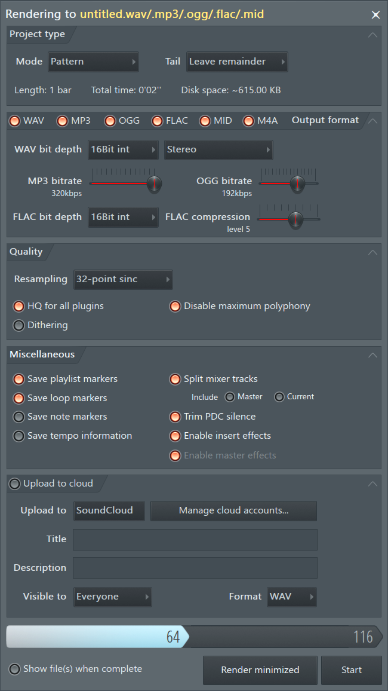
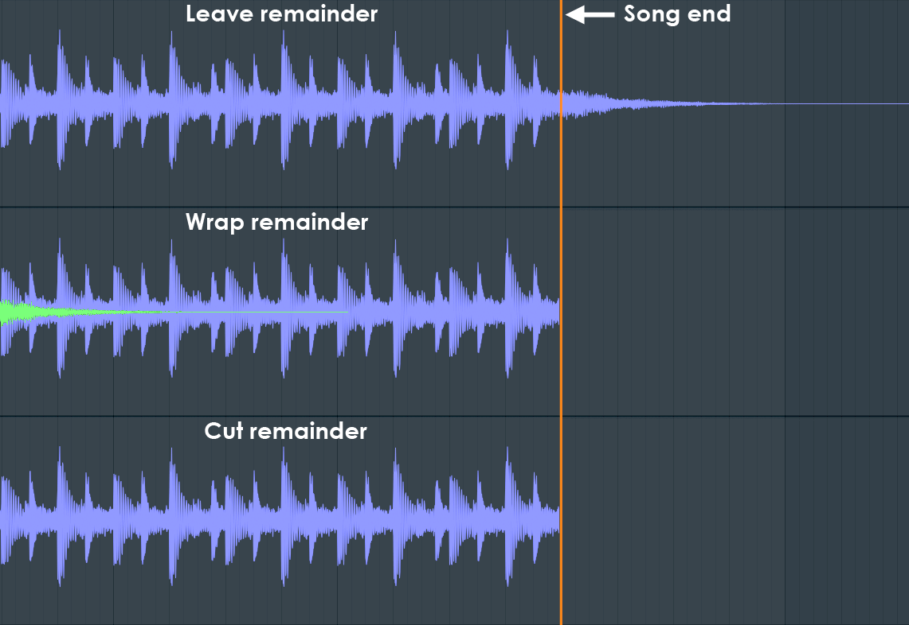

# Exporting (rendering) a song

How FL Studio exports a song to an audio file, from the manual (`fformats_save_export.htm`, with bits of
`menu_file`, `basics_shortcuts`, `playlist` and `plugins/wrapper`) and Théo. See [README.md](README.md) for
the sources. The last sections are ours: [what's decided](#decided-with-théo-2026-10-01) and [how we'd build it](#how-wed-build-it).

## What it is

- **Rendering**: FL plays the song (or a pattern) **as fast as it can, not in real time**, and writes the
  sound to a file. The time it takes "depends on export settings and project complexity". The manual says a
  render usually sounds *better* than live playback, because plugins and resampling can use their
  high-quality modes.
- **What's rendered is the master track**. A mixer track that doesn't reach the master, directly or
  through sends, isn't in the file. The exception is **Split mixer tracks**, which writes a file per track
  (stems).
- Formats: **WAV, MP3, OGG, FLAC, M4A** (audio) and **MID** (the notes, not sound). Several can be ticked
  at once, and one render writes them all.

## Opening it

| Key | What |
| --- | --- |
| Ctrl+R | Export a WAV file |
| Ctrl+Shift+R | Export an MP3 file |
| Ctrl+Shift+M | Export a MIDI file |
| File → Export → Wave / mp3 / ogg / MIDI file… | The same |

**First a save dialog** asks where the file goes and its name (the project's name by default). **Then the
export dialog** opens with that format ticked. Its title says what's being written:
"Rendering to untitled.wav/.mp3/.ogg/.flac/.mid". Nothing is rendered until **Start**.

## The dialog

Five folding sections from top to bottom, then a progress bar and the buttons.

### Project type

- **Mode**: **Song** (the Playlist) or **Pattern** (the current pattern). It starts on whichever mode the
  transport is in.
- **Tail**: what happens to sound still ringing after the end (reverb, delay, a long release):

  

  - **Leave remainder** (the default): the render goes on past the end until the tail has died away.
  - **Wrap remainder**: for loops. The tail is mixed back onto the start of the file, so the loop plays
    seamlessly. It renders the last bar first and folds what rings past it into the start. A tail from
    notes before the last bar isn't wrapped.
  - **Cut remainder**: the file stops exactly at the end.
- **The length**, worked out in this order:
  - **Song mode**: 1. a time selection on the Playlist, if any; 2. else the last time marker past the
    last bar with something in it; 3. else the end of the last bar with something in it; 4. plus the tail.
  - **Pattern mode**: 1. the last time marker past the pattern's last bar with data; 2. else the end of
    that bar; 3. plus the tail.
  - If Leave remainder cuts a tail off anyway, a **Repeat time marker** placed later extends the render
    to it.
- **Length** (bars), **Total time** (H:M:S) and **Disk space** (every ticked format added up) are shown
  read-only.

### Output format

- A light per format: **WAV, MP3, OGG, FLAC, MID, M4A**. Tick several to write them all in one render.
- **WAV bit depth**:
  - **16-bit int**: CD quality, plays everywhere.
  - **24-bit int**: for older DAWs and hardware.
  - **32-bit float**: FL's own mix format, for more editing elsewhere.

  **Channels**: Stereo, Mono (merged), Mono (left only) or Mono (right only).
- **MP3 / OGG / M4A bitrate**: a slider. MP3 goes up to 320 kbps, OGG to 450. The manual's guide:
  - 128 kbps: acceptable;
  - 160 kbps: hard to tell from a CD;
  - 224 kbps and up: practically indistinguishable.

  MP3 only supports 32, 44.1 and 48 kHz. It also adds a little silence at the start, so it's no good for
  loops.
- **FLAC**: 16 or 24 bit, and a compression level from 0 to 8 (5 is the default). The output is the same
  at every level: a higher level only makes the file about 10% smaller and takes longer to encode.
- **The sample rate isn't in the dialog**: it's the project's rate, from the Audio settings.
- **MID**: writes the notes. For a whole song, the project first has to be turned into MIDI Out channels
  (a macro). The Piano roll has its own "Export as MIDI file".

### Quality

- **Resampling**: how samplers and audio clips interpolate when they play a sample at another pitch or
  rate:
  - **Linear** (fastest, aliases when pitched far);
  - **6-point Hermite**;
  - **16- to 512-point sinc** (better and slower).

  Live playback has its own setting, so the two can sound different.
- **HQ for all plugins**: FL's own plugins switch to their high-quality modes. For VST/AU plugins, the
  wrapper option **"Notify about rendering mode"** (on by default) tells the plugin it's rendering offline,
  so plugins that have a better offline mode use it.
- **Disable maximum polyphony**: ignores channels' voice limits for the render.
- **Dithering**: shaped dither when going down to 16 bits (WAV and MP3). The manual says it only matters
  in very quiet passages.

### Miscellaneous

- **Save playlist markers / loop markers / note markers**: write markers into the WAV, as slice points or
  loop points, from the Playlist's time markers, the loop, or every note start.
- **Save tempo information**: the tempo in the WAV's metadata.
- **Split mixer tracks** (stems): every mixer track that's used, written to its own WAV, in the same
  render.
  - **Include**: Master, and/or the current track.
  - **WAV only**, not MP3, OGG or FLAC.
  - Muted tracks are skipped.
  - The master's effects are only on the master's file. "Export all playlist tracks" (below) is the way to
    get stems through the master.
- **Trim PDC silence** (on by default): removes the plugin delay compensation's silence from the start of
  the file, so the song starts at sample 0.
- **Enable insert effects** / **Enable master effects**: include the mixer tracks' effects, and the
  master's, in the render. Both are on for a normal export. They mostly matter when bouncing (below).

### Upload to cloud

- Upload straight to SoundCloud (title, description, public or private).

### The buttons

- **Show file(s) when complete**: opens the folder afterwards.
- **Render minimized**: FL minimises and renders in the background.
- **Start** (becomes **Abort** while it renders). The bar at the bottom shows the progress, in bars.

## Related, elsewhere in FL

- **Export all playlist tracks** (Playlist → Tools): solos each Playlist track in turn and renders it,
  **through the master**. This is the other kind of stems. **Export all playlist track groups** does the
  same per group.
- **Consolidate** (freeze), **Render as audio clip**, **Render and replace**: render clips or patterns to
  an audio clip in the song, with these same render settings. These are bouncing, not exporting.
- **Alt+R** in the Mixer: renders the *armed* mixer tracks to WAV.
- **Master (FL Cloud)**: AI mastering to a loudness target (LUFS), an online service.
- **Command line**: `FL -R -Emp3 project.flp` renders without opening the window (batch export).

## Decided with Théo (2026-10-01)

1. **A save dialog first**, as FL's: where the file goes and its name (the song's name by default), then
   the export window. In the desktop app it's the Mac's own save dialog; in the browser, the file is
   downloaded when the render ends.
2. **Formats: WAV, MP3, FLAC, OGG, M4A and MIDI**, several in one render. Stems can be written in any of
   them, not only WAV as in FL.
3. **MIDI matters**: the whole song's notes, a MIDI track per channel. No FL-style "turn the channels into
   MIDI Out first": we write it from the document.
4. **The tail is a choice**: **Cut at the end** (the default: the file ends where the Playlist's last bar
   does) or **Let it ring out** (the render goes on until the output has been silent for a moment, up to
   a limit). No Wrap remainder for now.
5. **Plugins render in their high-quality offline mode, always** (FL's "Notify about rendering mode").
6. **Editing the song while it exports** would be ideal, and FL can't do it. See
   [editing while it renders](#editing-while-it-renders): edits are free; hearing them waits for the
   render to end.

7. **The sampler's resampling** (how a sample is played at another pitch or rate; today linear, which
   adds faint aliasing to bright sounds pitched far): **a better method everywhere**, live too, and the
   best (sinc) in exports. The quality can be chosen, in Settings and in the export window. Tested: the
   aliasing measured, and every hit still landing on its sample (the interpolator's delay compensated).
8. **Editing while it exports: yes** ([how](#editing-while-it-renders)).
9. **The rest as suggested** (Théo: "happy with those"):
   - **The window**: the export is a window on the music desktop, opened by **⌘R** (WAV ticked) and
     **⌘⇧R** (MP3), after the save dialog.
   - **What's rendered**: Song or Pattern mode, starting on the transport's mode. The length is the
     Playlist's time selection, else the end of the last clip's bar. Length, total time and disk space are
     shown.
   - **Formats**: WAV 16 / 24 / 32-bit float (24 by default), MP3 320 kbps by default (a slider), FLAC 16 /
     24 bit; stereo only; the engine's sample rate; dither off, a switch for 16-bit files.
   - **Stems**: Split mixer tracks, one file per mixer track that has sound, from the same render, named
     "<song> - <track>". Muted tracks are skipped; the master is included if ticked. The plugin delay's
     silence is always trimmed.
   - **Other settings**: no insert / master effects switches, WAV markers, tempo metadata or SoundCloud
     upload yet. A "Show in Finder" switch; the last settings remembered across songs.
   - **The assistant**: an `export_song` tool now; bouncing later.

**Every step is tested**, latency included (the plugin delay trimmed to the sample, stems lined up with
the mix), and committed as it's done (Théo).

## How it's built

Built on 2026-10-01 from this document. Written for speed: Théo wants exports to be very fast.

- **The engine that's running renders it** (`engine/src/Export.cpp`, the `export` command). Its plugins
  are already loaded with their settings, so there's nothing to reload. It lets go of the audio device,
  prepares the plugins for blocks of 2048 and tells them they're rendering offline (`setNonRealtime`),
  resets them, and renders a copy of the song with a sequencer of its own on a thread of its own, then
  gives the plugins back to playback and takes the device again. The export's sequencer decodes audio
  clips on its own thread, as the offline engine does.
- **Plugins in parallel** (`engine/src/Workers.h`). A block's instruments render into their own buffers on
  every core and are added up in order; the mixer's tracks run in stages (`Song::stages`: none sends to
  another of its stage), each stage's effects and faders at once, their sends in order. The result is
  the same, sample for sample, as on one thread. Playback runs the same stages in turn.
- **Straight to disk**: 32-bit float WAVs written as they're rendered (no limit on length), the mix and,
  for stems, each track's sound after its fader, from the same pass. Every file starts on the song's
  first sample: the song's plugin delay is trimmed off, and each stem is held back until it's as late
  as the master, so the stems add up to the mix.
- **The song plays once** (`Song::loops`), so nothing comes round again in the tail; the tail either stops
  on the last sample or rings until it's been quiet (−80 dB) for half a second, 30 s at most.
- **Encoding** (`server/music/exports.ts`): ffmpeg makes each format from the engine's WAVs, several at
  once (they take a fraction of the render). The MIDI file is written in TypeScript from the same compiled
  song (`shared/music/midi.ts`). The settings, names and ffmpeg's arguments are pure
  (`shared/music/export.ts`).
- **The window** (`src/suites/music/export/`): ⌘R / ⌘⇧R or the toolbar's Export, the save dialog
  (`chooseSaveFile`, the desktop app's), the settings (remembered), Start, progress polled from the server,
  the files listed. `export_song` is the assistant's.
- **Tested**: the engine offline (`server/music/export.integration.test.ts`: the length, the tail, the
  trimmed delay, stems adding up to the mix, plugins told they're offline, parallel the same as one
  thread, playing refused meanwhile and the song sent meanwhile played after, aborting), resampling
  (`resampling.integration.test.ts`), the service against the stand-in engine and the real ffmpeg
  (`exports.test.ts`), the window and the tool in `e2e/music.spec.ts`. `pnpm tsx scripts/render-bench.ts`
  measures the speed with this computer's plugins.

### Editing while it renders

FL locks the song while it renders. We can do better, because the song lives in the tab, not in the
engine:

- **The render plays a copy.** On Start, the engine renders the song as it was at that moment. Edits
  made afterwards (notes, clips, the mixer, new channels) go on as usual: undo, autosave, everything. The
  engine keeps the newest song aside and switches to it when the render ends, so the edits never reach
  the file being written.
- **What you can't do meanwhile is hear it.** Play and the previews (the Piano roll's keys, the
  Browser's files) wait until the render is done, because the render is using the engine's plugins. A
  quick render makes that a few seconds.
- **Plugin windows are the catch**: a knob turned inside Serum *during* the render would change the
  render, since it's the same instance. So plugin windows are hidden while it renders and come back
  after.
- **Playing while it renders** would need a second engine with its own copy of every plugin. That means
  loading them all again (seconds each for Serum) and sharing the CPU with playback, so the export gets
  slower. It's possible later as a "render in the background" option, but it works against "really
  fast".

**Measured** (`pnpm tsx scripts/render-bench.ts`, 2026-10-01, an M5 Pro with 18 cores): the engine as it
was before the export, on one thread in blocks of 512, rendering chords on Serum 2's init patch (a
light one: real patches with unison and effects cost several times more) and two sampler drums.

| Song | One thread | A 3-minute song |
| --- | --- | --- |
| 6 × the test synth through the test effect | 71× real time | 2.5 s |
| 6 × Serum 2 through AUReverb2 | 18× | 10 s |
| 6 × Serum 2, no effects | 20× | 9 s |
| 24 × Serum 2 through AUReverb2 | 4.3× | 42 s |

The plugins are nearly all of it, and each instance only depends on its own input: that's what running
them in parallel speeds up. **With the export built** (blocks of 2048, plugins in their offline mode, then
on every core), the same songs, 60 seconds of each:

| Song | Played (one thread, blocks of 512) | Exported, one thread | Exported, every core | A 3-minute song |
| --- | --- | --- | --- | --- |
| 6 × Serum 2 through AUReverb2 | 17.5× real time | 30× | 108× | 1.7 s |
| 24 × Serum 2 through AUReverb2 | 4.3× | 7.4× | 45× | 4 s |

The parallel export is the same, sample for sample, as the one-thread one (tested). Plugins' offline-quality modes (always on, decided) can make a render slower
than playing it live. That's the price of FL's better-than-live render.

## Where Vaudio differs

**Same as FL Studio**: ⌘R (WAV) and ⌘⇧R (MP3) and the save dialog first, then the window; Song or
Pattern; the length from the time selection, else to the end of the last bar with something in it; the
tail; WAV, MP3, FLAC, OGG, M4A and MIDI in one render; WAV 16 / 24 / 32-bit float, MP3 to 320 kb/s, FLAC 16
/ 24-bit and its level; dither for 16 bits; Split mixer tracks (stems) with the mix if asked; plugin delay
trimmed; plugins told they're rendering offline; Show in Finder when done; Stop.

| What | FL Studio | Vaudio |
| --- | --- | --- |
| While it renders | The song is locked | The song can be edited: it's exported as it was at Start. Playing waits, and says why; plugin windows hide until it's done |
| Speed | One thread, as fast as it goes | Every core: 45× real time with 24 Serums on an M5 Pro, against 4.3× played |
| Tail | Leave, wrap or cut remainder | Ring out or cut (no wrap yet). Ringing stops after half a second under −80 dB, 30 s at most |
| Length | Also the last time marker | No time markers yet |
| Stems | WAV only; named mixer tracks | Any of the formats; every track something plays into (silent ones are left out), named "<song> - <track>" |
| Formats | Picked in the dialog | The same, and remembered across songs |
| OGG | Vorbis | libvorbis if ffmpeg has it, else ffmpeg's own Vorbis encoder (quality from the bitrate) |
| Resampling | Its own setting in the dialog | Settings' "in exports" choice, also in the window (sinc by default) |
| Quality switches | HQ for all plugins, max polyphony | Plugins always told they're offline; no polyphony limit to lift |
| Markers, tempo in WAVs, mono, sample rate in the dialog | Yes | Not yet (the sample rate is the engine's) |
| Upload to SoundCloud, FL Cloud mastering | Yes | No |
| Export all playlist tracks, consolidate, render as audio clip | Yes | Not yet |
| In a browser | — | No save dialog: the files are downloaded |
| A mix over full scale | Clipped in the file (but 32-bit float); FL's default template has a limiter on the master | **Keep it from clipping** (on by default): the engine mixes in floating point, so a mix can go over full scale and sound clean live (the computer's volume turns it down before the speakers), but a file would clip. A render that goes over is turned down as a whole, every file alike, to −0.3 dB, so it sounds as it played; the window says by how much. Found on Théo's first export: his mix peaked +12.6 dB over and the 808 was clipped flat |
