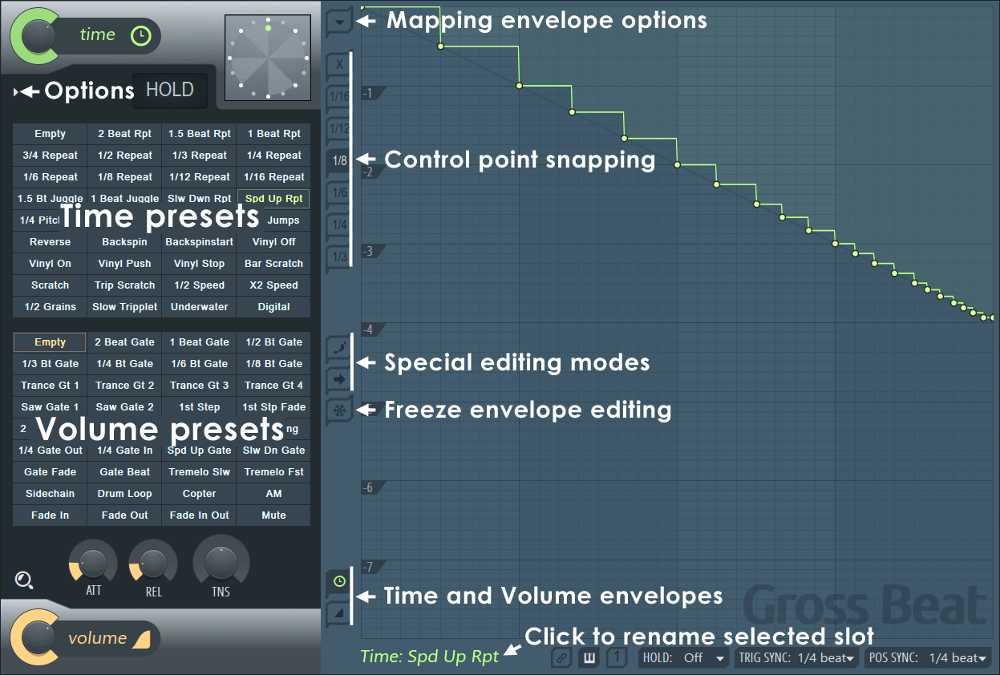
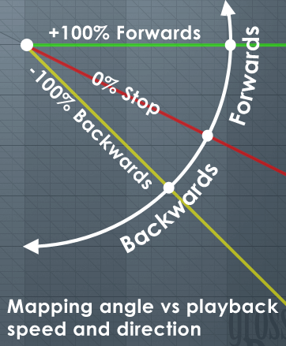
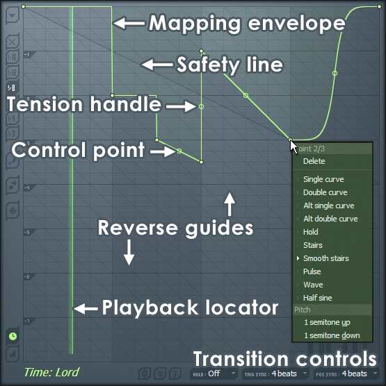

# Gross Beat

FL Studio's **Gross Beat**, from Image-Line's manual (`plugins/Gross%20Beat.htm`) and its screenshots
(below), and what producers use it for: chops, stutters, repeats, half speed, tape stops, scratches,
gates and sidechain pumping, all synced to the song. The last sections are ours: [what's
decided](#decided), [where Vaudio differs](#where-vaudio-differs) and [how it's built](#how-its-built).

## What it is

- An **effect** (it goes in a mixer track's slot) that manipulates the **position** (so the pitch and
  speed) and the **volume** of the sound going through it, in time with the song.
- It keeps the last **2 bars** of what comes in, a **rolling buffer**, and plays from it.
- It has **36 time slots** and **36 volume slots**. Each slot is an **envelope** one bar long (4 beats)
  that repeats every bar while it's selected. One time slot and one volume slot play at a time.
- Switching slots is the performance: click them, automate them (an automation clip, Hold curves), or
  trigger them from MIDI notes.

## The mapping panel (the envelope editor)

- **4 beats (1 bar) wide, 8 beats (2 bars) high.** It can step back up to 8 beats, once the buffer is full
  (it has heard 2 bars).
- **A time envelope** is an offset: what's heard is *now + offset*. The **top is now** (the sound as it
  comes in); down is further back in time, by the beat scale on the left (-1 .. -7).
- **A volume envelope** is a level: the top is 100%, the bottom silence.
- What a time envelope's shape does:

| Shape | What's heard |
| --- | --- |
| Flat (along the top, or a Hold step) | Normal speed: the sound, or a part of it from earlier, as it was |
| Sloping down, less steeply than the safety line | Slower, lower: the safety line's slope is a pause (0%) |
| Sloping up | Faster, higher (it can't pass the top: there's no future to read) |
| Down more steeply than the safety line | Backwards; the reverse guides' slope is normal speed backwards |
| A step down / up | A jump back / forward, by the beats it steps |
| Curves (Double, Half sine...) | Scratches, speeding up and slowing down |

- **Safety line**: the dark diagonal across the first 4 beats, one beat down per beat (a pause). Above it
  and behind the playhead is sound in the buffer; below it, on the first bar played, is silence.
- **Reverse guides**: grey diagonals, two beats down per beat: normal speed backwards.
- **Playback locator**: a green line moving across while the song plays.

### Editing it

| Mouse | What |
| --- | --- |
| Right-click (and drag) | Add a point (and move it) |
| Left-drag a point | Move it; Shift: only sideways, Ctrl: only up and down, Alt: off the grid |
| Drag a tension handle (the circle half-way along a segment) | Bend the segment; Ctrl: finely |
| Right-click a tension handle | Straighten it |
| Right-click a point | Its menu: Delete, the curve types, Pitch: 1 semitone up / down |
| Alt+click a point | Delete it |

The **curve types** are the automation clips' (`automation.md`): Single, Double, Alt single, Alt double,
Hold, Stairs, Smooth stairs, Pulse, Wave, Half sine. **Pitch 1 semitone up / down** makes the segment
arriving at the point play a semitone higher or lower than it does.

The **left strip**:

- **The options arrow** (top): Open / Save state file, Copy / Paste state, Undo, Undo history, Last reset,
  and the tools: Flip vertically, Scale levels, Normalize levels, Decimate points, Smooth up abrupt changes,
  Turn all points smooth, Create sequence, Analyze audio file.
- **Snap**: X (none), 1/16, 1/12, 1/8, 1/6, 1/4, 1/3 of a beat.
- **Special editing modes**: **Step editing** (drag across to draw a step per grid cell; Shift: pulses) and
  **Slide remaining points** (moving a point moves those after it along with it).
- **Freeze**: the envelopes can't be edited.
- **Time / Volume** (bottom): which envelope the panel shows.

The **bottom bar**: the slot's name (click to rename), **Link slots** (picking a time slot picks the
volume slot of the same number, and back), **Key-held** (a MIDI-triggered slot lasts while its key is
held), **One-shot** (a slot plays once, then Gross Beat goes back to slot 1), **HOLD** mode, **TRIG SYNC**,
**POS SYNC**.

## The left panel

- **Time** knob: how much of the time envelope is used (0..100%). **Scratching clock** (beside it, View
  scratching clock): a platter dragged up and down to scratch by hand.
- **HOLD**: the bar repeat button. Held, it repeats a bar for as long as it's held and the song plays:
  **Last** (the HOLD mode) repeats the bar just played; **Next** lets the next bar through, then repeats
  it; **Off**, the button does nothing.
- **The time slots** (36, in a grid, green) and **the volume slots** (36, orange). A click picks a slot
  (it's then shown in the panel to edit); while the song plays it starts on the next sync point. A white
  outline is the slot being edited, an outline in the slot's colour one waiting to start, a filled one the
  slot playing. Right-click: rename, copy, paste, clear, link to a controller / automate.
- **Volume** knob: how much of the volume envelope is used; **ATT** (0..500 ms) and **REL** (0..1000 ms)
  smooth its rises and falls, **TNS** bends that smoothing.

### Sync

- **TRIG SYNC**: when a slot picked while playing starts: Off (at once), or on the next 1/4, 1/2, 1, 2 or 4
  beats of the song.
- **POS SYNC**: where in its envelope it starts: Off (at the beginning), or where the song is inside the
  same lengths (at 4 beats, it's where the bar is: the envelope stays in line with the bars).

### The options menu

Trigger slots from MIDI notes (volume slots from C1, time slots from C4 upwards), Click reduction (fades
across a jump), Smoothing attack compensation (a jump's attack isn't lost under the volume smoothing),
Remove DC offset (after a pause, the sound sits off centre), HQ resampling (sinc, for pitch changes),
View scratching clock.

## The factory presets

The slots come filled (the screenshot):

- **Time**: Empty, 2 Beat Rpt, 1.5 Beat Rpt, 1 Beat Rpt, 3/4 Repeat, 1/2 Repeat, 1/3 Repeat, 1/4 Repeat,
  1/6 Repeat, 1/8 Repeat, 1/12 Repeat, 1/16 Repeat, 1.5 Bt Juggle, 1 Beat Juggle, Slw Dwn Rpt, Spd Up Rpt,
  1/4 Pitch…, (two hidden by the screenshot's label), Jumps, Reverse, Backspin, Backspinstart, Vinyl Off,
  Vinyl On, Vinyl Push, Vinyl Stop, Bar Scratch, Scratch, Trip Scratch, 1/2 Speed, X2 Speed, 1/2 Grains,
  Slow Tripplet, Underwater, Digital.
- **Volume**: Empty, 2 Beat Gate, 1 Beat Gate, 1/2 Bt Gate, 1/3 Bt Gate, 1/4 Bt Gate, 1/6 Bt Gate, 1/8 Bt
  Gate, Trance Gt 1-4, Saw Gate 1, Saw Gate 2, 1st Step, 1st Stp Fade, (four hidden), 1/4 Gate Out, 1/4
  Gate In, Spd Up Gate, Slw Dn Gate, Gate Fade, Gate Beat, Tremelo Slw, Tremelo Fst, Sidechain, Drum Loop,
  Copter, AM, Fade In, Fade Out, Fade In Out, Mute.

## Decided

Not yet talked through with Théo (2026-10-01, built from his request: "pretty much to the T what Gross
Beat is", in our UI style). What was chosen, to check with him:

- **A stock effect of ours**, chosen from an effect slot's picker (Built in → Gross Beat), not a plugin.
  Its envelopes are **in the song** (every edit is undone, the assistant can draw chops), unlike a
  plugin's settings, which are a file beside it.
- **Its window is ours**, in the app's look: the left panel and the mapping panel as FL lays them out,
  drawn with the automation clips' curves.
- **The factory presets** are ours, made to the names in FL's list; the four hidden time and volume names
  are guessed (1/4 Pitch Up, 1/4 Pitch Dn, Pitch Bend; 2nd Step, Off Beat, Dotted Gate, Swing Gate). A slot
  left as it came isn't stored in the song: it's the preset.
- **Defaults**: TRIG SYNC 1/4 beat, POS SYNC 4 beats (an envelope stays in line with the bars), HOLD Last,
  Click reduction on, Remove DC offset off (a 10 Hz high-pass: on, it would turn the low end of
  everything through it a little), snap 1/8 beat. An Empty Gross Beat leaves the sound exactly as it is.
- **The buffer empties when play starts**: the first bar can't step back before it (the safety line);
  stopped, the sound goes through as it is.
- **Pitched repeats** ("1/4 Repeat" and the like) repeat the first part of the bar, as the screenshot's
  Spd Up Rpt does: the steps run down the safety line.

## Where Vaudio differs

| What | FL Studio | Vaudio |
| --- | --- | --- |
| Triggering slots from MIDI notes, Key-held | Yes | Not yet: there's no MIDI routing to effects (MIDI input is step 5). Slots are picked by a click or automated |
| Time and Volume knobs | The envelopes' mix levels | The same (how far each envelope moves things: 50% time is half the offset) |
| Automating | Any knob or slot, an automation clip with Hold | The time and volume slots, the two mix knobs and ATT / REL / TNS: Create automation clip from their menus. The scratching clock is played live, not automated |
| HOLD and the scratching clock | Parameters too | Live only (held by the hand, not recorded or exported) |
| Open / Save state file, Undo history, Last reset | In the options menu | Copy / Paste state (between Gross Beats, and slots); the app's undo does the rest |
| Create sequence, Analyze audio file | Yes | Not yet |
| Smoothing attack compensation | "Moves the envelope forward slightly" | What's played after a jump is read the attack time earlier, so its start is heard once the volume is back |
| Compact mode | Drag the right edge in | No: the window resizes its mapping panel instead |

## How it's built

- **The document**: `MixerEffect.grossBeat` (`shared/music/types.ts`) on an effect whose plugin is
  `GROSS_BEAT_PLUGIN` (`vaudio:gross-beat`): the picked slots, the knobs, the options, and each slot changed
  from its preset (`time`, `volume`: null is the preset, so a song stores only what was changed). A slot is
  a name and automation points (`AutomationPoint`, the automation clips' curve types and tension) over
  `GROSS_TICKS` (4 beats): for time, 1 is now and 0 is `GROSS_DEPTH` (8) beats back. Validated in
  `normalizeGrossBeat` (`project.ts`); the presets and constants in `gross-beat-presets.ts`; what an
  envelope means (offset, speed, `pitchSegment`) and the edits (`updateGrossBeat`, `editGrossSlot`,
  `setGrossSlot`, `paintStep`, `slidePoint`) in `gross-beat.ts`. All tested.
- **Compiling** (`compile.ts`): each Gross Beat's `EngineEffect.grossBeat` carries its settings and the
  envelopes of the slots that can play (the picked ones, the range its slot automation reaches, slot 1 for
  one-shot), as straight lines (`sampling.ts`'s `sampleLane`, as automation lanes: a time envelope within a
  ten-thousandth of a beat, so a scratch's speed is smooth). Its slots and its Time and Volume knobs
  automate as lanes (`kind: "gross"`), set at each slice's start as an effect's mix is.
- **The engine** (`engine/src/GrossBeat.cpp`): a native effect, run in its slot like a plugin's (bypass,
  the slot's mix), no plugin delay. `gross::State` keeps the rolling buffer (8 beats at the song's tempo and
  a little more, made on the message thread and kept across songs by the effect's id in a
  `gross::Registry`; the export has a registry of its own). `Sequencer` gives it the song's position each
  block (`gross::Clock`: the tick on its first sample, from the loop's start counted in, so the bars line
  up; whether play just started). Each sample: the slots' sync (TRIG SYNC waits for its point, POS SYNC
  anchors the envelope on its grid), one-shot, the envelopes at their phases, HOLD (Last / Next, a bar of
  what came in), the scratching clock (smoothed), the read (Hermite, or sinc with HQ; silence before play
  started, the newest sample past now), click reduction (a jump, any step in where it reads, fades across
  3 ms, equal power), the volume smoothed (ATT / REL / TNS), Remove DC (a 10 Hz high-pass). It reports
  what it plays (`EngineTransport.grossBeats`). HOLD and the scratching clock are the `grossBeat` command.
  Tested offline to the sample: `server/music/gross-beat.integration.test.ts`.
- **The tab** (`src/suites/music/gross-beat/`): `gross-beat-window.tsx` (the window, opened from the
  slot's name, chosen from an effect slot's picker under Built in), `draw.ts` (the mapping panel's canvas,
  drawn when something changed or the song plays), `pointer.ts` (its mouse, a drag drawn through the edit
  it commits), `geometry.ts` (its maths, tested), `actions.ts`, `store.ts` (open windows, each one's view:
  the kind shown, snap, step, slide, freeze, the clock), `tool-edits.ts` (the assistant's `get_gross_beat`,
  `update_gross_beat`, `set_gross_beat_slot`; `add_mixer_effect` takes "Gross Beat", and `add_automation`
  its "time slot", "volume slot", "time mix" and "volume mix"). Its colours are theme tokens
  (`--gross-time`, the accent in other themes, and `--gross-volume`).
