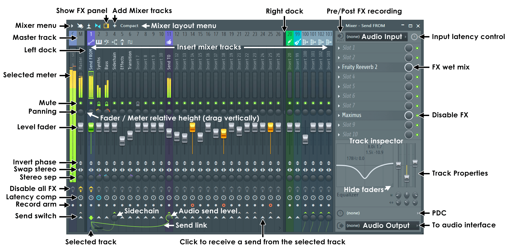
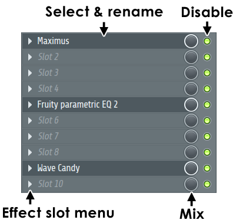
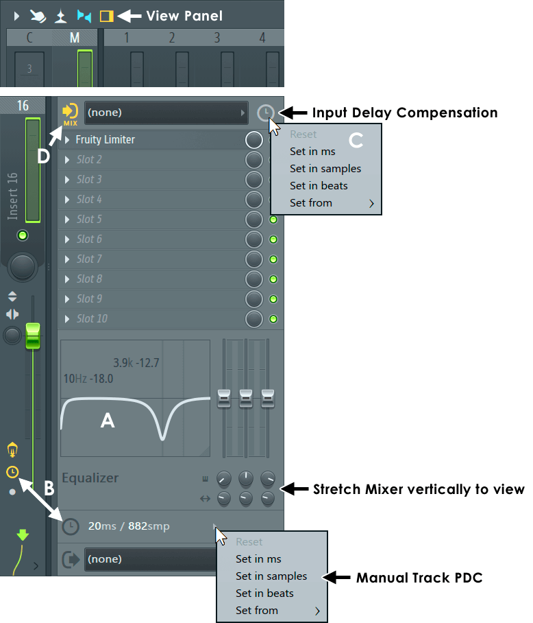
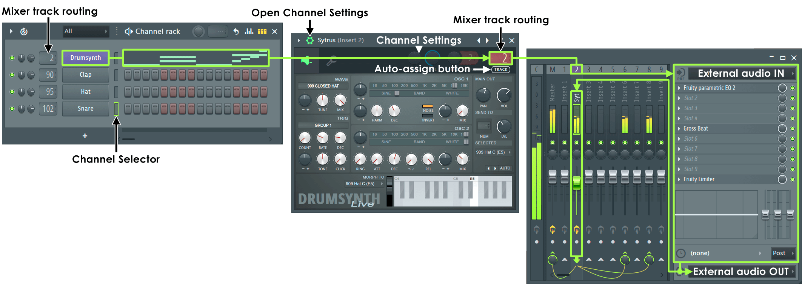
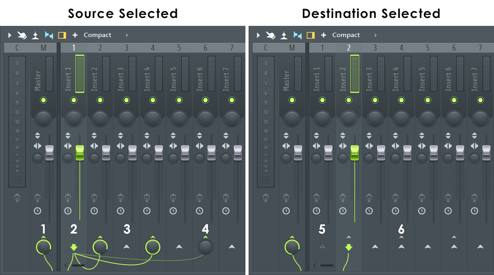
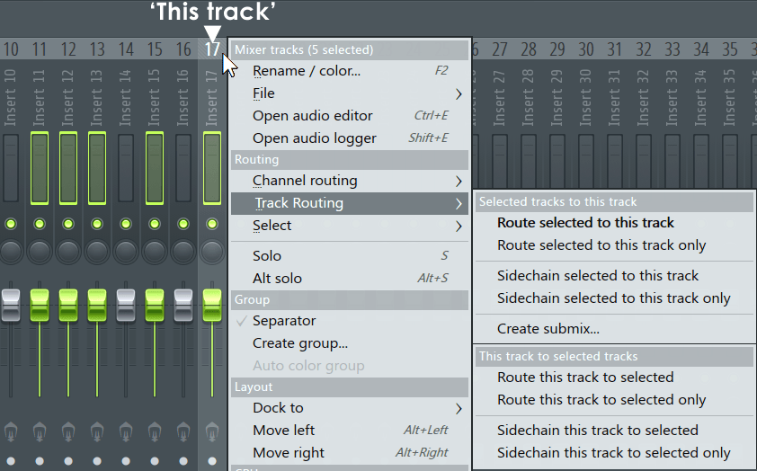

# The Mixer

How FL Studio's Mixer works, from the manual (`mixer.htm`, `mixer_trackprops.htm`, `mixer_mixermenu.htm`,
`mixer_levelsandmixing.htm`, `basics_shortcuts.htm`), Image-Line's FL Studio 2025 release notes, and Théo.
See [README.md](README.md) for the sources and for what holds everywhere (knobs, menus, windows, the left
button does and the right button undoes).

The last sections are ours: [where Vaudio differs](#where-vaudio-differs) and
[what to decide before building](#to-decide-with-théo).

## What it is

- **All audio passes through the Mixer.** Every channel of the rack is routed to a **mixer track** by
  number. A new channel goes to the **Master** unless told otherwise.
- **Tracks**: the **Master** (M), the **insert tracks** (1, 2, 3…) and a utility **Current** track (C:
  it receives whichever track is selected, for Edison and Wave Candy; we don't need it).
- **How many**: since FL Studio 2025, tracks are *dynamic*: added and deleted as needed, up to 500 (it
  was a fixed 125 before). The default templates have **16** (Image-Line's release notes and forum).
  "Trim unused tracks" deletes the ones nothing uses.
- **Mixer tracks aren't playlist tracks.** The playlist sequences clips; the routing to the mixer is the
  channel's. (FL has since added optional "instrument tracks" and "audio tracks" that tie a playlist track
  to a channel and a mixer track; the plain model is the one above.)
- A window like every other (**F9**), resizable; its layout and the controls shown depend on its size.

## Anatomy



Left to right: the **Master** track, then the insert tracks, then (on the right side of the window) the
**track inspector**, which shows the **selected** track's input, effect slots, EQ, delay compensation and
output. Only one track's inspector shows at a time.

**Across the top**: the Mixer menu (arrow), multi-touch, meter/waveform view (Alt+W), extra track
properties, show/hide the track inspector, **+** (add a track after the selected one; right-click: add
one, add several, add from a saved state), the layout menu (8 views, Compact to Extra large).

**Docks**: three: left, middle (which scrolls) and right, split by dividers. Organisation only; tracks
behave the same in any dock. The mouse wheel over the names scrolls the middle one.

**Each track, top to bottom**:

| Control | What it does |
| --- | --- |
| Number and icon | The track's number; an icon of its choosing |
| **Name** | Vertical label ("Insert 3" until renamed). Middle-click or F2 renames (and colours); a channel routed with auto-assign names it |
| **Peak meter** | Stereo, in dB. Turns orange over 0 dB. Only the Master (or a track sent straight to a device output) can really clip: the rest is 32-bit float and "can safely ignore peaks over 0 dB" |
| **Mute** (green LED) | See [mute and solo](#mute-and-solo) |
| **Pan** (knob) | See [pan](#pan) |
| **Fader** | The track's level, *after* its effects. Grey, **green when selected**, orange when armed for recording. Clicking above or below the handle glides it there |
| Invert phase, swap L/R | Two switches |
| **Stereo separation** | A knob, off in the middle: right narrows to mono, left widens |
| **FX master switch** | Left-click: every effect of the track on or off. Right-click: open or close all their windows. Dark when the track has none |
| **Track delay** (clock) | The track's delay, for delay compensation: grey (none), orange (automatic), blue (set by hand) |
| Record arm | Arms the track for recording (left), with file naming (right) |
| **Send switch** / **send knob** | See [routing](#routing-between-tracks): an up-arrow on a track the selected track can send to, a knob where it does |

Selecting: left-click a track's **pan or fader** selects it; **Ctrl+Shift** + click or drag over the
names and meters selects several, and moving one fader then moves them all. The selected track is the
one the inspector shows and the one sends are made *from*.

## A track, as sound goes through it

```
channels routed here ─┐
sends from tracks ────┼─► effect slots 1..10 ─► EQ (3 bands) ─► level and pan ─► mute ─┬─► the Master
external input ───────┘   (each: on, mix)       (+ phase, stereo sep)                   ├─► sends to other tracks
                                                                                         └─► a device output
```

- The order is the manual's: effects first, then the built-in "integrated effects" (the EQ, phase,
  stereo separation, volume and pan). The recording pickup points confirm it: after the effects (FX),
  after the EQ (EQ), after level and pan (LVL), after mute (POST).
- **Sends are post-fader**: a track sends what comes out of its fader. (Pre-fader needs FL's Fruity
  Send plugin in the first slot.)
- Every insert sends to the **Master** by default (its send switch lit); that send can be turned off, as
  any other can.

## Effect slots



- **10 per track**, in the inspector. More than 10: send to another track, or use Patcher.
- **Load an effect**: left-click the arrow at the left of a slot → Select (the plugin list); right-click
  the arrow opens the Plugin Picker.
- **Open it**: left-click its name. Empty slots read "Slot 3" in grey italics.
- **Reorder**: the mouse wheel over a slot moves it up or down (or Move up / down in its menu).
- **On / off**: the green LED at the right of each slot; same clicks as a track's mute.
- **Mix**: the knob beside it, the effect's wet/dry mix (100% by default).
- **Its menu** (the arrow): Replace (a plugin from the list), Delete (empty the slot), Patcherize,
  presets (browse, save as), spare state, link parameters, threaded processing, **smart disable** (stop
  processing it while it's silent), Move up / down, View editor, Rename / colour / icon, Help. An empty
  slot's menu only lists plugins.
- An effect's window is the same plugin wrapper as an instrument's ([plugin-window.md](plugin-window.md)).

## The track inspector (Ctrl+Enter)



Top to bottom: the **audio input** (a device input, for recording; the pickup point beside it), the
input's latency, the **10 effect slots**, the **EQ**, the track's **delay compensation**, the **audio
output** (a device output; the Master's must be set or nothing is heard).

**The EQ**: three fixed bands, **low shelf, peaking, high shelf**, drawn as a curve with a fader per band
(gain) and two rows of knobs (frequency, bandwidth). On the curve: left-drag moves a band's frequency
(sideways) and gain (up and down); right-drag its bandwidth and gain. It runs after the effect slots.

## Mute and solo

On a track's green LED (and, the same way, an effect slot's):

| Click | Does |
| --- | --- |
| Left-click | Mute / unmute |
| Ctrl+click, or Alt+click | Solo / unsolo |
| Ctrl+right-click | Unmute all |
| Shift+click | Lock its state (solo leaves it alone) |
| Alt+click | Solo it **and every track routed to and from it** (the menu's "Alt solo", Alt+S) |
| S (key) | Solo the selected track |

The manual contradicts itself on the right-click: one line says it solos, another that it opens a menu
with Solo **(unverified: ask Théo)**. "Restore previous state after solo" (a general setting) brings back
the mutes as they were when a solo is undone.

## Pan

- The Mixer's pan **mixes one side into the other**: fully right is the mono sum of both sides on the
  right, not just the left side turned down. For plain left/right levels FL points to Stereo Shaper.
- By default the **circular pan law**: the centre is 3 dB down on hard left/right, so a sound doesn't get
  louder as it's panned.
- That's the Mixer's pan. A channel's pan in the rack is its own control, before the Mixer.

## Levels

- The fader's 0 dB is near its top, with headroom above (**unverified: FL's fader goes to about
  +5.6 dB, default 0 dB**).
- Sampler channels load at 55% volume (about −5.2 dB) and respond to velocity (default 100 of 127), so a
  sample in the rack plays quieter than the same file as an audio clip (0 dB). Third-party instrument
  plugins get −6 dB of compensation.
- Everything inside is 32-bit float: only the Master, or a track sent to a device output, can clip.

## Routing channels to tracks



- **The rack's track selector** (Alt+M shows it): an LCD in front of each channel's button; drag it up
  or down. "---" is the Master. The same control is **TRACK** in the channel's window.
- **Auto-assign**: click the TRACK label: the channel goes to the first free track, which takes its name.
- **From the Mixer**: select channels in the rack, then on a mixer track **Ctrl+L** (route them to this
  track) or **Ctrl+Shift+L** (route them to this track and the ones after it, one each).
- Dropping an instrument from the plugin list onto a mixer track makes the channel and routes it there
  (naming the track).
- **Alt+L** selects, in the rack, the channels routed to the selected track.

## Routing between tracks



The row at the foot of the Mixer shows the **selected** track's routing:

1. **Destination tracks**: a **send knob** (the level it receives) on each track the selected one sends
   to, with a cable to it (the Master's drops off the bottom).
2. **The selected track**: a green down-arrow; it's the source.
3. **Available sends**: an up-arrow on every other track. **Click it to send there.** The arrow becomes
   a knob.
4. **Sidechain-only sends**: a greyed cable, the knob at zero.
5. **Tracks that already feed the selected one** are greyed out and can't be clicked: **FL won't make a
   loop**.
6. A small up-arrow above a switch: another track sends there already.

- **Remove a send**: click the switch above its knob. Turning the knob to 0 keeps the link but silences
  it: that's a **sidechain** send, heard only by a plugin with a sidechain input on the destination
  (a compressor ducking to the kick). Right-click the switch → "Sidechain only to this track". An audio
  send is always a sidechain send too.
- **Several at once** (the track's right-click menu → Track routing):

  

  - *Selected tracks to this track*: Route selected to this track, … **only** (their Master send turned
    off), Sidechain selected to this track (… only), **Create submix…** (the selected tracks go to this
    one, which goes to the Master).
  - *This track to selected tracks*: Route this track to selected (… only), Sidechain (… only).
- "Route cables" (View menu) draws the cables.

## Delay compensation (PDC)

- Plugins that look ahead (a linear-phase EQ, a limiter) put their audio late. **Automatic PDC** (the
  Mixer menu, on by default in new projects) delays every other path to match, through the routing,
  sends and sidechains included, and for instruments as well as effects.
- A track with detected latency lights its clock orange; hovering shows the latency in the hint bar.
- **Manual PDC** on a track (its clock, or the inspector's menu: Reset, set in ms, samples or beats, Set
  from another track) is an offset on top of the automatic one: positive delays this track, negative
  delays every other one. Plugins that report their latency wrong get a per-plugin offset in the wrapper.
- A latent plugin on the **Master** needs no compensation: everything goes through it.
- Playing live gets that much later ("FL Studio will no longer respond instantly").

## Tracks: adding, moving, deleting

- **+** adds a track after the selected one (right-click: several). The new track is selected.
- **Move**: Alt+← / → (the shortcuts page and the menu's screenshot; the menu page's text says
  Shift+← / →), or Shift+wheel over the track. Its channels and routing go with it.
- The track's right-click menu: Rename / colour (F2), File (open or save the track's state: its
  settings and effects; drag that onto another track to copy the chain), open the audio editor, Channel
  routing (Ctrl+L, Ctrl+Shift+L), Track routing (above), Select (the channels routed to it, the tracks
  it's routed to, the tracks routed to it), Solo (S), Alt solo (Alt+S), Group (separators, named groups),
  Dock to, Move left / right, Delete, Insert, **Trim unused tracks** (untouched ones, or also ones with
  effects but no input), Reset to default, Reset routing.

## Shortcuts (the Mixer focused)

| Key | Does |
| --- | --- |
| F9 | Show / hide the Mixer (anywhere) |
| S | Solo the selected track |
| Alt+S | Solo it and every track routed to and from it |
| Ctrl+L | Route the rack's selected channels to the selected track |
| Ctrl+Shift+L | Route them to this track and the next ones, one each |
| Alt+L | Select the channels routed to the selected track |
| Alt+← / → | Move the selected track(s) |
| Alt+Delete | Delete the selected track(s) (ours) |
| Ctrl+A | Select every track |
| Ctrl+Shift+click | Select several tracks |
| Ctrl+Enter | Show / hide the track inspector |
| F2 | Rename the selected track |
| Alt+W | Meters as waveforms |
| Ctrl+Shift+S | Save the track's state |
| Alt+R | Render the armed tracks to WAV |

Most controls (faders, pans, send levels, effect mixes) are automatable: right-click → Create automation
clip, Link to controller, Edit events, as everywhere.

## What we'll leave out

The Current track, docks, external inputs and outputs (until recording, step 6 of
[../music-suite.md](../music-suite.md)), recording pickup points, surround, Patcher, Edison, multi-touch,
the waveform meters, spare states, the eight layout sizes.

## Where Vaudio differs

The song has a mixer (`shared/music/mixer.ts`: tracks, routing, sends, effect slots, solo, all tested),
`compileSong` turns it into tracks in an order with their gains, the engine plays through it
(`Sequencer::mixTracks`) and meters it, and the Mixer window shows it (`src/suites/music/mixer/`, tested
in `e2e/music.spec.ts`). What the window does as FL Studio does: F9 and the toolbar's button; the master
on the left, the inserts scrolling beside it, the selected track's inspector on the right (Théo); a click
on a strip selects it, Ctrl+Shift+click adds, and the selected faders move together; the mute light (a
right-click solos, Théo; so do Ctrl and Alt with a click); pan; the fader (Ctrl for fine, Alt+click
resets, its menu types a level in dB); the send row (the selected track's down-arrow, a knob where it
sends with the switch above it to remove the send, an arrow where it could, greyed where a send would
make a loop; its menu routes only there or sidechains); the track menu (rename, channel routing, track
routing, select its channels, solo, Alt solo, move, insert, delete); a double-click or F2 renames; +
adds a track after the selected one; S, Alt+S, Ctrl+L, Ctrl+Shift+L, Alt+L, ← / →, Alt+← / →, Ctrl+A;
the rack's track selectors (Alt+M), its Ctrl+L (free tracks named after the channels) and TRACK in a
channel's window (a click on the word routes to a free track). The effect slots: choose, replace,
delete, move (by menu or the wheel), mix, on; the effect's name opens its own window (the engine's,
as an instrument's), and the engine runs the effects on the track before its fader. Bypassed, an effect
isn't run at all (FL does the same: its slot's mute).

Delay compensation is automatic, as FL's is by default (always on: no Mixer menu switch), through
instruments, effects, sends and chains; the manual offset is in ms (FL's also takes samples and beats,
and "Set from" another track). The inspector shows the track's plugin delay; the strip, a clock.

Each strip also has FL's invert phase and swap sides switches and stereo separation knob (folded into
the track's gains by `compileSong`); a colour from the track's menu tints its number; cables are drawn
from the selected track to where it sends (faint for a sidechain); Copy / Paste track state carries a
track's effects (their plugins' settings copied too) and its controls to another. Only the strips in
view are drawn, so 500 tracks open as fast as 16.

Théo's first pass (2026-09-30), all built:

- Changing a channel's insert number (drag, type, TRACK) selects that track in the mixer; selecting
  the channel alone doesn't.
- Naming: Ctrl+Shift+L and the free-track routes name an unnamed insert after its channel; routing
  several channels to one insert (Ctrl+L) names nothing; an insert already named keeps its name.
- With several tracks selected, a right-click keeps the selection, and Colour and Rename apply to them
  all (the same name, no numbering).
- A drag across the strips moves the selection one track at a time; Cmd+drag adds each one passed.
- The mixer opens filling the desktop; the meters share the strip's height with the faders, in FL's
  colours (green, amber, red: the theme's `--meter-*`); a selection meter ("SEL", at the left) is the
  selected tracks' sound added up, measured by the engine.
- A coloured track is coloured all the way down. Cables hang below the strips (only their ends show)
  and swing when plugged in.
- Effect slots: a click anywhere on an empty one opens the plugins; a loaded one's name opens its
  window; the arrow and a right-click give its menu; drag to reorder (it swaps with what's there).
  Dragged onto another track's strip, an effect moves there (its first empty slot), its plugin, settings
  and automation with it, and the inspector follows it; with ⌘ (Ctrl) a copy goes there instead, onto a slot of its own track too (Théo,
  2026-10-02; `effectToTrack`, `move_mixer_effect`).
- Copy track state can be dragged from the menu onto another track. Track state is FL's: effects and
  controls, not routing.
- The plugin picker (the slots and the rack's +): a big popover, a focused search, groups by the
  category the plugin reports, pins (this computer's) in a Pinned group and their own, arrow keys.
  It lists only ours (built in) and the plugins **starred** in the **Plugin manager** (FL's Options →
  Manage plugins, whose stars are its favourites): its More plugins… opens the manager, every plugin
  found with a star on each (Théo, 2026-10-02: macOS's dozens of Audio Units are in the way otherwise).
- Views: Compact, Wide, Extra large (effects listed under each strip).

Théo's second pass (2026-10-01), all built: the plugin picker in newspaper columns (a group runs on
into the next column; one line a plugin); an idle meter grey; a + after the last track; every knob
FL's (a lit cap in a well, the value an orange arc; bigger in the mixer); FL's metal fader caps (green
when selected) over a groove with faint dB lines; the mixer in FL's colours (mid-tone strips darker at
the top, tracks tinted all the way down under a header of their colour, green lights and cables, FL's
muted track colours), all `--knob-*`, `--fader-*` and `--mixer-*` theme tokens, in light and dark;
docks (left, middle, right; the master always left); Separator before, and named groups (a band across
their tops, dividers at their edges).

Théo's third pass (2026-10-01), all built: FL's layout and shading but **our colours**: the accent (not
FL's green or orange) for lights, the selected fader, cables and knob arcs (`--knob-arc`, configurable),
theme surfaces for the strips, and only the track colours made richer (a tint all the way down). The strip
is shaded as FL's, softly: darker from its top to the pan knob, a wider dark slot behind the fader. The
controls drawn closer to FL's pictures: narrow, tall metal fader caps; knobs with an unlit ring round the
whole sweep (so one at zero still has its outline), bigger in the mixer; lights as a lens in a bezel,
unlit a dark tint of the accent. The fader hangs at 0 dB for a few pixels on the way past (Shift: not).
Alt+Delete deletes the selected tracks. No focus outlines on the music editor's controls. Cables follow
the strips as they scroll, however fast. The plugin picker is only as big as its plugins need. A muted
track's strip is faded and greyed. The selected-track meter is wider, with FL's dB scale (3, 0, 3 … 51;
every 6 or 12 dB on a short mixer).

Théo's fourth pass (2026-10-02): the mixer made as nice to use as the other DAWs' (Logic, Pro Tools,
Ableton, Reaper, Studio One, Bitwig), all built, a commit each:

- **Solo** follows the routing and is a state of its own (below, in the choices). Each strip has an S
  (outlined when a soloed track's path keeps it on; a lock when it's solo safe); a strip whose sound is
  cut off further down (a muted bus) is faded a little, its hint saying why. The title bar's **SOLO**
  blinks while anything is soloed and clears every solo; **MONO** and **DIM** are the master's
  listening switches (the tab's, sent with the song, never exported).
- **Multi-select**: a selected strip's controls (mute, S, pan, stereo, phase, swap, fader, send knob)
  act on every selected track; on a strip that isn't selected, on it alone. Faders keep their offsets
  in dB (-3 and -10 pulled down 2 dB: -5 and -12). Shift+click selects a range, Escape (or a press on
  the empty space) keeps only the current track, a group's band selects its tracks. A mute light or S
  dragged across the strips paints them.
- **Routing**: the send row is every selected track's (a switch half lit where only some send; a cable
  from each); ⌘G routes the selection to a new bus right after it (named at once; it goes where they
  all went); an output label on each strip ("→ 12", red for nowhere) routes it from its menu; a selected
  bus shows what feeds it (dashed cables in); a selected track's down-arrow drags onto a strip to route
  there (⌘: a send besides); strips drag by their numbers to reorder; Route to the master only; a
  send's menu makes it **pre-fader** (the engine keeps the sound before the gains for it).
- **Groups**: Link the group's controls (Pro Tools' mix groups: one moved moves all), a **VCA fader**
  (a strip after the master scaling the group's levels, each keeping its own fader and automation);
  a bus **folds** away the tracks going into it (its chip says how many).

Not yet: a key to act on one strip of a selection alone; the VCA fader and the listening switches aren't
automatable.

**Sidechains** (`docs/sidechain.md`): an effect slot's key is its own (`MixerEffect.sidechain`), chosen in the
slot's menu (Sidechain input ▸), Pro-C's External or a strip's Sidechain to ▸, taken before the source's
effects, after them (the default) or after its fader; no 0% send is needed (FL's still work). A key badge marks
the slot, a dotted cable joins the tracks, and solo never stops one.

Not yet, or different: icons, the Current track, the track EQ (put off), "Compensate automations"
(automation is applied as the song plays, not shifted for plugin delay), recording, the slot's presets and Patcher, the
"glide" when the groove is clicked (the handle goes there at once). Choices made, to check with Théo:

- **The fader** is cubed: 0.8 of its travel is 0 dB, the top about +5.8 dB (FL's own curve is unverified).
- **The pan** moves each side as a mono sound under the circular law: the centre leaves the sound alone,
  fully to one side is both sides summed there.
- **Solo** isn't FL's (Théo's friends found FL's the worst of it; 2026-10-02). It's a state of its own
  (`MixerTrack.solo`, `shared/music/solo.ts`), so the mutes are never rewritten and clearing the solos
  brings back exactly what was heard, and it **follows the routing**, as Reaper, Logic, Studio One and
  Ableton's group tracks do: a soloed track keeps on every bus its sound goes through to the master, a
  soloed bus every track feeding it; the rest is silenced (`heardMixer`, what `compileSong` plays),
  except the master and **solo safe** tracks (a reverb return). Each strip has an **S** beside its mute
  light: a click adds to the solo (or takes out), Alt / ⌘ solos alone, Shift makes it solo safe (a
  lock). The mute light's right-click and Ctrl / Alt+click solo alone, FL's habit; S and Alt+S the same
  on the keys. A sidechain (a send at 0) is no way for the sound. A track the solo silences still feeds
  its keys (after its effects as always; after its fader through the gains it would have), so a ducked
  bass still ducks.
- **Removing a track** sends its channels to the master, and a track left sending nowhere because of it
  goes to the master too.

The rest of the table is still to build.

| What | FL Studio | Vaudio (planned) |
| --- | --- | --- |
| Tracks | Dynamic, 16 in a new project, up to 500 | The same: a list in the song, 16 to start, **+** adds one |
| Routing a channel | The rack's LCD (Alt+M), TRACK, auto-assign, Ctrl+L | All of these; the LCD is `Lcd` |
| Signal order | Effects, EQ, level and pan, mute, sends (post-fader) | The same |
| Effect slots | 10, with on/off and mix, reordered by the wheel | The same; VST3 and AU effects, states in `plugins/<slot id>.bin` like instruments' |
| The track EQ | Three fixed bands in the inspector | The same; a stock EQ plugin with more bands can come later |
| Sends | Post-fader, a knob per send, loops refused, sidechain at 0 | The same; loops refused by the edit (`edits.ts`), so the engine never sees one. Sidechains are the effect's own key, no send needed (`docs/sidechain.md`) |
| Pan | Folds one side into the other, circular law | The same for the Mixer; the channels' pan stays as it is |
| PDC | Automatic, per path, plus manual offsets | Report latency first; automatic compensation soon after |
| Meters | Peak, per track, orange over 0 dB | The same, from `EngineStatus` |
| Processing | Multi-threaded | One thread to start with |
| Smart disable | Per plugin, off by default | Effects always run (tails ring after stop) |
| Look | FL's artwork | Its layout, in our look (`docs/ui-redesign.md`) |

## To decide with Théo

- **The inspector**: FL shows the selected track's slots and EQ on the right of the Mixer. Keep that, or
  (FL's Extra large layout) the effects under each track?
- **Mute LED right-click**: solo, or a menu? (The manual says both.)
- **Solo**: plain solo on Ctrl+click and S, and Alt-solo (with everything routed to and from) on
  Alt+click and Alt+S, as FL?
- **The fader's range**: FL's (0 dB near the top, about +5.6 dB at the top)?
- **What's in the first version**: tracks, routing channels, level, pan, mute and solo, meters and the
  effect slots; then sends, then the EQ, then PDC. Or does something move up (sends for a reverb bus,
  say)?
