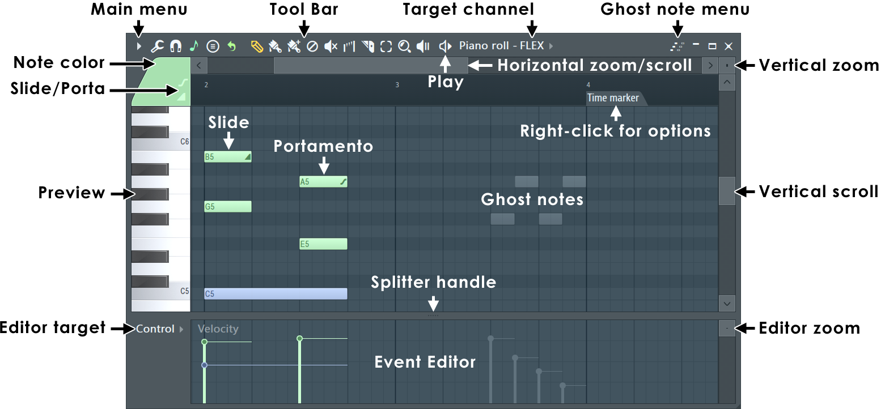
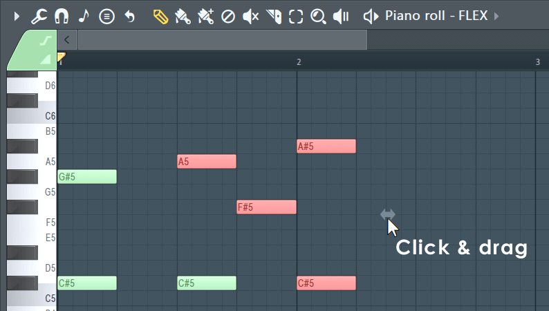
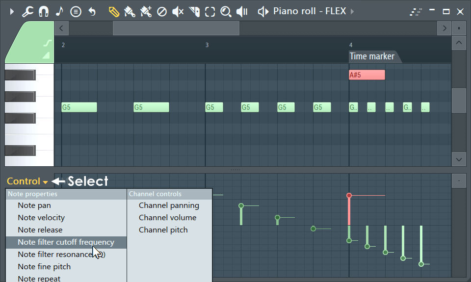
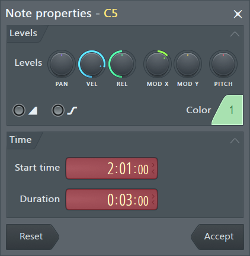
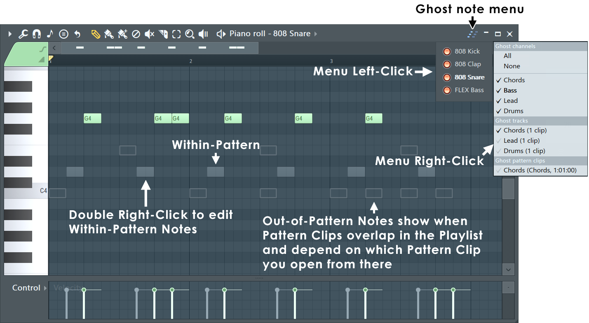

# The Piano roll

How FL Studio's Piano roll works, from the manual (`pianoroll.htm`, `pianoroll_menu.htm`,
`basics_shortcuts.htm`) and from Théo. See [README.md](README.md) for the sources and for what holds
everywhere (knobs, menus, windows, the left button does and the right button undoes).

The last sections are ours: [where Vaudio differs](#where-vaudio-differs) and what was decided.

## Anatomy

A window (F7), showing **one channel's notes in the current pattern**.

- **Title bar**, left to right: the menu arrow; Tools (wrench); Snap (magnet); Snap to scale (note);
  Stamp (chords); then the tools (Draw, Paint, Paint drums, Delete, Mute, Slice, Select, Zoom,
  Playback); Play; **"Piano roll - *channel*"**, which is the **target channel** selector (a menu of the
  channels, those with notes in this pattern ticked; the mouse wheel over it steps through them); the
  ghost note menu; minimise, maximise, close.
- **Top-left corner**: the note colour (16 colour groups, which are also MIDI channels) and the
  Slide / Portamento switches.
- **Ruler** along the top: bar numbers, time markers, and the **time selection** (in red).
- **Horizontal scrollbar** above the ruler: drag it to scroll, drag its ends to zoom.
- **Preview keyboard** down the left, C5 marked: click a key to hear it.
- **Grid**: pitch up the side, time along the top. Rows of black keys are shaded darker. Vertical lines
  at bars (strong), beats, and the snap's divisions.
- **Notes**: bars labelled with their pitch ("G5"), in their colour. Selected notes are red.
- **Ghost notes**: the other channels' notes in this pattern, grey and see-through.
- **Splitter**, then the **event editor** underneath: a value per note (velocity by default), drawn as a
  vertical line with a circle on top and a tail to the right as long as the note.
- **Vertical scrollbar** on the right, with a vertical zoom box above it.

## Tools

One is active at a time. Each has a key. Whatever the tool, **right-click deletes a note** and
**Ctrl makes a selection** instead.

| Tool | Key | Left button | Right button | Modifiers |
| --- | --- | --- | --- | --- |
| **Draw** (pencil) | P | Click adds a note; keep holding to move it before letting go. On a note: move it, or resize it by its right edge | Delete; drag to delete several | Shift: add and drag out its length. Alt: no snap. Ctrl: select |
| **Paint** (brush) | B | Click adds a note; drag adds a run of notes, one after another, replacing what they overlap | Delete | Shift: can move up and down while painting. Ctrl: select |
| Paint, drum mode | N | As Paint; clicking a note mutes / unmutes it; snap sets the note length | Delete; drag to delete several | Alt: half the snap. Ctrl: select |
| **Delete** | D | Click or drag to delete | | Ctrl: select (then Del) |
| **Mute** | T | Click or drag to mute notes (they stay, greyed, and don't play) | Delete | Ctrl: select |
| **Slice** | C | Drag a line across notes: each is cut where the line crosses it | | Shift: slice without dragging. Ctrl: select |
| **Select** | E | Click a note, or drag a rectangle | | Shift: add to / take from the selection |
| **Zoom** | Z | Drag a rectangle to zoom to it; click the background to zoom out | Toggle zoomed / not | |
| **Playback** (scrub) | Y | Click notes to hear them; drag to scrub | | Ctrl: select |

- **A new note is as long as the last note touched** (added, resized or clicked). Right-clicking the
  Snap icon sets that default length outright.
- A new note plays as it's added, and a moved note as it lands on each pitch (unless the song is playing
  and "Preview notes during playback" is off).
- Slide (S) and Portamento (O) make the notes added slide notes or portamento notes. They only work with
  FL Studio's own instruments, not VSTs.

## Notes: moving, resizing, copying

- **Move**: drag a note (or any note of the selection) up, down, left, right.
  - After starting to drag, **Shift keeps the pitch** (moves in time only) and **Ctrl keeps the time**
    (moves in pitch only).
- **Resize**: drag a note's right edge (the pointer becomes a double arrow). Resizing one of a selection
  resizes them all. The left edge only when "Allow resizing from left" is on (it's off by default).
- **Clone**: hold **Shift and drag** a note or the selection: the original stays, a copy moves.
- **Alt** while dragging bypasses snap.
- **Stretch**: a selection shows a handle at its right; dragging it stretches the notes' positions and
  lengths together. 
- **Double-click a note**: its properties dialog (below).
- **Glue** (Ctrl+G): join selected notes that touch into one. **Chop** (Ctrl+U): cut long notes into
  snap-sized ones. **Discard lengths** (Shift+D): make them as short as the snap allows.
- Edit commands work on **the selection, or on every note if nothing is selected**.

## Selecting

- **Ctrl+click** a note, or **Ctrl+drag** a rectangle. (Or the Select tool, without Ctrl.)
- **Ctrl+Shift** adds to, or takes from, the selection.
- **Ctrl+click empty space** deselects, as does Ctrl+D. **Ctrl+A** selects all; **Shift+I** inverts.
- **Ctrl+click a key** of the preview keyboard selects every note of that pitch; dragging down the keys
  selects a range of pitches.
- Selected notes are drawn red.

### The time selection (the red range on the ruler)

This is the "select in red and only that plays" feature.

- **Double-click the ruler and drag** (or Ctrl+drag along it) to select a range of time. It's drawn red
  on the ruler, and the notes inside it are selected.
- **While there's a time selection, playback loops it**: play starts at its start and goes round it.
  (The manual, of the playlist: "Timeline selections will play in loop mode".)
- **Ctrl+Enter** sets the time selection to span the selected notes. **Ctrl+← / →** moves it left or
  right by its own length.
- Ctrl+D (or a Ctrl+click on empty space) clears it.
- **Shift+5** zooms to it.
- **Insert space** (Ctrl+Ins) pushes everything after the selection later by its length; **Delete
  space** (Ctrl+Del) removes what's in it and closes the gap.
- Without a time selection, **a click on the ruler puts the playhead there**, and play starts from it.
  (Théo)

### Duplicate (Ctrl+B)

- Copies the selected notes (or all of them, if none are selected) and puts the copy **straight after
  the original**: that's how a bar is repeated to fill the next one.
- With a **time selection**, the copy goes one *selection length* later instead, so a one-bar selection
  repeats a phrase a bar later even if its notes don't fill the bar. The time selection and the note
  selection are independent: the notes say what's copied, the time selection says how far.
- The copy becomes the selection and the time selection moves with it, so pressing Ctrl+B again adds
  another repeat. (Théo)
- Without a time selection, the distance is the bars the notes span: from the start of the first note's
  bar to the end of the last note's, rounded up to a bar. (Théo)

## Snap

The magnet's menu. It decides where notes land when added, moved, resized and sliced, and how far the
arrow keys nudge.

- **Main**: follow the toolbar's global snap.
- **Line**: snap to the nearest grid line; the grid gets finer as you zoom in. The default.
- **Cell**: snap to the start of the cell the pointer is in.
- **(none)**: only limited by the tick resolution (PPQ).
- **1/6, 1/4, 1/3, 1/2 step; step**: fixed fractions of a step (a sixteenth note).
- **1/6, 1/4, 1/3, 1/2 beat; beat; bar**.
- Events, Markers: snap to other notes' edges, or to time markers.
- **Alt** bypasses snap while held. **Backspace** toggles the global snap between Line and none.

## The event editor (note properties)

- The lane under the grid shows one property of every note: a vertical line, a circle at its value, and
  a tail as long as the note.
- **"Control"** at its left chooses which: **Note pan, velocity, release, filter cutoff (Mod X), filter
  resonance (Mod Y), fine pitch, repeat**; or a channel control's automation (channel panning, volume,
  pitch). **Shift+F** (or the mouse wheel over it) cycles through them.
- **Drag** across the lane to draw values. With notes selected, only those change (that's how you set
  one note of a chord).
- **Shift+drag**: set every note dragged across to the same value. **Alt+click**: reset.
- **Alt+mouse wheel** over a note in the grid changes that property of it (Ctrl as well: finer).
- The splitter between grid and lane drags; right-click it to put it back. Shift+Enter hides the lane.

### Note properties dialog

Double-click a note. PAN, VEL, REL, MOD X, MOD Y, PITCH (fine) knobs; slide and portamento switches; its
colour group; its **start time and duration as bar : step : tick**; Reset and Accept. If the note is
part of a selection, it sets them all (and the time fields are hidden).

## Ghost notes

- **Alt+V** shows or hides the notes of the pattern's other channels, grey, behind this channel's.
- **Double right-click** a ghost note to switch the Piano roll to its channel.
- "Editable ghosts" (Ctrl+Alt+V) lets them be edited in place.
- (Notes from other patterns overlapping in the playlist show as hollow ghosts: a playlist matter.)

## Zoom and scroll

- **Scroll**: the scrollbars; the mouse wheel scrolls up and down. **Middle-button drag** (or
  Shift+right-button drag) pans both ways.
- **Horizontal zoom**: drag an end of the horizontal scrollbar; **Ctrl+mouse wheel**; **Page Up / Page
  Down** (centred on the pointer); **Shift+1, 2, 3** are three preset levels, **Shift+4** shows
  everything, **Shift+5** zooms to the time selection. Ctrl+right-drag zooms to a rectangle.
- **Vertical zoom**: the small box above the vertical scrollbar, dragged up and down; or middle-button
  drag on the keyboard.
- **Shift+0** centres the view on the playhead.

## With the Channel Rack

- A channel whose notes aren't plain steps shows a **miniature of its notes** in its rack row instead of
  step buttons; clicking that opens the Piano roll on it.
- A channel's right-click menu has **Piano roll**, which opens it on that channel.
- Steps are notes: a step is a note on the grid, as short as a step. Opening a stepped channel in the
  Piano roll shows them as such.
- **F7** shows or hides the Piano roll (on the selected channel).
- How Théo opens it: select the channel in the rack, then the Piano roll button on the toolbar; or the
  channel's right-click menu; or F7. In the Piano roll, the target channel menu lists the channels with
  notes in this pattern first, then the rest.

## Keys

Tools: **P** draw, **B** paint, **N** paint drums, **D** delete, **T** mute, **C** slice, **E** select,
**Z** zoom, **Y** playback. **S** slide, **O** portamento.

| Key | Does |
| --- | --- |
| Ctrl+A / Ctrl+D | Select all / deselect |
| Shift+I | Invert the selection |
| Ctrl+C / Ctrl+X / Ctrl+V | Copy / cut / paste (pasted from the leftmost bar in view) |
| **Ctrl+B** | **Duplicate the selection to the right** |
| Del | Delete the selection |
| Shift+← / → | Move the selection a snap unit left / right |
| Shift+↑ / ↓ | Transpose a semitone up / down |
| Ctrl+↑ / ↓ | Transpose an octave up / down |
| Alt+arrows | Nudge by a pixel (no snap) |
| Shift+Ctrl+← / → | Rotate left / right (wrapping round the bars) |
| Ctrl+← / → | Move the time selection left / right by its length |
| Ctrl+Enter | Time-select around the selected notes |
| Ctrl+Ins / Ctrl+Del | Insert / delete space the size of the time selection |
| Ctrl+G | Glue |
| Ctrl+U / Alt+U | Quick chop / Chop… |
| Ctrl+Q / Shift+Q / Alt+Q | Quick quantize / quantize start times / Quantize… |
| Ctrl+L / Alt+L | Quick legato / Articulate… |
| Shift+D | Discard lengths |
| Alt+M / Alt+Shift+M | Mute / unmute the selection |
| Shift+G / Alt+G | Group / ungroup notes |
| Alt+C | Give the selection the current colour |
| Shift+F (or F) | Next property in the event editor |
| Alt+V | Ghost notes on / off |
| G / K | The channel above / below |
| H / J | The channel above / below that has notes |
| Page Up / Page Down | Zoom in / out |
| Shift+1…3, Shift+4, Shift+5 | Zoom presets, show all, zoom to the time selection |
| Shift+0 | Centre on the playhead |
| Alt (held) | Bypass snap |
| Backspace | Global snap on / off |
| Shift+Enter | Show / hide the event editor |
| Ctrl+T | Typing keyboard plays notes (then letters aren't shortcuts) |
| Space | Play / stop |
| Esc | Close the window |

Mouse: double-click a note for its properties; Shift+drag clones; right-shift+click slices; Alt+wheel
changes the note's property; Ctrl+right-click zooms to the selection.

## The rest of the menu (mostly not for now)

- **Tools**: Riff machine, chord progression, Articulate, Quantize, Chop, Arpeggiate, Strum, Flam, Claw
  machine, Limit, Flip, Randomize, Scale levels, LFO, scripts.
- **Stamp**: chords and scales from a menu, placed with one click.
- **Snap to scale / scale highlighting**: a root and a scale; the grid shades the notes in it, and notes
  snap to it when moved.
- **Time markers**, time signatures and key markers on the ruler.
- **File**: open / save a score, import / export MIDI.
- **View**: grid colour and contrast, keyboard style and labels, rounded notes, note colour palettes,
  background waveform.
- **Groups** of notes that move as one; **colour groups** as MIDI channels.

---

## Where Vaudio differs

Built from this document (`src/suites/music/piano/`); every behaviour in the first part has a test in
`e2e/piano.spec.ts` or beside the code. Decided with Théo: quantize is in (he uses it all the time);
resizing from the left is out; the "modifier" tools (arpeggiate, randomize, strum...) wait.

**Same as FL Studio**: F7, the toolbar's Piano roll button and the rack menu open it; the target
channel menu (in-pattern first) and G / K, H / J; the Draw (P), Paint (B), Delete (D), Mute (T), Slice (C)
and Select (E) tools; left adds, right deletes (sweeping); Ctrl selects (Ctrl+Shift adds); moving,
resizing by the right edge, Shift+drag to clone, Shift / Ctrl to lock an axis once moving, Alt to bypass
snap; new notes as long as the last touched; the stretch handle; the snap menu (Line, Cell, none, step
and beat fractions, bar); the time selection (double-click or Ctrl+drag the ruler, red, loops playback,
Ctrl+Enter, Ctrl+← / →, a right-click clears it); a ruler click sets where play starts; Ctrl+B with the
copies selected and the time selection moving; Ctrl+A / D, Shift+I, Ctrl+C / X / V (pasted at the first
bar in view), Delete; Shift+arrows, Ctrl+↑ / ↓, Alt+arrows, Shift+Ctrl+← / →; Ctrl+G, Ctrl+U, Ctrl+Q,
Shift+Q, Ctrl+L, Shift+D, Alt+M / Alt+Shift+M; the event editor (velocity and pan; Shift+drag, Alt to
reset, Alt+wheel on a note; F / Shift+F); the note properties dialog; ghost notes (Alt+V, a double
right-click on one switches channel); zoom (Ctrl+wheel, Page Up / Down, Shift+1…5, Shift+0), scroll
(wheel, Shift+wheel, middle-drag); the keyboard sounds while held; a channel whose notes aren't steps
shows a miniature of them in the rack, which opens them.

| What | FL Studio | Vaudio now |
| --- | --- | --- |
| Backspace | Toggles the global snap | Deletes the selection too (a Mac keyboard has no Delete key) |
| Paint | Monophonic: replaces the notes it overlaps | Lays notes over what's there |
| Quantize | Also a dialog (Alt+Q) with strength and swing | Quick quantize only (Ctrl+Q, Shift+Q) |
| Event editor | Release, fine pitch, Mod X / Y, repeat, automation | Velocity and pan |
| Zoom tool, Playback tool | Z, Y | Not yet (Ctrl+wheel and the keys zoom) |
| Scrollbars | Drag their ends to zoom | Drag to scroll only |
| Snap | Main, Events, Markers | Not those three |
| Notes | Colour groups (MIDI channels), slide and portamento | None |
| Per-note pan | Sent to plugins as the note's pan | Heard on samplers; plugins ignore it for now |
| Time markers, time signatures per pattern, key markers | Yes | No |
| Scale highlighting, snap to scale, stamp | Yes | Later |
| Typing keyboard (Ctrl+T), MIDI keyboard, recording | Yes | Later |

Performance, measured in the browser (the grid is one canvas; only what's in view is drawn): with
4 000 notes a frame takes about 1 ms, dragging all of them too, Ctrl+B on all of them 44 ms; with
20 000 notes a frame is 2 to 3 ms, 40 ms with every note in view at once. A drag changes nothing in the
song until it's let go, so it's one undo step and nothing is saved or sent to the engine mid-drag.
