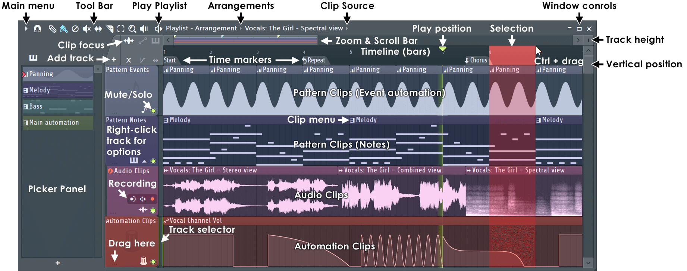
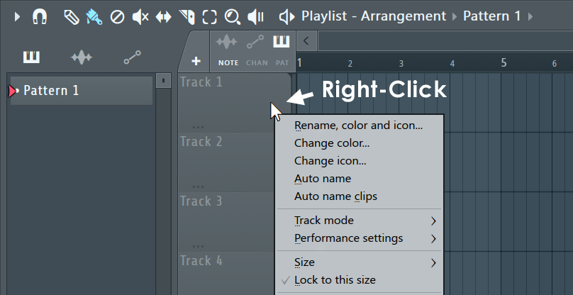
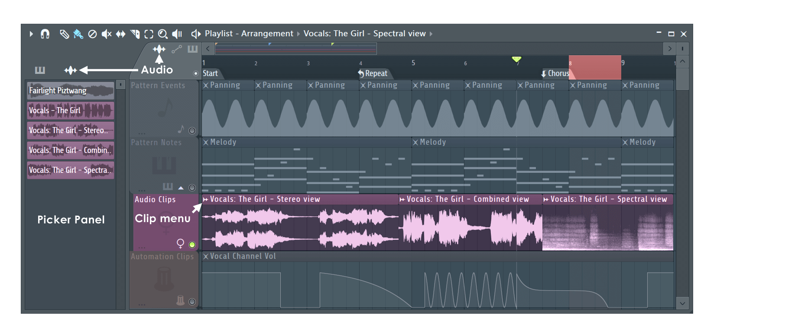
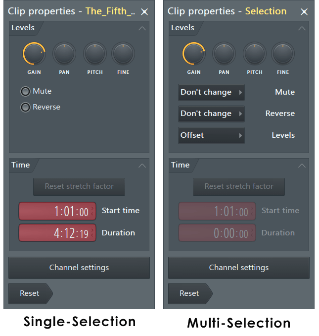
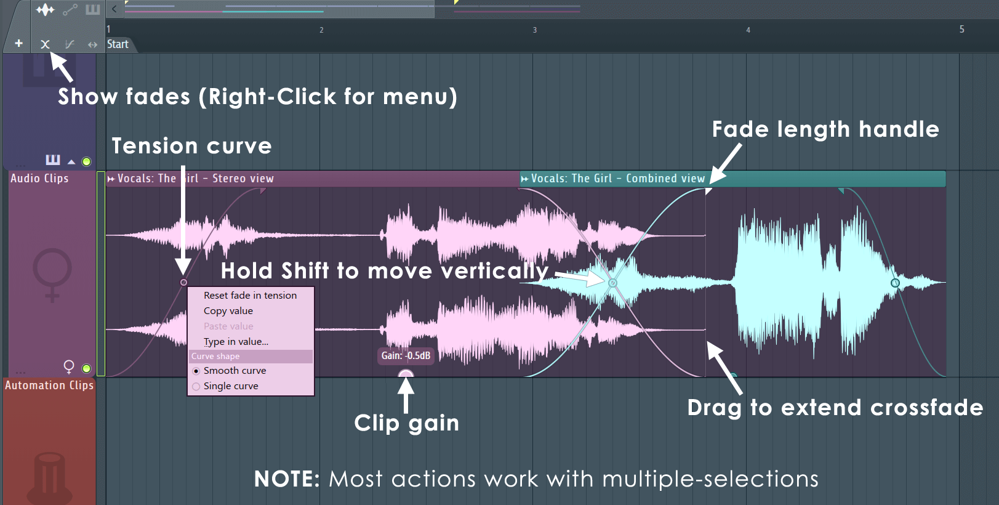
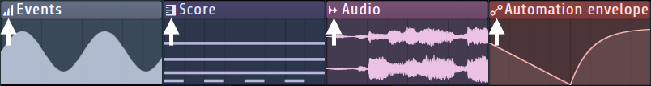
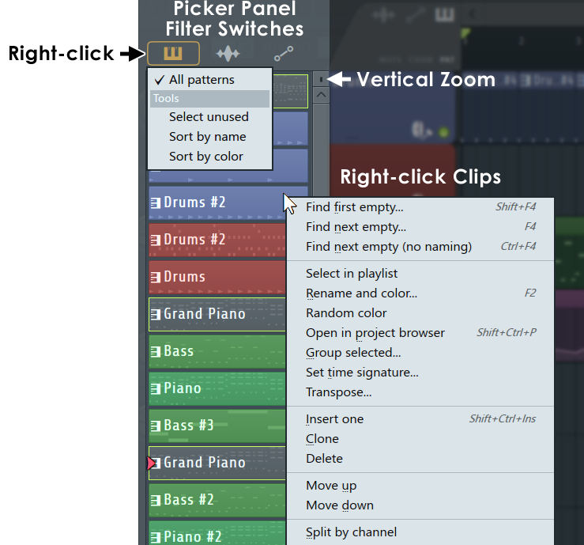

# The Playlist

How FL Studio's Playlist works, from the manual (`playlist.htm`, `playlist_patterns.htm`,
`playlist_audioclip.htm`, `playlist_automationclip.htm`, `menu_patterns.htm`, `toolbar_panels.htm`,
`songsettings_settings.htm`, `envsettings_audio.htm`, `basics_shortcuts.htm`) and Théo. See
[README.md](README.md) for the sources and for what holds everywhere (knobs, menus, windows, the left
button does and the right button undoes). Where neither the manual nor Théo says, it's marked
**(unverified)**.

The last sections are ours: [what we'll leave out](#what-well-leave-out),
[where Vaudio differs](#where-vaudio-differs), [what was decided](#decided-with-théo-2026-10-01) and
[how it's built](#how-its-built).

## What it is

The Playlist (F5) **arranges the song**. It's a window of **tracks** that **clips** are placed on. A clip
is one of three kinds:

| Clip | Holds | Looks like |
| --- | --- | --- |
| **Pattern clip** | A pattern: its notes for any of the channels (and its event automation) | A miniature of the pattern's notes, the pattern's name in its title bar |
| **Audio clip** | An audio file, played as it's placed | The file's waveform, its name in the title bar |
| **Automation clip** | A curve over time for one control (a knob, a fader, a plugin's parameter) | The curve |

When the playhead reaches a clip, FL does what the clip says: plays its notes, its audio, or moves its
control. The manual compares clips to notes in the Piano roll, and they're edited with the same tools.

The things that make it FL Studio:

- **Tracks aren't bound to anything.** Any clip goes on any track, and clips of every kind can share a
  track and even overlap (drawn see-through). A track has no instrument and no mixer track of its own.
- **Where a sound goes is decided by its channel**, not by the track it's on: a pattern clip's notes play
  on their channels, which play into their own mixer tracks. One pattern clip on one track can play every
  instrument of the rack.
- **Instances, not copies.** Every pattern clip of a pattern plays that same pattern: change the pattern
  and every clip of it changes. "Make unique" breaks one away (it clones the pattern).
- **Pattern mode and song mode** (the toolbar's PAT / SONG switch, L): PAT loops the current pattern
  (what Vaudio does today); SONG plays the Playlist from where play starts.
- **Track mode** (newer FL) can link a Playlist track to one instrument channel and one mixer track (an
  "Instrument track" or "Audio track"), for those who want a DAW's 1:1 layout. It's optional and off
  by default; the free model above is the FL way.

## Anatomy

- **Title bar**, left to right: the menu arrow; Snap (magnet); the tools (Draw, Paint, Delete, Mute,
  Slip, Slice, Select, Zoom, Playback); Play (plays the Playlist on its own); **"Playlist - Arrangement ›
  *clip source*"**: the arrangement's name (its menu: several arrangements of one song) and the **clip
  source**, the clip that Draw and Paint add (a menu of every pattern, audio and automation clip); then
  minimise, maximise, close.
- **Left**: the **Picker panel** (Alt+P), a list of every pattern, audio clip and automation clip of the
  project, with switches at its top to show each kind. Click one to make it the clip source, or drag it
  onto the tracks.
- **Clip focus** (above the track headers): three tabs, pattern, audio, automation. The focused kind is
  drawn on top of the others where they overlap and is the kind that's picked by a click. Each tab has its
  own options (audio: fades, stretch; pattern: clip colour from Note / Channel / Pattern). The **+** next
  to them adds an instrument or audio track (track mode).
- **The overview / scrollbar** along the top: a miniature of the whole song (FL's "Mini playlist
  preview") that scrolls the view; drag its ends to zoom.
- **The ruler** (the timeline, in bars): bar numbers, **time markers** under them ("Start", "Repeat",
  "Chorus"), the **play position marker** (a green triangle), and the **time selection** (red).
- **Track headers** down the left: each track's name ("Track 1"…), its colour as the header's background,
  a **mute light** at its bottom right (green when it plays), and a "…" grip. The divider under a header
  drags to change that track's height. 
- **The grid**: tracks across, time along the top. The background alternates by bar (FL's "Time segments:
  Bars"), with lines at bars, beats and the snap's divisions as you zoom in.
- **Clips**: a title bar (the clip menu's icon at its left, then the name) over the content. A clip's
  colour is its pattern's (or its channel's, or its notes', per the clip focus option).
- **Track height** control at the top right (all tracks), and a vertical scrollbar.
- There are **500 tracks**, all there from the start ("Track 1" to "Track 500"), empty until something's put
  on them. (unverified: the count; the manual only mentions "Insert one" and that the maximum exists.)

## Tools

One tool at a time, as in the Piano roll. Whatever the tool, **right-click deletes a clip** (and drags to
delete several), and **Ctrl selects** instead.

| Tool | Key | Left button | Right button | Modifiers |
| --- | --- | --- | --- | --- |
| **Draw** (pencil) | P | Click adds the clip source where it's clicked; keep holding to move it before letting go. On a clip: move it, or resize it by an edge | Delete; drag to delete several. Held on the background: slice (an option) | Shift: Paint. Ctrl: select. Alt: no snap |
| **Paint** (brush) | B | Click adds the clip source; drag paints copies of it one after another along the track | Delete; drag to delete several | Shift: copies the clip clicked. Ctrl: select. Alt: move a clip without snap |
| **Delete** | D | Click or drag to delete clips | | Shift: select (then Del) |
| **Mute** | T | Click or drag to mute clips (they stay, greyed, and don't play). Independent of the track's mute | Delete | Ctrl: select. Alt: move without snap |
| **Slip** | S | Drag a clip's content left or right inside the clip, its start and end staying where they are | | Shift+S: ripple edit (drag an edge: the content stays put at the other end) |
| **Slice** | C | Drag a line down through clips: each is cut where it crosses | | Shift: slice without dragging. Left-Shift: diagonal. Shift+Alt: no snap |
| **Select** | E | Click a clip, or drag a rectangle | | Shift: add to / take from the selection |
| **Zoom** | Z | Drag a rectangle to zoom to it | Toggle zoomed / not; its menu has the zoom presets | |
| **Playback** | Y | Click a clip to hear it from there; drag to scrub | | |

- **The clip source**: Draw and Paint add whatever's chosen as the clip source (the title bar's menu, the
  Picker panel, or a right-click on a clip focus tab). Clicking a clip with Draw also makes it the clip
  source, so the next click adds another of the same. (Théo)
- **Clicking a pattern clip makes its pattern the current one** (the rack and the Piano roll show it).
  (Théo)
- **Right-Shift+click** a clip slices it in any tool; Right-Shift+right-click slices and deletes the
  smaller part. **Insert** slices the clip under the pointer.
- **Double-click a pattern clip** opens it: in the Piano roll if it has notes, in the Channel rack if it's
  only steps (the "Edit patterns in: Automatic" default), scrolled to where it was clicked. **Alt**+double-
  click opens the other one. Double-click an audio clip: its channel's settings (Alt: the clip's own
  properties).
- **Double right-click** switches to the Mute tool.

## Clips: moving, resizing, copying

- **Move**: drag a clip (or any clip of the selection) left, right, and up and down between tracks. Snap
  applies to where its start lands. Alt while dragging: no snap.
- **Resize**: drag either edge of a clip, no key needed (Théo). (The manual has the left edge behind an
  option, "Allow resizing from the left", Ctrl+Alt+Home.) A resized or sliced clip is **a window onto its
  content**: what's outside it is still there, and dragging the edge out again brings it back.
- **Slip**: the Slip tool moves the content inside the window instead.
- **Clone**: Shift+drag a clip or the selection: the original stays, a copy moves (Shift+click a clip, in
  the shortcuts table).
- **Duplicate** (Ctrl+B): copies the selection (or every clip, if none is selected) straight after it.
  With a time selection, the copy goes one *time selection's length* later, and the time selection
  moves with it; the clips copied are still the selected ones. (Same as the Piano roll's Ctrl+B.)
- **Copy / paste**: Ctrl+C, Ctrl+V pastes at the left edge of the view (the first bar in view).
- **Shift+← / →** moves the selection by a snap unit; **Shift+↑ / ↓** moves it a track up or down (every
  clip, if none is selected).
- **Make unique** (the clip menu, or Shift+V+drag): the clip gets its own copy of its pattern (named
  "Pattern 1 #2"), so editing it changes only that clip.
- **Merge pattern clips** (Ctrl+G): the selected pattern clips become one clip of a new pattern holding
  all their notes.
- **Group** (Shift+G, Alt+G ungroups): grouped clips select and move together.
- **Chop** (the clip menu): cut a clip into bars or beats.
- **Quantize** (Ctrl+Q / Shift+Q): put the selected clips' starts on the snap's grid.
- **Shift+C**: select every clip of the same source.

### Pattern clips

- A pattern clip shows a **miniature of its pattern's notes** (every channel's, squeezed into the clip's
  height), and the pattern's name in its title bar. Its colour is the pattern's.
- **Its length** when it's added is the pattern's length (the Channel Rack's pattern length, or "Auto":
  to the end of the last bar with notes).
- **Lengthened past its pattern**, a clip shows more but **plays nothing there**: the pattern doesn't
  repeat (Théo).
- **Shortened or sliced**, a note that's cut by the clip's end stops there, and a note that starts before
  the clip's start (after a slice) plays from the clip's start: Project settings' **"Play truncated
  notes in clips"**, on in projects since FL 10.5. With it off, the second half of a sliced note is dropped.
- **When the pattern changes length**, clips that were as long as it follow it; a clip that's been resized
  keeps its length (Théo).
- **Split by channel** (the Patterns menu, also the Picker panel's pattern menu): makes one new pattern
  for each channel that has notes in the pattern, each named after its channel. This is what Théo means
  by "split by track": a whole beat built in one pattern, then pulled apart to arrange each part on its own
  track. **The pattern goes**: it's replaced by the new patterns, and each of its clips in the Playlist by
  the new patterns' clips, one per channel, on its track and the ones below (Théo). It's one undo step.

### Audio clips

- **An audio clip is a channel**: dropping an audio file on the Playlist (from the Browser or the
  Finder) makes an **audio clip channel** in the Channel rack (in its own "Audio" group) and puts a
  clip of it where it's dropped. Every clip of that channel plays the same file. Like any channel, it plays
  into a mixer track (the rack's track selector, or its settings' TRACK).
- An audio clip channel is a cut-down sampler: its settings have only the sample tab (precomputed effects,
  time stretching) and the misc tab, and it isn't played from the step sequencer or the Piano roll (it can
  be, but isn't meant to be).
- **A clip shows its file's waveform**, from where the clip's window starts in the file.
- **Dropped on a track header**, it also names the track after the file. **Shift** while dropping several
  files puts them one after another on the track instead of stacked.
- **Each clip's own properties** (Alt+double-click: the Clip properties window): gain, pan, pitch
  (semitones and cents, its length kept), mute, reverse, and its start and length. Edits there make the
  clip a "variant" of its channel; the channel's settings change every clip of it.
  
- **Fades and gain on the clip** (the audio focus tab's "Show fades", Shift+F): a triangle at each top
  corner drags a fade in or out; a small circle bends its curve; a half-circle on the bottom edge is the
  clip's gain (+36 dB to silence). Overlapping clips **crossfade** automatically (a project setting, on).
  
- **Slicing** can snap to the nearest zero crossing (an option) so cuts don't click.
- **Stretch** (Shift+M): dragging an edge time-stretches the clip instead of resizing its window (see
  [Stretching audio clips](#stretching-audio-clips)). Without stretching, an audio clip plays at its own
  speed whatever the tempo (a tempo change moves its end, not its sound).
- **7 / 8** pitch the selected audio clips a semitone down / up; **9** reverses them.
- "Make unique as sample" copies the file on disk too; "Deverb", Edison and NewTone are FL's own tools.
  "Extract stems" (and Edison's Convert to score) we have: [stems-and-notes.md](stems-and-notes.md).

### Stretching audio clips

From the manual's Channel Settings page (the sampler's, which an audio clip's channel shares) and its
Playlist pages, and FL Studio 2025's behaviour as its users describe it on Image-Line's forum.

- **Time stretching is a channel setting**, in the sample tab of the channel's settings:
  - **PITCH**: "Change sample pitch while preserving its length."
  - **MUL**: "Use this knob to modify the sample length. For example, you can quickly stretch the sample
    to twice its original length."
  - **TIME**: "The time it takes to play the sample from start to end. Depending on the Stretch Mode, the
    consequences of adjusting 'Time' will be different." Its right-click menu:
    - **(none)**: "Default (no stretching). The sample is transposed according to Channel pitch as normal."
    - **Autodetect**: "The sample's tempo (BPM) is autodetected and the Channel stretched accordingly."
    - **Project tempo**: "The sample duration is set to the original length when the project is at the
      current tempo."
    - **Beat/Bar #**: "Use these options when you know the exact number of Beats/Bars the sample is
      stretched to."
  - **MODE**: **Resample** ("Standard pitch shifting that varies sample length with sample pitch"),
    **Stretch** ("Vocals and other rhythmic samples stay in-key and in-time as the project tempo is
    automated"), Stretch pro (with formant control), and offline élastique and slice modes that keep drums'
    transients (slice markers).
- **A stretched sample follows the tempo**: TIME is a length in the song's time (bars, beats), so when the
  tempo changes the clip still fills the same bars, played faster or slower.
- **In the Playlist**, the toolbar's **Stretch** toggle ("Stretch audio when resizing", **Shift+M**): while
  it's on, dragging an audio clip's edge stretches its sound to the new length instead of moving its
  window's edge. Its content stays the same (the same part of the file, start to end); only its speed
  changes. With the toggle off, edges resize as usual.
- **A clip with no stretch mode is stretched by Resample** (faster and higher, slower and lower). Users
  ask for a default mode instead ("it always defaults to the 'resample' stretch mode which changes the
  pitch").
- **Each clip stretches on its own** (FL Studio 2025): stretching one makes it a *variant* of its channel,
  with its own time; the other clips of the same sample are left as they were. Selecting several clips and
  stretching one stretches them all by the same amount. (FL 2024 stretched every clip of the sample at
  once; users of both miss that, and FL 2025 users reach the channel's own setting through the channel
  settings' Variants list.)
- The clip menu has **Detect tempo** and **Fit to tempo** for audio clips.

### Automation clips

- A curve of points over time, with tension handles between them, for one control: made from a control's
  right-click menu ("Create automation clip"), which puts a clip on the Playlist covering the song (or the
  time selection).
- Its points are edited on the clip itself (right-click adds, drag moves; resizing is by its title bar).
- Vaudio has them: everything about automation (making a clip, editing its curve, the curve types, what an
  automated control does) is in [automation.md](automation.md).

## The clip menu

The icon at the top left of each clip opens it:

- **Preview**: play the clip on its own.
- **Select source**: swap the clip for another source (Shift: keep its relative start and end).
- **Channel settings** (audio, automation); **Edit pattern** (pattern: the Piano roll, or the rack if
  it's empty).
- **Rename and recolor**, **Change color**.
- **Make unique**; **Select all similar clips**; **Delete**.
- **Chop** into bars, beats (audio: by detected beats, or regions).
- Audio only: Make unique as sample, Edit sample, Detect tempo, Fit to tempo, Automate volume / pan,
  Crossfade with.

## Tracks

- **Mute**: the light on the header (left-click). **Solo**: Ctrl+click or right-click it. Alt+click
  mutes a group of tracks. A track's mute silences every clip on it; a clip's own mute (the Mute tool)
  is separate.
- **Select**: a click on the header selects the track; Ctrl+↑ / ↓ moves the selection, Ctrl+Alt+↑ / ↓
  extends it.
- **Rename and colour**: the header's right-click menu (**Rename, color and icon…**, Change color, Change
  icon, Auto name: after its first pattern clip, Auto name clips). A click on the name renames it.
- **Height**: drag the divider under a header; Alt+click it resets. "Size" in the menu, "Lock to this
  size". The track height control (top right) scales every track.
- **Move**: Shift+mouse wheel over the headers reorders tracks; Move up / Move down in the menu.
- **Insert one / Delete**, **Clone** (with its clips).
- **Group with above track**: makes it a sub-track of the one above (folded under it, muted and soloed
  with it).
- **Lock to content**: the track only adds the clip it's locked to.
- **Merge pattern clips**: all its pattern clips into one.
- **Consolidate** (freeze): render the track's clips to one audio clip and mute them.
- **Mute all clips / Unmute all clips**.

## The time selection, play position and markers

- **Ctrl+drag along the ruler** selects a range of time across every track (red). The clips inside it are
  selected (the parts of them outside it are drawn red too, but don't play). **While there's a time
  selection, play loops it.** Shift+drag on the ruler copies and moves the selection.
- **A click on the ruler** moves the play position there (stopped or playing). **Home** goes back to the
  song's start. The green marker can be dragged.
- **Ctrl+Enter**: time-select around the selected clips. **Ctrl+← / →**: move the time selection by its own
  length.
- **Ctrl+Ins**: insert space the length of the time selection (everything after it moves later);
  **Ctrl+Alt+Ins**: the same, slicing what crosses its start. **Ctrl+Del**: delete what's in the time
  selection and close the gap.
- **A double-click on the ruler**, or Ctrl+click on the selection, clears it.
- **Time markers** (Alt+T): named labels on the ruler ("Verse", "Chorus"), dragged by their edge. A double-
  click on one selects up to the next. Their right-click menu gives them an action: Start, Loop (the song's
  repeat point), Marker loop, skip, pause, a time signature change, start / stop recording. Alt+/ and Alt+*
  jump between them.
- **The end of the song**: playing in song mode, the song goes on to the end of its last clip's bar and
  loops back to the start (Théo). A "Loop" marker sets where it goes back to.

## Snap and zoom

- **Snap** (the magnet): the same choices as the Piano roll's (Main, Line, Cell, none, fractions of a step
  and a beat, bar, events). **Line** snaps to the grid lines in view, so it gets finer as you zoom in.
  **Alt** bypasses it while held; **Backspace** toggles the global snap.
- **Zoom**: Ctrl+wheel (about the pointer), Page Up / Page Down, Shift+1…3 presets, **Shift+4 shows the
  whole song**, Shift+5 the time selection; the ends of the scrollbar; Ctrl+right-drag a rectangle;
  Ctrl+right-click toggles back. **Shift+0** centres on the play position.
- **Scroll**: the mouse wheel scrolls tracks up and down; middle-button drag (or Left-Shift+right-drag)
  pans both ways.
- **Vertical zoom**: the track height control; the dividers between headers for one track.

## The Picker panel

- Every pattern, audio clip and automation clip of the project, each with its colour and a miniature, with
  switches at the top for the kinds shown (right-click them: sort by name, colour, mixer track; show only
  unused).
- **Click** one: it becomes the clip source (Draw and Paint add it). **Drag** it onto a track. Alt+right-
  click (held) previews it.
- **Right-click**: the Patterns menu for that pattern (rename and colour, clone, delete, **split by
  channel**, transpose, render as audio clip); Shift+click renames; Shift+C finds its first clip in the
  Playlist.
- Dragging patterns up and down the list reorders them (and renumbers them).

## With the rest of FL

- **PAT / SONG** (L, or the toolbar's switch): in song mode, Play plays the Playlist from its play
  position; the toolbar's **song position** LCD and slider show where the song is. The Piano roll, while
  the song plays, shows the playhead where the song is in the pattern it's showing (unverified).
- **Space** plays and stops in both modes. Play while playing pauses; **Stop** returns to where play
  started.
- **F5** shows or hides the Playlist. It's usually maximised, the rack and the Piano roll floating over it.
- **Pattern clips and the pattern selector**: selecting a pattern in the toolbar's selector makes it the
  clip source. Making a new pattern (F4, "next empty") and painting it in is the usual way to start a
  section.
- **The Browser**: a file dragged onto the tracks makes an audio clip; onto a header, an audio clip and the
  track named after it.
- **The Channel rack**: a channel dropped on a track header links them (track mode). The rack's channels
  that appear in the selected pattern clip are highlighted (unverified).
- **The Channel rack's groups** (its title bar's filter menu): channels are in groups, and the rack shows
  one group or All. New channels go in **Unsorted**, the default, where the instruments and drums are;
  audio clips' channels go in an **Audio** group; **All** shows every channel (Théo). More groups can be
  made and channels moved between them.

## Keys

Tools: **P** draw, **B** paint, **D** delete, **T** mute, **S** slip, **C** slice, **E** select, **Z** zoom,
**Y** playback.

| Key | Does |
| --- | --- |
| F5 | Show / hide the Playlist |
| L | Pattern / song mode |
| Alt+P | The Picker panel |
| Ctrl+A / Ctrl+D | Select all / deselect |
| Shift+I | Invert the selection |
| Ctrl+C / Ctrl+X / Ctrl+V | Copy / cut / paste (at the left edge of the view) |
| Ctrl+B | Duplicate the selection to the right |
| Del | Delete the selection (all clips if none is selected) |
| Shift+← / → | Move the selection a snap unit |
| Shift+↑ / ↓ | Move the selection a track up / down |
| Ctrl+↑ / ↓, Ctrl+Alt+↑ / ↓ | Select the track above / below, extend the track selection |
| Ctrl+← / → | Move the time selection by its length |
| Ctrl+Enter | Time-select around the selected clips |
| Ctrl+Ins / Ctrl+Alt+Ins / Ctrl+Del | Insert space / slice and insert / delete space |
| Ctrl+G | Merge the selected pattern clips |
| Shift+G / Alt+G | Group / ungroup clips |
| Alt+M / Alt+Shift+M | Mute / unmute the selection |
| Ctrl+Q / Shift+Q | Quantize clip starts |
| Shift+C | Select every clip of the same source |
| Insert | Slice the clip under the pointer |
| 7 / 8 / 9 | Audio clips: a semitone down / up, reverse |
| Shift+M | Stretch mode (audio clips) |
| Home | Play position to the song's start |
| Alt+T | Add a time marker |
| Page Up / Page Down | Zoom in / out |
| Shift+1…3, Shift+4, Shift+5 | Zoom presets, the whole song, the time selection |
| Shift+0 | Centre on the play position |
| Alt (held) | Bypass snap |
| Backspace | Global snap on / off |
| Space | Play / stop |
| Esc | Close the window |

Mouse: right-click deletes; double right-click switches to Mute; Shift+drag clones; Right-Shift+click
slices; Alt+right-click auditions a clip; Shift+wheel over the headers reorders tracks; Shift+Alt+wheel
on a clip nudges it.

---

## What we'll leave out

From the first version (most of it for good):

- **Arrangements** (several arrangements of one song), **performance mode** and live marker jumps,
  **track mode** (instrument / audio tracks linked to channels and mixer tracks), **lock to content**,
  **merge pattern clips**, **clip
  groups**, the magic lasso, background pictures, icons, the View menu's styles.
- **Automation clips**: built since ([automation.md](automation.md)).
- **Audio clips' reverse, zero-crossing slicing, crossfades**, and the élastique and slice stretch
  modes. (Stretching, fades and gain came on 2026-10-02.)
- **Time signature changes** and markers' other actions (loop, skip, pause), Slip's ripple mode.
- Consolidate, render as audio clip, time markers and the Zoom tool: built since (below).

## Where Vaudio differs

Built on 2026-10-01 from this document (`src/suites/music/playlist/`, `shared/music/playlist.ts`, song mode
in `shared/music/compile.ts`, audio clips in `engine/src/ClipPlayer.cpp`). Every behaviour below has a test:
the edits in `shared/music/playlist.test.ts`, song mode in `compile.test.ts` and, with the real engine,
`server/music/playlist.integration.test.ts`; the window in `e2e/music.spec.ts`.

**Same as FL Studio**: F5 and the toolbar's button (it opens filling the desktop); tracks bound to nothing,
clips of patterns and audio on any track, overlapping; FL's tools and keys, Draw (P), Paint (B), Delete
(D), Mute (T), Slip (S), Slice (C), Select (E), Playback (Y), each with its pointer; the left button adds,
the right one deletes (sweeping), Ctrl selects (Ctrl+Shift adds); a click on a clip makes it the clip
source and its pattern the one shown; moving (to other tracks too), Shift+drag to clone, either edge to
resize (Théo), a resized or sliced clip a window onto its content (widened again, it comes back), Alt to
bypass snap; the slice line, straight down at the grid line nearest the pointer; slip; a double-click opens a pattern clip in the Piano roll (or the rack, if it's only steps);
the snap menu; Ctrl+A / D, Shift+I, Shift+C, Ctrl+C / X / V (pasted at the first bar in view), Ctrl+B
(with the time selection), Delete (everything, when nothing's selected), Shift+arrows, Alt+M /
Alt+Shift+M, Ctrl+Q, Ctrl+Ins / Ctrl+Alt+Ins / Ctrl+Del, Ctrl+Enter, Ctrl+← / →, Page Up / Down,
Shift+1…5, Shift+0, Home, Alt+P, Esc; the ruler (a click sets where the song plays from, and moves a
playing song; Ctrl+drag or a double-click and drag selects time, which loops; a right-click or a
double-click clears it); the wheel (tracks), Shift+wheel (time), Ctrl+wheel (zoom), middle-drag (pan);
track headers (double-click renames, the mute light, a right-click or Ctrl+click on it solos, the divider
drags a track's height, Alt+click puts it back; the menu: rename, colour, size, select its clips, mute and
unmute all its clips, solo, insert one, move up / down, delete); the Picker panel (click to choose, drag
onto a track, the clip drawn where it would land while it's dragged; the pattern menu: transpose, rename,
clone, split by channel, delete); the clip source menu in the
title; the clip menu (its arrow); PAT / SONG (L); split by channel; make unique; audio clips as channels,
dropped from the Browser or the Finder (Shift: one after another on the track), streamed from disk.

| What | FL Studio | Vaudio now |
| --- | --- | --- |
| Tracks | 500, always there | As many as are used or changed, plus eight spare and enough to fill the view, up to 500 |
| Clip kinds | Pattern, audio, automation | Pattern, audio, automation ([automation.md](automation.md)) |
| Clip colours | The pattern's (or its notes' or channel's) | FL's scheme, from one colour: the title strip that colour, the body a dark shade of it (the grid faint behind), the notes or waveform a light tint (Théo). The colour is the source's (Rename and color), else the track's, else blue-grey for patterns and green for audio; red selected (live, as a selection rectangle covers them). Names too long end in … |
| Muted track | Its clips dimmed | Its clips greyed and darker, its lane shaded, its header dimmed as a muted mixer track's is; a click on the header around the name mutes too, not only the light (Théo) |
| Zoom tool | Z | The same (Z): a rectangle zooms to its time (its top track at the top), a click zooms out, a right-click back and forth; Ctrl+wheel, Page Up / Down and Shift+1…5 zoom too. Fully zoomed out shows the whole song and some room after it (an eighth, four bars at least), never fewer than 32 bars (Théo) |
| Overview / scrollbars | The mini playlist along the top scrolls and zooms (its ends); a vertical scrollbar | The same along the top (`overview.tsx`), in place of a scrollbar along the bottom: every clip a bar of its colour on its track's row (the tracks in use filling its height; selected ones red), spanning what fully zoomed out shows; its window drags to scroll, its ends zoom with the other end staying put, a press beside it brings the view there. The vertical scrollbar's ends change the tracks' height the same way (Théo, 2026-10-02) |
| Slice with Shift | Slices without dragging (Left-Shift: diagonal) | Cuts every track at once: a line the whole height, shown while Shift is held (Théo) |
| Clip menu | On each clip's corner: preview, source, rename, colour, make unique, chop, select similar, delete… | The arrow at the start of its title: Preview (held: the engine plays the clip alone), Edit pattern / Channel settings, Rename and color…, Change color, make unique, split by channel, Chop (every bar, beat, step or the snap), select all similar, mute, delete. No Select source yet |
| Audio clips | Fades, gain, pitch, reverse, stretch, crossfades, zero-crossing slices | Make unique as sample (a channel of its own, the same file); their channel's pitch, higher or lower in the same time whatever the mode (Théo, 2026-10-02: FL's pitch knob doesn't make a clip faster; the engine's stretcher shifts it); stretching (below); a 64-sample fade where a clip cuts its file off or starts inside it (FL's declicking). Their waveform decoded in the tab, sharp at any zoom, drawn as their gain and fades shape it. Their channel's precomputed effects (normalize, reverse, start, length, fades): prepared in memory, as FL does, the clips playing that. **Each clip's own fades and gain**, as FL's, always on the clip (no Show fades switch): a triangle at each top corner drags its fade, a dot mid-curve bends it, a half-circle on the bottom edge its gain (+36 dB to silence); slicing keeps the fade in with the first part and the fade out with the second; the clip menu's Reset fades and gain. No reverse per clip, crossfades or zero-crossing slices yet |
| Stretching | Shift+M or the toolbar's Stretch; the channel's TIME, MUL, PITCH and mode; Resample, Stretch, Stretch pro, élastique and slice modes; each clip a variant (FL 2025) | Shift+M or the Playlist toolbar's Stretch button (its pointer a double arrow over an audio clip's edge); each clip its own stretch, the selected ones stretched together, the others following their channel's (the channel window's Time stretching: mode and time, with FL's TIME menu: none, Autodetect, Project tempo, a beat to 16 bars, half and double for MUL). Resample and Stretch only (Signalsmith Stretch: pitch kept, transients smeared a little); no Stretch pro, élastique or slice modes. A clip with no mode of its own is stretched in Settings' "Stretch mode" (Stretch by default, what FL's users ask for). **Reset pitch, keep speed** (the MODE / TIME menu, `resetPitch`; Théo's): a clip sped up or slowed down the Resample way (its channel's pitch, or a Resample stretch) goes back to its file's pitch at the same speed, in Stretch mode, as setting FL's time-stretch PITCH back does; a pitched channel goes back with all its clips (its pitch is theirs) |
| Audio clip in the rack | Its channel, playable from steps | Its channel in the Audio group, with steps and notes (the Piano roll) as a sampler's: the engine has its file in memory once notes play it (Théo, 2026-10-01) |
| Double-click an audio clip | Its channel's settings | Its channel's settings: a cut-down sampler window (ON, PAN, VOL, PITCH in cents, TRACK, the file, its precomputed effects; its waveform pressed plays the file as its clips sound: its pitch, volume and pan, through its mixer track and its effects; Time stretching: the mode and the time) |
| Dragging files in | Shown where they'd land | Shown where they'd land, see-through, as long as the files (the Browser's; Finder files show a bar each until dropped) |
| Deleting clips | They go | They shrink and fade out where they were, as the Piano roll's notes do |
| Picker | Sorting, unused, groups, render; patterns reordered by dragging; tabs for patterns, audio and automation clips | Its tabs, as FL's (patterns, audio clips, automation clips, the last with an Automate… button: every control of the song to pick from). Each item drawn as its clips are, in its colour, with its notes or its file's waveform; the clip source marked on its left. Items select as a list does (⌘-click toggles, Shift+click a range) for the menu: patterns' Transpose selected…, Rename, Clone, Move up / down, Delete (every one: an empty Pattern 1 is left); audio clips' Channel settings and Delete. A double-click shows it in the Channel rack. Alt+↑ / ↓ reorders patterns (Théo) |
| Merge, group, lock to content, track mode, arrangements, performance mode | Yes | No (see what we'll leave out) |
| Render as audio clip, Consolidate | Clip menu, track menu | The same ([export.md](export.md)) |
| Time markers | Alt+T, named, with actions | Alt+T adds one where the song is (or plays from), named as it's added; drawn in a band along the ruler's bottom, dragged along it, clicked to play from it, double-clicked to rename; their right-click menu renames, deletes and sets their kind: a marker, Start recording or Stop recording (punch in / out, [recording.md](recording.md)). The export ends at the last one. No loop, skip or pause actions, no Alt+/ jumps; the assistant's `set_time_markers` |
| The Piano roll's ruler in song mode | Moves the song | Switches to pattern mode, from there |
| The playhead | In every window | The Playlist's in song mode; the rack's lights and the Piano roll's follow the pattern shown inside the song |
| Look | FL's artwork | Its layout in our look; the grid in the Piano roll's theme colours (`--piano-*`); the ruler FL's (numbers along the top, short ticks along the bottom) |

Performance, measured in the browser: with 6 000 clips (60 tracks, 100 bars), a frame takes 1 to 5 ms
while scrolling and about 30 ms with every clip in view at once (Shift+4); a drag edits nothing until
it's let go.

## Decided with Théo (2026-10-01)

1. **A pattern clip stretched past its pattern** shows more but plays nothing there: the pattern doesn't
   repeat.
2. **A pattern that changes length**: its full-length clips follow it; a resized clip keeps its length.
3. **Split by channel** removes the pattern and puts one pattern per channel (named after it) in its
   place, in the list and in each of its clips in the Playlist (one clip per channel on its track and
   the free ones below). One undo step.
4. **In song mode the song loops** to its start at the end of the last clip's bar.
5. **Clicking a clip with Draw** makes it the clip source, and a pattern clip's pattern the current one.
6. **Clips resize from either edge**, no key.
7. **PAT / SONG isn't saved**: a song with clips in its Playlist opens in song mode, otherwise pattern mode.
8. **Double-click a pattern clip**: the Piano roll if it has notes off the step grid, the rack if it's only
   steps.
9. **Audio clips are channels** in the rack, in an Audio group: the rack's group filter shows Unsorted (the
   default: every other channel), Audio, or All. They have steps and notes too, as FL's do (changed by Théo
   later the same day: at first a strip stood where the steps are).
10. **The order of work**: the document, song mode in `compileSong`, the engine (audio clips streamed),
    the transport, the window, split by channel, the assistant, e2e. A commit after each step.

## Decided for stretching (2026-10-02)

Théo asked for stretching "in one pass", doing whatever FL Studio does.

1. **FL 2025's way**: a clip has its own stretch (FL's variant) and the clips selected stretch together;
   a clip without one follows its channel's (the channel window's Time stretching).
2. **The time is kept as a tempo** (`AudioStretch.tempo`): the tempo at which the file plays at its own
   speed, FL's TIME put the other way round. At another tempo it plays proportionally faster or slower,
   so a stretched clip stays on its bars when the tempo changes, as FL's does. A stretch set from a menu
   (the clip's, or its channel's for the clips that follow it) keeps each clip's content, the same part
   of its file, and changes its length to fit: set to two bars, it's two bars long.
3. **Two modes**: Resample (speed and pitch together, as before) and Stretch (pitch kept, by Signalsmith
   Stretch, MIT, in the engine). In Stretch mode the channel's PITCH shifts the pitch without changing
   the time, as FL's time-stretch PITCH does; and in Resample too, since Théo's correction the same day
   (a pitched audio clip got faster: FL's pitch knob only makes it higher).
4. **A clip that has no mode is stretched in Stretch mode** by default (what FL's users ask for), a choice
   in Settings (Music → Stretch mode).
5. **Detect tempo** uses the video editor's beat tracker (`server/beats.ts`, now the platform's), and
   rounds the tempo so the file is a whole number of beats when that's within 4%, which is what makes a
   loop loop.

## How it's built

- **The document** (`shared/music/types.ts`): `MusicProject.playlist = { tracks, clips }`. Tracks are by
  number (`PlaylistTrack`: name, colour, size, muted; the list only as long as the last changed one).
  A clip is `{ id, kind: "pattern" | "audio", ref, track, start, length, offset, muted }`: `length` null for
  a pattern clip that follows its pattern; `offset` in ticks of a pattern, or seconds of an audio file, so
  a sliced vocal stays where it was in its file whatever the tempo. An audio clip's channel is
  `Channel.kind: "audio"` (no notes). Validated in `normalizeMusicProject`; deleting a pattern or a channel
  takes its clips with it.
- **The edits** (`shared/music/playlist.ts`): pure functions of a clip list, the same list back when
  nothing changes; a `ClipContext` (patterns' lengths, the tempo) gives clips their lengths.
- **Song mode** (`compileSong(song, patternId, loop, "song")`): the arrangement flattened into the
  engine's notes, and `EngineSong.audioClips` for the audio clips; their channels are `stream`.
- **The engine** (`engine/src/ClipPlayer.cpp`, `AudioStream.cpp`): each audio clip about to play gets a
  stream, decoded ahead on a reader thread into a lock-free ring, made by the message thread 1.5 s ahead
  of the playhead (and at once where play starts). A stream knows the play (`generation`) and the pass
  round the loop it's for, and the sequencer starts it on its sample; one that's late skips what it
  missed. A stream carries on through an edit that leaves its clip as it is (`AudioClip.key`).
- **The transport**: the mode is `useTransport.mode` (`switchMode`), with a start tick for each mode;
  `engine-sync.ts` sends the mode and its loop (the Piano roll's or the Playlist's time selection).
  `playhead.ts` says where the song is, and where the shown pattern is inside it.
- **The window** (`src/suites/music/playlist/`): like the Piano roll, canvases drawn once a frame when
  something changed (`draw.ts`), a `PlaylistDrag` drawn through `applyDrag` and committed once
  (`drag.ts`), maths in `geometry.ts`, the mouse in `pointer.ts`, keys in `keys.ts`, commands in
  `actions.ts`, the Picker and the track headers as React beside the canvas.
- **Stretching** (`shared/music/stretch.ts`, `stretchClips` / `setClipStretch` / `stretchChannel` in
  `playlist.ts`): a stretch is a mode and the tempo the file plays at its own speed; `ClipContext` gives each
  audio clip its own or its channel's (`stretchOf`) and the speed that makes (`fileSecondsPerTick(clip)`), so
  every edit already counts in it. `compileSong` sends the engine each clip's speed, and in Stretch mode
  `keepPitch` and `transpose`; `AudioStream` then decodes through Signalsmith Stretch on its reader thread,
  sought so its first sample out is the file's at the clip's place (`stretch.integration.test.ts`: hits
  within a millisecond, the pitch to the cent; 16 stretched clips take about 7% of a core). The Playlist's
  Stretch is `usePlaylist.stretch`; an edge dragged with it on is a `stretch` drag. The menus are
  `stretch-menu.tsx` on `stretching.ts`; Autodetect is `POST /api/engine/tempo`.
- **The assistant**: `transpose_patterns` and `move_pattern` (the Picker's), `get_playlist`, `place_clips`, `update_clips`, `remove_clips`, `slice_clips`,
  `split_by_channel`, `make_clip_unique`, `update_playlist_track`, `add_audio_clip`, `stretch_audio`, `detect_tempo`, and `play_song` with a
  mode (`src/suites/music/playlist/tool-edits.ts`).
