# Recording audio

How FL Studio records audio (a vocal, a guitar) into a song, from the manual (`recording_audio`,
`recording`, `toolbar_panels`, `mixer`, `mixer_trackprops`, `mixer_mixermenu`, `mixer_iorouting`,
`envsettings_audio`, `playlist`, `menu_options`, `basics_new_20`/`21`/`24`) and Théo. See
[README.md](README.md) for the sources. The online manual now describes **FL Studio 2026**; recording has
hardly changed since FL 20, and what's newer says so. Recording notes (MIDI) is [midi.md](midi.md).

The last sections are ours: [what we'll leave out](#what-well-leave-out), [what's decided](#decided-with-théo-2026-10-01),
[how it's built](#how-its-built) and [where Vaudio differs](#where-vaudio-differs).

## What it is

- **FL records through a mixer track.** A mixer insert takes one input of the audio device (a stereo pair
  or a mono input), and **arming** the track makes it record. Whatever reaches the track is what's
  recorded, so it's always an unused insert, **never the master** (which gets everything).
- **The transport's Record button is a separate switch.** Tracks can stay armed while Record is off.
  With Record on, **Play** starts recording on every armed track; **Stop** ends it.
- **Each armed track writes a WAV file**, and in song mode the file appears in the Playlist as an **audio
  clip** where recording started. Several tracks can record at once, as many as the device has inputs.
- **No comping.** Loop recording makes each pass a clip of its own; combining takes is done by hand
  (slicing, muting, then consolidating). There are no take lanes in any version up to 2026.

## The workflow

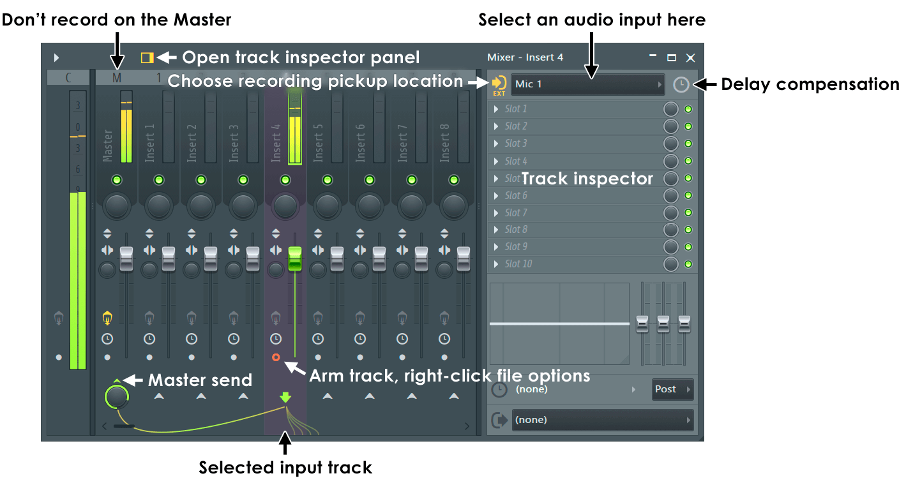

1. **Pick an unused insert track** and **choose its input** (the Input menu in its inspector, or on its
   Playlist audio track). Choosing an input **arms the track** and sets its pickup to EXT.
2. Optionally, **link a Playlist track to the insert**: it becomes an **audio track**, with the input,
   monitoring and arm on its header, and the takes land on it.
3. **Arm the transport**: click Record (it lights) or press **R**.
4. **Play** records (after the count-in, if it's on). **Stop** ends it.
5. The take is a new audio clip in the Playlist (song mode) or a new audio clip channel in the rack
   (pattern mode). With tracks still armed, recording again makes **new** clips and leaves earlier ones
   as they were.

The **One-click recording** button (a microphone on the toolbar) does steps 1–4 in one go: "I want to
record audio… Into Edison / Into playlist as an audio clip", then the input list, then a count-in of four
clicks.

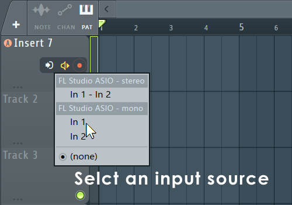

## The Record button

- **R**, or a click: Record on and off. It lights while on. With it on, Play records.
- **Right-click: the Recording filter** (what Record records) and options. Defaults, from the manual's
  picture:

  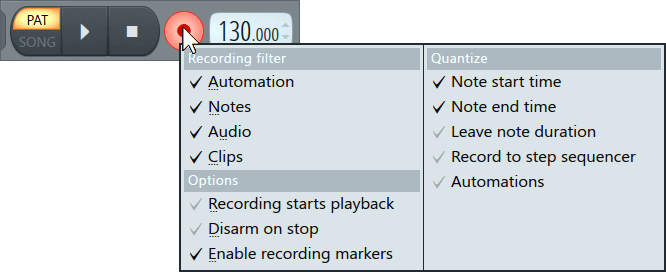

  | Item | What it does | Default |
  | --- | --- | --- |
  | Automation | Records control movements as automation | on |
  | Notes | Records notes (MIDI, the typing keyboard) | on |
  | Audio | Records audio from armed tracks | on |
  | Clips | Records Performance mode clips | on |
  | Recording starts playback | Pressing Record also starts play | off |
  | Disarm on stop | Record turns itself off when play stops | off |
  | Enable recording markers | Start/Stop recording time markers switch Record on and off (punch in/out) | on |
  | Quantize… | Notes only | |

- **Alt+click** shows the "What do you want to record" popup (its choices aren't in the manual).

### The recording switches beside it

| Switch | Key | What it does |
| --- | --- | --- |
| **Count-in** (precount) | Ctrl+P | Metronome ticks before recording starts; right-click picks how many bars (the choices aren't in the manual; one-click uses one bar of four clicks; the manual advises at least a bar of lead-in) |
| **Loop record** | — | Recording goes round the loop (the time selection, else the whole song) until Stop: each pass is a new clip |
| **Blend** (overdub) | Ctrl+B | For audio, sound-on-sound: earlier passes keep playing as it loops. Off, they're muted |
| **Metronome** | Ctrl+M | Clicks every beat, accented on the bar. It's heard while recording (and captured if it reaches the armed track) |
| **Wait for input** | Ctrl+I | Play waits until input arrives |

## The mixer track

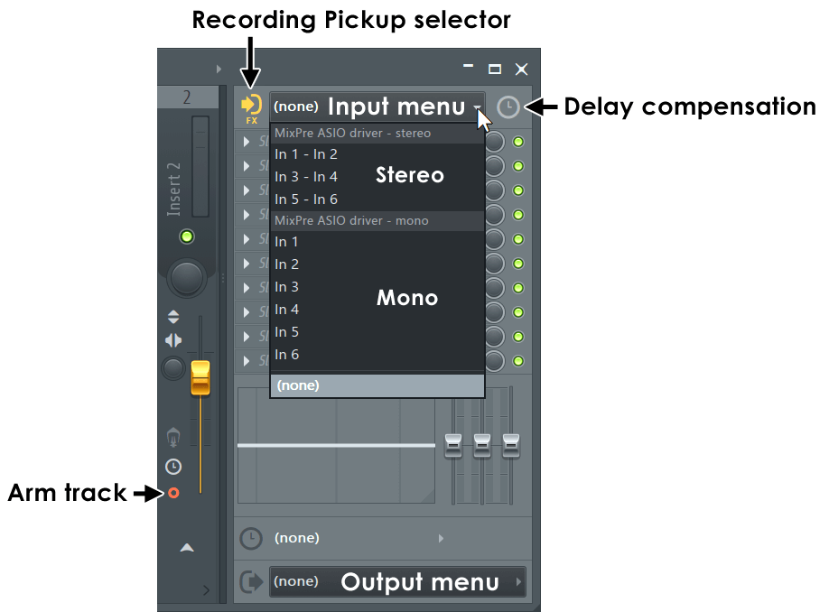

- **Input** (in the track inspector, Ctrl+Enter): the device's inputs as **stereo pairs** ("In 1 - In 2")
  then **mono** ones ("In 1"), then (none). A mono input fills both sides of the track. Several tracks can
  take the same input. Choosing one **arms** the track. The input is **mixed** with whatever else is routed
  into the track. Right-click → **AutoMap** gives each input to the next track and turns off their sends
  to the master (no feedback); Alt+click resets it.
- **Arm** (a small dot under the fader): left-click arms (red), right-click arms and asks for the file's
  name and folder. An armed track's fader turns **orange**. A track can be armed with no input, to record
  what's routed into it (internal audio).
- **Pickup** (where on the track the recording is taken; the icon before Input):

  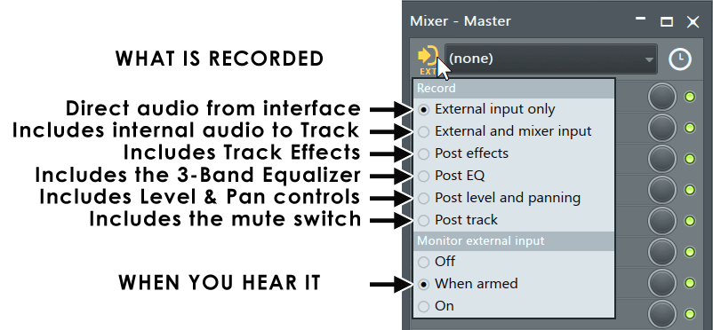

  | Pickup | Recorded | |
  | --- | --- | --- |
  | **EXT** | The external input only, dry | Recommended, the default, set when an input is chosen |
  | MIX | The input and the mixer's sound into the track, before effects | |
  | FX | After the effect slots | |
  | EQ | After the track's EQ | |
  | LVL | After its volume and pan | |
  | POST | After its mute | |

- **Monitor external input**: **Off**, **When armed** (the default) or **On**. What's heard goes through
  the track's effects and on to the master, so a vocal can be **recorded dry and heard with its reverb**
  (EXT pickup). The meters can show the input's level even when it isn't heard.
- **Input delay compensation** (the clock after Input): moves recorded audio earlier (positive) or later,
  in ms, samples or beats; "Adjust position of recorded audio" (FL 21) also takes out the delay of
  plugins in the way. The manual's way to measure it: record the metronome through the mic and line the
  clicks up with the grid.

  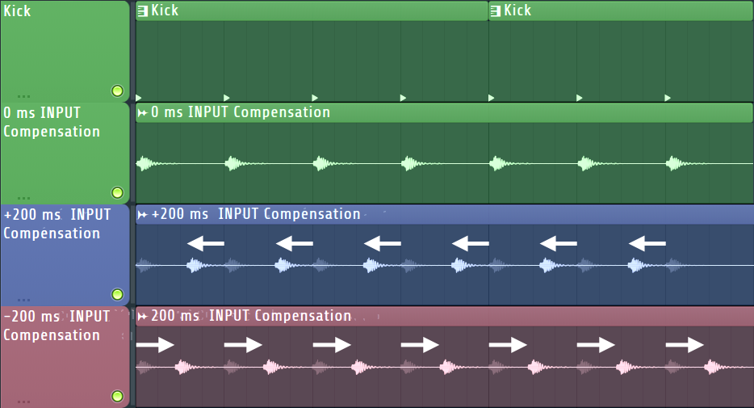

### The Mixer menu → Disk recording

| Option | What it does |
| --- | --- |
| Auto-unarm | Tracks are disarmed when play stops |
| Auto-create audio clips | The take goes on the Playlist (song mode only); "should be on" |
| Latency compensation | Takes the input latency off the start of the take ("there is no latency for internal audio": turn it off for that) |
| Auto-name playlist tracks | Names the tracks takes land on |
| Group loop recorded takes | Each loop pass goes on a child track under the audio track that recorded it |
| 16-bit / 24-bit / 32-bit float | The files' format (FL 2026.1); "normally use 32-bit float" |
| Render armed / selected tracks to wave (Alt+R / Shift+Alt+R) | Bouncing, not recording |

## Audio tracks on the Playlist

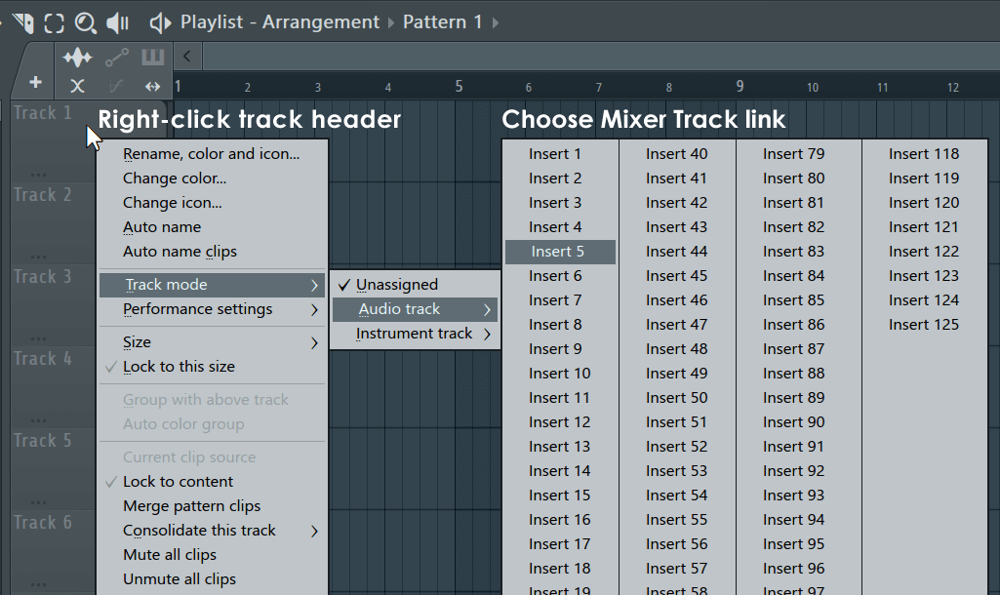

- Playlist tracks aren't bound to anything, but one can be **linked to a mixer insert**: right-click its
  header → **Track mode → Audio track → Insert N** (with several tracks selected, the next ones get the
  next inserts), or the Mixer's **Assign to new audio track(s)**, or a right-click on the Playlist's **+**.
- An audio track's header shows the insert's **input**, **monitoring** and **arm** (an icon that turns red
  when armed): recording can be set up without opening the Mixer. View → "Show controls on audio tracks"
  and "Show levels on audio tracks".

  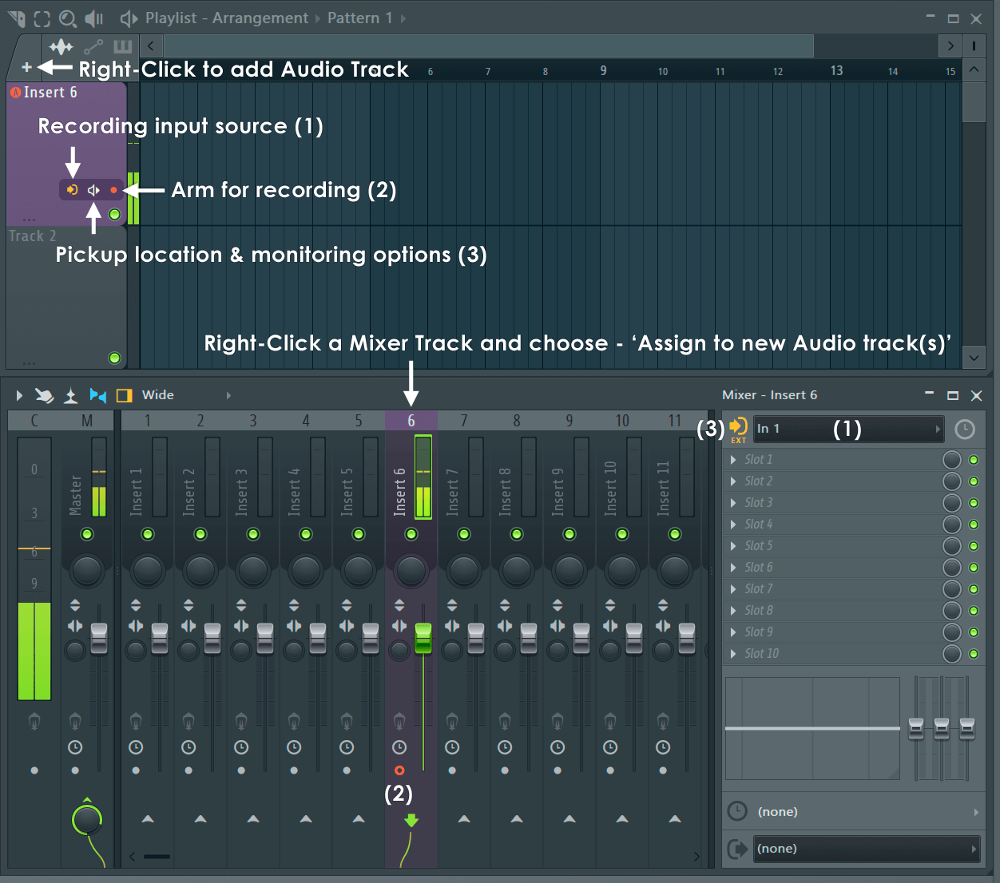

- **Takes from that insert land on it.** When there's no room, they go on **sub-tracks** under it.

## What a recording makes

- **A WAV per armed track per pass**, at the device's rate, in the format chosen in Disk recording;
  stereo (every mixer track is). Named after the project, the date and the insert, with `_2`, `_3`… for
  loop passes ("untitled_2022-01-05 10-00-46_Insert 1_2", from the manual's picture; the rule isn't
  written down).
- **Where**: the file named on the arm's right-click, else the project's data folder if it has one, else
  `Documents/Image-Line/FL Studio/Audio/Recorded` (shown in the Browser).
- **The clip**: on the insert's audio track, else on **the first Playlist track it fits on** without
  overlapping, from where recording started. In pattern mode, no clip: an audio clip channel in the rack.
- **Its channel's routing**: with an audio track, back into the insert that recorded it (so it's heard
  through that insert's effects, and would be recorded again unless the pickup is EXT); without one, into
  the track the insert sends to.
- **Undo** takes the clip away; the file goes to the trash once it can't be redone any more.

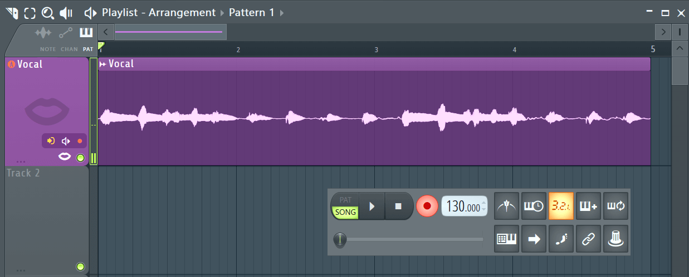

## Loop recording and takes

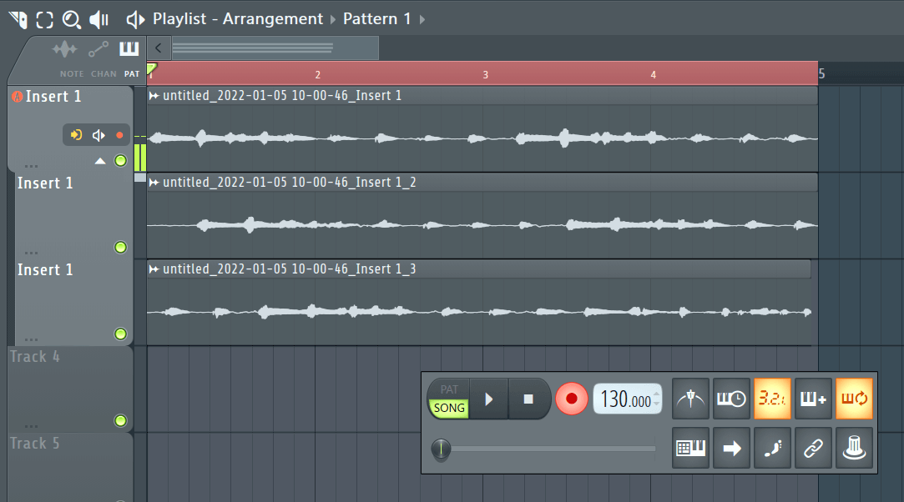

1. Loop record on; Blend on to hear earlier passes, off to mute them; song mode.
2. The time selection is the loop; without one, the whole song (with nothing in the Playlist, one bar).
3. At each end of the loop, the pass is put on the Playlist as a clip and recording goes on from the
   start: a new file. With **Group loop recorded takes**, each pass is a child track under the audio track.
4. The manual's advice for takes: **Loop record on, Blend off**: each pass mutes the ones before it, so the
   last is what's heard, and any earlier one can be unmuted.
5. FL warns that the first few ms of each pass may glitch (it saves a file and makes a channel at the
   wrap) and advises a bar of lead-in.

Punch in/out is done with **Start recording / Stop recording** time markers ("at selection" in the
markers' menu); there's no punch mode as such.

## Audio settings (F10 → Audio)

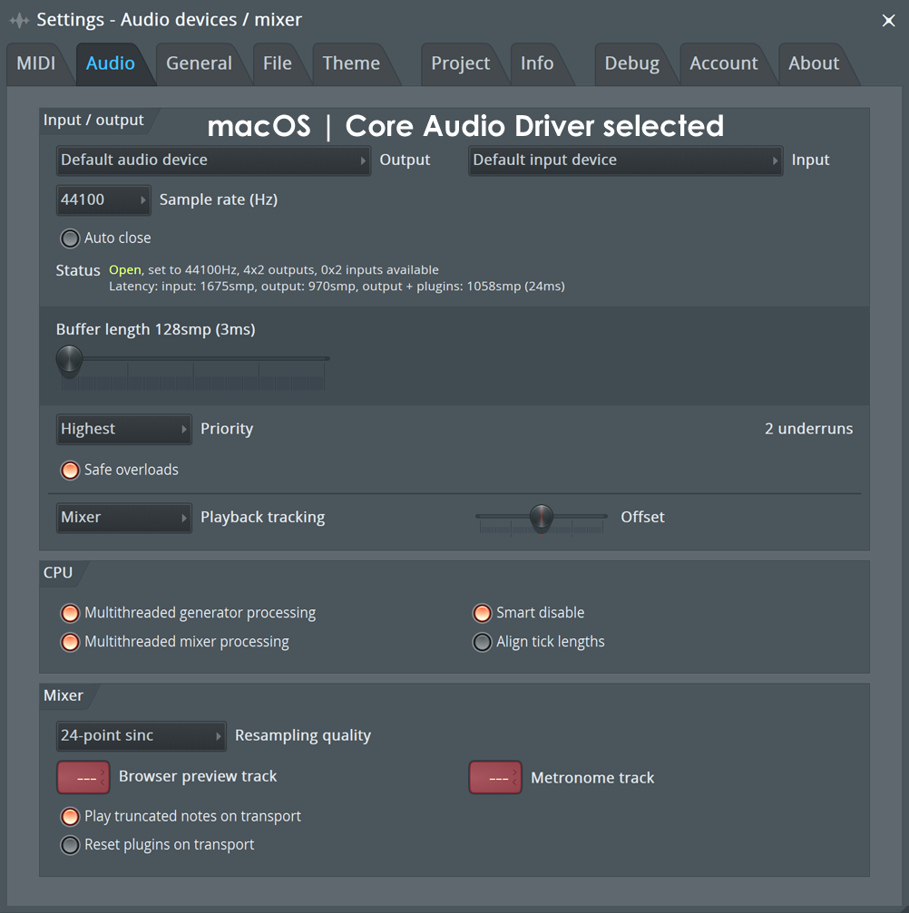

- On macOS, separate **Output** and **Input** devices (FL 2026; an aggregate device for more). On
  Windows, inputs need an ASIO driver.
- The status line gives both latencies: "input: 1675 smp, output: 970 smp, output + plugins: 1058 smp".
- A smaller **buffer** means less delay when monitoring (128 samples on Apple Silicon to start).
- **Offset**: a global shift of recorded material and the playhead, for what the rest doesn't fix.
- The **metronome track** (the master by default): route the click to a track of its own to give a
  performer a separate click.
- macOS asks for **microphone permission** before any input can be read.

## Shortcuts

| Key | What |
| --- | --- |
| R | Record on/off |
| Space | Play/stop (records when Record is on) |
| Ctrl+P | Count-in |
| Ctrl+B | Blend |
| Ctrl+M | Metronome |
| Ctrl+I | Wait for input |
| L | Pattern / song |
| Ctrl+Enter | The track inspector (input, arm) |
| Alt+click Input | Reset the mapping |

## What we'll leave out

- **Edison** (recording into an audio editor), the **One-click** wizard, **Wait for input**, the
  Recording filter's Notes, Automation and Clips (MIDI is step 5; automation recording can come with
  automation), the Audio Logger.
- **The pickup menu**: we always record the dry input (EXT) and hear it through the track (Théo).
- **Start/Stop recording markers** (punch in/out): not now (Théo); the time selection already loops.
- **Recording in pattern mode** (an audio clip channel, no clip): not now (Théo).
- **AutoMap**, Bypass track latency compensation, the 16/24-bit choice (32-bit float always), naming a
  file on the arm's right-click, Alt+R (that's bouncing).

## Decided with Théo (2026-10-01)

- **One pass** builds: an input device, an insert's input, arming, monitoring, the Record button with
  count-in, takes becoming audio clips, latency compensation; **plus loop recording (takes)** and **FL's
  audio tracks** (a Playlist track linked to an insert, with its controls on the header).
- **What's recorded and heard**: the **dry input** (FL's EXT), heard **through the insert's effects**
  (Monitor: Off, When armed, On; When armed by default). No pickup menu.
- **Hardware**: both an **audio interface** (input and output one device, a mono mic on input 1) and the
  **Mac's own mic** with headphones (input and output two devices), properly, from the start.
- **Where a take goes without an audio track**: FL's rule, **the first Playlist track it fits on**, from
  where recording started.
- Not now: punch in/out, recording in pattern mode.

## How it's built

Built in one pass (2026-10-01), as planned, apart from what's said. Musical decisions are TypeScript's;
the engine moves samples and says where they were.

### Microphone access

- The engine opens **no input until one is chosen** in Settings (Input device), and again at start from
  what it saved (`device.xml`): someone who never records is never asked.
- Both Vaudio's Info.plist (`mac.extendInfo` in `scripts/desktop.ts`) and the engine's
  (`MICROPHONE_PERMISSION_ENABLED` in `engine/CMakeLists.txt`) say why it wants the microphone. The
  desktop app asks (`systemPreferences.askForMediaAccess`, `electron/main.ts`, through the preload's
  `microphone` and `askMicrophone` in `src/lib/desktop.ts`) as an input device or a track's input is chosen;
  Settings says how to allow it when it's been refused. In `pnpm dev`, macOS asks the terminal running
  the server. Once the app is signed with the hardened runtime, both need
  `com.apple.security.device.audio-input`.

### The document and the tab's state

- `MixerTrack.input` (`MixerInput`: a device channel, mono on both sides, or the pair from it),
  `monitor` (off / armed / on, armed by default) and `inputOffset` (ms); `PlaylistTrack.mixerTrack` (FL's
  audio track). Validated in `normalizeMusicProject`; the master never has an input, and an audio track
  linked to an insert that's removed is an ordinary one again.
- **Arming, Record and the recording in progress are the tab's** (`src/suites/music/recording.ts`, not
  saved, not undone; cleared when another song opens). Record's options (the count-in, on and 1 bar by
  default; Loop record; Blend; Disarm on stop) are kept in the browser (`preferences.ts`), so they're the
  same in every song (Théo: turned off, the count-in stays off). The transport
  doesn't import the recording store (that made a cycle through the song's store): it registers itself
  (`setRecorder`), and Play records while Record is on.

### The engine

- **Inputs**: Settings' input device opens all its channels (JUCE masks what it hasn't);
  `audioDeviceAboutToStart` maps the callback's inputs to the device's channel numbers. `compileSong`
  gives each track `input: { channels, monitor, armed }` (`armed` comes with `SetSongRequest.armed`), and
  `Sequencer::process` adds a monitored input into its track before the effects (no delay compensation:
  it's live). A monitored track is "reached", so it has a buffer even with no channel on it.
- **Writing** (`engine/src/Recorder.cpp`): files are opened on the message thread (a recording's first
  ones in `start`, a spare per track for the next pass made by `service`, on the engine's timer); the audio
  thread writes each armed track's dry input into a `ThreadedWriter`'s FIFO (32-bit float WAV, one channel
  for a mono input, two for a pair) and hands finished files back through a lock-free queue. Offline,
  files are written at once on the rendering thread.
- **Count-in**: `Sequencer::record` asks for play with a count-in: the transport holds while the clicks
  (on every beat, higher on bars, heard whether the metronome is on or not) play, and recording begins on
  the sample the transport moves.
- **Loops**: at each wrap the recorder switches every track to its spare, `latency` samples after the
  sample the loop's first notes play on, so each pass after the first starts on the beat; nothing is lost
  or doubled (tested). Without Loop record, the song doesn't wrap while recording (`through`): it plays on
  past its end, and the playhead with it (`TransportState.through`).
- **Latency**: the device's input and output latency (CoreAudio's include the buffer) and the song's
  plugin delay, given at the start. The first take's file keeps it at its head (`skip`); `takeWindow` leaves
  it out, with the track's input offset.
- **Events**: the engine says `take` (`recordingId`, track, file, the tick at sample `skip`, frames,
  pass, final); the server makes the file the project's media (moved, `library.add`, wired in `app.ts` as
  `adoptTake`) and sends the tab an `EngineTakeEvent` with the `MediaAsset`. Files are written in
  `data/projects/<id>/recordings/` (never `tmp`, which is wiped on start).
- **Tests**: offline, a WAV stands in for the device's inputs (`render`'s `input`): takes match it sample
  for sample, a pair records two channels, the count-in records nothing, loop passes split exactly, a
  plugin's delay is left out (`server/music/recording.integration.test.ts`, `latency.integration.test.ts`).

### The tab

- **Takes become clips** (`addTakes`, `shared/music/recording.ts`): a channel each, routed into the track
  that recorded it, a clip where it was recorded: on the track's audio track, else the first track it
  fits on; loop passes stack below, all but the last muted unless Blend. A recording's takes are one undo
  step (each take arriving undoes the last and commits them all, while nothing else was edited).
- **The toolbar**: Record (R) beside Stop, red while on, pulsing while recording; then FL's count-in
  switch ("3·2·1", on by default; its right-click picks 1, 2 or 4 bars). Record's right-click menu has
  the count-in too, Loop record, Blend and Disarm on stop. While it counts in, the engine says how long is
  left (`EngineTransport.countIn`) and the playhead holds where play starts (`tickNow`). Pressed in pattern mode, Play switches to song mode
  and records there. While recording, a ruler click only moves where the next play starts.
- **The Mixer**: the inspector's Input row (the arm light; the Input menu, FL's: stereo pairs, then mono
  inputs, then (none) and the device's settings; choosing one arms the track; and a sliders button for
  Monitor and Input offset, lit when either isn't as it came: Théo wanted the row short); the arm
  light under each strip's fader, the fader FL's orange while armed (`--mixer-armed`, `--mixer-arm`); a
  track that takes an input has a purple number bar with a mic (`--mixer-input`; its own colour wins),
  armed or not, so a reopened song shows which tracks record (Théo); the
  track menu's Assign to new audio track.
- **The Playlist**: the track menu's Audio track (an insert, or none); an audio track's header has the
  insert's arm light and, if it's tall enough, its insert and input. While recording, the playhead is red
  and **each take is drawn as it records** (Théo): a red clip on the track it'll land on
  (`liveTakeTracks`, the same placement as `addTakes`), growing to the playhead with the input's level as
  its waveform. The engine measures each recording track's input as it writes it, its loudest
  sample every 5 ms, and sends them with each transport event (`Recorder::levels`, about 25 a second); the tab keeps them (`liveTakes`) until the take's file is in,
  when the clip takes its place.
- **Settings**: the input device, its inputs and their latency, and the microphone's permission.
- **The assistant**: `update_mixer_track` takes `input` ("1", "1-2", "none"), `monitor` and
  `inputOffset`; `update_playlist_track` takes `audioTrack`; `list_audio_inputs`, `arm_tracks`,
  `record_audio` (start, and stop answering with the takes); `get_mixer` says what's armed.
- **E2e**: the stand-in engine records (a tone per armed track and pass, 10 ms of latency at the head).

## Where Vaudio differs

| FL Studio | Vaudio |
| --- | --- |
| Pickup: EXT, MIX, FX, EQ, LVL, POST | The dry input only (EXT), heard through the track (Théo) |
| A track can be armed with no input, recording what's routed into it | Only a track with an input can be armed |
| Recording filter (notes, automation, clips), Edison, One-click, Wait for input, the Audio Logger | Audio only, into the Playlist |
| Start/Stop recording markers (punch in/out) | Not yet (Théo): the time selection loops |
| Recording in pattern mode makes an audio clip channel | Record switches to song mode (Théo) |
| Loop takes as child tracks under the audio track (Group loop recorded takes) | On the tracks below it (no child tracks yet) |
| A glitch may come at each loop's wrap (FL saves and makes a channel there) | Files are opened ahead: none |
| Input delay compensation per input, in ms, samples or beats | Per track, in ms |
| Auto-unarm (tracks), Auto-name playlist tracks, latency compensation as an option | Always: takes are named after their track, the latency is always left out; Disarm on stop is Record's |
| Bit depth 16/24/32 | 32-bit float always |
| File names chosen on the arm's right-click; files in a Recorded folder | Takes are the project's media, named after the track and when |
| AutoMap, low-latency monitoring (Bypass track latency compensation) | Not yet |
| Undone takes go to the trash | Undone takes stay in the project's media |
| The take's waveform appears as it's dumped | Each take is drawn as it records, its waveform from the input's level; the clip, with the file's waveform, replaces it when the take is in |

Still to come: a take's file repaired if the engine dies mid-recording (its WAV header is written when it
closes), punch in/out, recording in pattern mode, and an input level meter for an armed track that isn't
monitored.
