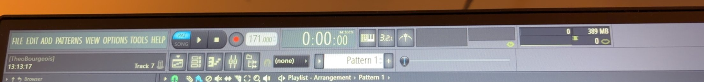

# The toolbar

FL Studio's main toolbar, the strip across the top of the window, from Théo's own screen (FL Studio 2025,
below) and the manual (`toolbar_panels.htm`). See [README.md](README.md) for the sources.

## Anatomy

Two rows, left to right. Each group is a panel of its own (they can be rearranged; this is the default):

| Group | Top row | Bottom row |
| --- | --- | --- |
| Menus and hint | The menus: File, Edit, Add, Patterns, View, Options, Tools, Help | The **hint bar**: what's under the pointer (here the user's name, the clock, and "Track 7", the playlist track under the pointer) |
| Transport | **PAT / SONG** switch; **Play** (Pause while playing); **Stop**; **Record**; the **tempo** LCD ("171.000": drag up and down, right-click for its menu and presets) | Window buttons: **Playlist** (F5), **Channel rack** (F6), **Piano roll** (F7), **Mixer** (F9), **Browser** (Alt+F8) |
| Time | The **song position** LCD, big ("0:00:00", M:S:CS; a click switches to B:S:T, bars:steps:ticks) | The global **snap** ("(none)") |
| Recording | **Typing keyboard to piano** · **Countdown** before recording (3.2.1) · **Metronome** | The **pattern selector**: an arrow for its menu, the name (click: the list of patterns), and **+** for a new one |
| Position | The hint panel and the song's **waveform/oscilloscope** | The **song position slider**: where the song (or pattern) is; drag it to move there |
| Monitor | **CPU** and **memory** use, polyphony, and the **output meter** (peak level, left and right) | |

- **Play** plays the pattern (PAT) or the song (SONG); pressed while playing it pauses. **Stop** stops and
  goes back to where play started. **Space** is play/stop.
- The tempo and position LCDs look like the rest of FL's number displays: dark, recessed, with a small
  label (BPM, M:S:CS).
- Everything is small (a row is about 24 px), and the groups are separated by thin grooves.

## Where Vaudio differs today

Vaudio shows only what it can do. What's there follows FL's layout (`src/suites/music/toolbar.tsx`):

| FL Studio | Vaudio |
| --- | --- |
| Layout: groups of two rows each | Ours (Théo): the title and hint at the left; in the middle two rows, the transport, tempo, position and monitors above, the window buttons, pattern selector and a wide song position slider below |
| Menus | None yet. The project's name (click to rename) is in their place, as the title |
| Hint bar | Yes: the name of what's under the pointer (its title) |
| PAT / SONG | No song mode yet (the playlist): it always plays the pattern |
| Play / Pause, Stop | Play (lit while playing; pressed again it stops, since there's no pause yet), Stop |
| Record, countdown, typing keyboard | Not yet (recording) |
| Tempo LCD | Yes: drag it up and down, or click it to type |
| Position LCD | Yes, in B:S:T (where the pattern is, or where play starts) |
| Window buttons | Piano roll (F7) and Channel rack (F6): a press opens the window or brings it forward (the keys toggle); the others come with their windows |
| Snap | The Piano roll has its own; no global snap yet |
| Metronome | Yes, beside the tempo rather than with the recording buttons |
| Pattern selector with + | Yes: the name opens the list (rename, clone, delete), + makes a new pattern |
| Song position slider | Yes, along the pattern: drag it to move where play is |
| CPU, output meter | Yes (the engine's load and the output's peak), with the audio settings beside them |
| — | Ours: undo and redo, the theme, Settle and the assistant, at the right end |
