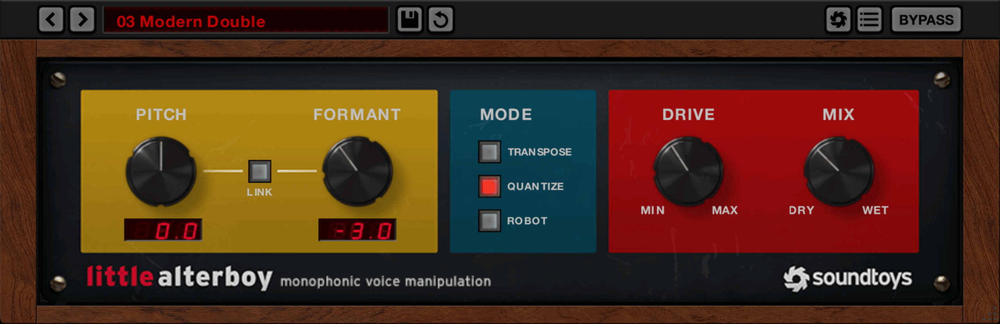
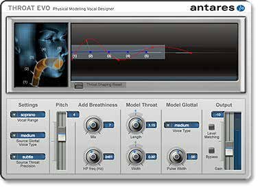
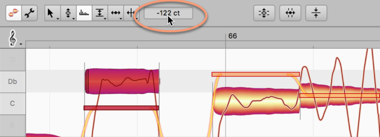
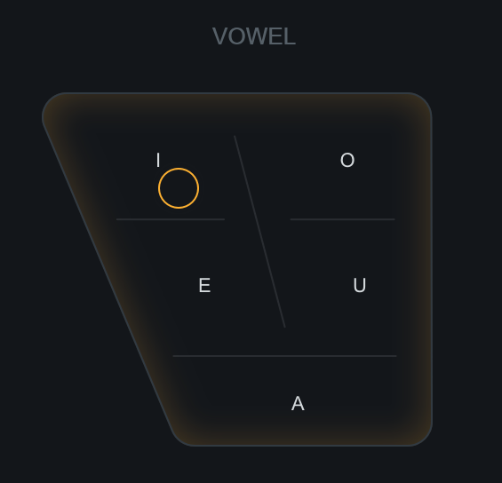
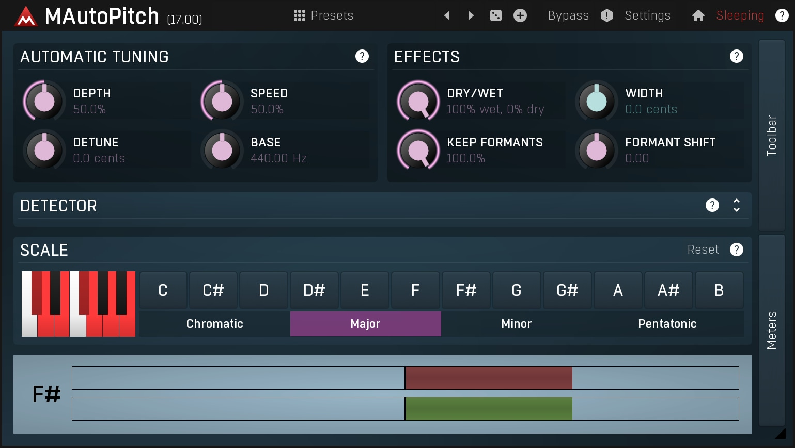
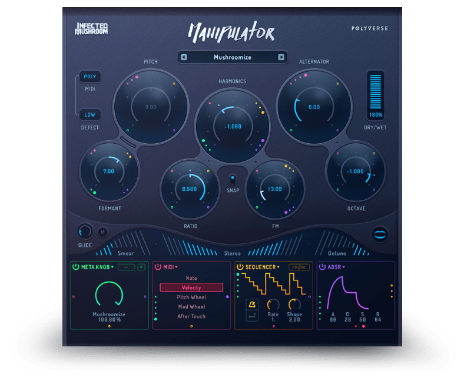

# A formant editor for vocals

A design for Vaudio's own **formant shifter and formant editor**, a stock effect of the music suite as
Auto-Tune, Pro-Q and PanMan are. It isn't a clone. Théo tried Soundtoys' Little AlterBoy and found it "distorted
as fuck... too artificial"; he asked for something "smarter... actually high-quality, top fucking tier". So
this document starts from research (what formants are, why shifting them sounds artificial, what the
literature and the best products do) and then designs ours, down to the files, the maths and the tests.
Its working name is **Tract** (the vocal tract, which is what it reshapes); [section 9](#9-open-questions-for-théo)
offers others. Code names stay neutral: `formant`.

Sources: the Little AlterBoy manual, Melodyne 5's manual, Antares' AVOX 4 manual (Throat Evo), zplane's,
iZotope's, Waves', Eventide's, Apple's, Ableton's and Image-Line's documentation; Sound On Sound's reviews and
its *Inside Track* interviews with mix engineers; KVR and Lemmy threads; the DSP literature (Röbel & Rodet
2005, Morise 2015 and 2016, Laroche & Dolson 1999, Laroche 2003, Röbel 2003 and 2010, Průša & Søndergaard 2016,
Průša & Holighaus 2017, Moulines & Charpentier 1990) and the source of WORLD, Rubber Band, Signalsmith Stretch
and SoundTouch; speech science (Peterson & Barney 1952, Hillenbrand et al. 1995, Smith & Patterson 2005,
Hillenbrand & Clark 2009, Assmann & Nearey 2007/2008, Joliveau, Smith & Wolfe 2004, Sundberg 2001); and the
neural voice literature (LLVC, StreamVC, Beatrice 2, BRAVE, FARGAN, SiFi-GAN). Every one is linked in
[Sources](#10-sources). Anything the sources don't give is marked **not stated**; anything worked out here
rather than read is marked **(inferred)**. Gearspace and Reddit refused every route we tried, so user
complaints come from KVR, Lemmy, reviews and retailers' summaries.

The pictures in `img/` are the makers' own screenshots, © Soundtoys, Antares, Celemony, iZotope,
MeldaProduction and Polyverse, kept here only as a private reference for building this app. Don't ship
them, and don't copy their artwork: we copy how things work, in our own visual style.

```
  THE IDEA IN ONE PICTURE

  a voice  =  a buzz (the vocal folds: the pitch and its harmonics)  shaped by  a filter (the throat and mouth: the formants)

  level │      F1        F2                F3     F4            level │   F1'      F2'             F3'    F4'
        │    ╱‾‾╲      ╱‾‾╲              ╱‾╲    ╱‾╲                   │  ╱‾‾╲    ╱‾‾╲            ╱‾╲    ╱‾╲
        │   ╱ |  ╲    ╱ |  ╲   envelope ╱ | ╲  ╱ | ╲                  │ ╱ |  ╲  ╱ |  ╲          ╱ | ╲  ╱ | ╲
        │  ╱| | |╲╲  ╱| | | ╲_________╱|  |  ╲╱|  | ╲                 │╱| | | ╲╱| | | ╲________╱| | |╲╱| | |╲
        │ ╱ | | | | ╲ | | | |  |  |  | |  |  | |  |  ╲                │ | | | | | | | |  |  |  | | | | | | | |
        └─┴─┴─┴─┴─┴─┴─┴─┴─┴─┴──┴──┴──┴─┴──┴──┴─┴──┴───► f            └─┴─┴─┴─┴─┴─┴─┴─┴──┴──┴──┴─┴─┴─┴─┴─┴─┴─► f
           harmonics stay where they are (same pitch)                   the same harmonics, the envelope moved down:
                                                                        a bigger throat, same note

  Tract: measure the envelope, move it (as a whole, or F1–F4 one by one, or by a drawn map),
         and re-weight the voice's own harmonics by (new envelope ÷ old envelope). Nothing is resynthesised.
```

## Contents

1. [What it is and why](#1-what-it-is-and-why)
2. [What the design stands on: facts about voices](#2-what-the-design-stands-on-facts-about-voices)
3. [The panel](#3-the-panel)
4. [The sound](#4-the-sound)
5. [How it works: the DSP](#5-how-it-works-the-dsp)
6. [Presets](#6-presets)
7. [Proposed for Vaudio: first and later](#7-proposed-for-vaudio-first-and-later)
8. [How it'd be built here](#8-how-itd-be-built-here)
9. [Open questions for Théo](#9-open-questions-for-théo)
10. [Sources](#10-sources)

---

## 1. What it is and why

### 1.1 Formants, for a producer

- A sung note is two things at once. The **vocal folds** buzz at the note's pitch (F0), making a stack of
  harmonics at F0, 2·F0, 3·F0... The **vocal tract** (throat, mouth, lips) is a set of resonances that
  makes some of those harmonics loud and others quiet. Those resonances are the **formants**: F1, F2, F3,
  F4, peaks in the spectrum's **envelope** (the smooth curve over the harmonics' tops).
- **F1 and F2 make the vowel.** An "ee" has a low F1 (about 300–450 Hz) and a high F2 (2.3–2.8 kHz); an "ah"
  has F1 near 750–900 Hz and F2 near 1.3–1.5 kHz (section 2.1). **F3 and above make the voice's identity
  and size**, and in trained singers F3–F5 cluster into the **singer's formant** near 3 kHz, the ring that
  cuts through a band.
- **A bigger head means lower formants.** A tract 10 % longer has formants about 10 % lower. Women's
  formants are about 16 % (≈ 2.6 semitones) above men's on average, children's about 24–35 % above
  (section 2.2). That is why formants sound like **size, age and gender**, while pitch sounds like the note.
- **Pitch and formants are independent in a real voice.** A man singing high keeps a man's formants. Speed a
  recording up and both rise together: the chipmunk. A formant shifter breaks that link the other way:
  same notes, different throat.

### 1.2 Why shifting them is hard

To move the formants and not the pitch, a processor has to tell the envelope (move it) from the harmonics
(keep them). Every method does that with some model, and every artefact producers complain about comes
from a model being wrong somewhere:

| The hard part | Why | What it sounds like when it goes wrong |
| --- | --- | --- |
| **Seeing the envelope at high pitch** | The harmonics sample the envelope every F0 Hz. At a soprano's 1 kHz there's one sample per kHz, and a formant narrower than ~2·F0 can't be seen at all (Röbel & Rodet 2005). Cheap estimators (LPC, plain cepstrum) lock onto single harmonics or sag between them | Whistling, "metallic" resonances, harmonics swelling and fading as the note moves (warble) |
| **Knowing the pitch** | Time-domain shifters (PSOLA) cut the voice into pitch periods. A wrong period (octave errors on breathy or low notes, a weak fundamental) puts the cuts in the wrong place | Roughness, a robotic doubling or halving, "glitchy" breaths |
| **Grains** | PSOLA moves formants by resampling each two-period grain; shifted up, grains shrink and stop overlapping; shifted down, they overlap more and the level changes | Buzz, a hollow pulse-train tone, level changes with the knob |
| **Phase** | Frequency-domain methods that move partials (phase vocoders) lose the phase relation between harmonics | Phasiness: a distant, reverberant, "underwater" voice; smeared consonants |
| **Valleys** | Moving a formant into a place where the voice had a valley means boosting whatever was there: noise, breath, room | Hiss and fizz, "distorted" grit on the moved formant |
| **Consonants and breath** | /s/, /sh/, /f/, /t/ and breath aren't harmonic. Shifted like vowels, /s/ moves toward /sh/ (a lisp) or whistles; put through pitch periods, noise becomes buzz | Lisping, whistly esses, buzzy breaths |
| **Resampling** | Compressing a grain or a signal without filtering it first folds high frequencies back down | A thin, gritty, inharmonic shimmer on bright voices |

### 1.3 What producers use it for on vocals

Verified from engineers in Sound On Sound's *Inside Track* series, its technique articles and the makers'
manuals:

- **Thickening doubles and backing vocals**, the most common use. A small shift down: "shift the formant down
  by a little bit (−1.0 to −3.0) to add depth and richness... great for background vocals" (Little AlterBoy's
  manual). Logic's guide: "Pitch to 0 semitones, Mix to 50%, and Formant to +1... place a singer (with a smaller
  head) next to the original singer". John Walden on Melodyne: "a very subtle formant shift to the double... a
  lovely thickness... but if you overdo things here it will sound like two different singers (and probably
  awful!)". Greg Fidelman on Metallica's backing vocals: AlterBoy "changes the formant and makes it sound less
  like just one guy".
- **Lower harmonies**: pitched-down harmony lines sound fat and dull; "shifting the formants between −50 to −100
  cents improved the subjective quality" (SOS, *Perfect Harmony*).
- **Character in small doses**: "I suggest a maximum of ±3 semitones... −2 semitones gives the voice a more
  soulful character, while... +2... more childlike" (Walden on Nectar). Melodyne users drag a note's formant
  down so it sounds "sung more from the diaphragm than the throat".
- **Width**: different shifts left and right (Cubase's "Tape Manipulator" preset applies "different amounts of
  formant shift... to the left and right channels").
- **Size, age, gender**: Panic! at the Disco "transposed Brendan's voice up an octave and then changed the
  formant" to sound like a kid; KPop Demon Hunters' demonic choir was formant-shifted "five or six different
  ways"; Kendrick Lamar's robot pre-hook layers one copy "+12" and another "with a lower formant so it sounds
  pitched down, even though it remains in the same key".
- **Vocal chops and drops**: Ian Kirkpatrick (Dua Lipa): "Little Alterboy is taking the formant of the vocal
  down and makes the 'throat' bigger"; Grant Boutin builds drop leads by humming and "formanting it".
  The Chainsmokers' engineer pitched vocals down "and changing the throat length" in Auto-Tune.
- **Fixing pitch-shifted vocals**: shifting a vocal up a few semitones with the formants held back keeps it
  natural ("pitch it up four or five semitones, and it still sounds natural", Mike Posner's producers on
  Ableton's Complex Pro with Formants at 100 %). A sped-up sample's chipmunk sound is the formants rising with
  the pitch; a formant shift down undoes it (**inferred** from the same mechanism).
- **Instruments**: AlterBoy on a Moog lead (Gorillaz), Melodyne's formant tool on drum loops ("Don't be shy
  here").
- **As a writing tool**: SZA's producer adds "crazy hard Auto-Tune or... formant shift... it can spark new
  ideas".
- **Not verified**: specific settings for Travis Scott's, Don Toliver's, Playboi Carti's or hyperpop vocals. The
  public descriptions are of pitch-shifting, Auto-Tune and technique (Carti's "baby voice" is a way of singing),
  not of formant settings. The presets in [section 6](#6-presets) aim at those sounds from first principles
  and are marked so.

### 1.4 The landscape

What each product does with formants, and what it's known for.

| Product | Formant controls | How (if said) | Latency | Known for |
| --- | --- | --- | --- | --- |
| **Soundtoys Little AlterBoy** | Pitch ±12 st, Formant (≈ semitones, range **not stated**), Link, Transpose / Quantize / Robot, Drive (Decapitator's tube), Mix | **Not stated**; descends from Soundtoys' PurePitch, "the world's first real-time formant shifting plug-in" | **Not published**; a Gearspace snippet says over 2000 samples at 44.1 kHz (unverified) | The default creative tool; its artefacts, phase and Drive are part of its sound |
| **Celemony Melodyne 5** | Formant tool per note (cents, a beam over each blob), formant transitions (orange lines, their speed draggable), automatic correction when pitch moves (Formants Up / Down 0–100 %), F(ormant) Character, **Sibilant Handling** | **Not stated** (offline, note-based) | Offline | The most natural; sibilants and breaths left alone |
| **Antares Throat Evo** (AVOX 4) | Throat Length and Width (ratios, 1.00 = as sung; human range shaded), a 5-point vocal-tract shape, glottal Voice Type and Pulse Width, Breathiness (mix + highpass), Pitch ±12 | Neutralises the singer's tract, then imposes a modelled one; falls back to "an alternative (but not quite as accurate) modeling method" when it can't hear a pitch | **Not stated** | Natural at small settings; "whistling" artefacts at extreme ones in its "subtle" precision |
| **Antares Auto-Tune Pro** / **AutoTune Advanced** (Sept 2026) | Throat Length 50–180 with Formant on (Pro); Transpose and Formant ±12 st, linkable, a "Formant Designer" (Advanced) | **Not stated** | Advanced: Live under 1 ms, Low Latency, High Quality | Throat on hard-tuned vocals |
| **zplane élastique Pitch 2.5** | Pitch ±12 st, Timbre ±12 st (50–200 %) on an XY control | élastique Pro, **not stated** | **163 ms** at 44.1 kHz, 150 ms at 48/96 | Clean, polyphonic, phase-coherent; slow |
| **zplane TIMBRE** (≈ Sept 2026) | ±36 st, **two bands with a crossover**, each linked or not; Resolution; a noise or side-chain "carrier" | **Not stated** | **23.2 ms** at 44.1 kHz | New; a "real-time poly formant shaper" |
| **iZotope VocalSynth 2** | Biovox: Shift (tract length), Nasal, Breath, Clarity, an **IPA vowel chart** to drag; Polyvox: Formant, Character | Biovox "estimates a vocal tract shape from the incoming audio" (wave digital filters) | **Not stated** | Character, vowel morphing |
| **iZotope Nectar 4** (Pitch) | Formant Shift (st), Formant Scale ("adjust formants in the direction of the pitch shift... more natural") | **Not stated** | **Not stated** | Formant following pitch |
| **Waves Vocal Bender** | Pitch and Formant ±1 octave, Link, Fine, Flatten, Mix; four modulators dragged onto any control | **Not stated** | "Zero" (a KVR user measured about 512 samples absorbed) | "Noticeably smoother than I've heard from previous formant shifters" (SOS) |
| **Eventide H90** | Formant −600..+600 cents, Formant Link | **Not stated** | Low ≈ 25 ms; **High ≈ 50 ms, "recommended for extreme formant settings"** | Harmonizer heritage |
| **MeldaProduction MAutoPitch** (free) | Keep Formants 0–100 % (default 100), Formant Shift, Width | **Not stated** | **Not stated** | "The formant shifting is incredibly clean" (KVR) |
| **Polyverse Manipulator** | Pitch, Formant, Harmonics, Alternator, Octave... | **Not stated** | "Real-time, zero-latency" | Creative mangling |
| **Minimal Audio Formant** (Sept 2025, free) | An XY pad, a tilt EQ | "Moves the resonant peaks... while leaving the fundamental pitch unchanged" | **Not stated** | "Pristine", low CPU; a gateway to their resynthesis plugin Evoke |
| **Logic Vocal Transformer** | Pitch, Formant, **Keep unvoiced formants** ("retains sibilant sounds... more natural-sounding") | **Not stated** | **Not stated** | Keeping sibilants unshifted |
| **Ableton Complex Pro**, **FL Pitcher / Newtone**, **ReaPitch** (élastique), **Graillon**, **BLEASS Vox** | Formants 0–100 % + Envelope (Ableton); Gender (Pitcher), per-note Formant (Newtone); Graillon "adding no latency"; Vox's "Real Time" button trades accuracy for latency | **Not stated** | Varies | Built-in conveniences |
| **Dreamtonics Vocoflex** (neural) | A target voice from ~10 s of audio, an XY gender pad, light/shadow voices | Neural voice conversion | **35 ms** (lowest) to **105 ms** (highest quality) | Real neural timbre transfer; not a formant tool as such |



**What the best do right**, from the table and the reviews:

1. **They leave consonants alone.** Melodyne's Sibilant Handling applies pitch and formant changes "only to the
   pitched element of the note, leaving the sibilant unaltered"; Logic offers "Keep unvoiced formants" for "a
   more natural-sounding transformation".
2. **They move formants with the pitch, a little.** Melodyne corrects formants when a note is transposed (by
   0–100 %, separately up and down); Nectar's Formant Scale and VocalSynth's Character move formants "in the
   direction of the pitch shift"; Throat Evo and Mutator include formant correction. Speech science agrees:
   listeners "prefer coordinated patterns of F0 and FF similar to those of natural speech" (Assmann & Nearey
   2007).
3. **They show the human range.** Throat Evo shades the knobs' "typical human anatomy" range ("the variation in
   the length of human vocal tracts is rarely more than about 25%... start within ±15%").
4. **They take the time they need.** The clean ones have latency: élastique 150–163 ms, Eventide's high-quality
   mode 50 ms "recommended for extreme formant settings", iZotope's real-time singing-voice converter
   "just under 60 ms" (DAFx-23). Offline (Melodyne, IRCAM Trax) is still judged best: "Offline stuff will sound
   better than real-time stuff, most of the time" (KVR).
5. **They model the envelope, not just the grains.** Throat Evo "begins by neutralizing the effect of the
   original singer's vocal tract"; iZotope's plug-in post-filters by a WORLD envelope (CheapTrick) after
   shifting. The rest **don't say**.

What **none** of them does: show the voice's own envelope with its formants as handles to drag one by one.
Throat Evo drags tract geometry, Melodyne a per-note offset, Biovox and Kilohearts a vowel position. That's
the gap this design fills.

The closest ideas, for reference:

| | |
| --- | --- |
|  | **Throat Evo**: the singer's tract (blue, fixed) and the model's (red, five draggable points from the vocal folds to the lips), the human range shaded. Each point is a length and a width |
|  | **Melodyne 5**: a beam over each note shows its formant shift ("−122 ct" in the inspector); orange lines are the transitions between notes, their slope draggable |
|  | **Biovox**: a vowel trapezoid (I, E, A, O, U); drag the node to blend toward a vowel |
|  | **MAutoPitch**: formant keeping as a percentage (100 % by default), a separate Formant Shift |
|  | **Manipulator**: formant as one knob among creative ones (Harmonics, Alternator, Octave), a modulation strip under them |

### 1.5 Why Little AlterBoy sounds artificial

Soundtoys doesn't publish its algorithm or latency, so this is a diagnosis from what users report and what
its manual says, not a teardown:

- **Users hear phase artefacts and warble.** "Alterboy does introduce phase issues... the artifacting from
  Alterboy works in that context really well" (Lemmy); "push pitch or formant a long way and you get the
  expected digital warble and roughness" (a review); "occasional messy artifacts, stereo quirks" (Plugin
  Boutique's summary of its reviews); "probably not the most precise tool... more of an 'effect' rather than an
  'illusion'" (KVR). On real-time shifters generally: "on breathy/subtle sources most realtime formant shifters
  fall apart... a lot sound glitchy" (KVR).
- **It's meant to colour.** Its manual says it's PurePitch "mashed up with a tube saturation model from our
  popular Decapitator"; Drive is on the front panel. Some of the "distorted" is intended.
- **It wants clean, monophonic, first-in-chain vocals**: "designed to process only clean monophonic vocal
  tracks... insert Little AlterBoy BEFORE any other effects" (manual). Reverb, doubles, bleed or a stereo
  bus break its analysis: a sign of a pitch-synchronous method **(inferred)**.
- **It shifts everything the same way**, consonants and breaths included: no sibilant or unvoiced handling is
  mentioned anywhere in its manual **(inferred from its absence)**.
- **Its latency is small-ish** (≈ 2000 samples by one report): too short to see several periods of a low voice
  and to look ahead past an octave error **(inferred)**.

The design answers each: no grains for the formant shift (a smooth filter on the voice's own spectrum), an
envelope model that's right at high pitch, consonants and breath kept (or shifted by their own amount),
transients untouched, a pitch tracker that looks ahead, a "natural link" of formants to pitch, the human
range shown, and no saturation.

---

## 2. What the design stands on: facts about voices

### 2.1 Where formants are

Means from the raw data of **Hillenbrand et al. 1995** (139 speakers; steady state), Hz. Each cell is
men / women / children.

| Vowel | F0 | F1 | F2 | F3 |
| --- | --- | --- | --- | --- |
| /i/ heed | 139 / 227 / 246 | 343 / 437 / 452 | 2323 / 2761 / 3082 | 3001 / 3373 / 3702 |
| /ɪ/ hid | 136 / 225 / 240 | 429 / 484 / 513 | 2034 / 2369 / 2556 | 2687 / 3057 / 3409 |
| /ɛ/ head | 127 / 213 / 230 | 588 / 727 / 740 | 1803 / 2063 / 2279 | 2604 / 2953 / 3297 |
| /æ/ had | 126 / 214 / 229 | 591 / 676 / 718 | 1930 / 2335 / 2497 | 2595 / 2973 / 3289 |
| /ɑ/ hod | 127 / 212 / 231 | 756 / 921 / 992 | 1309 / 1526 / 1689 | 2535 / 2832 / 2937 |
| /ɔ/ hawed | 125 / 214 / 232 | 656 / 804 / 836 | 1023 / 1188 / 1303 | 2521 / 2824 / 2951 |
| /ʌ/ hud | 129 / 218 / 234 | 621 / 760 / 738 | 1181 / 1416 / 1538 | 2548 / 2901 / 3126 |
| /ʊ/ hood | 133 / 230 / 242 | 469 / 519 / 571 | 1123 / 1229 / 1506 | 2435 / 2829 / 3076 |
| /u/ who'd | 144 / 236 / 247 | 380 / 460 / 493 | 992 / 1106 / 1404 | 2355 / 2735 / 2992 |
| /ɝ/ heard | 131 / 218 / 237 | 475 / 524 / 586 | 1379 / 1588 / 1721 | 1711 / 1930 / 2154 |

Peterson & Barney 1952 gives the same picture (men's /i/: 267 / 2294 / 2937 Hz). The vowel chart in the
panel (section 3.6) and its presets use this table.

### 2.2 Sizes, and how far is natural

Geometric means of the ratios over the vowels, from the same data:

| | F1 | F2 | F3 | F0 |
| --- | --- | --- | --- | --- |
| Women ÷ men | × 1.17 (+2.8 st) | × 1.16 (+2.6 st) | × 1.14 (+2.2 st) | × 1.64–1.73 (≈ +9 st) |
| Children ÷ men | × 1.24 (+3.7 st) | × 1.29 (+4.5 st) | × 1.24 (+3.7 st) | × 1.72–1.85 (≈ +10 st) |

- **Formants scale with the tract**: "a 10% longer vocal tract... formants that are 10% lower" (Anikin et al.
  2024). Adult male tracts average about 15.5 cm (Smith & Patterson 2005), female about 14 cm.
- **Not quite uniformly**: per vowel the women/men ratio runs from 1.09 (/ʊ/ F2) to 1.28 (/i/ F1), Fant's
  "non-uniform" scaling. But "uniform scaling may be a more appropriate model of human vowel perception"
  (Barreda 2021, via Anikin et al.). So one global shift is right for the main knob; non-uniform scaling is an
  editing option (section 3.4).
- **Gender needs both**: shifting f0 and formants together changed perceived sex about 82 % of the time;
  either alone was "usually ineffective"; "f0 is somewhat more important than formants" (Hillenbrand & Clark
  2009). Sex and age judgements within the normal range "are influenced about equally by GPR and VTL"
  (glottal pulse rate and tract length); for "abnormal combinations of low GPRs and short VTLs, the VTL
  information appears to decide" (Smith & Patterson 2005).
- **Coordinated is natural**: "listeners prefer coordinated patterns of F0 and FF similar to those of natural
  speech"; coordinated shifts beat opposite ones (Assmann & Nearey 2007, 2008). Across men, women and children,
  formants rise about **0.3 semitones per semitone of F0** (2.6 / 9 for women, 4 / 10 for children)
  **(inferred** from the table above).
- **What can be heard**: a single formant's just-noticeable difference is 1–2 % under ideal conditions
  (Kewley-Port & Watson 1994); a change of tract length is noticed at 6–10 %, "as little as 7%" reliably
  (Smith & Patterson). So **shifts under about 1 semitone are colour, not a different person**: right for doubles.
- **The human range**: tract lengths vary by "rarely more than about 25%" (Throat Evo's manual, ≈ ±4 st);
  start "within ±15%" (≈ ±2.4 st). Smith & Patterson's "normal" grid spans GPR 80–400 Hz and VTL 7.8–22.2 cm;
  their wide grid, 61–523 Hz and 6.5–26.8 cm, runs from "a small child 0.6-m high" to "a giant 3.7-m high".

### 2.3 High voices

- When a soprano sings above her F1, she moves F1 up with the note: "when fo exceeded the value of R1... R1
  increased with f0 so that R1 was approximately equal to f0" (Joliveau, Smith & Wolfe 2004). Vowels then
  "converge, and overlap".
- With F0 above F1, the harmonics sample the envelope too sparsely to see F1 at all. Resynthesis stays good only
  "provided the GPR is not much greater than the frequency of the first formant" (Smith & Patterson), and
  identification is worst at very high F0 (Assmann & Nearey 2008). Ableton's manual says the same in practice:
  "For high-pitched samples, lower Envelope values may provide better results".
- So, at high pitch, **a formant shift is necessarily weaker and must not invent an F1 between harmonics**
  (section 4.3).

### 2.4 Consonants and breath

- Sibilants are noise with their energy high: /s/ peaks around 6–10 kHz, /ʃ/ ("sh") lower; "/s/ is lower on
  average for male than for female speakers" (Chodroff & Wilson 2020). Shifting an /s/ down several semitones
  moves it toward /ʃ/: a lisp; up, it whistles **(inferred)**.
- The best tools keep them: Melodyne's Sibilant Handling (on by default) and Logic's "Keep unvoiced formants".
- So **consonants are unshifted by default**, with a control to let them follow (a real bigger person's /s/
  is a little lower, so a gender change may want some).

---

## 3. The panel

Our own window, in the app's look but dark in every theme, as Pro-Q's is (its colours are tokens:
`--formant-*`). FL Studio's window rules apply (title bar, snapping, resizable, fills the desktop on a
double-click of its title).

### 3.1 Layout

```
┌─ Tract · Vocal ─────────────────────────────────────────────────────────────────────── ─ □ × ┐
│ ◂ ▸  Natural Double          ↺   │ A  B  A→B │ Voice: Alto/Tenor ▾ │ Quality: Studio ▾ │ 53 ms │
├──────────────────────────────────────────────────────────────┬───────────────────────────────┤
│  dB                                                          │  VOICE MAP                    │
│   0 ┤        F1        F2                     F3     F4      │  pitch                        │
│     │       ╭●╮       ╭●╮                    ╭●╮   ╭●╮      │  +12 ┤        child ·         │
│ -20 ┤  ╭───╯   ╰─╮ ╭─╯   ╰─────╮      ╭─────╯   ╰─╮╯   ╰╮    │      │      ░░▒▒▒░           │
│     │  ┊ ┊ ┊ ┊ ┊ ╰╯ ┊ ┊ ┊ ┊ ┊ ╰──────╯ ┊ ┊ ┊ ┊ ┊ ┊ ┊ ┊╰─  │      │    ░░▒▒▓▒▒░ · woman    │
│ -40 ┤  ┊ ┊ ┊ ┊ ┊ ┊ ┊ ┊ ┊ ┊ ┊ ┊ ┊ ┊ ┊ ┊ ┊ ┊ ┊ ┊ ┊ ┊ ┊ ┊ ┊   │    0 ┼──░▒▒▓●▓▒▒░─────── fmt  │
│     │  in (grey) · out (accent) · harmonics (faint)          │      │ ░▒▒▓▒▒░               │
│     └──┬────┬─────┬──────┬────────┬───────┬──────┬──────┬─  │  -12 ┤░░▒░  giant ·          │
│       100  200   500    1k       2k      5k     10k    16k   │       -6     0     +6         │
├──────────────────────────────────────────────────────────────┴───────────────────────────────┤
│ WARP   in  ├──100──200────500───1k──────2k──────5k─────10k──┤                                │
│              ╲    ╲      ╲      ╲       ╲        ╲      ╲                                     │
│        out ├──100──200───500──1k──────2k──────5k──────10k───┤   (lines show where each goes)   │
├──────────────────────────────────────────────────────────────────────────────────────────────┤
│  (FORMANT)  (PITCH)  ( LINK )  │ (CONSONANTS) (BREATH) (SPREAD) │ (TILT) (MIX) (OUTPUT)        │
│   −1.5 st    0.0 st    30 %    │    0 %         0 dB    0.0 st  │  0 dB  100 %  0.0 dB          │
│  ♪ A3 +4¢ ●voiced   in ▮▮▮▮▮▯▯  out ▮▮▮▮▮▯▯  Auto Level −0.4 dB                                │
└──────────────────────────────────────────────────────────────────────────────────────────────┘
```

Four zones: the **top bar** (presets, A/B, voice, quality, latency), the **envelope display** with the
formant handles (left, the largest), the **voice map** (right), the **warp strip** under them, and the
**knob row** with the readouts.

### 3.2 The knobs

| Control | Range | Default | Scale | What it does |
| --- | --- | --- | --- | --- |
| **Formant** | −12 … +12 st (Fine: 0.1 st; shift-drag 0.01) | 0 | Linear in semitones; the ring shades ±2.4 st ("natural", Throat Evo's ±15 %) and ±4 st ("human", ±25 %); the readout also says the tract length ("−1.5 st · tract 109 %") | Moves the whole envelope: every formant × 2^(st/12). Up is smaller, brighter, younger; down is bigger, darker, older |
| **Pitch** | −12 … +12 st, plus **Fine** ±100 cents on its right-click and in the voice map | 0 | Linear in semitones, detents on whole ones | Transposes the voice, keeping its formants (as they are moved by Formant and Link). At 0 the pitch stage is off and adds no latency |
| **Link** | 0 … 100 % | **30 %** | Linear; a detent and a tick at 30 % ("natural") and 100 % ("tape") | How much the formants follow Pitch: formant shift = Formant + Link × Pitch. 30 % is how voices differ across sizes (section 2.2); 100 % is a sped-up tape (AlterBoy's Link); 0 % keeps the singer's throat at any pitch |
| **Consonants** | 0 … 100 % | **0 %** | Linear | How far unvoiced sound (/s/, /sh/, /f/, /t/, breath between words) follows the formant shift, in octaves: 0 keeps them as sung (Melodyne's and Logic's choice), 100 % shifts them as far as the vowels |
| **Breath** | −24 … +12 dB | 0 | dB | The aperiodic part inside sung notes (air, rasp): down for a cleaner, more "produced" voice, up for an airy one. It's re-weighted, never synthesised |
| **Spread** | 0 … 3 st | 0 | Linear | Width: the left channel's formants go Spread/2 down, the right's Spread/2 up (Cubase's left/right trick). A mono vocal becomes two throats, one per side |
| **Tilt** | −6 … +6 dB/oct around 1 kHz | 0 | dB/oct | The source's brightness (a pressed voice is brighter, a lax one darker): Minimal Audio's tilt, folded into the same filter at no cost |
| **Mix** | 0 … 100 % | 100 % | Linear | The slot's mix (every effect slot has one): the dry sound is held back as long as the wet, so it never combs |
| **Output** | −24 … +12 dB | 0 dB | dB | After Auto Level |

**Toggles** (in the top bar's menu and on right-click of the knob row):

| Toggle | Default | What it does |
| --- | --- | --- |
| **Auto Level** | On | Keeps the level the same whatever the shift (section 5.12); off, a shift changes loudness as a real EQ would |
| **Sibilance** | Keep | Keep / Follow / De-ess: with Keep, unvoiced sound above 4 kHz is never shifted even when Consonants is up (an /s/ stays an /s/); Follow lets Consonants move it; De-ess also lowers it by the amount the vowels' top end was raised (**inferred**: moved formants can make esses stand out) |

There's **no Drive**: Tract is meant to be clean. Saturation is another effect's job (open question 6).

### 3.3 The envelope display

The heart of the editor: what the voice is doing, live, and its formants as handles.

- **What's drawn** (on a log frequency axis 50 Hz – 16 kHz, dB down to −60, a canvas drawn every frame while
  sound comes):
  - the **input spectrum**, faint bars: the voice's harmonics, so you can see the pitch's comb;
  - the **input envelope**, a grey line: the throat as sung;
  - the **output envelope**, the accent line, filled lightly below: the throat after the edit;
  - **F1–F4 handles** on the output envelope's peaks, numbered, each with a thin grey stalk down to where the
    peak was in the input: you see each formant move;
  - a **confidence shading**: where the harmonics are too sparse to see the envelope (below ~1.5·F0, and
    everywhere at very high F0) the lines turn dotted. A soprano's F1 shows as uncertain rather than invented.
  - The envelope lines are smoothed for the eye over ~80 ms (the sound isn't); **Freeze** (a button, or **F**)
    holds the picture.
- **A formant handle** (Pro-Q's gestures, which Théo knows):

| Gesture | Effect |
| --- | --- |
| Drag sideways | That formant's **shift** (semitones, relative to where it is in each moment: the handle follows the formant as the vowel changes; section 5.6) |
| Drag up and down | That formant's **gain** (−12 … +12 dB, a bell over it) |
| Wheel, or Alt-drag vertically | That formant's **sharpness** (−100 … +100 %: up narrows and lifts its peak, "more resonant, nasal, ringing"; down widens it, "softer, covered") |
| Double-click | Reset that formant |
| Shift-drag | Fine |
| Ctrl/Cmd-drag | Constrain to one axis |
| Click | Select (several with Shift); the selected formants move together |
| Right-click | Its menu: reset, copy / paste settings, *Lock to vowel* (section 3.6, later), *Create automation clip* for its shift or gain |
| Hover | A floating readout: "F2 · 1.52 kHz → 1.71 kHz (+2.0 st) · +3.0 dB · sharp 20 %" |

- **The global shift** shows as all four handles moving together; dragging empty space horizontally moves the
  global Formant (so the display alone is enough to use it).
- **Per-formant edits are relative** to the formant wherever it is: "F1 +1.5 st" means "open every vowel a
  little", not "move 700 Hz to 760 Hz". A fixed-frequency edit is the warp strip's job.

### 3.4 The warp strip

The frequency map drawn as two rulers: the top ruler is where sound comes from, the bottom where it goes, and
lines join them (the lines lean as the map stretches or squeezes a region). It shows the total map: global
shift, Link, Spread's side (a menu picks L or R), the formant handles and the drawn points.

- **Drawn points**: click on the bottom ruler to add a point, drag it sideways to move that frequency's content
  (Hz to Hz, fixed: "move whatever's at 3 kHz to 2.5 kHz"); right-click deletes (FL's convention); double-click
  resets all.
- The map is always **monotonic** (content never crosses over) and its slope stays within ¼ … 4 (section 5.6):
  a point dragged past its neighbour stops at it.
- **Presets for the strip** in its menu: *Uniform* (the default), *Fant* (non-uniform: F1 moves 1.2× as far as
  F3, as women/men differ), *Low only* (below 1 kHz), *High only* (above 2 kHz: identity and "size" without
  changing vowels), *Two bands* (zplane TIMBRE's crossover: a split frequency and a shift each side).

### 3.5 The voice map

A pad whose **horizontal axis is the formant shift** (−12 … +12 st, i.e. throat size) and **vertical axis
the pitch** (−12 … +12 st). The dot is the current setting (Formant + Link × Pitch, Pitch); dragging it sets
both, with Link held (Alt-drag sets Formant freely).

- **The natural band** (**inferred** from section 2.2): shaded around the line formant = 0.3 × pitch, darkest
  within ±1 st of it (subtle: the same person), mid within ±2.4 st (another plausible person), light within
  ±4 st (unusual but human); beyond it is unshaded.
- **Labels** where things land: *woman* (≈ +2.6 st formant, +9 st pitch from a man), *man* (the inverse),
  *child* (≈ +4, +10), *giant* (−6, −12), *cartoon* (formants far above the band), *ogre* (far below it). Only
  as hints; nothing snaps.
- **The singer's own position** is the origin. When the plugin has heard enough of the voice (a few seconds),
  a small marker says what it heard: median pitch and its F1–F3 against the table in 2.1 ("sounds like:
  tenor, male tract"); from that, the labels slide to where a man's or a woman's voice would land **for this
  singer** (a woman singing gets *man* at −9 / −2.6).
- Double-click: back to the origin.

### 3.6 The vowel chart (later)

An F1 × F2 vowel trapezoid (IPA: i, e, ɛ, a, ɑ, ɔ, o, u, scaled to the singer by the voice map's estimate) with a
live dot where the voice is now: a teaching picture as much as a control. Later, its **Lock to vowel**: pull the
dot toward a vowel and F1/F2 are moved toward that vowel's places, by an amount (the talkbox / Biovox idea,
done on the real voice). See section 7.

### 3.7 Voice and quality

| Setting | Choices | Default | What it changes |
| --- | --- | --- | --- |
| **Voice** | Soprano (110–1400 Hz), Alto/Tenor (75–1100), Low Male (55–700), Instrument (55–2000), Bass Instrument (27.5–440) | Alto/Tenor | Auto-Tune's input types, with their ranges: where it listens for a pitch, and how long the pitch stage looks ahead (its latency) |
| **Quality** | Studio, Live | Studio | Studio: the full method, ≈ 53 ms (+ the pitch stage's look-ahead when Pitch is used). Live: a shorter frame for monitoring while recording, ≈ 13 ms (+ one period of the lowest pitch when Pitch is used); less precise on low voices |

The latency in the top bar is what it is now (it's compensated by the mixer either way).

### 3.8 Readouts and meters

- **Pitch heard**: the note and cents ("A3 +4¢"), grey when unsure; **voicing**: a dot (accent: voiced, grey:
  unvoiced, white flash: a transient).
- **Levels**: input and output, peak with a held top, in Pro-Q's meter style.
- **Auto Level**: the gain it's applying now, in dB.
- **Latency**: in ms, in the top bar.

### 3.9 Menus, keys and mouse

- **Every knob**: drag up / down; Shift for fine; double-click to its default; right-click: *Reset*, *Type
  a value*, *Create automation clip* (the app's convention). Knobs are the suite's `Knob` / `SongKnob`.
- **Keys while the window is in front**: `A` / `B` switch A/B; `1`–`4` select a formant; arrows nudge the
  selection (left/right: 0.1 st shift, up/down: 0.5 dB gain; with Shift: 1 st / 3 dB); `0` resets the
  selection; `F` freezes the display; `Delete` resets the selected warp point. Space plays, as everywhere.
- **The top bar's menu**: Copy settings, Paste settings, Reset all, Auto Level, Sibilance,
  Show input spectrum, Show confidence. (A tape-style pitch shift, pitch and formants together, is simply Link at 100 %.)

### 3.10 Presets and A/B

- Factory presets ([section 6](#6-presets)) in a menu by group (Natural, Doubles & width, Character, Fixes,
  Editor), prev / next arrows, a revert arrow that lights when edited (PanMan's bar).
- A preset sets the sound, **never the Voice or Quality** (as Auto-Tune's presets never set the key).
- **A / B** with *A→B* copy, as Pro-Q's. Both states are in the song.
- Saving your own presets: later (as for every built-in effect so far).

---

## 4. The sound

### 4.1 What it should sound like

In a producer's words, per setting, on a dry lead vocal. These are the targets the listening checks in
section 8 are against.

| Setting | Should sound like | Should **not** sound like |
| --- | --- | --- |
| Formant −0.5 … −1.5 st | The same singer, a bit fuller and darker: "sung from the chest". On a double, two people of a feather | Muffled, EQ'd, or "processed" |
| Formant −2 … −4 st | A bigger person with a darker throat; still a person; consonants crisp | A dull, boomy, swallowed voice; lispy esses |
| Formant +1 … +3 st | Lighter, younger, more forward; with Pitch +9 a convincing woman from a man | Nasal, honky, thin; whistling esses |
| Formant ±6 … 12 st | Cartoon and monster territory, but clean: clearly a "voice", no grit, no robotic buzz | Distortion, "underwater" phasiness, metallic ringing |
| Pitch ±5, Link 30 % | The singer singing higher or lower, credibly | A chipmunk (formants up with the pitch) or a "same throat, wrong register" oddness |
| Pitch −12, Link 30 % | A deep voice, solid low end, intelligible | Buzzy, "zipper"-like, hoarse |
| Spread 1–2 st | A wide, doubled image, still one performance; collapses to mono gracefully (the two sides differ only in tone) | A chorus wobble or phasey mono |
| Consonants 0 % | Esses, ts, breaths as sung, even at extreme shifts | (at 100 %) lisping or whistling |
| Breath −12 dB | Cleaner, smoother, like a better mic placement | Gated, choppy, or "denoised" swirl |
| Formant 0 | **Nothing at all**: the output is the input, delayed | Any change |

### 4.2 What bad versions sound like, and why

Every artefact in Théo's complaint, with its cause and what this design does about it.

| Artefact | Heard as | Cause | Our remedy |
| --- | --- | --- | --- |
| **Buzz / pulse-train** | A hollow, reedy, "robot" tone, worst when shifting formants up | PSOLA grains resampled shorter than their spacing (gaps between grains) | No grains for formants: a smooth filter on the spectrum (5.1). PSOLA only moves pitch, never stretches grains |
| **Warble** | Harmonics swelling and fading, a watery wobble on held notes | The envelope estimate jumps frame to frame (window position against the glottal cycle; an estimator that follows harmonics) | A pitch-adaptive envelope (CheapTrick: temporally stable by design), log-domain smoothing over ~10 ms, a test for it (8.7 #8) |
| **Whistling / metallic ring** | Narrow resonances that aren't the voice, often at high notes | LPC or high-order cepstra locking onto single harmonics; a tracker an octave low making the envelope follow harmonics | No LPC in the sound; envelope order from the pitch, biased high on doubt (5.3); confidence shading on the display |
| **Hiss / fizz / grit on a moved formant** | Noise appearing where a formant was moved into a valley | A large gain ratio in a valley boosts noise and room | Ratio capped (+18 dB, −36 dB), a floor on the input envelope 60 dB under its peak, the top band faded to identity (5.7) |
| **Phasiness** | Distant, reverberant, "underwater", loss of presence | Phase vocoder resynthesis losing harmonics' phase relations | The filter is zero-phase: no bin's phase is touched (5.4). Pitch by PSOLA, which keeps each period's waveform |
| **Smeared transients** | Soft consonants, a "slurred" t, k, p | Long windows with phase changes; time-varying filters that react late | Zero-phase filtering of short-IR gains keeps attacks where they are; on a detected onset the envelope's smoothing is reset and the consonant path takes over (5.8) |
| **Lisping / whistly esses** | /s/ turning into /sh/ (down) or a whistle (up) | Sibilants shifted with the vowels | Consonants 0 % by default; Sibilance: Keep (5.8) |
| **Buzzy breaths** | Breaths and fry turned into a tone | Noise put through pitch periods | Unvoiced and aperiodic sound bypasses the pitch stage, and isn't given periods (5.10) |
| **Octave flips** | A sudden robotic halving or doubling, a "glitch" in a phrase | The pitch tracker choosing the wrong period | Look-ahead octave voting over the latency's frames (5.3); in the formant path, a wrong pitch only blurs the envelope a little |
| **Boomy low end** | Formants down: a swollen fundamental; up: a thin one | The warp moving envelope energy into the region below the fundamental | The region below ~1.2·F0 is left unwarped (Röbel's D(k), 5.7) |
| **Level jumps** | The vocal jumping out or sinking as the knob moves | The envelope's energy changing with the shift | Auto Level from the filter's own energy ratio, smoothed (5.12) |
| **Aliasing** | Gritty, inharmonic shimmer on bright voices | Resampling (grains or signal) without band-limiting | Nothing is resampled in the formant path; the pitch stage's interpolation is band-limited when it compresses (5.10) |
| **Zipper / clicks on automation** | Steps as a knob or a lane moves | Parameters applied blockwise without smoothing | Every control smoothed per hop; the filter overlap-adds, so changes crossfade by construction (5.9) |
| **Stereo quirks** | Image wandering, one side brighter | Each channel analysed alone | One analysis of the mid, the same filter on both sides (5.11) |

### 4.3 How it reacts to the voice

| Voice | What happens | What the user sees |
| --- | --- | --- |
| **Low male** (F0 80–150 Hz) | Dense harmonics: the envelope is sharp and well-defined, so every shift is fully audible. The pitch stage's look-ahead is longest. Down-shifts risk boom: the below-F0 region is held | Clear peaks; F1–F4 handles steady |
| **Tenor / alto** (150–350 Hz) | The sweet spot | |
| **Soprano** (350–1000 Hz) | Sparse harmonics: F1 is often below or at F0 and can't be moved; F2 and up still move. Shifts are audibly gentler: that's physics, not a fault. Per-formant edits on F1 are disabled when it's under 1.5·F0 | The F1 handle dims ("not measurable at this pitch") |
| **Falsetto / whistle** (> 1 kHz) | Nearly sinusoidal: little envelope to move. The shift mostly reweights a few harmonics | Lines dotted |
| **Whispering, breath** | Unvoiced: the consonant path (Consonants decides) | Voicing dot grey |
| **Vocal fry, rasp** | Irregular periods: the tracker reports low confidence; the envelope uses its unvoiced setting, so fry isn't made tonal | |
| **Rap / spoken** | Many short voiced segments and consonants: voicing decisions every 5 ms, onsets reset smoothing | |
| **808 / bass / instruments** | Instrument or Bass Instrument as the Voice; the "formants" are the instrument's body resonances; Formant moves them (a bigger or smaller body) | |

---

## 5. How it works: the DSP

### 5.1 The idea, and the signal flow

**Formants are moved by filtering the voice with the ratio of two envelopes, never by resynthesising it.**
For each short frame, measure the voice's envelope `E(f)`, build the envelope it should have, `E'(f)`, and
multiply the frame's spectrum by `H(f) = E'(f) / E(f)`. The harmonics stay exactly where they are (the pitch
can't be damaged), their phases aren't touched (no phasiness), noise stays noise, and at rest `H = 1` and the
output is the input, bit for bit but for rounding. Every artefact left comes from `E` being wrong, so the
design spends its effort there. This is the core of Röbel & Rodet's envelope preservation, of Laroche 2003's
formant warping and of iZotope's real-time singing-voice converter's post-filter (DAFx-23); Signalsmith and
Rubber Band apply the same ratio inside their phase vocoders. What's ours is the whole around it: no phase
vocoder for formant-only shifts, a pitch-adaptive envelope, voiced and unvoiced paths, per-formant handles,
the pitch stage's correction.

```
                     ┌─────────────────────────── dry (held back by the latency, for Mix) ───────────────────────────┐
 L,R ──► input rings ┤                                                                                                │
                     ├─► mid (L+R)/2 ─► PITCH & VOICING: YIN (Auto-Tune's) + look-ahead octave vote ─► F0, p_voiced │
                     │                      │                                    + onset detector ─► onset          │
                     │                      ▼                                                                       │
                     ├─► PITCH STAGE (only when Pitch ≠ 0): TD-PSOLA, grains never stretched ─► L',R'               │
                     │        (formant-keeping; unvoiced sound passes through untouched)                            │
                     │                      │                                                                       │
                     │                      ▼                                                                       │
                     │   STFT frame (Hann N, hop N/8, zero-padded to 2N) of L',R' and of the mid                    │
                     │        │                                                                                     │
                     │        ├─► ENVELOPE  E_in(f): CheapTrick at F0 (voiced) / at 500 Hz (unvoiced), blended      │
                     │        │     (with a pitch stage: E_ref from the original too, time-aligned)                 │
                     │        ├─► FORMANTS  F1..F4 tracked on E (peaks, continuity, look-ahead)                     │
                     │        ├─► WARP MAP  w(f): global × Link × Spread side, per-formant anchors, drawn points    │
                     │        ├─► TARGET    E'(f) = E_ref(w⁻¹(f)) · bells · sharpness · tilt                        │
                     │        ├─► MASKS     voiced m(f) (+ max voiced frequency), harmonic h(f), sibilance band     │
                     │        └─► FILTER    log H = m·log(E'/E_in) + (1−m)·log H_consonant + breath; below-F0 kept, │
                     │                       top faded, capped, × Auto Level; IR trimmed to ±N/4                    │
                     │                      │                                                                       │
                     │                      ▼                                                                       │
                     │   Y = H · X  (zero-phase, the same H on L and R unless Spread) ─► iFFT ─► overlap-add        │
                     │                      │                                                                       │
                     └──────────────────────┴────────► Output gain ─► Mix with dry ─────────────────────────────────┘
```

### 5.2 Why this method

| Method | Formant-only | Moving pitch too | Latency | Typical artefacts | Per-formant editing |
| --- | --- | --- | --- | --- | --- |
| **LPC: inverse filter, warp the poles, re-filter** (time domain) | Poor at high F0: "LPC favors the representation of large amplitude peaks... whistling artifacts" and misses formants (Röbel & Rodet 2005) | With PSOLA on the residual | A few ms | Whistling, metallic rings, buzzy residual | Yes (poles), but the poles aren't reliable |
| **TD-PSOLA, grains resampled** (Auto-Tune's Throat, Praat's Change gender) | Only a linear scale (Laroche 2003); buzz when grains shrink; level changes; aliasing | Natively | 2–3 periods of the lowest pitch | Buzz, roughness on wrong marks, "metallic" octave errors | No |
| **Phase vocoder + envelope** (Laroche 2003, Rubber Band R3, Signalsmith, élastique (**inferred**)) | Good | Good with phase locking or PGHI; "not optimal for voiced monophonic speech" (Průša & Holighaus on PGHI) | 40–160 ms | Phasiness, transient smearing, unless carefully locked | Yes |
| **Vocoder resynthesis** (WORLD: CheapTrick + D4C + F0) | Full control | Full control | ≈ 50 ms+ | "Vocoder" buzz, breath and rasp simplified, every F0 error audible | Yes |
| **Neural** (section 5.18) | Excellent offline | Excellent offline | 35–450 ms, heavy | Hallucinated detail, 16–24 kHz models, quality falls at ±12 st (SiFi-GAN's MOS 3.9 → 3.0–3.3) | Not directly |
| **Envelope-ratio filter + PSOLA for pitch (ours)** | Only the envelope's errors | PSOLA (grains never stretched), then the envelope corrected | ≈ 53 ms (Studio), ≈ 13 ms (Live); + the pitch stage | Warble if the envelope wobbles (designed against); weaker at high F0 (physics) | Yes |

The filter is the only method in the table that is **exactly transparent at rest** and **never touches the
phase or the timing** of the voice, which is what "natural" needs. Its one weakness, the envelope, is where the
literature is strongest (section 5.5).

#### What Auto-Tune's engine gives us, and where it falls short

`engine/src/AutoTune.cpp` already has YIN (decimated to ~12 kHz, refined at the full rate, an octave check
against the last pitch, frames timed to the cent) and formant-keeping TD-PSOLA (marks to a fraction of a
sample, grains a tuned period apart). Reused: the pitch tracker and the PSOLA marks and grains (section 8.3).
For formants it falls short in seven ways:

| In `AutoTune.cpp` | Consequence for a formant editor |
| --- | --- |
| Formants move by **resampling each grain** (`stretch`, 0.5 … 1.8) | Formants up: grains shorter than their spacing, gaps, buzz. Only a uniform scale, at most ±10 st; no per-formant edits, no display |
| Gain compensation is `1 / max(1, stretch)` | The level changes with the shift (more overlap down, less up) |
| Grains read by **Catmull-Rom**, unfiltered, when compressed | Aliasing on bright voices when formants go up |
| **Unvoiced frames aren't shifted at all** (`shifted = false`), voiced ones are, switched per frame (`lastShifted`) | A consonant keeps its formants while the next vowel's move: fine for Auto-Tune's small Throat, audible at large shifts; the switch at voicing edges can click |
| No envelope model | Nothing to draw, no handles, no valley protection, no below-F0 care |
| One octave check, against the last frame only | A run of wrong frames goes uncorrected; the grains follow it (roughness) |
| Latency fixed by the longest *stretched* grain (`maxStretch + 1.5` periods) | Longer than a pitch stage that never stretches needs |

### 5.3 Pitch and voicing

Needed for: the envelope's window (CheapTrick is pitch-adaptive), the voiced/unvoiced decision, the below-F0
region, the formant tracker's expectations, the display, and the pitch stage. A formant-only shift with a
fixed envelope order needs no pitch at all (Rubber Band and AudioSculpt use a fixed "max F0"), but a fixed
order is too smooth for a bass or too rippled for a soprano; the pitch makes it right for both.

1. **YIN**, as Auto-Tune's (`Pitch.cpp`, moved out of `AutoTune.cpp`): the mid, DC removed, low-passed
   (4th-order Butterworth) and decimated to ≈ 12 kHz; every ≈ 2.7 ms the cumulative-mean-normalised difference
   `d′(τ) = d(τ) / [(1/τ)·Σ_{j≤τ} d(j)]`, `d(τ) = Σ_j (x_j − x_{j+τ})²`, the first dip under the threshold,
   parabolic interpolation, refined at the full rate (de Cheveigné & Kawahara 2002).
2. **Three candidates per frame**: the period found `τ`, `2τ` and `τ/2`, each with its `d′`.
3. **Look-ahead octave vote** (new): the STFT stage processes a frame ≈ 1.25 N after it arrives, so the
   pitch frames up to ≈ N/2 past each STFT frame's centre are known (≈ 8 YIN frames at Studio quality). Choose
   the frame's candidate by Viterbi over a window of 8 frames back and 8 ahead, 3 states each:

   ```
   cost(frame, c) = d′_c  +  λ · |log2(F0_c / F0_prev)|         λ = 0.35 per octave (inferred)
   ```

   This is pYIN's idea (Mauch & Dixon 2014) cut down to what fits in the latency: 48 states, trivial cost.
4. **Voicing probability** `p_v = clamp((0.35 − d′_min) / (0.35 − 0.10), 0, 1)` × an energy gate (−55 dBFS,
   ±3 dB hysteresis), smoothed over 10 ms **(inferred** thresholds, to be tuned on the tests).
5. **Onsets**: the mid's spectral flux each STFT hop, `Σ_k max(0, log|X_n(k)| − log|X_{n−1}(k)|)`, weighted to
   2–10 kHz, against an adaptive threshold (1.5 × the median of the last 0.5 s, plus 3 dB) **(inferred)**.

### 5.4 The frame: filtering by STFT

| Quantity | Studio | Live |
| --- | --- | --- |
| Frame `N` (Hann, periodic) | 2048 at 44.1 / 48 kHz, 4096 at 88.2 / 96 kHz (≈ 43 ms); Soprano: half; Bass Instrument: double | `N / 4` of Studio's |
| Hop `R` | `N / 8` (87.5 % overlap: ≈ 5.3 ms) | `N / 8` |
| FFT size `M` | `2N` (the frame zero-padded) | `2N` |
| Filter impulse response | Trimmed to `±N/4` | Trimmed to `±N/4` |
| Latency of this stage | `N + N/4` (≈ 53 ms at 48 kHz) | `N + N/4` (≈ 13 ms) |

Per hop, frame `n` covers input samples `[nR, nR + N)`:

```
buf[0 .. M)        = 0
buf[N/4 .. N/4+N)  = hann[j] · x[nR + j]                    (L', R' and the mid)
X  = FFT_M(buf)
Y  = H · X                                                   (H real, even: zero phase)
y  = IFFT_M(Y)
out[nR − N/4 + j] += y[j] · (2R / N)      for j in [0, M)     (Hann at hop N/8 sums to N/(2R) = 4)
```

- **Exact at rest**: with `H ≡ 1` the overlap-added frames rebuild the input exactly, `N/4` early in the
  buffer and so `N + N/4` late in time once the frame's end has arrived.
- **Zero phase**: `H` real and positive means no bin's phase changes; each harmonic keeps its phase and so
  the waveform's shape within a period (Laroche & Dolson's vertical coherence) is kept. A minimum-phase `H`
  (cepstral folding) would be causal and 2.5 ms shorter on latency, but its phase moves as the envelope moves
  (**inferred**: a faint frequency modulation); test 9's pre-echo limit decides if it's ever worth it.
- **No circular wrap**: `H` is designed on the `M`-point grid, transformed to its impulse response, trimmed
  with a Tukey taper to `|n| ≤ N/4` and transformed back (section 5.7), so the filtered frame never wraps round
  the buffer. The envelope's smoothness keeps the trim harmless (the ratio of two cepstrally smooth envelopes
  has a short response).
- **Stereo in one transform**: when both sides get the same `H` (Spread 0), filter `z = L′ + i·R′` with one
  complex FFT and one inverse; the real part is `L′` filtered, the imaginary part `R′` filtered (valid because
  `H` is real and even).

### 5.5 The envelope

The decisive part. Two candidates were weighed; **CheapTrick** is the default and the True Envelope is built
beside it as a reference and an option, the choice settled by tests 3 and 8 and by listening.

#### CheapTrick (Morise 2015), at the frame's pitch

From the paper and WORLD's `cheaptrick.cpp` (modified BSD), per STFT frame, on the mid, centred on the frame:

1. **A window three periods long**: Hann, `w(t) = 0.5 + 0.5·cos(π·t·F0 / 1.5)`, `|t| ≤ 1.5·T0`, normalised to
   unit energy; the windowed signal's DC removed (`x·w − w·Σ(x·w)/Σw`). Its length is capped at `N` (below
   ≈ 70 Hz at 48 kHz in Studio it spans a little less than three periods).
2. **Power spectrum** `P(ω) = |X(ω)|²` (FFT size `N_e` = WORLD's rule `2^(1 + ⌊log2(3·fs / f0_floor + 1)⌋)`,
   2048 at 48 kHz for a 75 Hz floor), with the part below F0 folded back ("DC correction").
3. **Smoothing in the linear domain** over a rectangle `2F0/3` wide:
   `P_s(ω) = (3 / 2F0) ∫_{−F0/3}^{F0/3} P(ω + λ) dλ`, plus a tiny floor.
4. **Liftering in the cepstrum**: `c(τ) = IFFT(log P_s)`, then two lifters,
   `l_s(τ) = sin(π·F0·τ) / (π·F0·τ)` (smoothing) and `l_r(τ) = (1 − 2q₁) + 2q₁·cos(2π·τ·F0)` with
   `q₁ = −0.15` (recovery), and `E(ω) = exp(FFT(c · l_s · l_r))`.

Why it suits a real-time formant shifter: the three-period window makes the estimate **independent of where
the window sits against the glottal cycle** (STRAIGHT's and TANDEM-STRAIGHT's insight; Kawahara et al.),
which is exactly what prevents warble, and it costs three FFTs and no iteration. It's the estimator iZotope
uses for formant-preserving post-filtering in a shipped real-time plug-in (DAFx-23).

**Unvoiced frames** use WORLD's default `F0 = 500 Hz` for the window and lifters. Mixed frames blend the two
estimates in the log domain by `p_v`: `log E = p_v·log E_voiced + (1 − p_v)·log E_unvoiced`. A low-confidence
pitch therefore never produces a harmonic-following envelope: it slides toward the smooth one (Throat Evo's
fallback to "an alternative... modeling method" when it can't hear a pitch, done continuously).

#### True Envelope (Röbel & Rodet 2005), the reference

Iterate on the log spectrum `A₀(k) = log|X(k)|`, `V₀ = −∞`:

```
A_i(k) = max(A_{i−1}(k), V_{i−1}(k))
V_i    = cepstral smoothing of A_i at order P_c     (a Hamming lifter ≈ 1.66 × wider than the rectangular one)
stop when A₀(k) − V_i(k) ≤ Δ = 2 dB for every k
```

The envelope "covers every peak" and never sags between harmonics. Order rule: `P_c ≤ fs / (2·F0)` for a
rectangular lifter, ≈ 1⅔ × that for Hamming (≈ 500 for a bass, ≈ 40 for a soprano at 48 kHz). Accelerated by
max-filtering the spectrum down, a cepstrum of `8·P_c` points, and step-size control
`C_i = λ·W·(C′_i − C_{i−1}) + C_{i−1}`, `λ = (E_I + E_O) / E_I` (2.5–11 × faster). Its cost is iterative and
data-dependent (5–30 iterations), so it's capped at 8 iterations on the audio thread **(inferred)**, which is
why it isn't the default. If a doubtful pitch must set its order, **round the pitch up**: too smooth only
blurs a formant a little; too detailed follows harmonics and whistles.

#### In time

The log envelope is smoothed frame to frame with a one-pole, `τ = 8 ms`, **reset on an onset** so consonants
aren't late. Both `E_in` and the target come from the same smoothed estimate, so the smoothing can't create
a mismatch between them.

### 5.6 The formants and the warp map

#### Tracking F1–F4

On the smoothed input envelope, in dB, each frame:

1. **Candidates**: local maxima between 150 Hz and 5.5 kHz (Soprano / children-like voices: 6.5 kHz; Praat's
   ceilings are 5 kHz for men, 5.5 kHz for women, 8 kHz for children), located by a parabola in log
   frequency, kept if they stand ≥ 3 dB above the higher of their two flanking minima; each with its −3 dB width.
2. **Assignment** to F1..F4 by Viterbi over the same look-ahead window as the pitch: cost
   `Σ_i |F_i − F_i,ref| / 1000 + 0.5·Σ_i B_i / F_i + 2·Σ_i |log2(F_i(t) / F_i(t−1))|`, the references
   500 / 1500 / 2500 / 3500 Hz scaled by the voice map's size estimate (Praat's tracker's costs and references,
   simplified **(inferred)**); order kept (`F_i < F_{i+1}`, at least 200 Hz apart).
3. **A formant not found** (merged with its neighbour, or under 1.5·F0) keeps its last position relative to its
   neighbours and its confidence decays to 0 over 30 ms; its edits fade with it.
4. Positions smoothed with `τ = 15 ms` in log frequency.

#### Composing the map

Output frequency `= w(input frequency)`. From the inside out:

```
u(f)   per-formant shifts: a monotone cubic (Fritsch–Carlson PCHIP) in log f through
       (f_lo, f_lo), (F_i, F_i · 2^(s_i·c_i/12)) for each formant i (s_i its shift, c_i its confidence), (f_top, f_top)
β(f)   the global ratio: 2^((Formant + Link·Pitch ± Spread/2) / 12)          (± by side)
       Fant mode: β(f)^k(f), k = 1.2 at F1 falling to 0.9 at F3 and above      (inferred from 2.2)
d(f)   the drawn map: PCHIP through the user's points (Hz → Hz), (0, 0) and (fs/2, fs/2)
w(f) = d( β(f) · u(f) )
```

- **Slope limits**: `dw/df ∈ [1/4, 4]` everywhere (points are pushed apart until it holds); this keeps the map
  invertible and stops one region being stretched into a whistle.
- **The inverse** `w⁻¹`, which the filter needs (it reads the input envelope at the frequency that lands on
  each output bin), is found by walking the monotone table of `w` on the bin grid.
- What `engineFormant` sends is the parameters (formant indices with their shifts, β, the drawn points);
  the engine builds `w` each frame because the formants' positions are only known there.

### 5.7 The filter

For output frequency `f` (on the `M`-point grid), in dB (`L = 20·log10`):

```
f_src(f)   = D(f)·f + (1 − D(f))·w⁻¹(f)               below the fundamental: unwarped
             D(f) = 1 / (1 + exp((f − 1.2·F0) / (0.15·F0)))          (Röbel & Rodet's eq. 8–9; constants inferred)
             then faded to f between f_a = min(12 kHz, 0.40·fs) and f_b = min(16 kHz, 0.45·fs)
L_target   = L E_ref(f_src)                              (beyond fs/2: E at fs/2, falling 12 dB/oct)
           + Σ_i g_i · exp(−½·(log2(f / F_i′) / σ_i)²)    bells: gain g_i at the moved formant, σ_i its width in octaves
           + sharpness: L_s + (1 + ρ_i)·(L − L_s) near F_i′, L_s a ½-octave smoothing
           + T · log2(f / 1 kHz)                          Tilt
L_Hv       = L_target − max(L E_in(f), max_f L E_in − 60 dB)       voiced path (the floor stops valley boosts)
L_Hu       = the same with β_u = β^c (c = Consonants), no per-formant edits; above 4 kHz 0 dB if Sibilance: Keep
L_H        = m(f)·L_Hv + (1 − m(f))·L_Hu  +  (1 − h(f))·b·p_v      b = Breath (dB), h harmonic mask (5.8)
L_H        = clamp(L_H, −36 dB, +18 dB) + L g_auto                  caps (Rubber Band clamps at ±35.6 dB)
H          = 10^(L_H/20) → IFFT → Tukey-trimmed to |n| ≤ N/4 → FFT → real part
```

- `E_ref` is `E_in` when there's no pitch stage; with one, it's the envelope of the original sound, aligned
  (section 5.10).
- The bells' widths come from the formant's measured −3 dB width (clamped to 0.1 … 0.5 octave); sharpness
  `ρ_i ∈ [−1, 1]`.
- The caps are asymmetric because cuts are harmless and boosts are where noise comes from **(inferred)**.

### 5.8 Voiced, unvoiced, transients, breath

- **The voiced mask** `m(f) = p_v · σ((MVF − f) / 300 Hz)`: the voice is harmonic up to its **maximum voiced
  frequency** (Stylianou's HNM); above, it's breath and noise. MVF per frame = the highest 500 Hz band whose
  harmonic-to-interharmonic energy ratio exceeds 6 dB (**inferred**, after HNM's harmonicity test and WORLD's
  band aperiodicity). Smoothed over 20 ms in time and 300 Hz in frequency: a hard per-bin mask makes musical
  noise.
- **The harmonic mask** `h(f)`, for Breath only: 1 within ±1.5 bins of each harmonic `k·F0` (the Hann frame's
  main lobe), falling to 0 halfway between, below MVF; 0 above MVF. Breath re-weights what lies between
  harmonics and above MVF in voiced frames: the air in a note.
- **Consonants** take the unvoiced path `H_u`: by default identity (Consonants 0 %), so /s/, /t/, /f/ and breaths
  are exactly as sung however far the vowels move. At 100 % they move by the same ratio.
- **Sibilance** (Keep, the default): above 4 kHz the unvoiced path stays identity even when Consonants moves the
  rest (so a bigger voice's /s/ can drop a little in its body without becoming /sh/).
- **Onsets**: the envelope smoothing resets, and for 10 ms `m(f)` is pulled toward the unvoiced path, so a
  plosive's burst passes with `H ≈ 1` (no pre-echo at all at default settings; at most ±N/4 of a gentle
  filter otherwise).

### 5.9 Smoothing every change

| What | How | Time |
| --- | --- | --- |
| Formant, Pitch, Link, Spread (as log-ratios), Tilt, Breath, Consonants, Output | One-pole per hop toward the target set by the panel or a lane | 20 ms |
| Per-formant shifts and gains | One-pole per hop | 20 ms |
| Formant positions | One-pole in log f | 15 ms |
| The envelope (log) | One-pole, reset on onsets | 8 ms |
| Masks | One-pole in time, moving average in frequency | 10–20 ms, 300 Hz |
| Auto Level | One-pole on power | 300 ms |
| The filter itself | Overlap-add at 87.5 %: each output sample is a weighted average of 8 frames' filters | Built in |

Automation lanes set targets at each 256-sample slice (as every effect's), so live and export match exactly.

### 5.10 The pitch stage

Only when Pitch ≠ 0 (or automated, or Live's pitch is on). Moving pitch is a different job from moving
formants, and for one voice the cleanest real-time tool is still TD-PSOLA: each period is cut out and laid down
at the new period, so each period's waveform (and with it the envelope and the phase relations) is kept,
with no phasiness (Moulines & Charpentier 1990; Röbel 2010 found his phase-vocoder method only "slightly worse"
than PSOLA for downward male transposition and better for female voices, so PSOLA is at least as good where
it matters most here).

- **Marks and grains from Auto-Tune** (`Psola.cpp`): marks a period apart, each nudged to where the waveform
  after the last comes again, to a fraction of a sample; Hann grains two periods long; synthesis marks a new
  period `T0 / ratio` apart, each from the nearest analysis mark.
- **Grains are never stretched.** The pitch stage keeps the formants (as PSOLA does) and the envelope filter
  moves them. So no grain is ever compressed or resampled: no buzz from gaps, no aliasing.
- **Marks on the pulses** (new): within the search window, the mark is placed on the period's main excitation
  (the largest negative peak of the differentiated, low-passed mid), a cheap stand-in for glottal closure
  instants (GCIs; ZFF and SEDREAMS need too much look-ahead), so overlapping grains align **(inferred)**.
- **Unvoiced and transient sound passes through untouched** (`p_v` below ½ or an onset): grains go back where
  they were. Switching between the two is a crossfade over two periods, not a frame's toggle.
- **The envelope correction** (new): PSOLA keeps the envelope only roughly (its two-period window smears it,
  and pitch-up spreads the harmonics over it). So the filter's target is taken from the **original** sound:
  `E_ref` = CheapTrick of the original mid (delayed to line up with the pitch stage's output) at the original
  F0, and `E_in` = CheapTrick of the pitch-shifted mid at `F0·ratio`. `H = E_ref(w⁻¹(f)) / E_in(f)` then
  both corrects what PSOLA did and applies the edit **(inferred** design; the cost is a second envelope).
- **Link** adds `Link × Pitch` semitones to the global formant shift: at 100 % the result is a tape's
  chipmunk (or slowed tape), clean.
- **Latency**: Auto-Tune's rule without the stretch: `⌈2.5·T_max⌉ + 2·hop_pitch` (≈ 39 ms for Alto/Tenor,
  51 ms for Low Male, 28 ms for Soprano at 48 kHz). Live: grains from causal marks only, `T_max + hop_pitch`
  (≈ 16 ms for Alto/Tenor), at the cost of repeating the latest period more on large shifts **(inferred)**.

### 5.11 Stereo and Spread

- **One analysis** of the mid `(L + R) / 2`: one pitch, one envelope, one set of formants; the same `H` on both
  sides. The image stays where it was (a stereo source isn't made mono), and the cost is one analysis.
- **Spread** builds two maps (`β·2^(−Spread/24)` for the left, `β·2^(+Spread/24)` for the right) and two filters,
  so each side is filtered on its own (four real FFTs instead of two complex). Both sides keep the same pitch
  and timing: it widens by tone alone, so it folds to mono without combing **(inferred**; test 14).

### 5.12 Auto Level

The filter knows what it does to the level, so Auto Level needs no detector after it:

```
r_n     = Σ_k W(k)·|X_mid(k)|²·H(k)²  /  Σ_k W(k)·|X_mid(k)|²      W: a 60 Hz high-pass and a +4 dB shelf above 2 kHz (K-weighting's shape)
r̄       = r̄ + (1 − e^(−R / (0.3·fs)))·(r_n − r̄)                    only on frames above −50 dBFS (held otherwise: no pumping in gaps)
g_auto  = clamp(1 / √r̄, −9 dB, +9 dB)                               folded into H, so it's as smooth as the filter
```

### 5.13 Latency

Fixed by Voice, Quality and whether the pitch stage is on (a song edit, so the mixer recompensates; Pitch
automated counts as on). Reported to `Song::compensate`; the dry sound for Mix is read as late.

| Voice | Studio, formants only | Studio, with pitch | Live, formants only | Live, with pitch |
| --- | --- | --- | --- | --- |
| Soprano | 27 ms | 55 ms | 7 ms | 18 ms |
| Alto/Tenor, Low Male, Instrument | 53 ms | 92 ms (Low Male: 104 ms) | 13 ms | 29 ms (Low Male: 34 ms) |
| Bass Instrument | 107 ms | 203 ms | 27 ms | 66 ms |

(At 48 kHz; the sizes are powers of two chosen in milliseconds, so other rates are within a few ms.) For
comparison: élastique Pitch 150–163 ms, Eventide H90 25 / 50 ms, iZotope's converter < 60 ms, Rubber Band's
live shifter "50 ms or more", Vocoflex 35–105 ms, zplane TIMBRE 23 ms.

### 5.14 CPU

Per hop (Studio, 48 kHz, 187.5 hops a second): CheapTrick 3 FFTs of 2048; the filter's design 2 real FFTs of
4096; filtering 2 complex FFTs of 4096; pitch frames, masks and the map, O(N). Roughly 8 FFTs of ≤ 4096 points,
a few microseconds each on vDSP: on the order of 100 µs a hop, **about 2 % of one core**, double with the pitch
stage's second envelope or Spread **(inferred**: measure it; test 16 guards it).

### 5.15 Sample rates

Everything is specified in seconds and hertz and converted at the rate: frame sizes are the power of two
nearest the time in milliseconds; the pitch tracker decimates to ≈ 12 kHz at any rate; the warp, the masks
and the bells are in Hz; the top fade follows `fs` (5.7). Tests 1, 3 and 4 run at 44.1, 48 and 96 kHz.

### 5.16 One hop, in pseudocode

```cpp
// formant::State::process, per input sample: rings, pitch frames (every ~2.7 ms), and every R samples a hop.
void State::hop (const Settings& s)
{
    const auto t = nextFrameStart;                       // frame covers [t, t + N) of the (pitch-stage) signal
    const auto pitch = pitchAt (t + N / 2);              // look-ahead Viterbi already ran up to here
    const auto pv = voicingAt (t + N / 2), onset = onsetAt (t);

    // 1. Envelopes (log, on the M-point grid), smoothed; reset on an onset.
    envelopeOf (mid, t, pitch.f0, pv, logEin);           // CheapTrick (voiced/unvoiced blend)
    if (pitchStageOn) envelopeOf (originalMid, t - pitchDelay, pitch.f0 / ratio, pv, logEref);
    else logEref = logEin;
    smoothLog (logEin, onset); smoothLog (logEref, onset);

    // 2. Formants, map, masks.
    trackFormants (logEref, pitch, formants);            // F1..F4 + confidence, Viterbi with look-ahead
    buildWarp (s, smoothedControls, formants, warpL, warpR);   // monotone, slopes in [1/4, 4]
    voicedMask (spectrumMid, pitch, pv, onset, m, h);

    // 3. The filter(s): log H, caps, Auto Level, trimmed impulse response.
    designFilter (s, logEin, logEref, warpL, m, h, pitch, HL);
    if (spread) designFilter (s, logEin, logEref, warpR, m, h, pitch, HR);
    autoLevel (spectrumMid, HL, HR);

    // 4. Filter and overlap-add (zero phase).
    if (! spread) filterComplex (inL, inR, t, HL, outL, outR);   // z = L + iR
    else { filterReal (inL, t, HL, outL); filterReal (inR, t, HR, outR); }

    // 5. What the window draws (only while watched).
    if (watched) report (pitch, pv, onset, logEin, logEtarget, formants, levels);
    nextFrameStart += R;
}
```

### 5.17 Real-time checklist

- Every buffer, FFT object (`juce::dsp::FFT` per size), table and ring allocated in the constructor, on the
  message thread. `process` never allocates, locks, waits or does I/O. `juce::ScopedNoDenormals`.
- The True Envelope option is capped in iterations; every loop on the audio thread has a fixed bound (as
  Auto-Tune's `synthesise` has its guard).
- Settings arrive by the song's atomic pointer; lanes write controls through `setControl`; the display's frames
  go out through a lock-free ring read by `describe()` on the message thread.
- Bypassed (`skipped()`), it starts afresh when next run. A new state (another rate, voice or block size) is made
  by the registry on the message thread.
- The export makes its own registry and renders through the same `process`, so a render is identical to
  playback.

### 5.18 A neural mode, later (honestly)

What exists, from section A of the research:

| System | Latency | Speed | Notes |
| --- | --- | --- | --- |
| LLVC (Koe AI, 2023) | ≈ 20 ms | 2.8 × real time on a desktop i9 CPU | 16 kHz, one target voice |
| StreamVC (Google, 2024) | ≈ 71 ms | 10.8 ms per 20 ms on one phone core | 16 kHz |
| Beatrice 2 | ≈ 50 ms | RTF < 0.2 on one laptop thread (i7-1165G7) | < 30 MB, has a VST |
| RVC | 90–190 ms (ASIO / measured) | Barely real time on CPU | |
| Seed-VC (real time) | ≈ 430 ms | Laptop GPU | Diffusion |
| BRAVE (2025) | ≈ 10 ms | RTF 0.29 at 128-sample blocks, RTNeural | Timbre transfer, not voices |
| FARGAN (2024) | 10 ms frames | 600 MFLOPS, < 1 % of a laptop core | 16 kHz speech vocoder |
| SiFi-GAN | | RTF 0.74 on a server CPU | Quality falls to MOS 3.0–3.3 at 2× or 0.5× F0 |
| Dreamtonics Vocoflex | 35–105 ms | CPU | Commercial, voice transfer |

- **Feasible now**: low-latency voice *conversion* at speech quality (16–24 kHz, MOS ≈ 3.5–3.9), to a trained
  target voice. **Not shown anywhere**: transparent 44.1 / 48 kHz singing moved ±12 semitones in real time on a
  laptop CPU. A neural vocoder doesn't fix large shifts either (SiFi-GAN degrades at 2× F0).
- **What a later "Neural" quality would be** (**inferred**): keep our analysis (F0, the envelope, the masks) and
  our warp; resynthesise the voiced part below ≈ 8–11 kHz with a small causal source-filter vocoder (FARGAN /
  Wavehax / SiFi-GAN-lite class, 0.3–3 M parameters) conditioned on the warped envelope and F0, trained on
  singing with formant and pitch perturbations (NANSY's augmentation); keep our filtered air and sibilance above
  it; run it with RTNeural or Apple's BNNS on a worker thread, reporting its extra 10–30 ms. Offer it first as
  an **export-only** quality (as Vocoflex's high-quality mode and SoundID VoiceAI's render step do) and live only
  once benchmarked under a DAW's load (DAFx 2026: "isolated benchmarks can be misleading"). That conflicts with
  the house rule that playback and export sound the same; see open question 8.

---

## 6. Presets

Ours, by what they're for. A preset sets the sound, never the Voice or Quality. "Basis" says where the numbers
come from: an engineer's or a manual's setting (with its source in 1.3), the voice data (2.2), or **inferred**.
Unlisted controls are at their defaults (Link 30 %, Consonants 0 %, Sibilance Keep, Auto Level on).

| Group | Preset | Formant | Pitch | Link | Other | Basis |
| --- | --- | --- | --- | --- | --- | --- |
| — | **Default** | 0 | 0 | 30 % | | |
| Doubles & width | **Natural Double** | −1.5 | 0 | | | AlterBoy's manual (−1 … −3 for backing vocals); Walden ("very subtle") |
| | **Lighter Double** | +1.0 | 0 | | | Logic's guide ("Formant to +1... a singer with a smaller head") |
| | **Doubles Pair, Wide** | 0 | 0 | | Spread 1.5 st | Cubase's left/right formant trick |
| | **Harmony Below** | −0.8 | 0 | | | SOS: −50 … −100 cents on lower harmonies |
| | **Stack Variety** | −2.5 | 0 | | Tilt −1 dB/oct, Breath −3 dB | Fidelman: "less like just one guy" (**inferred** values) |
| Character | **Soulful** | −2.0 | 0 | | | Walden on Nectar (−2: "more soulful") |
| | **Younger** | +2.0 | 0 | | | Walden (+2: "more childlike") |
| | **Bigger Throat** | −3.0 | 0 | | F1 gain +1.5 dB | Kirkpatrick: formant down "makes the 'throat' bigger" |
| | **Dark & Heavy** | −4.0 | 0 | | Tilt −1.5 dB/oct, Sibilance Keep | The dark, low-throat trap vocal (**inferred**; no verified settings exist) |
| | **Nasal** | 0 | 0 | | F2 +3 dB, sharpness +40 %; F1 sharpness +20 % | **Inferred** (narrow F1–F2 resonances read as nasal/honky) |
| | **Covered** | 0 | 0 | | F1–F3 sharpness −40 %, Tilt −1 dB/oct | **Inferred** (wide, soft formants) |
| Gender & age | **Man → Woman** | +2.6 (total) | +9 | 30 % (Formant −0.1) | Consonants 30 %, Sibilance Follow below 4 kHz | 2.2: women ÷ men ×1.16 formants, ≈ +9 st F0; both needed (Hillenbrand & Clark) |
| | **Woman → Man** | −2.6 (total) | −9 | 30 % | Consonants 30 % | The same, inverted |
| | **Child** | +4.0 (total) | +10 | 30 % (Formant +1.0) | Breath +2 dB | 2.2: children ÷ men ×1.24–1.29, ≈ +10 st |
| | **Giant** | −6.0 (total) | −12 | 30 % (Formant −2.4) | Consonants 40 %, Tilt −1 | Smith & Patterson's "giant" corner (**inferred** values) |
| Effects | **Cartoon** | +7.0 | 0 | | Consonants 50 % | Logic: + is "Mickey Mouse" |
| | **Darth** | −7.0 | 0 | | Consonants 50 % | Logic: − is "Darth Vader" |
| | **Baby Voice** | +5.0 (total) | +7 | 30 % (Formant +2.9) | | The pitched-up "baby" vocal (**inferred**: Carti's is a technique; this imitates it) |
| | **Hyperpop** | +3.0 (total) | +12 | 30 % (Formant −0.6) | Tilt +1 dB/oct | Pitched-up hyperpop leads (**inferred**) |
| | **Chipmunk (tape)** | +12 (total) | +12 | 100 % | | Tape speed-up: AlterBoy's Link |
| | **Slowed (tape)** | −5 (total) | −5 | 100 % | | Slowed records (chopped and screwed's sound) |
| | **Octave Down, Natural** | −3.6 (total) | −12 | 30 % | | **Inferred** |
| | **Octave Up, Natural** | +3.6 (total) | +12 | 30 % | | Panic! at the Disco's "up an octave and then changed the formant" |
| | **Chop Lead** | −2.0 | +12 | 0 % | | Boutin's "humming... and then formanting it" (**inferred** values) |
| Fixes | **Unchipmunk** | −4.0 | 0 | | | For a sample sped up ≈ 4 st: the formants put back (**inferred**) |
| | **Natural Transpose +5** | +1.5 (total) | +5 | 30 % | | "Pitch it up four or five semitones, and it still sounds natural" |
| | **Natural Transpose −5** | −1.5 (total) | −5 | 30 % | | The same, down |
| | **De-Nasal** | −1.0 | 0 | | F2 sharpness −30 % | AlterBoy's tip: down "to add depth... to a voice that might be too nasal" |
| Editor | **Open Vowels** | 0 | 0 | | F1 +1.5 st | **Inferred** (a higher F1 is a more open vowel) |
| | **Closed Vowels** | 0 | 0 | | F1 −1.5 st | **Inferred** |
| | **Size Only** | +2.0 | 0 | | Warp: High only | **Inferred** (identity without touching the vowels) |
| | **Fant Male → Female** | +2.6 | 0 | | Warp: Fant | 2.2's non-uniform scaling |

"(total)" means the formants' total shift with Link counted (Formant + Link × Pitch); the preset stores Formant
so that the total comes out.

---

## 7. Proposed for Vaudio: first and later

### 7.1 Conventions (as for our other effects)

- **Ours, not a plugin**: a `MixerEffect` whose plugin is `FORMANT_PLUGIN` (`vaudio:formant`), chosen from an
  effect slot's picker (Built in → the plugin's name), its settings in the song (`MixerEffect.formant`): every
  change undone, saved, read and set by the assistant.
- **Its own window** in the app's look, dark in every theme (its own `--formant-*` tokens, as Pro-Q's `--eq-*`),
  canvases drawn every frame while sound comes, nothing drawn while idle.
- **Knobs automatable** (`AutomationTarget` `{ kind: "formant" }`), including each formant's shift and gain.
- **The assistant at parity**: every control and every handle through tools (section 8.6).
- **Export = playback**: one `process`, lanes on the 256-sample grid.

### 7.2 First

Everything in section 3 except what's listed under Later: the knobs, the toggles, Voice and Quality (Studio and
Live), the envelope display with F1–F4 handles (shift, gain, sharpness), the warp strip with drawn points and its
presets, the voice map, the readouts and meters, the factory presets, A/B, automation, the tools, and the
tests of section 8.7. CheapTrick as the envelope, the True Envelope beside it as the test reference.

### 7.3 Later, in order

1. **Auto-Tune's Throat on this engine**: replace its grain stretch with the envelope filter (section 5.2's
   shortcomings), so Auto-Tune's Formant and Throat get the same quality, and Auto-Tune's pitch and this
   plugin's share one PSOLA.
2. **The vowel chart's Lock to vowel** (section 3.6): pull F1/F2 toward a chosen vowel, by an amount.
3. **Per-note formants** (Melodyne's tool): needs a note-level view of audio, which the suite doesn't have;
   automation covers it meanwhile.
4. **A carrier** (zplane TIMBRE's): the envelope imposed on noise ("whisper") or on a side-chain, formant
   vocoding. Needs side-chain inputs to effects (Pro-Q is waiting for them too).
5. **A zero-latency mode** for tracking: a warped all-pole filter in the time domain (all-pass warping of
   an LPC model, Strube 1980; Härmä et al. 2000), knowingly less clean.
6. **Saving one's own presets** (as for every built-in effect).
7. **Neural quality** (section 5.18), if open question 8 allows it.

### 7.4 Where it differs from Little AlterBoy

| What | Little AlterBoy | Ours |
| --- | --- | --- |
| Formant method | **Not stated** (PurePitch's) | An envelope-ratio filter: no grains, no resampling, exact at rest |
| Formant range | ≈ semitones, range **not stated** | ±12 st, natural ranges shaded |
| Per-formant editing, display | No | F1–F4 handles on the live envelope, a warp strip, a voice map |
| Link | On / off (100 %) | 0–100 %, 30 % "natural" by default |
| Consonants, breath | Shifted with everything (**inferred**) | Kept by default; Consonants, Breath, Sibilance |
| Modes | Transpose, Quantize, Robot | Transpose only: quantising and robot are Auto-Tune's job (put it first) |
| Drive | Decapitator's tube | None (open question 6) |
| Stereo | "Stereo quirks" reported | One analysis, one filter: the image kept; Spread for width |
| Latency | **Not published** (≈ 2000 samples reported) | 13 ms (Live) to 53 ms (Studio), compensated |
| MIDI | The Pitch knob mapped from the host | Not yet (effects hear no MIDI) |

---

## 8. How it'd be built here

Built as Auto-Tune and Pro-Q are: a `MixerEffect` whose plugin is ours, its settings in the song, the engine
running it natively. Code names stay neutral (`formant`), whatever the product is called.

### 8.1 The files

| Where | File | What's in it |
| --- | --- | --- |
| Shared | `shared/music/types.ts` | `MixerEffect.formant?: Formant`; `FORMANT_CONTROLS`; the `AutomationTarget` `{ kind: "formant"; effect; control }` |
| | `shared/music/formant-presets.ts` | `FORMANT_PLUGIN` (`vaudio:formant`), `isFormant`, the ranges (`MAX_FORMANT_SHIFT`...), `normalizeFormant`, the factory presets, the vowel table of section 2.1 |
| | `shared/music/formant.ts` | `findFormant`, `formants`, `editFormant`, `updateFormant`, `setFormantPeaks`, `setFormantWarp`, `loadFormantPreset`, A/B; `warpPoints` (the drawn map, validated monotonic) and **`engineFormant`** (what the engine plays) |
| | `shared/music/formant-voice.ts` | The voice map's maths (section 3.5): the natural band, the labels, a heard voice's estimate against section 2.1's table |
| | `shared/music/compile.ts` | `EngineEffect.formant`; lanes `kind: "formant"` |
| | `shared/music/engine.ts` | `EngineFormantState` in `EngineTransport.formants`; the `formantWatch` command |
| | `shared/music/tools.ts` | The tool specs (8.6) |
| | `shared/music/project.ts` | `normalizeMusicProject` calls `normalizeFormant` |
| Engine | `engine/src/Formant.h/.cpp` | `formant::Settings` (parse, `setControl`), `formant::State` (the pipeline of section 5), `formant::Registry` |
| | `engine/src/FormantEnvelope.h/.cpp` | CheapTrick, the True Envelope, the formant tracker, the warp and the filter's design: pure functions of a spectrum and settings, testable apart |
| | `engine/src/Pitch.h/.cpp` | YIN, moved out of `AutoTune.cpp` and shared, with the look-ahead vote (5.3) |
| | `engine/src/Psola.h/.cpp` | The pitch stage: Auto-Tune's marks and grains, moved out and shared (5.10) |
| | `engine/src/Song.cpp` | Parse `vaudio:formant` slots; `Song::compensate` adds `effect.formant->latency()` |
| | `engine/src/Sequencer.cpp` | Run it in its slot; `setFormantControl` for lanes |
| | `server/music/fake-engine.mjs` | Answers `formantWatch`, reports nothing |
| Tab | `src/suites/music/formant/` | `formant-window.tsx`; `display.tsx` + `draw.ts` + `geometry.ts` (the envelope display, the warp strip, the voice map); `pointer.ts` (every gesture); `envelope-history.ts` (the engine's frames, outside React, as `pitch-history.ts`); `actions.ts`; `store.ts` (open windows, freeze, selection, the A/B shown); `tool-edits.ts` |
| | `src/themes/studio.css` (and themes) | `--formant-*` tokens |
| | `src/suites/music/mixer/inspector.tsx`, `plugin-picker.tsx` | "Built in" → the plugin's name |
| Docs | `docs/music-suite.md` | Its row in the table of what's built; this document gets *Decided*, *Where Vaudio differs* and *How it's built* as the others have |

### 8.2 What's decided in TypeScript, what in the engine

As for every effect of ours, **what a setting means is decided in TypeScript**, tested, and the engine gets
plain numbers:

| Decided in TypeScript (`engineFormant`) | Done in the engine |
| --- | --- |
| The global ratio's parts (Formant, Link × Pitch, Spread's ± half) as semitones; Fant's exponents; the per-formant shifts (st), gains (dB), sharpness (−1..1); the drawn points (Hz → Hz), validated monotonic within the slope limits | Tracking the formants each frame and building `w` from those numbers and where the formants are now |
| The Voice as Hz (lowest, highest); Quality as the frame's duration in ms; whether the pitch stage runs (Pitch ≠ 0 or automated) | Frame sizes as powers of two at its rate; the latency |
| Consonants as an exponent, Breath and Tilt in dB, Sibilance's band, Auto Level on/off, Output as a gain | Pitch, voicing, envelopes, masks, the filter, Auto Level's measurement, the pitch stage |

So a preset, a tool call or automation can't make the engine do something the panel can't show, and the maths
of the settings is tested without the engine.

### 8.3 What's reused

| From | What | How |
| --- | --- | --- |
| Auto-Tune (`AutoTune.cpp`) | YIN on a decimated copy, refined at the full rate; the octave check; frames timed at the middle of what was compared, less the filter's delay | Moved into `Pitch.h/.cpp` unchanged first (Auto-Tune's tests must still pass), then the look-ahead vote and voicing probability added there for both |
| Auto-Tune | PSOLA marks to a fraction of a sample, grains a new period apart, `frameAt` | Moved into `Psola.h/.cpp`; this plugin calls it with no stretch |
| Auto-Tune | `tune::Registry` (state by effect id, remade only when the rate, the voice or the block size change); the report ring read by `describe()` | `formant::Registry`; the display's frames |
| Pro-Q | `juce::dsp::FFT` (vDSP on macOS); the analyzer's log-frequency grid and fall; its display's gestures (drag: frequency and gain; wheel: Q); its floating readout; its dark tokens | The STFT; the envelope display; the F1–F4 handles |
| PanMan, EchoBoy | The preset bar (prev / next / revert), A/B | The top bar |
| The tests | `auto-tune.integration.test.ts`'s synthetic vowel, its YIN, `centroid`, `rms` | Moved into `server/music/voice-test.ts`, shared, and extended (8.7) |

### 8.4 The audio thread

- Everything is allocated in `formant::State`'s constructor on the message thread: the rings, an FFT object per
  size, the scratch spectra, the envelope and mask buffers, the Viterbi tables, the display's ring. `process`
  never allocates, locks or waits.
- **The STFT runs on the audio thread**, a frame each hop, inside `process`: never deferred to another thread,
  which would make the export differ from playback.
- The display's data (the newest input and output envelopes on a 240-point log grid, 50 Hz – 16 kHz; the formants;
  the pitch; the voicing; levels) goes into a lock-free ring, read by `describe()` on the message thread, only
  while the window is open (`formantWatch`, as `eqWatch`).
- Bypassed, it's `skipped()` and starts afresh when next run.

### 8.5 The engine's protocol

- In the song: `EngineEffect.formant` = `engineFormant(settings)`.
- `formantWatch { effects: string[] }`: which instances to report (open windows).
- In each transport event, `formants: Record<effectId, EngineFormantState>`:

```ts
interface EngineFormantState {
  /** Samples its sound is late by (compensated). */
  latency: number;
  /** Seconds between frames. */
  step: number;
  /** The latest frames, oldest first, numbered so one said twice is seen once. */
  frames: {
    n: number;
    /** Pitch heard (MIDI, fractions are cents; -1 none) and how voiced (0..1); an onset in this frame. */
    pitch: number;
    voiced: number;
    onset: boolean;
    /** F1..F4: [heard Hz, moved-to Hz, confidence 0..1]; 0 Hz: not found. */
    formants: [number, number, number][];
    /** Levels in and out (dBFS), Auto Level's gain (dB). */
    levelIn: number;
    levelOut: number;
    autoGain: number;
    /** Only on the newest frame: input and output envelopes and the input spectrum, dB on FORMANT_GRID. */
    input?: number[];
    output?: number[];
    spectrum?: number[];
  }[];
}
```

### 8.6 Automation and the assistant

- **Automatable** (`FORMANT_CONTROLS`): `formant`, `pitch`, `link`, `spread`, `consonants`, `breath`, `tilt`,
  `output`, and `f1Shift`…`f4Shift`, `f1Gain`…`f4Gain`. (The slot's mix is already automatable as every
  effect's.) Lanes `kind: "formant"`, in the engine's units, set at each slice's start; the engine smooths them
  (5.9). Automating `pitch` turns the pitch stage on for the whole song (its latency can't change mid-song).
- **Tools** (`shared/music/tools.ts`; handlers in `src/suites/music/formant/tool-edits.ts`, pure
  `(song, input, env) => { song, text }`, tested):
  - `get_formant`: its settings in words and numbers, and, if its window has heard the voice, what it heard
    (median pitch, F1–F3, "sounds like a tenor with a male tract"), so the model can reason "+2.6 st and +9 st
    will read as a woman".
  - `update_formant`: any setting, or a preset by name.
  - `set_formant_peaks`: per formant (1..4) a shift (st), gain (dB) and sharpness.
  - `set_formant_warp`: the drawn map as points (Hz → Hz), or one of the strip's presets.
  - `add_mixer_effect` takes the plugin's name; `add_automation` its controls ("formant", "formant pitch",
    "formant f1 shift"...); `describeMixer` describes it; a step label and an icon in the chat.

### 8.7 Tests, with pass criteria

Three layers, cheapest first.

**Pure TypeScript** (`shared/music/formant.test.ts`, `formant-voice.test.ts`): edits return the same song when
nothing changes; `normalizeFormant` clamps and repairs; drawn maps stay monotonic within slopes ¼ … 4 for any
input (fuzzed); presets' totals (Formant + Link × Pitch) are what their names say; the voice map's labels match
section 2.2's ratios; `engineFormant` at defaults is the identity.

**The estimators in C++** (`FormantEnvelope` through a small test target, or the engine's `render` on synthetic
frames): harmonic spectra made under known formants (Lorentzian peaks), at F0 = 82, 110, 220, 440 and 880 Hz:

| Test | Pass |
| --- | --- |
| CheapTrick against the formants put in | Within 2 dB RMS over 200 Hz – 5 kHz for F0 ≤ 440 Hz |
| True Envelope passes through the harmonics' tops | Every harmonic below 5 kHz within 1.5 dB of the envelope |
| Peaks found = formants put in | F1, F2 within 3 % (or ±F0/2, whichever is larger) for F0 ≤ 440; F3, F4 within 4 % |
| Temporal stability | The same vowel analysed at 64 window offsets within one period: envelope spread ≤ 0.3 dB RMS |
| Unvoiced | Noise through a formant filter: the estimate within 2 dB RMS of the filter, 300 Hz – 8 kHz, over 50 frames |

**Through the real engine, offline** (`server/music/formant.integration.test.ts`, skipped when the engine isn't
built; songs made with the app's own edits, the effect on the master, rendered and measured, as
`auto-tune.integration.test.ts` does). Test signals made in the test: a **sung vowel** (harmonics under known
formants, 5.5 Hz ±30-cent vibrato, 0.3 % jitter) at G2 (98 Hz), A3 (220 Hz), A4 (440 Hz), A5 (880 Hz); a **vowel
sequence** /a/ – /i/ – /u/ with 80 ms glides; a **word**: /s/ (noise in 4–9 kHz at −20 dB) + /a/ + a /t/ burst
(2 ms of noise) + /a/; **white noise**; an **impulse train** at 5 Hz.

| # | What | How it's measured | Pass |
| --- | --- | --- | --- |
| 1 | **Transparent at rest** | Defaults; output minus input delayed by the reported latency | Residual ≤ −90 dB relative to the input's RMS |
| 2 | **Latency is what it says** | Cross-correlation of output and input, Formant +4 st; and an export with a parallel dry track | Equal to `latency` to the sample; the export lines up |
| 3 | **Formants land where asked** | Formant ±3, ±7, +12, −12 st on the vowel; each harmonic's level (8192-point Hann FFT at the known F0) interpolated in log frequency; F1, F2 found | Within max(3 %, F0/3) of the ratio × the input's for G2 and A3; max(5 %, F0/2) for A4; at A5 the spectral centroid moves by ratio^0.7 … ratio^1.1 |
| 4 | **Pitch stays put** when only formants move | YIN, median over 1 s, Formant ±7 st | Within ±1 cent of the input's; vibrato depth within ±2 cents |
| 5 | **Pitch moves to the cent** | Pitch +5, −7, −12 st, Link 0 | Within ±2 cents of the target; F1, F2 (test 3's reading) within 3 % of the input's |
| 6 | **Link** | Pitch +12, Link 30 % and 100 % | Formants moved by +3.6 st and +12 st within 3 % |
| 7 | **No level jumps** | RMS in 50 ms windows on the steady vowel, Auto Level on | Within ±1 dB of the input for shifts within ±7 st; no step > 0.5 dB between windows |
| 8 | **No warble** | Each of the first 10 harmonics' level every 10 ms on a vibrato-free vowel, Formant +4 st | Standard deviation at most 0.5 dB above the input's |
| 9 | **No clicks, no grain noise** | Energy above 12 kHz where the input has none; a click detector (second difference over local RMS); on the vowel and on test 12's sweep | HF energy ≤ −60 dB relative to the signal; no click detector hit above 8 × the input's own |
| 10 | **Consonants** | The word, Formant −5 st, Consonants 0 % and 100 % | At 0: the /s/ centroid within 2 % of the input's, the /t/ burst unchanged (correlation ≥ 0.99); at 100 %: the /s/ (with Sibilance Follow) moved by the ratio within 5 %; energy 5 ms before the /t/ ≤ −40 dB relative to it at any setting |
| 11 | **Noise stays noise** | White noise, Formant ±7 st, Consonants 100 % | Spectral flatness over 300 Hz – 8 kHz ≥ 0.9 × the input's; level within ±1 dB |
| 12 | **Automation sweeps cleanly** | An automation clip, Formant −12 → +12 st over 4 s | F1 rises monotonically (±2 %); tests 7 and 9 hold |
| 13 | **Robust to the pitch tracker** | A vowel with its fundamental 20 dB under its 2nd harmonic; a vowel with an octave leap | F1 reading never jumps > 10 % on steady parts; octave flips on ≤ 1 % of frames |
| 14 | **Stereo** | A vowel panned 30 % left with decorrelated room noise, Formant +3; then Spread 2 st on a mono vowel | Level difference between sides within 0.3 dB of the input's, correlation within 0.02; with Spread, left's F1 2 st under right's within 3 %, the mono sum without comb notches (no dip > 3 dB) |
| 15 | **Mix doesn't comb** | Mix 50 %, Formant 0 | Output equals the input, delayed |
| 16 | **Speed** | One instance, 48 kHz, 60 s, Studio, pitch stage on | Renders at ≥ 40 × real time on the test machine (logged; a regression guard) |
| 17 | **Rates and Live** | Tests 1, 3, 4 at 44.1 and 96 kHz; tests 1–4 at Live (test 3's tolerance doubled for G2) | The same criteria |
| 18 | **Voicing edges with the pitch stage** | Pitch +5 on the word | No click detector hit at the /s/ – /a/ and /a/ – /t/ boundaries |

---

## 9. Open questions for Théo

Decisions only you can make:

1. **The name.** Proposals: **Tract** (what it reshapes; short), **Persona** (what it changes), **Larynx**,
   **Vowel**, **Throatbox**. Taken already: Formant (Minimal Audio, 2025), Throat (Antares), Timbre (zplane,
   2026), Little AlterBoy.
2. **Link's default: 30 % or 0 %?** 30 % makes Pitch sound like the same kind of person singing higher (the
   speech data); 0 % keeps the singer's own throat at any pitch (AlterBoy with Link off, which its manual calls
   "more natural").
3. **Consonants' default: 0 %** (Melodyne, Logic: esses never change) or a little (a bigger person's /s/ is
   slightly lower)?
4. **Latency**: Studio is 53 ms with formants only and ≈ 92 ms with Pitch (Alto/Tenor), all compensated. Fine
   for mixing; too much to sing through, hence Live (13 / 29 ms). Is that the right trade, or should Studio be
   longer still for quality (élastique takes 150 ms)?
5. **Auto-Tune's Throat**: rebuild it on this engine (section 7.3, first)? Its Throat would sound better and both
   effects would share one pitch stage; Auto-Tune's sound would change slightly.
6. **No Drive**: Tract is clean on purpose. Do you want AlterBoy's grit available (a Drive knob, or a
   saturation effect of our own later)?
7. **Pitch modes**: AlterBoy's Quantize and Robot are left to our Auto-Tune (put it first). Should Tract have them
   too, so one effect does the whole AlterBoy trick?
8. **A neural quality**: export-only would break the rule that export sounds like playback. Allowed for that
   one setting, or only once it runs live?
9. **The look**: dark in every theme with its own tokens, as Pro-Q, or the app's theme?
10. **Range**: ±12 semitones for Formant and Pitch (as AlterBoy, Vocal Bender, AutoTune Advanced), or wider
    (TIMBRE goes to ±36)?
11. **Doubles**: is putting it on a duplicated track enough, or do you want a built-in "double" (a second, shifted
    and slightly delayed voice beside the dry one)?

---

## 10. Sources

**Products: manuals and pages**

- Soundtoys, *Little AlterBoy* manual (2019): https://www.soundtoys.com/wp-content/uploads/Little-AlterBoy-Manual.pdf ; product page: https://www.soundtoys.com/product/little-alterboy/ ; store: https://store.soundtoys.com/product/little-alterboy ; panel image: https://www.soundtoys.com/wp-content/uploads/Soundtoys_5.5_LittleAlterBoy_ModernDouble-scaled.png
- Celemony, *Melodyne 5* assistant manual: https://images.equipboard.com/uploads/item/manual/112861/celemony-melodyne-5-assistant-manual.pdf ; SOS review of Melodyne 5: https://www.soundonsound.com/reviews/celemony-melodyne-5
- Antares, *AVOX 4* manual (Throat Evo, Mutator Evo): https://www.strumentimusicali.net/manuali/2017/11/06/0f/antares-avox4-en.pdf ; "What is formant shifting": https://www.antarestech.com/blog/what-is-formant-shifting-the-hidden-vocal-effect-producers-use ; AutoTune Advanced: https://www.antarestech.com/products/pitch-correction/advanced and https://www.musicradar.com/music-tech/antares-autotune-advanced ; Metamorph: https://www.soundonsound.com/news/antares-unveil-metamorph-ai-vocal-transformer
- zplane, élastique Pitch: https://products.zplane.de/products/elastiquepitch/ ; TIMBRE: https://products.zplane.de/products/timbre/ and https://www.musicradar.com/music-tech/zplanes-timbre-is-a-formant-shifting-plugin-with-a-few-tricks-up-its-sleeve
- iZotope, VocalSynth 2 Biovox: https://docs.izotope.com/vocalsynth2/en/biovox/index.html ; making of Biovox: https://www.izotope.com/en/learn/the-making-of-biovox-in-vocalsynth-2 ; Polyvox: https://docs.izotope.com/vocalsynth2/en/polyvox/index.html ; vowel chart image: https://docs.izotope.com/vocalsynth2/en/images/modules/bvx-adv-vowel.png ; Nectar 4 Pitch: https://docs.izotope.com/nectar4/en/pitch/index.html
- Waves Vocal Bender, SOS review: https://www.soundonsound.com/reviews/waves-vocal-bender ; OVox: https://musictech.com/reviews/plug-ins/waves-ovox/
- Eventide H90 Harmonizer algorithms: https://cdn.eventideaudio.com/manuals/h90/1.11.4/content/algorithms/harmonizer-plus.html
- MeldaProduction MAutoPitch: https://www.meldaproduction.com/MAutoPitch ; screenshot: https://www.meldaproduction.com/webtemp/imagecache/screenshots/MAutoPitch00.v1.jpg
- Polyverse Manipulator: https://polyversemusic.com/products/manipulator/ ; image: https://polyversemusic.com/wp-content/uploads/2019/10/Manipulator_Gui_Illustration-min.png
- Kilohearts Formant Filter: https://kilohearts.com/products/formant_filter
- Minimal Audio Formant: https://musictech.com/news/gear/minimal-audio-formant/ ; https://www.kvraudio.com/product/formant-by-minimal-audio/details
- Apple, Vocal Transformer: https://support.apple.com/guide/logicpro/vocal-transformer-parameters-lgcef28352ca/12.3/mac/15.6 ; https://support.apple.com/guide/logicpro/use-vocal-transformer-lgcebe59db4a/12.3/mac/15.6 ; https://support.apple.com/guide/final-cut-pro-logic-effects/lgex939f9fba/mac
- Ableton manual (Complex Pro): https://www.ableton.com/en/manual/audio-clips-tempo-and-warping/
- Image-Line, Pitcher: https://www.image-line.com/fl-studio-learning/fl-studio-online-manual/html/plugins/Pitcher.htm
- Auburn Sounds Graillon: https://www.auburnsounds.com/products/Graillon.html ; BLEASS Vox: https://www.bleass.com/vox/
- Dreamtonics Vocoflex: https://dreamtonics.com/vocoflex/ ; SOS review: https://www.soundonsound.com/reviews/dreamtonics-vocoflex?amp
- Roland VT-4: https://www.roland.com/global/products/vt-4/
- Synchro Arts RePitch, SOS: https://www.soundonsound.com/reviews/synchro-arts-repitch?amp
- Sonarworks SoundID VoiceAI: https://support.sonarworks.com/hc/en-us/articles/25893634282258 ; DataMind Combobulator FAQ: https://datamindaudio.ai/faq/

**Users and reviews**

- KVR threads: https://www.kvraudio.com/forum/viewtopic.php?t=413147&start=15 ; https://www.kvraudio.com/forum/viewtopic.php?t=584131 ; https://www.kvraudio.com/forum/viewtopic.php?p=8245513 ; https://www.kvraudio.com/forum/viewtopic.php?t=536183 ; https://www.kvraudio.com/forum/viewtopic.php?p=8035579 ; https://www.kvraudio.com/forum/viewtopic.php?p=8751220
- Lemmy / Hexbear threads: https://hexbear.net/comment/4419403 ; https://hexbear.net/comment/4421347 ; https://hexbear.net/comment/4420273 ; https://hexbear.net/comment/4418624 ; https://hexbear.net/comment/4419396 ; https://hexbear.net/comment/4418633 ; https://lemmy.dbzer0.com/post/11201031
- Plugin Boutique, Little AlterBoy: https://www.pluginboutique.com/products/1807-Little-AlterBoy
- Reviews: https://violetrecording.com/little-alterboy-review/ ; https://blog.dubspot.com/plugins/little-alterboy ; https://blog.faderpro.com/plugins/soundtoys-little-alterboy/ ; https://www.musicradar.com/news/6-of-the-finest-formant-shifting-plugins ; https://blog.landr.com/formant-shifting/
- Gearspace, "Little Alter Boy" (search snippet only): https://gearspace.com/threads/little-alter-boy.994425/

**How producers use it (Sound On Sound)**

- Creative pitch processing (Walden): https://www.soundonsound.com/techniques/creative-pitch-processing
- Perfect Harmony: https://www.soundonsound.com/techniques/perfect-harmony
- Cubase vocal doubling: https://www.soundonsound.com/techniques/cubase-15-vocal-doubling-techniques
- Melodyne pitch correction: https://www.soundonsound.com/techniques/pitch-correcting-vocals-melodyne
- Inside Track: Metallica https://www.soundonsound.com/techniques/inside-track-metallica-moth-flame ; Panic! at the Disco https://www.soundonsound.com/techniques/inside-track-panic-disco ; Kendrick Lamar https://www.soundonsound.com/techniques/inside-track-kendrick-lamar-black-panther-all-stars ; Justin Bieber https://www.soundonsound.com/techniques/inside-track-justin-bieber-purpose ; KPop Demon Hunters https://www.soundonsound.com/techniques/inside-track-kpop-demon-hunters ; Dua Lipa https://www.soundonsound.com/techniques/inside-track-dua-lipa-dont-start-now ; Grant Boutin https://www.soundonsound.com/techniques/inside-track-grant-boutin ; The Chainsmokers https://www.soundonsound.com/techniques/inside-track-chainsmokers-closer ; SZA https://www.soundonsound.com/techniques/inside-track-sza-kill-bill ; Gorillaz https://www.soundonsound.com/techniques/inside-track-gorillaz-charger ; Jorja Smith https://www.soundonsound.com/techniques/inside-track-jorja-smith-try-me ; Mike Posner https://www.soundonsound.com/techniques/inside-track-mike-posner-took-pill-ibiza ; Bon Iver https://www.soundonsound.com/techniques/inside-track-bon-iver-22-a-million ; Future https://www.soundonsound.com/techniques/inside-track-future-draco

**Envelopes, phase vocoders, PSOLA**

- Röbel & Rodet, "Efficient spectral envelope estimation and its application to pitch shifting and envelope preservation", DAFx-05: https://www.dafx.de/paper-archive/2005/P_030.pdf
- AudioSculpt, True Envelope: https://support.ircam.fr/docs/AudioSculpt/3.0/co/True%20Envelope.html ; Villavicencio, Röbel & Rodet, ICASSP 2006: https://hal.archives-ouvertes.fr/hal-01161354
- Morise, CheapTrick (Speech Communication 67, 2015) and D4C (84, 2016); WORLD source: https://github.com/mmorise/World (cheaptrick.cpp, d4c.cpp; modified BSD) ; Morise, Yokomori & Ozawa, WORLD (IEICE 2016): https://www.jstage.jst.go.jp/article/transinf/E99.D/7/E99.D_2015EDP7457/_article ; real-time WORLD synthesis, APSIPA 2020: http://www.apsipa.org/proceedings/2020/pdfs/0000821.pdf
- iZotope, real-time singing voice conversion plug-in, DAFx-23: https://dafx.de/paper-archive/2023/DAFx23_paper_21.pdf
- Laroche & Dolson, "Improved phase vocoder time-scale modification of audio", IEEE TSAP 7(3), 1999: https://seniordesign.cs.tcu.edu/1516Ribbit/resources/ImprovedPhaseVocoder.pdf ; "New phase-vocoder techniques for pitch-shifting...", WASPAA 1999: https://www.ee.columbia.edu/~dpwe/papers/LaroD99-pvoc.pdf ; phasiness, WASPAA 1997: https://www.ee.columbia.edu/~dpwe/papers/LaroD97-phasiness.pdf
- Laroche, "Frequency-domain techniques for high-quality voice modification", DAFx-03: https://dafx.de/paper-archive/2003/pdfs/dafx72.pdf
- Röbel, transients in the phase vocoder, DAFx-03: https://dafx.de/paper-archive/2003/pdfs/dafx32.pdf ; shape-invariant speech transformation, DAFx-10: https://dafx.de/paper-archive/2010/DAFx10/Roebel_DAFx10_P84.pdf
- Průša & Søndergaard, RTPGHI, DAFx-16: https://dafx.de/paper-archive/2016/dafxpapers/03-DAFx-16_paper_02-PN.pdf ; Průša, Balazs & Søndergaard, PGHI, IEEE TASLP 2017: https://arxiv.org/abs/1609.00291 ; Průša & Holighaus, "Phase vocoder done right", EUSIPCO 2017: https://arxiv.org/abs/2202.07382
- Barry et al., DAFx-08: https://dafx.de/paper-archive/2008/papers/dafx08_19.pdf
- Moulines & Charpentier, TD-PSOLA, Speech Communication 9, 1990 (from memory of the citation; not fetched); Praat, Change gender: https://www.fon.hum.uva.nl/praat/manual/Sound__Change_gender___.html ; Praat, formant analysis: https://www.fon.hum.uva.nl/praat/manual/Sound__To_Formant__burg____.html ; Formant: Track: https://www.fon.hum.uva.nl/praat/manual/Formant__Track___.html
- McLeod, MPM thesis: https://www.cs.otago.ac.nz/research/publications/oucs-2008-03.pdf
- Rubber Band Library: https://github.com/breakfastquay/rubberband ; Signalsmith Stretch: https://github.com/Signalsmith-Audio/signalsmith-stretch and its design notes https://signalsmith-audio.co.uk/writing/2023/stretch-design/
- Cited from the literature but not fetched (verify before quoting): de Cheveigné & Kawahara, YIN (JASA 2002); Mauch & Dixon, pYIN (ICASSP 2014); El-Jaroudi & Makhoul, Discrete All-Pole (IEEE TSP 1991); Kawahara et al., STRAIGHT (Speech Communication 1999) and TANDEM-STRAIGHT (ICASSP 2008); Stylianou, HNM (IEEE TSAP 2001); Strube, all-pass warped LPC (JASA 1980); Härmä et al., frequency-warped signal processing (JAES 2000); Fant, non-uniform vowel normalisation (STL-QPSR 1966/1975)

**Voices**

- Hillenbrand et al. 1995, raw data: https://github.com/santiagobarreda/hillenbrand_et_al_1995 ; Peterson & Barney 1952 data: https://www.cs.cmu.edu/afs/cs/project/ai-repository/ai/areas/speech/database/pb/pb.tgz and https://ccrma.stanford.edu/~kglee/m220c/formant.html ; phonTools: https://cran.r-project.org/src/contrib/Archive/phonTools/
- Smith & Patterson 2005: https://pmc.ncbi.nlm.nih.gov/articles/PMC2346770/ ; Smith et al. 2007: https://pubmed.ncbi.nlm.nih.gov/18247770/
- Hillenbrand & Clark 2009: https://pubmed.ncbi.nlm.nih.gov/19525544/
- Assmann & Nearey 2007: https://pubmed.ncbi.nlm.nih.gov/17672527/ ; 2008: https://pubmed.ncbi.nlm.nih.gov/19045804/
- Anikin, Barreda & Reby 2024: https://pmc.ncbi.nlm.nih.gov/articles/PMC11525281/
- Fitch & Giedd 1999: https://pubmed.ncbi.nlm.nih.gov/10489707/
- Kewley-Port & Watson 1994: https://pubmed.ncbi.nlm.nih.gov/7759654/
- Sundberg 2001 (singer's formant): https://pubmed.ncbi.nlm.nih.gov/11411472/ ; country singers: https://pubmed.ncbi.nlm.nih.gov/12269635/
- Joliveau, Smith & Wolfe 2004: https://pubmed.ncbi.nlm.nih.gov/15532674/ and https://pubmed.ncbi.nlm.nih.gov/14712266/
- Chodroff & Wilson 2020 (sibilants): https://pmc.ncbi.nlm.nih.gov/articles/PMC7297833/ ; fricative peaks: https://pmc.ncbi.nlm.nih.gov/articles/PMC12499953/

**Neural**

- LLVC: https://arxiv.org/abs/2311.00873 ; RVC: https://github.com/RVC-Project/Retrieval-based-Voice-Conversion-WebUI/blob/main/docs/en/README.en.md ; StreamVC: https://arxiv.org/html/2401.03078v1 ; Beatrice 2: https://huggingface.co/fierce-cats/beatrice-trainer ; Seed-VC: https://github.com/Plachtaa/seed-vc ; DDSP-SVC: https://github.com/ms903x1/DDSP-SVC
- DDSP: https://arxiv.org/abs/2001.04643 ; DDSP-VST: https://magenta.tensorflow.org/ddsp-vst-blog ; BRAVE: https://arxiv.org/html/2503.11562v2 ; RAVE in a DAW: https://forum.ircam.fr/article/detail/tutorial-neural-synthesis-in-a-daw-with-rave/
- LPCNet: https://arxiv.org/pdf/1903.12087 ; FARGAN: https://arxiv.org/abs/2405.21069 ; SiFi-GAN: https://ar5iv.labs.arxiv.org/html/2210.15533 ; Vocos: https://ar5iv.labs.arxiv.org/html/2306.00814 ; streaming vocoders: https://arxiv.org/html/2506.03554v1 ; GOLF: https://arxiv.org/pdf/2306.17252 ; NANSY: https://arxiv.org/pdf/2110.14513
- RTNeural: https://ccrma.stanford.edu/~jatin/rtneural ; anira: https://arxiv.org/html/2506.12665v1 ; DAFx 2026, inference on Apple Silicon: https://dafx.de/paper-archive/details/rBxXewYH3YxRTiGXqSabwQ
