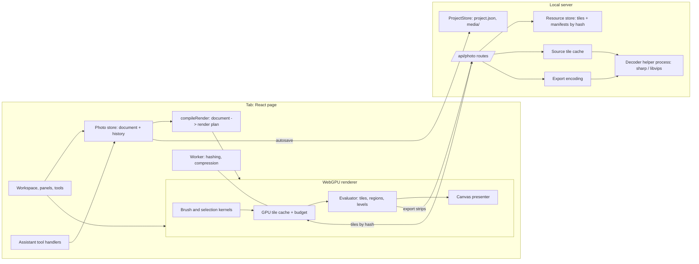

# Architecture: a lasting photo foundation

Status: revised 2026-10-05 (first proposal 2026-10-03). The revision moves rendering and painting into the page
(WebGPU) and decoding into a helper process on the server; there is no native photo engine. Why, and the measurements
behind it: [engine options](research/engine-options.md). Pixel rules: [rendering](rendering.md).

## Principles

- **One document, one history, in the tab**, as in the video and music suites: the tab owns the document and its undo
  history and autosaves it; the server validates and stores. Nothing else keeps a competing copy.
- **Pixels are immutable, content-addressed blobs.** A document never contains pixels; it references *surface
  manifests* by hash, and a manifest references *tiles* by hash. An edit makes new tiles and a new manifest; undo
  switches a reference back. Nothing is replayed, nothing is copied whole.
- **One evaluator.** The page's WebGPU renderer draws the view, the thumbnails, the assistant's pictures and every
  export. There is no second renderer to keep in step (rejected: a native engine plus a page fallback).
- **Untrusted files never reach the app's process.** Decoding and encoding run in a helper process the server
  starts, so a malformed file can crash that, not the app (the desktop app's server runs in Electron's main process).
- **Explicit colour and coordinates.** Linear extended sRGB, premultiplied, document pixels with y down. No module
  guesses a domain.
- **Lasting contracts first, hardening machinery later.** The document format, the resource format, the colour rules
  and the effect definitions are expensive to change once projects exist, so they are decided now. Memory admission
  control, garbage collection policies and fault injection are cheap to add later and wait for the hardening step.

## Where the work happens



**The tab** holds the document and history, compiles the render plan, renders with WebGPU, paints, and hashes and
compresses new tiles in a Worker. **The server** stores blobs, serves decoded source tiles, verifies what it's sent,
saves documents, and has the helper process encode exports. **The helper process** is the only code that parses image
files: it decodes sources into raw tiles (at their own bit depth, oriented, not colour-converted) and encodes exports.
It is a Node script run through `server/process.ts` (in the desktop app as Electron in Node mode, which `process.ts`
already does for `.mjs` scripts), restarted when it dies, as the music engine is. Requests in flight when it dies
are retried one at a time, so a file that crashes it again can only be the one in flight: that one fails, the others
go through (`server/photo/helper.ts`, tested with a deliberate crash).

The renderer creates its device with `requiredLimits` taken from the adapter (a plain `requestDevice()` gets the
spec's defaults: 8192-pixel textures, 256 MiB buffers) and the optional features it uses (`shader-f16`,
`float32-filterable`, `texture-formats-tier2`), each with a stated fallback or a refusal if missing. A lost device is
replaced from a *new* adapter.

GPU work stays on the page's main thread at first: it is asynchronous, and the canvas lives there. If React work
measurably delays frames, the renderer moves into a Worker with an `OffscreenCanvas`; its interface is designed for
that (messages in, frames out, no shared React state).

## Repository layout

Photo is a suite like music: its own folders, the platform through the registries, never another suite.

```text
shared/photo/
  types.ts            PhotoProject, layers, masks, effect instances, ids, API request/response types
  project.ts          createPhotoProject, normalizePhotoProject (validates, repairs, migrates; tested)
  edits.ts            Pure document edits (same instance on a no-op)
  state.ts            PhotoState = document + session state under history (the selection)
  geometry.ts         Affine maths, document/layer/view conversions, tile grids and levels
  surfaces.ts         Manifest type, validation, copy-on-write manifest edits, tile keys
  colour.ts           Transfer functions, ICC matrix/TRC parsing, output transform (CPU reference)
  render-plan.ts      compileRender: document -> render plan; region and level rules per node
  brush.ts            Stroke samples -> dabs (spacing, interpolation; pure and tested)
  effects/            Effect definitions: parameters, units, versions, region rules (exposure, curves, glow, flare)
  reference/          CPU reference kernels for tests (compositing, exposure, curves, blur, colour)
  tools.ts            The assistant's tool specs
server/photo/
  routes.ts           /api/photo/...
  resources.ts        The content-addressed blob store: verify, write, read, reachability, collection
  sources.ts          Source tile cache, built by the helper
  helper.ts           Runs and supervises the helper process (protocol, restarts, queues)
  helper-process.mjs  The helper: sharp decode/probe/encode; JSON lines + binary frames on stdio
  exports.ts          Export jobs: strips from the tab -> helper -> file, published atomically
server/suites/photo.ts  SuiteBackend: create/normalize/stats/remapMedia, what the assistant is told
src/suites/photo/
  index.ts            ClientSuite
  store.ts            Document, history (DocumentHistory<PhotoState>), autosave, publication gate
  ui.ts               Session state outside history: tool, target, viewport, panels
  keys.ts             Photo's shortcuts (pure, tested), as music's keys.ts
  api.ts              Client for /api/photo on lib/api.ts's request
  workspace.tsx       The docked workspace (components/dock)
  panels/             Layers, Properties, tool options, history
  canvas/             The canvas element, overlays (handles, marching ants, brush cursor)
  tools/              Pointer state machines: move/transform, rectangle selection, brush, hand, zoom
  render/             device.ts, tile-cache.ts, evaluator.ts, presenter.ts, kernels/*.wgsl.ts, uploads.ts
  tools-handlers.ts   The assistant's tool handlers; tool-edits.ts their pure edits (tested)
```

Register the folders in `server/architecture.test.ts`'s `SUITE_FOLDERS` **in the first commit**: until then the test
counts photo files as the video zone and lets them import video code silently.

## The document

Times are not involved: an image has no clock. Coordinates are document pixels, x right, y down, origin at the top-left
pixel edge. Layer order is bottom to top (the Layers panel reverses it).

```ts
// As built in F1 (shared/photo/types.ts). Fields arrive with what renders them, by versioned migration.
interface PhotoProject extends DocumentBase {        // { version, name }
  canvas: { width: number; height: number; background: string | null };  // "#rrggbb" sRGB, or transparent
  output: { highlights: "film" | "clip" };            // the SDR output transform, versioned with the document
  layers: PhotoLayer[];                               // bottom to top
}

type PhotoLayer = ImageLayer;                          // F2 adds adjustments, F3 pixel layers and masks, F4 generators

interface ImageLayer {
  id: string; name: string; visible: boolean; opacity: number;   // opacity 0..1
  kind: "image";
  mediaId: string;                                     // project media: the source, kept whole
  transform: LayerTransform;
}

/** Centre in document pixels, scale (negative mirrors), rotation in degrees clockwise: typing 100% gives 100%. */
interface LayerTransform { x: number; y: number; scaleX: number; scaleY: number; rotation: number }

// Planned (F2–F4), as proposed: blend, mask (a SurfaceId, layer-local), effects (EffectInstance[]),
// PixelLayer { kind: "pixel"; surface: SurfaceId }, AdjustmentLayer, GeneratorLayer.
```

Rules, each enforced by `normalizePhotoProject` and tested:

- Every id is unique; references resolve (a `mediaId` to project media, a `SurfaceId` to a well-formed id). A
  dangling reference is reported and kept, never silently dropped: the layer renders as missing.
- An effect instance with an unknown type or a newer version is preserved and shown as unavailable, not reinterpreted
  or deleted. Parameters are validated by their definition; a bad value is repaired to its default and reported.
- Only fields that exist are written. No placeholder layer kinds before their renderer exists; text, groups, crop and
  RAW settings arrive by versioned migrations when built.
- **Media ids appear only in `project.json`.** Manifests and tiles never contain media ids (they're content-addressed
  pixels), because the platform's `remapMedia` rewrites only the document when a package is duplicated or re-id'd.

### Session state and history

`DocumentHistory` is reused as it is: its document is small (layer metadata and hashes), so its 200-entry cap and its
JSON comparison at a gesture's end are fine. Its document type is `PhotoState = { doc: PhotoProject; selection:
SurfaceId | null }`: Photoshop records selection changes in history, so the selection rides along; autosave saves
only `doc` and runs when `doc` changes. Active tool, target (content or mask), viewport, hover, drafts and GPU handles
are session state in `ui.ts`, never in history.

## Resources: surfaces, manifests and tiles

A **surface** is pixels in a tile grid: a pixel layer's colour, a mask's coverage, a selection.

```ts
interface SurfaceManifest {
  v: 1;
  format: "rgba16f" | "r16f" | "rgba32f";      // see rendering.md for which is used where
  tile: 256 | 512;                              // 256 (F0 measured both); recorded so a change needs no migration
  fill: number[];                               // the value of every tile not listed (transparent; masks: 1)
  tiles: [x: number, y: number, ref: string][]; // ref: a tile hash, or "c:" + a constant value
}
```

- A tile blob is the tile's raw little-endian samples, compressed (deflate). **Its hash is SHA-256 of the raw
  samples**, so the compression can change without changing identities. A tile that is all one value is not stored:
  its manifest entry is a constant (`c:`), which keeps masks and fills nearly free.
- A manifest is canonical JSON; its hash is its `SurfaceId`. Tile coordinates are in the surface's own pixels
  (layer-local for layers and masks, document pixels for selections); surfaces can extend past the canvas.
- **The tab computes hashes** (WebCrypto, in the Worker) the moment a stroke ends, so the edit is committed to history
  at once. Uploads follow in the background. The server recomputes every hash and refuses a mismatch.
- The server stores blobs under `photo/resources/` in the package (sharded by hash prefix), written to a temporary
  file, flushed and renamed: a blob either exists whole or not at all. A `PUT` of a blob that exists is a no-op that
  succeeds, so retries and duplicate finishes are harmless by construction.
- Tiles are served by hash with immutable cache headers; the page's GPU cache holds them by hash too.

### The publication gate

A saved document may only reference blobs the server already has. So:

1. The store's `save(doc)` first awaits the uploads of every manifest the document references (and their tiles).
2. The server's photo `normalize` refuses (409) a document that references a manifest it doesn't have, keeping the
   previous `project.json`. This is a defence; with step 1 it never fires.
3. A failed upload is retried with backoff, as the autosaver retries saves. While uploads are failing, the header
   shows the project as not saved, with the reason (disk full, server gone); editing continues on the GPU copies.

This removes ordering problems by construction: no transaction protocol, no staging area, no two-phase commit.

### Garbage

Blobs referenced by nothing pile up (every stroke writes a few tiles). History isn't saved, so once a project is closed
the only roots are `project.json` and the recovery checkpoint. **Collect when a project is opened and no tab has it
open**: mark from those two documents, delete what's unmarked. Never collect while a tab has it open (its history is
a root the server can't see). A crash during collection loses nothing referenced: marking finishes before deleting.

## Sources

Source images are **project media** (`MediaAsset`, kind `image`): they get the package's ownership, URLs,
duplication, Library and id remapping for free. Never fork a second media store.

- **Import** goes through the platform's media upload, with the photo helper's probe for images: dimensions after
  orientation, bit depth, alpha, the ICC profile (kept as bytes) and its kind (matrix/TRC or LUT). Today's import
  probes with ffprobe, then with the helper (`MediaAsset.image`), and accepts PNG/JPEG/WebP/GIF/BMP (16-bit PNG
  too); more formats are still to come (see "Integration" below).
- **Decoding** is the helper's: once per source and decoder version, into a raw tile file in `photo/cache/sources/`
  (8 or 16 bits, oriented, *not* colour-converted, tile-major so a tile is one read at an offset). A 48 MP JPEG
  decodes in about 0.23 s here (measured). The tab fetches tiles by `(mediaId, x, y)`. sharp's defaults are wrong
  for us in three measured ways, so the helper's recipe is explicit and tested:
  - **Profiles**: by default an 8-bit file is converted to sRGB and clipped, and a 16-bit file keeps P3 numbers but
    loses its profile. The helper reads stored values (`ignoreIcc` / `keepIccProfile`) and returns the profile bytes
    from `metadata().icc` separately.
  - **16-bit**: `.raw({ depth: "ushort" })` alone gives 8-bit values in 16-bit slots; it needs
    `.toColourspace("rgb16")`.
  - **Orientation**: `.autoOrient()` applies EXIF orientation, mirroring included, and the probe reports the size after
    it.
- **HEIC** (iPhone photos): sharp's prebuilt libheif decodes AVIF only. On macOS, `sips` converts HEIC to PNG at its
  own depth (10-bit → 16-bit) with its profile (measured), so the helper uses it there; that's the first usable
  editor's work, not the foundations'.
- **Colour conversion happens on the GPU**, exactly and unclipped: transfer curve to linear, then the profile's matrix
  to linear sRGB (with chromatic adaptation), then premultiply. sharp's own conversion clips out-of-gamut colour even
  into float scRGB (measured: Display P3 green comes out `[0, 1, 0]` instead of about `[-0.22, 1.04, -0.08]`), so it
  is not used for matrix/TRC profiles, which is what cameras and phones write (Display P3, sRGB and Adobe RGB are all
  matrix/TRC). A LUT-based profile is converted to sRGB by the helper (Little CMS, inside libvips) and the layer says
  its colours were clipped. An untagged source is sRGB, said so in its layer's properties.
- **Levels** (the pyramid for zoomed-out views) are built on the GPU from linear premultiplied tiles, so reductions
  are correct in light. They're rebuildable and evictable. The first view of a large source can show a quick coarse
  picture (the helper's shrink-on-load preview, labelled as coarse) while full tiles arrive.

## Edits, gestures and strokes

Metadata edits are pure functions in `shared/photo/edits.ts`, committed with `commit(edit)`; drags are gestures
(`DocumentGesture`), one undo step each, previews derived from the gesture's base.

A brush stroke, start to end:

1. **Pointer down** captures the target (layer, content or mask), the brush settings and the current selection.
   Pointer input uses coalesced events, in document coordinates (so zoom and DPR never change the result).
2. **While drawing**, `brush.ts` turns samples into dabs (pure, tested); the GPU stamps them into *draft tiles*:
   a draft tile is a copy of the committed tile, made on first touch (copy-on-write). The view draws through drafts.
3. **Pointer up**: the touched draft tiles are read back (20 tiles took 2 ms here), hashed in the Worker, and a new
   manifest is built from the old one plus those entries. One `commit` puts the new `SurfaceId` in the document:
   one undo step. Uploading starts.
4. **Escape, pointer cancel, a tool or project switch** before pointer up: drafts are dropped; nothing was committed.

Undo and redo switch `SurfaceId`s; tiles the GPU cache no longer holds are fetched by hash. Strokes on the same
surface are serial (the next one's base is the previous one's result, already on the GPU), so there's no merge.

A selection is a coverage surface in document pixels (a rectangle's edges antialiased), committed as
`PhotoState.selection`. It is session state, never saved, so its tiles stay in the tab and are never uploaded (most
are constant, so it costs almost nothing). "Mask from selection" makes the mask in the layer's own pixels. If the
layer's transform is the identity, it shares the selection's manifest (safe, since nothing changes in place);
otherwise the GPU resamples the selection through the inverse transform into a new surface, which is uploaded like a
stroke.

## Persistence and the package

```text
Name.vaudio/
  project.json                    The document (platform)
  meta.json                       Suite and dates (platform)
  media/<id>/                     Sources (platform)
  photo/resources/<ab>/<hash>     Tiles and manifests: authored, never rebuildable
  photo/recovery/previous.json    The last document whose blobs were all present (recovery checkpoint)
  photo/cache/                    Decoded sources, levels: rebuildable, never copied
```

- **Saving** is the platform's autosave (`createAutosaver`, debounced, one at a time, retried), behind the
  publication gate. After a successful save the server copies the previous `project.json` to the checkpoint.
- **Durability**: blobs are flushed before they're acknowledged; photo documents are written temp, flush, rename,
  and the folder flushed. What we promise: a crash of the tab, server or helper never loses an acknowledged edit,
  and a document never references a missing blob; a power loss can lose the last seconds. **On open** the server
  checks that every referenced manifest and tile exists; if not, it opens the checkpoint and says so.
- **A corrupt `project.json` must not be replaced.** Today the platform swaps an unreadable document for a new empty
  one (`readDocAt` in `server/projects.ts`), which the next autosave writes over the damaged file. Fix this for every
  suite before photo ships: set the file aside (`project.corrupt-<date>.json`) and open the checkpoint, or refuse
  with a message.
- **Duplicate** copies the package's other folders whole (`server/projects.ts` `copy`): photo needs copy-on-write
  clones (FICLONE) for `photo/resources` and its `cache` folders skipped. Platform change, small.
- **Move/rename** moves the whole package: blobs travel with it; nothing has a path inside it.

## Exporting

The open tab renders full-resolution composite tiles in strips with the same kernels, applies the output transform
and quantises (8-bit with deterministic dithering, see rendering.md), and sends each band of tile rows as it's made
(F0's lab: `POST /exports` to begin, `PUT /exports/:id/rows?from=` per band, `POST /exports/:id/finish`), so neither
side ever holds the whole image (a single 192 MB body from a 48 MP page broke F0's first run). The helper encodes (PNG, JPEG over a matte; TIFF 16-bit later) into a temporary file that is renamed into
place only when complete; cancelling deletes it; an existing file is never overwritten by a failed export. The export
pins one document state, so editing continues meanwhile. The export loop is driven by GPU completion
(`onSubmittedWorkDone`), never `requestAnimationFrame`: a window that's fully covered on macOS becomes hidden and is
throttled even with `backgroundThrottling: false` (verified), and exports must not slow down because of that. 16-bit
TIFF must name a lossless compression (sharp's TIFF default is JPEG, which forces 8 bits). 8-bit output is tagged
sRGB (sharp's sRGB-to-sRGB tagging leaves 8-bit samples exact, measured); 16-bit output stays untagged for now,
because the same call changes 16-bit samples by up to 25 000 of 65 535 (measured on sharp 0.35.5): writing the
profile chunk ourselves is F4's.

Exporting a project no tab has open (the assistant, in the background) uses a hidden page: in the desktop app a hidden
window (as `electron/gl-window.ts` does for video), otherwise headless Chromium. Both have WebGPU on Metal with the
flags `server/gl-browser.ts` already passes (measured); the prototype only exports from the open tab.

## Failure handling

| Failure | What happens |
| --- | --- |
| GPU device lost | `device.lost`: recreate the device, re-upload from the server's blobs and sources; an unfinished stroke is cancelled and the user told so |
| Helper process dies | Restarted on the next request; its job is retried once, then fails with the file's name |
| Server unreachable | Uploads and saves retry; the header says not saved; nothing committed is dropped from the tab |
| Tab closes or crashes | The last autosave and its blobs are on disk; at most the debounce window is lost |
| Disk full | Uploads fail with that reason; the project shows not saved; the previous good state on disk is intact |
| Missing source file | The layer renders as missing (hatched), keeps its settings, can be relinked later |
| No WebGPU adapter | The photo workspace says it needs WebGPU and why; other suites are unaffected. No CPU renderer in v1 |

## The assistant

Same parity rule as every suite: each feature lands with its tool. Tools act through the same edits as the UI (an
`edit` tool is a pure `(state, input) => { state, text }` in `tool-edits.ts`, tested). It reads the document as
text (`get_document`: layers, their kinds, transforms, effects with values) and sees it as pictures (`view_image`:
the renderer draws a JPEG of the document or a region, as video's `view_frames` does, `src/assistant/frames.ts`).
It can't paint strokes in v1; it can add and change layers, adjustments, effects, transforms, masks from selections
and exports.

## Integration with the platform

Registries (TypeScript lists what's missing): `SuiteId`, `SUITES`, `SuiteDocuments` (`shared/suites.ts`),
`SUITE_TOOLS` (`shared/suite-tools.ts`), `suiteBackend` (`server/suites/index.ts`), `clientSuite`
(`src/suites/index.ts`). Then these, found by reading the code, which aren't registries yet:

| Where | What photo needs |
| --- | --- |
| `server/architecture.test.ts` `SUITE_FOLDERS` | **Done in F0** (`shared/photo/`, `server/photo/`, `src/suites/photo/`); add `server/suites/photo.ts` in F1 |
| `server/projects.ts` `readDocAt` | Never replace a corrupt document (all suites) |
| `server/projects.ts` `copy` | FICLONE clones; skip rebuildable `cache` folders |
| Media import (`server/media.ts`, `probe.ts`) | **Done**: the media store is the platform's, and `app.ts` gives it the helper's probe (`MediaLibraryOptions.probeImage`: `MediaAsset.image` says bits, alpha, orientation, ICC; its upright size wins). Still to do: photo's formats (TIFF, AVIF, HEIC), which ffprobe's checks refuse today |
| `DocStats`, `ProjectPreviews` (`server/project-previews.ts`) | A still cover for Home: the tab renders one after saves; previews are audio/video only today |
| Home drop (`home.tsx`: first suite whose `startsWith` accepts) | Images alone start a photo project; video currently takes them |
| `electron/main.ts` File menu, `server/projects.ts` error text | Hard-coded to video and music |
| `server/storage.ts` `writeJson` | A flushed variant (file and folder) for documents that promise durability |
| `playwright.config.ts` | WebGPU needs the GPU launch flags (`--use-angle=metal --enable-gpu`, what `server/gl-browser.ts` passes): the default headless launch has `navigator.gpu` but no adapter (measured; `scripts/photo-bench.ts` launches that way) |
| Desktop packaging (`scripts/desktop.ts`) | **Built in F0.** `Resources/photo-helper/helper.mjs` (the helper and sharp's JavaScript, bundled) and `native/@img/` (the addon and libvips, 19 MB; Node-API, so not tied to Electron's ABI). electron-builder drops any folder called `node_modules` from resources, so the bundle's one require of the addon is pointed at `native/` (asserted at build). libvips is LGPL-3.0-or-later, dynamically linked: its package keeps its licence and notices. `pnpm test:desktop` checks the packaged helper decodes and encodes exactly |
| `electron/main.ts` switches | **Built in F0.** Chrome stops giving a page an adapter after a second GPU-process crash within two minutes; the desktop app turns that off (`--disable-gpu-process-crash-limit`, `--disable-domain-blocking-for-3d-apis`) so recovery always works. The browser keeps Chrome's behaviour: after repeated crashes the workspace asks for a reload |

Workspace pieces reused as they are: the dock (`components/dock`, suite-agnostic), Settings sections, the assistant
panel, themes and `components/ui`. Shortcuts are photo's own (`keys.ts`), as music's are: there's no platform registry.

## Modularity that must hold

- Swapping the GPU backend (WebGL2, or native Dawn running the same WGSL) changes no project file.
- Adding an effect is a definition, kernels, its region rule and fixtures; the Layers panel and the routes don't change.
- Brushes, the assistant and the UI change the document through the same edits and resources.
- No library object, GPU handle or path crosses into the document. Sources, authored blobs and caches have separate
  owners and lifetimes.
- A failed preview, upload or export never removes a committed edit.
