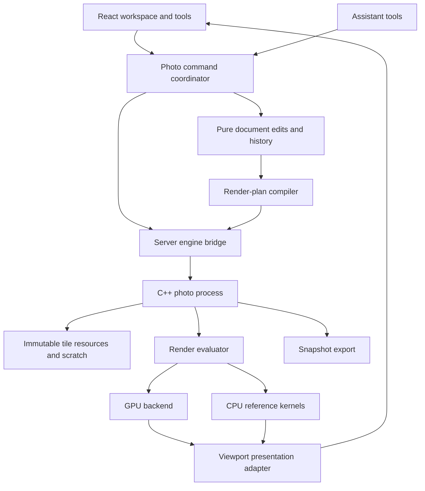

# Architecture: a lasting photo foundation

Status: implementation proposal, 2026-10-03. Backend and presentation choices have prototype gates.
Read [rendering](rendering.md) for pixel contracts and [engine research](research/engine-options.md) for alternatives.

## Architecture principles

One authoritative document, one commit/history path, immutable pixel resources, explicit color and
coordinates, bounded caches, revisioned asynchronous work, and the same evaluator for preview/export.
Modules should hide a real change boundary; avoid building a general plugin framework before the first
two effects work. Add small typed interfaces for storage, processing and presentation.

Use C++20 for pixel storage, painting, decoding adapters, scheduling and rendering. Use TypeScript for
document semantics, pure edits, the compiled render description, UI and assistant commands. C libraries
can be wrapped by the native modules. Language choice does not substitute for avoiding copies or
choosing good algorithms.

## Ownership and dependency direction



The server serializes accepted commits per project and validates referenced resources. A tab holds
the editable metadata and history; the engine executes compiled work and produces resources. It must
not independently mutate layer structure or maintain a competing undo stack. A second editing client
uses revision checks rather than silently overwriting the first; multiwriter merging is deferred.

Native code depends on photo protocol/render contracts, not React, the video timeline, or JUCE. GPU
types stay behind the render backend. Presentation is replaceable without changing the document.

## Proposed repository layout

```text
shared/photo/
  types.ts, project.ts       Document types, creation, validation, migrations
  edits.ts                  Pure metadata edits
  commands.ts               User/assistant command inputs and results
  protocol.ts               Versioned engine control and event contracts
  compile.ts                Document -> immutable render plan
  effects/                  Definitions, parameter validation, presets
src/suites/photo/
  index.ts, store.ts         Suite lifecycle, metadata history, autosave coordination
  workspace/                Panels and document canvas
  tools/                    Pointer state machines; transforms, selection, brush
  engine-client.ts          Requests, revision tracking, presentation adapter
server/photo/
  engine.ts                 Process lifecycle, handshake, jobs, resource operations
  routes.ts                 Validated control/binary transport
  persistence.ts            Photo resource staging and save integration
server/suites/photo.ts      Create/normalize/stats/remap and assistant instructions
photo-engine/
  CMakeLists.txt
  src/core/                 Geometry, tile/resource descriptors, errors
  src/resources/            Immutable manifests, tile storage, cache, scratch
  src/paint/                Stroke sampling and raster/mask operations
  src/render/               Graph evaluator, scheduler, CPU kernels, GPU backend
  src/io/                   Decoder, color transform and encoder adapters
  src/protocol/             Host commands, events, binary framing
  tests/                    Native fixtures, headless rendering, fault injection
```

Keep the photo target independent of `engine/`, which currently builds the audio engine with JUCE.
Reuse lifecycle patterns from `server/music/engine.ts`, not its audio commands or runtime. Only extract
shared process helpers after both callers demonstrate the same need.

## Canonical document and pixel resources

The metadata document follows existing `DocumentBase` (`version`, `name`) and adds canvas settings,
working-space identifier, ordered layer tree, resource descriptors and versioned effect instances.
Every layer, effect and resource has a stable opaque ID. Layer order is explicitly bottom-to-top;
the UI reverses it for topmost-first display. Transform coordinates are in document pixels, y down.

Start with discriminated layer kinds: placed image, pixel layer, adjustment and generator. Add group
support in the next core milestone using explicit child order and isolation. Do not persist arbitrary
compiled graph nodes as the public document model. Render plans and GPU cache handles are derived.

A placed image references preserved source media plus its interpretation (orientation, profile,
decoder version). A pixel layer or raster mask references an immutable surface manifest. A manifest
records bounds, sample format, color/coverage semantics, tile-grid specification, default sample and
tile blob IDs. It shares unchanged tile references with earlier versions. Pixel arrays never live in
project JSON, React state or base64 engine control messages.

An effect instance stores definition ID, implementation/schema version, parameters, enabled state,
mix and optional mask. The registry describes parameter units and validation; the compiler resolves
an instance into processing nodes. Unknown effect versions are preserved and reported, not silently
reinterpreted. Opening a document with unsupported required content should use an explicit limited
or read-only mode, retaining its data.

Do not add fake future layer kinds with no renderer. Introduce text, paths, embedded documents and
RAW settings through versioned document migrations when their milestones are researched.

### State that stays outside the document

Active tool, active layer/mask target, hover, pointer capture, viewport, panel layout, draft gestures,
pending jobs and GPU handles are session state. A current selection is session coverage, with its own
undoable entries in the common command history; saved selections become document resources later.
Selection resource roots must stay pinned while active or retained by history.

## Edits, gestures and resource transactions

Pure metadata edits return the same object for a no-op. Gesture preview is separate from committed
state; one drag/stroke becomes one undo entry. `DocumentHistory` is useful for metadata semantics,
but its 200-entry cap and JSON comparison do not provide a pixel memory budget or resource lifetime
management. Wrap/extend it behind the photo store instead of copying entire image buffers into it.

Example: a mask brush stroke.

1. Capture target layer/mask, base revision, resource version, selection coverage and brush settings.
2. Start an engine transaction; apply numbered input batches to copy-on-write draft tiles. Display
   its preview without publishing the draft as the committed document.
3. On pointer-up, finalize the immutable tiles and surface manifest. The engine returns staged resource
   IDs, affected bounds and a transaction receipt; cancellation releases the draft.
4. The server validates/publishes staged blobs before accepting a metadata edit that references them.
   Compare the base revision. A stale transaction is rejected or deliberately retried, never applied
   to a different target. Duplicate finalize requests return the same receipt.
5. The client records one history entry with before/after metadata and selection/session changes.
   Autosave sees committed state only. Undo switches resource references; it does not rerun the stroke.

Durable publication is required before a save may reference resources. Persist pixels as the
authority; optionally retain sampled strokes for future editing. Input replay alone is insufficient
because algorithms, sampling and brush assets can change.

Resource liveness roots include current document, history, saved checkpoint, active selection,
in-flight transactions and export snapshots. GPU caches are not roots. Collection is conservative;
do not delete persisted pixel blobs during the prototype. Later GC must scan all checkpoint/history
roots, including recovery data, before deleting anything.

## Engine protocol and scheduling

Use versioned small control messages and a separate length-framed binary channel for pixel output.
The exact channel can start as an engine pipe relayed by the local server. Bound message sizes and
queues. JSON-lines is reasonable for control, following the music integration; full image data is not.

Every request/event carries protocol version, project/session ID, request ID, document revision and
engine epoch. Rendering also carries view revision; gestures carry transaction ID and batch sequence.
The epoch changes after restart, preventing late responses from a dead engine from matching new jobs.

Handshake reports backend/device, supported effects/formats, limits and build versions. Commands cover
open/close, publish plan, begin/update/finalize/cancel resource edit, viewport render, export snapshot,
cancel job and resource statistics. Acks distinguish accepted, completed, cancelled and failed work.
Parameter errors, stale revisions, missing resources, decode failures, disk full and device loss get
typed errors rather than a generic engine disconnect.

Generate or mechanically validate native/TypeScript protocol schemas from one definition. The
existing repo has no photo schema generator; select a small approach during implementation and use
shared protocol fixtures to catch drift. Validate untrusted messages at both boundaries.

Prioritize cursor/gesture feedback, visible viewport tiles, refinement, thumbnails, then background
exports. Coalesce superseded preview requests, but never discard brush input batches or committed
operations. Batch brush inputs off the React render path. Jobs reference immutable snapshots and
can be cancelled without leaving partial published edits.

## Persistence and project integration

Extend `SuiteId` with `photo`, and register its shared document/tools, server backend and client suite.
Existing suite contracts are in `shared/suites.ts`, `shared/suite-tools.ts`, `server/suites/suite.ts`
and `src/suites/types.ts`. Implement `open`, `close`, `flush`, `discard`, settings, summaries and tools.
Keep photo-specific statistics out of duration-based video assumptions; audit `SuiteSummaries` and
`DocStats` rather than pretending an image has a timeline.

Proposed package additions:

```text
project.json                   Existing canonical document entry
meta.json                      Existing project/suite metadata
media/                         Existing imported-source ownership
photo/resources/<blob-id>       Immutable tile and manifest blobs
photo/recovery/                 Recent committed checkpoint/recovery records
photo/cache/                    Rebuildable decoded tiles and previews
```

Integrate with existing package storage; confirm actual paths before implementing. Source bytes,
working-profile data and authored tile manifests travel with duplication/moving. Caches can be dropped.
`remapMedia` changes source IDs on project duplication; photo blob IDs remain valid when their whole
resource subtree is copied. Do not allow generic duplication to copy JSON while omitting photo blobs.

Save stages blobs, verifies reachable manifests, then atomically replaces the document checkpoint;
only then report saved and update recents/thumbnail metadata. Serialize saves and reject older
revisions. Keep a prior recoverable checkpoint. Temp-file/rename protects against partial JSON, but
does not by itself guarantee power-loss durability: flush files and required directory metadata for
the durability level we advertise. Existing `writeJson` needs a photo-specific durability assessment.

An engine restart loads the last accepted metadata and resources. Abort incomplete gestures and show
the user their committed state. Preserve finalized unpublished resources for cleanup/recovery rather
than inventing a commit. `flush` waits for gesture resolution, resource publication and checkpoint
completion; export pins one committed revision while editing continues.

## GPU execution and presentation

Recommended first candidate: native Dawn/WebGPU with WGSL processing kernels. Select the backend only
after a packaging, precision and viewport-transfer experiment. CPU kernels are correctness oracles and
a basic recovery path for the initial operations, not a requirement to duplicate every later effect.

Presentation candidates are bounded viewport readback for baseline browser/Electron development and
shared native textures for the desktop fast path. Electron's shared-texture APIs exist but are
experimental; supported formats, synchronization, sandbox/preload access and retained-frame lifetime
must be tested on our installed Electron. Offscreen BrowserWindow rendering is the opposite direction
and does not prove native-to-canvas integration.
[Electron sharedTexture](https://www.electronjs.org/docs/latest/api/shared-texture).

A 1920×1080 RGBA8 viewport is about 8.3 MB; at 60 updates/sec, readback alone moves about 498 MB/sec
before copies. Read back changed viewport regions/coalesce updates and measure. Never read back a
48 MP working document on every pointer event. If readback misses targets and shared-texture delivery
cannot be made reliable, revisit the renderer/presenter split before completing the prototype.

## Modularity that must hold during implementation

- Changing GPU backend does not migrate project files.
- Adding an effect requires a definition, processing implementation, bounds/dependency contract and fixtures;
  it does not change the layer panel or command protocol for every effect.
- Brushes and assistant edits use the same transactions as manual operations.
- Decoder/color/encoder libraries sit behind narrow native adapters; no library object leaks into JSON.
- Source files, authored pixels and rebuildable caches have distinct ownership and lifetimes.
- Export captures one revision and uses the same evaluator, with full quality and explicit output policy.
- Failure handling is part of each module contract; accepted edits cannot vanish because a preview failed.
