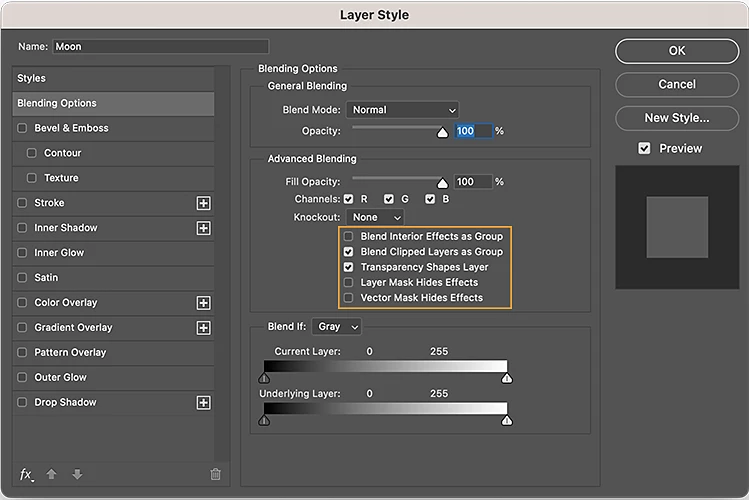
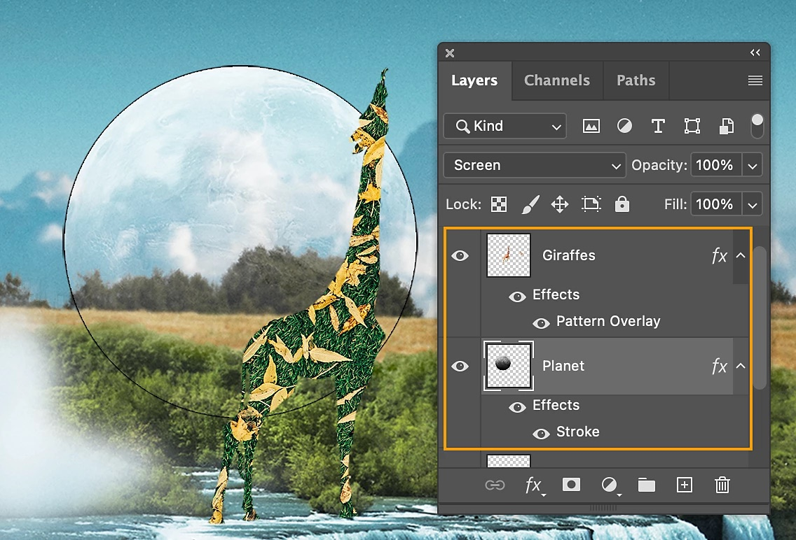
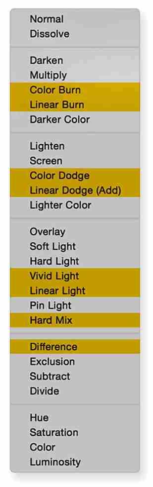
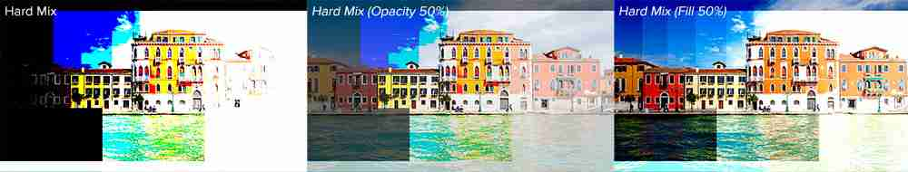
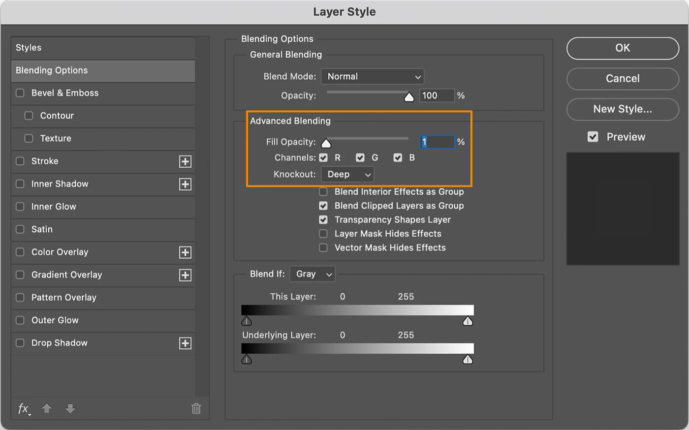
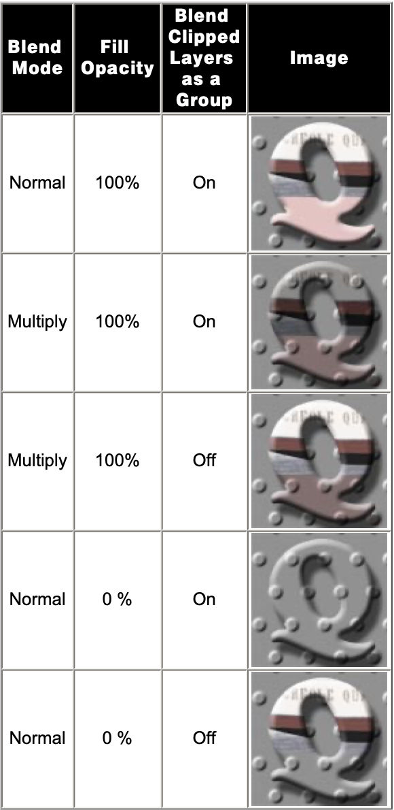
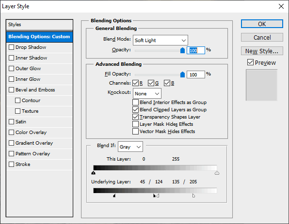
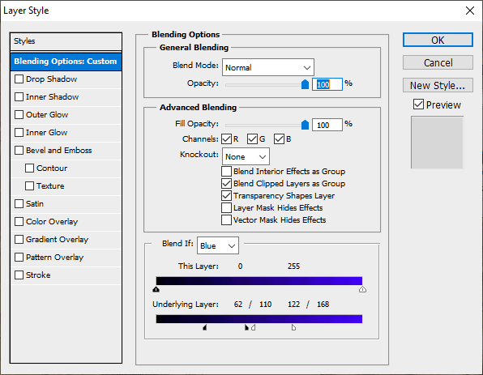

# Advanced Blending and Blend If

> **Measured since** (2026-10-06, Photoshop 27.11): fill and the special eight, Fill 0 %, and a pixel's own transparency (it acts like Opacity). See [photoshop-measurements.md](photoshop-measurements.md),
> which overrides this document where they disagree.

How Photoshop's Blending Options page works below **General Blending**: Fill Opacity, Channels, Knockout, the
five checkboxes, and **Blend If**. Researched 2026-10-06 for a Photoshop-faithful Layer Style feature in the
photo suite. No hands-on Photoshop session was available: the behaviour comes from Adobe's documentation and
file format specification, the source code of PSD readers and renderers, and two open-source renderers that
calibrate themselves against Photoshop 2026 (psd-tools and Patchy). The last two sections are ours:
[implementation notes](#implementation-notes-for-us) and [open questions](#open-questions).

## How to read the evidence

Every claim carries one of these labels.

| Label | Means |
| --- | --- |
| **Verified** | Adobe's own help pages, Adobe's PSD specification, an Adobe screenshot, or a file format fact read in parser source code |
| **Secondary (measured)** | A third-party renderer that states it was calibrated against real Photoshop output (Patchy against Photoshop 2026 / 27.8 COM captures; psd-tools against Photoshop 2026 fixtures). Strong evidence, but not Adobe's |
| **Secondary** | A reputable book, tutorial or forum answer |
| **Inferred** | Our own reasoning from the above. Treat as a hypothesis until tested |

All maths below uses values in [0, 1] (8-bit value ÷ 255) unless it says otherwise. `s` is the layer's
(source) colour, `d` the backdrop (destination), `α` the layer pixel's own alpha, `m` its masks, `f` Fill
Opacity, `o` Opacity.

## Where it is



*The Blending Options page as Adobe's current help shows it (macOS). Note the slider label **Current Layer**.*

- **Layer > Layer Style > Blending Options…**, **Blending Options…** from the Layers panel's fx button (Add A
  Layer Style) or the panel menu, or double-click the layer row outside its name and thumbnail. For a type
  layer Adobe says to use the menu or the fx button. **Verified** (Adobe, "Layer opacity and blending").
- The page is the second item of the Layer Style dialog's left list. It reads **Blending Options: Default**
  until something on it changes, then **Blending Options: Custom** (see the Windows screenshot under
  [Blend If](#the-controls)). **Verified** (screenshot).
- **Blend Mode**, **Opacity** and **Fill** are also in the Layers panel, and are the same values: changing one
  place changes the other. **Verified** (Adobe; the Photoshop CS2 Bible says the same).
- A layer with non-default advanced blending shows a small badge at the right of its Layers panel row (two
  overlapping squares in Adobe's knockout screenshot below). **Verified** that the badge exists; which settings
  trigger it is **Inferred** (any non-default value on this page).
- The **Properties** panel: we found no evidence that it shows any of these controls in 2024–2026. **Unverified.**
- **Not this page**: a Smart Filter's "Blending Options" (double-click the filter's blending icon) only has a
  mode and opacity for that filter. **Verified** (Adobe shortcuts page lists it separately).
- **Groups**: the same page opens for a group. Adobe's 2025 page says Fill "is not available for layer groups,
  only the overall Opacity control appears" in the **Layers panel** (**Verified**), but groups do carry a Fill
  value that Photoshop renders (psd-tools' Photoshop 2026 fixtures have a group at Fill 50%; Patchy: "folder
  Fill fades the content, never the effects"). **Secondary (measured).**
- **Adjustment layers**: the Blending Options page is reachable (Layer > Layer Style > Blending Options, or the
  context menu) with mode, opacity, Fill, Knockout and Blend If; layer effects are not offered. **Secondary**
  (CS2 Bible; Damien Symonds shows Blend If on a Hue/Saturation layer).
- **Background layer and locked layers**: Opacity can't be changed. **Verified** (Adobe). Fill likewise
  (**Inferred**: the Background has no transparency at all).
- A saved Style can carry the blending options: the **New Style** dialog has an "Include Layer Blending
  Options" checkbox (**Secondary**), and `.asl` files hold a `blendOptions` descriptor with `Opct`, `Md  `,
  `fillOpacity` and the Blend If ranges (`Blnd`) (**Secondary (measured)**, Patchy `docs/ps-compat.md`).
  Whether Knockout, Channels and the checkboxes travel with a style is **Unverified**.



*Adobe's Layers panel. **Fill** sits under **Opacity**, on the Lock row.*

## The controls at a glance

| Control (as labelled) | Type | Range / values | Default | PSD storage | Action Manager key |
| --- | --- | --- | --- | --- | --- |
| Fill Opacity (Layers panel: Fill) | slider + field, % | 0–100 | 100 | tagged block `iOpa`: 1 byte 0–255 + 3 pad; omitted at 100 % | `fillOpacity` (unitDouble, `percentUnit`); DOM `ArtLayer.fillOpacity` |
| Channels: R G B (C M Y K, L a b in other modes) | checkboxes | on/off each | all on | `brst`: list of int32 channel numbers that are **restricted** | `channelRestrictions`: list of `channel` enums that stay **enabled** |
| Knockout | menu | None, Shallow, Deep | None | `knko`: 1 byte 0/1/2 + 3 pad (the spec calls it a boolean) | `knockout` enum: `shallow`, `deep` (and none) |
| Blend Interior Effects as Group | checkbox | | off | `infx`: 1 byte bool + 3 pad | `blendInterior` |
| Blend Clipped Layers as Group | checkbox | | **on** | `clbl`: 1 byte bool + 3 pad; absent means on | `blendClipped` |
| Transparency Shapes Layer | checkbox | | **on** | `tsly`: 1 byte bool + 3 pad | `transparencyShapesLayer` |
| Layer Mask Hides Effects | checkbox | | off | `lmgm`: 1 byte bool + 3 pad | `layerMaskAsGlobalMask` |
| Vector Mask Hides Effects | checkbox | | off | `vmgm`: 1 byte bool + 3 pad | `vectorMaskAsGlobalMask` |
| Blend If | menu | Gray, Red, Green, Blue (RGB) | Gray | (selects which pair is shown) | `channel` in each `blendRange` |
| This Layer / Current Layer | 4-handle slider | 0–255 per handle | 0 / 255 | layer record "blending ranges": source range | `srcBlackMin`, `srcBlackMax`, `srcWhiteMin`, `srcWhiteMax` |
| Underlying Layer | 4-handle slider | 0–255 per handle | 0 / 255 | layer record "blending ranges": destination range | `destBlackMin`, `destBlackMax`, `destWhiteMin`, `destWhiteMax` |

Sources: the PSD spec names `clbl`, `infx`, `knko`, `brst`, `tsly`, `lmgm`, `vmgm` and the blending ranges
(**Verified**). `iOpa` is not in the spec but is read by ag-psd and psd-tools (**Verified** in their source).
`knko`'s three values are psd-tools' `Knockout` enum (NONE 0, SHALLOW 1, DEEP 2), while ag-psd reads it as a
boolean and so loses Deep (**Verified** in source). The defaults come from Adobe's text ("always selected by
default" for Blend Clipped Layers and Transparency Shapes Layer) and its screenshots (**Verified**). The Action
Manager names come from scripts that drive Photoshop (jamLayers, psd-zoo) and Photoshop's charID tables
(**Secondary**). Two charID quirks: `destWhiteMax`'s charID `Dstt` is shared with `desaturate`, and scripts see
the green channel as `grain`; read them by charID, not by stringID (**Secondary**).

## Fill Opacity

### What it scales

- Opacity "affects layer styles and blending modes applied to a layer"; Fill "affects only pixels, shapes, or
  text on a layer without affecting the opacity of layer effects such as drop shadows". **Verified** (Adobe).
- So at Fill 0 % the layer's own content disappears and every effect stays at full strength. This is the
  standard "effects only" trick (a stroke or glow around invisible text). **Verified.**
- Interior effects (the three Overlays, Satin, Inner Glow, Inner Shadow) are **not** faded by Fill unless
  **Blend Interior Effects as Group** is on; exterior effects (Drop Shadow, Outer Glow, Stroke, Bevel & Emboss)
  never are. **Secondary** (CS2 Bible; class notes). Which effects count as interior differs between sources:
  see [Blend Interior Effects as Group](#blend-interior-effects-as-group).
- Clipped layers fade with their base's Fill while **Blend Clipped Layers as Group** is on, and keep their
  strength when it's off. **Secondary** (class notes' Fill 0 % example, below; Patchy).
- An adjustment layer's strength is scaled by Fill as by Opacity. **Secondary (measured)** (Patchy).
- A group's Fill fades the group's content, not the group's own effects. **Secondary (measured)** (psd-tools'
  `knockout-none-*` fixtures: a blue layer in a Fill 50 % group over red flattens to (127, 0, 128); Patchy).
- Dissolve: Fill and Opacity both just lower the probability that a pixel is painted. **Secondary (measured)**.
- Photoshop stores Opacity and Fill as bytes (0–255), so 50 % is 128/255 when blending. **Verified** (spec for
  Opacity; `iOpa` for Fill, e.g. 37 % = 94) and **Secondary (measured)** for the blending (Patchy).

### The ordinary 19 modes: Fill is just more opacity

For every mode except the eight below, Fill multiplies the layer's coverage exactly as Opacity does, so 40 %
Fill and 40 % Opacity look the same on a layer without effects. **Verified** in outcome (Photoshop Training
Channel: "19 out of the 27 Blending Modes behave the same way"), **Secondary (measured)** for the formula.

The compositing is the W3C/PDF model (**Verified**, W3C Compositing and Blending §5.8): the mode's colour where
the backdrop is opaque, the source's own colour where it isn't, then source-over with the combined weight.

```
a   = α · m · g                    // pixel alpha × masks × Blend If gate (below)
w   = a · f · o                    // the weight for an ordinary mode
s'  = (1 − αd) · s + αd · B(s, d)  // W3C: the blended colour
out = s' · w + d · αd · (1 − w)    // premultiplied out; αout = w + αd · (1 − w)
```

### The special eight



*The eight modes where Fill and Opacity differ (Photoshop Training Channel).*

**Color Burn, Linear Burn, Color Dodge, Linear Dodge (Add), Vivid Light, Linear Light, Hard Mix,
Difference.** For these, 50 % Fill and 50 % Opacity give different pictures; Fill usually looks gentler and
more useful. **Secondary** (PTC; Adobe community; widely reproduced) and **Secondary (measured)** (Patchy's
`blend_mode_has_special_fill` lists exactly these eight, calibrated on 256×256 Photoshop 2026 captures).



*Hard Mix: full strength (left), Opacity 50 % (middle: a posterised result washed over the original), Fill
50 % (right: a softer contrast boost with many levels). Photoshop Training Channel.*

**Why.** Opacity is applied *after* the blend, as a crossfade: `lerp(d, B(s, d), o)`. Fill is applied *inside*
the blend, by first pulling the source towards the mode's **neutral colour** (the colour that leaves the
backdrop unchanged), then blending at full strength:

```
s_f = n + f · (s − n)       // n = 1 for the burns, 0 for the dodges and Difference, ½ for Vivid/Linear Light
K_f(s, d) = B(s_f, d)
```

- Evidence: an Adobe community expert showed that Color Burn at Fill X % equals Fill 100 % with a white layer
  clipped to it at (100 − X) % opacity, which is exactly `s_f = 1 − f(1 − s)`. A Unity forum user matched Color
  Dodge to `lerp(d, d / (1 − f·s), o)` against Photoshop "except near 1". Patchy implements the source pull for
  the burns, dodges and Difference, and states that for the three light modes Photoshop fades the kernel's own
  doubled term towards that half's neutral, which in continuous terms is the same pull towards ½.
  **Secondary (measured).**
- When `B` is affine in `s` on each side of the neutral and never clamps (Multiply, Screen, Overlay, Soft
  Light, Hard Light…), pulling the source gives exactly the crossfade, so Fill = Opacity anyway. The eight are
  modes that divide (the dodges and burns, Vivid Light), clamp (Linear Dodge, Linear Burn, Linear Light), step
  (Hard Mix) or take an absolute value (Difference). **Inferred.** Darken, Lighten and Pin Light are also not
  affine, yet Photoshop doesn't treat them specially, so the list is Adobe's choice, not a mathematical
  necessity (**Inferred**).

Continuous kernels at Fill `f` (Patchy's 8-bit integer kernels reduce to these; **Secondary (measured)**,
except where marked):

| Mode | 100 % Fill | At Fill f |
| --- | --- | --- |
| Color Burn | `1 − (1 − d) / s` | `1 − (1 − d) / (1 − f(1 − s))` |
| Linear Burn | `d + s − 1` | `d − f(1 − s)` |
| Color Dodge | `d / (1 − s)` | `d / (1 − f·s)` |
| Linear Dodge (Add) | `d + s` | `d + f·s` |
| Difference | `|d − s|` | `|d − f·s|` |
| Linear Light | `d + 2s − 1` | `d + f(2s − 1)` |
| Vivid Light | burn by `2s` below ½, dodge by `2s − 1` above | the same with `s_f = ½ + f(s − ½)` |
| Hard Mix | `1 if s + d ≥ 1 else 0` | `(d − f(1 − s)) / (1 − f)`: a steep ramp, not a threshold |

All clamp to [0, 1]. Hard Mix is the one mode that isn't a source pull: its Fill version is a linear ramp of
slope `1/(1 − f)` centred on the 100 % threshold. That fits the observation that Hard Mix at Fill 90 % gives
about 27 levels per channel and at 50 % about 129 (`255·(1 − f) + 1`) (**Secondary**, Adobe community), and
Patchy pins it to Photoshop captures at nine Fill values. Krita's "Hard Mix Softer (Photoshop)" mode,
`3d − 2(1 − s)`, is this ramp at `f = ⅔` (**Verified** in Krita source; the link to Fill is **Inferred**).

**How the result lands.** The blend result is weighted by coverage × Opacity, not by Fill; Fill only scales how
much alpha the layer adds where the backdrop is transparent (**Secondary (measured)**, Patchy's "shared
special-Fill alpha split", confirmed by Photoshop COM probes at Opacity 50 % and under a uniform mask):

```
e    = a · f · o                        // alpha the layer adds
w    = a · o                            // weight of the blend result
αout = e + αd · (1 − e)
out  = s · e · (1 − αd) + K_f(s, d) · w · αd + d · αd · (1 − w)   // premultiplied
```

Over an opaque backdrop this is `lerp(d, K_f(s, d), a·o)`: Fill changes the kernel, coverage and Opacity
crossfade it.

**Worked examples** (opaque backdrop):

| Mode | d | s | 50 % Fill | 50 % Opacity |
| --- | --- | --- | --- | --- |
| Linear Dodge | 0.8 | 0.5 | `min(1, 0.8 + 0.25)` = 1.0 | `lerp(0.8, 1.0, ½)` = 0.9 |
| Difference | 0.5 | 1.0 | `|0.5 − 0.5|` = 0.0 | `lerp(0.5, 0.5, ½)` = 0.5 |
| Color Dodge | 0.5 | 0.8 | `0.5 / 0.6` = 0.833 | `lerp(0.5, 1.0, ½)` = 0.75 |
| Hard Mix | 0.6 | 0.5 | `(0.6 − 0.25) / 0.5` = 0.7 | `lerp(0.6, 1.0, ½)` = 0.8 |

**8-bit details Patchy pinned** (**Secondary (measured)**; useful only for byte parity): Fill is rounded to a
byte first (`fb = round(f·255)`); Fill 0 skips the layer entirely; Linear Light's neutral is 127.5 (its kernel
is `d + 2s − 256`, so low Fill darkens by one level); Vivid Light rounds its burn half down and dodge half up;
Hard Mix uses `fb − 1` from 128 up; the burns and dodges use a /256 scale under Fill.

**Pixel transparency is not Fill (by default).** A semi-transparent pixel of a Linear Dodge layer crossfades
like Opacity while **Transparency Shapes Layer** is on. With it off, the spec says transparency is "treated in
the same way as fill opacity including modulating blend modes" (**Verified** wording), so the pixel's alpha
would enter the kernel like Fill (**Inferred** reading).

**Effects in these modes.** Patchy found that a Linear Burn, Color Burn or Color Dodge *effect* (an overlay, a
shadow) folds its own coverage × opacity into the colour Fill-style rather than crossfading. **Secondary
(measured)**, narrow evidence.

### Bit depth

- 8 and 16 bits: all eight modes exist. Photoshop's integer rounding differs between depths (**Inferred**).
- 32 bits: only Linear Dodge (Add) and Difference of the eight are available (the 32-bit list is Normal,
  Dissolve, Darken, Multiply, Lighten, Darker Color, Linear Dodge (Add), Lighter Color, Difference, Subtract,
  Divide, Hue, Saturation, Color, Luminosity). **Verified** (Adobe, "Features that support 32-bpc HDR images").
  Whether Fill keeps its special behaviour there, unclamped, is **Unverified**.

## Channels

- One checkbox per colour channel of the document (R, G, B in RGB). "You can choose to exclude the red channel
  from blending; in the composite image, only the information in the green and blue channels is affected."
  **Verified** (Adobe).
- An excluded channel keeps the backdrop's **premultiplied** value: `out_c = d_c · αd` (premultiplied), so in
  straight colour `out_c = d_c · αd / αout`. Alpha and the other channels composite normally. The restriction is
  applied after the blend (and after the special-Fill kernel). **Secondary (measured)** (Patchy, fixture
  `photoshop-channel-restrictions`).
- Consequences: over transparency an excluded channel comes out 0; excluding all three removes the layer, its
  effects and its alpha entirely. It covers the content and the interior and exterior effects. Fill and Blend
  If compose with it independently. An adjustment layer leaves its excluded channels unadjusted.
  **Secondary (measured).**
- Groups: an isolated group restricts at the merge; a Pass Through group with restricted channels does **not**
  become isolated. A restricted clipping base restricts the whole clipped stack against the original backdrop;
  a restricted clipped member keeps the base's value in that channel. **Secondary (measured).**
- Other colour modes: CMYK shows C, M, Y, K; Lab shows L, a, b (**Inferred** from the channel model; the CS2
  Bible mentions dropping a layer from CMYK's Black channel). Excluding a channel in Lab or CMYK means its own
  channel, not RGB's.
- Storage: `brst` lists the restricted channel numbers (0 = first colour channel); the Action Manager list
  `channelRestrictions` lists the ones still enabled (**Verified** spec; **Secondary (measured)** for the AM
  meaning).

## Knockout


*"HELLO" is a text layer at Fill 0 % with Knockout Deep above a blue Rectangle: it punches through the
rectangle to the Background. Note the advanced-blending badge on the HELLO row. Adobe.*



*Adobe's settings for that example. This 2023 screenshot still labels the slider **This Layer**.*

A knockout turns the layer's shape into a hole through the layers below it, down to a chosen backdrop. The
layer's own pixels then fill the hole again at its Fill; so **at Fill 100 % in Normal mode a knockout is
invisible**, and the usual setting is a low Fill, or a blend mode that lets the hole show through. **Verified**
(Adobe: "you can either lower the Fill Opacity or use … the Blend Mode menu"), **Secondary (measured)**
(psd-tools: "at 100 % the layer's own content exactly refills the hole it punched").

| Option | Knocks through to | Source |
| --- | --- | --- |
| None | nothing (an ordinary layer) | Verified |
| Shallow | "the first possible stopping point, such as the first layer after the layer group or the base layer of the clipping mask": the backdrop the enclosing group (or clipping stack) started from | Verified (Adobe) |
| Deep | the **Background** layer; with no Background layer, to transparency | Verified (Adobe) |
| Either, outside any group or clipping mask | both reveal the Background (or transparency) | Verified (Adobe) |

Refinements:

- **Deep stops at an isolated group.** Deep passes through Pass Through groups but not through a group with
  any other blend mode: inside such a group it gives the same result as Shallow. **Secondary (measured)**
  (psd-tools fixtures `knockout-deep-nested` vs `knockout-deep-nested-pt`). Strictly, the fixtures can't tell
  "stops at the group's backdrop" from "knocks to transparency inside the isolated group" (both then composite
  over the same backdrop), so either model passes. **Inferred.**
- **The Background layer is the canvas, not knocked out.** Deep reveals the Background's pixels; convert the
  Background to an ordinary layer and the same file knocks through to transparency, removing both layers
  beneath (psd-tools: Photoshop renders (0, 0, 255, 128), blue at half alpha). **Secondary (measured).**
- **Clipping masks.** To reveal a clipping stack's base, the base must have **Blend Clipped Layers as Group**
  on (**Verified**, Adobe). With it on, both Shallow and Deep stop at the base; with it off, Shallow goes to the
  layer under the base and Deep to the Background. **Secondary** (CS2 Bible).
- **The hole's size is the layer's shape, not its Fill.** Fill fades the layer's paint without narrowing the
  hole: that's what makes Fill 0 a clean hole. **Secondary (measured)** (psd-tools).
- **Opacity and the hole**: psd-tools punches the hole with shape × masks, unscaled by layer Opacity, so at
  Opacity 50 % the in-between layers are fully gone and the layer shows at half over the target. Whether
  Photoshop really does this, or fades the hole with Opacity, is not measured. **Unverified**: see
  [open questions](#open-questions).
- **Blend mode against the target**: with knockout, the layer blends with the knockout target, not with the
  layers it removed (psd-tools' formula). **Inferred** from a measured implementation.
- **Effects**: the layer's effects still draw (a Stroke around a deep knockout, Adobe's and the CS2 Bible's
  examples); the knockout removes the layers below "and any associated layer effects" (**Secondary**).
- **Transparency Shapes Layer off** makes the knockout cover the whole layer (or its mask) rather than its
  pixels (**Verified**: the checkbox "restrict[s] layer effects and knockouts to opaque areas").
- **Knockout on a group**: allowed; the group's content punches as one, and a Pass Through group with a
  knockout renders as if it were isolated ("the pass-through blend mode stops mattering"). **Secondary
  (measured)** (psd-tools).

psd-tools' measured cases (white Background, red layer, then the group; the "nested" ones add an `Outer`
group holding a green layer beside the knockout group; group Fill 50 %, blue content; Photoshop 2026, pixel
(16, 16)):

| Fixture | Result | Meaning |
| --- | --- | --- |
| none-normal, none-passthrough, none-cyanbg | (127, 0, 128) | no knockout: blue over red |
| none-nested | (0, 127, 128) | blue over the green sibling |
| shallow-nested, shallow-nested-pt | (127, 0, 128) | to `Outer`'s backdrop (red) |
| deep-nested (`Outer` isolated) | (127, 0, 128) | stopped by the isolated `Outer` |
| deep-nested-pt (`Outer` Pass Through) | (127, 127, 255) | through to the white Background |
| deep-normal, deep-passthrough | (127, 127, 255) | to the Background |
| deep-cyanbg | (0, 127, 255) | the Background's own colour shows |
| deep-nobg (no Background) | (0, 0, 255, α 128) | to transparency |

The compositing psd-tools uses for a knockout layer (PDF knockout-group style; `shape` is coverage × masks,
`alpha` adds Fill and Opacity; `K` is the knockout target's colour and alpha):

```
αg  = (1 − shape) · αg + (shape − alpha) · αK + alpha
col = (1 − shape) · αprev · col + (shape − alpha) · αK · K + alpha · ((1 − αK) · s + αK · B(K, s))
```

## The five checkboxes

### Blend Interior Effects as Group

- Off by default. On: "apply the blending mode of the layer to layer effects that modify opaque pixels, such as
  Inner Glow, Satin, Color Overlay, and Gradient Overlay", without changing those that modify only transparent
  pixels (Outer Glow, Drop Shadow). **Verified** (Adobe).
- It also applies **Fill** to the interior effects: off, Fill fades the pixels only; on, Fill fades the pixels
  and the interior effects together, and at Fill 0 % only the exterior effects remain. **Secondary** (CS2
  Bible figure 6-28; class notes figs. 4.38–4.39).
- Compositing order, **Secondary (measured)** (Patchy fixture `photoshop-interior-exterior-blending`):
  - **Off**: the layer's pixels blend with the backdrop through the layer's mode (scaled by Fill); then each
    interior effect composites over that result with its **own** mode and opacity; everything is then faded by
    Opacity as one.
  - **On**: the interior effects fold into the layer's colour first, inside the layer; that merged layer then
    blends with the backdrop through the layer's mode and Fill.
  - Either way the exterior effects go on before the layer, against the same backdrop, with their own modes,
    and the layer shape conceals them (Drop Shadow per its "Layer Knocks Out Drop Shadow"). Opacity scales
    everything.
- **Which effects are interior** is not agreed:

  | Source | Interior effects |
  | --- | --- |
  | Adobe (examples, "such as") | Inner Glow, Satin, Color Overlay, Gradient Overlay |
  | Photoshop CS2 Bible | Inner Shadow, Inner Glow, Satin, the three Overlays (Stroke and Bevel & Emboss are exterior, even when inside) |
  | Class notes (Photoshop 7) | the above plus "any part of the Bevel and Emboss or the Stroke … inside of the object" |
  | Patchy (measured) | the three Overlays, Satin, Inner Glow; Inner Shadow and Bevel composite onto the blended result either way |

- Example (class notes): a layer in Multiply with a Color Overlay looks almost unmultiplied with the box off
  (the overlay is painted over the multiplied result) and properly multiplied with it on.

### Blend Clipped Layers as Group



*The base is the letter Q (with Drop Shadow and Bevel), a photo is clipped to it. Multiply with the box off
leaves the photo unmultiplied; Fill 0 % with it on hides the photo, with it off keeps it. Photoshop 7 class
notes (prancingpixel).*

- On by default. On: "apply the blending mode of the base layer to all layers in the clipping mask". Off:
  "maintains the original blending mode and appearance of each layer in the group". It only matters on the
  clipping stack's **base** layer. **Verified** (Adobe; class notes).
- **On**: the clipped layers composite onto the base first, as one isolated stack; the merged result then
  meets the backdrop with the base's mode, Fill, Opacity and masks. The members blend against the base's colour
  at full strength (destination alpha 1), and the base's alpha masks the ensemble. **Secondary (measured)**
  (Patchy, byte-exact fixture `photoshop-clipping-mask.psd`). The base's effects (overlays, Satin, glows,
  shadows, Bevel, Stroke) draw **over** its clipped layers (Patchy, Photoshop COM probe).
- **Off**: the base blends with the backdrop alone, with its own mode and Fill; then each clipped layer
  composites onto the running result with its own mode and opacity, masked by the base's shape. "Only the
  Opacity slider will impact the other layers in the group" (CS2 Bible): the base's Opacity still fades its
  clipped layers, its Fill and blend mode don't. **Secondary.**
- With **Blend Interior Effects as Group** on and this box off, the base's overlays and Satin fold into the
  base first, so the clipped layers cover them, while its Inner Shadow and Stroke still paint over the
  members. **Secondary (measured)** (Patchy).
- It also decides how far a knockout inside the stack reaches (see [Knockout](#knockout)).
- ag-psd notes that `clbl` "has to be set to true when using color burn blend mode (otherwise
  transparencyShapesLayer is set incorrectly)", a file-writing quirk, unexplained. **Verified** (comment in
  source), meaning **Unverified**.

### Transparency Shapes Layer

- On by default. On: "restrict layer effects and knockouts to opaque areas of the layer". Off: "applies these
  effects throughout the layer". **Verified** (Adobe).
- Spec (`tsly`): "1: the transparency of the layer is used in determining the shape of the effects… 0: treated
  in the same way as fill opacity including modulating blend modes, rather than acting as strict
  transparency." **Verified.**
- In practice, off: the layer's shape becomes the whole canvas, or its layer mask if it has one. Edge effects
  (Inner Glow, Drop Shadow, Stroke) disappear because there's no edge; a Color or Pattern Overlay covers the
  whole image; **clipped layers spill** outside the base's pixels to fill the canvas or mask; a knockout covers
  the whole layer. **Secondary** (CS2 Bible figure 6-31; class notes). This lets a layer or vector mask replace
  the pixels as the shape.
- The pixel alpha then acts like Fill: it fades the layer's colour (and, for the special eight, enters the
  kernel) instead of defining the shape. **Inferred** from the spec's wording.

### Layer Mask Hides Effects

- Off by default. On: "restrict layer effects to the area defined by the layer mask". **Verified** (Adobe).
- Spec (`lmgm`): "1: the layer mask is used in a final crossfade masking the layer and effects rather than
  being used to shape the layer and its effects." Old files without the key use the mask's link state instead
  (unlinked = 1). **Verified.**
- **Off** (default): the mask **shapes** the layer. Effects are computed from `α × mask`, so a stroke or shadow
  traces the mask's edge and lands, at full strength, on ground the mask hides. A soft mask makes edge
  effects such as Inner Glow start where the mask is fully opaque rather than fading (CS2 Bible figure 6-30).
- **On**: effects are computed from the layer's pixels alone; then the layer **and** its effects are multiplied
  by the mask at the end, so painting black in the mask hides effects too. **Verified** (spec), **Secondary**
  (CS2 Bible; Patchy fixture `photoshop-stroke-masked`).
- Patchy: by default the mask reshapes the effect contour where it's fully black; how fractional mask values
  enter the shape is not pinned. **Secondary (measured).** Through the Action Manager the flag is
  `layerMaskAsGlobalMask` inside the effects descriptor (Patchy).

### Vector Mask Hides Effects

- Off by default. The same choice for the vector mask (`vmgm`: "Same as in Layer mask as global mask, but
  applying the vector mask"). **Verified.**
- Off: the vector shape is the layer's outline and the effects trace it (how shape layers get their strokes
  and shadows). On: the vector mask clips the layer and its effects at the end. **Secondary** (CS2 Bible).

## Blend If

### The controls



*Windows. The Underlying Layer black handle is split to 45 / 124 and the white one to 135 / 205; the readout
shows each pair as "low / high". Note "Blending Options: Custom" in the left list. Damien Symonds.*



*With a colour channel chosen, the bars become that channel's ramp. Damien Symonds.*

- **Blend If** menu: **Gray** ("a blending range for all channels"), or one colour channel ("Red, Green, Blue"
  in RGB). **Verified** (Adobe). The settings for each entry are kept separately and all apply at once (see the
  maths). **Secondary (measured).**
- **This Layer** (labelled **Current Layer** in Adobe's 2025 screenshots) and **Underlying Layer**: each a
  gradient bar 0–255 with a black handle (default 0) and a white handle (default 255), "measured on a scale
  from 0 (black) to 255 (white)". **Verified.** The scale is 0–255 in 16-bit documents too (**Inferred**: the
  file stores bytes).
- **Splitting**: "hold down Alt (Windows) or Option (Mac OS), and drag one half of a slider triangle. The two
  values that appear above the divided slider indicate the partial blending range." **Verified.** The handles
  stay ordered, black low ≤ black high ≤ white low ≤ white high (**Inferred**; Patchy's editor enforces it).
- Adobe's meaning: This Layer chooses which of the layer's pixels "will blend, and therefore appear"
  (white handle at 235: pixels brighter than 235 are excluded). Underlying Layer chooses which pixels of "the
  underlying visible layers" show **through** the layer (black handle at 19: underlying pixels darker than 19
  show through). **Verified.** "Underlying" means the whole composite below, not one layer (Damien Symonds).

### The maths

Blend If makes a per-pixel **gate** `g` in [0, 1] that multiplies the layer's coverage, like a mask computed
from colours. **Secondary (measured)** (Patchy fixture `photoshop-blend-if-4b-roundtrip`, within 2/255; tests
`compositor_blend_if_*`).

1. **Values are the document's encoded 0–255 numbers.** For a channel entry, the channel's 8-bit value; for
   **Gray**, a weighted sum of the encoded R, G, B (not a linear-light luminance):

   ```
   Gray = (299·R + 590·G + 111·B + 500) div 1000      // R, G, B as 0–255 integers
   ```

   These are the PDF/"0.30, 0.59, 0.11" luma weights, with thousandths chosen to reproduce Photoshop 2026's
   primary and secondary colour probes. **Secondary (measured).** Not 0.2126/0.7152/0.0722, as some tutorials
   claim (**Secondary**, contradicted). The encoded-space reading is **Inferred** from the 0–255 bytes; how
   "Blend RGB Colors Using Gamma" in Color Settings changes it is unknown.

2. **One range** `[bl, bh, wl, wh]` gives, for a value `v` (integers):

   ```
   ramp(v) = 0                               if v < bl or v > wh
           = (v − bl + 1) / (bh − bl + 1)    if bl ≤ v < bh      // split black handle
           = (wh − v + 1) / (wh − wl + 1)    if wl < v ≤ wh      // split white handle
           = 1                               otherwise
   ```

   The ramp is **linear**, and both byte endpoints are inside the feather: the first value kept is
   `1/(span + 1)`, not 0. Joined handles (`bl = bh`, `wl = wh`) are hard cut-offs, and the defaults
   `[0, 0, 255, 255]` pass everything. **Secondary (measured).**

3. **The gate** multiplies every active range, This Layer on the layer's colour and Underlying Layer on the
   backdrop's:

   ```
   gThis  = Π over {Gray, R, G, B}  ramp_this_c(value_c(s))
   gUnder = Π over {Gray, R, G, B}  ramp_under_c(value_c(d))
   g      = gThis · ((1 − αd) + αd · gUnder)
   ```

   `s` is the layer's own **straight** colour (before effects and before its blend mode); `d` is the composite
   below at that pixel. The transparent part of the backdrop always passes the Underlying test, so over empty
   canvas the Underlying sliders do nothing. **Secondary (measured).** A half-transparent pixel keeps its colour
   and loses alpha: a 128-alpha pixel at gate 127/255 becomes 64-alpha (Patchy test).

4. **Where it goes**: `a = α · m · g`, then Fill, Opacity and the blend mode as above. So Blend If behaves like
   coverage, never like Fill: with a special-eight mode the gate is part of the crossfade weight, not the
   kernel. Fill and Blend If are independent. **Secondary (measured).**

Worked example: Underlying black split at 45 / 124. An underlying Gray of 80 gives `(80 − 45 + 1) / (124 − 45 +
1) = 36/80 = 0.45`, so the layer shows at 45 % there; at 44 it's gone, at 124 it's fully there.

### What it applies to

- **Effects are not gated.** A layer's Drop Shadow or Stroke stays whole where Blend If hides the layer's
  pixels. **Secondary (measured)** (Patchy: "PS does not gate effects with it"). With Blend Interior Effects as
  Group on: **Unverified**.
- **Adjustment layers**: This Layer reads the **adjusted** result, Underlying Layer the backdrop **before** the
  adjustment (a Levels layer mapping 50 to 211 passes a This Layer cut at 128 but fails the same Underlying
  cut). **Secondary (measured)** (Patchy; agrees with tutorials).
- **Groups**: any non-default range on a group isolates it, even a Pass Through group: its children composite
  on their own, This Layer reads that result, and Underlying reads the backdrop outside the group. A Pass
  Through group holding only an adjustment then has nothing to adjust and does nothing. **Secondary
  (measured)** (Patchy, Photoshop 27.8 COM, July 2026).
- **Clipping base**: Blend If hides the base's colour but not its shape: clipped layers still clip to the base's
  original alpha. **Secondary (measured).**
- **Layer masks** still multiply as usual (**Inferred**).

### Storage

- **PSD**: not a tagged block but the layer record's "Layer blending ranges data": a length, then the composite
  gray source range, the composite gray destination range, then a source and destination range per channel;
  each range is 4 bytes, "2 black values followed by 2 white values" (black low, black high, white low, white
  high). The gray pair is "present but irrelevant for Lab & Grayscale". **Verified** (spec; ag-psd and Krita
  read it this way). Photoshop writes 40 bytes for RGB: Gray, R, G, B pairs plus an identity pair for
  transparency (**Secondary (measured)**, Patchy).
- **Action Manager**: a `blendRange` list of `blendRange` objects, one per channel that isn't at its default,
  each with `channel` (`gray`, `red`, green, `blue`) and eight integers `srcBlackMin`, `srcBlackMax`,
  `srcWhiteMin`, `srcWhiteMax`, `destBlackMin`, `destBlackMax`, `destWhiteMin`, `destWhiteMax` (**Secondary**,
  jamLayers). "src" is This Layer, "dest" Underlying Layer.
- **Krita** reads the ranges and the `clbl`/`infx`/`knko`/`tsly`/`lmgm`/`vmgm`/`brst` keys but renders none of
  them (**Verified**, `psd_additional_layer_info_block.cpp`, `psd_layer_record.cpp`). psd-tools renders Fill
  and knockout but not Blend If, `infx` or `clbl` (**Verified**, TODOs in `composite.py`). Patchy renders all
  but knockout.

## One layer, in order

What the evidence above adds up to, for a pixel layer `L` with effects, composited onto the running backdrop
(**Inferred** synthesis; each step's source is in its section):

1. **Shape**: `shape = α · mask · vectorMask` (Transparency Shapes Layer off: the masks alone, or the whole
   canvas). Layer/Vector Mask Hides Effects on: leave that mask out of the shape and keep it for step 7.
2. **Exterior effects** (Drop Shadow, Outer Glow; Stroke and Bevel per the interior question) are computed from
   the shape and composited onto the backdrop with their own modes, conceded by the shape where they ask.
3. **Blend If gate** `g` from `L`'s straight colour and the backdrop **as it was before step 2** (Patchy keeps a
   pre-effect snapshot for this).
4. **Interior effects**: Blend Interior Effects as Group on: fold them into `L`'s colour now.
5. **Blend**: `L` (or the folded result) meets the backdrop with its mode, coverage `shape · g`, Fill `f`
   (special eight: inside the kernel) and the knockout target in place of the backdrop if Knockout is set.
   Clipped layers, with Blend Clipped Layers as Group on, were merged into `L` beforehand.
6. **Interior effects**, box off: composite them over the result with their own modes, inside the shape.
7. **Opacity** and any "hides effects" mask crossfade the whole of 2–6 against the backdrop from before step 2;
   excluded **Channels** keep the backdrop's premultiplied value.

## Implementation notes for us

Our renderer composites premultiplied linear light in f16 tiles on WebGPU (docs/photo/rendering.md). Most of
this page is per-pixel and cheap; what costs is extra buffers and backdrop snapshots.

**Model the factors separately.** A layer reaching the compositor must carry `shape` (alpha × masks), Blend If
`g`, Fill and Opacity as separate factors, not pre-multiplied into its texture: Fill and Opacity differ in the
special eight, in knockout and in effects, and Blend If needs the straight colour. In WGSL the layer pass takes
the layer tile (premultiplied), the mask tiles and a small uniform block (fill, opacity, mode, flags, the eight
Blend If ranges); it un-premultiplies once per pixel.

**Fill.** Ordinary modes: `w = shape · g · f · o`. Special eight: pull the source towards the neutral by `f`
inside the mode's kernel, weight the result by `shape · g · o`, and add alpha with `f` (the split formula
above). The neutral is defined in the domain the mode's kernel runs in: rendering.md leaves "other blend
modes" to be stated per mode, and ½ encoded is not ½ linear (about 0.214). If we run a mode in linear light,
its neutral for Vivid/Linear Light should be the linear value of mid grey, or the look won't match Photoshop's.
Implement the continuous formulas; don't copy Photoshop's 8-bit rounding quirks. In 32-bit-style unclamped
values, Linear Dodge at reduced Fill should not clamp (Photoshop's 32-bit behaviour is unverified).

**Blend If.** Purely per pixel and independent of zoom. Needs the backdrop at the layer's position, which our
ping-pong layer pass already reads, but the backdrop **before** the layer's exterior effects: keep the
pre-effect backdrop tile while the layer's effects composite (one extra tile per styled layer in flight).
Evaluate in **encoded** space: un-premultiply, encode with the document's transfer curve (sRGB), clamp to
[0, 1] (HDR values above 1 must count as 255, or a default white handle would cut them), scale by 255, then
the gray weights and ramps. For byte parity with Photoshop on 8-bit sources, round to integers before the
ramp; otherwise use the continuous ramp `clamp((v − bl + 1)/(bh − bl + 1))`, which differs by at most one
step. Store the eight ranges as integers 0–255, as Photoshop does.

**Channels.** A per-channel select after the blend: `out.c = excluded ? dst.c : blended.c` on premultiplied
values, alpha as normal. If the document's colour space has other primaries than our working space (a P3
photo), a channel means the document's channel: convert, select, convert back, or forbid the option off-sRGB.

**Knockout.** Shallow needs the backdrop the enclosing group started from; Deep needs the Background layer's
tile (or transparent), bounded by the nearest isolated group. Keep the group's starting backdrop tile alive
while its children composite (one tile per nesting level that contains a knockout layer). The hole is the
layer's shape, unscaled by Fill. Cheap once the snapshot exists.

**Interior effects as group, clipping as group.** Both want a layer-local isolated buffer: fold interior
effects (or clipped members) into the layer's colour before it meets the backdrop. We already isolate
non-Pass-Through groups; reuse that path. With clipping as group off, members composite one by one onto the
running result, each multiplied by the base's shape: no extra buffer, but the base's shape must stay
available.

**Transparency Shapes Layer off** makes a layer's shape unbounded (the canvas, or its mask): its tile bounds
become the mask's bounds or infinite. The planner must treat such a layer as covering every tile, like an
adjustment layer. Edge-driven effects then vanish because the shape has no edge.

**Layer/Vector Mask Hides Effects** only changes whether the mask goes into the shape that effects are computed
from (distance transforms, blurs: the expensive part, owned by the effects documents) or into the final
crossfade. Switching it means recomputing the effect inputs, nothing more.

**Reduced views.** Blend If, the special eight, knockout and channel masks are all non-linear in colour, so a
reduced (mip) level composited from reduced inputs won't equal the reduction of the full-resolution result.
Ordinary blend modes already have this property; treat these the same way: draw the reduced view
approximately, then refine from full resolution, never showing a stale view (renderer.ts already does this for
adjustments). Nothing on this page depends on pixel distances, so nothing here needs zoom-scaled radii.

**Groups with Blend If** isolate, even Pass Through ones (measured). Our planner must treat "has a non-default
range" as an isolation trigger.

**What's expensive**: the extra snapshots (pre-effect backdrop for Blend If, group start for knockout) and the
isolated buffers for "as group" options. Each is one extra tile per layer or group in flight (512 KB for a
256-pixel f16 RGBA tile), times the tiles in view. The per-pixel maths is trivial.

## Open questions

Each wants a probe in a real Photoshop 2025/2026 (flat-colour layers, read with the Info panel or a saved
16-bit TIFF):

1. **Knockout and Opacity.** Does layer Opacity fade the hole (the in-between layers come back) or only the
   layer over the target (psd-tools' model)? Test: red Background, green layer, blue layer above with Knockout
   Deep, Fill 100 %, Opacity 50 %; read the pixel.
2. **Which effects are interior** for Blend Interior Effects as Group: Inner Shadow? the inner half of Stroke and
   Bevel? Test each alone on a Multiply layer at Fill 0 %, box on and off.
3. **Blend If and effects** with Blend Interior Effects as Group on; and whether Blend If's This Layer reads the
   colour before or after interior effects then.
4. **Bit depths.** Is the Blend If scale 0–255 against 16-bit values with interpolation, or are 16-bit values
   rounded to bytes? Is Blend If available in 32-bit, and on what values (linear? clamped?) Do Linear Dodge and
   Difference keep their Fill behaviour in 32-bit, unclamped?
5. **Gamma.** Does Color Settings' "Blend RGB Colors Using Gamma 1.00" change the special-eight Fill kernels and
   the Blend If values?
6. **Gray in other modes.** What is Blend If Gray in CMYK and Lab, and which Blend If entries do those modes
   offer?
7. **Transparency Shapes Layer off and the special eight**: does a half-transparent pixel then behave exactly
   like Fill 50 %? Test a 50 %-alpha Linear Dodge pixel against a Fill 50 % opaque one.
8. **Clipping as group off**: does the base's Opacity still fade the clipped layers, and does a non-Normal base
   mode stop carrying them (Patchy left this unprobed)?
9. **Group Fill** in 2026: is the Layers panel's Fill field still disabled for groups while the dialog allows
   it?
10. **Shortcuts**: number keys with the Move tool set Opacity; whether Shift + number sets Fill was not found in
    Adobe's shortcut list.
11. **"This Layer" vs "Current Layer"**: which version renamed the label, and whether Windows matches.
12. **Properties panel**: does any 2025–2026 version expose Fill, Knockout or Blend If there?

## Sources

Adobe (read 2026-10-06; Adobe's servers refuse scripted requests, so the text was read from Wayback Machine
copies of the same URLs):

- Layer opacity and blending: https://helpx.adobe.com/photoshop/using/layer-opacity-blending.html
- Knockout to reveal content from other layers (May 2023):
  https://helpx.adobe.com/photoshop/using/knockout-reveal-content-layers.html
- Set layer opacity and blending modes (2025):
  https://helpx.adobe.com/photoshop/desktop/create-manage-layers/apply-layer-effects/set-layer-opacity-and-blending-modes.html
- Blending modes: https://helpx.adobe.com/photoshop/using/blending-modes.html
- High dynamic range images ("Features that support 32-bpc HDR images"):
  https://helpx.adobe.com/photoshop/using/high-dynamic-range-images.html
- Default keyboard shortcuts: https://helpx.adobe.com/photoshop/using/default-keyboard-shortcuts.html
- Adobe Photoshop File Formats Specification (layer records, blending ranges, `clbl`, `infx`, `knko`, `brst`,
  `tsly`, `lmgm`, `vmgm`): https://www.adobe.com/devnet-apps/photoshop/fileformatashtml/

Source code (read at the commits named):

- psd-tools, 13f6a90 (2026-10-06): `src/psd_tools/composite/composite.py` (`_Source`, `_EffectCanvas`,
  `_apply_source`, `_knockout_backdrop`, `_document_backdrop`), `src/psd_tools/constants.py` (`Knockout`),
  `tests/psd_tools/composite/test_composite.py` (`_KNOCKOUT_CASES`): https://github.com/psd-tools/psd-tools
- Patchy, 719c049 (2026-10-06), MIT: `src/core/blend_math.cpp` (`blend_if_threshold_factor`,
  `blend_if_gray_value`, `composite_special_fill_rgb`, `compose_special_fill_result`, the light-mode Fill
  kernels), `src/render/layer_compositor.hpp` (`blend_if_underlying_alpha_factor`, the base pass,
  `composite_effect_color`), `docs/blend-modes.md`, `docs/ps-compat.md`, `docs/layer-effects-render.md`,
  `tests/core/compositor_blend_if_tests.cpp`, `src/ui/blend_if_range_editor.cpp`:
  https://github.com/SethRobinson/Patchy
- ag-psd: `src/additionalInfo.ts` (`clbl`, `infx`, `knko`, `lmgm`, `iOpa`, `brst`, `tsly`), `src/psdReader.ts`
  (`readLayerBlendingRanges`), `src/psd.ts`: https://github.com/Agamnentzar/ag-psd
- Krita, 585f817 (2026-10-06): `libs/psd/psd_additional_layer_info_block.cpp`, `libs/psd/psd_layer_record.cpp`,
  `libs/pigment/compositeops/KoCompositeOpFunctions.h` (`CFHardMixSofterPhotoshop`):
  https://invent.kde.org/graphics/krita
- Action Manager names: jamLayers.jsxinc (LabelPlus/PS-Script, `toLayerObject`):
  https://github.com/LabelPlus/PS-Script ; Alchemist's `CharIDToStringID.ts`: https://github.com/jardicc/alchemist ;
  psd-zoo's `scripts/gen_misc2.jsx` (`knockout` enum `shallow`/`deep`): https://github.com/signal-slot/psd-zoo ;
  boogalooper's Snippets, "Layers - toggle blending options.jsx": https://github.com/boogalooper/Snippets
- W3C Compositing and Blending Level 1, §5.8 (the blended colour):
  https://www.w3.org/TR/compositing-1/

Books, tutorials, forums:

- McClelland & Fuller, *Photoshop CS2 Bible*, chapter 6, "Advanced Blending Options" (copy read at
  https://flylib.com/books/en/2.816.1.44/1/)
- Photoshop 7 class notes, "Chapter 5: Advanced Blending Options—Checkboxes" (prancingpixel):
  https://photos.imageevent.com/prancingpixel/classextras/layerstyles/LayerStyle10.pdf
- Photoshop Training Channel, "Blending Modes Explained" (the special eight):
  https://photoshoptrainingchannel.com/blending-modes-explained/
- Adobe community, "Fill slider with Color Burn blend mode" (c.pfaffenbichler's equivalences, Hard Mix level
  counts): https://community.adobe.com/t5/photoshop-ecosystem-discussions/fill-slider-with-color-burn-blend-mode/m-p/12848094
- Unity forum, "Photoshop Fill Opacity blend mode" (Color Dodge under Fill):
  https://discussions.unity.com/t/photoshop-fill-opacity-blend-mode/692430
- Damien Symonds, "The Blend If sliders in Photoshop":
  https://www.damiensymonds.net/the-blend-if-sliders-in-photoshop/

Images (in `img/`):

| File | Source |
| --- | --- |
| advanced-dialog-current.png | Adobe, from "Layer opacity and blending": https://helpx-prod.scene7.com/is/image/HelpxProd/ps-blending-options?$png$&jpegSize=200&wid=749 (WebP converted to PNG) |
| advanced-layers-panel-fill.jpg | Adobe, same page: https://helpx-prod.scene7.com/is/image/HelpxProd/ps-advanced-blending-options?$png$&jpegSize=200&wid=1136 |
| advanced-knockout-hello.jpg | Adobe, "Knockout to reveal content": https://helpx-prod.scene7.com/is/image/HelpxProd/ps-knockout%20effect-2?$png$&jpegSize=300&wid=1890 (shrunk to 1400 px) |
| advanced-dialog-knockout-deep.png | Adobe, same page: https://helpx-prod.scene7.com/is/image/HelpxProd/ps-layer-style-knockout-effect?$png$&jpegSize=300&wid=1658 (shrunk to 1400 px) |
| advanced-special-eight-menu.jpg | Photoshop Training Channel: https://photoshoptrainingchannel.com/wp-content/uploads/2022/04/8-special-blending-modes.jpg |
| advanced-hard-mix-fill-vs-opacity.jpg | Photoshop Training Channel: https://photoshoptrainingchannel.com/wp-content/uploads/2017/04/hard-mix-blending-mode-opacity-fill.jpg |
| advanced-clipped-as-group.png | Cropped from page 7 of the prancingpixel class notes PDF above |
| advanced-blend-if-split.png | Damien Symonds: https://www.damiensymonds.net/the-blend-if-sliders-in-photoshop/blendif10.png |
| advanced-blend-if-blue.png | Damien Symonds: https://www.damiensymonds.net/the-blend-if-sliders-in-photoshop/blendif13.png |
