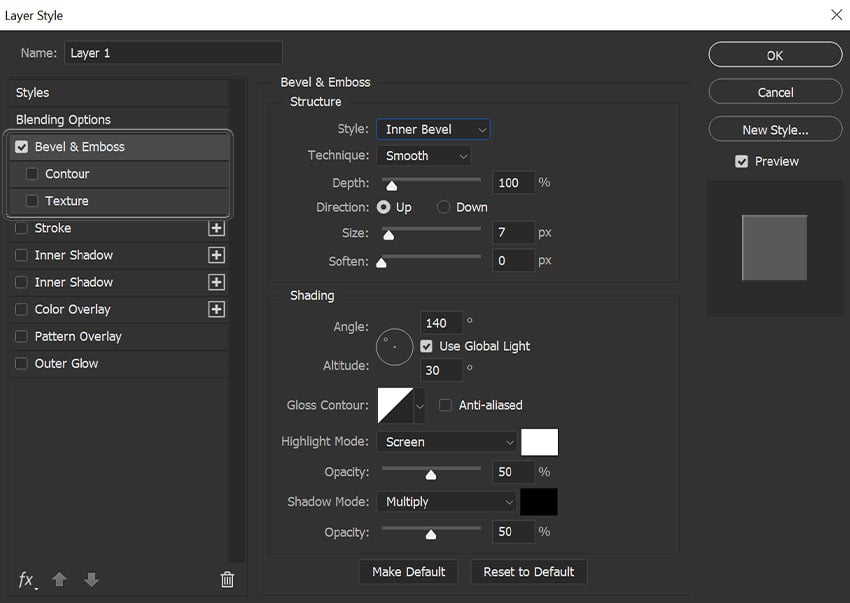
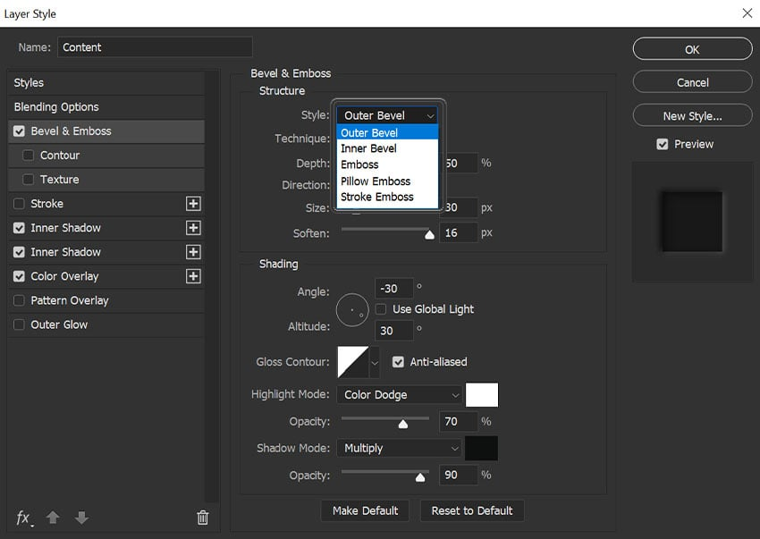
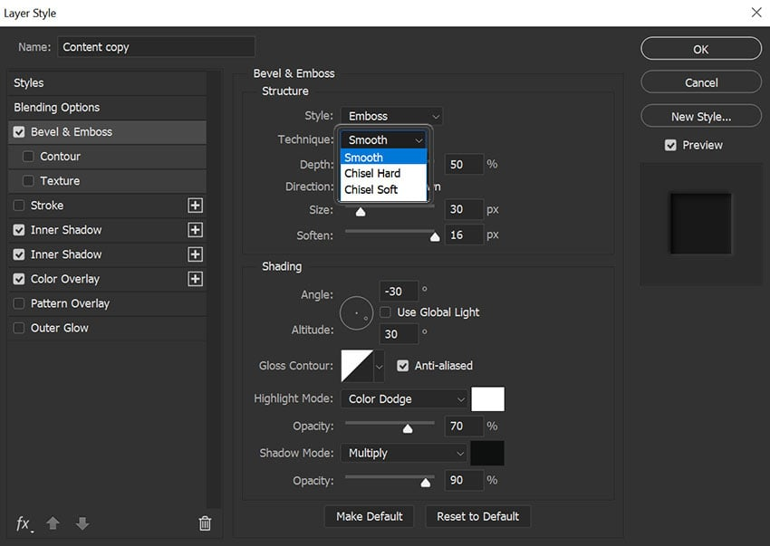
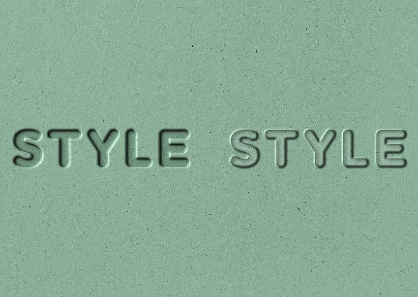
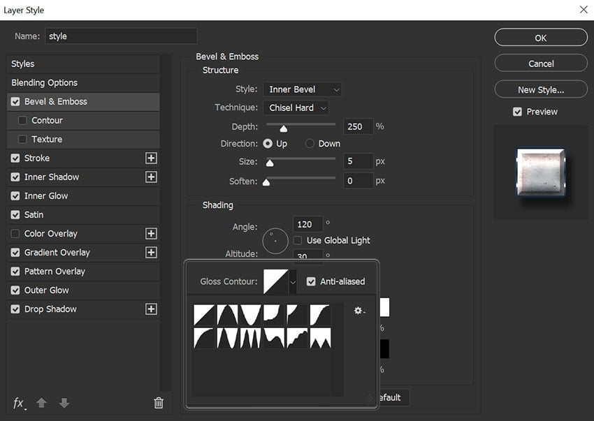
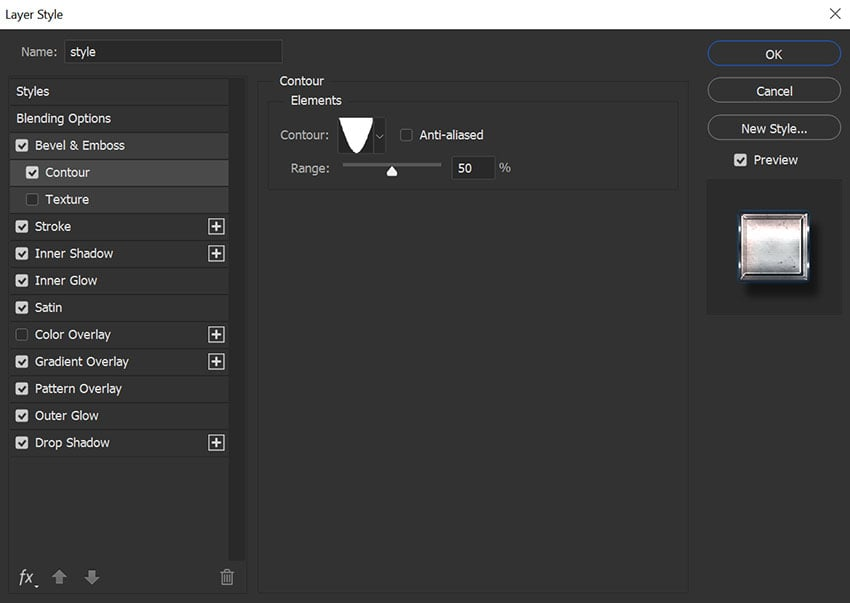
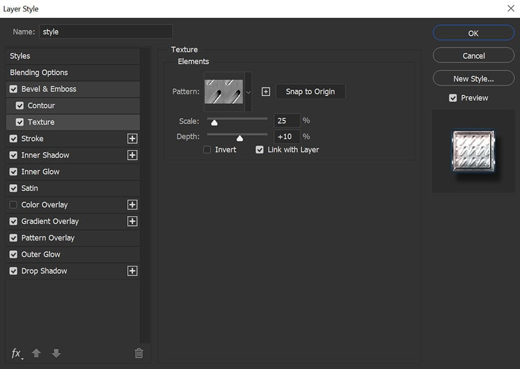
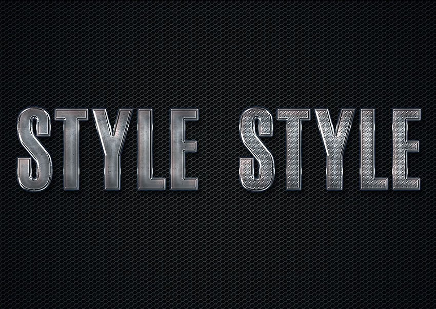
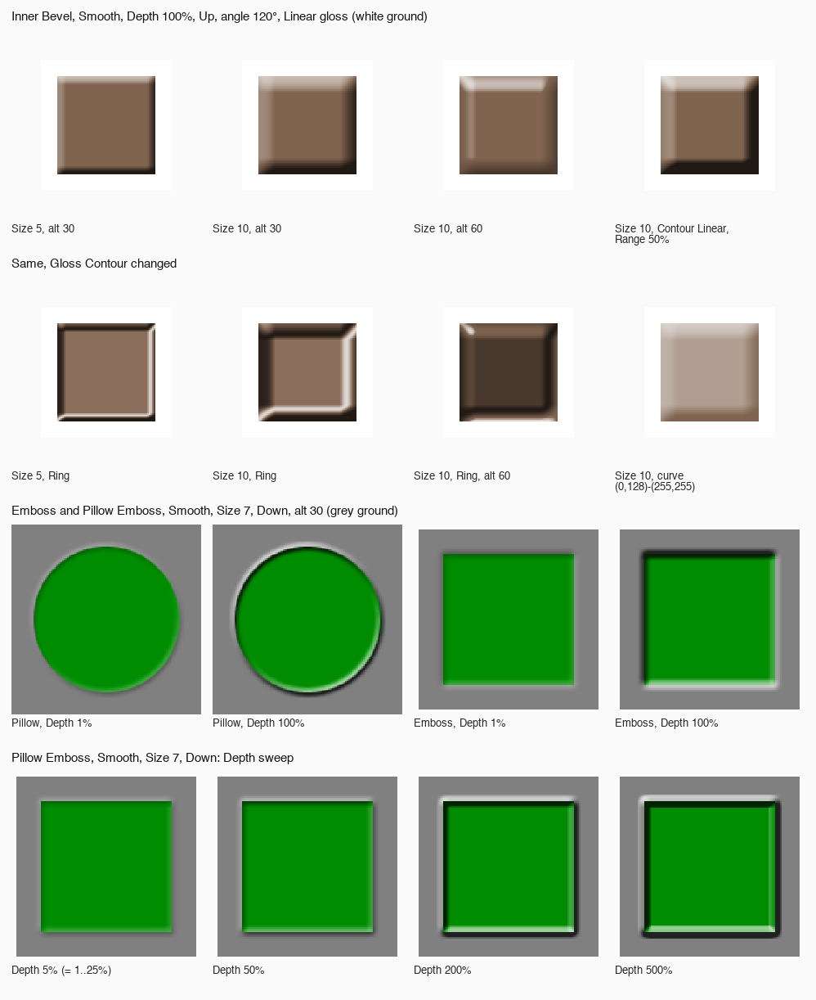

# Bevel & Emboss (with Contour and Texture)

> **Measured since** (2026-10-06, Photoshop 27.11): chisel Hard and Chisel Soft (rendered: every style × technique), Smooth's 45° at Depth 100 %. See [photoshop-measurements.md](photoshop-measurements.md),
> which overrides this document where they disagree.

How Photoshop's Bevel & Emboss layer effect works: its controls, its file format and, as far as can be
established, its algorithm. Researched 2026-10-06 for the photo suite's Layer Style work. Research only:
nothing here is built yet.

Every claim carries one of these marks:

- **Verified**: an Adobe document, a file Photoshop wrote, a render Photoshop made, or source code we read.
- **Measured**: we reproduced it ourselves against Photoshop's own renders (see
  [our check against Photoshop](#our-check-against-photoshops-renders)).
- **Secondary**: a reputable tutorial, forum answer or third-party implementation that says it was calibrated
  against Photoshop, which we didn't re-measure.
- **Inferred** / **Unverified**: our reasoning, or a claim we couldn't confirm. Never treat these as fact.

The best implementation references, in order of trust:

1. **Patchy** (MIT, `SethRobinson/Patchy` at `719c049450`), an open-source editor whose layer effects are
   calibrated against Photoshop 2026 (27.8) by scripting Photoshop over COM and comparing renders. Its test
   fixtures include `.psd` files and Photoshop's `.bmp` renders of them. Its bevel code is
   `src/render/layer_compositor.hpp` (`render_bevel_emboss`) and `src/render/layer_style_mask_ops.cpp`
   (`bevel_technique_height_mask`, the tent blur, the distance transform).
2. **Our own re-implementation** of Patchy's model in Python, run against those Photoshop renders. Inner Bevel
   Smooth matches Photoshop to 1–3 levels in 255 (details below).
3. **Krita** (GPL, `KDE/krita` at `585f8170ef`): `libs/image/layerstyles/kis_ls_bevel_emboss_filter.cpp`,
   `gimp_bump_map.cpp`, `kis_ls_utils.cpp`. It's a port of GIMP's LayerFX script plus GIMP's Bump Map, not a
   Photoshop calibration, and it differs from Photoshop in several places (listed below).
4. Adobe's help pages, the Photoshop File Format specification, ag-psd, psd-tools.

## The short version

- The bevel is a **height field made from the layer's alpha**, lit by a **directional light**, split into a
  **highlight amount** and a **shadow amount**, which are painted as two flat colours with their own blend modes and
  opacities. Nothing else of the layer's colour is used. (Verified: Adobe, Krita, Patchy.)
- **Smooth** = the alpha blurred by a **tent filter** (two box blurs) of width `max(2, round(Size))`. **Chisel
  Hard** = a Euclidean **distance transform** profile. **Chisel Soft** = a "modified" distance profile, unknown.
  (Measured for Smooth; Verified wording from Adobe for the chisels; the chisel maths is Secondary at best.)
- **Depth 100% means a 45° slope** at the steepest point of a Smooth bevel, whatever the Size (Measured at 100%;
  the scaling with Depth is Secondary).
- The light is `L = (cos A·cos h, −sin A·cos h, sin h)` (x right, y down, z towards the viewer; A = Angle,
  h = Altitude). A flat face gets `sin h`; the **highlight** is how far a pixel's `N·L` rises above that, normalised
  to the headroom, and the **shadow** how far it falls below, normalised to `sin h`. (Measured.)
- **Gloss Contour** remaps `N·L` before that split. **Contour** (the sub-page) reshapes the profile; with a Linear
  curve, **Range** r simply multiplies the slope by 100/r. (Measured.)
- **Pillow Emboss ignores Depth below 25%**: 1%, 5%, 10% and 25% render identically. (Measured from Photoshop
  renders.)
- In files, **`TrnS` is the Gloss Contour and `MpgS` is the Contour sub-page**. Krita's reader swaps them.
  (Verified from Photoshop-written files.)

## Where it sits



*The Bevel & Emboss page (Photoshop CC, Windows). Its sub-pages, Contour and Texture, are indented under it in the
list. The values here aren't the defaults (Size 7, Angle 140°, both opacities 50%). Tuts+.*

- Layer › Layer Style › Bevel and Emboss, the fx menu at the foot of the Layers panel, or the Layer Style dialog
  (double-click a layer). Ticking the box applies it with the current settings; clicking the name shows its page.
  (Verified: Adobe.)
- **One per layer.** Stroke, Inner Shadow, Color Overlay, Gradient Overlay and Drop Shadow have a **+** to add
  another; Bevel & Emboss doesn't. (Verified: the dialog.)
- It's the **top** entry of the effects list, and the list is the drawing order: Bevel & Emboss draws over every other
  effect, including Stroke. (Verified: the list. Secondary: Patchy, "Bevel shading … composites OVER the stroke
  band".)
- Contour and Texture each have their own checkbox. Photoshop leaves an unticked sub-page's keys out of the file
  (Verified, see [the descriptor](#the-psd-descriptor-ebbl)); whether the dialog remembers them meanwhile is
  Unverified.
- The page has two groups, **Structure** and **Shading**, then **Make Default** and **Reset to Default**. Make
  Default stores the current values as this effect's defaults for next time; Reset to Default brings those back.
  (Verified: Adobe.)

## Structure

| Control | Type | Range | Default | Key |
| --- | --- | --- | --- | --- |
| Style | menu | Outer Bevel, Inner Bevel, Emboss, Pillow Emboss, Stroke Emboss | Inner Bevel | `bvlS` (enum `BESl`: `OtrB`, `InrB`, `Embs`, `PlEb`, `strokeEmboss`) |
| Technique | menu | Smooth, Chisel Hard, Chisel Soft | Smooth | `bvlT` (enum `bvlT`: `SfBL`, `PrBL`, `Slmt`) |
| Depth | slider + % field | 1–1000 % | 100 % | `srgR` (`#Prc`, "strength ratio") |
| Direction | radio | Up, Down | Up | `bvlD` (enum `BESs`: `In  ` = Up, `Out ` = Down) |
| Size | slider + px field | 0 or 1 – 250 px | 5 px | `blur` (`#Pxl`) |
| Soften | slider + px field | 0–16 px | 0 px | `Sftn` (`#Pxl`) |

Sources: keys and enums Verified from Photoshop-written files (Patchy's fixtures, dumped with psd-tools) and ag-psd
`src/descriptor.ts`. Defaults Secondary: a third-party capture of Photoshop's default descriptors
(`effect-default-data.js` in `eolix/photosuite`), consistent with Patchy, libpsd and GIMP LayerFX. Ranges:
Soften 16 is Secondary (an Adobe community bug report says Scale Effects can push it past its "limit of 16 px"; the
slider ends at 16 in the Tuts+ screenshot); Depth 1–1000, Size up to 250 and Range 1–100 are Secondary (Patchy's
dialog mirrors Photoshop's). Whether Size goes down to 0 is Unverified.

### Style



*The Style menu. Tuts+.*

Adobe's descriptions (Verified):

| Style | Adobe says | Where the shading lands (Secondary: Patchy; Measured for Inner) |
| --- | --- | --- |
| **Outer Bevel** | "creates a bevel on the outside edges of the layer contents" | Outside the shape only: weight `1 − alpha`, out to Size px |
| **Inner Bevel** | "creates a bevel on the inside edges" | Inside only: weight `alpha`, in to Size px |
| **Emboss** | "simulates the effect of embossing the layer contents against the underlying layers" | Both sides of the edge, Size/2 each way, one continuous slope |
| **Pillow Emboss** | "simulates the effect of stamping the edges of the layer contents into the underlying layers" | Both sides, Size/2 each way, the outside slope mirrored: a groove along the edge |
| **Stroke Emboss** | "confines embossing to the boundaries of a stroke effect applied to the layer. (The Stroke Emboss effect is not visible if no stroke is applied to the layer.)" | Inside the Stroke effect's band |

**What Stroke Emboss needs.** An enabled **Stroke** effect on the same layer with a non-zero size and opacity
(Verified: Adobe says it's invisible without one). Patchy builds the matte from every enabled Stroke's band coverage
(their union, stroke opacity and gradient opacity included) and shades on top of the stroke (Secondary). Which stroke
it uses when several are stacked, and whether a stroke's colour matters, is Unverified.

### Technique



*The Technique menu, on an Emboss with Soften at its maximum, 16 px. Tuts+.*

Adobe's descriptions (Verified):

- **Smooth** "blurs the edges of a matte slightly and is useful for all types of mattes, whether their edges are soft
  or hard. It does not preserve detailed features at larger sizes."
- **Chisel Hard** "uses a distance measurement technique and is primarily useful on hard-edged mattes from
  anti-aliased shapes such as type. It preserves detailed features better than the Smooth technique."
- **Chisel Soft** "uses a modified distance measurement technique and, although not as accurate as Chisel Hard, is
  more useful on a larger range of mattes. It preserves features better than the Smooth technique."

So Smooth is a blur and both chisels are distance transforms. What "modified" means is not documented anywhere we
found. GEGL's Bevel filter (GIMP 3) draws the same line: "Chamfer" uses a distance map (Euclidean, Manhattan or
Chebyshev), "Bump" "adds an emboss effect on top of a blur" (Verified: GIMP docs). See
[the height field](#2-the-height-field) for the maths.

### Depth

"Specifies the depth of a bevel. It also specifies the depth of a pattern" (Verified: Adobe). It's how steep the
slopes are, so how strong the shading is; it doesn't move where the bevel sits. Measured: at 100%, a Smooth Inner
Bevel's steepest slope is 45°, at any Size. Higher depths saturate: past a point every slope facing the light is fully
lit and every slope facing away fully shaded, so the bevel looks harder. **Pillow Emboss treats anything under 25% as
25%** (Measured). Whether other styles share that floor is Unverified.

### Direction

**Up** raises the shape; **Down** sinks it. Mathematically Down negates the slopes, which swaps where highlights and
shadows fall (Verified: Krita passes Direction Down as `invert` to the bump map, which flips the height; Patchy
negates the gradient).



*Direction: per the tutorial, the left word "sinks into the page" (Down) and the right one "comes out of the page"
(Up). Tuts+.*

### Size

How far the bevel reaches, in document pixels (Verified: Adobe "Size specifies the radius and size of blur"). Measured:
a Smooth Inner Bevel of Size 5 shades exactly 5 pixels in from a hard edge; Size 10, 10 pixels. Emboss and Pillow
Emboss reach Size/2 each side of the edge (Secondary: Patchy).

### Soften

"Blurs the results of shading to reduce unwanted artifacts" (Verified: Adobe). Two implementations disagree on
what's blurred: Krita and GIMP LayerFX blur the shading after the light and the Gloss Contour (matching Adobe's
words); Patchy blurs the height field before lighting, with three box passes whose radii add up to `ceil(Soften)`.
Which one Photoshop does is Unverified (a test is in [Open questions](#open-questions)). It's 0–16 px, and Scale
Effects can push it past 16 until the file is reopened (Secondary: Adobe community bug report).

## Shading

| Control | Type | Range | Default | Key |
| --- | --- | --- | --- | --- |
| Angle | dial + ° field | −180° to 180° | 120° | `lagl` (`#Ang`) |
| Altitude | the same dial + ° field | 0–90° | 30° | `Lald` (`#Ang`) |
| Use Global Light | checkbox | on/off | on | `uglg` |
| Gloss Contour | contour picker | any contour | Linear | `TrnS` (object `ShpC`: `Nm  `, `Crv `) |
| Anti-aliased (gloss) | checkbox | on/off | off | `antialiasGloss` |
| Highlight Mode | blend mode menu + colour swatch | every layer blend mode | Screen, white | `hglM` (enum `BlnM`, `Scrn`), `hglC` |
| Opacity (highlight) | slider + % field | 0–100 % | 75 % | `hglO` (`#Prc`) |
| Shadow Mode | blend mode menu + colour swatch | every layer blend mode | Multiply, black | `sdwM` (`Mltp`), `sdwC` |
| Opacity (shadow) | slider + % field | 0–100 % | 75 % | `sdwO` (`#Prc`) |

Sources: keys Verified (Photoshop files); defaults Secondary (the third-party default capture, Patchy and GIMP
LayerFX all agree); the angle field accepting negative values is Verified (a Tuts+ screenshot shows −30°).

### Angle and Altitude

- **Angle** is the light's direction in the image plane, counter-clockwise from 3 o'clock: 90° is light from the top,
  120° from the upper left. **Altitude** is its height: "0 is ground level and 90 is directly above the layer"
  (Verified: Adobe). Measured: the light vector Photoshop uses is

  ```
  L = (cos A · cos h,  −sin A · cos h,  sin h)     x right, y down, z towards the viewer
  ```

- One circular widget sets both: the direction of the cross-hair from the centre is the Angle, its distance from the
  centre the Altitude (the centre is 90°). Typing in either field works too. Whether the radius is linear in Altitude
  or `cos h` is Unverified.
- A low Altitude rakes the light across the surface: shadows reach full strength sooner. A high one lights faces
  from above: at 60° and more, steep slopes facing the light "tip past" it and get less highlight than gentler ones,
  which shows as a thin dark line inside the highlight (Measured: the Altitude 60 tile in the chart below).

### Use Global Light

"Sets one master lighting angle shared across Drop Shadow, Inner Shadow, and Bevel & Emboss" (Verified: Adobe).
For Bevel & Emboss the global light holds the **Altitude** too: Layer › Layer Style › Global Light sets "the angle
and altitude" (Verified: Adobe). Changing the angle in any effect with the box ticked changes the global angle,
and so every other effect that uses it. The document stores them as image resources 1037 (Global Angle, an integer
0–359) and 1049 (Global Altitude) (Verified: PSD specification). The specification says an absent Global Angle is
"assumed to be 30", which looks like a confusion with the altitude; new documents show 120° and 30° (Secondary).
The effect's own `lagl`/`Lald` are still written when `uglg` is on (Secondary: the default capture holds 120/30
with `uglg` true).

### Gloss Contour

"Creates a glossy, metallic appearance. Gloss Contour is applied after shading a bevel or emboss" (Verified: Adobe).
Measured: it **remaps the lighting value `N·L`** (0–1) through the curve, and the highlight/shadow split then runs on
the remapped value against the flat face's `sin h`. So:

- Linear changes nothing.
- A curve that passes through `(sin h, sin h)` keeps flat areas clean; one that doesn't puts a constant wash over the
  whole flat interior: Ring at Altitude 30° lifts the face by about 6/255, at 60° darkens it (Measured, and Secondary:
  Patchy).
- Non-monotonic curves (Ring, Ring - Double, Sawtooth) make rings of light and dark across the slope: the "chrome"
  look.



*The contour picker opened from Gloss Contour: Photoshop's twelve default contours. The cog menu loads, saves and
resets sets; clicking the thumbnail itself opens the Contour Editor. Tuts+.*

The contour presets are shared with Contour, glows and shadows. Their names, in picker order: Linear, Cone, Cone -
Inverted, Cove - Deep, Cove - Shallow, Gaussian, Half Round, Ring, Ring - Double, Rolling Slope - Descending, Rounded
Steps, Sawtooth 1 (Secondary: GIMP LayerFX copies the list and approximates each curve). Ring's points as Photoshop
saves them: (0,0) (32,110) (64,237) (96,239) (128,138) (159,32) (191,6) (223,99) (255,255) (Verified: a
Photoshop-written file).

**The Contour Editor** (click the thumbnail): points on a 0–255 by 0–255 grid, Input and Output fields, a **Corner**
checkbox per point (a sharp corner instead of a smooth curve), Load, Save, New (Verified: Adobe). In the file a curve
is `Crv `, a list of `CrPt` with `Hrzn` (input) and `Vrtc` (output), plus `Cnty` (true = smooth) on every point of
a custom curve; Linear is two points and no `Cnty` (Verified: Photoshop files; Secondary: Patchy). Patchy draws a curve
as natural cubic splines between corner points, like Curves, then a 256-entry table (Secondary); our Ring check with
that interpolation is within a few levels, so the interpolation is close but maybe not exact.

**Anti-aliased** "blends the edge pixels of a contour or gloss contour. This option is most useful on small shadows
with complicated contours" (Verified: Adobe). What that means numerically is Unverified. Patchy reads the 256-entry
table with linear interpolation when it's on and nearest-entry when it's off (Secondary). Krita, when it's off,
samples the curve at 1% steps only (`lookup_table[(int)((int)(i/2.55)*2.55+0.5)]`, `kis_ls_utils.cpp` lines
330–341), i.e. 101 levels, which bands steep curves (Verified: code; whether Photoshop does this is Unverified).

### Highlight and Shadow

Each is a flat colour, a blend mode and an opacity: "Specifies the blending mode of a bevel or emboss highlight or
shadow" (Verified: Adobe). The amount computed per pixel scales the opacity, so the highlight is literally "white at
75% × amount, screened over what's below" (Measured). The mode list is the layer blend mode list (Secondary:
screenshots show Screen, Multiply, Color Dodge, Vivid Light). Common recipes use Color Dodge or Vivid Light for the
highlight; Patchy found Photoshop folds the opacity into the colour for Color Dodge, Color Burn and Linear Burn
rather than mixing by it (Secondary; see [Compositing](#9-compositing)).

## Contour (sub-page)



*The Contour sub-page, here with a custom curve and Range 50%. Tuts+.*

| Control | Type | Range | Default | Key |
| --- | --- | --- | --- | --- |
| (enable) | checkbox in the list | on/off | off | `useShape` |
| Contour | contour picker | any contour | Linear | `MpgS` (object `ShpC`) |
| Anti-aliased | checkbox | on/off | off | `AntA` |
| Range | slider + % field | 1–100 % | 50 % | `Inpr` (`#Prc`) |

Keys Verified (Photoshop files). Range's default of 50% is Secondary (Patchy's notes, and a Chinese-language
walkthrough of the dialog); a Photoshop default capture in `eolix/photosuite` holds 28, which we can't explain.

What it does, per Adobe: "In beveling and embossing, Contour allows you to sculpt the ridges, valleys, and bumps that
are shaded in the embossing process" (Verified). It reshapes the cross-section of the bevel, the height profile from
the edge inwards, where Gloss Contour reshapes the light. Adobe's only description of Range is the glows' one ("which
portion or range of the glow is targeted for the contour").

Measured: with a **Linear** Contour, Range r multiplies every slope by 100/r. Range 50% looks exactly like Depth
doubled; Range 100% is the same as no Contour. It is **not** "the curve applied to the first r% of the profile": that
model is off by up to 130/255. How Range combines with a **non-linear** curve is Unverified. Patchy applies the
curve to `clamp(height / r)` (Secondary, and inconsistent with its own linear case); Krita multiplies the 8-bit
height by 100/r (clamped at 255) then applies the curve, but reads Range from a field the loader never sets, so it
always uses 100 (Verified: code, `adjustRange` and `config->range()` versus `setContourRange`).

## Texture (sub-page)



*The Texture sub-page: pattern picker, the + that saves the current pattern as a preset, Snap to Origin, Scale,
Depth, Invert and Link with Layer. Tuts+.*

| Control | Type | Range | Default | Key |
| --- | --- | --- | --- | --- |
| (enable) | checkbox in the list | on/off | off | `useTexture` |
| Pattern | pattern picker | the loaded patterns | the first pattern | `Ptrn` (`Nm  ` name, `Idnt` id; the pixels are in the file's `Patt`/`Pat2`/`Pat3` block) |
| Snap to Origin | button | | | resets `phase` |
| Scale | slider + % field | 1–1000 % | 100 % | `Scl ` (`#Prc`) |
| Depth | slider + % field | −1000 to +1000 % | +100 % | `textureDepth` (`#Prc`) |
| Invert | checkbox | on/off | off | `InvT` |
| Link with Layer | checkbox | on/off | on | `Algn` |
| (offset) | drag in the canvas | document pixels | 0, 0 | `phase` (object with `Hrzn`, `Vrtc`) |

Keys Verified (Photoshop files); ranges Secondary (Patchy's dialog; the Tuts+ screenshot shows "+10" with an explicit
sign).

Adobe (Verified): "Use Scale to scale the size of the texture. Select Link With Layer if you want the texture to
move along with the layer as the layer moves. Invert inverts the texture. Depth varies the degree and direction
(up/down) to which the texturing is applied. Snap To Origin makes the origin of the pattern the same as the origin
of the document (if Link With Layer is deselected) or places the origin in the upper-left corner of the layer (if
Link With Layer is selected). Drag the texture to position it in the layer." (The same page's Pattern entry says it
the other way round for Snap to Origin; the Texture wording above is the one that matches Patchy's probes.)

How it renders (Secondary: Patchy, calibrated against Photoshop with ramp and cloud patterns):

- The pattern becomes a bump: its luminance `Y = 0.299 R + 0.590 G + 0.111 B` (Photoshop's grey weights).
  **Dark texels are raised** by default; Invert raises light ones. A negative Depth is the same as Invert.
- The bump is smoothed by a 3×3 box, so whole texel plateaus become domes and pits rather than lighting only at
  their edges.
- It's **added to the height field** before the normals, scaled by the texture Depth and by where the bevel is: the
  whole inside of the shape for Inner Bevel and Stroke Emboss, `1 − |2·height − 1|` (most at the edge's middle) for
  the others. Because the normals are scaled by the bevel's Depth × Size, the texture's relief grows with those too.
- Placement: Link with Layer anchors the tile grid at the layer's **effects reference point** (`fxrp`, a tagged block
  of two doubles that Photoshop updates when the layer moves); unlinked, at the document origin. `phase` adds on top,
  in document pixels. At 100% texels map to pixels exactly (nearest); enlarged, linear interpolation; reduced, a box
  average (Secondary: Patchy's pattern sampler, shared with Pattern Overlay).
- A Texture whose pattern can't be found is turned off by Photoshop when the file opens (Secondary: Patchy).

Krita does it differently (Verified: code): it multiplies a contrast-adjusted copy of the pattern into the 8-bit
height map (`COMPOSITE_MULT`), with GIMP LayerFX's mapping from Depth to contrast, and inverts the final shading when
Invert is on.



*The same metal style without (left) and with (right) a Texture. Tuts+.*

## Defaults when first ticked

| Setting | Default |
| --- | --- |
| Style, Technique | Inner Bevel, Smooth |
| Depth, Direction | 100 %, Up |
| Size, Soften | 5 px, 0 px |
| Angle, Altitude | 120°, 30°, Use Global Light on (the document's global light) |
| Gloss Contour | Linear, Anti-aliased off |
| Highlight | Screen, white (255, 255, 255), 75 % |
| Shadow | Multiply, black (0, 0, 0), 75 % |
| Contour | off; Linear, Anti-aliased off, Range 50 % |
| Texture | off; Scale 100 %, Depth +100 %, Invert off, Link with Layer on |

Secondary: a third-party capture of Photoshop's default descriptor (except Range, see above), consistent with Patchy
and GIMP LayerFX. "Make Default" changes these per user, so a given machine may differ.

## The PSD descriptor (`ebbl`)

Layer effects live in the `lfx2` tagged block ("Object-based effects layer info": version 0, descriptor version 16,
then a descriptor), or `lmfx` when any effect has several instances (Verified: PSD specification; Secondary: ag-psd,
Patchy). The root holds `Scl ` (the effects' scale, 100%) and `masterFXSwitch` (Show Effects). Bevel & Emboss is
the `ebbl` object (class `ebbl`). Photoshop writes 22 items in this order (Verified: every Photoshop file we dumped;
Patchy's notes say the same):

`enab, present, showInDialog, hglM, hglC, hglO, sdwM, sdwC, sdwO, bvlT, bvlS, uglg, lagl, Lald, srgR, blur, bvlD,
TrnS, antialiasGloss, Sftn, useShape, useTexture`

With Contour on, `MpgS, AntA, Inpr` follow `useShape`; with Texture on, `InvT, Algn, Scl , textureDepth, Ptrn, phase`
are appended. **Keys of a sub-page that's off are left out** (Verified: the fixtures). Colours are `RGBC` objects
(`Rd  `, `Grn `, `Bl  `, 0–255 doubles); opacities are `#Prc`, angles `#Ang`, lengths `#Pxl` unit floats.

**`TrnS` is the Gloss Contour, `MpgS` the Contour sub-page.** Verified: Photoshop-written files store a Gloss Contour
named "Ring" in `TrnS` next to `antialiasGloss`, and the sub-page's curve in `MpgS` next to `useShape`/`AntA`/`Inpr`.
psd-tools agrees (`BevelEmboss.contour` is `TransferSpec` beside `antialiasGloss`). ag-psd reads both into one
`contour` field and writes only `TrnS`, so it loses the sub-page curve. **Krita's reader is swapped**: it maps
`/ebbl/TrnS` to the sub-page and `/ebbl/MpgS` to the gloss (`kis_asl_layer_style_serializer.cpp` lines 1228 and
1237), though its writer has them the right way round (Verified: code).

The legacy `lrFX` block's `bevl` record (Photoshop 5) holds angle, "strength" (depth in pixels), blur, the two modes
and colours, style, opacities as bytes, enabled, use-global-angle and up/down (Verified: PSD specification). Photoshop
ignores it whenever `lfx2` exists (Secondary: Patchy). It has no technique, soften, contours or texture.

## The algorithm

Photoshop's code isn't public. What follows is Patchy's Photoshop-calibrated model, which we re-implemented and
checked where Photoshop renders exist, with the gaps marked.

```
alpha of the layer (its mask folded in)  ──►  matte A
                                  │
              Technique ──────────► height field H   (blur, or distance transform)
              Contour + Range ────► H reshaped
              Texture ────────────► H += bump
                                  │
              Depth, Size, Direction ► slopes (central differences) → normal N
              Angle, Altitude ────► light L → lighting l = N·L
              Gloss Contour ──────► l' = curve(l)
                                  │
              split around sin(Altitude) ► highlight amount, shadow amount
              Style ──────────────► weight (inside, outside, both)
              Soften ─────────────► (blur: before or after, unverified)
                                  │
              highlight colour / mode / opacity ─┐
              shadow colour / mode / opacity ────┴─► drawn over the layer and its other effects
```

### 1. The matte

The layer's alpha, with its layer mask and vector mask folded in unless **Layer Mask Hides Effects** / **Vector Mask
Hides Effects** is ticked, in which case the effect is computed from the raw alpha and the mask hides its output
(Verified: Adobe's wording for those options; Secondary: Patchy's stroke probes for the details). On a shape or fill
layer whose fill is a gradient or pattern with transparency, the matte is the **shape's coverage**, not the painted
alpha (Secondary: Patchy, 13 Photoshop probes). On a group, the matte is the group's combined silhouette (Secondary).
Fill Opacity doesn't touch the matte or the effect (Verified: Adobe, "Fill opacity affects only pixels, shapes, or
text on a layer without affecting the opacity of layer effects").

### 2. The height field

`H` runs from 0 outside the shape to 1 inside.

**Smooth** (Measured): `H = T ∗ A`, where `T` is a separable **tent** of `N = max(2, round(Size))`:

```
T(k) = (N − |k|) / N²,   |k| < N          (the same in x and y)
```

That's two box blurs of width N in a row. Across a hard edge it ramps over 2N − 1 pixels centred on the edge, so an
Inner Bevel sees the inner N of them. Satin's blur is the same tent (Secondary: Patchy). Our check rejects Size 6 for
a Size 5 bevel and a triple box, so the kernel is pinned.

**Emboss and Pillow Emboss** use the same tent at **half** the size, `N' = max(2, round(Size / 2))`, and light both
sides of the edge (Secondary: Patchy; partly Measured, see the check).

**Measured since** (Photoshop 27.11, photoshop-measurements.md): both chisels are the signed distance to the edge at
0.48 of a unit per pixel per width, flat past the width (Chisel Hard a pixel further outside), Chisel Soft with one
extra step across the edge; that's `chiselShape` in `reference/style.ts`, within 2 levels of every facet. Patchy's
model below is what we started from.

**Chisel Hard** (Secondary, not calibrated): Patchy uses exact Euclidean distances (Felzenszwalb–Huttenlocher) to the
nearest clear pixel `d_in` and to the nearest painted pixel `d_out`, blended by the edge pixel's alpha so anti-aliased
edges stay smooth:

```
inside  = 0.5 + 0.5 · min(1, d_in  / Size)
outside = 0.5 − 0.5 · min(1, d_out / Size)
H = alpha · inside + (1 − alpha) · outside
```

That gives straight flanks with a crease where distances from two edges meet: the "chiselled" ridge along a letter's
spine and sharp mitres at corners, which is what Chisel Hard looks like. Adobe's "primarily useful on hard-edged
mattes from anti-aliased shapes" suggests Photoshop measures from the sub-pixel edge implied by anti-aliasing; Patchy's
stroke work found Photoshop anchors its distance bands at the matte's half-coverage boundary (Secondary). Neither the
slope scale (Patchy's gives half Smooth's) nor the exact edge treatment is verified for the bevel.

**Chisel Soft** (Unverified): "a modified distance measurement technique". Patchy takes the Chisel Hard field and
rounds it with one 3×3 box blur. Plausible alternatives: a chamfer (city-block or 3-4) distance, or a distance
transform of a blurred matte. Nobody has published a calibration.

**Krita** ignores Technique altogether (Verified: code). It builds a stepped ramp by shrinking or growing the
selection one pixel at a time and filling each ring with `(i + 1) / Size · 255` (`paintBevelSelection`), which is
roughly a chamfer distance transform, for every technique.

### 3. Where each style puts it

Per style, the shading is weighted (Secondary: Patchy; Measured for Inner Bevel):

| Style | Weight | Height and slope |
| --- | --- | --- |
| Inner Bevel | `A` | full-size `H`, one sign (Up: +, Down: −) |
| Outer Bevel | `1 − A` | full-size `H`, one sign |
| Emboss | 1 | half-size `H`, one sign |
| Pillow Emboss | outside `1 − A` with sign `s`, inside `A` with sign `−s`, `s = −1` for Up, `+1` for Down; both are drawn at anti-aliased edge pixels | half-size `H` |
| Stroke Emboss | the Stroke effect's band coverage | full-size `H` of that band |

Krita's equivalents (Verified: code) grow the selection by Size (Outer), 0 (Inner), ⌈Size/2⌉ (Emboss), and build
Pillow from two half-size ramps, one inverted, with the comment "TODO: probably not correct!". It doesn't implement
Stroke Emboss.

### 4. Contour and Range

With Contour on: a Linear curve at Range r scales the slopes by `100 / r` (Measured). For other curves, the profile
`H` goes through the curve (Verified intent: Adobe's "sculpt the ridges, valleys, and bumps"); how Range positions
the curve along the profile is Unverified (see above).

### 5. Texture

`H += bump · TextureDepth · coverage` before the slopes (Secondary: Patchy; see [Texture](#texture-sub-page)).

### 6. Slopes, Depth and the normal

Central differences over two pixels, scaled so the slope is dimensionless (Measured for Smooth Inner Bevel):

```
k  = 0.5 · Depth · max(1, Size) · (100 / Range if a Linear Contour is on, else 1)       Depth as a fraction
gx = (H(x−1, y) − H(x+1, y)) · k
gy = (H(x, y−1) − H(x, y+1)) · k              y down
(gx, gy) = −(gx, gy) for Direction Down
N  = (gx, gy, 1) / |(gx, gy, 1)|
```

The tent ramp's steepest slope is `1/N` per pixel, so with `k = 0.5 · Depth · Size` the steepest `|g|` is just
`Depth`: 1 (45°) at 100%, whatever the Size. That's why a bevel looks the same scaled up or down when Size scales with
it.

For Emboss and Pillow Emboss, `k = 0.5 · max(Depth, 0.25) · N'` (Secondary; the 25% floor Measured for Pillow).

Krita uses GIMP's bump map instead (Verified: `gimp_bump_map.cpp`): 3×3 Sobel sums on the 8-bit height and
`nz = 6 · 255 / Depth` with Photoshop's Depth percentage passed straight in, so its steepness depends on Size and its
Depth doesn't match Photoshop's (Inferred).

### 7. Lighting

```
L = (cos A · cos h,  −sin A · cos h,  sin h)
l = N · L                                    (a flat face gives sin h)
```

(Measured: the angle convention and the formula reproduce Photoshop's renders.)

### 8. Highlight and shadow amounts

```
if l ≥ sin h:  highlight = (l − sin h) / (1 − sin h)
else:          shadow    = (sin h − l) / sin h
both clamped to [0, 1]
```

(Measured, Inner Bevel Smooth, Altitude 30° and 60°.) The shadow reaches full strength on any slope facing away
from the light by `h` or more; the highlight only on a slope facing the light exactly. With a high altitude, slopes
steeper than `90° − h` tip past the light and their highlight falls again.

**Gloss Contour** (Measured): `l' = curve(clamp(l, 0, 1))`, then the same split with `l'` in place of `l`. A curve
can turn a lit slope into shadow and the reverse.

**Pillow and Emboss shadows** (Secondary: Patchy): the shadow side uses the un-normalised value
`raw = gx·Lx + gy·Ly + sin h`, `shadow = (sin h − raw) / sin h`, which is linear in the slope and saturates early.
Measured: this reproduces Photoshop to within 3 levels at depths up to 25% and to within 7 at 50%; at 100–1000% the
mean error stays under 0.5 but corners and the outer rim are off by up to 20–70 levels. So the Pillow/Emboss model
is close but not exact.

Krita (Verified: code) turns the bump map's 8-bit shade into highlight `max(0, v − 127) · 255/128` and shadow
`255 − min(v, 127) · 255/127`, the same split around a neutral middle, but with GIMP's compensation for altitude. As
we read it, a flat area comes out at about 254, which would be a full highlight; GIMP LayerFX avoids that by running
the bump map on a 50% grey layer. We didn't run Krita to confirm.

### 9. Compositing

The highlight is the highlight colour, drawn with the highlight mode at `opacity × highlight × weight × layer
opacity`; the shadow likewise. (Measured: Screen white and Multiply black at 75% reproduce Photoshop exactly in an
8-bit RGB document, blended on the document's encoded values.) Details:

- Both draw over the layer **and its other effects** (Bevel & Emboss is top of the list). Krita draws the shadow,
  then the highlight (Verified: code, projections `00_bevel_shadow`, `01_bevel_highlight`); in Photoshop a pixel
  normally has only one, except Pillow's anti-aliased edges, where both apply (Secondary).
- Layer **Opacity** scales both; **Fill** doesn't (Verified: Adobe).
- **Blend Interior Effects as Group** doesn't change the bevel: it draws on the blended result either way
  (Secondary: Patchy; Adobe's list of affected effects names Inner Glow, Satin, Color Overlay, Gradient Overlay but
  not the bevel).
- **Burn and dodge modes**: for Linear Burn and Color Burn Photoshop moves the colour towards white by its alpha and
  blends at full strength; for Color Dodge it moves it towards black. Mixing by alpha afterwards is wrong for these
  (Secondary: Patchy, layer effects generally).
- Soften: see [Soften](#soften).

### Our check against Photoshop's renders

Patchy's fixtures include Photoshop's own renders of known bevels on shapes 60–100 pixels across (brown
`RGB(128, 100, 80)` squares on white, green squares and circles on grey). We re-implemented the model above in Python and compared, pixel for pixel, in the
padded area around each shape:

| Photoshop layer | Settings | Max error /255 | Mean |
| --- | --- | --- | --- |
| `s5` | Inner Bevel, Smooth, Size 5, Depth 100, 120°/30° | 2 | 0.02 |
| `s10` | same, Size 10 | 1 | 0.04 |
| `s10a60` | Size 10, Altitude 60° | 3 | 0.07 |
| `s10c50` | Size 10, Contour Linear, Range 50% | 2 | 0.05 |
| `s10c100` | Size 10, Contour Linear, Range 100% | 1 | 0.04 |
| `bar6` | Size 5 on a 6-pixel-wide bar | 3 | 0.03 |
| gloss `s10c100` | Gloss Contour (0,128)–(255,255) | 1 | 0.18 |
| gloss `s5`, `s10` | Gloss Contour Ring | 5–8 | 0.7–0.9 |
| pillow `d5`…`d25` | Pillow, Smooth, Size 7, Down | 3 | 0.07 |
| pillow `d100`, `d500` | Depth 100%, 500% | 22, 67 | 0.2 |

The model is sharp: Depth 120% instead of 100% gives errors up to 15, Size 6 instead of 5 up to 34, and Range as
"curve over the first r%" up to 130. A Size 5 bevel's edges, Photoshop against the model, red channel, first five
pixels in from each edge:

| Edge | Photoshop | Model |
| --- | --- | --- |
| top (faces the light) | 199 193 182 165 142 | 199 193 182 165 142 |
| left | 158 158 155 148 136 | 159 158 155 148 136 |
| right | 119 100 81 63 48 | 119 100 81 63 48 |
| bottom (faces away) | 113 83 54 32 32 | 113 83 53 32 32 |



*Photoshop 2026 renders from Patchy's test fixtures, cropped and enlarged 2× (nearest neighbour). Rows: Inner Bevel
Smooth at two sizes, a high altitude and a Linear Contour at Range 50%; the same with Gloss Contours (Ring, and a curve
starting at 128, which lifts the whole face); Pillow Emboss and Emboss at Depth 1% and 100% (Direction Down); a Pillow
depth sweep, where 1–25% are identical. No Chisel renders were available.*

The Tuts+ guide's comparison of Smooth (left) and Chisel Hard (right) is too subtle at web size to show; see its
`_0021_4_2.jpg` in Sources. A proper Style × Technique chart, chisels included, needs renders from Photoshop itself
(see [Open questions](#open-questions), item 1).

### GIMP LayerFX and libpsd

Krita's header names GIMP's LayerFX (registry.gimp.org node 186) as its reference. LayerFX
(`layer-effects/layerfx.py`, `layerfx_bevel_emboss`): ring-by-ring height map (`draw_blurshape`), optional texture
multiplied in, optional contour, `plug_in_bump_map` on a 50%-grey mask at GIMP's Depth 1–65 (default 3), the gloss
contour, a Gaussian blur for Soften, then Levels 127–255 → highlight mask and 0–127 → shadow mask (Verified: code).
libpsd's `bevel_emboss.c` only fakes Outer Bevel by blurring and offsetting the matte (Verified: code); it isn't a
reference.

## Edge cases

- **Bit depth.** Photoshop computes effects in the document's mode. In 32-bit documents only Normal, Dissolve,
  Darken, Multiply, Lighten, Linear Dodge (Add), Difference, Hue, Saturation, Color, Luminosity, Lighter Color and
  Darker Color are available as layer blend modes (Verified: Adobe), so the default Screen highlight can't apply
  there; what Photoshop substitutes is Unverified. 32-bit documents also blend in linear light, so the same bevel
  looks different there (Inferred). 16-bit gives smoother gradients than 8-bit; users report fewer "chisel marks"
  (Secondary: Adobe community). Whether the height field itself is 8-bit in 8-bit documents is Unverified; Krita's
  is (Verified: code).
- **Colour space.** In 8- and 16-bit RGB documents Photoshop blends on encoded values (gamma-encoded RGB), and our
  check matched on that basis (Measured). The highlight and shadow *amounts* are scalars and don't depend on the
  colour space; only the final blend does.
- **Anti-aliased and soft edges.** Smooth uses the fractional alpha directly, so soft mattes give soft bevels.
  Pillow composites both sides at anti-aliased pixels (Secondary). A semi-transparent fill (alpha < 1 everywhere)
  has a flat height below 1 and no bevel in its middle, only at its edges (Inferred from the model).
- **Thin shapes.** Where the shape is narrower than 2 × Size, the ramps from both edges overlap and never reach 1;
  Smooth then lights a rounded ridge (Measured: the 6-pixel `bar6`).
- **Masks.** See [The matte](#1-the-matte). Layer Mask Hides Effects and Vector Mask Hides Effects are Blending
  Options (Verified: Adobe).
- **Groups and clipping.** A style on a group uses the group's silhouette; a clipping base's bevel draws over its
  clipped layers (Secondary: Patchy's Photoshop probes).
- **Scale Effects** (Layer › Layer Style › Scale Effects) scales the style "without scaling the object" (Verified:
  Adobe). For the bevel it scales Size and Soften (Secondary: the Soften report); Depth, a ratio, presumably stays
  (Inferred); whether it scales Texture Scale is Unverified. Image › Image Size with Scale Styles does the same
  (Inferred).
- **Effect bounds.** Outer Bevel, Emboss and Pillow Emboss draw outside the layer's pixels (Size, or Size/2, plus
  Soften); Inner Bevel never does.

## Implementation notes for us

How we would build it on the photo suite's renderer (WebGPU tiles, premultiplied linear light, f16/f32;
[rendering.md](../rendering.md)).

**Passes.** Bevel & Emboss is a layer-effect node with three stages, cached separately:

1. **Height field** (needs neighbours): from the layer's alpha (mask folded in unless "hides effects"), at the
   effect's level. Smooth: two separable box passes of width N (or one tent pass with prefix sums in a compute
   shader: O(1) per pixel whatever the Size). Emboss/Pillow: the same at N'. Chisel: a distance transform (below).
   Then Contour (a 256-entry, better a 4096-entry, curve texture), Texture (pattern sampled in document space, 3×3
   box, added), Soften if it's on the height. Store as **`r32float`**: an f16 height near 1 has steps of about
   0.0005, while a Size-250 slope is 0.004 per pixel, so f16 would quantise the normals by ~12%.
2. **Shading** (pointwise, 3×3 reads): central differences, normal, `N·L`, Gloss Contour, the split, the style's
   weight. Writes two coverage planes (highlight, shadow) as `rg16float`. Angle, Altitude, Gloss Contour and Depth
   changes re-run only this stage.
3. **Composite** (pointwise): colour, mode and opacity per plane, over the layer and its other effects, at the top
   of the layer's effect stack. Colour and opacity changes re-run only this.

Keys: the height field's key is the matte's key plus Style, Technique, Size, Soften, Contour and Texture; the shading
adds Depth, Direction, Angle, Altitude, Gloss Contour; the composite adds colours, modes, opacities. With Use Global
Light, the document's global light is part of the shading key.

**Distance transforms.** Chisel needs an exact Euclidean distance, unbounded in principle but capped at Size here,
which makes it local: every pixel only needs to know about edges within Size. Options on the GPU: jump flooding
(log₂ passes, small errors at some pixels: test against an exact CPU reference), or Felzenszwalb–Huttenlocher's
separable exact transform as row then column compute passes over a tile plus its apron. Use alpha-weighted sub-pixel
seeds for anti-aliased edges. The CPU reference goes in `shared/photo/reference/`, as for the other kernels.

**Tiles and aprons.** For an output tile the height field needs the matte grown by: N − 1 (tent) + 1 (central
difference) + Soften support + 1 (texture box) for Smooth Inner Bevel; Size + those for Chisel; and the *output*
region itself extends outside the layer by Size (Outer) or Size/2 (Emboss, Pillow) plus Soften. So: declare the input
region as the output grown by `Size + Soften + 3`, and the layer's effect bounds as its alpha bounds grown by the
style's reach. Tiles of the bounds that see no edge within the apron are constant: inside, a flat face (no shading,
except a Gloss Contour wash, which is a constant per document); outside, nothing. Skip them as constants. Test seams
between neighbouring tiles for every technique, as the rendering doc asks for any kernel that reads neighbours.

**Zoom independence.** Everything is in document pixels, and the slope scale `0.5 · Depth · Size` makes the shading
dimensionless, so rendering at a reduced level with Size, Soften, Texture Scale and phase scaled by the level gives
nearly the same picture. Nearly: `N = max(2, round(Size))` rounds, the minimum of 2 kicks in sooner, Chisel's crease
and sub-pixel detail vanish, and a Gloss Contour or a hard Contour amplifies small differences. The node doesn't
commute with reduction (it's non-linear), so the settled view is level 0 reduced, as for other such nodes; while a
gesture is under way, evaluate at the view's level with scaled parameters and mark it "Refining…". Export always at
level 0.

**Light and colour domain.** Compute the amounts exactly as Photoshop does; they're coverage. Blending Screen and
Multiply in linear light will look different from Photoshop (lighter shadows' mid-tones, stronger highlights' falloff
in encoded terms). Per the house rule, each blend mode states its domain; if we want Photoshop's look, that's a
versioned compatibility setting, not a hidden difference. Highlights above 1 from Linear Dodge are allowed in our
pipeline (the output transform rolls them off).

**Cost.** The shading and composite stages are a few ALU operations per pixel. The height field is the cost: two
box passes are cheap at any Size with running sums; a distance transform per edit of the layer's pixels is the
expensive part, so cache it by the matte's content hash. A Texture adds one pattern sample and a 3×3 blur. Painting on
a bevelled layer invalidates the height field only in the painted region grown by the apron.

**What to build first.** Inner and Outer Bevel, Smooth, with Gloss Contour and a Linear Contour's Range: all of that is
Measured and pinned by fixtures. Then Emboss and Pillow (close), Texture (Secondary), Chisel Hard and Soft and Stroke
Emboss last, each behind its own fixture. The assistant needs a tool to set every control (house rule).

**Fixtures.** Patchy's `photoshop-bevel-*.psd/bmp`, `photoshop-gloss-contour`, `photoshop-emboss-styles`,
`photoshop-pillow-emboss{,2}` are MIT-licensed Photoshop renders: usable as test fixtures for our CPU reference,
with their 8-bit, encoded-space compositing noted.

## Open questions

Each wants a test in real Photoshop (2025 or later): a 60×60 square, an ellipse and a line of type, 8-bit RGB, one
setting changed at a time, the composite exported and compared with our CPU reference.

1. **Chisel Hard and Chisel Soft**: render squares, ellipses and type at Size 5, 10, 20, Depth 100%, with Inner, Outer,
   Emboss and Pillow. Fit: distance metric (Euclidean or chamfer), slope scale, the edge's sub-pixel position, and what
   "modified" means for Soft. This is also the missing Style × Technique chart.
2. **Soften**: blur before or after shading? A Size 10 bevel with Soften 0 and 8, and with a Ring Gloss Contour (a
   blur after the contour smooths the rings; before it, the rings stay sharp).
3. **Contour with a non-linear curve**: Cone, Half Round, Ring at Range 25, 50, 75, 100%. How Range places the curve.
4. **Depth floor**: does 1–25% render the same for Inner and Outer Bevel too? A depth sweep 1, 10, 25, 50%.
5. **Pillow and Emboss at high depth**: corners and the outer rim at 100–1000% (our model is off by up to 70 levels
   there).
6. **Texture**: Scale and phase at reduced scales; whether Texture Depth's sign and Invert are exactly equivalent;
   the coverage for Outer Bevel and Emboss.
7. **Stroke Emboss** with two Strokes, a gradient Stroke, Center and Inside positions.
8. **16 and 32 bits**: the same file converted to 16 and 32 bits, then compared; what the highlight mode becomes in
   32-bit; whether the height is 8-bit in 8-bit documents (look for banding on a Size 100 Smooth bevel).
9. **Anti-aliased** on a Gloss Contour: what changes numerically (try Sawtooth, which has steep steps).
10. **Defaults**: Contour Range's default (50 or 28?) and the global light of a new document in Photoshop 2025/2026.
11. **The Angle/Altitude dial**: is the radius linear in Altitude?
12. **Zoomed-out preview**: does Photoshop compute styles at full resolution and reduce, or at the view's level?
    (Compare a Size 2 bevel at 25% zoom with the 100% render reduced.)
13. **Scale Effects**: which bevel fields change (Size, Soften, Texture Scale, phase)?
14. **Fractional and zero Size**: can Size be 0 in the dialog, and does a scripted 2.5 px Size round?

## Sources

Adobe (Verified):

- Layer effects and styles, archived 2024-02-14:
  https://web.archive.org/web/20240214083332/https://helpx.adobe.com/photoshop/using/layer-effects-styles.html
  (Layer style options; Modify layer effects with contours; Global light; Scale effects)
- Layer style effects and options overview (2026):
  https://helpx.adobe.com/photoshop/desktop/create-manage-layers/apply-layer-effects/layer-style-effects-and-options-overview.html
- Layer opacity and blending (Fill, Advanced Blending), archived 2025-01-26:
  https://web.archive.org/web/20250126145923/https://helpx.adobe.com/photoshop/using/layer-opacity-blending.html
- Blending modes (32-bit list), archived 2024-12-18:
  https://web.archive.org/web/20241218120344/https://helpx.adobe.com/photoshop/using/blending-modes.html
- Photoshop File Formats Specification (Global Angle 1037, Global Altitude 1049, `lfx2`, `bevl`), archived
  2025-01-04: https://web.archive.org/web/20250104161700/https://www.adobe.com/devnet-apps/photoshop/fileformatashtml/
- Adobe community, Scale Effects exceeds Soften's 16 px limit (Secondary):
  https://community.adobe.com/bug-reports-711/レイヤースタイルを適用したレイヤーに対して-効果の拡大-縮小-を行うと-ベベルとエンボス-の-ソフト-の限界値である16pxを超えて適用される-657059
- Adobe community, bevel "jaggedness" (Secondary):
  https://community.adobe.com/t5/photoshop/bevel-and-emboss-quot-jaggedness-quot/td-p/9255994

Code (Verified as read):

- Patchy, MIT, commit `719c049450`: https://github.com/SethRobinson/Patchy:
  `src/render/layer_compositor.hpp` (`render_bevel_emboss`), `src/render/layer_style_mask_ops.cpp`
  (`bevel_technique_height_mask`, `blur_satin_tent_mask_in_place`, `exact_squared_distance_transform`),
  `src/core/style_contour.cpp`, `src/core/pattern_sampler.hpp`, `src/core/layer.hpp`, `docs/ps-compat.md`,
  `docs/layer-effects-render.md`, fixtures `test-fixtures/psd/photoshop-bevel-*.psd/bmp`,
  `photoshop-gloss-contour.*`, `photoshop-emboss-styles.*`, `photoshop-pillow-emboss{,2}.*`
- Krita, GPL, commit `585f8170ef`: https://invent.kde.org/graphics/krita (mirror https://github.com/KDE/krita):
  `libs/image/layerstyles/kis_ls_bevel_emboss_filter.cpp`, `gimp_bump_map.cpp`, `kis_ls_utils.cpp`,
  `libs/psdutils/psd.h`, `libs/image/kis_asl_layer_style_serializer.cpp`
- GIMP LayerFX (Jonathan Stipe), `layer-effects/layerfx.py`:
  https://github.com/bdonlan/gimp-plugin-registry/blob/master/layer-effects/layerfx.py
- libpsd `bevel_emboss.c`: https://github.com/alco/psdump/blob/master/libpsd-0.9/src/bevel_emboss.c
- ag-psd `src/descriptor.ts`, `src/psd.ts`: https://github.com/Agamnentzar/ag-psd
- psd-tools `src/psd_tools/api/effects.py`: https://github.com/psd-tools/psd-tools
- Photoshop default effect descriptors (`effect-default-data.js`):
  https://github.com/eolix/photosuite/blob/main/src/document/formats/psd/effect-default-data.js
- GEGL Bevel (GIMP 3 docs): https://docs.gimp.org/3.0/en/gegl-bevel.html

Tutorials (Secondary):

- John Shaver, "The Comprehensive Guide to Bevel and Emboss", Envato Tuts+:
  https://design.tutsplus.com/articles/the-comprehensive-guide-to-bevel-and-emboss--psd-17308
- "Ps：图层样式 - 斜面和浮雕" (NetEase), Range's default: https://m.163.com/dy/article/J9CTBDR40536FE6V.html

Images:

| File | Source |
| --- | --- |
| `img/bevel-page.jpg` | Tuts+, https://cms-assets.tutsplus.com/cdn-cgi/image/width=850/uploads/users/1990/posts/108947/image-upload/_0025_2.jpg |
| `img/bevel-style-menu.jpg` | Tuts+, https://cms-assets.tutsplus.com/cdn-cgi/image/width=850/uploads/users/1990/posts/108947/image-upload/_0024_3_1.jpg |
| `img/bevel-technique-menu.jpg` | Tuts+, https://cms-assets.tutsplus.com/cdn-cgi/image/width=850/uploads/users/1990/posts/108947/image-upload/_0022_4_1.jpg |
| `img/bevel-direction-up-down.jpg` | Tuts+, https://cms-assets.tutsplus.com/cdn-cgi/image/width=850/uploads/users/1990/posts/108947/image-upload/_0017_6_2.jpg |
| `img/bevel-gloss-contour-picker.jpg` | Tuts+, https://cms-assets.tutsplus.com/cdn-cgi/image/width=850/uploads/users/1990/posts/108947/image-upload/_0010_10_1.jpg |
| `img/bevel-contour-page.jpg` | Tuts+, https://cms-assets.tutsplus.com/cdn-cgi/image/width=850/uploads/users/1990/posts/108947/image-upload/_0003_14_1.jpg |
| `img/bevel-texture-page.jpg` | Tuts+, https://cms-assets.tutsplus.com/cdn-cgi/image/width=850/uploads/users/1990/posts/108947/image-upload/_0001_15_1.jpg |
| `img/bevel-texture-result.jpg` | Tuts+, https://cms-assets.tutsplus.com/cdn-cgi/image/width=850/uploads/users/1990/posts/108947/image-upload/_0000_15_2_f.jpg |
| `img/bevel-photoshop-renders.png` | Our montage of Photoshop's renders in Patchy's fixtures (MIT): https://github.com/SethRobinson/Patchy/tree/719c049450/test-fixtures/psd (`photoshop-bevel-smooth.bmp`, `photoshop-gloss-contour.bmp`, `photoshop-emboss-styles.bmp`, `photoshop-pillow-emboss2.bmp`) |

Not embedded: Tuts+'s Smooth versus Chisel Hard comparison,
https://cms-assets.tutsplus.com/cdn-cgi/image/width=850/uploads/users/1990/posts/108947/image-upload/_0021_4_2.jpg
(too subtle to read at this size).
