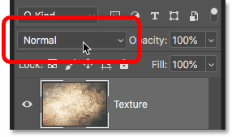
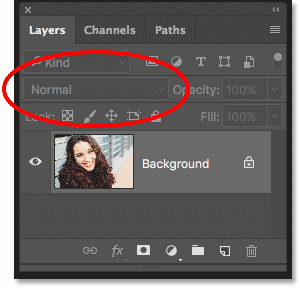
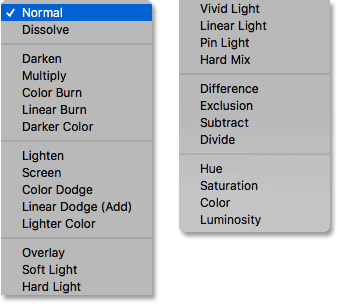
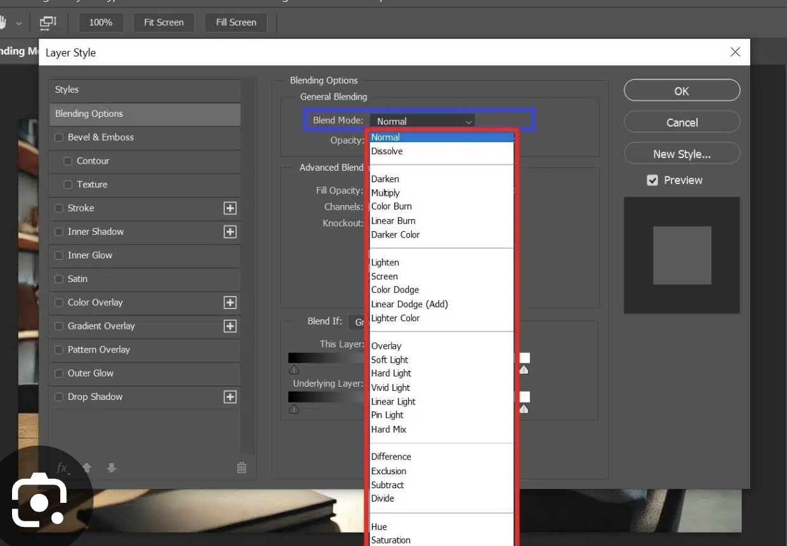
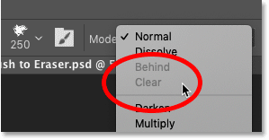
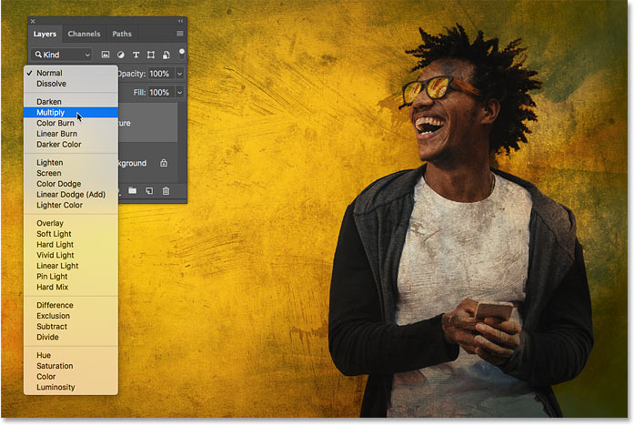
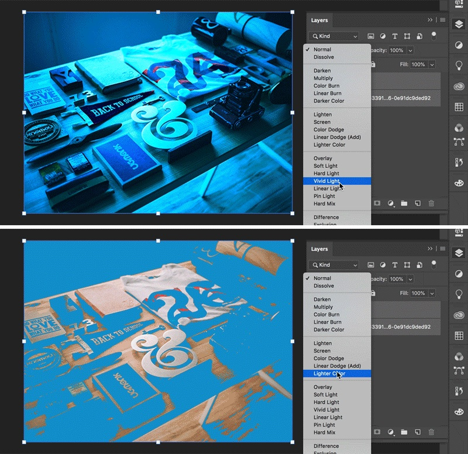
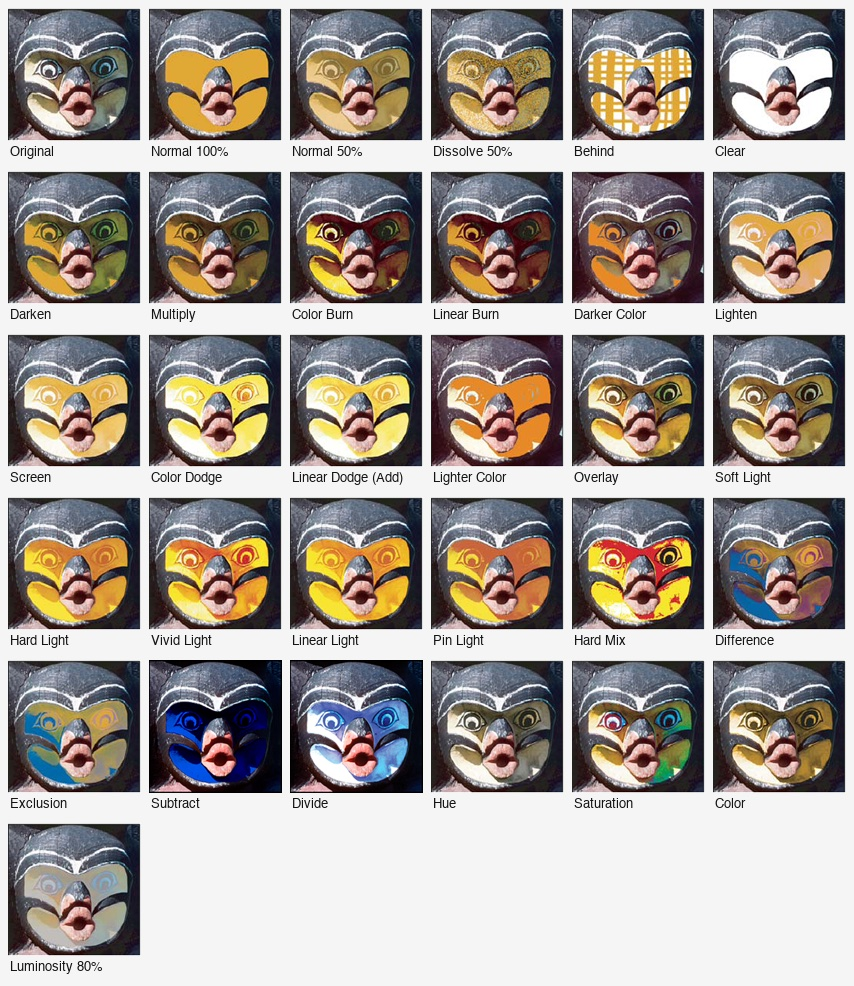
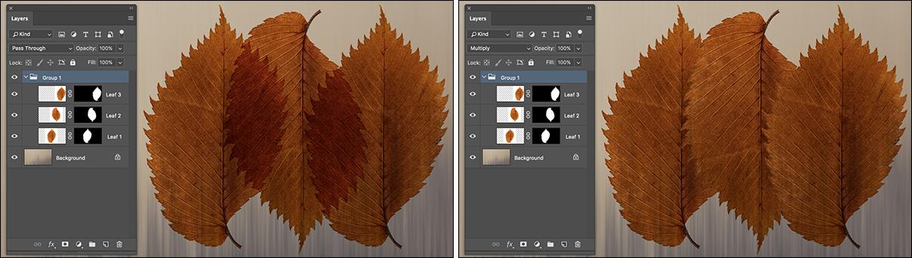
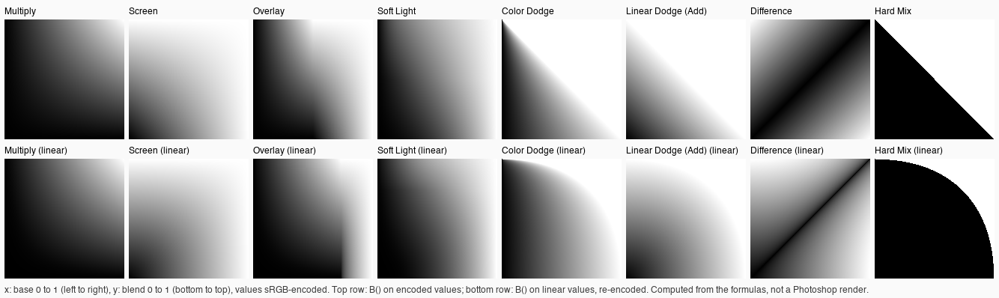

# Blend modes and opacity (General Blending)

> **Measured since** (2026-10-06, Photoshop 27.11): every mode's formula, Opacity and Fill (the special eight), Darker/Lighter Color and Hard Mix's tie. See [photoshop-measurements.md](photoshop-measurements.md),
> which overrides this document where they disagree.

How Photoshop's layer **Blend Mode** and **Opacity** work: the Layers panel's dropdown, the Layer Style dialog's
General Blending row, every mode's arithmetic, and the colour space it runs in. Researched 2026-10-06 for desktop
Photoshop 2024–2026 (versions 25–27). Research only: nothing here is built yet.

The last two sections are ours: [implementation notes](#implementation-notes-for-us) and
[open questions](#open-questions). Fill, Blend If, knockout and the "special eight" in depth are the Advanced
Blending research beside this file; this one covers what touches the modes themselves.

**How sure each claim is.** Every claim carries one of these marks:

- **[V] Verified**: an Adobe page (current or archived) or source code we read.
- **[S] Secondary**: a reputable tutorial, forum test or a third party's measurement of Photoshop.
- **[I] Inferred / unverified**: our reasoning or a guess. Never build on it without the test in
  [open questions](#open-questions).

**Notation.** `b` is the backdrop (Adobe's *base* colour: everything composited below), `s` the source (Adobe's
*blend* colour: the layer). Both are one colour channel, **unpremultiplied**, in [0, 1] unless said otherwise.
`B(b, s)` is the mode's blend function; `αb`, `αs` are alphas.

## Where the controls are

### The Layers panel


*The Layers panel's top row: Blend Mode (here Normal), Opacity, and below it Fill. Photoshop CC 2019, from
Photoshop Essentials.*

| Control | Type | Range | Default | What it does |
| --- | --- | --- | --- | --- |
| **Blend Mode** (no label; the dropdown left of Opacity) | Menu | 27 modes for layers; 28 for groups (adds Pass Through) | Normal (layers), Pass Through (groups) | How the layer's pixels combine with what's below. [V] |
| **Opacity** | Number field with a pop-up slider and a scrubby label | 0–100 %, whole numbers in the UI [I] | 100 % | Fades the whole layer, its layer effects included. [V] |
| **Fill** | Same | 0–100 % | 100 % | Fades the layer's own pixels but not its effects. Covered by the Advanced Blending research. [V] |

- Both menus are greyed out on the **Background** layer, which has no blend mode or opacity until it's made a normal
  layer. [S]

  
  *On the Background layer the Blend Mode, Opacity and Fill controls are disabled. From Photoshop Essentials.*

- With several layers selected, choosing a mode sets it on all of them. [S: Julieanne Kost, Adobe]
- Adjustment and fill layers take blend modes and opacity like pixel layers. [I: common knowledge, not checked]
- **Opacity keys** (with a tool that has no opacity of its own, such as the Move tool): a digit sets 10 %…90 %, `0`
  sets 100 %, two digits typed quickly set an exact value (`4` `5` is 45 %), `0` `0` sets 0 %. Shift with the digits
  sets **Fill**. With a painting tool the same keys set the *tool's* opacity (and Shift its flow). [S: photoblogstop]


*The Layers panel's blend mode menu, split into two columns by the tutorial's author. Photoshop CC 2019, from
Photoshop Essentials.*

### The Layer Style dialog: General Blending


*Layer Style › Blending Options › General Blending: the Blend Mode menu open (Théo's screenshot). The same list,
with the same separators, as the Layers panel's.*

| Control | Type | Range | Default | Notes |
| --- | --- | --- | --- | --- |
| **Blend Mode:** | Menu | The same modes as the Layers panel | The layer's | The same value as the Layers panel's: "these options mirror the options found in the Layers Panel" [S]. Changing it previews on the canvas while the dialog's Preview box is on [S]; Cancel puts the old value back [I] |
| **Opacity:** | Slider + number field with `%` | 0–100 | The layer's | Same value as the Layers panel's Opacity [S] |

The dialog's live hover preview: see [below](#live-preview-while-hovering). Whether the dialog's menu also offers Pass
Through for a group with a layer style is [unverified](#open-questions).

### Painting tools' Mode menu

The options bar of the Brush, Pencil, Paint Bucket, the Fill and Stroke commands, and shape tools in fill-region mode
have a **Mode** menu with the same list plus two painting-only modes after Dissolve: **Behind** and **Clear**. They
can't be set on a layer. [V]


*The Brush tool's Mode menu: Behind and Clear follow Dissolve (greyed here because the target is the Background
layer, which can't be transparent). From Photoshop Essentials.*

## The list, in menu order

Separators split the menu into six groups (the user's screenshot above). The group names are Adobe's help page's,
they aren't shown in the menu. [V]

| Group | Mode | Key (Win ⇧Alt / Mac ⇧⌥ +) | PSD layer key | Descriptor value (`BlnM`) | 32-bit | Since |
| --- | --- | --- | --- | --- | --- | --- |
| (groups only) | Pass Through | P [S] | `pass` | `passThrough` [I] | yes [I] | CS (8) [I] |
| Normal | Normal | N | `norm` | `Nrml` | yes | 1.0 |
| | Dissolve | I | `diss` | `Dslv` | yes | 1.0 |
| (painting only) | Behind | Q | none | none | ? | |
| (painting only) | Clear | R | none | none | ? | |
| Darken | Darken | K | `dark` | `Drkn` | yes | |
| | Multiply | M | `mul ` | `Mltp` | yes | |
| | Color Burn | B | `idiv` | `CBrn` | no | |
| | Linear Burn | A | `lbrn` | `linearBurn` | no | 7 [I] |
| | Darker Color | none | `dkCl` | `darkerColor` | unclear (see below) | CS3 [I] |
| Lighten | Lighten | G | `lite` | `Lghn` | yes | |
| | Screen | S | `scrn` | `Scrn` | no | |
| | Color Dodge | D | `div ` | `CDdg` | no | |
| | Linear Dodge (Add) | W | `lddg` | `linearDodge` | yes | 7 [S] |
| | Lighter Color | none | `lgCl` | `lighterColor` | unclear | CS3 [I] |
| Contrast | Overlay | O | `over` | `Ovrl` | no | |
| | Soft Light | F | `sLit` | `SftL` | no | |
| | Hard Light | H | `hLit` | `HrdL` | no | |
| | Vivid Light | V | `vLit` | `vividLight` | no | 7 [S] |
| | Linear Light | J | `lLit` | `linearLight` | no | 7 [S] |
| | Pin Light | Z | `pLit` | `pinLight` | no | 7 [S] |
| | Hard Mix | L | `hMix` | `hardMix` | no | CS [S] |
| Inversion / Cancellation | Difference | E | `diff` | `Dfrn` | yes | |
| | Exclusion | X | `smud` | `Xclu` | no | |
| | Subtract | none | `fsub` | `blendSubtraction` | unclear | CS5 [I] |
| | Divide | none | `fdiv` | `blendDivide` | unclear | CS5 [I] |
| Component (HSL) | Hue | U | `hue ` | `H   ` | yes | |
| | Saturation | T | `sat ` | `Strt` | yes | |
| | Color | C | `colr` | `Clr ` | yes | |
| | Luminosity | Y | `lum ` | `Lmns` | yes | |

- **Keys** [V: Adobe's "Keys for blending modes" table]: Shift+Alt (Windows) / Shift+Option (macOS) + the letter.
  Darker Color, Lighter Color, Subtract and Divide have none. Pass Through's ⇧⌥P is from Julieanne Kost's blog, not
  Adobe's table [S]. With a painting tool active the keys set the tool's mode; otherwise the selected layers'. [S]
- **PSD keys** [V: Adobe's PSD format specification as implemented by ag-psd `helpers.ts` and psd-tools
  `constants.py`]: the layer record's 4-byte blend mode key. A group's Pass Through lives in its section divider
  block (`lsct`), whose blend key overrides the group record's (ag-psd `psdReader.ts`). Opacity is the layer
  record's one byte, 0–255; Fill is the `iOpa` tagged block, one byte 0–255 [S: ag-psd `additionalInfo.ts`].
- **Descriptor values** [S: ag-psd `descriptor.ts` `BlnM`]: in Actions and in `lfx2` effect descriptors, a mode is
  an enum of type `BlnM` under the key `Md  `; opacity is `Opct`, a unit float in percent (`#Prc`). Photoshop 2026
  also writes long-form values (`BlnM.colorBurn`, `BlnM.normal`) that readers must accept (ag-psd's comment, and
  psd-tools' commit 53045ed "read the long-name subtract mode Photoshop writes"). `passThrough` as a descriptor value
  is our guess [I]; ag-psd marks it as never seen in files.
- **Bit depth** [V: Adobe help]: in 16-bit everything is available [I: no page says otherwise]. In 32-bit the current page lists only Normal,
  Dissolve, Darken, Multiply, Lighten, Linear Dodge (Add), Difference, Hue, Saturation, Color, Luminosity. The 2019
  version of the same page also listed Lighter Color and Darker Color, and Subtract's own description ("in 8- and
  16-bit images, any resulting negative values are clipped to zero") implies a 32-bit Subtract. So "unclear" above
  means Adobe's pages disagree: check in Photoshop 2026.
- Bitmap and indexed-colour images call Normal **Threshold**. [V]

## Choosing a mode

### Live preview while hovering


*Hovering over Multiply in the open menu previews it on the image without selecting it. Photoshop CC 2019, from
Photoshop Essentials.*


*Two frames of Adobe's "live blend mode" animation from the CC 2019 What's New page: the canvas follows the hovered
item (Vivid Light, then Lighter Color).*

- **Introduced in Photoshop CC 2019 (20.0, October 2018).** "Photoshop displays a live preview of blend modes on the
  canvas when you scroll over different blend mode options in the **Layers panel and the Layer Style dialog**." [V:
  Adobe What's New 2019, archived]
- Nothing is committed until a click; moving off the menu or Esc restores the current mode. [S: Photoshop Essentials]
- **No checkbox in Preferences.** Adobe's only off switch is a line in `PSUserConfig.txt`: `LiveBlendModes 0`,
  "disables live previews on canvas of layer blend modes", 20.0.1 or later. [V: Adobe KB "Enable optional
  extensions"] A feature request for a real preference (citing a sensory disability) is still open. [S]
- The preview is skipped while transform controls are showing on the layer (a user's diagnosis of a "partial
  preview", 2024). [S]
- The painting tools' Mode menu in the options bar: no live preview is documented. [I]

### Cycling and the keyboard

- **⇧+ / ⇧−** (Shift with plus or minus) step to the next / previous mode, on the layer with the Move tool (or any
  tool without a mode), on the tool otherwise. [V: Adobe's shortcuts table] Each step applies at once (it's not a
  preview). [S]
- With the dropdown focused, **↑ / ↓** change the mode on Windows; a 2012 Mac user reported they didn't in the Layer
  Style dialog. [S, old] Unknown in 2026.
- Mouse-wheel over the **closed** dropdown: not documented anywhere we found. [open question](#open-questions)

## How a mode is applied

### The compositing equation

Photoshop's modes are the ones Adobe put into PDF 1.4 and that the W3C took into *Compositing and Blending Level 1*
(§5–§10). Blending a layer onto the backdrop is two steps, on **unpremultiplied** colour [V: W3C]:

```
1. mix the mode in where there is backdrop:
   s' = (1 − αb) · s + αb · B(b, s)
2. source-over with the layer's effective alpha:
   αo = αs + αb · (1 − αs)
   co = αs · s' + αb · b · (1 − αs)          (premultiplied result; divide by αo for colour)
```

- Over a **transparent** backdrop (αb = 0) every mode shows the layer as Normal would. [V: W3C; S: matches
  Photoshop, e.g. a Multiply layer at the top of a transparent document shows its own colours]
- `αs` is the layer pixel's alpha × the mask × Fill × Opacity for every mode but the "special eight" (next item)
  and Dissolve. [I: for these modes the two places give the same result]
- **Opacity is a straight mix afterwards**: at opacity `o` the result is `lerp(backdrop, result at 100 %, o)`. For all
  but eight modes this equals putting `o` into `αs`, so **Opacity and Fill look identical**. For Color Burn, Linear
  Burn, Color Dodge, Linear Dodge (Add), Vivid Light, Linear Light, Hard Mix and Difference they don't: Fill goes
  *into* the formula. [S: photoblogstop, Adobe forums] See [the special eight](#the-special-eight-with-fill).
- Step 1 runs **per channel** for separable modes and on the **whole RGB triple** for Darker Color, Lighter Color
  and the component modes. Alpha is never blended by the mode, only composited. [V: W3C]
- All of this happens in the document's **encoded** RGB (gamma) unless "Blend RGB Colors Using Gamma" is on: see
  [colour space](#colour-space-encoded-or-linear).

### Every mode's formula

The formulas below are W3C's except where marked, and where Photoshop has been **measured** we say so. The key
measurement is psd-tools' (September 2026): 3 440 samples rendered by Photoshop 2026 through scripting, read back by
colour samplers, against which 17 of 20 separable modes already matched W3C within 1.4/255 and three needed the
corrections below (commits f0b6d0b and 1651583). It was taken in CMYK documents, on the complement of the ink, which
psd-tools shows uses the same functions as RGB; an RGB re-check is in [open questions](#open-questions).


*Adobe's own examples of painting each mode onto part of a face (from the 2019 "Blending modes" help page). Subtract
and Divide were made differently (applied to the whole image).*

#### Normal group

| Mode | Formula | Notes |
| --- | --- | --- |
| Normal | `B = s` | [V] |
| Dissolve | `B = s`; alpha becomes `αs' = (u(x, y) < αs·o) ? 1 : 0`, then composited at full opacity | "A random replacement of the pixels with the base color or the blend color, depending on the opacity at any pixel location" [V]. Partially transparent pixels (soft brush edges, feathered masks) become a scatter of fully opaque ones; opacity and fill thin the scatter [S]. `u` is a per-pixel random number: its generator, whether it's fixed to the canvas or the layer, and whether it changes between renders are [unknown](#open-questions) |
| Behind (painting) | `co = cb + cs·(1 − αb)`, `αo = αb + αs(1 − αb)` (Porter-Duff *destination-over*) | Paints only on transparent parts. [V description; I formula] |
| Clear (painting) | `αo = αb · (1 − αs)`, colour unchanged | Turns painted pixels transparent, an eraser. [V description; I formula] |

#### Darken group

| Mode | Formula | Notes |
| --- | --- | --- |
| Darken | `min(b, s)` per channel | [V] Can make a "third colour" (channels from both). |
| Multiply | `b · s` | [V] |
| Color Burn | `b == 1 → 1`; else `s == 0 → 0`; else `1 − min(1, (1 − b) / s)` | [V: W3C] Photoshop keeps both edge cases as written (white backdrop stays white even under black) [S: measured]. Special eight |
| Linear Burn | `max(0, b + s − 1)` | [S] Special eight |
| Darker Color | Whole pixel: `Lum(s) < Lum(b) ? s : b` | Adobe's help says it compares "the total of all channel values" [V]. **That's wrong**: a 2017 forum test in Photoshop picked (174, 154, 194) as darker than (225, 161, 49) though its sum is larger, and kept (225, 161, 49) against (200, 200, 0) though that sum is smaller [S]. A weighted luminance explains both. `Lum` = 0.3 R + 0.59 G + 0.11 B is consistent with that test and is what psd-tools uses and matched (in CMYK) [S]; Rec. 709 weights are also consistent with the test, so the exact weights are [open](#open-questions). Ties: [unknown](#open-questions) (psd-tools and Krita keep the backdrop) |

#### Lighten group

| Mode | Formula | Notes |
| --- | --- | --- |
| Lighten | `max(b, s)` | [V] |
| Screen | `b + s − b·s` | [V] |
| Color Dodge | `b == 0 → 0`; else `s == 1 → 1`; else `min(1, b / (1 − s))` | [V: W3C] Photoshop keeps both edge cases (black stays black under white) [S: measured]. Special eight |
| Linear Dodge (Add) | `min(1, b + s)` | [V] Special eight. In 32-bit, unclamped [I] |
| Lighter Color | Whole pixel: `Lum(s) > Lum(b) ? s : b` | As Darker Color [S] |

#### Contrast group

| Mode | Formula | Notes |
| --- | --- | --- |
| Overlay | `HardLight(s, b)`: `b ≤ 0.5 ? 2·b·s : 1 − 2(1 − b)(1 − s)` | [V] Hard Light with the layers swapped; decided by the backdrop |
| Soft Light | `s ≤ 0.5 ? b − (1 − 2s)·b·(1 − b) : b + (2s − 1)(D(b) − b)` with `D(b) = b ≤ 0.25 ? ((16b − 12)b + 4)b : √b` | **The W3C formula.** Widely quoted as "Photoshop's" (Wikipedia, Krita's "Soft Light (Photoshop)" `CFSoftLight`) is the same with `D(b) = √b` always. psd-tools measured Photoshop 2026: the √b-only form was up to 12.6/255 off for backdrops darker than 0.25, the W3C form within ~1/255 [S: measured]. The two differ only where `s > 0.5` and `b < 0.25`, by up to 17 levels in 8 bits (our computation). Pure black or white never gives pure black or white [V] |
| Hard Light | `s ≤ 0.5 ? 2·b·s : 1 − 2(1 − b)(1 − s)` | [V] Multiply by 2s, or Screen by 2s − 1 |
| Vivid Light | `s ≤ 0.5`: `s == 0 → 0`, else `1 − min(1, (1 − b) / (2s))`; `s > 0.5`: `s == 1 → 1`, else `min(1, b / (2(1 − s)))` | Colour Burn of 2s below the middle, Colour Dodge of 2s − 1 above it [V description], but **the source's extremes win** (`s = 0` gives 0 even on a white backdrop, `s = 1` gives 1 even on black), unlike plain Color Burn and Color Dodge. Using W3C's burn/dodge (backdrop cases first) was psd-tools' largest error until fixed [S: measured]. Continuous at `s = 0.5`. Special eight |
| Linear Light | `clamp(b + 2s − 1, 0, 1)` | [V description; S formula] Special eight |
| Pin Light | `s ≤ 0.5 ? min(b, 2s) : max(b, 2s − 1)` | [V description; S formula] Continuous |
| Hard Mix | `1` if `b + s > 1`, or `b + s == 1` and `b > 0.5`; else `0` | Adobe: "if the resulting sum for a channel is 255 or greater, it receives a value of 255" [V], so only the primaries, their complements, black and white remain. Measured, the exact tie `b + s = 1` goes to 1 only where `b > 0.5` (`b > s` and `s < 0.5` are the same test on that line); a plain `≥ 1` got 8 of 145 boundary samples wrong [S: measured]. In 8 and 16 bits the tie is real: complementary codes sum to exactly 1. Special eight; Fill makes it soft (below) |

#### Inversion and cancellation group

| Mode | Formula | Notes |
| --- | --- | --- |
| Difference | `abs(b − s)` | [V] Special eight |
| Exclusion | `b + s − 2·b·s` | [V: W3C; S: photoblogstop] |
| Subtract | `max(0, b − s)` | [V] "In 8- and 16-bit images, any resulting negative values are clipped to zero", so 32-bit keeps `b − s` |
| Divide | `b == 0 → 0`; else `s == 0 → 1`; else `min(1, b / s)` | [V description "divides the base color by the blend color"; S edge cases: photoblogstop "blacks stay black", psd-tools and Krita `CFDivide`; measured within 1.4/255] |

#### Component group (non-separable)

Photoshop's component modes are the W3C/PDF functions, with the PDF's luminance weights [S: Ben Lincoln 2011 found
Photoshop's Color matches the PDF addendum; psd-tools 2026 matched all four in CMYK within 1.2/255]:

```
Lum(C)       = 0.3·R + 0.59·G + 0.11·B
ClipColor(C) = L = Lum(C); n = min(R, G, B); x = max(R, G, B)
               if n < 0: C = L + (C − L) · L / (L − n)
               if x > 1: C = L + (C − L) · (1 − L) / (x − L)
SetLum(C, l) = ClipColor(C + (l − Lum(C)))
Sat(C)       = max(R, G, B) − min(R, G, B)
SetSat(C, s) = if max > min: mid = (mid − min) · s / (max − min); max = s
               else: mid = max = 0
               min = 0                       (on the sorted channels, written back in place)

Hue         = SetLum(SetSat(s, Sat(b)), Lum(b))
Saturation  = SetLum(SetSat(b, Sat(s)), Lum(b))
Color       = SetLum(s, Lum(b))
Luminosity  = SetLum(b, Lum(s))
```

- Hue with a grey layer makes the result grey (SetSat of a grey gives 0) [I, matches "grays from the foreground
  remain gray": simplefilter]. Saturation over a grey backdrop changes nothing [V].
- Color and Luminosity are each other with the layers swapped [V: Adobe "the inverse effect of Color mode"].
- These are not Lab or HSL lightness. The coefficients are the old NTSC ones, applied to *encoded* values, so they're
  only an approximation of perceived lightness. [V: W3C §10.2]
- A Photoshop "luminosity" of 0.3/0.59/0.11 is close to, but not, Rec. 601 (0.299/0.587/0.114, which Krita's
  `HSYType` uses: `KoColorSpaceMaths.h` line 913). [V]

### Where Photoshop departs from W3C or from folklore

| Mode | Folklore / spec | What Photoshop does | Evidence |
| --- | --- | --- | --- |
| Soft Light | "Photoshop's" √b-only formula (Wikipedia, Krita) | W3C's, with the cubic below 0.25 | [S] measured, 2026 |
| Vivid Light | Built from W3C's Color Burn / Dodge | The source's 0 and 1 win over the backdrop's | [S] measured |
| Hard Mix | `b + s ≥ 1` (Adobe's own help) | Ties go to 1 only where `b > 0.5` | [S] measured |
| Darker / Lighter Color | "Total of all channel values" (Adobe's help) | A weighted luminance | [S] forum test |
| Color Burn / Dodge | W3C | W3C, backdrop cases first | [S] measured |
| Every mode | W3C blends in "gamma-encoded sRGB" | The document's own encoded space, whatever its profile | [V] see next section |

## The special eight with Fill

Color Burn, Linear Burn, Color Dodge, Linear Dodge (Add), Vivid Light, Linear Light, Hard Mix and Difference treat
Fill differently from Opacity [S: photoblogstop 2011, Kelby, Fstoppers; Adobe's help says nothing]. Opacity fades
the result; Fill changes the formula: "it first decreases the effect where it was already the weakest" [S]. Hard Mix
at reduced Fill gains soft transitions and more than eight colours [S].

No primary source gives the maths. A consistent hypothesis [I]: Fill (and probably the pixel's own alpha) moves the
source toward the mode's neutral colour *before* the formula, then the result is used as is.

| Mode | Neutral | Candidate at fill `f` | Evidence |
| --- | --- | --- | --- |
| Linear Dodge (Add) | black | `min(1, b + f·s)` | [I] |
| Color Dodge | black | `min(1, b / (1 − f·s))` | [S] a Unity forum user matched Photoshop with this, "slight differences near FF" |
| Linear Burn | white | `max(0, b − f·(1 − s))` | [I] |
| Color Burn | white | `1 − min(1, (1 − b) / (1 − f·(1 − s)))` | [I] |
| Linear Light | 50 % grey | `clamp(b + f·(2s − 1))` | [I] |
| Vivid Light | 50 % grey | Vivid Light of `0.5 + f·(s − 0.5)` | [I] |
| Difference | black | `abs(b − f·s)` | [I] |
| Hard Mix | none | `clamp((b − f·(1 − s)) / (1 − f))`: `b` at 0, the step at 1 | [I] a guess shaped to fit the reports; must be measured |

Opacity then mixes the backdrop with that result. A 2019 forum thread also found a bug where a **group** in Linear
Dodge with Fill below 100 % renders differently from Photoshop 2014 (Jeff Arola's diagnosis). [S]

## Groups and Pass Through


*Left: a group in Pass Through, its three leaves each in Multiply, so they also darken one another. Right: the group
set to Multiply (leaves Normal): the group is flattened first, then multiplied onto the background. From Julieanne
Kost's blog (Adobe).*

- **Pass Through** (groups' default) composites the group's children straight onto the stack below, as if there were
  no group: their modes and adjustment layers reach layers outside it. Any other mode **isolates** the group: its
  children are composited onto transparency, then the result is blended as one layer. [V: Adobe "Layer opacity and
  blending"; S: Kost]
- A Pass Through group's Opacity and mask are applied by mixing the stack *after* the group with the stack *before*
  it (psd-tools' compositor does this; its fixtures are checked against Photoshop's saved composites). [S]
- Adjustments in a Pass Through group stop at the group when the group has clipped layers or Fill below 100 %
  (psd-tools' compositor, `_get_group`). [S]
- Normal on a group is *not* Pass Through: it isolates. [V]

## Bit depth and range

- **8-bit**: integer arithmetic; results are rounded to 1/255 (psd-tools' tolerance is 1.4/255). [S]
- **16-bit** is 0…32 768 internally (15 bits + 1), chosen for "a midpoint to the range (very useful for blending)"
  and shifts instead of divides (Chris Cox, Adobe). So 50 % grey is exact in 16-bit and not in 8-bit (128 is
  0.502). Every formula above is continuous at its 0.5 switch except Hard Mix, so that matters little. [S]
- **32-bit** documents are linear-light floating point, and values above 1 exist. That's why only the modes that make
  sense for unbounded light are offered: Multiply, Add, Darken, Lighten, Difference and the component modes. Modes
  built on "1 is white" (Screen, Overlay, dodges, burns, lights) are missing. [V list; I reasoning]
- In 8 and 16 bits nothing can leave [0, 1]: every formula clamps as written. Only Subtract is documented to go
  negative in 32-bit. [V]
- Krita, which supports HDR, decides per mode which inputs to clamp to [0, 1] first
  (`KoCompositeOpGenericFunctorBase.h`): none for Multiply, Screen, Darken, Lighten, Difference and Add (with a clamp
  on the result); the source only for Linear Burn, Color Dodge, Hard Light, Vivid Light, Hard Mix; both for Color
  Burn, Exclusion, Soft Light, Pin Light and the component modes; both at 0 only for Divide. A sensible model for our
  extended range. [V: Krita source]

## Colour space: encoded or linear

**By default Photoshop blends in the document's encoded RGB** (sRGB's curve in an sRGB document, gamma 2.2 in Adobe
RGB, 1.8 in ProPhoto), mode and opacity alike. [S: every source above agrees, and our rendering.md assumes it; the
Color Settings help page was unreachable]

**Blend RGB Colors Using Gamma** (Edit › Color Settings, More Options / Advanced, off by default, value 1.00 when
turned on): "controls how RGB colors blend together to produce composite data … When the option is selected, RGB
colors are blended in the color space corresponding to the specified gamma. A gamma of 1.00 is considered
colorimetrically correct and should result in the fewest edge artifacts." [S: Adobe's wording as commonly quoted;
the help page was unreachable, so the exact text is unconfirmed]

- It's an **application** setting, not saved in the document: the same PSD looks different on two machines. [S]
- It changes layer compositing (opacity, soft edges, text and shape layers), not single-layer images. [S]
- 2025–2026: with gamma 1.00 the GPU path rendered some blends differently while dragging with the Move tool;
  Adobe said it was fixed in 27.10 (August 2026). [S]
- Whether it also moves each **mode's** formula into linear light, or only the mixing, isn't documented. [I: almost
  certainly both, since converting the pixels and running the same code is the obvious implementation; test it]
- A sibling, **Blend Text Colors Using Gamma** (default 1.45), affects type edges only. [S]

### What linear blending would do to each family


*Our computation (not a Photoshop render): base 0→1 left to right, blend 0→1 bottom to top, shown sRGB-encoded. Top
row: the formula on encoded values (Photoshop's default). Bottom row: on linear values, re-encoded.*

Largest and mean difference, in 8-bit levels, between evaluating a mode on sRGB-encoded values and on linear ones
(our computation over a 256 × 256 grey grid; colour differences are similar per channel):

| Family | Modes (max / mean) | What changes |
| --- | --- | --- |
| Unchanged | Normal, Darken 0 / 0, Lighten 0 / 0 | A per-channel min or max commutes with any increasing curve. Only the alpha mix differs |
| Nearly unchanged | Multiply 7 / 2.5, Divide 73 / 2.5 | With a pure power curve these would be exact (`a^γ·b^γ = (ab)^γ`); sRGB's straight toe breaks it a little |
| Moderate | Screen 27 / 11, Soft Light 31 / 15 | Screen in linear brightens much more; Soft Light's effect is stronger in the shadows |
| Large | Overlay and Hard Light 119 / 28, Pin Light 119 / 14, Linear Burn 120 / 19, Add 80 / 26, Difference 120 / 52, Exclusion 120 / 40, Subtract 120 / 26 | Their "50 % grey is neutral" moves to linear 0.5, which is encoded 188. A grey (128) layer in Overlay *darkens* by about half instead of doing nothing, so every dodge-and-burn layer and texture overlay breaks |
| Extreme | Color Burn 244 / 34, Color Dodge 203 / 39, Vivid Light 246 / 61, Linear Light 213 / 54, Hard Mix 255 / 80 | Thresholds and divisions land somewhere else entirely (Hard Mix's diagonal becomes a curve) |
| Component modes | Not tabulated | `Lum`'s weights only approximate lightness on encoded values; in linear they'd be closer to luminance but no longer Photoshop's |

So Photoshop's look **depends on blending in the encoded space**; for most modes the formula is the look.

### Recommendation

For "looks like Photoshop": **evaluate every mode's `B(b, s)` on unassociated, sRGB-encoded values**, the same
domain as our Curves. That alone reproduces Photoshop exactly wherever the layer is opaque at 100 %. What's left is
the alpha and opacity mix (step 2 and every partial edge), where Photoshop's default mixes encoded values and our
foundations mix linear light (rendering.md: Normal compositing is linear). That's GIMP 2.10's split: its layer modes
have a *blend space* (perceptual for Screen, Overlay, the dodges and burns, the lights, Difference, Exclusion, Hard
Mix; linear for Multiply, Add, Subtract, Divide) and a separate *composite space* (linear) [V: GIMP
`gimp-layer-modes.c`]. We'd use encoded for every mode, to match Photoshop, and keep the document's mix linear. A
document setting "blend like Photoshop's default" (encoded mixing too) can come later, versioned, as rendering.md
already says.

## Implementation notes for us

- **A blend is a per-pixel pass that reads the backdrop.** WebGPU has no framebuffer fetch, so each non-Normal layer
  is a compute (or render) pass over the tile: read the composite so far and the layer, write a new composite. One
  read and one write per layer per tile; ALU is trivial (the component modes are a few dozen instructions). Normal
  can stay the existing premultiplied source-over.
- **The pass, per pixel** (premultiplied linear f16 in, out):
  1. Unpremultiply both (guarded at α = 0).
  2. Encode both with the sRGB curve in f32. Values outside [0, 1] (glows above 1, P3 colours below 0): clamp per
     the mode's rule, Krita's table above. Multiply, Darken, Lighten, Add, Difference, Subtract, Divide can keep
     out-of-range values if we want HDR-safe variants; the rest clamp, as an sRGB Photoshop document would.
  3. `B(b, s)` in f32 (one WGSL function per mode, from a `switch` or specialised pipelines).
  4. Decode the result back to linear.
  5. Mix: `s' = (1 − αb)·s + αb·B`, then source-over with `αs` = alpha × mask × fill × opacity, in linear light.
  6. Premultiply, `round_for_store`, store.
- **The special eight** need Fill (and, if confirmed, the pixel alpha) inside `B`, so the pass needs fill separately
  from opacity. Keep the shader signature `B(b, s, fill)` from the start.
- **Dissolve** needs a deterministic noise in **document** pixel coordinates (the same u32 hash as the output dither
  in `shared/photo/output.ts`, salted per layer), so a tile renders the same alone or with neighbours, and exports
  match the screen. Then `alpha = hash < α·o ? 1 : 0` and Normal.
- **Zoom.** Everything here is pointwise, so it's resolution independent at level 0. Reduced views (the pyramid)
  aren't: a mode applied to averaged pixels isn't the average of the mode (Hard Mix and Difference most of all).
  Draw reduced views by blending reduced levels for speed and let the renderer's existing refinement replace them,
  or mark nonlinear modes as "refine always". Dissolve on a reduced level is best drawn as Normal: the expected value
  of the speckle is exactly the alpha, which is what a downsample of the true speckle shows.
- **Groups**: isolated groups render into their own surface first (they already do for Normal); Pass Through needs
  the mix-against-the-backdrop-before rule for its opacity and mask.
- **Precision.** Encoding and decoding in f32 between f16 stores costs nothing measurable. Hard Mix's tie test
  (`b + s == 1`) is exact only when the inputs come from exact 8-bit codes; through linear f16 and back the sum lands
  within ~1e-4 of 1, so compare with a tolerance of a quarter 8-bit step and break ties on `b > 0.5`.
- **CPU reference**: each mode in `shared/photo/reference/` with fixtures from the psd-tools tables (their
  `PHOTOSHOP_CMYK_SEPARABLE` / `PHOTOSHOP_CMYK` pairs, converted to RGB complements) plus our own Photoshop
  renders.
- **Cost**: blend passes are bandwidth-bound like any layer composite. A document with many non-Normal layers costs a
  pass each; nothing needs a blur, distance transform or neighbourhood.

## Open questions

Each is a test in real Photoshop 2026 (27.x) unless said otherwise. A script (ExtendScript or UXP) that fills a
backdrop, sets a layer's colour, mode, opacity and fill, and reads `colorSamplers`, as psd-tools did, settles most of
them in an hour.

1. **RGB re-check of the measured corrections** (Soft Light's cubic, Vivid Light's extremes, Hard Mix's tie) in an
   8-bit sRGB document, and the same 20 modes in 16-bit.
2. **Darker / Lighter Color weights and ties**: compare green (0, 255, 0) with grey levels around 150: 0.3/0.59/0.11
   and Rec. 709 disagree there. Then a pair of equal luminance.
3. **The special eight with Fill**: sweep `f` in 10 % steps for each mode on a ramp backdrop and fit the
   candidates above, Hard Mix especially. Then the same with the *pixel's* alpha (a 50 % transparent layer at 100 %
   Fill) and with a 50 % grey layer mask, to learn which of alpha and mask behave like Fill and which like Opacity.
4. **Blend RGB Colors Using Gamma 1.00**: does Overlay with a 128 grey layer still do nothing (mode in encoded space)
   or darken (mode in linear)? Does 50 % white over black become 128 or 188? Is the conversion the profile's curve or
   a plain power?
5. **32-bit list**: which modes the Layers panel offers in a 32-bit document today (Adobe's 2019 and 2025 pages
   disagree on Lighter/Darker Color; Subtract and Divide are unclear), and whether Add and Subtract leave [0, 1].
6. **Dissolve's noise**: move the layer by one pixel. Does the pattern move with it or stay on the canvas? Is it the
   same after reopening the file? Is it the same in an export? How does it look at 50 % zoom?
7. **Dissolve with layer effects**: does a drop shadow dissolve too?
8. **Live preview**: does it work from the keyboard (arrows while the menu is open), with the mouse wheel over the
   closed menu, and in the Layer Style dialog on macOS today? Is Pass Through offered in the dialog for a group?
9. **Opacity storage**: what byte does 50 % write (127 or 128)? Can scripting set fractional opacity, and does the
   render use it?
10. **Lab and CMYK documents**: which modes are missing there (we only need RGB, but a PSD import must know).

## Sources

Adobe (primary):

- Blending mode descriptions, current: https://helpx.adobe.com/photoshop/using/blending-modes.html (fetched through
  https://web.archive.org/web/2025/https://helpx.adobe.com/photoshop/using/blending-modes.html; last updated
  2025-10-27)
- The same page in 2019, with the example images and the older 32-bit list:
  https://web.archive.org/web/2019/https://helpx.adobe.com/photoshop/using/blending-modes.html
- What's new in Photoshop CC 2019 (live blend mode preview, new compositing engine):
  https://web.archive.org/web/2019/https://helpx.adobe.com/photoshop/using/whats-new/2019.html
- Enable optional extensions (`LiveBlendModes 0`): https://helpx.adobe.com/photoshop/kb/enable-optional-extensions-photoshop-cc.html
  (read through https://web.archive.org/web/2023/…)
- Default keyboard shortcuts, "Keys for blending modes":
  https://web.archive.org/web/2023/https://helpx.adobe.com/photoshop/using/default-keyboard-shortcuts.html
- Layer opacity and blending: https://helpx.adobe.com/photoshop/using/layer-opacity-blending.html
- Julieanne Kost (Adobe), Five additional tips for blend modes:
  https://jkost.com/blog/2018/08/five-additional-tips-for-accessing-and-applying-blend-modes-in-photoshop-cc.html
- Julieanne Kost, Photoshop CC 2019 announcement: https://jkost.com/blog/2018/10/adobe-announces-updates-to-photoshop-cc-2019-v20.html

Specifications and source code:

- W3C Compositing and Blending Level 1: https://www.w3.org/TR/compositing-1/
- psd-tools `composite/blend.py`, `composite/composite.py`, `constants.py`, `tests/psd_tools/composite/test_blend.py`:
  https://github.com/psd-tools/psd-tools (commits f0b6d0b "correct soft light, vivid light and hard mix against
  Photoshop", 1651583, 40bc28c, 53045ed; September 2026)
- ag-psd `src/helpers.ts` (`toBlendMode`), `src/descriptor.ts` (`BlnM`), `src/additionalInfo.ts` (`iOpa`),
  `src/psdReader.ts`: https://github.com/Agamnentzar/ag-psd
- Krita `libs/pigment/compositeops/KoCompositeOpFunctions.h` (lines 109–849),
  `KoCompositeOpGenericFunctorBase.h`, `libs/pigment/KoColorSpaceMaths.h` (line 909, `HSYType`):
  https://github.com/KDE/krita (mirror of invent.kde.org)
- GIMP `app/operations/layer-modes/gimp-layer-modes.c` (blend and composite spaces per mode):
  https://github.com/GNOME/gimp

Secondary:

- photoblogstop, "A detailed explanation of how Photoshop blend modes work" (formulas, the special eight, opacity
  keys): https://photoblogstop.com/photoshop/photoshop-blend-modes-explained/ (read through the Wayback Machine)
- Adobe Community, "Darker Color blend mode behaviour" (2017 test, Scott Valentine):
  https://community.adobe.com/t5/photoshop-ecosystem-discussions/darker-color-blend-mode-behaviour/m-p/9484313
- Adobe Community, "Wrong alpha blending for gamma 1.00" (2025–2026):
  https://community.adobe.com/t5/photoshop-ecosystem-discussions/wrong-alpha-blending-for-gamma-1-00/m-p/15495387
- Adobe Community, "Make Blend Colors Using Gamma a document setting":
  https://community.adobe.com/t5/photoshop-ecosystem-ideas/photoshop-make-quot-blend-colors-using-gamma-quot-a-document-setting/idi-p/12249621
- Adobe Community, "Option to disable live preview of layer blending modes":
  https://community.adobe.com/t5/photoshop-ecosystem-ideas/photoshop-option-to-disable-live-preview-of-layer-blending-modes/idi-p/12248679
- Adobe Community, "Hovering over blend modes doesn't show a full preview":
  https://community.adobe.com/questions-712/hovering-over-blend-modes-doesnt-show-a-full-preview-1144572
- Adobe Community, "Ability to cycle through blend modes in layer styles with arrow keys" (2012):
  https://community.adobe.com/t5/photoshop-ecosystem-discussions/photoshop-ability-to-cycle-through-blend-modes-in-layer-styles-with-arrow-keys/idi-p/12249753
- Adobe Community, "So different of Linear Dodge between old and new versions" (2019):
  https://community.adobe.com/questions-712/so-different-of-linear-dodge-between-old-and-new-versions-1078992
- Adobe Community, "16-bit or 15-bit" (Chris Cox): https://community.adobe.com/t5/photoshop-ecosystem-discussions/16-bit-or-15-bit-1/m-p/3268275
- Unity Discussions, "Photoshop Fill Opacity blend mode" (2018): https://discussions.unity.com/t/photoshop-fill-opacity-blend-mode/692430
- Ben Lincoln, "Secrets of Photoshop's Colour Blend Mode Revealed (Sort Of)" (2011):
  https://www.beneaththewaves.net/Photography/Secrets_of_Photoshops_Colour_Blend_Mode_Revealed_Sort_Of.html
- simplefilter.de, "Blending Modes of Photoshop & Co.": http://www.simplefilter.de/en/basics/mixmods.html
- Photoshop Essentials, "How to preview layer blend modes in Photoshop CC 2019":
  https://www.photoshopessentials.com/basics/preview-layer-blend-modes-photoshop-cc-2019/
- Photo Training Channel, blend mode keyboard shortcuts:
  https://photoshoptrainingchannel.com/tips/all-photoshop-blend-mode-keyboard-shortcuts/
- openphotographyforums, "Photoshop blend at gamma 1.0": https://openphotographyforums.com/forums/threads/photoshop-blend-at-gamma-1-0.14081/

Images:

| File | Source |
| --- | --- |
| `img/dialog-blend-mode-list.png` | Théo's screenshot |
| `img/blend-layers-panel-row.png` | https://pe-images.s3.amazonaws.com/basics/cc/2019/blend-mode-previews/layer-blend-mode-option.png |
| `img/blend-layers-panel-menu.png` | https://pe-images.s3.amazonaws.com/basics/cc/2019/blend-mode-previews/layer-blend-modes-photoshopcc2019.png |
| `img/blend-hover-preview-multiply.jpg` | https://pe-images.s3.amazonaws.com/basics/cc/2019/blend-mode-previews/preview-multiply-blend-mode-photoshopcc2019.jpg |
| `img/blend-adobe-live-preview.jpg` | Frames 60 and 120 of Adobe's https://helpx.adobe.com/content/dam/help/en/photoshop/using/whats-new/2019/jcr_content/main-pars/image_1120407235/live-blend-mode.gif (via the Wayback Machine), stacked |
| `img/blend-background-greyed.png` | https://pe-images.s3.amazonaws.com/photo-editing/layer-blend-modes/intro/photoshop-blend-modes-grayed-out.png |
| `img/blend-brush-mode-behind-clear.png` | https://pe-images.s3.amazonaws.com/basics/brushes/turn-brush-to-eraser/clear-blend-mode-unavailable.png |
| `img/blend-group-pass-through-vs-multiply.jpg` | https://jkost.com/blog/wp-content/uploads/2018/08/04-Pass-through.jpg and https://jkost.com/blog/wp-content/uploads/2018/08/03Layer-Group.jpg, side by side |
| `img/blend-adobe-examples.jpg` | Adobe's `pa_22.png` … `pa_22z.png`, `pa_subtract_mode.png`, `pa_divide_mode.png`, `pa_blendmode_lighter_color.png`, `pa_blendmode_darker_color.png` from https://helpx.adobe.com/content/dam/help/images/ (via the Wayback Machine, 2019), labelled and arranged by us |
| `img/blend-encoded-vs-linear.png` | Computed by us from the formulas above (sRGB curve, 8-bit) |
