# The Layer Style dialog

> **Measured since** (2026-10-06, Photoshop 27.11): the dialog's pages in 27.11 (screenshots), the hover preview, the stored keys, contour interpolation and every preset contour's points. See [photoshop-measurements.md](photoshop-measurements.md),
> which overrides this document where they disagree.

How Photoshop's Layer Style dialog works as a whole: how it opens, what's in it, the controls every effect
shares (contours, the angle dial, Global Light, swatches, pickers), the Layers panel and menus around it, and how a
style is saved in a PSD. Researched 2026-10-06 for current desktop Photoshop (2024–2026: versions 25 to 27), from
Adobe's Help pages (the 2025–2026 pages and the older, longer 2022 page, read through the Internet Archive),
Adobe's What's New for CC 2015, Adobe's PSD file format specification, the source of two PSD libraries (ag-psd,
psd-tools) and tutorials. No hands-on Photoshop session was used: where only a tutorial or our own reading says
so, it's marked.

Each effect's own page (Drop Shadow, Bevel & Emboss…) and Blending Options are in the other documents of this
folder. This one is what they share.

The last sections are ours: [implementation notes](#implementation-notes-for-us) and
[open questions](#open-questions).

**How claims are marked**

| Mark | Means |
| --- | --- |
| **V** | Verified: an Adobe Help page, an Adobe screenshot, Adobe's file format specification, or library source code |
| **S** | Secondary: a reputable tutorial (Photoshop Essentials, Julieanne Kost, Tuts+, PTC) or Adobe's community forum |
| **I** | Inferred: our reading of the evidence, not stated anywhere |
| **U** | Unverified: remembered or plausible, but no source found |

## What it is

- A **layer effect** is one effect (Drop Shadow, Stroke…). A **layer style** is the layer's effects *plus* its
  blending options (blend mode, Opacity, Fill, the advanced blending, Blend If). **V** (Adobe: "A layer style is
  one or more effects applied to a layer or layer group"; Photoshop Essentials spells out the blending part, **S**.)
- Effects are **live**: they're computed from the layer's content every time it's drawn, so painting, editing text
  or moving the layer redraws them. "If you apply a drop shadow to a text layer and then add new text, the shadow
  is added automatically to the new text." **V**
- They're **non-destructive** and add almost nothing to the file: the PSD keeps only their settings. **V** / **S**
- There are **ten effects**, plus two sub-pages of Bevel & Emboss (Contour, Texture). **V**
- One dialog, **Layer Style**, edits all of them, and the layer's Blending Options, and lists the Styles presets.
  It is **modal**: OK commits everything as one change, Cancel throws everything away. **I** (every tutorial
  describes it this way; Adobe doesn't use the word.)

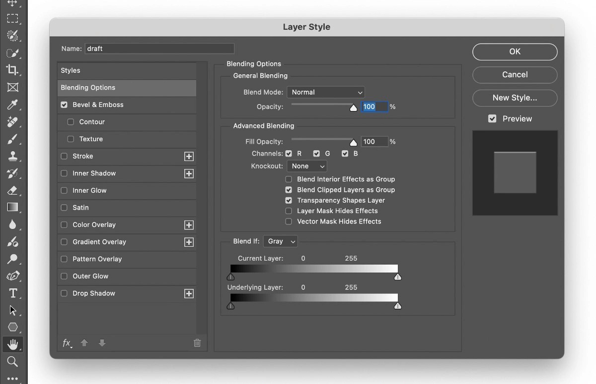
*The whole dialog, current version (Adobe's own screenshot, 2026): the Name field, the left list (Styles,
Blending Options, the effects with their checkboxes and +), the page in the middle, and OK / Cancel / New Style… /
Preview and the swatch on the right.*

## Opening it

| From | What happens | |
| --- | --- | --- |
| **Double-click a layer's row**, outside its name and thumbnail | Opens the dialog for that layer (on Blending Options) | **V** (page: **S**) |
| Double-click the layer's **fx** badge | Opens the dialog | **V** |
| Double-click the **Effects** row under a layer | Opens the dialog | **S** (Kost) |
| Double-click **one effect's row** under a layer | Opens the dialog on that effect's page | **V** |
| **fx** button at the bottom of the Layers panel → an item | Blending Options…, or one effect: the dialog opens on its page with that effect turned on | **V** / **S** |
| **Layer › Layer Style ›** an item | The same list as the fx button | **V** |
| Right-click a layer → **Blending Options…** | Opens the dialog on Blending Options | **S** |
| Right-click the **fx** badge → an effect | Opens on that effect | **S** |

- Double-clicking the **name** renames the layer instead, and double-clicking the **thumbnail** does the layer
  kind's own thing (a Smart Object's contents, an adjustment's Properties). That's why Adobe says "outside the
  layer name or thumbnail". **V** for the rule, **I** for the reasons. Accidentally opening the dialog when
  meaning to rename is a long-standing complaint (Adobe forum, **S**).
- The fx menu and the Layer Style submenu list **Blending Options…**, a separator, then the ten effects **in the
  dialog's order** (Bevel & Emboss… Drop Shadow…). **V** (screenshots).

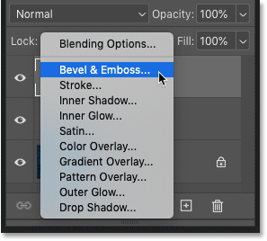
*The fx button at the bottom of the Layers panel: Blending Options…, then the ten effects (Photoshop Essentials).*

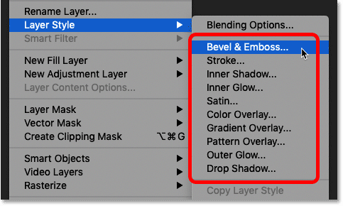
*Layer › Layer Style: the same list (Photoshop Essentials).*

### Which layers can have a style

| Layer | Styles? | |
| --- | --- | --- |
| Pixel, type, shape, fill (Solid Colour, Gradient, Pattern), Smart Object | Yes | **V** (Adobe lists "bitmap, vector and type layers"; tutorials, **S**) |
| **Group** | Yes, since **CS6**. The group's contents are composited first, then its effects run on the result. | **V** (Adobe: "a layer or layer group") / **S** (Tuts+, bjango, PTC) |
| **Background** layer | **No**: the fx button and the Layer Style menu are greyed out. Convert it to a normal layer first. | **V** (Adobe) / **S** |
| A fully **locked** layer (Lock All) | No | **V** (Adobe's 2022 note: "You cannot apply layer styles to a background, locked layer, or group"; the group part is out of date) |
| **Adjustment** layer | Double-clicking it opens Layer Style on Blending Options (Blend If is used on adjustments a lot). Whether its effects can be turned on is unknown. | **S** / **U** |
| Artboard | Unknown | **U** |

**Several layers selected**: the dialog can't be opened for all of them (the fx button doesn't open it), but a
Styles preset clicked, **Paste Layer Style** and **Clear Layer Style** all act on every selected layer. **V** for
Styles / Paste / Clear (Adobe, 2026); **S** for the fx button (O'Reilly summary).

## The dialog

Left to right: the **list**, the **page** of whatever is selected in it, and the **buttons**.

### The Name field (new)

Adobe's 2025–2026 screenshots show **Name:** above the list, holding the layer's name ("Layer 1", "draft"). The
2022–2023 screenshots don't have it, and an Adobe forum request to rename a layer from the dialog is still marked
open. So it is recent; the version that added it is **U**. Presumably it renames the layer as part of the dialog's
change (**I**).

### The left list

Top to bottom (**V**, Adobe screenshots, 2022 and 2026):

| Row | Click its name | Its checkbox | + |
| --- | --- | --- | --- |
| **Styles** | Shows the Styles presets as the page; clicking one applies it to the dialog's layer | — | — |
| **Blending Options** | Shows Blending Options (another document) | — | — |
| **Bevel & Emboss** | Its page | On / off | — |
| ↳ **Contour** (indented) | Bevel's contour page | On / off | — |
| ↳ **Texture** (indented) | Bevel's texture page | On / off | — |
| **Stroke** | Its page | On / off | **+** |
| **Inner Shadow** | Its page | On / off | **+** |
| **Inner Glow** | Its page | On / off | — |
| **Satin** | Its page | On / off | — |
| **Color Overlay** | Its page | On / off | **+** |
| **Gradient Overlay** | Its page | On / off | **+** |
| **Pattern Overlay** | Its page | On / off | — |
| **Outer Glow** | Its page | On / off | — |
| **Drop Shadow** | Its page | On / off | **+** |

- **Name vs checkbox**: the checkbox turns the effect on *with its current settings* without showing its page;
  clicking the name shows its page **and turns it on**. **V** (Adobe's caption: "Select a checkbox to apply the
  current settings without displaying the effect's options. Select an effect name to display its options.") That
  clicking the name also ticks it: **S** (every tutorial; Adobe's step "Select an effect" then adjust).
- The selected row is highlighted; the page in the middle is titled with its name. **V**
- **The order is the drawing order**, top of the list drawn last (on top). Since **CS6**: before that the list
  started with Drop Shadow and ended with Stroke, in no useful order. **V** for both orders (screenshots), **S**
  for the reason (Tuts+: "changed to display the order in which the effects are actually applied").
  See [the drawing order](#the-drawing-order).

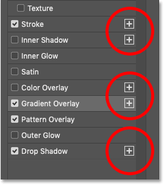
*The five effects that can be added more than once carry a + (Photoshop Essentials).*

#### Several of one effect (CC 2015)

- **Stroke, Inner Shadow, Color Overlay, Gradient Overlay and Drop Shadow** can each be added up to **10 times**
  per layer (or group). The others (Bevel & Emboss, Inner Glow, Satin, Pattern Overlay, Outer Glow) once. **V**
  (Adobe What's New, June 2015: "more than one instance of some effects… a + icon"; the five names: screenshots)
  / **S** for the 10 (bjango; Photoshop Essentials: "up to a maximum of 10").
- **+** adds a copy of that effect **directly above the selected one** in the list, so above it in the picture.
  The copy starts as an exact duplicate of the instance it was made from. **S** (Photoshop Essentials: "New
  strokes are always added above the previously-selected stroke"; "both strokes are exactly the same").
- Instances of one effect are just repeated rows with the same name; each has its own checkbox and page. **V**

#### The bottom bar: fx, ↑, ↓, trash

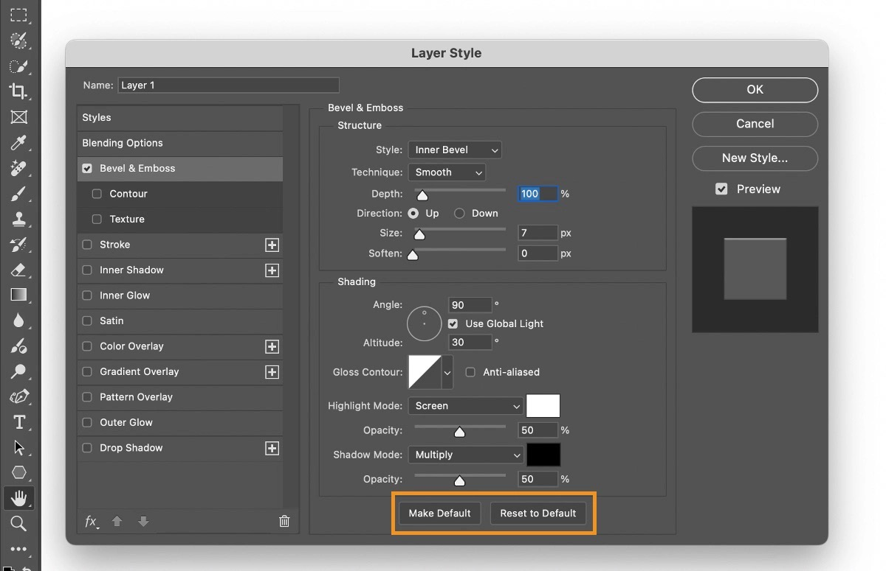
*fx menu, Move effect up, Move effect down (bottom left) and Delete (bottom right). This Adobe screenshot also
shows the Bevel page's Make Default and Reset to Default buttons, and the Angle dial with its altitude dot.*

| Control | Does | |
| --- | --- | --- |
| **↑ / ↓** (Move effect up / down) | Moves the selected instance above or below **another instance of the same effect**. An effect can never be moved past a different effect: the effects' order is fixed. Greyed out unless the selected effect has several instances. | **V** (Adobe 2015: "Change the effect stacking order") / **S** for the limits (Photoshop Essentials: "You can't move a stroke above or below other types of layer effects"; Adobe forum expert) |
| **Trash** | Deletes the selected instance from the list | **V** (Adobe 2015: "Delete effects") |
| **fx ▾** | The list's menu, below | **V** |

Whether the trash works on an effect with a single instance (or only removes a duplicate) is **U**.

#### The fx menu

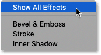
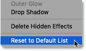
*Top and bottom of the dialog's fx menu (Photoshop Essentials): Show All Effects, the effects' names, Delete
Hidden Effects, Reset to Default List.*

Adobe (2015) says the menu lets you "manage what effects are displayed in the section, delete hidden effects,
reset any changes you've made to the default state of the left pane". **V** Its items:

| Item | Does | |
| --- | --- | --- |
| **Show All Effects** | Brings back every effect's row | **V** (screenshot) / **S** |
| The ten **effect names** | Show or hide that effect's row(s) in the list | **I** (Adobe's "manage what effects are displayed"; whether a name toggles or adds is not documented) |
| **Delete Hidden Effects** | Removes the effects whose rows are hidden from the layer's style | **V** (name) / **I** (what it does) |
| **Reset to Default List** | Back to one row of each effect, in the default order. It also unticks effects (Photoshop Essentials had to re-tick its Drop Shadow afterwards). | **V** (name) / **S** |

**A known oddity**: the list remembers its rows across layers. After making six strokes on one layer, opening the
dialog on another layer still showed six (empty) Stroke rows; and opening the dialog on a layer whose style was
made with only some effects shows only those rows, so people keep clicking Show All Effects. Adobe forum answers
blame the list being saved with the style (and `Styles.psp`, a preferences file). **S** This matches the PSD's
per-effect `present` and `showInDialog` flags ([persistence](#how-a-style-is-saved)), **I**.

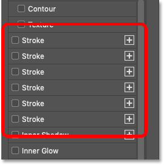
*Six Stroke rows left in the list from another layer's style (Photoshop Essentials).*

### The right column

| Control | Does | |
| --- | --- | --- |
| **OK** | Applies everything changed in the dialog and closes it. **Enter** presses it. | **V** / **S** (Enter) |
| **Cancel** | Closes it and puts everything back as it was. **Esc** presses it. | **V** / **S** |
| **Reset** (Cancel with **Alt/⌥ held**) | Puts every setting back as it was when the dialog opened, and leaves the dialog open | **S** (Kelby, Planet Photoshop: true of "most of Photoshop's dialogs") |
| **New Style…** | Saves the current style as a Styles preset ([New Style](#styles-presets)) | **V** |
| **Preview** | Checkbox, on by default: whether the canvas shows the changes live | **V** (the control) / **I** (what off does: the canvas shows the layer as it was) |
| The **swatch** under Preview | A grey square drawn with the current style, updating as you edit | **V** (screenshots) / **I** |

### Each effect's page

- A page groups its controls in titled boxes ("Structure", "Quality", "Shading", "Elements"). **V** (screenshots)
- Under each effect's controls (not on Blending Options or Styles): **Make Default** and **Reset to Default**.
  **V**
  - **Make Default** saves the page's current values as that effect's defaults, used "the next time this dialog is
    opened". **V** It's an application preference, not the document's. **I**
  - **Reset to Default** sets the page back to those saved defaults (Photoshop's own until you've made some). **V**
- Photoshop Essentials says "The Layer Style dialog box remembers the last settings you applied", and resets an
  effect first every time. **S** How that squares with Make Default (which values a freshly ticked effect starts
  with: the saved defaults, or the last ones used) is an [open question](#open-questions).
- Is the dialog resizable, and does it reopen on the last page? Not found. **U** It does open on the effect chosen
  from a menu. **S**

## While it's open

### Live preview

The canvas shows every change as it's made (Preview on). The dialog is modal, but the canvas behind it still
answers the pointer **V** / **S**:

| On this page | Dragging on the canvas | |
| --- | --- | --- |
| **Drop Shadow**, **Inner Shadow** | Moves the shadow: sets Angle and Distance | **V** ("You can drag in the document window to adjust the offset distance"; and the angle of Drop Shadow, Inner Shadow, Satin) |
| **Satin** | Sets its Angle and Distance | **V** |
| **Gradient Overlay** (and Stroke with a gradient, **U**) | Moves the gradient's centre (its Offset) | **V** ("move the center of the gradient by clicking and dragging in the image window") |
| **Pattern Overlay**, Bevel's **Texture** | Moves the pattern; **Snap to Origin** puts it back | **V** |
| Any other page | Pans the view, like the Hand tool | **S** (2005 forum tip) |

- With **Use Global Light** on, dragging a shadow changes the document's Global Light angle too, so every effect
  using it moves. **I** (follows from how Global Light works, below.)
- **Zoom** while it's open: ⌘+ / ⌘− (Ctrl on Windows). **S** Space-drag panning: **U**.

### Keys

| Key | Does | |
| --- | --- | --- |
| Enter | OK | **S** |
| Esc | Cancel | **S** |
| Alt/⌥ (held) | Cancel becomes Reset | **S** |
| ⌘+ / ⌘− | Zoom the canvas | **S** |
| Tab | Moves between fields (and scrubby labels as elsewhere) | **U** |

No shortcuts to jump between pages were found (**U**).

## The drawing order

Which effects are under the layer's content and which over it, bottom to top. **S** (Photoshop Essentials:
"layer effects are now listed in the order in which they are applied, from bottom to top"), consistent with
Adobe's description of blend modes ("an inner shadow blends with the active layer because the effect is drawn on
top of that layer, but a drop shadow blends only with the layers beneath"), **V**.

| Drawn | Effect | Where |
| --- | --- | --- |
| 1 (bottom) | Drop Shadow | Under the content |
| 2 | Outer Glow | Under the content |
| 3 | *The layer's content* (at its Fill opacity) | |
| 4 | Pattern Overlay | Over the content, inside its shape |
| 5 | Gradient Overlay | Over |
| 6 | Color Overlay | Over |
| 7 | Satin | Over |
| 8 | Inner Glow | Over |
| 9 | Inner Shadow | Over |
| 10 | Stroke | Over (its Outside part lies past the content's edge) |
| 11 (top) | Bevel & Emboss | Over everything else |

- The list in the dialog and under the layer in the Layers panel are this order, top to bottom. **V**
  (screenshots, below and above.)
- Several instances of one effect: **higher in the list is drawn on top**. **S** (Photoshop Essentials: the new
  stroke, added above, "is sitting above the original stroke in the document").
- So an overlay hides the overlays under it unless its blend mode or opacity lets them through (a Gradient
  Overlay at Normal hides the Pattern Overlay). **S**
- Fill opacity fades the content and the "interior" effects with it, Opacity fades the whole result: Blending
  Options' document has the rules. Masks and clipping too.

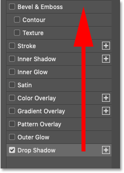
*Drawn from the bottom of the list up: Drop Shadow first, Bevel & Emboss last (Photoshop Essentials).*

## Shared controls

### Contour (picker and editor)

Used by Drop Shadow, Inner Shadow, Outer Glow, Inner Glow, Satin, and Bevel & Emboss (twice: its Gloss Contour
and its Contour sub-page). **V**

**What it is**: a curve that reshapes the effect over its width ("curves in disguise", **S**). The x axis is
*where*: the effect's own ramp from one side of its extent to the other; the y axis is *how strong*: bottom
transparent, top full. **V** for the uses, **S** for the axes (TipSquirrel: "the right side of the curve
represents the outer edge of the layer, while the left side represents the interior", shown on Inner Glow). What
the input is per effect (a shadow's blurred alpha, a glow's distance…) belongs to each effect's document. Adobe's
2026 page: "For Drop Shadow and Inner Shadow, the contour controls the opacity falloff of the shadow. For Outer
Glow and Inner Glow, the contour determines how the glow fades from its origin. For Bevel & Emboss, the contour
shapes how the highlight and shadow transition across the surface." **V**

**The picker** (the Contour row of a page) **V**:

- **The thumbnail** (A): clicking it opens the **Contour Editor** on the current curve.
- **The arrow** beside it (B): a pop-up grid of preset contours; clicking one picks it. **V** Its gear menu has the
  usual preset commands (load, save, reset, view as thumbnails or list), **I**. Alt/⌥-click a preset deletes it.
  **V**
- **Anti-aliased** checkbox beside it: "Blends the edge pixels of a contour or gloss contour. This option is most
  useful on small shadows with complicated contours." **V**

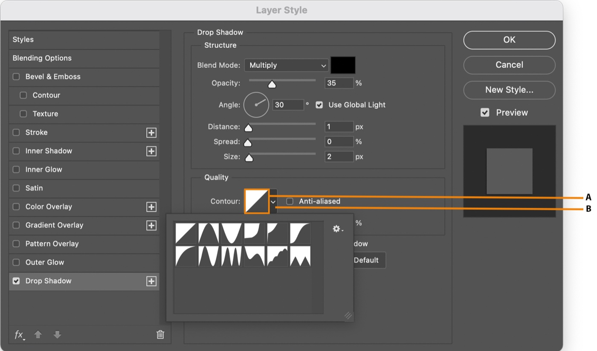
*The Drop Shadow page's Quality box: A, the contour thumbnail (opens the Contour Editor); B, the arrow (opens the
presets). The twelve default contours are in the pop-up (Adobe).*

**The default presets** (12, in this order: the count and shapes are **V** from Adobe's screenshot, the names
**S** from tutorials and a forum list made from them):

| Row 1 | Row 2 |
| --- | --- |
| **Linear** (the default: a straight diagonal) | **Half Round** |
| **Cone** | **Ring** |
| **Cone - Inverted** | **Ring - Double** |
| **Cove - Deep** | **Rolling Slope - Descending** |
| **Cove - Shallow** | **Rounded Steps** |
| **Gaussian** | **Sawtooth 1** |

Two presets' points, as a real PSD stores them (ag-psd's test file; x, y on 0..255) **V**:

| Preset | Points |
| --- | --- |
| Linear | (0, 0) (255, 255) |
| Gaussian | (0, 0) (32, 7) (64, 38) (96, 101) (128, 166) (159, 209) (191, 235) (223, 248) (255, 255) |

The other presets' points are not documented: they'd have to be read from a PSD that uses them, or from the
`.shc` file Photoshop ships (**U**).

**The Contour Editor** (a dialog over the dialog) **V** / **S**:

| Control | Does |
| --- | --- |
| **Preset** | The contour's name and a menu of presets; editing the curve makes it "Custom" (**I**) |
| **Mapping** | The graph: click the curve to add a point, drag a point to move it, drag it off to delete it (**I**: as Curves does) |
| **Input / Output** (%) | The selected point's position, typed |
| **Corner** | Checkbox: makes the selected point a sharp corner instead of a smooth curve. **V** ("Select a point and hit Corner to create a sharp corner") |
| **OK / Cancel** | |
| **Load… / Save…** | A contour file, `.shc` |
| **New…** | Saves the curve as a preset in the picker |

*The Contour Editor on Ring - Double, labelled by TipSquirrel: position across the graph (interior to edge),
intensity up it (transparent to full). Windows, CS5.*

**How a contour is defined** **V** (file format spec) / **I**:

- A list of points, x increasing, each with a **continuous** flag (smooth) or not (a corner). The `.shc` file
  stores them as two 16-bit integers each (vertical, horizontal) and one byte per point for continuity.
- Between smooth points the curve is a smooth spline through them, as in Curves; at a corner it bends sharply.
  Which spline exactly (Curves' natural cubic, or another) is **U**. That a corner makes straight segments either
  side of it, and how a smooth point next to a corner behaves, are **U**: measure them.
- The maximum number of points is **U** (Curves allows 16).

### The angle dial

- A circle with a line from its centre: drag in it, or type degrees in the field beside it. **V** ("enter a value
  or drag the angle radius")
- The angle is where the **light comes from**: a shadow falls the other way. 120° is up and to the left. **V** /
  **S**
- Where the light also has a height (**Bevel & Emboss**, **Global Light**), the dial shows a point inside the
  circle instead: its direction is the angle, its distance from the rim is the **Altitude** (0° on the rim, the
  ground; 90° in the middle, overhead). **V** for Altitude's meaning ("0 is ground level and 90 is directly above
  the layer"), the dial's look **V** (screenshot), dragging the point to set both **I**.
- The range typed: **U** (−180..180 probably).

### Global Light

- **Use Global Light** checkbox on **Drop Shadow, Inner Shadow and Bevel & Emboss** (not Satin, which has an
  angle of its own). **V**
- When it's on, the effect's angle (and Bevel's altitude) **is the document's**: setting the angle in any effect
  that uses it sets it for all of them. When it's off, the angle is that effect's own. **V** ("that angle becomes
  the global lighting angle. Any other effect that has Use Global Light selected automatically inherits the same
  angle setting")
- **Layer › Layer Style › Global Light…** opens a small dialog with the same dial: **Angle** and **Altitude**,
  OK / Cancel. **V** It changes every effect in the document that uses it. **V**
- Defaults: **120°**, altitude **30°**. **S** (tutorials; and the ag-psd test PSD's effects with Use Global
  Light all read 120° / 30°). Photoshop 5's file format says the angle is "assumed to be 30" when the document
  doesn't store one, which is old. **V** (spec), so: **I** for today's defaults.
- Changing Global Light with **no document open** sets the default for new documents. **S** (PTC)
- Use Global Light is on by default. **S**
- It is **per document**: the angle and the altitude are saved in the document (PSD image resources 1037 and
  1049), not in each layer. **V** (spec, psd-tools)

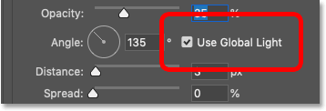
*Drop Shadow's Angle with Use Global Light (Photoshop Essentials).*

No screenshot of the Global Light dialog itself was found that could be used.

### Colour swatches

- A swatch beside an effect's blend mode (or alone) is its colour. Clicking it opens the Color Picker; while the
  picker is open, clicking on the canvas samples a colour. **V** (Adobe: "You can click the color box and choose
  a color") / **S** (sampling, Photoshop Essentials).
- Glows have a choice between a colour swatch and a gradient (radio buttons). **V** (screenshot)

### Gradient and pattern pickers

- **Gradient**: clicking the gradient opens the **Gradient Editor**; the arrow beside it opens the gradient
  presets. **V** ("Select the gradient to display the Gradient Editor or the inverted arrow and choose a gradient
  from the pop-up panel")
- **Pattern**: the pattern's arrow opens the pattern presets; a button makes a preset from the current settings;
  **Snap to Origin**; **Link with Layer**. **V** Patterns available are those loaded in the Patterns panel (since
  2020 the pickers show its folders). **S**

### Noise, Jitter

- **Noise**: "the number of random elements in the opacity of a glow or shadow". **V**
- **Jitter**: "Varies the application of a gradient's color and opacity" (gradient glows). **V**

### Blend mode and Opacity

Every effect has its own **Blend Mode** (a menu with the same modes as the Layers panel, **V** user's screenshot
below) and **Opacity**. Each effect's default mode differs (Multiply for shadows, Screen for glows; **V**
screenshots). Another document covers the modes.

*The dialog's Blend Mode menu, on Blending Options (Théo's screenshot).*

## Around the dialog

### The Layers panel

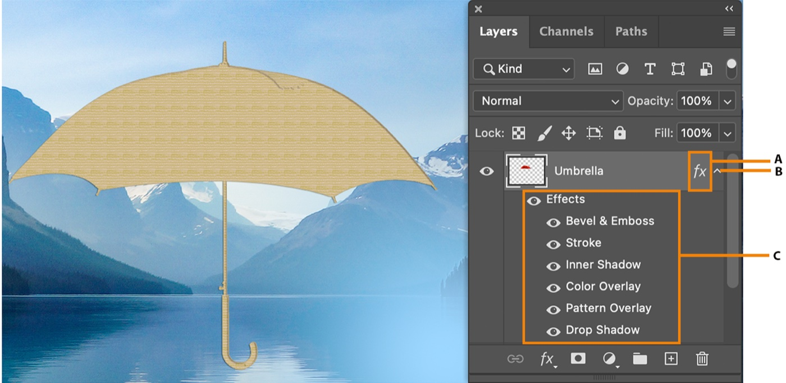
*A: the fx badge. B: the arrow that opens or closes the list. C: the effects, each with its eye, under an
"Effects" row with its own eye (Adobe).*

| What | Does | |
| --- | --- | --- |
| **fx badge** on the layer's row, right | Shows the layer has effects. Double-click: the dialog. Right-click: its menu. | **V** / **S** |
| **Arrow** beside it | Shows or hides the effects' rows (only the panel; nothing changes in the picture). **Alt/⌥-click**: every layer's at once (in a group, or the document). | **V** |
| **Effects** row and its **eye** | The eye turns all the layer's effects off or on | **V** / **S** |
| Each effect's row and its **eye** | The eye turns that effect off or on (the same as its checkbox in the dialog, **I**). Double-click: the dialog on its page. | **V** |
| The extra badge next to fx (two squares) | The layer has **advanced blending** changed (since CS6) | **S** (Tuts+) |
| Panel Options › **Expand New Effects** | Whether a layer's effects list opens when it gets effects | **S** (Kost) |

**Dragging** **V** (Adobe) / **S**:

| Drag | Result |
| --- | --- |
| The **fx badge** or the **Effects** row onto another layer | **Moves** all the effects there |
| … with **Alt/⌥** | **Copies** them |
| **One effect** onto another layer | Moves that effect |
| … with **Alt/⌥** | Copies that effect |
| Effects (one or all) onto the **canvas** | Applies them to "the highest layer in the Layers panel that contains pixels at the drop point" |
| An effect, or Effects, onto the **trash** | Deletes it, or all of them |

- **Dragging copies only the effects, not the blending options** (Fill stayed at 100% on the target); Copy /
  Paste Layer Style copies both. **S** (Photoshop Essentials)
- Where a copied effect lands among the target's instances of the same effect, and whether a dragged effect
  *replaces* the target's single-instance effect of that kind, are **U**.

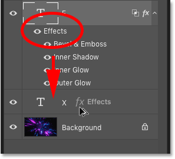
*Alt/⌥-dragging the Effects row onto another layer copies every effect (Photoshop Essentials). The two-squares
badge beside fx marks changed advanced blending.*

**The fx badge's right-click menu** (**S**: Kost, Photoshop Essentials): Disable Layer Effects / Enable Layer
Effects (all of this layer's at once), Blending Options…, the ten effects, Copy Layer Style, Paste Layer Style,
Clear Layer Style, Global Light…, Create Layers, Hide All Effects, Scale Effects…. In Photoshop 2025 (26.1) Clear
Layer Style left the *layer row's* right-click menu; it's on the fx badge's and the Effects row's (Adobe forum,
**S**).

### The Layer › Layer Style menu

**V** (Photoshop Essentials screenshots; Adobe names every item):

| Item | Does | Scope |
| --- | --- | --- |
| Blending Options… | The dialog, on Blending Options | The layer |
| Bevel & Emboss… … Drop Shadow… | The dialog, on that effect | The layer |
| **Copy Layer Style** | Copies the selected layer's style (effects *and* blending options, **S**) | |
| **Paste Layer Style** | Puts it on every selected layer, **replacing** their styles | Every selected layer, **V** |
| **Clear Layer Style** | Removes the style | Every selected layer, **V** |
| **Global Light…** | The Global Light dialog | The document |
| **Create Layers** | Turns the effects into layers ([below](#create-layers-and-rasterize-layer-style)) | The layer |
| **Hide All Effects** / **Show All Effects** | Hides or shows every effect of every layer | The document, **V** |
| **Scale Effects…** | Scales the effects' sizes ([below](#scale-effects-and-transforming)) | The layer |

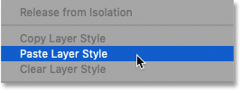
*Copy, Paste and Clear Layer Style in a layer's right-click menu (Photoshop Essentials, before 2025).*

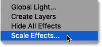
*Global Light…, Create Layers, Hide All Effects, Scale Effects… (Photoshop Essentials).*

- Clearing a style can also be done by applying the **None** style (the white swatch with a red line in the
  Styles panel's Basics). **S**
- **Hide All Effects** is a document flag saved in the file (image resource 1042, "Only present when they are
  hidden"). **V** (spec)

### Scale Effects and transforming

- **Transforming a layer doesn't scale its effects**: a 10 px stroke stays 10 px when the layer is scaled to 50%.
  **V** (Adobe: "when you transform or resize a layer, the effects don't automatically scale with it"). Illustrator
  has a preference for it; Photoshop doesn't (Adobe forum, **S**).
- **Scale Effects…** (dialog title **Scale Layer Effects**): one **Scale** value in %, **Preview**, OK / Cancel.
  It scales every size in the layer's effects ("without scaling the object"). **V** Its range is **1–1000 %**.
  **S**
- **Image › Image Size** has **Scale Styles** in its gear menu: on, resizing the whole image scales every layer's
  effects with it ("available only if you selected the Constrain Proportions option"). **V**
- **A Smart Object** keeps its effects the right size when scaled, if the effects are *inside* it (convert the
  styled layer to a Smart Object, then scale). **V** (Adobe's tip for text)
- Whether Scale Effects rewrites the stored values (sizes, distances) or only sets the style's `Scl ` factor
  ([persistence](#how-a-style-is-saved)) is **U**; what it does to angles, opacities and pattern scale is **U**.

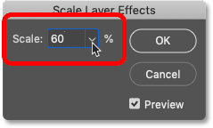
*Scale Layer Effects, with Preview (Photoshop Essentials).*

### Create Layers and Rasterize Layer Style

- **Create Layers** (Layer › Layer Style, or the fx menu): "Photoshop converts each effect into a separate layer,
  grouped with the original layer". The effects under the content become layers below it; the ones over it become
  layers **clipped** to it ("such as Inner Glow to layers within a clipping mask"). **V** Each is named after the
  layer and the effect ("Layer 1's Drop Shadow"). **S**
- What's lost: the effects stop following the content ("the effect layers won't automatically update"), and "the
  layers produced… may not result in artwork that exactly matches the version using layer styles. You may see an
  alert". **V** The alert's text: **U**.
- **Rasterize Layer Style** (Layer › Rasterize › Layer Style; right-click a layer with effects, since CS6) merges
  the effects into the layer's own pixels in one step. **S** (Tuts+)

### Styles presets

- **Window › Styles**: the presets in folders (2020+: groups; Legacy Styles and More from the panel menu). **V**
- **Click** a style: applied to every selected layer, **replacing** its style. **Shift**-click (or Shift-drag)
  **adds** the style's effects to the layer's instead. Dragging a style onto a layer, or onto the canvas, applies
  it there. **V** (Adobe 2022)
- **Hover** a style: its name and a **preview** on the canvas. **V** (Adobe 2026: "Hover over a style to see its
  name and preview its effect")
- The dialog's **Styles** row shows the same presets; picking one applies it to the dialog's layer, and its menu
  has Rename / Delete Style, Save / Load Styles. **V**
- Libraries are `.asl` files (Import Styles, Export Selected Styles). **V**
- **New Style…** (the dialog's button, the Styles panel's +, or its menu) asks for **V** (screenshot) / **S**:

| Field | |
| --- | --- |
| **Name** | |
| **Include Layer Effects** | On by default |
| **Include Layer Blending Options** | Whether the preset also carries the blend mode, Opacity, Fill and advanced blending; a preset that does changes them when applied (Photoshop Essentials: a style set the layer's Fill to 56%) |
| **Add to my current library** | Creative Cloud Libraries |

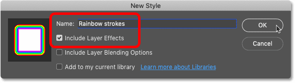
*New Style, with its preview square (Photoshop Essentials).*

- Shape and Pen tools in shape mode: a style chosen in the options bar is applied to the shapes drawn. **V**

### The blend mode menu's hover preview

Since **CC 2019**, hovering over a mode in the **Layers panel**'s blend mode menu previews it on the canvas
before it's picked; Shift + `+` / `−` steps through the modes with the Move tool. **S** (Photoshop Essentials;
Adobe forum asks for a way to turn it off.) Whether the **dialog's** blend mode menus preview on hover is **U**:
the dialog already previews everything live, so a pick is seen at once either way.

## How a style is saved

The PSD keeps a layer's style in its **additional layer information**, as a **descriptor** (Photoshop's
key/value object format). **V** (spec, ag-psd, psd-tools)

| Block | What | |
| --- | --- | --- |
| `lrFX` | Photoshop 5's binary effects (`cmnS`, `dsdw`, `isdw`, `oglw`, `iglw`, `bevl`, `sofi`): only five effects; still written for old readers | **V** (spec) |
| `lfx2` | "Object-based effects layer info" (Photoshop 6): version 0, then a descriptor | **V** (spec) |
| `lmfx` | The same with **several instances** (CC 2015); written when an effect has more than one; undocumented | **V** (ag-psd, psd-tools) |
| `lfxs` | Another undocumented form psd-tools reads | **V** (psd-tools) |

ag-psd reads `lmfx` over `lfx2` when both are there. Whether Photoshop writes both for a style with several
instances (so older versions see the first of each) is **I**.

**The style's descriptor** (`lfx2` / `lmfx`) **V**:

| Key | Holds |
| --- | --- |
| `Scl ` | A percentage: the style's scale |
| `masterFXSwitch` | All the layer's effects on or off at once (psd-tools: "Photoshop's one switch over the whole fx list, which greys every entry out"): the Effects eye or Disable Layer Effects, **I** |
| `numModifyingFX` | `lmfx` only: how many effects are enabled |
| One key per effect | Below |

| Effect | `lfx2` key | Several (`lmfx`) |
| --- | --- | --- |
| Drop Shadow | `DrSh` | `dropShadowMulti` (a list) |
| Inner Shadow | `IrSh` | `innerShadowMulti` |
| Outer Glow | `OrGl` | — |
| Inner Glow | `IrGl` | — |
| Bevel & Emboss | `ebbl` | — |
| Satin | `ChFX` | — |
| Color Overlay | `SoFi` | `solidFillMulti` |
| Gradient Overlay | `GrFl` | `gradientFillMulti` |
| Pattern Overlay | `patternFill` | — |
| Stroke | `FrFX` | `frameFXMulti` |

**Every effect's descriptor** has these flags **V** (both libraries) / **I** (what they mean in the UI):

| Key | Means |
| --- | --- |
| `enab` | On or off: the checkbox in the dialog, the eye in the Layers panel |
| `present` | The effect is in the layer's style at all (psd-tools lists only these: "Whether the effect has an entry in the layer's fx list") |
| `showInDialog` | Its row is shown in the dialog's list (what the fx menu's show / hide changes, **I**) |
| `Md  `, `Opct`, `Clr `… | Its settings (each effect's document) |
| `uglg` | Use Global Light |
| `lagl`, `Lald` | Its own angle and altitude (used when `uglg` is off) |
| `TrnS` | Its contour (Satin's is `MpgS`): a `ShpC` object with `Nm  ` (the preset's name) and `Crv ` (a list of `CrPt`, each `Hrzn`, `Vrtc` on 0..255) |
| `AntA` | Anti-aliased |

- A corner point's flag: the `.shc` file has one per point; in a descriptor it's presumably `Cnty` on the
  `CrPt` (the key exists in Photoshop's vocabulary). ag-psd drops it when reading effects. **I**
- Since CC 2015 "layers can have disabled effects even if you can't see them in [the] layers panel" (Adobe
  forum, **S**): a style keeps effects that are off, with their settings. psd-tools notes Photoshop leaves the
  `lfx2` block behind even after the last effect is removed. **V**
- In which order a `…Multi` list runs (first = top of the dialog's list, or bottom) is **U**: check a PSD.
- **Per document**, in the image resources **V** (spec, psd-tools): **1037** Global Angle, **1049** Global
  Altitude, **1042** Effects visible (Hide All Effects).

## Implementation notes for us

How our photo suite would carry this. Proposals, to agree with Théo before building; the effects' maths and
Blending Options' rules are the other documents'.

**The document** (`shared/photo/types.ts`):

- A `style` on every layer kind that can have one (image, pixel, later text, shape, group; not the canvas
  background, and adjustment layers only for their blending), absent when the layer has none:
  `{ enabled: boolean /* masterFXSwitch */, effects: LayerEffect[] }`, with blending options beside it (their
  document). `LayerEffect` is `{ id, type, enabled, params }` as our `EffectInstance` is, with the effect types as
  definitions in `shared/photo/effects/` (specs, defaults, validation, `normalizePhotoProject`).
- **Order** is not the user's: effects are drawn in the fixed order above, so `effects` is stored in that order
  and edits keep it (`orderEffects`, as the video editor's). Only instances of one type move among themselves
  (↑ / ↓). A type allowed once is refused a second instance (normalise drops extras); five types allow up to 10.
- **Global Light is the document's**: `PhotoProject.globalLight = { angle: 120, altitude: 30 }`. An effect with
  `useGlobalLight` doesn't store an angle that matters: renderers read the document's. Changing it is a document
  edit that re-renders every layer using it.
- **Hide All Effects**: Photoshop saves it in the file. For us it reads better as view state (like Compare,
  ux.md), never an undo step. Decide.
- **Contours** are data: `{ name, points: [x, y, corner][] }` on 0..255, with Photoshop's 12 presets as constants.
  Their exact points must come from a real PSD or Photoshop's `.shc` (only Linear and Gaussian are known). The
  curve's interpolation must be measured against Photoshop before it's fixed, and tested as Curves' is
  (`shared/photo/reference/`).
- What the PSD's `present` / `showInDialog` express (rows kept in the list, effects kept while off) is worth
  keeping only as `enabled: false` effects that stay in `effects` with their settings. The list's rows are UI.
- Scale: no `Scl ` field. Scale Effects is an edit that multiplies the sizes (pure, tested), like Photoshop's
  result if not its storage. Transforming a layer leaves effects alone, as Photoshop does; Image Size (when we
  have it) offers Scale Styles.

**The dialog**:

- A window of the platform's (`components/windows`, docs/windows.md), as Settings and video's dialogs are: it
  keeps its keys (`keepsKeys`) and doesn't block the canvas, which stays zoomable and pannable and takes the
  on-canvas drags above.
- **One gesture**: opening it starts a `photoGesture()` on the layer; every control applies to the gesture, so
  the canvas previews live and nothing reaches undo; **OK** ends it (one undo step, "Layer Style"); **Cancel** /
  Esc cancels it (the document is exactly as before, Global Light included); **Alt** turns Cancel into **Reset**,
  which re-applies the gesture's base and stays open. Derive each preview from the gesture's base.
- **Preview off** is a render override for that layer (the base's style), not a document change. The swatch is a
  small render of the style on a square, through the same compositor (the plan's evaluator draws covers and the
  assistant's pictures already).
- The left list's rows (which are shown, which instance is selected, the page) are the dialog's UI state.
  **Make Default** writes the photo suite's preferences (`src/suites/photo/preferences.ts`), never the document.
- The Contour Editor is a window over the dialog, its own small gesture inside the bigger one (its Cancel puts
  the curve back, the dialog's Cancel everything).
- Copy / Paste Layer Style is an app clipboard of `{ style, blending }`; Paste replaces on every selected layer
  in one undo step; Alt-drag in Layers copies effects only. Styles presets later, as the Library's items are.
- The assistant gets tools at parity (set a layer's style, add / remove / move an instance, set Global Light,
  copy / paste a style), as pure edits, with `describe` showing each layer's effects in drawing order.

**The renderer** (rendering.md, compositor.ts):

- Each styled layer becomes a small sub-plan: its content's coverage (after its mask, or not, per Blending
  Options' "Layer Mask Hides Effects") feeds the effects; the parts below the content, the content at Fill, the
  parts above it, then the whole at Opacity and its blend mode. Prefix keys should include the style, so a style
  change only re-renders that layer's sub-plan.
- Effects grow the layer's bounds (shadows, glows, outside strokes): the plan must know each style's reach,
  in document pixels, to fetch enough tiles and not crop (system.md's glow already does).
- Sizes are document pixels. Reduced views need the effect computed at that reduction with the same look:
  test reduced against full-size, as for the glow.
- Photoshop computes in the document's encoded space at 8/16 bits; we composite in linear light. Alpha-only
  steps (blur, choke, spread, contour on alpha) should match; colour blends (Multiply shadows, Screen glows,
  overlays at other modes) will differ unless we blend those in encoded space. That choice belongs with Blending
  Options' research; a reference render from Photoshop is needed to decide.
- Contours and noise must be deterministic (seeded by the layer and effect id), so exports repeat.

## Open questions

1. **Defaults**: does a freshly ticked effect start from its saved defaults (Make Default) or from the last
   values used in the dialog? And are 120° / 30° today's Global Light defaults? Check in Photoshop 2025.
2. **The fx menu**: do the effect names in it toggle rows, or add an instance? What exactly does Delete Hidden
   Effects delete: unchecked effects, or hidden rows? Needs a screenshot of the whole menu.
3. **Trash**: does it delete a single-instance effect (resetting its settings) or only duplicates?
4. **`…Multi` order** in the PSD: first element = top of the list?
5. **Contour maths**: which spline, what a corner does, how many points; and the 10 presets' points we don't have.
6. **Scale Effects**: does it rewrite the values or set `Scl `? What happens to angles and pattern scale?
7. **Adjustment layers** in the dialog: are the effects there at all? And artboards?
8. **The Name field**: which version added it, and is renaming there part of the dialog's undo step?
9. Is the dialog resizable, and does it remember its page and position? Does the blend mode menu in it preview on
   hover?
10. **Create Layers**: the exact layer structure per effect (clipped, knockout groups for Inner Shadow?) and the
    alert's text.
11. For us: keep Hide All Effects in the document (as Photoshop) or as view state? Encoded-space blending for
    effects to match Photoshop, or linear like the rest?

## Sources

**Adobe (primary)**

- Add layer styles, 2025: https://helpx.adobe.com/photoshop/desktop/create-manage-layers/apply-layer-effects/add-layer-styles.html
- Layer style effects and options overview, 2026: https://helpx.adobe.com/photoshop/desktop/create-manage-layers/apply-layer-effects/layer-style-effects-and-options-overview.html
- Work with layer styles (Make Default), 2026: https://helpx.adobe.com/photoshop/desktop/create-manage-layers/apply-layer-effects/work-with-layer-styles.html
- Work with preset styles, 2026: https://helpx.adobe.com/photoshop/desktop/create-manage-layers/apply-layer-effects/work-with-preset-styles.html
- Manage preset styles, 2025: https://helpx.adobe.com/photoshop/desktop/create-manage-layers/apply-layer-effects/manage-preset-styles.html
- Copy and paste layer styles, 2026: https://helpx.adobe.com/photoshop/desktop/create-manage-layers/apply-layer-effects/copy-and-paste-layer-styles.html
- Display or hide layer styles, 2026: https://helpx.adobe.com/photoshop/desktop/create-manage-layers/apply-layer-effects/display-or-hide-layer-styles.html
- Remove layer effects, 2025: https://helpx.adobe.com/photoshop/desktop/create-manage-layers/apply-layer-effects/remove-layer-effects.html
- Scale layer effects, 2025: https://helpx.adobe.com/photoshop/desktop/create-manage-layers/apply-layer-effects/scale-layer-effects.html
- Set a global lighting angle, 2026: https://helpx.adobe.com/photoshop/desktop/create-manage-layers/apply-layer-effects/set-a-global-lighting-angle-for-all-layers.html
- Manage contours, 2026: https://helpx.adobe.com/photoshop/desktop/create-manage-layers/apply-layer-effects/manage-contours.html
- Convert layer styles to image layers, 2025: https://helpx.adobe.com/photoshop/desktop/create-manage-layers/apply-layer-effects/convert-layer-styles-to-image-layers.html
- Import preset style libraries, 2026: https://helpx.adobe.com/photoshop/desktop/create-manage-layers/apply-layer-effects/import-preset-style-libraries.html
- Layer effects and styles (the long 2022 page), via the Internet Archive: https://web.archive.org/web/2023/https://helpx.adobe.com/photoshop/using/layer-effects-styles.html
- What's new in Photoshop CC (June 2015: Layer Styles, the dialog's new list), via the Internet Archive: https://web.archive.org/web/20150813100409/https://helpx.adobe.com/photoshop/using/whats-new.html
- Resizing images (Scale Styles), 2022, via the Internet Archive: https://web.archive.org/web/2023/https://helpx.adobe.com/photoshop/using/resizing-image.html
- Photoshop File Formats Specification (image resources 1037, 1042, 1049; `lrFX`, `lfx2`; contour files): https://www.adobe.com/devnet-apps/photoshop/fileformatashtml/ (read via https://web.archive.org/web/20260929202727/https://www.adobe.com/devnet-apps/photoshop/fileformatashtml/)

**Source code**

- ag-psd, `src/descriptor.ts` (`Lfx2Descriptor`, `LmfxDescriptor`, `serializeEffects`, `parseEffects`, effect keys), `src/additionalInfo.ts` (`lfx2`, `lmfx`, `lrFX` handlers), `test/read/effects/data.json` (contours, 120° / 30°): https://github.com/Agamnentzar/ag-psd
- psd-tools, `src/psd_tools/api/effects.py` (`present`, `showInDialog`, `masterFXSwitch`), `constants.py` (`lfx2`, `lmfx`, `lfxs`, resources 1037 / 1042 / 1049), `terminology.py` (`TrnS`, `MpgS`, `CrPt`, `Cnty`, `uglg`, `lagl`, `Lald`): https://github.com/psd-tools/psd-tools

**Secondary**

- Photoshop Essentials, Using Layer Effects and Styles in Photoshop CC 2020: https://photoshopessentials.com/?p=29070
- Photoshop Essentials, Add multiple strokes to text: https://www.photoshopessentials.com/photoshop-text/text-effects/add-multiple-strokes-to-text-in-photoshop/
- Photoshop Essentials, How to copy layer effects: https://www.photoshopessentials.com/?p=26706
- Photoshop Essentials, Layer blend mode previews in CC 2019: https://www.photoshopessentials.com/basics/preview-layer-blend-modes-photoshop-cc-2019/
- Julieanne Kost, Working with Layer Effects and Layer Styles: https://jkost.com/blog/2020/10/working-with-layer-effects-and-layer-styles-in-photoshop.html
- Tuts+, Improvements to Layer Style feature in Photoshop CS6: https://design.tutsplus.com/articles/improvements-to-layer-style-feature-in-photoshop-cs6--psd-16973
- bjango, Photoshop CC 2015 improvements: https://bjango.com/articles/photoshopcc2015/ and CS6: https://diagnostics.bjango.com/articles/photoshopcs6/
- deke.com, Applying multiple stroke effects in CC 2015: https://www.deke.com/content/applying-multiple-stroke-effects-in-photoshop-cc-2015
- TipSquirrel, Understanding Layer Style Contours: https://www.tipsquirrel.com/understanding-layer-style-contours-in-photoshop/
- Photoshop Training Channel: Global Light defaults https://photoshoptrainingchannel.com/tips/change-global-lighting-default-settings/, Scale Effects https://photoshoptrainingchannel.com/tips/scale-effects/, styles on groups https://photoshoptrainingchannel.com/tips/apply-layer-styles-group/
- Photoshop Gurus, layer style canvas-drag tip (2005): https://www.photoshopgurus.com/forum/threads/a-quick-tip-layer-style-secret.3417/
- Photoshop Gurus, Reset to Default List: https://www.photoshopgurus.com/forum/threads/can-i-make-blending-options-always-all-show.64840/
- Adobe Community: Show All Effects / Styles.psp https://community.adobe.com/t5/photoshop-ecosystem-discussions/always-click-quot-show-all-effects-quot/m-p/10028141; move arrows https://community.adobe.com/questions-712/layer-style-dialog-box-move-effect-up-down-arrow-buttons-disabled-1163647; reordering request https://community.adobe.com/t5/photoshop-ecosystem-ideas/p-multiple-and-reorder-sort-effects-styles/idc-p/12268545; disabled effects https://community.adobe.com/t5/photoshop-ecosystem-ideas/photoshop-remove-unused-layer-styles/idi-p/12249931; Clear Layer Style in 26.1 https://community.adobe.com/questions-712/clear-layer-style-missing-in-photoshop-26-1-0-1175196; no transform scaling https://community.adobe.com/t5/photoshop/i-m-not-crazy-default-scaling-of-layer-effects/m-p/11072270; rename in the dialog https://community.adobe.com/feature-requests-713/p-allow-renaming-of-layers-in-layer-styles-dialog-653460
- Kelby, the hidden Reset button: https://insider.kelbyone.com/tip-tuesday-the-hidden-reset-button/
- GIMP Chat, Photoshop contour preset names: https://gimpchat.com/viewtopic.php?p=71489

**Images**

| File | Source |
| --- | --- |
| `img/dialog-blending-options.jpg` | Adobe, Layer style effects and options overview: https://helpx-prod.scene7.com/is/image/HelpxProd/The-left-panel-of-the-opened-Layer-Style-dialog-bo |
| `img/dialog-make-default.jpg` | Adobe, Work with layer styles: https://helpx-prod.scene7.com/is/image/HelpxProd/The-Layer-Style-dialog-box-in-Adobe-Photoshop-is-d |
| `img/dialog-contour-picker.jpg` | Adobe (2022 page): https://helpx.adobe.com/content/dam/help/en/photoshop/using/layer-effects-styles/ps-detail-of-layer-style-dialog-drop-shadow.png.img.png (via the Internet Archive) |
| `img/dialog-layers-panel-effects.jpg` | Adobe (2022 page): https://helpx.adobe.com/content/dam/help/en/photoshop/using/layer-effects-styles/ps-apply-layer-effects-panel.png.img.png (via the Internet Archive) |
| `img/dialog-contour-editor.jpg` | TipSquirrel: https://www.tipsquirrel.com/wp-content/uploads/2011/09/contours-07.jpg |
| `img/dialog-plus-buttons.png` | Photoshop Essentials: https://pe-images.s3.amazonaws.com/basics/layer-effects/basics/layer-effect-plus-signs.png |
| `img/dialog-list-many-strokes.png` | Photoshop Essentials: https://pe-images.s3.amazonaws.com/type/effects/cc/multiple-strokes/multiple-strokes-still-visible.png |
| `img/dialog-fx-menu-show-all.png` | Photoshop Essentials: https://pe-images.s3.amazonaws.com/basics/layer-effects/basics/show-all-effects.png |
| `img/dialog-fx-menu-reset.png` | Photoshop Essentials: https://pe-images.s3.amazonaws.com/type/effects/cc/multiple-strokes/reset-to-default-list.png |
| `img/dialog-stacking-order.png` | Photoshop Essentials: https://pe-images.s3.amazonaws.com/basics/layer-effects/basics/order-of-layer-effects-photoshop.png |
| `img/dialog-use-global-light.png` | Photoshop Essentials: https://pe-images.s3.amazonaws.com/basics/layer-effects/basics/use-global-light.png |
| `img/dialog-new-style.png` | Photoshop Essentials: https://pe-images.s3.amazonaws.com/type/effects/cc/multiple-strokes/naming-new-layer-style.png |
| `img/dialog-layer-menu.png` | Photoshop Essentials: https://pe-images.s3.amazonaws.com/basics/layer-effects/basics/layer-layer-style-effects.png |
| `img/dialog-layer-menu-bottom.png` | Photoshop Essentials: https://pe-images.s3.amazonaws.com/basics/layer-effects/basics/layer-style-scale-effects-command.png |
| `img/dialog-scale-effects.png` | Photoshop Essentials: https://pe-images.s3.amazonaws.com/basics/layer-effects/basics/scale-layer-effects-photoshop.png |
| `img/dialog-paste-layer-style.png` | Photoshop Essentials: https://pe-images.s3.amazonaws.com/basics/layer-effects/copy-paste/paste-layer-style.png |
| `img/dialog-alt-drag-effects.png` | Photoshop Essentials: https://pe-images.s3.amazonaws.com/basics/layer-effects/copy-paste/copy-all-layer-effects.png |
| `img/dialog-fx-button-menu.png` | Photoshop Essentials: https://pe-images.s3.amazonaws.com/basics/layer-effects/basics/add-layer-effect-layers-panel-photoshop.png |
| `img/dialog-blend-mode-list.png` | Théo's screenshot |
