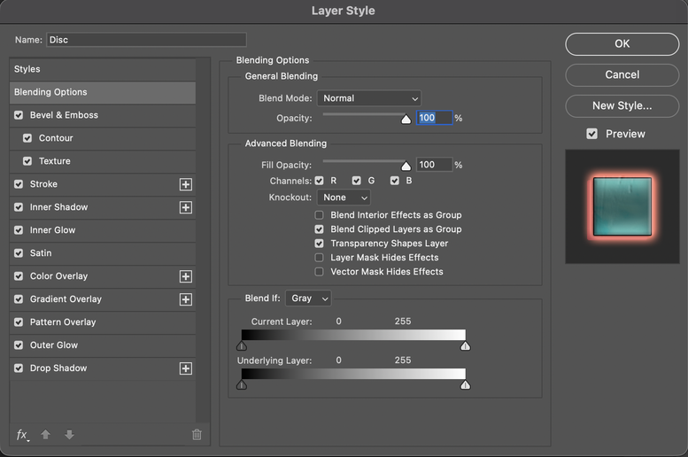
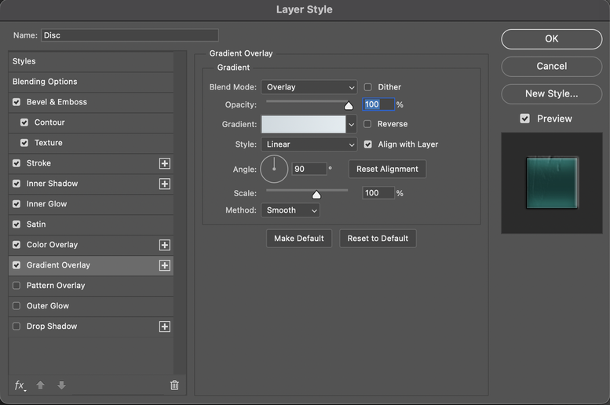
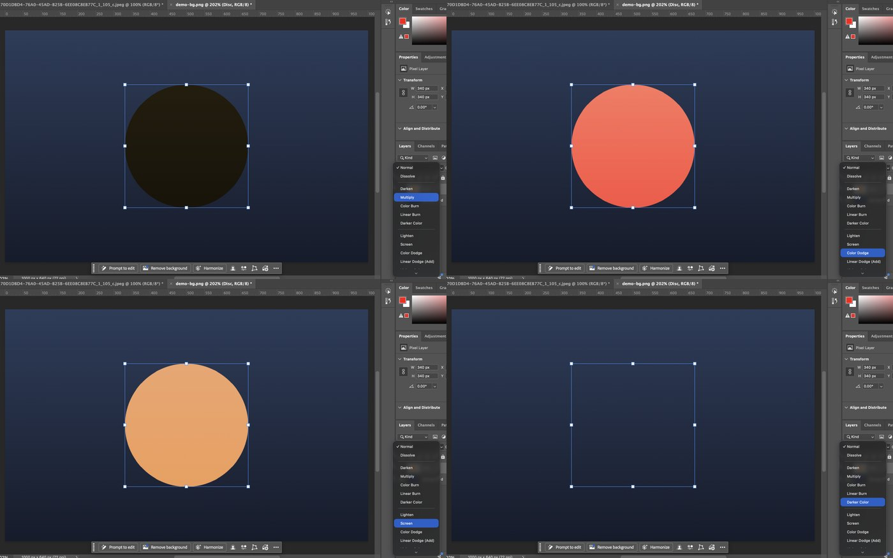
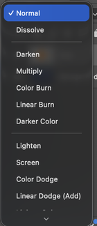
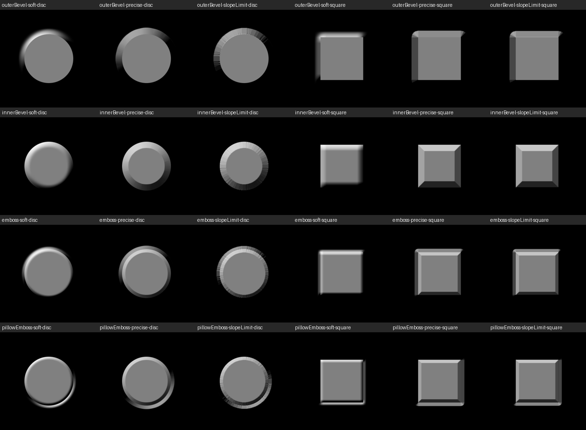
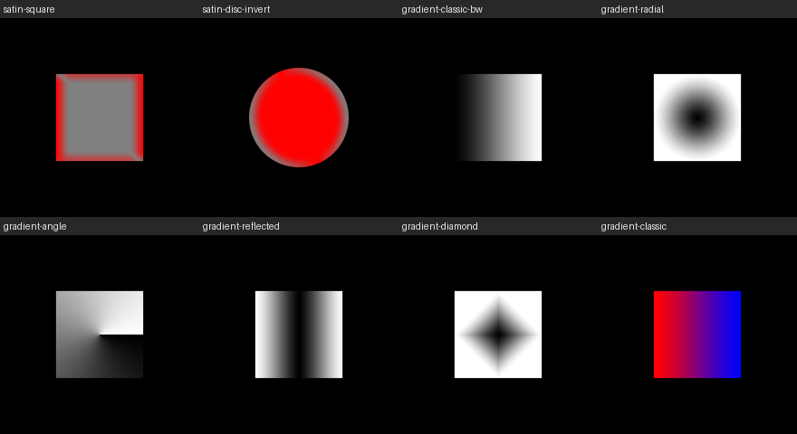

# Measured in Photoshop 2026

What a real Photoshop does, measured 2026-10-06 on Théo's machine: **Photoshop 27.11.0**, macOS, colour settings
"North America General Purpose 2" (RGB working space sRGB IEC61966-2.1), 8-bit RGB documents. Everything here is
**Measured** in the house's labels (README.md, "Labels"); it overrides the Secondary and Inferred claims in the other
documents where they disagree, and each of those now points here.

## How

`scripts/photoshop-probes/` drives Photoshop through AppleScript's `do javascript` (ExtendScript), with Python
(numpy, PIL) making the inputs and measuring the outputs:

- A probe makes its own images (tagged sRGB), opens them as a document, puts a layer above, sets a blend mode, Fill,
  Opacity or layer effects (through `ActionDescriptor`s, `fx.py`), saves a flattened PNG and closes the document
  unsaved. It never touches an open document of the user's. Outputs are in `data/photoshop-probes/` (gitignored).
- `fx.py` also reads an effect back from Photoshop as JSON (`executeActionGet`), so every stored key and unit is
  Photoshop's own.
- `contours.ts` reads Photoshop's contour presets (`.shc`) from its install.
- The dialog's screenshots were taken by opening it from the Layer menu and clicking its list (CoreGraphics mouse
  events: `click.js`), on a demo document of our own, then Cancel.

| Probe | What it measures |
| --- | --- |
| `blend_modes.py` + `analyse_blend.py`, `dig_blend.py`, `fit_lum.py` | Every mode over a 256 × 256 grey grid (backdrop × layer) and 65 536 random colour pairs |
| `fill_probe.py` + `analyse_fill.py` | Fill 0/25/50/75 %, Opacity 50 % and a 50 %-alpha layer, every mode |
| `fx_defaults.py` | What Photoshop stores for each effect given only "enabled" |
| `glow_profile.py` + `fit_glow.py` | Outer Glow's falloff from a straight edge: Softer and Precise, Size 1–250, Spread 0–100 % |
| `contour_probe.py` + `spline_fit.py` | Contours read off a glow (Precise, Size 250, Range 50: one row of pixels is the curve) |
| `fx_batch.py` + `analyse_fx2.py` | Stroke positions on a disc and a square, Drop Shadow angles, encoded effect blending, Inner Glow, Noise |
| `fx_bevel.py` | Bevel & Emboss: every style × technique on a disc and a square, Depth, Soften; Satin; gradient styles |

## The dialog, as it is in 27.11

*Blending Options in Photoshop 27.11 (our screenshot). Note "Current Layer" (older versions said "This Layer") and
the Name field at the top.*

Every page, in the list's order: [Styles](img/ps2026-page-styles.png),
[Blending Options](img/ps2026-page-blending-options.png), [Bevel & Emboss](img/ps2026-page-bevel-emboss.png),
[Contour](img/ps2026-page-contour.png), [Texture](img/ps2026-page-texture.png), [Stroke](img/ps2026-page-stroke.png),
[Inner Shadow](img/ps2026-page-inner-shadow.png), [Inner Glow](img/ps2026-page-inner-glow.png),
[Satin](img/ps2026-page-satin.png), [Color Overlay](img/ps2026-page-color-overlay.png),
[Gradient Overlay](img/ps2026-page-gradient-overlay.png), [Pattern Overlay](img/ps2026-page-pattern-overlay.png),
[Outer Glow](img/ps2026-page-outer-glow.png), [Drop Shadow](img/ps2026-page-drop-shadow.png).

*Gradient Overlay: Method (here Smooth) sits under Scale; Reset Alignment beside Align with Layer.*

- **Clicking an effect's name turns it on** and shows its page (each page we visited got ticked); Cancel undid all of
  it: the layer had no effects afterwards (read back).
- The values shown are what a new effect gets **on this install** (Emboss, Depth 63%, a red Normal Drop Shadow with
  Spread 100%…): Théo's saved defaults (Make Default), not Adobe's factory ones. The factory defaults are still to be
  read on a clean preferences folder (not done: it would reset his).
- Global Light here is 30°, also this install's.

### The Layers panel's mode menu and its live preview

*Hovering Multiply, Color Dodge, Screen and Darker Color in the Layers panel's menu (not clicking): the canvas shows
each at once. Escape closed the menu and the layer was Normal again (read back).*

*The menu is a scrolling list with Photoshop's groups separated by lines, the current mode ticked.*

## Blend modes

All at 100 %, 8-bit sRGB, opaque layer over an opaque backdrop. "Max" is the largest difference in 8-bit levels over
the 131 072 measured pixels, against each formula evaluated **on encoded (sRGB) values** and rounded.

| Mode | Formula | Max | Notes |
| --- | --- | --- | --- |
| Normal, Darken, Multiply, Linear Burn, Lighten, Screen, Linear Dodge, Overlay, Difference, Subtract | W3C | 0 | Exact |
| Color Burn, Color Dodge, Soft Light, Hard Light, Linear Light, Pin Light, Exclusion, Divide | W3C | 1 | Rounding only |
| **Soft Light** | **W3C's** (`D(b)` with the `b ≤ ¼` polynomial) | 1 | The "Photoshop" formula (Wikipedia, Krita) is off by up to 17 |
| **Vivid Light** | W3C's, but the layer's 0 gives 0 and its 1 gives 1 | 2 | Plain W3C is off by 255 there |
| **Hard Mix** | 1 when `b + s > 1`; at exactly `b + s = 1` (255 in codes), 1 only when `b > ½` (code > 127) | 0 | Over all 65 536 random colour pairs too |
| **Hue, Saturation, Color, Luminosity** | W3C's `SetLum`/`SetSat`/`ClipColor` with weights 0.3 / 0.59 / 0.11 | 5–7 (mean 0.37) | Rec. 601 weights are worse (7–11), Rec. 709 far worse (70–94); the rest is Photoshop's integer arithmetic, not found |
| **Darker / Lighter Color** | The colour with the lower (higher) `0.3R + 0.59G + 0.11B`, on encoded values | 0 for 99.74 % of pairs | 0.26 % of random pairs, all within about one level of a tie, pick the other colour; no linear weights do better (searched), nor linear-light luminance (about 34× worse) |

**Every mode is evaluated on encoded values.** No mode got closer in linear light.

### Opacity, Fill and transparency

- **Opacity mixes encoded values.** 50 % white over black gives **128** (linear mixing would give 188). Every mode at
  50 % Opacity is `lerp(b, B(b, s), 0.5)` on encoded values within 1 level (Hard Mix and Darker Color only at ties).
- **Fill = Opacity for every mode but the special eight** (within 1 level at Fill 25, 50, 75 %).
- **The special eight's Fill**, confirmed (max error in levels at Fill 25 / 50 / 75 %):

  | Mode | At Fill `f` | Max |
  | --- | --- | --- |
  | Color Burn | `ColorBurn(b, 1 − f(1 − s))` | 1 / 1 / 2 |
  | Linear Burn | `clamp(b − f(1 − s))` | 1 / 1 / 1 |
  | Color Dodge | `ColorDodge(b, f·s)` | 1 / 1 / 2 |
  | Linear Dodge (Add) | `clamp(b + f·s)` | 1 / 1 / 1 |
  | Difference | `|b − f·s|` | 1 / 1 / 1 |
  | Linear Light | `clamp(b + f(2s − 1))` | 1 / 2 / 1 |
  | Vivid Light | Vivid Light of `½ + f(s − ½)` | 1 / 1 / 2 |
  | Hard Mix | `clamp((b − f(1 − s)) / (1 − f))`, a ramp | 1 / 1 / 6 |

- **Fill 0 % shows the backdrop exactly**, in every mode (no effects on the layer).
- **A pixel's own transparency acts like Opacity, not Fill**, in every mode, the special eight included (a 50 %-alpha
  layer at 100 / 100 matches `lerp(b, B, α)` within 1; as Fill it would be 64–127 levels off). This is with
  Transparency Shapes Layer on, the default.

## Shadows and glows

All four effects share one matte model; measured on Outer Glow (white, over black, so a pixel's value is the glow's
coverage × 255) and checked on the others.

- **Softer is two box blurs of width Size**, a tent: the alpha step blurred by a box `Size` wide, twice, fits within
  0–1 level at every Size from 3 to 250 (one box: 8–14 off; three: 2–3; a Gaussian: 3–4). The first pixel outside
  the edge is just under ½ (121 at Size 20), and the glow is gone about `Size − 1` px out.
- **Precise is a straight ramp**: at the `k`-th pixel outside (k = 0 first), `clamp((Size − k) / (2·Size + 2))`, within
  1 level at every Size. It reaches 0 at exactly Size px.
- **Spread (and Choke) is a percentage of Size**, stored in a key called `chokeMatte` whose unit says pixels.
  - Softer: the edge is grown by `round(Size × spread)` px, then the two boxes are `Size − that` wide. Exact (0–1).
  - Precise: `clamp((Size − k) / ((2 − 2·spread)·Size + 2))`. Exact at 0, 25 and 50 %. At 100 % it's a hard edge at
    Size (one level off at the last pixel).
- **Inner Glow, Edge** has the very same profile inward (121, 109, 98…: Outer Glow's at Size 20); **Center** is its
  complement (134 = 255 − 121, rising inward). Choke 50 % is Spread 50 % inward.
- **Drop Shadow's offset** is `distance × (−cos θ, +sin θ)` with y down: 0° throws the shadow left, 90° down, 120°
  down and to the right (10, 17 px at distance 20). The angle is where the light comes from.
- **Effects blend in encoded values too**: a 35 % Multiply black shadow over grey 128 gives **83** (`128 × 0.65`);
  in linear light it would be 104.
- **Noise is repeatable**: the same effect rendered twice gives identical pixels. (Whether it moves with the layer is
  still open.)

## Contours

- **Smooth points are a natural cubic spline, clipped to 0..255**, the same as Curves (our ledger A14): within 2
  levels of a natural spline on two test curves; "not-a-knot" and clamped ends are 57–65 off.
- **A corner point splits the curve**: each run between corners is its own natural spline, and a run of two points is
  a straight line (Cone with a corner peak is a triangle; Steps with corners are flat steps). Stored as
  `continuity: false` in a `curvePoint` (`horizontal`, `vertical`).
- **The input runs 0 (outside the matte) to 255 (inside)**; with Range `r` %, input = matte / r (Range 50 % makes the
  0..½ half of the falloff span the whole curve).
- **Photoshop's presets**, from its own files (`Default Contours.shc`, the 12 in the picker; `Presets/Contours/Contours.shc`,
  30), as `input,output` on 0..255 with `*` for a smooth point (no mark: a corner):

| Contour | Points |
| --- | --- |
| Linear | 0,0* 255,255* |
| Cone | 0,0* 129,255* 255,0* |
| Cone - Inverted | 0,255* 127,0* 255,255* |
| Cove - Deep | 0,65* 95,74 151,115* 178,178* 192,255* |
| Cove - Shallow | 0,0* 4,126 80,179* 129,255* |
| Gaussian | 0,0* 32,7* 64,38* 96,101* 128,166* 159,209* 191,235* 223,248* 255,255* |
| Half Round | 0,0* 29,71* 87,167* 195,240* 255,255* |
| Ring | 0,0* 32,110* 64,237* 96,239* 128,138* 159,32* 191,6* 223,99* 255,255* |
| Ring - Double | 0,0* 32,74* 64,219* 96,187* 128,0* 159,175* 191,202* 223,2* 255,255* |
| Rolling Slope - Descending | 2,255* 53,100* 97,107* 179,153* 252,0* |
| Rounded Steps | 0,0* 15,36* 64,64 84,106* 127,126 146,169* 192,190 221,224* 255,195* |
| Sawtooth 1 | 0,0* 66,128 127,0 191,126 255,0* |

  The other 18 (Cone - Asymmetrical, Gaussian - Inverse, Log, Notched Slope, Peaks, Ring - Triple, Steps, Terraced,
  Valley - High/Low…) are printed by `pnpm tsx scripts/photoshop-probes/contours.ts`. Cone's peak is smooth in the
  file, so the preset Cone is a rounded hump, not the triangle its name suggests.

## Stroke

- **A Euclidean distance band**, anti-aliased: on a disc of radius 70, Outside 10 px covers radii 70–80, Inside 60–70,
  Center 65–75, matching `clamp(hi − r + ½)·clamp(r − lo + ½)` with a mean error of 0.08–0.13 levels (a few edge pixels
  up to 65: Photoshop's edge is a little harder than a one-pixel ramp).
- **Outside corners are round**: on a square, the stroke reaches 7 px along the diagonal from the corner (10 / √2).
  Inside and Center edges are crisp along straight sides.

## Bevel & Emboss

*Rendered by Photoshop 27.11 through the probes: Outer Bevel, Inner Bevel, Emboss, Pillow Emboss × Smooth
(`softMatte`), Chisel Hard (`preciseMatte`), Chisel Soft (`slopeLimitMatte`), on a disc and a square (grey 128 layer,
Size 20, Depth 100 %, light 120° / 30°, highlight white and shadow black, both Normal 100 %).*

- **Chisel Hard is one flat facet exactly Size px wide** (20 px at Size 20, 40 at 40), lit evenly along a radius,
  mitred at a square's corners (a straight skeleton: the distance to the nearest edge). Its slope is about 25° at
  Depth 100 % (the facet facing the light reads 162–163 where Smooth's steepest point, 45°, reads 168).
- **Chisel Soft is the same facet with a one-pixel lip at the edge** (168, then 163 along the facet) and radial
  streaks on curves: a coarser distance (chamfer-like) than Chisel Hard's.
- **Smooth at Depth 100 %** peaks at 168 on the light's side (the 45° the research predicted); Depth 200 and 500 tip
  the steepest part past the light and darken the outer edge (155, then 132), Depth 50 softens it. Soften 5 smooths
  the profile's inner end.
- The images are kept as fixtures in `data/photoshop-probes/fx3/` (`bevel-<style>-<technique>-<shape>.png`), their
  middle row and column in `shared/photo/reference/bevel-fixtures.json` (`BEVEL=1 python3 export_fixtures.py`).
- **Fitted** (`scripts/photoshop-probes/fit-bevel.ts`): a chisel's height is the signed distance at 0.48 a pixel per
  width, flat past the width inside and past width + 1 outside for Chisel Hard (width + ½ both ways for Chisel
  Soft, plus one extra step across the edge: its lip). Every facet lands on Photoshop's to the pixel; levels within
  2 for the bevels, 4 for Emboss and Pillow.

## Patterns

`fx_pattern.py` defines patterns in Photoshop (Edit › Define Pattern through its descriptor) and renders them; the
renders are in `data/photoshop-probes/fx4/`, their rows in `shared/photo/reference/pattern-fixtures.json`.

- **Pattern Overlay**, read with a coded 16 × 10 pattern (each texel's colour says where it is) on a square at 40..130:
  a pixel shows texel (x − phase) mod size: **Phase is in pixels**, positive moves the pattern right and down, and a
  fractional one lands on whole pixels (2.5 as 3). With Link with Layer on or off the pattern starts at the canvas's
  origin for a layer made there (its effects' reference point).
- **Scale**: at 200% texels mix linearly, texel i at coordinate i (pixel 40 shows texel 4 exactly, 41 half 4 and 5);
  at **50% a pixel is the 2 × 2 box of texels** (a mip level, on encoded values).
- **Angle** turns the pattern anticlockwise (90°: the pattern's right points up). At 30° ours is a fraction of a
  pixel off Photoshop's; at 90° Photoshop's repeats one texel and skips another along a column (its resampling).
- **Bevel's Texture** (a 32-pixel sine and a 16-pixel step in an Inner Bevel's flat face): the height added is
  **Texture Depth × (1 − luminance)** (dark rises; Invert the other way), fitted at 0.99 of that on the sine; **no
  smoothing** (the step lights exactly the two pixels either side of it); its slopes are scaled as the bevel's are,
  so Depth 200% equals Texture Depth 200%, Size 10 equals Texture Depth 50%, and Emboss (half the size) the same.

## Satin and gradients

*Satin on a square and inverted on a disc (red, Normal, angle 19°, distance 11, size 14); Gradient Overlay black to
white in each style, and red to blue (Classic).*

- **Satin** is the tent of the coverage at Size, through the contour, at ±(Distance at Angle) **rounded to whole
  pixels**, differenced (inverted with Invert): within 1 level (a sub-pixel offset is 7 off).
- **Classic interpolation at 100 % smoothness is the average of linear and smoothstep**:
  `c = ½·t + ½·(3t² − 2t³)`, with `t` the pixel's left edge over the width, within 1 level. Between stops' colours it
  mixes encoded values.
- The **Method** (Perceptual, Linear, Classic, Smooth, Stripes) couldn't be set through a descriptor (`gs99` is read
  back as Classic whatever we send): measure it from the dialog.

## What Photoshop stores (`layerEffects`)

Read back from Photoshop (`data/photoshop-probes/fx/defaults.json` has every key):

- **dropShadow**: `mode`, `color`, `opacity`, `useGlobalAngle`, `localLightingAngle`, `distance`, `chokeMatte`
  (Spread, %), `blur` (Size), `noise`, `antiAlias`, `transferSpec` (the contour), `layerConceals` (Layer Knocks Out).
- **innerShadow**: the same without `layerConceals` (`chokeMatte` is Choke).
- **outerGlow / innerGlow**: `mode`, `color` (or a gradient), `opacity`, `glowTechnique` (`softMatte` Softer,
  `preciseMatte` Precise), `chokeMatte`, `blur`, `noise`, `shadingNoise` (Jitter), `antiAlias`, `transferSpec`,
  `inputRange` (Range); inner adds `innerGlowSource` (`edgeGlow`, `centerGlow`).
- **bevelEmboss**: `highlightMode/Color/Opacity`, `shadowMode/Color/Opacity`, `bevelTechnique` (`softMatte` Smooth,
  `preciseMatte` Chisel Hard, `slopeLimitMatte` Chisel Soft), `bevelStyle` (`outerBevel`, `innerBevel`, `emboss`,
  `pillowEmboss`, `strokeEmboss`), `useGlobalAngle`, `localLightingAngle`, `localLightingAltitude`, `strengthRatio`
  (Depth), `blur` (Size), `bevelDirection` (`in` Up, `out` Down), `transferSpec` (Gloss Contour), `antialiasGloss`,
  `softness` (Soften), `useShape` (Contour on), `useTexture`.
- **chromeFX** (Satin): `mode`, `color`, `antiAlias`, `invert`, `opacity`, `localLightingAngle`, `distance`, `blur`,
  `mappingShape` (its contour).
- **solidFill** (Color Overlay), **gradientFill** (Gradient Overlay: `gradient` with `colors` and `transparency` stops
  on 0..4096, `angle`, `type`, `reverse`, `dither`, `gs99` (Method), `align`, `scale`, `offset`), **patternFill**,
  **frameFX** (Stroke: `style` `outsetFrame` / `insetFrame` / `centeredFrame`, `paintType` `solidColor` /
  `gradientFill` / `pattern`, `mode`, `opacity`, `size`, `color`, `overprint`).
- Several instances are `…Multi` lists (`dropShadowMulti`, `innerShadowMulti`, `solidFillMulti`, `gradientFillMulti`,
  `frameFXMulti`); each effect has `enabled`, `present` and `showInDialog`. `scale` is the whole style's (Scale
  Effects).

## Still open

- Where Bevel's Texture shows outside the shape (Outer Bevel, Emboss), and a pattern's transparency in an overlay.
- Hue / Saturation / Color / Luminosity's last 5–7 levels, and Darker / Lighter Color's near-ties: Photoshop's integer
  arithmetic.
- Gradient Methods other than Classic (set them in the dialog, then measure).
- Factory defaults (needs a clean preferences folder).
- Whether Noise and Dissolve move with the layer; Jitter.
- 16-bit documents and "Blend RGB Colors Using Gamma" (an application setting we didn't change on Théo's machine).
