# Shadows and glows

> **Measured since** (2026-10-06, Photoshop 27.11): softer (two box blurs of width Size), Precise, Spread and Choke, Inner Glow's sources, the shadow's angle, encoded blending, Noise's repeatability, contours. See [photoshop-measurements.md](photoshop-measurements.md),
> which overrides this document where they disagree.

How Photoshop's four "edge" layer effects work: **Drop Shadow**, **Inner Shadow**, **Outer Glow** and **Inner
Glow**. Researched 2026-10-06 from Adobe's current help pages, the PSD file format specification, Adobe-press and
tutorial screenshots, real PSDs saved by Photoshop (ag-psd's test fixtures), and the source code of five programs
that reimplement these effects: Krita, libpsd, Beef's PSD reader (Brian Fiete), Vinnie Falco's VFLib/LayerEffects,
and ag-psd/psd-tools (file formats only). No hands-on Photoshop comparison was made for this document: every
pixel-level claim below is either from code that imitates Photoshop or from someone else's measurement, and is
labelled as such.

Evidence labels used throughout:

| Label | Means |
| --- | --- |
| **Verified** | Read in a primary source: Adobe's documentation or the PSD spec, a Photoshop screenshot, or the source code being described (for "Krita does X", the Krita code is primary) |
| **Secondary** | A reputable tutorial, forum post or measurement by someone else, or reverse-engineering code whose author compared it with Photoshop |
| **Inferred** / **Unverified** | Our reasoning, or a claim no source settles. Never treat these as facts; see [Open questions](#open-questions) |

The last two sections are ours: [implementation notes](#implementation-notes-for-us) and
[open questions](#open-questions).

## The short version

- All four effects are made from the **layer's transparency alone** (its alpha after its masks, before Fill),
  never its colours. The pipeline is the same for all four: take the matte (inverted for the inner ones), grow it
  (**Spread**) or shrink it (**Choke**), soften it over the rest of **Size**, shift it (**Distance** at **Angle**,
  shadows only), map the result through **Range** and the **Contour** curve, colour it (a colour, or a gradient
  for glows), add **Noise** / **Jitter**, and blend it with its own **Blend Mode** and **Opacity**. (Verified in
  every reimplementation; Secondary for Photoshop itself.)
- **Spread and Choke are a share of Size, not an extra distance.** `spreadPx = round(Size × Spread%)`, and only
  `Size − spreadPx` is left for the soft falloff, so the effect always ends about **Size** px from the edge.
  (Verified in four codebases; Secondary for Photoshop.)
- **Softer is a blur; Precise is a distance ramp.** The best reverse-engineering we found (Brian Fiete's, used in
  PopCap tools and the Beef IDE) makes Softer two passes of a separable box blur (a tent per axis, σ ≈ 0.41 ×
  (Size − spreadPx)), and Precise a linear ramp of a chamfer distance transform. Krita uses a Gaussian (σ = 0.3r +
  0.3) for Softer and has no real Precise mode. (Secondary.)
- **Inner effects live inside the layer and outer effects outside it.** Photoshop behaves as if it composited two
  worlds, "inside" (backdrop, then the layer at its Fill, then the inner effects) and "outside" (backdrop, then
  the shadow and glow), then chose between them per pixel by the layer's alpha, then applied layer Opacity. That
  is why Fill 0% still shows inner effects, and why a drop shadow is hidden under a 0%-fill layer unless **Layer
  Knocks Out Drop Shadow** is off. (Secondary: Beef's compositor; the Fill and knock-out behaviour itself is
  documented.)
- Photoshop blends effects in the document's **encoded** RGB (gamma) space by default. Our renderer composites in
  linear light, so a 35% Multiply black shadow will look clearly lighter than Photoshop's unless we add a
  compatibility rule. (Secondary for Photoshop; the arithmetic is ours.)

## Where the four effects sit

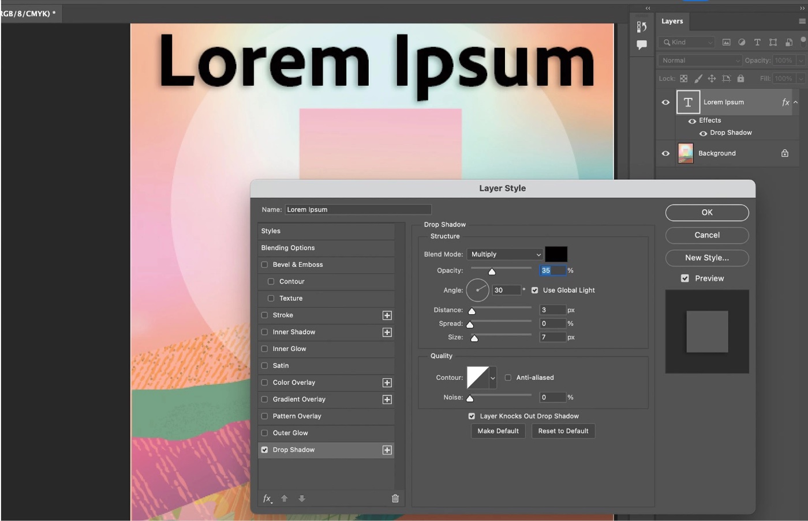
*Adobe's own screenshot (Photoshop 2026 help): the Drop Shadow page. The **+** buttons sit beside Stroke, Inner
Shadow, Color Overlay, Gradient Overlay and Drop Shadow only; Inner Glow and Outer Glow have none. The arrows at
the bottom left reorder instances.*

- **Opening the dialog.** Double-click a layer (outside its name and thumbnail), or the **fx** button at the
  bottom of the Layers panel, or **Layer › Layer Style ›** an effect. Ticking an effect's box applies it with its
  current settings; clicking its name shows its page. (Verified: Adobe, *Layer style effects and options
  overview*.)
- **Order.** The dialog lists, top to bottom: Bevel & Emboss, Stroke, Inner Shadow, Inner Glow, Satin, Color
  Overlay, Gradient Overlay, Pattern Overlay, Outer Glow, Drop Shadow (Verified: screenshot). Effects are drawn
  in the reverse of that list, so the list reads as a stack: Drop Shadow at the bottom, then Outer Glow, then the
  layer and its interior effects (Pattern, Gradient, Color Overlay, Satin, **Inner Glow**, **Inner Shadow**,
  Stroke, Bevel). Beef reads the PSD effects in exactly this order (`PSDReader.cpp`, `ReadEffectSection`);
  Krita uses the same split (drop shadow before the layer; inner glow then inner shadow in the "overlay" pass).
  (Secondary.)
- **Several instances.** Since Photoshop CC 2015, **Drop Shadow**, **Inner Shadow**, **Stroke**, **Color
  Overlay** and **Gradient Overlay** can each be added up to **10** times per layer with the **+** button; the
  glows cannot (Secondary: Bjango, *Photoshop CC 2015 improvements*; the + buttons are Verified in Adobe's
  screenshot). A new instance appears directly below the one whose + was clicked (Secondary). The instance
  higher in the list draws above the lower one (Inferred from the list-is-a-stack rule). In the file, one
  instance is stored as `DrSh`/`IrSh` in `lfx2`; several as the arrays `dropShadowMulti`/`innerShadowMulti` in
  the `lmfx` block (Verified: ag-psd `additionalInfo.ts`, `descriptor.ts` `serializeEffects`).
- **Make Default / Reset to Default** (every effect page): Make Default stores the page's current values as that
  effect's default for new applications; Reset to Default reloads the saved default (Verified: Adobe, *Work
  with layer styles*). These are per effect type and per computer (Inferred: they live in preferences).

## Controls

### Drop Shadow

The page is in two groups, **Structure** and **Quality**, then a checkbox and the two default buttons (Verified:
Adobe's screenshot above).

| Control (as labelled) | Type | Range, unit | Factory default | PSD key (`lfx2` › `DrSh`) | What it does |
| --- | --- | --- | --- | --- | --- |
| **Blend Mode** + swatch | Menu + colour | Photoshop's layer blend modes | Multiply, black | `Md  ` (enum `BlnM`), `Clr ` | How the shadow mixes with what's below; the swatch opens the Color Picker |
| **Opacity** | Slider + field | 0–100 % | 35 % (modern), 75 % (Photoshop 5–CS era) | `Opct` (`#Prc`) | The shadow's opacity |
| **Angle** | Dial + field | −180…180 ° | the document's global angle | `lagl` (`#Ang`) | Direction the light comes **from**; the shadow falls the other way |
| **Use Global Light** | Checkbox | | on | `uglg` | Use (and edit) the document's one light angle instead of `lagl` |
| **Distance** | Slider + field | 0 px and up (maximum unverified) | 3 px (modern), 5 px (old) | `Dstn` (`#Pxl`) | Offset of the shadow along the angle |
| **Spread** | Slider + field | 0–100 % | 0 % | `Ckmt` (stored with `#Pxl` units, but the value is the percentage) | Share of Size spent growing the matte before the soft part |
| **Size** | Slider + field | 0–250 px | 7 px (modern), 5 px (old) | `blur` (`#Pxl`) | Radius of the whole edge: grow plus soften |
| **Contour** | Curve thumbnail + preset menu | curve, 0–255 both axes | Linear | `TrnS` (class `ShpC`: `Nm  `, `Crv ` of `{Hrzn, Vrtc, Cnty}`) | Remaps the falloff (see [Contours](#contours)) |
| **Anti-aliased** | Checkbox | | off | `AntA` | Smooths the bands a steep contour makes |
| **Noise** | Slider + field | 0–100 % | 0 % | `Nose` (`#Prc`) | Grain in the shadow's opacity |
| **Layer Knocks Out Drop Shadow** | Checkbox | | on | `layerConceals` | Hides the shadow under the layer's own shape even when Fill is low (see below) |

Also stored per effect: `enab` (ticked), `present` and `showInDialog` (whether the instance exists and is listed;
Verified as keys in ag-psd, meaning Unverified). Sources: Adobe overview for each definition; the PSD keys from
ag-psd `descriptor.ts` (`parseEffectObject`), Beef `PSDReader.cpp` lines ~719–738 and Krita
`kis_asl_layer_style_serializer.cpp` lines ~1020–1030 (Verified). Ranges: Size 0–250 (Secondary: Bjango, *Blur
radius comparison*; Krita's dialog `kis_dlg_layer_style.cpp` also caps Size at 250 and Distance at 500).

**Defaults.** 29 layers in ag-psd's test PSDs, saved by Photoshop with effects that were never switched on
(`present: false`), all carry the same values: Drop Shadow Multiply, black, 35 %, distance 3, spread 0, size 7,
Linear, anti-aliased off, noise 0, knock-out on; Inner Shadow the same; Outer and Inner Glow Screen, **white**,
35 %, Softer, spread/choke 0, size 7, range 50 %, jitter 0, inner source Edge (Secondary: these are what Photoshop
writes, but a user's Make Default would change them). Adobe's screenshot (35 %, 3 px, 0 %, 7 px) and *The Adobe
Photoshop Book for Digital Photographers* ("from the default 35%") agree. The older factory defaults, kept by
libpsd, were 75 % opacity, 120°, distance 5, size 5, and glows in pale yellow `#FFFFBE` (Verified in libpsd's
`*_default` functions; Secondary for Photoshop).

**Angle convention.** The light comes from `Angle`, measured anticlockwise from 3 o'clock; the shadow moves the
opposite way. In image coordinates (y down) every reimplementation uses
`offset = (round(−Distance·cos θ), round(Distance·sin θ))`, so 120° puts the shadow right and down (Verified in
Beef `ImgEffects.cpp` line 1487, Krita `psd.cpp` `calculateOffset`, libpsd `drop_shadow.c` lines 335–336;
Secondary for Photoshop). Rounding to whole pixels is what all three do; whether Photoshop offsets by fractions is
Unverified.

**Global Light.** One angle and altitude per document, set in **Layer › Layer Style › Global Light** or from any
Drop Shadow, Inner Shadow or Bevel & Emboss page with **Use Global Light** ticked; changing it there changes every
effect that uses it (Verified: Adobe, *Set a global lighting angle*). It is stored in image resource 1037
("Global Angle", 0–359, **assumed 30 if absent**) and 1049 (Global Altitude) (Verified: PSD spec). What angle a
brand-new document gets is Unverified: Adobe's own 2026 screenshot shows 30°, tutorials show 90° and 120°.

**Dragging on the canvas.** While the dialog is open on Drop Shadow (also Inner Shadow and Satin), dragging in the
document window moves the shadow; Angle and Distance follow the drag (Secondary: *The Adobe Photoshop Book for
Digital Photographers*, Peachpit: "move your cursor outside the Layer Style dialog, right out onto your image,
and click-and-drag"). With Use Global Light on, the drag changes the global angle and so every effect using it
(Inferred). Whether Shift constrains the drag is Unverified.

**Layer Knocks Out Drop Shadow.** "Controls the drop shadow's visibility in a semi-transparent layer" (Verified:
Adobe overview). With it on (the default), lowering the layer's **Fill** to 0 % leaves the shadow around the shape
but not under it: the shape "knocks out" a hole. With it off, the shadow shows through the transparent fill
(Secondary: Tuts+ *How to Use Drop Shadows*, CreativePro *Clipping Drop Shadows*). Layer **Opacity**, unlike
Fill, fades the layer and every effect together (Verified: Adobe, *Layer opacity and blending*).

### Inner Shadow

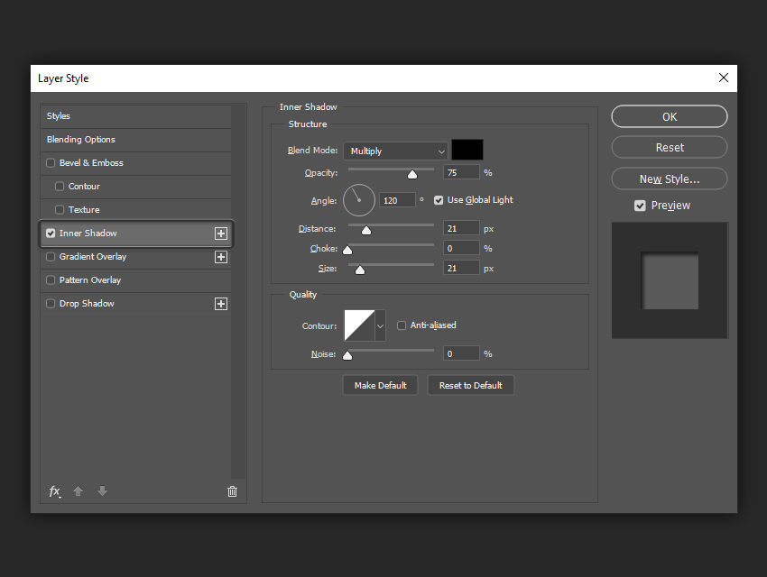
*Inner Shadow: the same page as Drop Shadow with **Choke** in place of Spread and no knock-out box (Tuts+; the
values shown are that author's, not defaults).*

Same controls, keys and ranges as Drop Shadow, under `IrSh`, except:

- **Choke** (0–100 %, key `Ckmt`) replaces Spread: it "shrinks the boundaries of the matte of an Inner Shadow or
  Inner Glow prior to blurring" (Verified: Adobe overview). `chokePx = round(Size × Choke%)`.
- No **Layer Knocks Out** option: the shadow only exists inside the layer.
- The shadow appears on the side the light comes **from**: the inverted matte (everything outside the layer) is
  shifted away from the light and spills over the inner edge facing it, like the wall of a cut-out (Inferred from
  the algorithm; matches Tuts+'s examples).

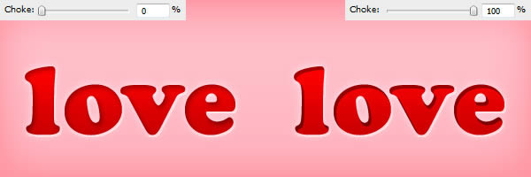
*Choke 0 % (left) and 100 % (right): at 100 % no size is left for softening, so the inner shadow becomes a hard
inner band (Tuts+).*

### Outer Glow

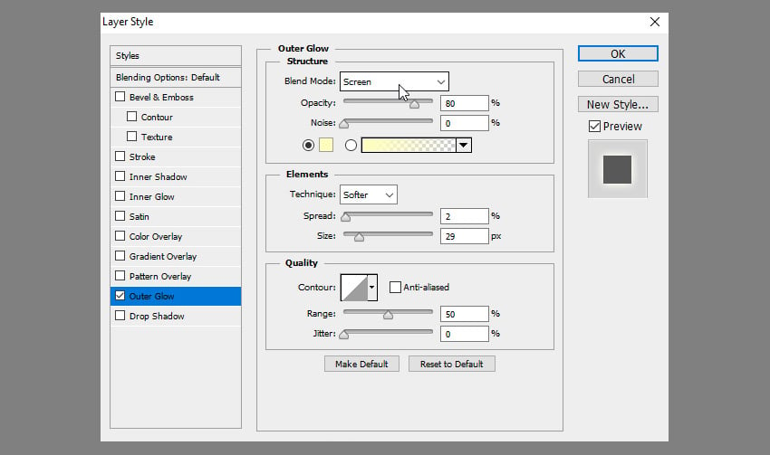
*Outer Glow: Structure (Blend Mode, Opacity, Noise, the colour or gradient choice), Elements (Technique, Spread,
Size), Quality (Contour, Anti-aliased, Range, Jitter) (Tuts+, Photoshop CC; the values are the author's).*

| Control | Type | Range | Factory default | PSD key (`OrGl`) | What it does |
| --- | --- | --- | --- | --- | --- |
| **Blend Mode** | Menu | blend modes | Screen | `Md  ` | |
| **Opacity** | Slider | 0–100 % | 35 % (modern), 75 % (old) | `Opct` | |
| **Noise** | Slider | 0–100 % | 0 % | `Nose` | Grain in the glow's opacity |
| colour radio + swatch | Radio + colour | | on, white (modern), `#FFFFBE` (old) | `Clr ` | A single-colour glow |
| gradient radio + swatch + menu | Radio + gradient | | off | `Grad` | A glow coloured along a gradient (see below). Which radio is on is implied by which key is stored (Verified: Beef `ReadEffectGradient`) |
| **Technique** | Menu | Softer, Precise | Softer | `GlwT` (enum `BETE`: `SfBL`, `PrBL`) | How the falloff is made |
| **Spread** | Slider | 0–100 % | 0 % | `Ckmt` | Share of Size spent growing the matte |
| **Size** | Slider | 0–250 px | 7 px (modern), 5 px (old) | `blur` | Radius of the glow |
| **Contour** + **Anti-aliased** | Curve + checkbox | | Linear, off | `TrnS`, `AntA` | |
| **Range** | Slider | 1–100 % (minimum Inferred) | 50 % | `Inpr` (`#Prc`) | Which part of the falloff the contour spans |
| **Jitter** | Slider | 0–100 % | 0 % | `ShdN` (`#Prc`) | Randomises the position along the gradient |

Adobe's definitions (Verified, overview page): **Technique** "Inner Glow and Outer Glow offer Softer and Precise";
**Range** "controls which portion or range of the glow is targeted for the contour"; **Jitter** "varies the
application of a gradient's color and opacity"; **Contour** "controls transparency rings in solid glows, gradient
repetitions in gradient glows". Adobe's older help text, quoted in 2012 on the Filter Forge forum: "**Softer**
applies a blur and is useful on all types of mattes, whether their edges are soft or hard. At larger sizes, Softer
does not preserve detailed features. **Precise** uses a distance measurement technique to create a glow and is
primarily useful on hard-edged mattes from anti-aliased shapes such as type. It preserves features better than the
Softer technique." (Secondary: a quotation of an Adobe page that no longer exists.)

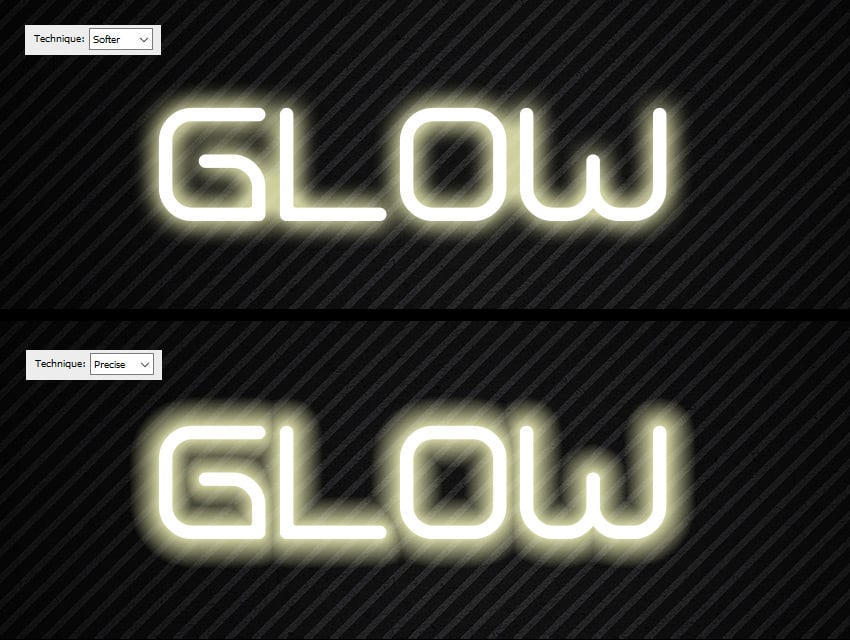
*Softer (top) rounds the glow and fills in the counters; Precise (bottom) keeps the glow's outline parallel to
the letters (Tuts+).*

### Inner Glow

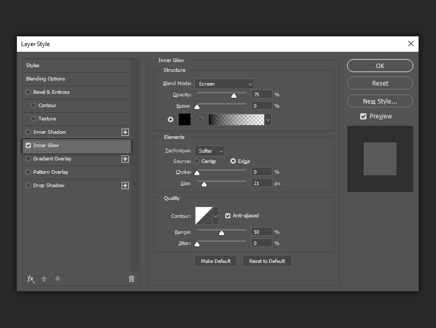
*Inner Glow: as Outer Glow, plus **Source: Center / Edge**, and **Choke** in place of Spread (Tuts+; the
black colour is the author's).*

Same as Outer Glow under `IrGl`, with:

- **Source** (radio, key `glwS`, enum `IGSr`: `SrcC` Center, `SrcE` Edge; default Edge). "Select Center to apply a
  glow that emanates from the center of the layer content, or Edge to apply a glow that emanates from the inside
  edges" (Adobe's older help, Secondary; current overview just says "Specifies the source for an inner glow").
  In the old `lrFX` record, Center was a byte called **Invert** (Verified: PSD spec "Effects layer, inner glow
  info"; libpsd maps Invert to Center).
- **Choke** (0–100 %, `Ckmt`) in place of Spread.

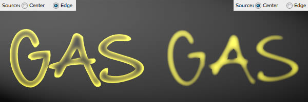
*Source Edge (left) glows along the inside of the outline; Center (right) is its complement, bright in the middle
and fading towards the edges (Tuts+).*

## Contours

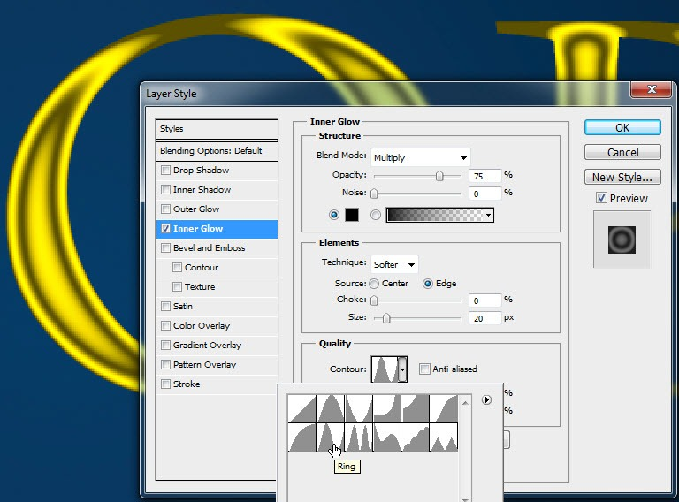
*The contour preset picker, opened from the arrow beside the Contour thumbnail (Photoshop CS5, TipSquirrel). It
holds twelve presets; TipSquirrel names Linear, Cone, Ring, Ring – Double and Cove among them. The full list
(we believe Cone – Inverted, Cove – Deep, Cove – Shallow, Gaussian, Half Round, Rolling Slope – Descending,
Rounded Steps and Sawtooth 1 besides) is from memory and Unverified.*

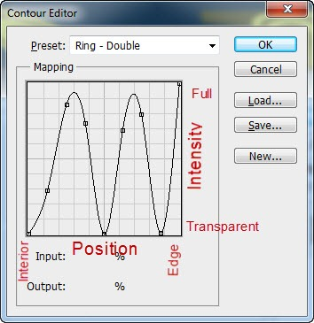
*Clicking the thumbnail itself opens the Contour Editor, a Curves-like graph. Annotated by TipSquirrel: the
horizontal axis is position (left: the far, "interior" end of the effect; right: the edge it starts from), the
vertical axis intensity (bottom: transparent; top: full).*

- **What it maps.** The input is the effect's falloff value: 1 (right) where the effect is strongest, at the
  matte's edge, down to 0 (left) where it fades out, Size px away. The output is the effect's intensity
  (Secondary: TipSquirrel; Adobe: "for Drop Shadow and Inner Shadow, the contour controls the opacity falloff of
  the shadow. For Outer Glow and Inner Glow, the contour determines how the glow fades from its origin"). With a
  solid colour the output is opacity; with a gradient it is the position in the gradient, so a wavy contour
  repeats the gradient's colours as rings (Verified: Adobe overview's definition of Contour).
- **The curve.** Points on a 0–255 grid; each is smooth or a corner (`Cnty` false = corner). Beef draws smooth
  runs as cubic splines and corners as straight segments (Verified: Beef `ImageCurve::Init`). Photoshop's exact
  spline is Unverified; it is presumably the same as its Curves adjustment.
- **Range** (glows only). Every reimplementation that supports it rescales the input before the curve:
  `x' = min(1, x / Range)` (Verified: Beef `CreateContourDataTable`, Krita `adjustRange`, libpsd
  `psd_bitmap_ajust_range`). A low Range squeezes the whole curve into the outermost part of the glow and leaves
  everything nearer the shape at the curve's right-hand value: a denser, harder glow. That matches Tuts+'s
  pictures (Secondary).

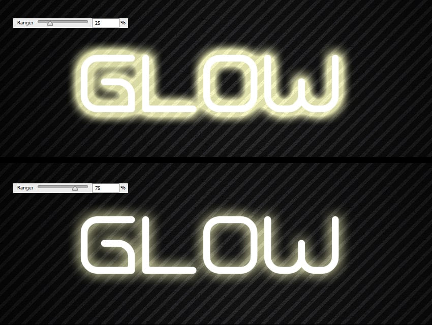
*Range 25 % (top) and 75 % (bottom) with a Linear contour: lower Range keeps the glow at full strength further out
(Tuts+).*

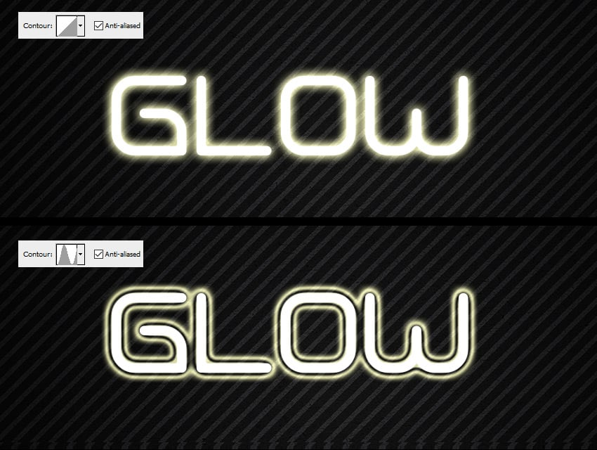
*Linear (top) and a ring-shaped contour (bottom): the curve's peaks and troughs become rings in the glow
(Tuts+).*

- **Anti-aliased.** "Blends the edge pixels of a contour or gloss contour" (Verified: Adobe overview). Two
  readings in code: Beef smooths the falloff map with a 2×2 filter (weights 114, 57, 57, 28 /256) before the curve
  lookup, only when the contour isn't Linear (`AntiAliasIndices`); Krita/libpsd, with it off, quantise the curve
  to 101 steps (`lookup_table[(int)((int)(i / 2.55) * 2.55 + 0.5)]`), which makes visible bands (Verified in both
  codebases; Photoshop's own method Unverified).

## The algorithm, step by step

What follows is the pipeline as the reimplementations agree on it, with each step's sources and where they
disagree. "Beef" is Brian Fiete's `BeefySysLib/img/ImgEffects.cpp` (Beef IDE, 2019–2025; its constants are
empirical fits to Photoshop, and an older copy credited "Photoshop fudge factor by Brian Fiete" lives in VFLib).
Of the codebases, it is the one whose author clearly measured Photoshop most, so it is our working model;
everything taken from it is **Secondary**.

### 1. The matte

- Input is the layer's **alpha**, 0–1, after its layer and vector masks and before **Fill** (Fill only scales the
  layer's own pixels; Verified: Adobe, *Layer opacity and blending*: Fill "affects pixels painted in a layer or
  shapes drawn on a layer without affecting the opacity of layer effects"). The colours of the layer play no
  part (Verified: every implementation reads only alpha: Krita `selectionFromAlphaChannel`, Beef
  `SoftBlurInit`). With **Layer Mask Hides Effects** off (the default), the mask shapes the matte; with it on, the
  effects are made from the unmasked layer and then masked (Secondary: Beef `mLayerMaskHidesEffects`; the
  Blending Options document covers this).
- Outer effects (Drop Shadow, Outer Glow) use `m = α`. Inner effects (Inner Shadow, Inner Glow) use the inverse,
  `m = 1 − α`, with everything **beyond the layer's pixels** counting as outside (Verified: Krita
  `invertsSelection`; Beef `SoftBlurInit(…, invert)` fills the margin with 255).

### 2. Spread or Choke

`spreadPx = round(Size × Spread / 100)` (or Choke) and `softPx = Size − spreadPx` (Verified: Krita
`ShadowRectsData`, libpsd `outer_glow.c` `(spread * size + 50) / 100`, Beef `(int)(mSize * spread + 0.5f)`, VFLib
`BoxBlurAndDilateSettings`). CSS converters use the same split (Secondary: Heygrady, *Recreating Photoshop drop
shadows in CSS3*: "spread-radius = size × spread%, blur-radius = size − spread-radius").

How the matte grows differs:

- **Beef / VFLib** (Secondary): a true dilation. A 5×5 chamfer distance transform measures each pixel's distance
  from the matte, seeding partly covered pixels with a fractional distance (`(255 − α) × 1.03`/256 px) so the
  result stays anti-aliased; pixels within `spreadPx` become 1, the next pixel a 1-px ramp, the rest 0. Weights
  (×256): 254 for a step, 358 for a diagonal, 567 for a knight's move (Beef `gKernelValsFwd`), "optimal values for
  5×5: 0.9866, √2, 2.2062" after Butt and Maragos (VFLib `vf_ChamferDistance.h`).
- **Krita and libpsd** (Verified in code): a Gaussian blur of radius `spreadPx`, then a threshold
  (`v < 24 ? v × 10 : 255`, `findEdge`). This grows the shape by only about 0.4 × spreadPx, so at Spread 100 % the
  glow is much thinner than Photoshop's (Inferred from the maths: a Gaussian-blurred edge drops below 24/255 at
  1.32σ, and σ = 0.3r + 0.3).

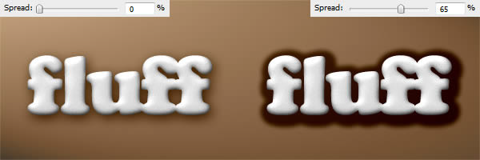
*Spread 0 % and 65 % at the same Size: the shadow keeps its extent but stays dark for longer before fading (Tuts+).*

### 3. Softening: Softer

The rest of the size, `softPx`, becomes a blur. The evidence for its kernel:

| Source | Kernel | Spread of the kernel for blur `r = softPx` | Label |
| --- | --- | --- | --- |
| Beef `SoftBlur` (2019–2025) | Two iterations of a separable box blur, each of half-width `ρ/2` with fractional end taps, where `ρ = r − 1.2` (`ρ = 0.5` when `r ≤ 2`; one iteration when `ρ < 0.9`); Outer Glow Softer bumps Size up to at least 2 | Tent per axis, half-width ≈ `r − 0.2`; σ ≈ (ρ + 1)/√6 ≈ 0.41 × r | Secondary |
| VFLib (2012, Fiete's earlier constants) | The same two box iterations, `ρ = r − (1.85 − 0.45 × min(1, r/10))` | Same shape | Secondary |
| libpsd (2006) | Gaussian with σ = 1.4r / √(2 ln 255) ≈ 0.42 × r, cut where it falls below 1/255 | σ ≈ 0.42 × r | Secondary |
| Krita | Gaussian with σ = 0.3r + 0.3, kernel 6⌈σ⌉ + 1 wide (`KisGaussianKernel::sigmaFromRadius`) | σ ≈ 0.3 × r | Verified (as Krita's) |
| Bjango, *Blur radius comparison* | Measured by eye against CSS: Photoshop's drop shadow Size × 1.136 ≈ CSS `box-shadow` blur (CSS σ = blur/2, so σ ≈ 0.57 × Size) | | Secondary; disagrees, see [Open questions](#open-questions) |

Two independent reverse-engineerings (Fiete's boxes, libpsd's Gaussian) land on σ ≈ 0.41–0.42 × r, and Fiete's
tent has finite support of about Size px, which matches Adobe's description of Size as "the radius and size of
blur" and VFLib's note that the "fade extends 1 pixel past size". We take the **tent** as the working model.

Two consequences worth knowing:

- At Spread 0 the falloff value **on the layer's edge is 0.5** (a blurred step is half way up at the step). So
  with a Linear contour the glow or shadow starts at half strength next to the shape; Spread raises it (Inferred
  from the algorithm; the Tuts+ pictures agree).
- At **Size 0** there is no softening: the effect is a hard copy of the (offset) shape (Secondary: Tuts+ "When it
  is set to 0, the shadow is exactly the same size as the shape"). At **Spread 100 %** there is no blur either:
  the result is the shape grown by Size px with a 1-px anti-aliased edge, which is why "for outer strokes with hard
  edges you can set it all the way to 100%" (Secondary: Tuts+; Beef's `aRadiusLeft == 0` path).

### 4. Softening: Precise (glows only)

- **Beef's model** (`ChokedPixelTransform`, Secondary): a signed distance `sd` from the spread-grown edge (outside
  positive; chamfer distance transforms both ways), mapped linearly:
  `a = clamp(0.5 − sd / (2 × (Size − spreadPx + 1)), 0, 1)`. So, like Softer, it is 0.5 on the edge, reaches 0
  about `Size − spreadPx + 1` px out, and follows the shape's outline exactly instead of rounding it. At Spread
  100 % it is the hard grown shape.
- **VFLib's earlier model** (Secondary): `a = max(0, 1 − d/Size)` from the shape's edge (1 on the edge), Spread
  ignored.
- **Krita and libpsd** (Verified in code): no distance measurement at all: Precise only hardens the matte
  (`findEdge`) before the same Gaussian, so it barely differs from Softer.
- **A cross-check.** VFLib measured Photoshop's Precise glow ("Experimental notes" in `vf_OuterGlowStyle.cpp`):
  the outer border fades over the last **24 %** of `(1 − Spread) × Size` at Sizes 100 and 250 and Spreads 0–75 %
  ("the fade starts at radius = 76% of the size"). Beef's fade (step 6) starts where `a < 1/8.4 = 0.119`; on
  Beef's Precise ramp that is at `1 − 2 × 0.119 = 0.762` of the ramp, i.e. 76 %. Two sources made a decade apart
  agree, which supports both Beef's ramp and its fade constant (Inferred from Secondary data).

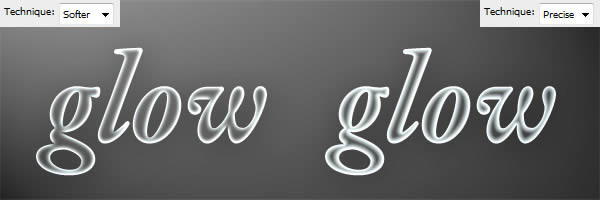
*Inner Glow, Softer (left) and Precise (right): Precise keeps a band of even width inside every stroke, Softer
blurs it into the thin parts (Tuts+).*

### 5. Offset (shadows only)

The softened map is translated by the integer offset from [Angle and Distance](#drop-shadow) (Verified in Beef,
Krita, libpsd). The order of offset and blur doesn't matter mathematically for a translation; Krita offsets last,
Beef reads the blurred map at `x − offset`.

### 6. Range, Contour and the outer fade

For each pixel with falloff value `a`:

1. `x = min(1, a / Range)` (Range = 100 % for shadows, which have no Range control).
2. `c = Contour(x)`, from a lookup table (Beef 4096 entries, Krita and libpsd 256).
3. **The outer fade** (outer effects only). Photoshop makes the outer border of a glow or shadow fade to nothing
   even when the contour or gradient would not (VFLib's notes: "The outer border of the glow has a fade, in
   addition to the alpha of the interpolated gradient colour", "Range, Contour, and Jitter do not affect alpha of
   the fade", "There is no fade at 100% spread"). Beef: `alpha = min(alpha, min(1, 8.4 × a))`, applied when the
   contour's left end or the gradient's far end isn't transparent, or Noise is on. Krita: the contour table is
   multiplied by a fixed ramp that reaches 1 at `a ≈ 0.09` (`applyContourCorrection`, `edgeHidden`). Inner
   effects have no such fade (Verified in both codebases; Secondary for Photoshop). The ring-contour picture in
   [Contours](#contours) shows it: the outermost ring still dies away at the glow's border.

### 7. Colour, gradient and Jitter

- **Shadows and solid-colour glows**: colour = the effect colour, alpha = `c` (after the fade).
- **Gradient glows**: the colour **and its opacity** come from the gradient at position `1 − c`: the gradient's
  left end sits at the shape, its right end at the outer border (Verified: Beef `CreateGradientDataTable`
  `gradientPos = 1 − yVal`; Krita `LinearGradientIndex` `255 − alpha`). A solid colour is in fact handled as the
  gradient "colour, 100 % → colour, 0 %" (Verified: Beef `ReadEffectGradient`). Beef notes a "strange effect
  where alpha gradient never fully reaches end when there's more than one stop" and clamps such opacity lookups to
  0.95 (Secondary).
- **Jitter** perturbs the gradient position per pixel and has no effect on a solid-colour glow (Verified: both
  codebases skip it without a gradient; consistent with VFLib's notes). Beef: in 80 % of pixels, add a uniform
  random `±Jitter × full range` and clamp. Krita: add `Jitter × noise(0…255)` and **wrap** round the gradient.
  Tuts+ describes the look as "adjusting the lightness of adjacent pixels in a way that is similar to Overlay",
  "very subtle most of the time" (Secondary). Photoshop's exact formula is Unverified.

### 8. Noise

"Specifies the number of random elements in the opacity of a glow or shadow" (Verified: Adobe overview). The
reimplementations disagree:

- **Krita / libpsd** (`applyNoise`, Verified in code): every pixel's alpha is copied to a random position up to
  ±4 px away (random 4-bit x and y offsets, averaged with the pixel's own position), then that scattered map
  replaces the smooth one at `Noise %` opacity. The result is dust scattered **beyond** the smooth falloff. The
  random field is cached per environment and anchored to document coordinates (libpsd passes `left, top`).
- **Beef** (Verified in code): in 80 % of pixels where alpha > 0, add a uniform random `±Noise × 255` to alpha.
  Grain inside the falloff, nothing beyond it, and not repeatable (C `rand()`).

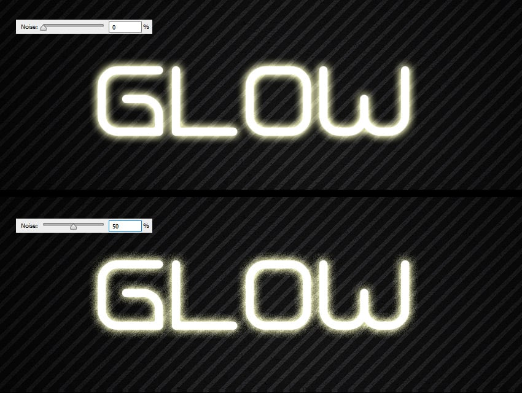
*Noise 0 % and 50 % (Tuts+). The grain spills past the smooth glow like dust, which is closer to Krita's scatter
than to Beef's alpha jitter (Inferred from the picture).*

Tuts+: "Noise creates transparency of adjacent pixels using a Normal blend mode" (Secondary). Whether
Photoshop's pattern is the same every render, and whether it moves with the layer, is Unverified.

### 9. Inner Glow's Source

- **Edge**: the falloff of the inverted matte as above: strongest (0.5 at Choke 0) at the inside of the edge,
  fading inwards over Size.
- **Center**: the complement, `alpha → 1 − alpha` (Beef, after the colour lookup) or `a → 1 − a` (Krita, before
  the contour) (Verified in both codebases). The two orders give the same picture with a Linear contour and a solid
  colour, and differ with a gradient (which end of the gradient sits at the centre) or a non-linear contour;
  Photoshop's order is Unverified.

### 10. Compositing: the inside and outside worlds

Beef's compositor (`ImageEffects::FlattenInto`, Secondary) reproduces Photoshop's documented behaviour with two
working images:

```
outside = backdrop
for each outer effect, bottom to top (Drop Shadows, then Outer Glow):
    outside = blend(outside, effect, effect.opacity, effect.mode)

inside = backdrop
inside = blend(inside, layer pixels, Fill, layer.mode)      // Fill only here
for each inner effect, bottom to top (… Inner Glow, Inner Shadow, Stroke, Bevel):
    inside = blend(inside, effect, effect.opacity, effect.mode)

result = mix(outside, inside, layer alpha)                  // per pixel, weighted by both alphas
result = mix(backdrop, result, layer Opacity)               // Opacity fades everything
```

This explains, without special cases:

- inner effects are clipped to the layer's alpha, soft edges included, and show at Fill 0 %;
- drop shadows and outer glows never show where the layer is opaque, whatever its Fill: the **knock-out**;
- layer Opacity fades content and effects together, Fill only the content (Verified: Adobe).

**Layer Knocks Out Drop Shadow off** is not modelled by Beef (it reads the flag and ignores it). The documented
behaviour (the shadow shows through a low-Fill layer) means that shadow is also composited into the **inside**
world, under the layer's pixels (Inferred). Krita implements the flag by erasing the shadow with the unshifted
layer alpha when it is on: `shadow × (1 − α)` (Verified: `kis_ls_drop_shadow_filter.cpp` lines 205–219), which
is the same thing as the mix above for an opaque-colour shadow.

**Blend modes.** Each effect blends with its own mode into the world it belongs to; the default modes are Multiply
for shadows and Screen for glows (Secondary: the defaults Photoshop writes). Photoshop does this in the document's
RGB encoding (gamma, e.g. sRGB) unless **Edit › Color Settings › Blend RGB Colors Using Gamma 1.00** is on, an
application-wide setting (Secondary: CG Cookie and the Adobe community idea asking to make it a document setting).

## Krita's implementation

Krita (`libs/image/layerstyles/`, `libs/psdutils/psd.h`, commit `585f8170`, 2026-10-06) imitates Photoshop for
PSD and ASL compatibility; most of its effect code is "copy paste from libpsd" (its comments say so). One filter,
`KisLsDropShadowFilter`, does all four effects in modes `DropShadow`, `InnerShadow`, `OuterGlow`, `InnerGlow`
(`kis_ls_drop_shadow_filter.cpp`). Everything below is Verified in that code.

**Per effect** (`applyDropShadow`, lines 110–232), on an 8-bit selection whatever the image's depth:

1. Selection from the layer's alpha (`opacityU8`); inverted for inner effects (`invertsSelection`).
2. If knocking out, keep a copy of the selection.
3. Precise: `findEdge` (`v < 24 ? v × 10 : 255`).
4. Spread/Choke: Gaussian blur of radius `spreadPx`, then `findEdge` again.
5. Blur of radius `Size − spreadPx`: a Gaussian, σ = 0.3r + 0.3 (FFTW or separable).
6. Range (`i × 100 / range`, clamped).
7. Inner Glow Center: invert.
8. Contour lookup (256 entries) with the outer fade ramp for outer effects; Anti-aliased off quantises the curve.
9. Noise (the scatter above), then the offset.
10. Knock-out: erase with the unshifted alpha.
11. Fill with the colour, or a 256-entry gradient table at index `255 − alpha` (plus Jitter, wrapped), into a
    projection that carries the effect's blend mode and opacity.

**Stacking** (`kis_layer_style_projection_plane.cpp`): Drop Shadow is drawn **before** the layer; Pattern,
Gradient and Color Overlay, Satin, Inner Glow and Inner Shadow are drawn onto a copy of the layer with its alpha
maxed out, which is then cut back to the layer's alpha (`KisLayerStyleKnockoutBlower`); then Stroke; then Outer
Glow and Bevel **after** the layer. Outer Glow is therefore drawn above the layer and erased where the layer is
(`knocksOut` true for glows), not drawn under it as Photoshop does; the two differ only on semi-transparent
pixels.

**Zoom.** For reduced-resolution previews (`LodWrapper`), Size and Distance are multiplied by the level's scale
(`scaleLinearSizes`); Spread, Choke and Range, being percentages, are unchanged.

**Where Krita knowingly differs from Photoshop**:

- **Contours from PSD/ASL files are ignored.** `convertAndSetCurve` only logs "Curve conversion is not
  implemented yet" (`kis_asl_layer_style_serializer.cpp` line 875), and the `Cnty` flag is reported as
  unsupported, so every contour renders Linear. Krita's own UI has no contour editor; the table defaults to
  identity. (KDE bug 382269, "Inner Glow Improvements": "Probably because we do not implement contours yet.")
- **Precise is not a distance transform** and Spread is a blur-and-threshold (above).
- The blur is a Gaussian narrower than libpsd's and Fiete's.
- Masks are 8-bit at every image depth, so large glows band in 16-bit images.
- One instance per effect type (`style->dropShadow()` is single).
- The Krita team's own audit ("Krita Layer Styles Problems", KDE meeting documents) notes "Inner/outer glow should
  start with white" and that Inner Glow's Softer/Precise and Center/Edge at first did nothing (Secondary).

## Edge cases

- **Bit depth.** Nothing settles whether Photoshop computes effect masks at the document's depth. 8-bit falloffs
  over hundreds of pixels band; Noise hides it. Whether layer styles all work in 32-bit documents is Unverified
  (community posts say many layer features don't).
- **Soft and semi-transparent layers.** The matte is the alpha itself, so a feathered or 50 %-opacity-painted
  layer gets proportionally weaker effects, and inner effects fade with its edge (the inside/outside mix).
- **Colour space.** Effect colours are document colours (`Clr ` in the document's model; the old `lrFX` also kept
  a "native color"). Blending happens in the encoded space by default: a Multiply shadow of opacity `o` over a
  backdrop gives `B_enc × (1 − o)`. In linear light the same operation gives `B_lin × (1 − o)`, which re-encoded is
  about `B_enc × (1 − o)^(1/2.2)`: at `o = 0.35` that is 0.82 × the backdrop instead of Photoshop's 0.65. Large,
  visible difference (Inferred arithmetic).
- **Opacity, Fill, Blending Options.** Opacity fades everything; Fill only the layer's pixels. **Blend Interior
  Effects as Group** makes Fill (and the layer's mode) apply to the interior effects too; **Transparency Shapes
  Layer** off stops the layer's alpha from clipping them; **Layer Mask Hides Effects** reverses the mask order
  (Secondary: Beef's `mBlendInteriorEffectsAsGroup`, `mTransparencyShapesLayer`; these belong to the Blending
  Options research).
- **Groups.** A style on a group is made from the group's merged alpha (Inferred). How a Pass Through group with
  effects is isolated is Unverified.
- **Canvas edges.** Inner effects treat everything beyond the layer's pixels as outside, so a full-canvas layer
  gets inner glow and inner shadow along the canvas border (Inferred from Beef and Krita; Unverified in
  Photoshop). Drop shadows and glows extend past the canvas and are simply cropped.
- **Scale.** Transforming a layer does not scale its effects; **Layer › Layer Style › Scale Effects** does, and
  Image Size's **Scale Styles** option does on resampling (Verified: Adobe, *Scale layer effects*). The `lfx2`
  block carries a top-level `Scl ` (percent) beside `masterFXSwitch` (Verified: ag-psd); whether Photoshop applies
  it at render time or bakes it into Size and Distance is Unverified.
- **Small sizes.** Size 1–2 still blurs (Beef uses a fixed 0.5 px box); Outer Glow Softer treats 1 as 2 (Beef,
  Secondary).

## PSD storage

All four effects live in the layer's `lfx2` descriptor (or `lmfx` when any effect has several instances), keyed
`DrSh`, `IrSh`, `OrGl`, `IrGl`, with the switch for all effects in `masterFXSwitch` (Verified: PSD spec "Object
based effects layer info"; ag-psd). The Photoshop 5 `lrFX` block (`dsdw`, `isdw`, `oglw`, `iglw`) is still
written for old readers and holds only blur, "intensity" (Spread/Choke), angle, distance, colour, blend mode,
enabled, global angle, opacity and, for inner glow, Invert (Verified: PSD spec).

| Key | Meaning | Unit | In |
| --- | --- | --- | --- |
| `enab` | effect ticked | bool | all |
| `present`, `showInDialog` | instance exists / is listed | bool | all |
| `Md  ` | blend mode | enum `BlnM` | all |
| `Clr ` | colour | colour descriptor | all |
| `Opct` | opacity | `#Prc` | all |
| `uglg` | Use Global Light | bool | shadows |
| `lagl` | local angle | `#Ang` | shadows |
| `Dstn` | Distance | `#Pxl` | shadows |
| `Ckmt` | Spread / Choke (a percentage, though typed `#Pxl`) | `#Pxl` | all |
| `blur` | Size | `#Pxl` | all |
| `Nose` | Noise | `#Prc` | all |
| `AntA` | Anti-aliased | bool | all |
| `TrnS` | Contour (`ShpC`: `Nm  `, `Crv ` of `CrPt {Hrzn, Vrtc, Cnty}`) | 0–255 | all |
| `layerConceals` | Layer Knocks Out Drop Shadow | bool | Drop Shadow |
| `GlwT` | Technique (`BETE`: `SfBL` Softer, `PrBL` Precise) | enum | glows |
| `Grad` | gradient (present instead of the colour when the gradient radio is on) | gradient descriptor | glows |
| `Inpr` | Range | `#Prc` | glows |
| `ShdN` | Jitter | `#Prc` | glows |
| `glwS` | Source (`IGSr`: `SrcC`, `SrcE`) | enum | Inner Glow |
| Image resource 1037 / 1049 | Global Angle (default 30) / Altitude | int | document |

Sources: ag-psd `descriptor.ts` (Verified), Beef `PSDReader.cpp` (Verified), Krita's serializer (Verified). Two
parser bugs to avoid copying: psd-tools reads Outer Glow's spread from `ShdN` (Jitter's key) and calls `Ckmt` "in
pixels"; ag-psd's types put `source` on Outer Glow and omit its `technique` (Verified in their code).

## Implementation notes for us

How we'd build these on the photo suite's GPU tile renderer (premultiplied linear light, f16/f32, tiles with
levels; see [rendering.md](../rendering.md)). The plan follows the working model above and keeps every constant
in one place so measurements can tune it.

**Passes per effect instance.**

1. **Matte** (r16float, one channel): the layer's alpha after its masks, sampled over the destination tile grown
   by the apron (below), shifted by `−offset` for shadows. Inverted for inner effects, with "beyond the layer's
   bounds" read as outside. One matte serves every effect of the layer.
2. **Grow** (Spread/Choke > 0, and Precise): a distance transform. A chamfer 5×5 scan is sequential and poor on a
   GPU; the GPU options are jump flooding (log₂ n passes, approximate, small errors at Voronoi seams) or an exact
   separable squared-EDT (Felzenszwalb–Huttenlocher: one 1-D lower-envelope pass per row, then per column, as
   compute shaders). We'd use the exact EDT with alpha-seeded sub-pixel offsets (Gustavson's anti-aliased EDT) and
   clamp it at Size + 2: anything farther doesn't matter, so the transform is exact within the apron. Euclidean
   differs from Photoshop's chamfer (if it is one) by up to ~2 % of the distance; measure before copying the
   chamfer's polygonal shape (Open question 3).
3. **Soften**: Softer as the tent: two box passes per axis (four separable passes) with fractional end weights, each
   O(1) per pixel through a running sum or subgroup prefix sums, so cost doesn't grow with Size. Precise as the
   linear ramp of the signed distance from pass 2: no blur pass.
4. **Shade** (one fragment pass): Range, contour (4096×1 r16float LUT, linear filtering), the outer fade
   `min(1, 8.4a)`, Anti-aliased, noise, gradient (4096×1 rgba16float LUT) and Jitter, opacity; output a
   premultiplied effect layer.
5. **Composite** in two accumulators per tile, outside and inside, then `mix(outside, inside, α_layer)` and
   `mix(backdrop, ·, Opacity)`, as in step 10. Drop shadows with knock-out off also go into the inside accumulator
   under the layer.

**Cache by what changes.** The softened map (after pass 3) depends only on the matte, Size, Spread/Choke, Technique
and the offset; colour, opacity, blend mode, contour, Range, Noise, Jitter and gradient only re-run pass 4. Make the
softened map a render-plan prefix key so dragging Opacity or picking a contour never re-blurs (VFLib's notes
suggest Photoshop caches the same way: "previewing Range changes is very fast"). Instances with the same Size and
Spread share one softened map, whatever their offsets and colours.

**Aprons and offsets.** A destination tile needs source alpha from its own rectangle moved by `−offset` and grown
by `Size + 2` px (+ 4 for Noise's scatter). With Size 250 and 256-px tiles that is a 760-px square, nine tiles of
source for each tile of result: recomputing per tile wastes ~9×. Compute effects over blocks of tiles (e.g.
2048 px, apron overhead ~1.5×) rather than tile by tile. Distance can be large (Photoshop's maximum is unverified;
Krita allows 500): the source block is just translated, never grown by Distance.

**Zoom independence.** Every parameter is in document pixels. For a view at level L (scale 2⁻ᴸ):

- compute at level L with Size, Spread px and Distance × 2⁻ᴸ (Krita's `LodWrapper` approach) when the scaled
  softening is at least ~4 px; the box passes accept fractional radii, and the EDT handles fractional distances;
- otherwise compute at the coarsest level where the falloff still spans ~4 px, then downsample, so thin shapes
  and small shadows don't vanish or bloat;
- **noise** must be defined at level 0 (a hash of document pixel coordinates and the effect's id, the same u32
  hash as the output dither) and shown at reduced levels as its local mean, or zooming out would change the look;
- export and the "refine" pass always compute at level 0. A tent with σ ≈ 100 px can still be computed at ¼
  resolution and upsampled with errors below 1/255 (Inferred; verify with fixtures).

**Precision.** f16 holds the falloff to ~1/2048 near 1, enough. Keep the 0.5 edge value exact (no bias in the box
weights). LUT indices should use `a` before any quantisation; Anti-aliased off can mimic Photoshop's banding by
quantising the contour input to 101 steps, as Krita does, if fixtures show that.

**Colour domain.** Our blending is linear; Photoshop's is encoded. For effects, the difference is large (see Edge
cases). The rendering doc already says a Photoshop-compatible look must be a versioned document setting. Two
candidate compatibility rules for shadows and glows: blend these effect layers in the encoded domain (an extra
encode/decode around the blend), or remap opacity so that `1 − o_lin = (1 − o)^2.2` for Multiply-black. The first
is general, the second only right for black Multiply; decide with fixtures.

**What's expensive.** Distance transforms for Spread, Choke and Precise (several compute passes over the apron),
full-resolution blurs of large Sizes on big documents, and ten instances that each have their own Size. Cheap:
everything after the softened map, and offsets.

## Open questions

Each wants a fixture made in Photoshop 2025/2026 (macOS, 16-bit sRGB document, Color Settings with gamma blending
off), exported as a flattened 16-bit PNG and as the PSD, and compared with our render in a test. A small UXP or
ExtendScript script can sweep the parameters.

1. **The blur kernel.** Tent (two boxes) or Gaussian, and its width per Size. Test: a white vertical edge on black,
   Outer Glow Normal, white, 100 %, Linear, Softer, Spread 0, Sizes 1, 2, 3, 5, 10, 20, 50, 100, 250; read one row
   and fit both models. Also explains Bjango's 1.136 factor, which disagrees with the code-derived σ.
2. **The 0.5 edge value.** Same fixture: is the glow 50 % right outside the edge at Spread 0?
3. **Spread's metric.** A single opaque pixel with Outer Glow Spread 100 %, Size 40: circle (Euclidean) or
   octagon-ish (chamfer)? Also 45° edges.
4. **Precise.** Same fixtures with Precise: the ramp's value at the edge, its linearity, and the fade starting at
   76 %.
5. **Range.** Glow with a Ring contour at Range 25, 50, 100: does `x / Range` describe the ring positions?
6. **Contours.** Which spline Photoshop draws through smooth points; what Anti-aliased does to a Sawtooth contour.
7. **Noise.** Its distribution and footprint (scatter beyond the glow or grain within), whether it is the same on
   every render, and whether it moves with the layer or stays fixed to the canvas.
8. **Jitter.** Wrap-around or clamp at the gradient's ends.
9. **Inner Glow Center with a gradient.** Which end of the gradient sits at the centre.
10. **Knock-out off.** Shadow under a 50 %-alpha layer with Fill 100 % and 0 %, knock-out on and off: does the
    inside/outside model hold?
11. **Canvas edges.** Inner Glow on a full-canvas layer: glow at the border or not?
12. **Bit depth.** The same fixtures in 8- and 16-bit documents: is the falloff computed at document depth? Do
    the effects exist in 32-bit?
13. **Defaults.** Delete preferences, then read Reset to Default for each effect. ag-psd's fixtures also contain
    untouched effects at Size 12 and 29: do Photoshop's defaults scale with document size or resolution?
14. **Limits.** Distance's maximum; Range's minimum; whether values can be fractional after Scale Effects; what the
    `Scl ` key does.
15. **Global light.** The angle a new document starts with (30°, 90° or 120°?).
16. **Zoomed-out preview.** Does Photoshop's on-screen effect change with zoom (computed per pyramid level) or is it
    computed at 100 % and downsampled?
17. **Groups.** A drop shadow on a Pass Through group: is the group isolated?
18. **Multiple instances.** Confirm that the upper instance in the list draws on top, and where + inserts.

## Sources

Adobe (primary):

- [Layer style effects and options overview](https://helpx.adobe.com/photoshop/desktop/create-manage-layers/apply-layer-effects/layer-style-effects-and-options-overview.html) (every control's definition)
- [Manage contours](https://helpx.adobe.com/photoshop/desktop/create-manage-layers/apply-layer-effects/manage-contours.html)
- [Work with layer styles](https://helpx.adobe.com/photoshop/desktop/create-manage-layers/apply-layer-effects/work-with-layer-styles.html) (Make Default, Reset to Default)
- [Set a global lighting angle for all layers](https://helpx.adobe.com/photoshop/desktop/create-manage-layers/apply-layer-effects/set-a-global-lighting-angle-for-all-layers.html)
- [Scale layer effects](https://helpx.adobe.com/photoshop/desktop/create-manage-layers/apply-layer-effects/scale-layer-effects.html)
- [Add drop shadows to text](https://helpx.adobe.com/photoshop/desktop/text-typography/text-on-paths-shapes/add-drop-shadows-to-text.html)
- [Layer opacity and blending](https://helpx.adobe.com/photoshop/using/layer-opacity-blending.html) (Fill vs Opacity)
- [Photoshop File Formats Specification](https://www.adobe.com/devnet-apps/photoshop/fileformatashtml/) (`lrFX`, `lfx2`, image resources 1037/1049)

Source code (read for this document):

- Krita, [invent.kde.org/graphics/krita](https://invent.kde.org/graphics/krita) at `585f8170`: `libs/image/layerstyles/kis_ls_drop_shadow_filter.cpp`, `kis_ls_utils.cpp`, `kis_layer_style_projection_plane.cpp`, `KisLayerStyleKnockoutBlower.cpp`, `libs/image/kis_gaussian_kernel.cpp`, `libs/psdutils/psd.h`, `psd.cpp`, `libs/image/kis_asl_layer_style_serializer.cpp`, `libs/ui/dialogs/kis_dlg_layer_style.cpp`
- Beef (Brian Fiete), [BeefySysLib/img/ImgEffects.cpp](https://github.com/beefytech/Beef/blob/master/BeefySysLib/img/ImgEffects.cpp) (last changed 2025-01-26, `89bf4750`) and [PSDReader.cpp](https://github.com/beefytech/Beef/blob/master/BeefySysLib/img/PSDReader.cpp)
- Vinnie Falco, [LayerEffects](https://github.com/vinniefalco/LayerEffects) (`6cbd0f88`), VFLib `modules/vf_unfinished/graphics/`: `vf_OuterGlowStyle.cpp` (experimental notes), `vf_LayerStyles.h`, `vf_BoxBlur.h`, `vf_ChamferDistance.h`
- libpsd (Graphest, 2004–2007), mirror [TheNicker/libpsd](https://github.com/TheNicker/libpsd): `src/outer_glow.c`, `inner_glow.c`, `drop_shadow.c`, `gaussian_blur.c`, `effects.c`
- [ag-psd](https://github.com/Agamnentzar/ag-psd): `src/descriptor.ts`, `src/psd.ts`, `src/additionalInfo.ts`, and the PSDs in `test/read/*/data.json` (the defaults)
- [psd-tools](https://github.com/psd-tools/psd-tools): `src/psd_tools/api/effects.py`, `src/psd_tools/composite/effects.py`

Secondary:

- Bjango, [Blur radius comparison](https://bjango.com/articles/blurradiuscomparison/) and [Photoshop CC 2015 improvements](https://diagnostics.bjango.com/articles/photoshopcc2015/) (10 instances)
- Filter Forge forum, [Photoshop "Outer Glow" Technique: Soft?](https://www.filterforge.com/forum/read.php?FID=5&TID=10288&MID=111984) (2012; Vinnie Falco's findings, Adobe's old technique text)
- Heygrady, [Recreating Photoshop drop shadows in CSS3 and Compass](https://2012.heygrady.com/blog/2011/08/06/recreating-photoshop-drop-shadows-in-css3-and-compass/)
- Scott Kelby, *The Adobe Photoshop Book for Digital Photographers*, [Peachpit excerpt](https://www.peachpit.com/articles/article.aspx?p=3173266&seqNum=5) (dragging the shadow, default 35 %)
- CreativePro, [Clipping drop shadows in Photoshop, Illustrator and InDesign](https://creativepro.com/clipping-drop-shadows-photoshop-illustrator-and-indesign/)
- TipSquirrel, [Understanding layer style contours in Photoshop](https://www.tipsquirrel.com/understanding-layer-style-contours-in-photoshop/)
- Envato Tuts+ series: [How to use drop shadows](https://design.tutsplus.com/articles/how-to-use-drop-shadows-in-photoshop--psd-16652), [Understanding inner shadows](https://design.tutsplus.com/articles/understanding-inner-shadows-in-photoshop--psd-16767), [How to apply outer glow](https://design.tutsplus.com/articles/how-to-apply-outer-glow-to-layer-styles-in-photoshop--psd-16796), [Understanding the inner glow setting](https://design.tutsplus.com/articles/understanding-the-inner-glow-setting-in-photoshop--psd-17080)
- KDE: [bug 382269](https://bugs.kde.org/show_bug.cgi?id=382269), [Krita Layer Styles Problems](https://origin.files.kde.org/krita/krita_meeting_docs/Other%20Documents/Krita%20Layer%20Styles%20Problems.odt)
- CG Cookie, [Blend RGB colors using gamma](https://cgcookie.com/community/2830-on-photoshop-do-you-use-quot-blend-rgb-colors-using-gamma-quot-this-on-color-settings-ctrl-shift-k-amp-gt-advanced); Adobe community idea, [make "Blend colors using gamma" a document setting](https://community.adobe.com/t5/photoshop-ecosystem-ideas/photoshop-make-quot-blend-colors-using-gamma-quot-a-document-setting/idi-p/12249621)

Images (each downloaded, checked and, where noted, cropped):

| File | Source |
| --- | --- |
| `img/shadow-drop-dialog-adobe.jpg` | Adobe, [Add drop shadows to text](https://helpx.adobe.com/photoshop/desktop/text-typography/text-on-paths-shapes/add-drop-shadows-to-text.html) (`helpx-prod.scene7.com/is/image/HelpxProd/Text-with-Drop-Shadow-effect-applied--The-Layer-St`) |
| `img/shadow-inner-dialog.png` | Tuts+, [Understanding inner shadows](https://design.tutsplus.com/articles/understanding-inner-shadows-in-photoshop--psd-16767) (`uploads/users/523/posts/34016/image/layer-style-panel-example.png`) |
| `img/shadow-inner-choke.png` | Same article, `part-3-12.png`, cropped |
| `img/shadow-spread.png` | Tuts+, [How to use drop shadows](https://design.tutsplus.com/articles/how-to-use-drop-shadows-in-photoshop--psd-16652) (`uploads/users/523/posts/34015/image/part-2-12.png`), cropped |
| `img/glow-outer-dialog.jpg` | Tuts+, [How to apply outer glow](https://design.tutsplus.com/articles/how-to-apply-outer-glow-to-layer-styles-in-photoshop--psd-16796) (`uploads/users/108/posts/33092/image/outer-glow-photoshop-0.jpg`) |
| `img/glow-softer-vs-precise.jpg` | Same article, `outer-glow-photoshop-comparison-5.jpg` |
| `img/glow-range.jpg` | Same article, `outer-glow-photoshop-comparison-9.jpg` |
| `img/glow-contour-ring.jpg` | Same article, `outer-glow-photoshop-comparison-8.jpg` |
| `img/glow-noise.jpg` | Same article, `outer-glow-photoshop-comparison-3.jpg` |
| `img/glow-inner-dialog.png` | Tuts+, [Understanding the inner glow setting](https://design.tutsplus.com/articles/understanding-the-inner-glow-setting-in-photoshop--psd-17080) (`uploads/users/523/posts/34017/image/inner-glow-settings-panel-preview.png`) |
| `img/glow-inner-source.png` | Same article, `part-1-14.png`, cropped |
| `img/glow-inner-technique.png` | Same article, `part-1-12.png`, cropped |
| `img/glow-contour-picker.jpg` | TipSquirrel, [Understanding layer style contours](https://www.tipsquirrel.com/understanding-layer-style-contours-in-photoshop/) (`wp-content/uploads/2011/09/contours-04.jpg`) |
| `img/glow-contour-editor.jpg` | Same article, `contours-07.jpg` |
