# Stroke, Satin and the overlays

> **Measured since** (2026-10-06, Photoshop 27.11): the stroke's band and corners, Classic gradient interpolation; Satin and gradient-style renders are kept as fixtures. See [photoshop-measurements.md](photoshop-measurements.md),
> which overrides this document where they disagree.

How Photoshop's **Stroke**, **Satin**, **Color Overlay**, **Gradient Overlay** and **Pattern Overlay** layer
effects behave, precisely enough to rebuild them. Researched 2026-10-06 from Adobe's help pages (current and
archived), Adobe's PSD file format specification, the source code of four independent reimplementations (Krita's
layer styles, libpsd, psd-tools' compositor, GIMP's layerfx plug-in), ag-psd's descriptor tables, tutorials and
Adobe community threads. **No hands-on Photoshop comparison was made for this document.** The last two sections
are ours: [implementation notes](#implementation-notes-for-us) and [open questions](#open-questions).

Every claim is marked:

| Mark | Meaning |
| --- | --- |
| **[V]** | Verified: Adobe documentation, Adobe's file format spec, or a real Photoshop screenshot showing it |
| **[S]** | Secondary: a reimplementation's source code (each has its own accuracy; see [the sources](#the-reimplementations)), a reputable tutorial, an Adobe employee's blog, a forum expert |
| **[I]** | Inferred or unverified: our reading, a guess from screenshots, or sources that disagree |

## The reimplementations

None of these is Photoshop. They are the best implementation evidence there is, and they disagree in places.

| Source | What it is | How much to trust it |
| --- | --- | --- |
| **psd-tools** (`src/psd_tools/composite/effects.py`, `composite.py`, 2026) | Python PSD compositor | Its stroke code is tested against fixtures rendered by Photoshop 2026 (issues #799, #846, #895 are cited in its comments). The most trustworthy source on the stroke's shape and compositing. Its gradient and pattern fills are simplistic (no midpoints, no offset, no phase, no angle for patterns) |
| **Krita** (`libs/image/layerstyles/kis_ls_*.cpp`, `kis_ls_utils.cpp`, `libs/psdutils/psd.h`, `libs/image/kis_asl_layer_style_serializer.cpp`) | Full layer-style engine reading and writing ASL/PSD | Dmitry Kazakov says its stroke "still doesn't generate exactly the same result as in PS" ([KDE bug 398691](https://bugs.kde.org/show_bug.cgi?id=398691)). Its gradient geometry is copied from libpsd ("copy paste from libpsd", `kis_ls_utils.cpp` ~L440) |
| **libpsd** (Graphest Software, 2004–2007; `src/stroke.c`, `satin.c`, `gradient_overlay.c`, `boundary.c`) | C PSD decoder and blender, Photoshop CS era | Reverse-engineered against Photoshop CS/CS2. Old, but the origin of most later code |
| **GIMP layerfx** (Jonathan Stipe, `layerfx.2.8.py`) | Plug-in that rebuilds each effect from GIMP layers | Approximations built from selections and layer modes |
| **ag-psd** (`src/descriptor.ts`, `psd.ts`) | TypeScript PSD reader/writer | Descriptor keys and enums only, no rendering |

## What the five share

### Where they draw

- **Stroke is the only one of the five that can draw outside the layer's pixels.** Satin and the three overlays
  change only pixels the layer already covers: Adobe calls them effects "that modify opaque pixels" **[V]**
  ([layer opacity and blending](https://helpx.adobe.com/photoshop/using/layer-opacity-blending.html)).
- **Blend Interior Effects as Group** (Blending Options) "appl[ies] the blending mode of the layer to layer effects
  that modify opaque pixels, such as Inner Glow, Satin, Color Overlay, and Gradient Overlay" **[V]** (same page).
  Pattern Overlay isn't named but is surely in the same class **[I]**. Blending Options themselves are in
  [advanced-blending.md](advanced-blending.md).
- **Fill opacity** "affects only pixels, shapes, or text on a layer without affecting the opacity of layer effects"
  **[V]**. At Fill 0 % an overlay still shows at its own opacity, and a stroke still draws **[S]** (the usual
  "fill 0 + stroke" outline trick). Layer **Opacity** fades the layer and all its effects together **[V]**.
- **Order.** The dialog's effect list is, from the top, Bevel & Emboss, Stroke, Inner Shadow, Inner Glow, Satin,
  Color Overlay, Gradient Overlay, Pattern Overlay, Outer Glow, Drop Shadow **[V]** (screenshots below). The
  list is the stacking order, top drawn last **[S]**: a 100 % Normal Color Overlay hides a Gradient Overlay, and
  Stroke paints over all the interior effects. Within several instances of one effect, the upper one in the list
  is on top **[S]**.
- **Several instances.** Since Photoshop CC 2015, "Stroke, inner shadow, color overlay, gradient overlay and drop
  shadow layer styles can now have up to 10 instances per layer" **[S]**
  ([Bjango](https://bjango.com/articles/photoshopcc2015/)); the dialog shows a **+** beside exactly those **[V]**.
  Satin and Pattern Overlay have one instance each.

### Scale Effects

Layer > Layer Style > Scale Effects "scale[s] the effects in the layer style without scaling the object" **[V]**
([Adobe, archived](https://web.archive.org/web/2024/https://helpx.adobe.com/photoshop/using/layer-effects-styles.html)).
It's stored once for the whole style, as the `Scl ` key of the effects descriptor **[S]** (ag-psd). What it
multiplies here, per Krita's `scaleLinearSizes` (`psd.cpp` L260, `psd.h` L1134), which it uses for both PSD scale
and its own reduced-resolution previews **[S]**:

| Effect | Scaled by Scale Effects | Not scaled |
| --- | --- | --- |
| Stroke | Size; gradient or pattern Scale | Angle, opacity |
| Satin | Distance, Size | Angle, contour |
| Color Overlay | (nothing) | |
| Gradient Overlay | Scale | Angle, offset |
| Pattern Overlay | Scale | Angle, phase **[I]** |

Scaling a gradient's Scale when the gradient is sized to the layer's box looks wrong (the box doesn't change),
so for Gradient Overlay this is probably Krita's simplification **[I]**. Image > Image Size's **Scale Styles**
option applies the same scaling **[S]**.

### Descriptor keys

Effects live in the layer's `lfx2` block (object-based effects, "Photoshop 6.0") **[V]**
([PSD file format spec](https://www.adobe.com/devnet-apps/photoshop/fileformatashtml/)); several instances use
`lmfx`, with `frameFXMulti`, `solidFillMulti` and `gradientFillMulti` arrays **[S]** (ag-psd `descriptor.ts`).
Every effect has these keys **[S]** (ag-psd, Krita):

| Key | Type | Meaning |
| --- | --- | --- |
| `enab` | bool | Enabled (the checkbox) |
| `present`, `showInDialog` | bool | Whether the effect exists in the style and is listed in the dialog (CC 2015+) |
| `Md  ` | enum `BlnM` | Blend mode |
| `Opct` | UnitFloat `#Prc` | Opacity, 0–100 |

Krita turns the percentage into 8 bits with `qRound(255/100 × opacity)` (`kis_ls_overlay_filter.cpp` L64) **[S]**;
libpsd uses `(int)(opct × 2.55 + 0.5)`. Whether Photoshop keeps fractional opacity is unknown **[I]**.

## Stroke

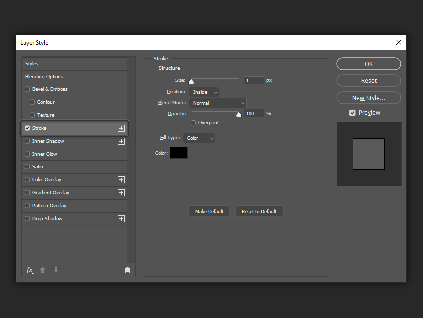

*The Stroke page (Photoshop CC, 2019 or so): Structure (Size, Position, Blend Mode, Opacity, Overprint), then
Fill Type and its options. Source: Envato Tuts+.*

Adobe: Stroke "outlines the object on the current layer using color, a gradient, or a pattern. It is particularly
useful on hard-edged shapes such as type" **[V]**. The descriptor class is `FrFX` **[S]**.

### Structure

| Control | Type | Range, unit | Key | What it does |
| --- | --- | --- | --- | --- |
| **Size** | slider + field | 1–250 px **[S]** (Tuts+: "anywhere from 1 px to 250 px"; psd-tools: "The widest stroke Photoshop writes" is 250) | `Sz  ` `#Pxl` | Width of the band |
| **Position** | menu | Outside, Inside, Center **[V]** | `Styl`, enum `FStl`: `OutF`, `InsF`, `CtrF` **[S]** | Where the band sits relative to the layer's edge |
| **Blend Mode** | menu | the blend modes | `Md  ` | How the stroke blends with what it lands on |
| **Opacity** | slider | 0–100 % | `Opct` | The stroke's opacity |
| **Overprint** | checkbox | | `overprint` **[S]** (ag-psd, psd-tools) | Inside the layer: blend the stroke with the layer instead of knocking the layer out. Added in CC 2015 **[S]** |
| **Fill Type** | menu | Color, Gradient, Pattern **[V]** | `PntT`, enum `FrFl`: `SClr`, `GrFl`, `Ptrn` **[S]** | What the band is painted with |

Fractional sizes: Photoshop's fields take whole pixels **[I]**; the descriptor is a double and psd-tools renders
fractions.

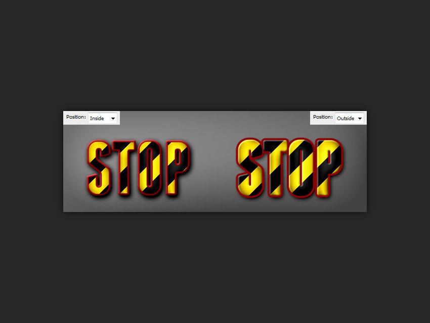

*Position Inside (left) and Outside (right). The outside stroke grows the letters and rounds their corners; the
inside one eats into them. Source: Envato Tuts+.*

### How the band is computed

The stroke is a band in a **signed distance field** of the layer's edge **[S]**. With `d` the distance from a pixel
centre to the edge (positive outside the layer, negative inside) and `S` the Size, the band covers:

| Position | Band (`lo` ≤ d ≤ `hi`) |
| --- | --- |
| Outside | 0 … S |
| Center | −S/2 … S/2 |
| Inside | −S … 0 |

(psd-tools `_BANDS`, `effects.py` ~L90; Krita grows by S, shrinks by S, or both by S/2, `kis_ls_stroke_filter.cpp`
L105–L112.) How Photoshop splits an odd Size for Center (1.5 px each side, or 1 and 2) is unverified **[I]**.

**Which edge.** psd-tools, measured against Photoshop fixtures, says **[S]**:

- Photoshop reads the edge from each pixel's **coverage**, not from the 0.5 iso-contour: "a pixel at `alpha`
  states that the boundary runs `0.5 − alpha` from its own centre, and its neighbours measure outward from there"
  (`_signed_distance`).
- So on a feathered edge, every partially transparent pixel is ½ px from the edge, and "a stroke of any size covers
  all of it". A 16 px soft brush edge under a 3 px stroke is entirely stroked.
- Where opaque meets fully transparent with no partial pixel, the exact Euclidean distance to the step is used.
- Pixels with no coverage of their own take the nearest stated edge: `min over partial pixels p of |x − p| +
  near[p]`. Photoshop's result "is mirror-exact", so ties between equidistant pixels aren't broken by scan order.
- The band is anti-aliased with a linear ramp a pixel wide on each side:
  `coverage = clamp(hi − d + 0.5, 0, 1) × clamp(d − lo + 0.5, 0, 1)` (`_distance_band`).

That matches the forum reports that strokes on soft brush strokes look jagged and blotchy, worse "the softer the
brush is" **[S]** ([Adobe community](https://community.adobe.com/t5/photoshop-ecosystem-discussions/jagged-edges-on-layer-styles/m-p/10409586/highlight/true)).

The other reimplementations are coarser **[S]**:

- **Krita** dilates the alpha (as 8-bit) by convolving with an unnormalised disc of radius S, whose last pixel fades
  linearly (`createDilateMatrix`, `kis_gaussian_kernel.cpp` L308), and clamps to 255; erosion is the same on the
  inverted alpha. A sum, not a maximum: a 10 % pixel with enough neighbours dilates to 100 %.
- **libpsd** traces the edge where alpha > 24/255 as a pixel-stepped polygon (GIMP's boundary code), strokes it
  with libart at width 2S with **round joins**, then knocks the inside or outside out (`stroke.c`, `boundary.c`
  L3471).
- **layerfx** uses GIMP's Grow and Shrink Selection.

**Corners** **[S]**: an Outside stroke rounds every convex corner with a radius of S. Users have asked for square
outside corners for over a decade; Adobe hasn't added them and experts point to shape-layer strokes instead
([feature request](https://community.adobe.com/feature-requests-713/outside-stroke-with-square-corners-654668)).
An Inside stroke keeps convex corners sharp (its inner edge is rounded at concave places instead). This is exactly
what a Euclidean distance band does. (Edit > Stroke, a different command, gives chamfered 45° corners on a
rectangular selection, which experts call "expected"
([thread](https://community.adobe.com/t5/photoshop-ecosystem-discussions/stroke-command-produces-45-degree-angles/m-p/9022821)).
Don't confuse the two.)

**Large strokes**: one thread reports visible facets on a 200 px layer-style stroke around a smooth pen path
([thread](https://community.adobe.com/questions-712/layer-style-stroke-has-faceted-edges-1087113)) **[S]**. That
suggests Photoshop's distance isn't exactly Euclidean at large sizes, or that it follows the pixel-stepped edge.
Unverified **[I]**.

### How the stroke composites with the layer

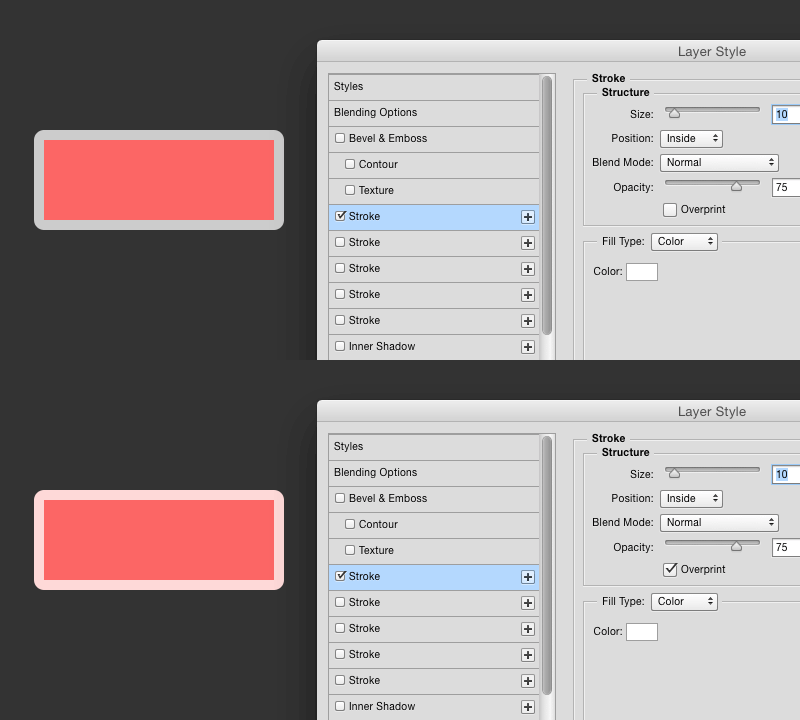

*Inside stroke, 10 px, white, 75 %. Top: Overprint off: the stroke replaces the layer, so the dark backdrop shows
through it. Bottom: Overprint on: the stroke blends over the red fill. Source: Bjango.*

- **Inside part, Overprint off** (the default, and the only behaviour before CC 2015): the stroke **replaces** the
  layer under it. "A stroke of 50% opacity shows what is behind the layer, not a mix of the layer's stroke and
  fill" **[S]** (Bjango). At 0 % opacity an inside stroke "will act as a mask and hide areas of the layer"
  **[S]** (Tuts+). Kazakov: "in PS it uses a bit different way of blending (it removes the part of the original
  layer, or just uses COMPOSITE_COPY)" **[S]**; Krita copies with `KisLayerStyleKnockoutBlower`.
- **Inside part, Overprint on**: the stroke is composited over the layer (and its interior effects) with its own
  blend mode and opacity **[S]**.
- **Outside part**: disjoint from the layer. psd-tools: "on a pixel the boundary cuts an outset band comes out at
  `1 − alpha` and the two together fill the pixel. Their coverages therefore *add*" (`_apply_outer_effects`)
  **[S]**. So there is **no seam** between an anti-aliased edge and an outside stroke. The outside band keeps its
  own blend mode against the backdrop **[S]**. Krita gets the same no-seam result differently: with an Outside
  stroke it raises every partly transparent layer pixel to opaque (`ThresholdCeil`), with Inside it drops them to
  transparent (`ThresholdFloor`) (`kis_ls_stroke_filter.cpp` L165–L174, `krita_utils.cpp` L503).
- **Where it applies, for the layer pixel**: psd-tools composites the inside effects "with the layer and puts the
  result on the backdrop, so an inset stroke renders at `alpha*S + (1 - alpha)*B`" **[S]**.

As formulas, per pixel, with layer coverage `α` (alpha after its mask), layer colour `L`, interior-effects result
`L'` (the layer after Satin and overlays), stroke colour `C`, stroke opacity `o`, inside coverage `bᵢ` and outside
coverage `bₒ` as fractions of the pixel, `blend` the stroke's blend mode, `B` the backdrop. This is our reading of
psd-tools **[I]**:

```text
inside share   s = bᵢ / α                      (0..1 of the layer's own area)
layer'' = Overprint ? mix(L', blend(L', C), o·s)
                    : L' with s·o of its area replaced by C, and s·(1 − o) of it removed
outside share  t = bₒ / (1 − α)
result  = layer'' composited over (B with blend(B, C) at opacity o·t on the remaining 1 − α)
coverage = α·(1 − (Overprint ? 0 : s·(1 − o))) + bₒ·o
```

### Fill Type: Color

| Control | Key | Notes |
| --- | --- | --- |
| **Color** | `Clr ` (object `RGBC` etc.) | The stroke's colour, in the document's mode |

### Fill Type: Gradient

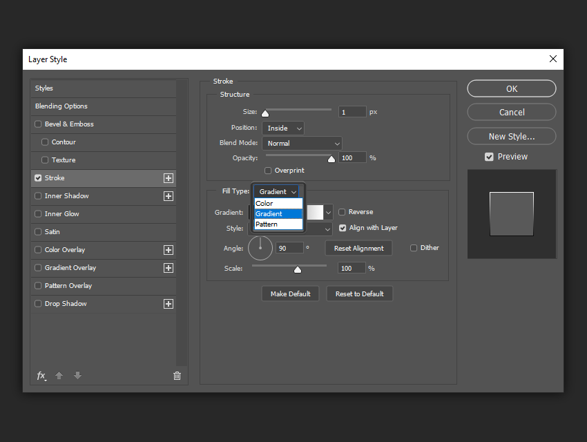

*Fill Type: Color, Gradient, Pattern. Gradient shows Gradient, Reverse, Style, Align with Layer, Angle, Reset
Alignment, Dither and Scale. Source: Envato Tuts+.*

The options are those of [Gradient Overlay](#gradient-overlay) **[V]** (dialog), with the keys in the same
descriptor **[S]**: `Grad`, `Rvrs`, `Type` (`GrdT`), `Algn`, `Angl`, `Ofst`, `Dthr`, `Scl `, and `gs99` for the
Method **[S]** (ag-psd). Differences:

- **Style** has a sixth entry, **Shape Burst** (`Type` = `GrdT` `shapeburst`), "Stroke effect only; not in the
  terminology" **[S]** (psd-tools `constants.py`).
- **Align with Layer**'s box: libpsd grows the layer's box by the stroke (Outside: +S each side; Center: +S/2;
  Inside: the layer's box) (`stroke.c`) **[S]**. Unverified in Photoshop **[I]**.
- The gradient is painted across the whole band; the band is only a mask **[S]**. Users note that Photoshop
  can't run a gradient *along* a stroke (Illustrator can) **[S]**.

#### Shape Burst

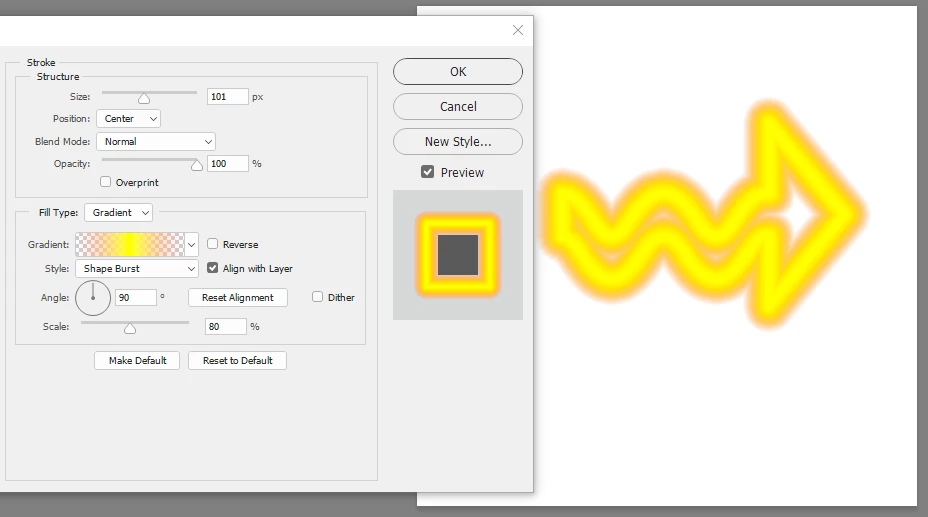

*Shape Burst, Center, 101 px, Scale 80 %, a transparent–orange–yellow–orange–transparent gradient on a thin arrow:
a neon tube that follows the shape. Note the sharp concave notch at the arrow's tail and the rounded outer
corners. Source: Adobe community (davescm).*

Shape Burst maps the gradient by **distance across the band** rather than by position **[S]** (forum uses: "a
gradient perpendicular to the path", "make any gradient follow the selection contours"). Our model **[I]**:

```text
u = (d − lo) / (hi − lo)        0 at the band's inner edge, 1 at its outer edge, or the reverse
t = u through Scale             probably about one end, as for the other styles
```

Which end of the gradient sits at the layer's edge, how Scale is applied and whether Angle does anything are all
unverified. The example above is symmetrical, so it can't tell. Neither Krita (it aborts on an unknown style,
`kis_ls_utils.cpp` L526) nor psd-tools renders Shape Burst.

### Fill Type: Pattern

| Control | Range | Key | Notes |
| --- | --- | --- | --- |
| **Pattern** | preset picker, + New Preset | `Ptrn` {`Nm  `, `Idnt`} | By name and UUID; the pattern itself is in the document's `Patt`/`Pat2`/`Pat3` block **[V]** (spec) |
| **Angle** | −180…180° **[I]** | `Angl` **[S]** | Added in Photoshop 21.2 (June 2020) **[S]** ([Julieanne Kost](https://jkost.com/blog/2020/06/photoshop-v21-2-pattern-rotation-auto-font-activation-select-subject-and-more.html)) |
| **Scale** | 1–1000 % **[S]** | `Scl ` | |
| **Link with Layer** | checkbox | `Lnkd` **[S]** (not `Algn` as in Pattern Overlay: Krita's comment "yes, we share the params") | |
| **Snap to Origin** | button | resets `phase` | See [Pattern Overlay](#pattern-overlay) |
| (dragged offset) | | `phase` {`Hrzn`, `Vrtc`} | Dragging in the image while the page is open **[S]** |

## Satin

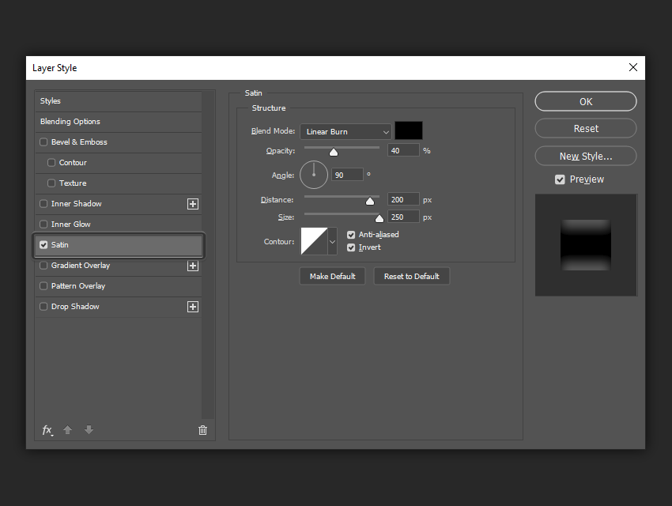

*The Satin page: Blend Mode and colour, Opacity, Angle, Distance, Size, Contour with Anti-aliased and Invert. Here
Linear Burn, 40 %, 90°, 200 px, 250 px (the Size slider at its end). Source: Envato Tuts+.*

Adobe: "Applies interior shading that creates a satiny finish" **[V]**. Tuts+: "Satin creates two copies of your
layer, then offsets and blurs them to produce the final result" **[S]**. Descriptor class `ChFX` **[S]**.

| Control | Type | Range | Key | What it does |
| --- | --- | --- | --- | --- |
| **Blend Mode** + colour swatch | menu, colour | | `Md  `, `Clr ` | How the satin's colour blends over the layer |
| **Opacity** | slider | 0–100 % | `Opct` | |
| **Angle** | dial + field | −180…180° **[I]** | `lagl` `#Ang` | Direction of the two copies' offset. No Use Global Light **[S]** (Krita: "no global light setting explicitly") |
| **Distance** | slider | 0–250 px **[I]** (from the slider in the screenshot) | `Dstn` `#Pxl` | How far each copy is offset |
| **Size** | slider | 0–250 px **[V]** (screenshot: 250 at the slider's end) | `blur` `#Pxl` | Blur radius |
| **Contour** | curve picker + editor | | `MpgS` (object `ShpC`: `Nm  `, `Crv ` points `Hrzn`/`Vrtc` 0–255) **[S]** | Remaps the satin's intensity |
| **Anti-aliased** | checkbox | | `AntA` | Smooths the contour lookup |
| **Invert** | checkbox | | `Invr` | Inverts the result |

Distance can be dragged in the image while the page is open, and so can Angle **[V]** (Adobe: "You can drag in the
document window to adjust the angle of a Pattern Overlay, Drop Shadow, Inner Shadow, or Satin effect").

### The algorithm

libpsd (`satin.c` L281–L370) and Krita (`kis_ls_satin_filter.cpp` L96–L179) agree **[S]**:

```text
A      = the layer's alpha (after its layer mask)
G      = gaussian_blur(A, Size)                      blur radius = Size
G'     = contour(G)                                  the Contour as a 256-entry table
off    = (−Distance·cos θ, +Distance·sin θ)          θ = Angle, y pointing down
m(p)   = | G'(p + off) − G'(p − off) |               the difference of two opposite copies
m(p)   = 1 − m(p)                                    if Invert
satin  = colour, coverage m(p) · A(p), opacity Opacity, blended over the layer with Blend Mode
```

So the two copies are offset **±Distance** (2 × Distance apart), not one copy against the original.
GIMP layerfx does the same with two layers set to Difference, but **applies the contour after the difference**,
not before (`makeSatin`, `layerfx.2.8.py` L3681) **[S]**. Which order Photoshop uses is unknown **[I]**: with the
default linear contour the two agree.

Consequences of this model, worth testing in Photoshop **[I]**:

- `|a − b|` doesn't change when the offset is negated, so **Angle θ and θ + 180° give the same satin**.
- **Distance 0** gives nothing, or a flat fill with Invert on.
- Far from any edge both copies are 1, so the satin vanishes in the middle of big shapes and lives near edges
  that the offset crosses; Invert turns that around (colour in the middle, gaps along the edges).
- The result is multiplied by the layer's own coverage, so the satin never leaves the layer.

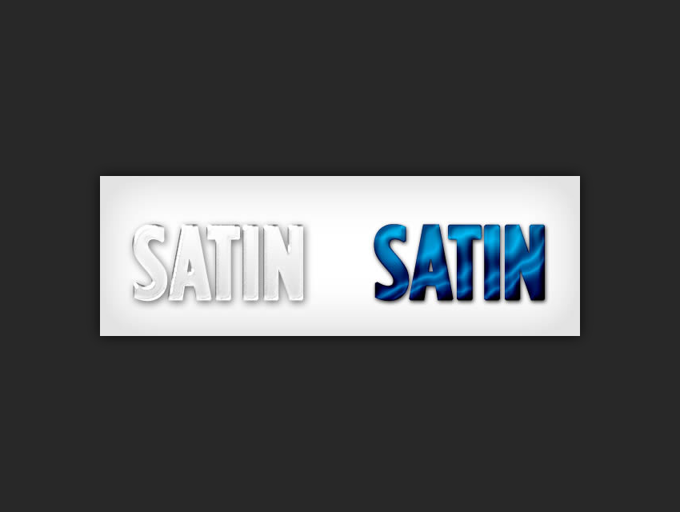

*Satin on type: subtle shading (left) and the wavy "silk" look of a large Size and Distance (right). Source: Envato
Tuts+.*

**Contour details, from Krita's `applyContourCorrection`** (`kis_ls_utils.cpp` L300–L351) **[S]**: the contour is a
256-entry table indexed by the 8-bit value. With Anti-aliased off, the index is first quantised to 100 levels
(`lookup[(int)((int)(i / 2.55) * 2.55 + 0.5)]`). Contour editor points are numbered 0–255 and can be corners
(`Cnty` false) **[S]**. Contours themselves are covered with the shadows and glows.

**The blur.** Libpsd and Krita use a Gaussian with Size as its radius. Whether Satin's Size is the same blur as
the shadows' Size (which isn't a plain Gaussian in every account) belongs with that research **[I]**.

**Defaults.** libpsd's, presumably Photoshop CS-era: Multiply, black, 50 %, 19°, 11 px, 14 px, linear contour,
Invert on, Anti-aliased off (`satin.c` L41) **[S]**. Krita's differ (Linear Burn, 8 px, 7 px). Current Photoshop
defaults unverified **[I]**.

## Color Overlay

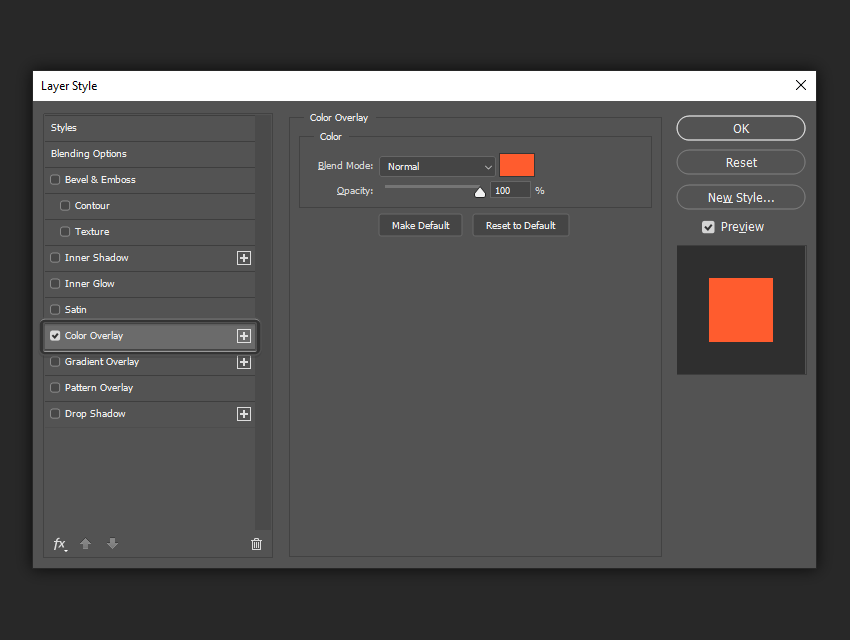

*The Color Overlay page: Blend Mode, colour swatch, Opacity. Source: Envato Tuts+.*

Adobe: "Fills content with a solid color" **[V]**. Descriptor class `SoFi` ("solid fill"; `sofi` in the older
`lrFX` block, "added in Photoshop 7.0") **[V]** (spec).

| Control | Range | Key |
| --- | --- | --- |
| **Blend Mode** | the blend modes | `Md  ` |
| **Color** | colour picker | `Clr ` |
| **Opacity** | 0–100 % | `Opct` |

```text
result over the layer's area = mix(L, blend(L, colour), Opacity)      coverage stays α
```

Krita fills a device with the colour and composites it with the layer's alpha as the knockout
(`fillOverlayDevice`; `KisLayerStyleProjectionPlane::apply`) **[S]**.

## Gradient Overlay

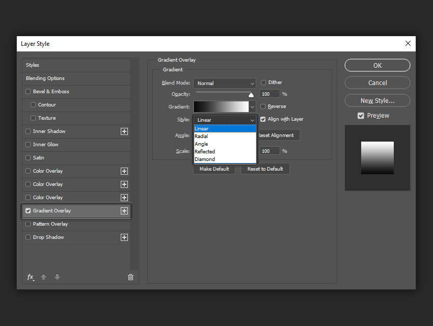

*The Gradient Overlay page (before Photoshop 23.0 added Method): Blend Mode, Dither, Opacity, Gradient, Reverse,
Style (Linear, Radial, Angle, Reflected, Diamond: no Shape Burst here), Align with Layer, Angle, Reset Alignment,
Scale. Source: Envato Tuts+.*

Adobe: "Fills content with a gradient" **[V]**. Descriptor class `GrFl` **[S]**.

| Control | Type | Range | Key | What it does |
| --- | --- | --- | --- | --- |
| **Blend Mode** | menu | | `Md  ` | |
| **Dither** | checkbox | | `Dthr` | Noise against banding |
| **Opacity** | slider | 0–100 % | `Opct` | |
| **Gradient** | swatch (opens the Gradient Editor) + preset menu | | `Grad` (object `Grdn`) | The gradient |
| **Reverse** | checkbox | | `Rvrs` | "flips the orientation of the gradient" **[V]** |
| **Style** | menu | Linear, Radial, Angle, Reflected, Diamond **[V]** | `Type`, enum `GrdT`: `Lnr `, `Rdl `, `Angl`, `Rflc`, `Dmnd` **[S]** | "specifies the shape of the gradient" **[V]** |
| **Align with Layer** | checkbox | | `Algn` | "uses the bounding box of the layer to calculate the gradient fill" **[V]**; off: the document canvas **[S]** (Krita `defaultBounds`, libpsd `context->width/height`) |
| **Angle** | dial + field | −180…180° **[I]** | `Angl` `#Ang` | Direction |
| **Reset Alignment** | button | | sets `Ofst` to 0, 0 **[I]** | Undoes dragging |
| **Scale** | slider | 10–150 % **[I]** (100 sits at 64 % of the slider) | `Scl ` `#Prc` | "scales the application of the gradient" **[V]** |
| **Method** | menu | Perceptual, Linear, Classic (23.0); Smooth, Stripes (2025) | `gs99`, enum `gradientInterpolationMethodType`: `Perc`, `Lnr `, `Gcls`, `Smoo` **[S]** (ag-psd; Stripes' value not known) | How colours are mixed between stops |
| (dragged centre) | | % of the box | `Ofst` {`Hrzn`, `Vrtc`} `#Prc` **[S]** | "You can also move the center of the gradient by clicking and dragging in the image window" **[V]** |

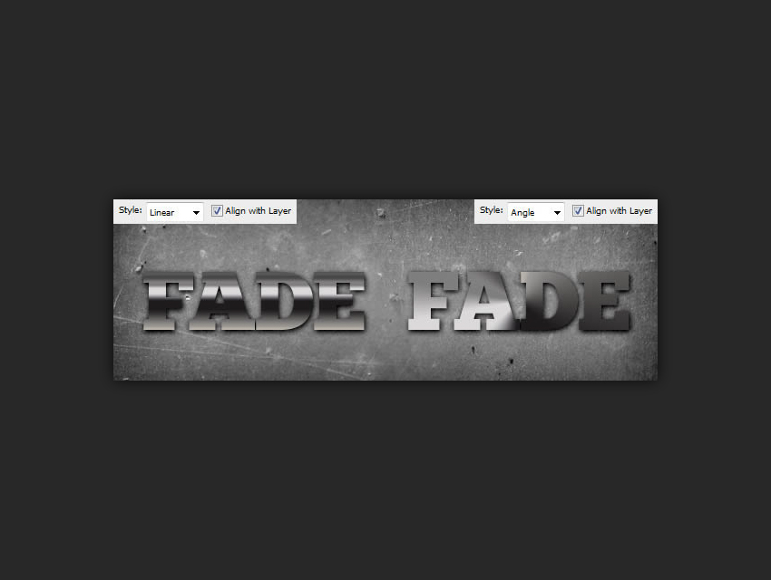

*Style Linear (left) and Angle (right) on the same metal gradient, both aligned with the layer. Source: Envato
Tuts+.*

### Geometry

**Verified** (Adobe's Gradient tool, whose styles the overlay shares): Linear "shades from the starting point to the
ending point in a straight line"; Radial "in a circular pattern"; Angle "shades in a counterclockwise sweep around
the starting point"; Reflected "mirrors the same linear gradient on either side of the starting point"; Diamond
"shades from the middle to the outer corners of a diamond pattern"
([Adobe, archived 2023](https://web.archive.org/web/2023/https://helpx.adobe.com/photoshop/using/gradients.html)).

For the overlay there's no start or end point: the gradient is laid out on a **box** (the layer's bounds with Align
with Layer, else the canvas), centred on the box's centre moved by `Ofst`. libpsd's construction, copied into Krita
(`kis_ls_utils.cpp` L429–L535, `stroke.c`) **[S]**:

```text
box      = layer bounds (Align with Layer) or the canvas; W, H its size
centre   = box centre + (W·Ofst.x/100, H·Ofst.y/100)
w, h     = round(W·Scale/200), round(H·Scale/200)           half-sizes, scaled
corner   = round(atan(H / W) in degrees)
θ        = Angle folded into 0…90° (signs remembered per quadrant)
if θ ≤ corner:  rx = w,               ry = round(rx·tan θ)
else:           ry = h,               rx = round(ry / tan θ)
r        = (±rx, ∓ry)                the point where the line at Angle leaves the scaled box (y down)
rc       = round(√(rx² + ry²))

Linear     from centre − r (location 0)  to centre + r (location 1)
Radial     centre, radius rc
Angle      around centre, starting along r
Reflected  linear about centre (Krita: from centre − r to centre, mirrored)
Diamond    centre, size rc, rotated by Angle (libpsd); Krita uses r with a bilinear shape
```

What follows from it **[S]**, all of it to check against Photoshop **[I]**:

- At 90° the gradient's first stop is at the box's **bottom** and the last at the top. The dialog's preview
  (black → white, 90°: dark at the bottom) agrees **[V]** (screenshot above).
- A Linear gradient's ends sit where the line through the centre at Angle **leaves the box**, not where the box's
  corners project onto it, so at 45° on a wide box the corners are clamped to the end colours.
- Radial's radius depends on Angle on a non-square box.
- Krita's Reflected puts location 0 at the box edge and 1 at the centre, the reverse of the Gradient tool's
  description (location 0 at the start point, the centre). One of them is wrong.

### Method (interpolation)

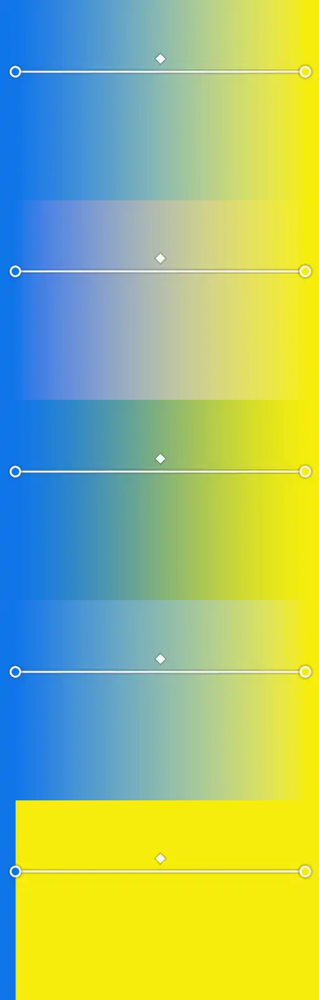

*From the top: Perceptual, Linear, Classic, Smooth, Stripes, each a blue-to-yellow gradient drawn with the
Gradient tool. Source: Glen Smith.*

- **Added in Photoshop 23.0** (October 2021): Perceptual, Linear and Classic; Perceptual the default **[S]**
  ([Adobe community bug report](https://community.adobe.com/bug-reports-711/p-files-with-gradient-layers-created-in-22-5-2-look-different-in-23-0-658745)).
  "Any gradients that you draw with the Gradient tool, fills, overlay effects, and maps, and Shapes fill and
  stroke support these new interpolation options" **[V]**
  ([Adobe: gradient interpolation](https://helpx.adobe.com/photoshop/using/gradient-interpolation.html)). Older
  documents open as Classic **[V]** (same page; fixed in 23.0.1 for gradient maps and actions **[S]**).
- **Classic** "uses the cubic interpolation of colors" and keeps the old look **[V]**. It mixes the document's
  encoded values **[S]** (search summaries say "the selected working space"), which is why its middle is darker
  and greener above.
- **Perceptual** "interpolates the gradient in the OKLab color space" **[V]**.
- **Linear** "interpolates the gradient in the linear color space" **[V]** (linear light: note the grey middle
  above).
- **Smooth** and **Stripes**: added in a 2025 release, after Adobe MAX London **[S]**
  ([fotokonyv.hu](https://halado.fotokonyv.hu/photoshop-gradient-ismet-egy-ujdonsag/),
  [Glen Smith](https://glensmith.co.uk/photoshop/gradient-tool)). "Stripes is designed for creating stripes, with
  multiple stops"; it "does not create a gradual transition but creates sharp switches" **[S]**. Exactly where a
  stripe switches is unverified: in the picture, with two stops, the switch is at the first stop, which would
  mean each interval takes its *right-hand* stop's colour **[I]**. Smooth looks like Perceptual with eased
  transitions **[I]**. ag-psd knows `Smoo` and has "TODO: stripes".

### The gradient itself (as far as overlays need)

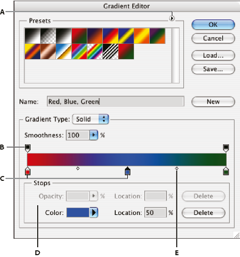

*The Gradient Editor (an older version): A panel menu, B opacity stop, C colour stop, D stop values and Delete,
E midpoint. Source: Adobe.*

The `Grad` object (`Grdn`) **[S]** (ag-psd, Krita, libpsd):

| Key | Meaning |
| --- | --- |
| `Nm  ` | Name |
| `GrdF` | `CstS` (Solid, custom stops) or `ClNs` (Noise) |
| `Intr` | Smoothness, 0–4096 (4096 = 100 %) |
| `Clrs` | Colour stops: `Clr `, `Type` (`UsrS` own colour, `FrgC` foreground, `BckC` background), `Lctn` 0–4096, `Mdpn` 0–100 (midpoint, % of the way to the next stop; 50 by default) |
| `Trns` | Opacity stops: `Opct` %, `Lctn`, `Mdpn` |
| Noise only | `Smth` (roughness), `ClrS` (RGB, HSB, Lab), `RndS` (seed), `VctC` (restrict colours), `ShTr` (add transparency), `Mnm `, `Mxm ` |

- **Colour and opacity are separate tracks** with their own stops and midpoints **[V]** (the editor).
- **Midpoint**: "where the gradient displays an even mix of the starting and ending colors" **[V]**.
- **Smoothness**: "The smoothness 0 value goes in straight lines connecting stops and midpoints, while a 100% value
  does a spline curve. With a simple gradient with 2 stops and a default midpoint, theoretically, smoothness has no
  effect" **[V]** ([Adobe, archived 2023](https://web.archive.org/web/2023/https://helpx.adobe.com/photoshop/using/gradients.html)).
  So at 0 % each half-interval is linear through (midpoint, 50 %); the spline at 100 % is unspecified **[I]**.
  Default 100 % **[S]**.
- Stops at the same location make hard edges **[S]**; psd-tools keeps the later of two co-located stops.
- Krita samples the gradient into a 256-entry table before use (`getGradientTable`) **[S]**: fine for 8 bits,
  visible banding in 16-bit documents.
- **Dither**: Adobe's tool help: "create a smoother blend with less banding" **[V]**. Krita uses blue-noise dither
  **[S]**. What Photoshop's noise is, and whether it does anything in 16- or 32-bit documents, is unknown **[I]**.

## Pattern Overlay

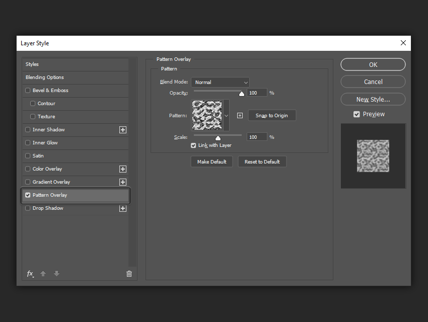

*The Pattern Overlay page (before 21.2 added Angle): Blend Mode, Opacity, Pattern with New Preset (+) and Snap to
Origin, Scale, Link with Layer. Source: Envato Tuts+.*

Adobe: "Fills content with a pattern" **[V]**. Descriptor class `patternFill` **[S]**.

| Control | Type | Range | Key | What it does |
| --- | --- | --- | --- | --- |
| **Blend Mode** | menu | | `Md  ` | |
| **Opacity** | slider | 0–100 % | `Opct` | |
| **Pattern** | preset picker | | `Ptrn` {`Nm  `, `Idnt`} | "The Pattern option is not available if no patterns are loaded" **[V]** |
| **New Preset** (+) | button | | | "create a new preset pattern based on the current settings" **[V]** |
| **Snap to Origin** | button | | resets `phase` | See below |
| **Angle** | dial + field | −180…180° **[I]** | `Angl` **[S]** (ag-psd writes `Angl` for `patternFill`; psd-tools reads it) | "rotate your pattern at the desired angle" **[V]**. Added in **Photoshop 21.2, June 2020**, for Pattern Overlay, pattern Strokes, Pattern Fill layers and shapes **[S]** (Julieanne Kost, Adobe) |
| **Scale** | slider | 1–1000 % **[S]** | `Scl ` `#Prc` | "specify the size of the pattern" **[V]** |
| **Link with Layer** | checkbox | | `Algn` | "if you want the pattern to move along with the layer as the layer moves" **[V]** |
| (dragged offset) | | | `phase` {`Hrzn`, `Vrtc`} | "Drag a pattern to position it in the layer; reset the position by using the Snap To Origin button" **[V]** |

All **[V]** quotes are from Adobe's archived
[layer effects page](https://web.archive.org/web/2024/https://helpx.adobe.com/photoshop/using/layer-effects-styles.html).

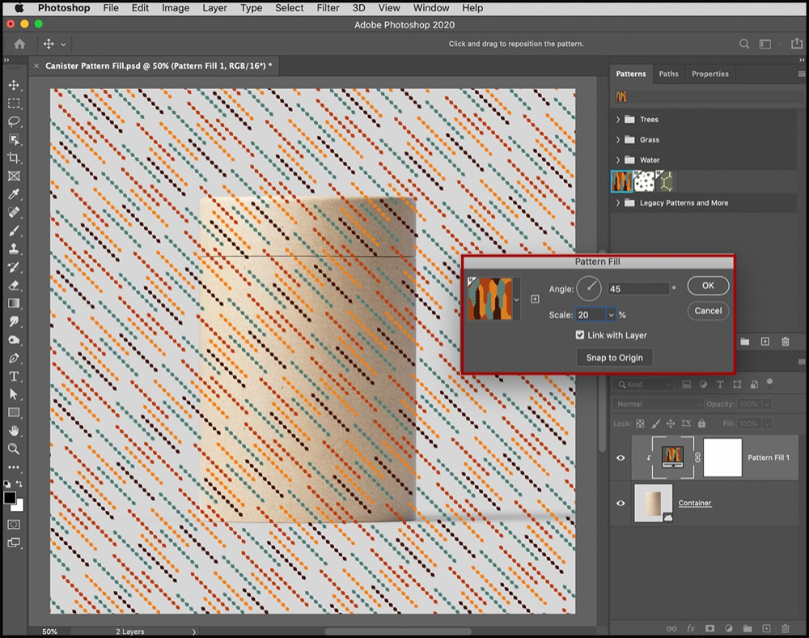

*Photoshop 2020 (21.2): a pattern rotated 45° at 20 %. This is the Pattern Fill layer's dialog, which has the same
Angle, Scale, Link with Layer and Snap to Origin as Pattern Overlay. The options bar reads "Click and drag to
reposition the pattern". Source: Julieanne Kost (Adobe).*

### Origin, Snap to Origin, Link with Layer

Adobe contradicts itself **[V]**. The Pattern entry: Snap To Origin makes "the origin of the pattern the same as the
origin of the document (when Link With Layer is selected), or to place the origin at the upper-left corner of the
layer (if Link With Layer is deselected)". The Texture entry, a few lines below: "the same as the origin of the
document (if Link With Layer is deselected) or places the origin in the upper-left corner of the layer (if Link
With Layer is selected)". The second reading is the one consistent with "Link with Layer: the pattern moves with
the layer", and it's Krita's (`fillPattern`, `kis_ls_utils.cpp` L370–L403) **[S]**:

```text
origin  = layer bounds' top-left   (Link with Layer)   or   (0, 0) of the canvas (not linked)
offset  = phase − origin, wrapped to the pattern's size
pixel p samples pattern at ((p + offset) / (Scale/100)), tiled
```

Krita reads `phase` as **percent of the pattern's size**; ag-psd passes it through as a number and libpsd ignores it.
Photoshop probably stores pixels **[I]**. What "the layer's upper-left" is for type, shapes and Smart Objects
(pixel bounds, or the object's box) and whether a layer mask changes it are unknown **[I]**. Where rotation pivots
(the origin, presumably) is unknown **[I]**.

### Sampling and transparency

- Scaling a Pattern Fill below 100 % blurred it badly until it was fixed in 22.0 **[S]**
  ([bug report](https://community.adobe.com/t5/photoshop-ecosystem-bugs/p-pattern-fill-layer-scaling-feature-changes-image-quality-drastically/idc-p/12552478)).
  Tutorials still advise 50 %, 25 % or 10 % "for optimal resampling quality" **[S]**. The resampling filter is
  unknown **[I]**.
- Patterns can have transparency. Krita flattens a pattern with alpha before using it (`cachedFlattenedPattern`)
  **[S]**; whether Photoshop's overlay lets the layer show through a pattern's transparent parts is unverified
  **[I]**.

## Bit depth, colour space and the edges

- **Encoded-space blending.** Photoshop blends layers and effects in the document's encoded space by default
  (see [rendering.md](../rendering.md), "Operation domains") **[S]**. 32-bit documents are linear. So the same
  style looks different in 8/16-bit and 32-bit documents, and different from our linear-light compositor, for every
  blend mode but Normal at 100 %, and for every partly transparent pixel of a stroke.
- **8-bit internals.** Krita and libpsd do all of this in 8 bits (alpha, contour tables, gradient tables, dilation)
  **[S]**. Photoshop's internal precision for effects in 16- and 32-bit documents is unknown **[I]**.
- **Layer masks.** libpsd applies the layer mask to the alpha before both the stroke and the satin (`stroke.c`,
  `satin.c`) **[S]**, so a stroke outlines the masked shape. A user's outside stroke on a masked layer also drew
  along the layer's own edge ([thread](https://community.adobe.com/questions-712/layer-edge-is-appearing-as-line-when-stroke-outside-is-applied-to-layer-1116831))
  **[S]**. Layer Mask Hides Effects and Transparency Shapes Layer change this (see
  [advanced-blending.md](advanced-blending.md)).
- **Groups.** An effect on a group works on the group's composite like on a layer's pixels **[S]** (psd-tools
  strokes a group's composited subtree).

## Implementation notes for us

How we'd build these on the photo suite's WebGPU tile renderer, which works in premultiplied linear light, f16/f32
([rendering.md](../rendering.md)).

### The pipeline per layer

1. **Coverage.** The layer's composite alpha `α` (after its mask, as the Blending Options say), as a scalar
   surface. Everything below reads it; nothing converts it.
2. **Interior pass**, one shader: start from the layer's premultiplied colour, then Satin, Pattern Overlay, Gradient
   Overlay, Color Overlay in that order (bottom of the list first), each `mix(L, blend(L, c), opacity·share)` in
   its blend mode's stated domain, never widening coverage. Gradients and patterns are functions of document
   coordinates, so they need no inputs but the layer and their parameters.
3. **Stroke pass**: one band field, then inside and outside composited as in
   [the formulas above](#how-the-stroke-composites-with-the-layer): inside replaces or overprints, outside adds
   coverage disjointly with its own blend mode against the backdrop. That means the stroke's outside part is a
   separate input to the parent's compositing, not something folded into the layer surface, unless its blend mode
   is Normal.
4. Several Stroke, Color Overlay or Gradient Overlay instances repeat their pass in list order.

### The stroke's distance field

- **Seeds from coverage, sub-pixel**: each partly covered pixel is a seed at distance `0.5 − α` from its own centre
  (psd-tools' rule); hard steps seed the pixel-edge midpoint. Store each pixel's nearest seed position (rg32float,
  document pixels) plus that seed's own offset.
- **Jump flooding** over the layer's region: `⌈log₂(S + 2)⌉` passes (Size ≤ 250, so at most 8), then one or two
  extra passes at step 1 (JFA+1) to fix its known misses. Distance = `|x − seed| + offset(seed)`, sign from `α`.
  Exact EDT (Felzenszwalb's separable parabolas) is the alternative if JFA's rare errors show; it's two 1-D passes
  per axis, awkward but doable in compute shaders.
- **The band's edge**: `clamp(hi − d + 0.5) · clamp(d − lo + 0.5)`, the same ramp psd-tools uses. This is the
  anti-aliasing; no supersampling needed for straight edges, and corners are close enough.
- **Shape Burst**: `u = (d − lo)/(hi − lo)` from the same field, into the gradient's lookup table.
- **Tile halos**: a tile's stroke needs `⌈S⌉ + 1` px of the layer around it for Outside and Center, `⌈S⌉ + 1`
  inside for Inside (the seeds can be that far). Satin needs `|offset| + blur reach` (3σ). Overlays need none.
- **Cost and caching**: the field is the expensive part: up to nine passes over the layer's extent plus halo. Key
  it by the layer content's hash and Size, Position and the view's level, like the render plan's prefix keys, so
  that changing the stroke's colour, opacity, blend mode or fill doesn't recompute it.

### Zoom independence

- Everything is defined in **document pixels**. At a reduced view, compute the field on the reduced level with the
  Size scaled (`S × scale`) and the ramp still one *screen* pixel wide: the band's area stays right on average.
- Thin strokes break that: a 1 px stroke at 1/8 is ⅛ px wide and the ramp approximation over-covers it. Multiply
  the band's coverage by `min(1, (hi − lo)·scale)` when the band is narrower than a screen pixel, and let refinement
  replace the reduced view with the full-resolution result downsampled, as the renderer already does for adjustments.
  Never show a reduced stroke as final if it differs visibly.
- Gradients are evaluated analytically per pixel centre in document coordinates: exact at every zoom. Patterns sample
  a mip-mapped (pre-filtered) pattern texture with the rotation and scale applied: also zoom-independent, as long
  as reduced views use the right mip.
- Satin's blur scales with the view (`σ × scale`) and its offset too; below a pixel it degenerates gracefully.
  Large Sizes (250 px) want a downsampled blur pyramid rather than a 750-tap kernel.

### Colour

- **Gradients** become a 1-D lookup texture per gradient (1024 or 4096 entries, rgba16float, linear light,
  premultiplied after interpolation), computed in TypeScript by a tested reference with the stops, midpoints,
  smoothness and Method: Perceptual mixes in OKLab, Linear in linear light (our native space), Classic in the
  document's encoded space (then converted), Stripes as steps. 256 entries, Krita's choice, bands in 16-bit.
- **Dither**: our output transform already dithers 8-bit output deterministically, and nothing bands in f16, so the
  checkbox can be stored and honoured as a no-op at first.
- **Blend modes** follow rendering.md's rule: each gets its domain and extended-range rule before shipping. Our
  linear-light Multiply under a satin won't match Photoshop's encoded Multiply; if matching matters, that's the
  versioned compatibility setting, not a per-effect hack.

### The documents

Everything here is parameters: Size, Position, fill, gradient stops, pattern reference by content hash, angles in
degrees, offsets in document pixels (convert Photoshop's percentages on import). Satin's and the contours'
256-entry curves are data, not code, so a PSD's contour imports exactly.

## Open questions

Each wants a test in real Photoshop (2025 or later, RGB 8-bit, sRGB, and again in 16- and 32-bit), saved as a PSD
with its rendered PNG, so the reimplementations' disagreements become fixtures.

| Question | How to settle it |
| --- | --- |
| Is the stroke's distance exactly Euclidean, including at 200–250 px (the faceting report)? | Outside stroke of 250 px on a 2000 px anti-aliased circle; compare the outer edge with a true circle |
| How is Center split for odd sizes? | 3 px Center stroke on a hard-edged square; count pixels each side |
| psd-tools' coverage rule (`0.5 − α`) on feathered edges | 3 px stroke on a 20 px-feathered disc; compare the stroke's extent with the ramp's |
| The outside stroke and the edge: really no seam, and how blend modes act there | White layer, white outside stroke, black background: look for a dark ring; then Multiply stroke |
| Inside stroke compositing with and without Overprint, at 0, 50 and 100 % | Solid red square, 10 px white Inside stroke, read pixel values |
| Shape Burst: which end of the gradient is at the edge, does Angle matter, what Scale does | Black→white Shape Burst on Outside, Inside and Center strokes; then Reverse, Scale 50 %, Angle 0/90 |
| Stroke gradient's box with Align with Layer (does it grow by the stroke?) | Linear black→white at 0° on Outside 50 px stroke of a small square; locate the ends |
| Satin: contour before or after the difference; θ and θ + 180° identical; Distance 0 | Satin with the Ring contour vs Linear on a square; 19° vs 199°; Distance 0 with Invert on and off |
| Satin's blur: Gaussian? Same as Drop Shadow's Size? | Satin 0 px Distance off, Invert, Size 20 on a hard square; profile the edge |
| Gradient Overlay geometry: ends on the box's edge (libpsd) or at the projected corners? Radial's radius vs Angle? Reflected's direction? Diamond? | 400×100 layer, black→white, each style at 0°, 30°, 45°, 90°; sample along lines |
| Is `Ofst` in percent of the box, and does Reset Alignment zero it? | Drag the gradient, save, read the descriptor |
| Stripes: where each stripe switches, and which colour it takes | Three-stop gradient with Stripes; read the switch positions |
| Classic's interpolation space in 16- and 32-bit documents, and Smoothness at 100 % | Same gradient drawn in each bit depth, read values; fit the spline |
| Pattern Overlay: Snap to Origin and Link with Layer (Adobe's two statements disagree); `phase` units; rotation pivot | Pattern with a marked corner, layer offset 37,53 px; toggle Link, Snap, move, rotate 30°; read `phase` |
| Pattern Overlay with a transparent pattern | Pattern with holes over a red layer |
| Scale Effects: which values it multiplies, and rounding | Scale Effects 50 % on a style using all five; read the descriptor and render |
| Current defaults of each effect | Reset Preferences, open each page, screenshot |
| Value ranges (Satin Distance, angles, gradient Scale 10–150, pattern Scale 1–1000) | Type out-of-range values into each field |

## Sources

### Adobe

- Layer effects and styles (archived Feb 2024), the "Layer style options" list:
  <https://web.archive.org/web/2024/https://helpx.adobe.com/photoshop/using/layer-effects-styles.html>
- Layer style effects and options overview (2026):
  <https://helpx.adobe.com/photoshop/desktop/create-manage-layers/apply-layer-effects/layer-style-effects-and-options-overview.html>
- Layer opacity and blending (Blend Interior Effects as Group, fill opacity):
  <https://helpx.adobe.com/photoshop/using/layer-opacity-blending.html>
- Gradient interpolation: <https://helpx.adobe.com/photoshop/using/gradient-interpolation.html>
- Gradients (archived Jan 2023: styles, smoothness, Gradient Editor):
  <https://web.archive.org/web/2023/https://helpx.adobe.com/photoshop/using/gradients.html>
- Apply a gradient fill (2026):
  <https://helpx.adobe.com/photoshop/desktop/adjust-color/color-effects-techniques/apply-gradient-fill.html>
- Photoshop file format specification (`lfx2`, `lrFX`/`sofi`, `Patt`):
  <https://www.adobe.com/devnet-apps/photoshop/fileformatashtml/>
- Julieanne Kost, Photoshop v21.2 pattern rotation:
  <https://jkost.com/blog/2020/06/photoshop-v21-2-pattern-rotation-auto-font-activation-select-subject-and-more.html>
- Community: gradients in 22.5.2 vs 23.0
  <https://community.adobe.com/bug-reports-711/p-files-with-gradient-layers-created-in-22-5-2-look-different-in-23-0-658745>;
  outside stroke with square corners
  <https://community.adobe.com/feature-requests-713/outside-stroke-with-square-corners-654668>;
  Edit > Stroke 45° corners
  <https://community.adobe.com/t5/photoshop-ecosystem-discussions/stroke-command-produces-45-degree-angles/m-p/9022821>;
  faceted stroke edges <https://community.adobe.com/questions-712/layer-style-stroke-has-faceted-edges-1087113>;
  jagged edges on layer styles
  <https://community.adobe.com/t5/photoshop-ecosystem-discussions/jagged-edges-on-layer-styles/m-p/10409586/highlight/true>;
  outside stroke on a masked layer
  <https://community.adobe.com/questions-712/layer-edge-is-appearing-as-line-when-stroke-outside-is-applied-to-layer-1116831>;
  pattern fill scaling quality
  <https://community.adobe.com/t5/photoshop-ecosystem-bugs/p-pattern-fill-layer-scaling-feature-changes-image-quality-drastically/idc-p/12552478>;
  shape burst gradient around an object
  <https://community.adobe.com/t5/photoshop-ecosystem-discussions/photoshop-cc-gradient-around-an-object/td-p/9144759>

### Source code

- Krita, `libs/image/layerstyles/` (`kis_ls_stroke_filter.cpp`, `kis_ls_satin_filter.cpp`,
  `kis_ls_overlay_filter.cpp`, `kis_ls_utils.cpp`, `KisLayerStyleKnockoutBlower.cpp`,
  `kis_layer_style_projection_plane.cpp`), `libs/image/kis_gaussian_kernel.cpp`, `libs/image/krita_utils.cpp`,
  `libs/psdutils/psd.h`, `psd.cpp`, `libs/image/kis_asl_layer_style_serializer.cpp`:
  <https://invent.kde.org/graphics/krita> (mirror <https://github.com/KDE/krita>)
- KDE bug 398691 (stroke width, Photoshop's blending): <https://bugs.kde.org/show_bug.cgi?id=398691>; Krita MR 160
  (halo fix): <https://invent.kde.org/graphics/krita/-/merge_requests/160>
- libpsd (`src/stroke.c`, `satin.c`, `boundary.c`, `bitmap.c`, `gradient_overlay.c`):
  <https://github.com/TheNicker/libpsd>
- psd-tools (`src/psd_tools/composite/effects.py`, `composite.py`, `paint.py`; `api/effects.py`; `constants.py`):
  <https://github.com/psd-tools/psd-tools>
- ag-psd (`src/descriptor.ts`, `src/psd.ts`): <https://github.com/Agamnentzar/ag-psd>
- GIMP layerfx (`py/layerfx.2.8.py.txt`): <https://github.com/earl-kent/layerfx>

### Tutorials and articles

- Envato Tuts+ (Stroke, Satin, Color Overlay, Gradient Overlay, Pattern Overlay):
  <https://design.tutsplus.com/articles/how-to-properly-add-a-stroke-using-photoshop-layer-styles--psd-17989>,
  <https://design.tutsplus.com/articles/how-to-apply-the-satin-setting-to-layer-style-effects--psd-17311>,
  <https://design.tutsplus.com/articles/how-to-use-color-overlay-within-the-layer-styles-dialogue-in-photoshop--psd-17580>,
  <https://design.tutsplus.com/articles/how-to-apply-gradient-overlays-using-layer-styles-in-photoshop--psd-17583>,
  <https://design.tutsplus.com/articles/how-to-apply-pattern-overlays-using-photoshop-layer-styles--psd-17833>
- Bjango, Photoshop CC 2015 improvements (multiple effects, stroke Overprint):
  <https://bjango.com/articles/photoshopcc2015/>
- Glen Smith, Gradient tool (the five methods): <https://glensmith.co.uk/photoshop/gradient-tool>
- fotokonyv.hu, Stripes method (2025): <https://halado.fotokonyv.hu/photoshop-gradient-ismet-egy-ujdonsag/>
- Photoshop Gurus, smoothness and method:
  <https://www.photoshopgurus.com/forum/threads/how-ps-gradients-change-with-smoothness-and-method-options.76770/>;
  Shape Burst for directional gradients: <https://www.photoshopgurus.com/forum/threads/directional-gradient.43928/>
- Photoshop Training Channel, multiple strokes from one layer with Shape Burst:
  <https://photoshoptrainingchannel.com/tips/multiple-strokes-one-layer/>

### Images

| File | Source |
| --- | --- |
| `img/stroke-dialog.png` | <https://cms-assets.tutsplus.com/uploads/users/523/posts/34023/image/example-of-the-stroke-layer-style-settings.png> |
| `img/stroke-filltype.png` | <https://cms-assets.tutsplus.com/uploads/users/523/posts/34023/image/example-of-the-fill-type-settings.png> |
| `img/stroke-positions.png` | <https://cms-assets.tutsplus.com/uploads/users/523/posts/34023/image/part-1-06.png> |
| `img/stroke-overprint.png` | Both frames of <https://bjango.com/images/articles/photoshopcc2015/photoshopcc2015-stroke-overprint.gif>, stacked |
| `img/stroke-shape-burst.png` | <https://uploads-us-west-2.insided.com/adobedme-en/attachment/1235979_pastedImage_1.png> (WebP, converted) |
| `img/satin-dialog.png` | <https://cms-assets.tutsplus.com/uploads/users/523/posts/34019/image/example-of-the-satin-layer-style-settings.png> |
| `img/satin-example.png` | <https://cms-assets.tutsplus.com/uploads/users/523/posts/34019/image/part-1-01.png> |
| `img/overlay-color-dialog.png` | <https://cms-assets.tutsplus.com/uploads/users/523/posts/34020/image/example-of-the-color-overlay-settings.png> |
| `img/overlay-gradient-dialog.png` | <https://cms-assets.tutsplus.com/uploads/users/523/posts/34021/image/example-of-style-settings.png> |
| `img/overlay-gradient-linear-angle.jpg` | <https://cms-assets.tutsplus.com/uploads/users/523/posts/34021/image/part-1-10.jpg> |
| `img/overlay-gradient-methods.png` | <https://glensmith.co.uk/photoshop/img/gradient/16.webp> to `20.webp`, stacked |
| `img/overlay-gradient-editor.png` | <https://helpx.adobe.com/content/dam/help/en/photoshop/using/gradients/jcr_content/main-pars/image_0/pa_23.png.img.png> (via the Wayback Machine) |
| `img/overlay-pattern-dialog.png` | <https://cms-assets.tutsplus.com/uploads/users/523/posts/34022/image/example-of-the-pattern-overlay-settings.png> |
| `img/overlay-pattern-angle.jpg` | <https://jkost.com/blog/wp-content/uploads/2020/06/Group-3.jpg> (shrunk to 1000 px) |
