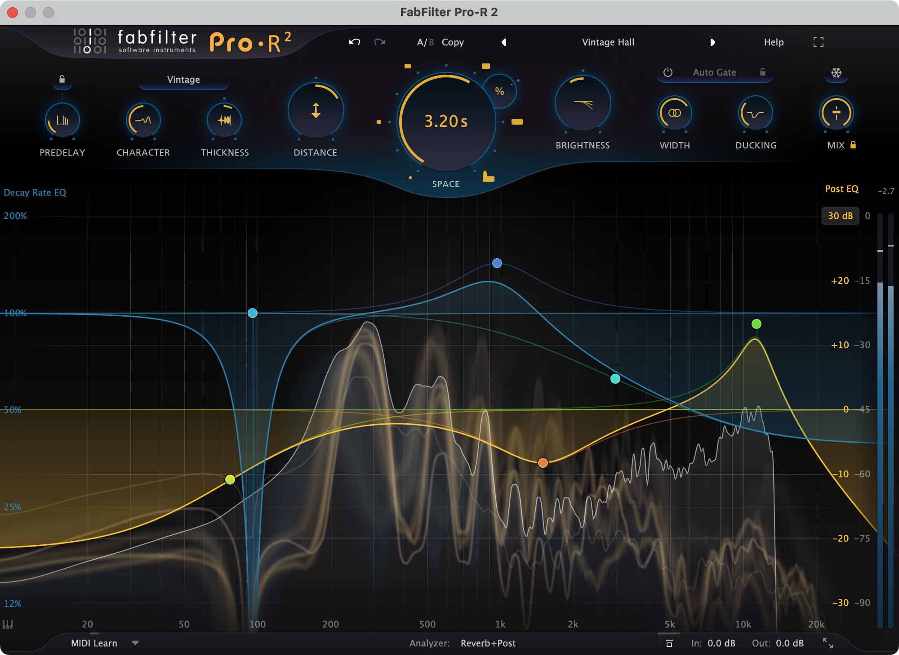
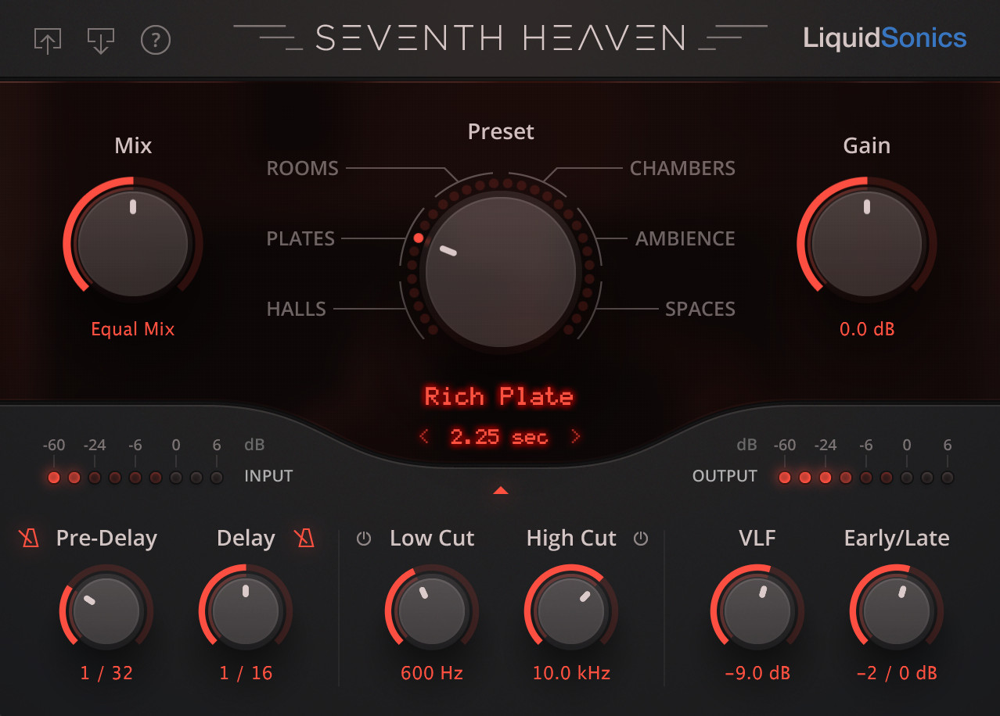
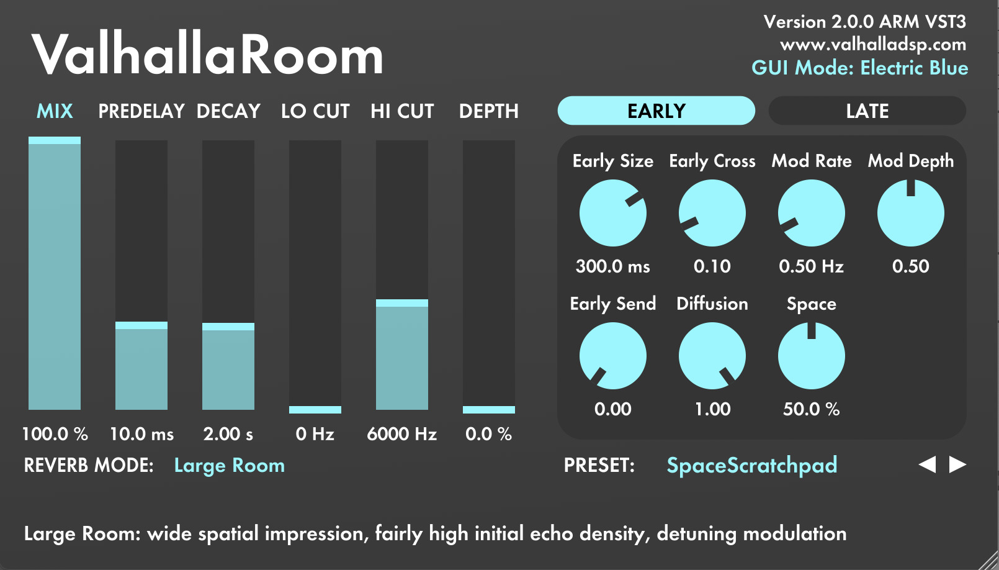
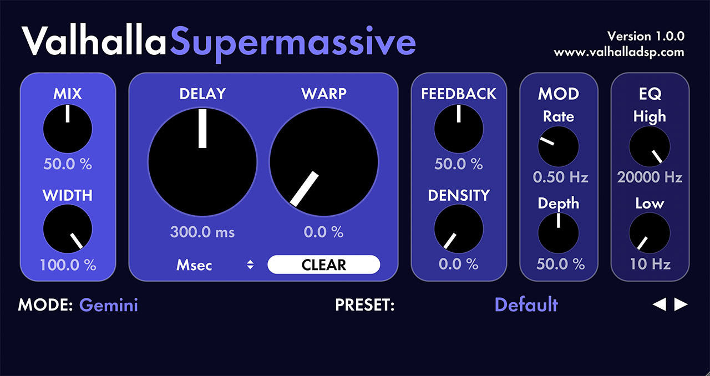
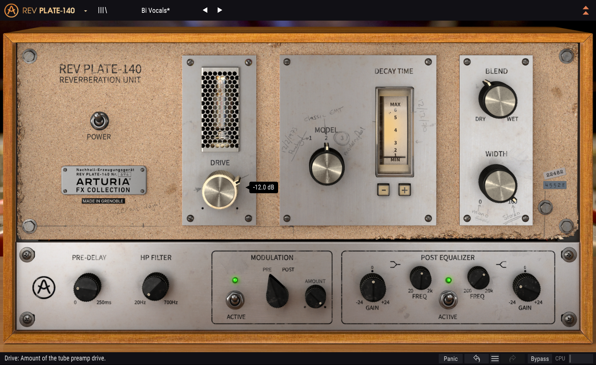
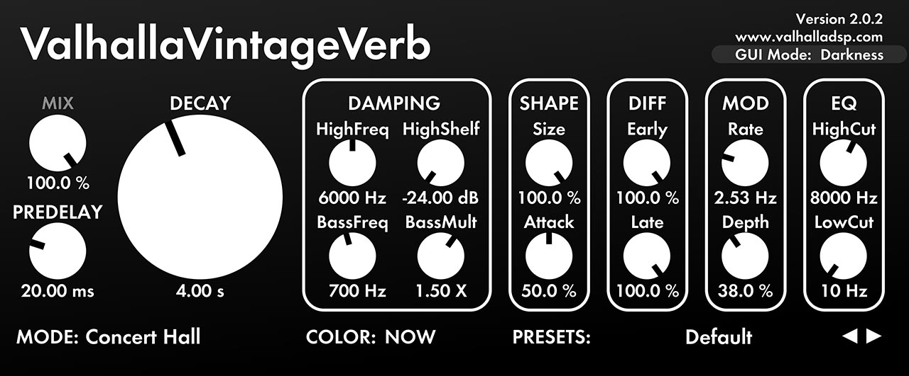
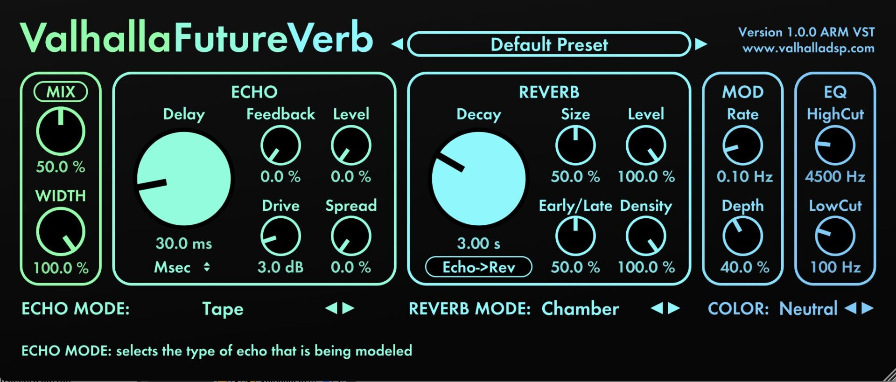
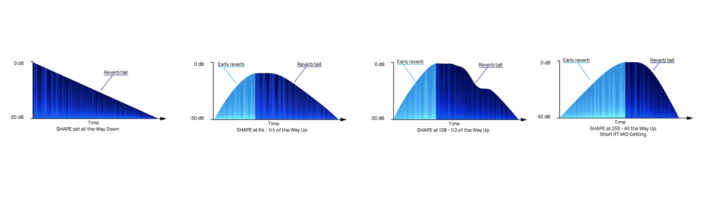
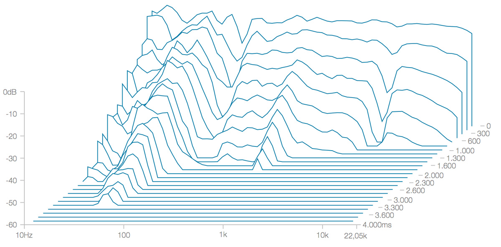
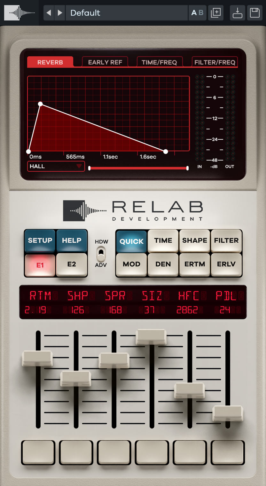

# Reverb: a vocal reverb for Vaudio

The design of our reverb, mostly for vocals, before anything is built. Théo uses FabFilter Pro-R 2 and finds
it "isn't the best"; he asked for "a really good reverb mostly for vocals" and for research into better ones.
So this document first surveys what the engineers behind pop, rap, R&B and hyperpop records put on vocals,
and why ([1](#1-the-survey)); then chooses what to base ours on ([2](#2-the-choice)); then designs it
completely: the panel ([4](#4-the-panel)), the sound ([5](#5-the-sound)), the DSP ([6](#6-how-it-works-the-dsp)),
the presets ([7](#7-the-presets-wed-ship)), and how it's built here and tested ([8](#8-proposed-for-vaudio),
[9](#9-how-itd-be-built-here)). [Open questions](#10-open-questions-for-théo) and [sources](#11-sources) at
the end.

**The research behind it is in [`reverb-vocals.md`](reverb-vocals.md)**: about sixty engineers' vocal reverb
set-ups with their settings, the classic units from their manuals and measurements, VintageVerb and Pro-R 2
read control by control from the plug-ins, eighty other reverbs' manuals, and the literature on how much
reverb listeners want. What it changed here is listed in [section 12](#12-what-the-research-changed); the
sections below are already updated.

Sources, in short: the engineers' own words (Sound On Sound's *Inside Track* and interviews), the makers'
manuals and pages (FabFilter's Pro-R 2 help, Valhalla's blog and pages, Lexicon's 480L manual, Bricasti's,
LiquidSonics', UAD's, Soundtoys', Arturia's, Eventide's, Waves', 2C's), Sean Costello's Valhalla DSP blog, and
the literature: Schroeder, Jot and Chaigne, Dattorro's "Effect Design, Part 1" (read at the source),
Julius O. Smith's *Physical Audio Signal Processing*, Schlecht and Habets, Prawda, Välimäki and Schlecht,
Järveläinen and Karjalainen, Abel and Huang, Griesinger. Every one is listed with its URL in
[Sources](#11-sources). Anything the sources don't give is marked **not stated**; anything worked out
rather than read is marked **(inferred)**.

The pictures in `img/` are the makers' own screenshots and diagrams, © FabFilter, Valhalla DSP,
LiquidSonics, Relab and Arturia, kept here only as a private reference for building this app. Don't ship
them, and don't copy their artwork: we copy how things work, in our own visual style.

**The basis, in one line**: Valhalla VintageVerb's idea of a reverb (modes as colours of one Lexicon-style
machine, three eras, the Smooth Plate for vocals), built on Dattorro's published Griesinger-style plate and a
16-line feedback delay network with Jot's frequency-dependent absorption, under FabFilter Pro-R 2's Decay
Rate EQ, Distance and display, with ducking, a de-esser, a synced pre-delay and velvet-noise early energy
built in for vocals. Why: [section 2](#2-the-choice).

```
 vocal ──┬─────────────────────────────────────────────────────────────── dry ──────────────────┐
         │                                                                                       │
         ├──► ducker's ear (the dry level) ──────────────────────────────────┐                   │
         │                                                                   ▼                   ▼
         └──► cuts ─► de-ess ─► pre-delay ─► early energy ─► LATE NETWORK ─► Post EQ ─► width ─► duck ─► MIX ─► out
                                (ms, or     (velvet noise:   plate: Dattorro's figure-eight
                                 1/16 …)     dense at once,  halls: 16 lines, an A4⊗A4 matrix
                                             never rings)    each line: all-pass ─ delay ─ absorb,
                                                             so every band decays as the Decay EQ says
```



## 1. The survey

What engineers and producers actually use on vocals, in their own words; the reverbs themselves; the
techniques that make a vocal sound expensive; why Pro-R 2 falls short; and what's new.

### 1.1 What the engineers put on vocals

From interviews in their own words (mostly Sound On Sound's *Inside Track*, read at the source). Where a
setting is given, it's here; where only a forum says so, it's left out.

| Engineer | Genre, record | Vocal reverb | In their words |
| --- | --- | --- | --- |
| Jonathan Low | Pop: Taylor Swift, "willow" (2021) | UAD Capitol Chambers + UAD EMT 140; EchoBoy into Altiverb spring for throws | The chamber gives "the vocal a nice density and size, without it being a long reverb"; the plate "for the longer tail". "The chamber for the upfront space determining where the vocal sits in the mix, and the plate more for the depth behind that" |
| Mitch McCarthy / Dan Nigro | Pop: Olivia Rodrigo, "drivers license" (2021) | Three Valhalla VintageVerb auxes: "Hall", "Plate", "Chorus Verb"; and one on the vocal insert | Less reverb in the verses, to keep the vocal "more personal"; more as the song builds |
| Charlie Puth | Pop (2022) | Valhalla; LiquidSonics Seventh Heaven | "My favourite reverbs are those by Valhalla … and the LiquidSonics Seventh Heaven, which is an emulation of the Bricasti M7" |
| Rob Kinelski | Pop: Billie Eilish, "bad guy" (2019) | Almost none: Soundtoys MicroShift for width | "I added some reverb to an early mix, and they immediately said: 'Get rid of the reverb.'" "The less you put on a record, the bigger it sounds" |
| Jon Castelli | Pop: Kesha, "Praying" (2017) | UAD AKG BX20 spring → Pro-MB → Fairchild 670; UAD EMT 140 and 250 | "The Pro-MB controls the dense and harsh mid-range of the vocal verb"; the 670 "because of the way it controls the reverb tail". Sends muted in the verses |
| Tony Maserati | Pop / R&B: Robin Thicke, Jason Mraz | EchoBoy → Softube TSAR-1; UAD AMS RMX16; Relab LX480; Sonnox Oxford Reverb | "A strange, ringy reverb in mono going straight to a dark chamber"; RMX16 "for sort of a darker reverb sound"; the LX480 "a shorter, thinner plate-type setting. It adds a little bit of airy brightness to a voice". "I tend to use a variety of reverbs to add that layered richness" |
| Manny Marroquin | Pop / R&B | Bricasti M7 | "The M7 just has THE sound that none of these other reverbs have" |
| Taesub Lee | K-pop: TWICE, "Scientist" (2022) | UAD Lexicon 480L among four sends | Backing vocals on the 480 alone, "so they are in a different space" |
| Adam Thein | Pop: Djo, "End Of Beginning" (2026) | LiquidSonics Seventh Heaven; VintageVerb; Softube TSAR-1 | "The main one I used was the Liquidsonics Seventh Heaven" |
| Illangelo | R&B: The Weeknd, "The Hills" (2015) | Altiverb, H-Delay before it for pre-delay, Pro-Q 2 after it | "Rolls off quite a bit of top end, to make sure the reverb does not sound too big frequency-wise" |
| Patrizio "Teezio" Pigliapoco | R&B: Chris Brown, *Indigo* (2019) | Valhalla VintageVerb (a "140Verb" aux); ValhallaShimmer for effect | "The entire album has Valhalla reverbs. They are really cheap reverbs, but I love them." Shimmer gives "something that's just out of control" |
| Rob Bisel | R&B: SZA, "Kill Bill" (2023) | Valhalla VintageVerb + a Guitar Rig spring; UAD AKG BX15 on backing vocals | "The reverbs are pretty prominent" |
| Jaycen Joshua | Rap, pop | Convolution plates and rooms; stacked reverbs | "Reverb is the kiss of death on rap vocals" (2010); later: "using a dark short reverb to add warmth and low end to a vocal, as opposed to just using reverb to add 'space'. We'll stack multiple reverbs" (2024) |
| Derek "MixedByAli" Ali | Rap: Kendrick Lamar, *To Pimp A Butterfly* (2015) | EMT 250 on Kendrick; AMS RMX16; Lexicon 480L | Plugin reverbs used while tracking are replaced by the hardware at the mix |
| Matt Schaeffer | Rap / R&B: Kendrick Lamar & SZA, "All The Stars" (2018) | Waves RVerb ("SZA Chamber"); VintageVerb and Altiverb with the lows cut | "You get a cleaner sound by taking it out, and you make space for actual instruments" |
| Mike Dean | Rap: Travis Scott, Kanye West | Avid D-Verb; Valhalla | "The D-Verb. It makes stuff sound like it's in a room, what else do you want?" "I don't like stuff where I don't know what it is doing" |
| Fabian Marasciullo | Rap: Lil Wayne, "How To Love" (2011) | Waves RVerb: a short room and a slightly longer plate | The room "to give the snap some space and vibe" |
| Leslie Brathwaite | Pop / rap: Pharrell, "Happy" (2014) | Altiverb on one shared aux | "I prefer to have the reverb on an aux … I like to have everything that I send through it feel like it's in the same room" |
| Noah "40" Shebib | Rap: Drake, "Headlines" (2012) | Little | Drake wants it "pretty dry" |
| Chris Lord-Alge | Rock, pop | Lexicon 224 and 480 originals, Bricasti M7, AMS, EMT 246 / 252, Sony DRE2000, SP2016 | "You can't really beat the original digital reverbs." Long halls shut off when the song gets loud |
| Michael Brauer | Rock / pop: Coldplay | AMS non-linear, Lexicon PCM81 | "If you send everything to reverb, you don't hear it, but if you send only one thing to reverb, it'll be huge" |
| Andrew Scheps | Rock, pop | Spring or EMT 140 | "I don't use a lot of reverb, but when I use it, it's either a spring, or a reverb like the 140" |
| Tom Elmhirst | Soul / pop: Amy Winehouse, "Rehab" (2007) | Spring printed at tracking + EMT plate | "I'm not a big fan of digital reverbs anyway" |
| Humberto Gatica | Pop ballads | AMS RMX16 | "The classic long reverb that you can't change and that nothing else can duplicate" |

**Almost nobody names FabFilter Pro-R or Pro-R 2**: one engineer of about sixty (Todd Hurtt, a Pro-R chamber
among three sends for Polo G: `reverb-vocals.md` 1.1). The names that come back
are Valhalla VintageVerb (five of them), plates (EMT 140 / 250 hardware or UAD's: five), Lexicon 224 / 480L and
their copies (Relab LX480, Softube TSAR-1, UAD 480: five), Bricasti M7 / Seventh Heaven (four), the AMS
RMX16 (five), chambers (three), and Altiverb's convolution (four). Hyperpop producers (A. G. Cook, Dylan Brady,
SOPHIE) and the trap engineers asked about (Ethan Stevens, Jimmy Cash, Wheezy, Pi'erre Bourne) have published
no reverb choices: **not stated**.

This table is the first survey. `reverb-vocals.md` 1.1 has about sixty set-ups, rap and trap first, with what's
before and after the reverb and every setting the sources give; 1.2 there sums them up, 1.3 gives the numbers
(decays, pre-delays, insert mixes, return filters) and 1.5 what's true about timing reverb to the tempo.

### 1.2 The reverbs, compared

What each is, from its maker's manual or page, and what it's known for on vocals.

| Reverb | Kind | What makes its sound | Controls of note | On vocals |
| --- | --- | --- | --- | --- |
| **Valhalla VintageVerb** (2012; v4.0.5, 2024) | Algorithmic, Lexicon-inspired | 22 modes over the same machinery; three eras (1970s: "reduced bandwidth (10 kHz maximum output frequency). Downsampled internally… modulation is dark and noisy"; 1980s: "full bandwidth", modulation "still dark and noisy"; NOW: "modulation is clean and colorless") | Mix, PreDelay, Decay (0.2–70 s), Damping (HighFreq, HighShelf, BassFreq 100 Hz–10 kHz, BassMult 0.25–4×), Size, Attack, Early and Late Diffusion, Mod Rate and Depth, High Cut, Low Cut | The most-named vocal reverb in the survey. Costello: "The Smooth modes are the best reverb algorithms for 'expensive' sounding vocals"; "adjust the Diffusion until the time response on sibilance is smooth … then bring the Diffusion down just a touch to reduce coloration" |
| **Valhalla FutureVerb** (October 2025) | Algorithmic, new research | "8 years of research"; "reverbs that have a natural, transparent sound, without the metallic artifacts of prior digital algorithmic designs"; sounds good without modulation; Density with "no metallic coloration" | 8 reverb modes, 12 echo modes (the echo as a pre-delay with character, before or after the reverb), Decay 0.2–70 s, Size, Early/Late, Density, Mod, High/Low Cut (also the damping), Colour: Bright, Neutral (top-end RT60 limited to 1–1.5 s), Dark (steep 8 kHz), Studio (steep 600 Hz and 10 kHz) | Hall: "Turn up the modulation for epic ballad vocals"; Cathedral: "Perfect for epic ballad vocals" |
| **Valhalla Room** (2011; 2.0, 2023) | Algorithmic | Early and late sections; early "energy" with no all-passes, "as dense, colorless, and spacious as possible" | Depth (early/late balance, after the 224's and SP2016's), Early Size, Cross, Send, Diffusion; Late Size, Cross, Bass Mult/Xover, High Mult/Xover; Decay 0.1–100 s | "High Diffusion settings will not result in a metallic decay with vocals" |
| **Valhalla Plate** (2015) | Algorithmic plate model | Tuned against a real EMT 140 (Avast!, Seattle) | Decay ("RT60 between 2.9 kHz and 3.6 kHz"), Size ("modal density": over 100 % smoother), Width, two shelves outside the loop, Mod | Costello's own "go-to reverb on most mixes for snare drum and lead vocals" |
| **Valhalla Supermassive** (free; 5.0, 2025) | Delays and FDNs | Warp spreads delay lengths from echoes to reverb; Density mixes them | Delay (synced), Warp, Feedback, Density, Mod, cuts outside the loop | Libra mode: "ethereal vocals". The hyperpop wash |
| **Lexicon 480L** (1986) / Relab LX480 / Softube TSAR-1 | Algorithmic hardware and its copies | Random Hall: "random delay elements… reduction of long-lived modes… less metallic"; Spin and Wander modulate the delays; Shape and Spread shape the build | RT Mid, Bass Mult ("1.5X or less"; ideal hall 1.2), Crossover, RT HF Cut, Size (metres), Shape 0–255, Spread, Diffusion ("low or moderate… for clearer and more natural vocals"), Pre-delay, Spin, Wander | Maserati's LX480 "adds a little bit of airy brightness to a voice"; SOS on LX480: "doesn't exaggerate sibilance or transients… you can trowel it on" |
| **Lexicon 224 / 224XL** (1978; the XL later) | Algorithmic, 20 kHz then 34.125 kHz sampling | Fixed point, saturating accumulator, quantised modulation (Costello) | Bass and mid decay 0.6–70 s, Crossover, Treble decay, Depth, Diffusion (from software 4.0) | UAD's manual: low Diffusion "useful with… vocals". CLA: "You can't really beat the original digital reverbs" |
| **Lexicon PCM Native** | Algorithmic | Lexicon's later algorithms | BassRT multiplier, RT HiCut with damping types, Chorus, Spin, Wander, Reflections, Echoes | SOS: "For vocals… the Plate algorithms with the two delayed reflections, set at between 100ms and 300ms"; "the older, slightly more shimmery reverbs still sound the best for pop… The shimmer comes in part from the Spin and Wander" |
| **Bricasti M7** | Algorithmic hardware (closed) | Not published | Reverb Time 0.1–30 s, Size, Diffusion, Density, Mod (1–9), LF and HF RT multipliers (0.2–4 / 0.2–1) with crossovers, VLF cut, Early/Reverb mix, Rolloff | Marroquin: "THE sound". Its VOX Plate: PD 24 ms, RT 1.5 s, Size 5, HF ×0.9 at 5.6 kHz, LF ×0.85 at 1.2 kHz, Rolloff 6.4 kHz |
| **LiquidSonics Seventh Heaven** (2017) | Sampled M7 ("Fusion-IR": time-varying convolution) | The M7's sound, sampled | The M7's controls, plus a ducker that ducks "only the reverb (not the reflections)" | SOS: "a lush chamber for an exposed solo vocal… pretty much without peer". Puth, Thein |
| **LiquidSonics Lustrous Plates** | Sampled plates | Ten plates; Frequency Dispersion ("Low frequencies… delayed by around 10ms more than high… well suited to guitars and vocals") | Damper ("just under one second up to approximately 5 seconds"), ducking | — |
| **EMT 140** (1957) / UAD / Waves Abbey Road Plates | Steel plate, 1 × 2 m (and models) | Instant density, dispersion, a short top-end decay | Damper 0.5–5.5 s (UAD), input high-pass, mod 0–10 cents | Low, Castelli, Scheps, Elmhirst. Waves' manual: pre-delay "40 ms for vocals" |
| **EMT 250** (1976) | The first digital reverb, 32 kHz | Heavy modulation ("sounded like a chorus unit": Costello) | Decay 0.4–4.5 s at 1 kHz, LF ×0.5–2 at 300 Hz, HF ×0.25–1 at 6 kHz, pre-delay 0–60 ms | Ali on Kendrick Lamar; Castelli |
| **Soundtoys SuperPlate** | Plate models | Five plates (EMT 140, 240, Audicon, EcoPlate III, Stocktronics), three preamps | Decay (RT60 at 500 Hz, to a minute, infinite), cuts before the plate, Auto-Decay (the decay shortened while the input is loud) | SOS: "In a vocal context, Auto-Decay can achieve much the same thing as ducking" |
| **AMS RMX16** | Algorithmic hardware | Ambience, Nonlin 2, Reverse | HI decay filter (18 kHz → 1 kHz), LO ×¼–4 at 350 Hz | Gatica; Ali; Maserati ("darker"); its Hall C1 "very useful for vocals" |
| **Eventide SP2016** / **Blackhole** | Algorithmic | SP2016: Stereo Room, Room, Hi-Density Plate, EQ inside the feedback; Blackhole: huge, inverse ("Gravity"), Freeze | SP2016: Position (early/late), Diffusion; Blackhole: Size, Gravity, Feedback, Mod, Freeze | Guzauski on SP2016's Stereo Room for vocals; Blackhole: "If you're after a subtle plate to add to vocals… this is most definitely not the reverb to choose!" (SOS) |
| **FabFilter Pro-R 2** (November 2023) | Algorithmic | One model; Space morphs "over a dozen" room models with the decay; Modern, Vintage and Plate styles | Space (200 ms–10 s), Decay Rate (25–400 %), Pre-delay (0–500 ms, synced 1/4–1/32 with an Offset 50–200 %), Character, Thickness, Distance, Brightness, Width, Ducking, Auto Gate, Freeze, Decay Rate EQ (six bands, each 12.5–200 %), Post EQ (six bands) | No engineer in the survey names it. MusicTech: "not the most characterful reverb"; SOS on Pro-R 1: "smooth, rich, sophisticated and classy" but no choice "for grotty springs, clangy plates or gritty lo-fi vintage digital" |
| **Arturia Rev PLATE-140**, **Rev INTENSITY**, **Rev LX-24** | Plate model; algorithmic; a 224 model | LX-24's Vintage 12: "sample rate of 20480Hz… 12-bit… elliptical filter set at 8k, pre-emphasis, de-emphasis" | PLATE-140: three plates, tube drive, Decay 0.4–5 s; INTENSITY: Freeze, envelope follower; LX-24: Decay 0.6–70 s, Distance, Drive | SOS on PLATE-140: "the right amount of metallic overtones and a very dense tail" |
| **2C Aether / B2** | Algorithmic | Early reflections from 33 space types, a late reverb with Low/Mid/High ratios | Aether's Diffuse: "Low values… useful on vocals"; B2's negative Density for "slow transients such as… vocals" | — |
| **Exponential Audio R4 / PhoenixVerb** (now iZotope) | Algorithmic | Envelope Attack/Time/Slope | Tail Suppress: "a reverb 'ducker'" | SOS on R4: "on a lead vocal… make the reverb swell at the end of each line" |
| **Waves H-Reverb** | Algorithmic (FIR) | Build-up, ER models, two-slope envelope | Dynamics: Duck, Comp or **DeEss** (range 0 to −24 dB); LF and HF damping multipliers | SOS: ducking and de-essing "always on call" |
| **Baby Audio Crystalline** (2022) | Algorithmic | — | Tempo-synced pre-delay and length, Ducker, Gate, Freeze, Reverse, Shimmer | SOS: "a lot of thought into how this reverb might be used on vocals… Transients… minimise… loud consonants" |
| **Altiverb**, **UAD Capitol Chambers**, **Abbey Road Chambers** | Convolution (sampled spaces) | Real rooms and chambers | — | Illangelo, Brathwaite, Schaeffer; Low's Capitol Chambers. (Not something we can ship: they're other people's impulses) |











### 1.3 What makes a vocal sound expensive

The recurring techniques, with who does them.

| Technique | What's done | Who / where |
| --- | --- | --- |
| **Two spaces, not one** | A short dense room or chamber for where the voice sits, a longer plate or hall for depth behind it | Low (chamber + plate), Marasciullo (room + plate), Maserati (dark AMS + bright LX480), Joshua ("we'll stack multiple reverbs"), CLA (a 1 s room under long halls) |
| **Pre-delay** | A gap before the reverb, often in time with the song (a quarter note is 60 000 / BPM ms; halve it for each smaller value) | Illangelo (an H-Delay before Altiverb "for some pre-delay"); Waves' plate manual: "40 ms for vocals"; Pro-R 2 and Crystalline sync it. Griesinger: speech stays clear if "≥ 20 ms pass before significant reflected energy" |
| **Ducking** | The reverb turned down while the voice sings, so it blooms in the gaps | Built into Pro-R 2, Seventh Heaven, H-Reverb, R4 ("Tail Suppress"), Crystalline, SuperPlate (Auto-Decay); by hand with a compressor on the return (Castelli's Fairchild "because of the way it controls the reverb tail") |
| **EQ on the return** | Lows off (150–600 Hz), tops rolled off (6–10 kHz), harsh mids tamed | Schaeffer, Brathwaite (lows out); Illangelo ("rolls off quite a bit of top end"); Castelli (Pro-MB on "the dense and harsh mid-range"). Abbey Road's chamber sends were band-passed, "virtually all energy above 10 kHz and below 600 Hz" cut (Costello); FutureVerb's Studio colour is that |
| **De-essing what's sent** | Sibilants kept out of the reverb | H-Reverb's DeEss; Pro-R 2's Decay Rate EQ can "notch out sibilant frequencies in a vocal reverb" (SOS). Engineers: Colmenero's EQ before the reverb ("You don't want to have esses all over your reverb"), Curtis Douglas's de-esser "set fairly aggressively" before his 480L, Gibbs' Pro-DS after his (`reverb-vocals.md` 1.2) |
| **Plates** | Instant density, no early reflections, a short top end: bright but not hissy | Costello: "The high frequencies always have a fairly short decay, so consonants and sibilance won't ring out for too long… zingy brightness, but without the sibilance turning into annoying hiss, which can easily happen with digital reverbs" |
| **Vintage digital** | The 224, 480L, AMS, EMT 250: a darker, modulated, slightly grainy tail | CLA, Ali, Lee, Maserati, Gatica; VintageVerb's eras |
| **Modulation for lushness** | A slow chorus in the tail ("Chorus Verb" aux, Spin and Wander) | McCarthy; SOS on PCM Native; Pro-R 2's Character "chorus-like effect at 100% which works well on vocals" |
| **Less is more, and automated** | Drier verses, wetter choruses; one element reverbed, not everything | Kinelski, 40, Joshua, Stent, Goldstein ("I don't want to actually hear reverbs"), Brauer ("if you send only one thing to reverb, it'll be huge"); McCarthy, Castelli and CLA automate it by section |
| **Keep the early energy out of the way** | Too many early reflections "mask both the direct sound and the desirable late reverberation"; the result is "muddy". Energy arriving 50–160 ms after the voice gives envelopment, energy in the first ~20 ms smears it | Griesinger (Lexicon's reverb designer, Dattorro's source for the plate) |

### 1.4 Why Pro-R 2 falls short for Théo's vocals

Théo uses it and finds it "isn't the best"; nobody has published a vocal shoot-out against it. The first
version of this section guessed; `reverb-vocals.md` 3.2 reads Pro-R 2 control by control from the plug-in and
3.3 sets the complaints against what the sources say. In short:

- **Not much character.** "It may not be the most characterful reverb in our toolkit" (MusicTech); no choice
  "for grotty springs, clangy plates or gritty lo-fi vintage digital" (SOS, Pro-R 1). The engineers in the
  survey pick reverbs *for* their character and stack two.
- **Macros hide the controls.** Character mixes modulation, early reflections and "late echoes" in one knob
  ("Missed opportunity not to add some extended FabFilter modulation options": MusicTech); Thickness mixes
  density and saturation, and turning it up lowers the reverb's level. MusicRadar: things "distilled down to
  single multipurpose knobs".
- **Ducking is a range only** (0–48 dB), with no threshold, attack, release or hold among its 141
  parameters, and it can't be keyed from another track (FabFilter: "Pro-R 2 is not set up to be used with
  external side-chain"). Its Auto Gate "feels more like a cut than a drop" (FabFilter's forum).
- **Nothing for sibilance on the way in**: FabFilter's own advice is a post low-pass "as low as 2 kHz".
- **Its Decay Rate EQ can't be bypassed or saved on its own** (MusicRadar, SOS).
- **Corrected**: Space doesn't tie size and length together as first said; Decay Rate (25–400 %) changes "the
  decay time without altering the room sound". The Decay Rate EQ's bands go 12.5–200 %.
- **What it does best**, and we keep: the Decay Rate EQ drawn over the decaying spectrum, Distance, the synced
  pre-delay with an Offset, Freeze, Lock Mix, the Post EQ's automatic gain compensation, a calm display.

### 1.5 New since 2024

| Reverb | When | What's new |
| --- | --- | --- |
| Valhalla FutureVerb | October 2025 | Transparent, non-metallic modes "without any modulation"; Colour modes (Neutral caps the top-end RT60 at 1–1.5 s; Studio); an echo section as a characterful pre-delay |
| Valhalla Supermassive 4 and 5 | 2024, November 2025 | Pleiades ("the best sounding reverb in Supermassive"), Sirius (a workhorse room, hall or cathedral) |
| Valhalla VintageVerb 4 | December 2023 – 2024 | Chamber1979 and Hall1984: Lexicon-style loops with Jot's decay techniques, "much less metallic", short decays possible |
| FabFilter Pro-R 2 | November 2023 | Styles, Thickness, Ducking, Auto Gate, Freeze, IR import (no feature since) |
| Arturia Rev LX-24 | 2023 | A Lexicon 224 model with its 20 480 Hz, 12-bit converters |
| Eventide Temperance Pro | 2025 | A modal reverb tuned to a 12-note selection |
| Sonible smart:reverb 2 | 2025 | "Content-aware": analyses the input, perception-based Size, Width and Distance, unmasking between tracks |
| LiquidSonics Seventh Heaven 1.5.8 | October 2025 | Maintenance; no new LiquidSonics reverb in 2023–26 |



## 2. The choice

> **Basis: Valhalla VintageVerb's idea of a reverb** (modes that are colours of one Lexicon-style machine, three
> eras, a handful of knobs, its Smooth Plate as the vocal default), **built on published networks**
> (Dattorro's Griesinger-style plate, and a 16-line feedback delay network), **with Jot's absorption so every
> band decays as asked** (what Costello did for Hall1984 and Chamber1979), **under FabFilter Pro-R 2's Decay
> Rate EQ, Distance and display**, plus vocal tools none of them has together: ducking with its release,
> a de-esser on the way in, a tempo-synced pre-delay, and velvet-noise early energy that doesn't ring on a voice.

### 2.1 The candidates

Scored for what Théo asked (a really good reverb, mostly for vocals) and what we can do (build it natively,
algorithmically, from what's published). ●●● strong, ●● fair, ● weak.

| Candidate | Vocal reputation | Buildable algorithmically | Published how it works | Character range | Vocal tools | Verdict |
| --- | --- | --- | --- | --- | --- | --- |
| **VintageVerb** | ●●● (the most named) | ●●● (Lexicon-style loops and FDNs) | ●● (Costello's blog: modes, eras, techniques; no constants) | ●●● (22 modes, 3 eras) | ● (none) | **The model**: its structure and sound targets |
| **Lexicon 480L / 224** | ●●● | ●● (topology unpublished; Dattorro's plate is "in the style of Griesinger") | ●● (manuals; Dattorro) | ●● | ● | Its plate (via Dattorro) and its eras' artefacts |
| **Bricasti M7 / Seventh Heaven** | ●●● | ● (closed; Seventh Heaven is sampled) | ● | ●● | ●● (ducker) | A sound to aim at, not a design to copy |
| **EMT 140 / plate models** | ●●● | ●● (a physical plate model is heavy; plate-class networks are cheap) | ●●● (physics) | ● (one sound) | ● | Its decay curve becomes our Plate's natural curve |
| **FabFilter Pro-R 2** | ● (respected, not chosen) | ●●● | ●● (manual) | ●● (3 styles) | ●● (ducking, freeze) | Its Decay Rate EQ, Distance, synced pre-delay, display |
| **FutureVerb** | ●● (new) | ●●● | ● (blog) | ●● | ● | Its Colour modes (Neutral's top-end cap, Studio) |
| **Supermassive / Blackhole** | ● (effects) | ●●● | ●● | ●●● (washes) | ● | Later: Space mode |
| **Convolution (Altiverb, chambers)** | ●●● | — (other people's impulses) | — | — | — | Not ours to ship |

### 2.2 Why this basis

1. **It's what's on the records.** VintageVerb, Lexicon plates and halls (and their copies), EMT plates and
   the M7 are what the engineers in the survey name for vocals; none names Pro-R 2.
2. **It can be built, measured and owned.** Every block is published: Dattorro's plate with its exact
   constants, Jot's absorption, Schlecht's and Prawda's accurate T60 control, velvet noise, Abel and Huang's
   echo density. Nothing depends on someone else's impulse responses.
3. **It fixes the classic faults where vocals hear them.** The metallic ring of short all-passes on glottal
   pulses (Costello: "especially audible on male vocals"), sibilant splashes, mud from early energy, a tail
   that fights the words. The Smooth modes, velvet early energy, the de-esser, Jot's absorption and the
   ducker each take one away.
4. **It keeps what's good in Pro-R 2**, which Théo knows: the Decay Rate EQ drawn over the spectrum, Distance,
   a synced pre-delay with an Offset, Freeze, a calm display.
5. **It fits our engine.** Delay lines, all-passes, Hermite reads, LFOs, biquads, registries by effect id and
   lanes on the 256-sample grid are already there (EchoBoy, Pro-Q, PanMan).



## 3. What it is

- **A reverb for vocals first**, and good on everything else: a stock effect of ours, chosen from an effect
  slot's picker (Built in → Reverb), its settings in the song, run natively by the engine.
- **Its purpose**: to put a voice in a space that sounds expensive (smooth, dense, never metallic) and to keep
  it there without fighting the words: pre-delay in time with the song, ducking under the singer, a
  de-esser on the way in, a tail whose length is set band by band and measured.
- **Its lineage**, in one line each:
  - **Schroeder** (1962): delay lines and all-passes make reverberation.
  - **Moorer** (1979, through Smith's summary): a low-pass in each loop for a frequency-dependent decay; early
    reflections as taps.
  - **Gerzon** (1971–72), **Stautner and Puckette** (1982), **Jot and Chaigne** (1991): the feedback delay network,
    a lossless matrix with absorption in each line, so every frequency decays exactly as asked.
  - **Griesinger and Blesser**, "the early successful commercial inventors" (Dattorro) behind the Lexicon and
    EMT digital reverbs (EMT 250, 1976; Lexicon 224, 1978; 480L, 1986), whose plate class **Dattorro** published
    (1997): the "figure-eight" all-pass loop; modulation against the "picket fence".
  - **Costello** (Valhalla, 2009–2025): modes as colours of the same machinery; the 1970s / 1980s / NOW eras;
    the Smooth modes for "expensive" vocals; "early energy" without all-passes; Jot's absorption applied to
    Lexicon-style loops (Hall1984, Chamber1979).
  - **FabFilter Pro-R 2** (2023): a Decay Rate EQ drawn over the spectrum, Distance, ducking, a clean display.
  - **Järveläinen and Karjalainen** (2007), Välimäki and colleagues (2013–2022): velvet noise, dense and smooth at a
    fraction of the cost.
- **Not a convolution reverb.** Every sound it makes is computed by our own network, tunable and ours to
  ship; no impulse responses of anyone's hardware.

## 4. The panel

One window, in the app's look but with its own dark tokens (`--verb-*`, as Pro-Q's `--eq-*`): a dark display
over a row of knobs. Fixed size by default (about 860 × 520 px), resizable (the display grows). Opened from
the effect slot's name, chosen from the slot's picker under Built in → Reverb.

```
┌──────────────────────────────────────────────────────────────────────────────────────────────────────┐
│ ◀ ▶  Vocal Plate ▾   ↺   A│B  ⧉     MODE ◀ Smooth Plate ▶    ERA  Now ▾        ❄ FREEZE    ◑ 25 %   │ top bar
├──────────────────────────────────────────────────────────────────────────────────────────────────────┤
│ DECAY │ SHAPE                                                           1.8 s @ 1 kHz      in ▮ out ▮ │
│  10 s ┤                                                                                         ▮   ▮ │
│       │       ●──────╮                                                                          ▮   ▮ │
│   2 s ┤──────────────╰──────────●─────────────────╮                                             ▮   ▮ │ the display
│       │  ░░░▒▒▒▓▓▓▓▓▓▓▓▓▓▒▒▒▒▒▒░░░░░ (the tail's spectrum)  ╰──────────●───────                    ▮   ▮ │
│ 0.5 s ┤                                                                                         ▮   ▮ │
│       └────┬──────┬──────┬──────┬──────┬──────┬──────┬──────┬──────┬─────                     duck ▮ │
│           50    100    200    500     1k     2k     5k    10k    20k                                  │
├──────────────────────────────────────────────────────────────────────────────────────────────────────┤
│  PRE-DELAY    DECAY     SIZE    DISTANCE   DIFFUSION │ MOD RATE  DEPTH │ WIDTH │ LOW CUT  HIGH CUT  │
│   (◯) 1/64    (◯) 1.8 s  (◯)      (◯)        (◯)      │  (◯)      (◯)   │  (◯)  │  (◯)      (◯)      │ knobs
│   SYNC ▾                                             │                 │       │                    │
│  ── VOCAL ──  DE-ESS (◯) 6 dB    DUCK (◯) −4 dB   ▸ Advanced                                          │
└──────────────────────────────────────────────────────────────────────────────────────────────────────┘
```

### 4.1 The top bar

| Item | What it does |
| --- | --- |
| ◀ ▶ and the preset name | Previous / next preset; a click on the name: the preset menu (folders: Lead Vocal, Pairs, Backing Vocals, Throws & FX, Other; Init). The name is shown in italics once edited |
| ↺ Revert | Back to the preset as loaded (lit once edited), as PanMan's circular arrow |
| A │ B | Two settings to compare; a click switches; Copy A → B in its menu (Pro-Q's A/B) |
| ⧉ | Copy / Paste the whole reverb (to another Reverb, any track) |
| MODE ◀ name ▶ | The algorithm (section 4.4); arrows step through without the menu (FutureVerb's) |
| ERA | Now, 1980s, 1970s (section 4.5) |
| ❄ FREEZE | Holds the tail for ever (section 6.13); lit while on. Automatable |
| ◑ Mix | Dry / wet, 0 .. 100 %, equal power; the ◑ glyph locks it (Mix Lock: presets and A/B leave it alone; on by default on a send made by `add_vocal_reverb`) |

### 4.2 The main controls

| Control | Range | Default | Scale | What it does |
| --- | --- | --- | --- | --- |
| **Pre-delay** | 0 .. 500 ms; or Sync: 1/64, 1/32, 1/16, 1/8, 1/4, 1/2, each straight, dotted or triplet | 1/64 synced (31 ms at 120 BPM) on the lead-vocal plates; 20 ms in Init | Log-ish (more travel under 100 ms); Sync menu under the knob | The gap before the reverb starts: room for the consonants. In Sync, Offset (advanced) scales it 50 .. 200 %. The document keeps both a time and a note value; Sync picks which (Sonsig Rev-A's), so switching loses neither. Engineers use 12–85 ms, the makers' vocal presets 0–31 ms (VintageVerb, Pro-R 2, the M7's VOX Plate at 24 ms): `reverb-vocals.md` 1.3, 2.11, 3.1.5 |
| **Decay** | 0.1 .. 60 s, then ∞ | 1.8 s | Log | The RT60 at 1 kHz (the time to fall 60 dB). The Decay EQ shapes it across frequency, relative to this. At ∞ the loop holds (6.13) |
| **Size** | 0 .. 100 % | 50 % | Linear | The network's scale: bigger is smoother and slower to start; smaller is tighter and more coloured. Doesn't change Decay (the absorption follows) |
| **Distance** | 0 .. 100 % | 25 % | Linear | Where the listener is: close (strong, early first reflections, bright early sound: for drums and rooms) to far (no close reflections, a slow, darker build, more tail than early: what keeps a lead vocal clear, 6.7). Pro-R 2's Distance |
| **Diffusion** | 0 .. 100 % | 60 % | Linear | The early density: smooth at the top, discrete echoes at the bottom. In Plate, the input diffusers' gains. Every manual that advises on vocals says low to moderate (the 224's Vocal Plate at 4 of 63, the 480L, D-Verb, LX-24: `reverb-vocals.md` 2.4, 2.14, 4.1); Costello's rule is up until sibilance is smooth, then "down just a touch" |
| **Mod Rate** | 0.05 .. 10 Hz | Per mode (0.8 Hz) | Log | How fast the network's delays wander. VintageVerb runs 0.1–10 Hz, its vocal presets 0.5–3 Hz; Lexicon's Spin "values between 1–2 Hz" (`reverb-vocals.md` 2.6, 3.1.3) |
| **Mod Depth** | 0 .. 100 % | Per mode (0 % on Plate, about 40 % elsewhere) | Linear; the excursion goes as its square, 1 ms × (Depth)² | How far the delays move: at 40 % (0.16 ms) and 0.8 Hz about 1.4 cents (the metal gone, nothing heard as pitch); at 100 % and 2 Hz about 22 cents, a chorus (table in 6.8). A real plate is static (EMT 140; the 480L's plates and halls run unmodulated): Plate starts at 0 |
| **Width** | 0 .. 150 % | 100 % | Linear | Mono reverb to wider than the speakers (mid/side; the bass under 150 Hz never widened) |
| **Low Cut** | 20 Hz .. 2 kHz (20: off) | 200 Hz on vocal presets; off in Init | Log | 12 dB/oct on the reverb's output (24 from the knob's menu: FL users find Reeverb 2's 600 Hz cut lets 50 Hz through). Shown on the display. Engineers cut 100–300 Hz (`reverb-vocals.md` 1.3) |
| **High Cut** | 1 .. 20 kHz (20: off) | 8 kHz on vocal presets; off in Init | Log | 12 dB/oct on the output (24 from the knob's menu). Every documented vocal reverb low-pass is at or under 9.4 kHz, most 5–7 kHz (engineers, the M7's 6.4 kHz, VintageVerb's 4–7 kHz: `reverb-vocals.md` 1.3, 2.14, 3.1.5) |
| **De-ess** | 0 .. 24 dB | 6 dB on vocal presets; 0 in Init | Linear | How far sibilance is turned down *on the way into* the reverb (6.3). The dry voice isn't touched. Engineers de-ess what feeds their reverb ("You don't want to have esses all over your reverb": Colmenero); H-Reverb, the only reverb that de-esses inside, goes to 24 dB |
| **Duck** | 0 .. −24 dB | −4 dB on vocal presets; 0 in Init | Linear in dB | How far the reverb is turned down while the dry sound plays, or while another track does (its Key, 4.3, 6.11) |

**Mix** (in the top bar) has a taper that puts 10–40 % across the middle of the knob, where an insert lives
(engineers' insert mixes are 12–25 %: `reverb-vocals.md` 1.3; UAD's Pure Plate has 15 % at 12 o'clock).

Every knob: drag up/down (Shift: fine), double-click: default, right-click: its menu (Create automation clip,
Reset, Type a value). The value shows on the knob while it's touched, in its units. Knobs are the app's
`Knob` with the window's look (Pro-Q's `knob.tsx` style).

### 4.3 The advanced panel

Slides out under the knobs (▸ Advanced), as EchoBoy's Tweak. Four groups:

| Group | Control | Range | Default | What it does |
| --- | --- | --- | --- | --- |
| **Input** | Input | Mono / Stereo / Auto | Auto (the mode's: plates mono, others stereo) | What the network hears (6.3) |
| | Input Cross | 0 .. 100 % | 30 % | Stereo in: how much of each side reaches the other's lines |
| | Input Low Cut | 20 Hz .. 2 kHz | 20 (off) | 12 dB/oct before the reverb (what never rings) |
| | Input High Cut | 1 .. 20 kHz | 20 k (off) | 12 dB/oct before the reverb |
| | De-ess Freq | 4 .. 12 kHz | 6.5 kHz | Where the de-esser listens and cuts |
| | Pre-delay Offset | 50 .. 200 % | 100 % | Scales a synced pre-delay (Pro-R 2's) |
| **Early & late** | Early Send | 0 .. 100 % | 100 % | How much of the early energy feeds the late network |
| | Early Cross | 0 .. 100 % | 50 % | The early sound's spread between sides |
| | Late Diffusion | 0 .. 100 % | Per mode | The in-line all-passes' gain (the tail's density growth) |
| | Mod Shape | Chorus / Random (Wander later) | Per mode | Sine LFOs (chorus; can be heard) or random walks (hides the metal without pitch). Later, **Wander**: the 480L's way, each line's tap jumping to a new place and crossfaded, so it moves without bending pitch (6.8) |
| | Variation | 1 .. 1000 | 1 | The seed of the velvet taps and the random modulation, so a pattern that rings on one voice can be re-rolled (RoomWorks' Variation) |
| | Tone Lock | On / Off | On | Decay EQ changes length only (Jot's tone corrector), or length and level (6.6) |
| **Ducking** | Key | This track / another track | This track | What the ducker listens to. Another track is a 0 % send into this one, as Pro-C's external key (`setProCSidechain`): a backing vocal's reverb ducked by the lead, a reverb on a send ducked by the vocal that feeds it. LuxeVerb, Seventh Heaven, Arturia have it; Pro-R 2 can't (`reverb-vocals.md` 4.1) |
| | Threshold | Auto, or −60 .. 0 dB | Auto | Above it the ducking begins; Auto follows the key's level. The detector has a fixed 150 Hz high-pass, so a bass-heavy key doesn't hold the tail down **(inferred)** |
| | Attack | 1 .. 100 ms | 10 ms | How fast it ducks |
| | Release | 20 ms .. 3 s, or a note value | 250 ms | How fast it comes back (H-Reverb's recovery goes to 3 s: a ballad's bloom wants it) |
| | Hold | 0 .. 500 ms | 50 ms | How long it stays down after the voice stops |
| | Duck What | Tail / All | Tail | Only the late reverb, or the early sound too (Seventh Heaven ducks "only the reverb (not the reflections)", which keeps the sense of space; four LiquidSonics manuals say so) |
| | Auto-Decay | 0 .. 90 %, Recovery 1 .. 500 ms | 0 % | Instead of turning the tail down, shorten it while the key is loud (SuperPlate's: "Conceptually, it's very similar to the common 'Ducking' control… instead of reducing the volume of the reverb, it dynamically reduces the decay time"). The amount is how much shorter at full key level (6.11) |
| **Output** | Low shelf | 50 .. 500 Hz, ±12 dB | 200 Hz, 0 dB | First-order, on the wet sound (Valhalla Plate's EQ) |
| | High shelf | 1 .. 16 kHz, ±12 dB | 8 kHz, 0 dB | First-order, on the wet sound |
| | Studio | On / Off | Off | Low Cut 600 Hz and High Cut 10 kHz, steep (24 dB/oct): the Abbey Road send filter, FutureVerb's Studio colour |
| | Mono Below | Off, 20 .. 500 Hz | 150 Hz on vocal presets; off in Init | The wet sound's side signal removed below it, at every Width (Crystalline, ChromaVerb, Hybrid Reverb, smart:reverb have it) |
| | Output | −24 .. +12 dB | 0 dB | The wet sound's level |

### 4.4 The modes

| Mode | In one line | Its default sound |
| --- | --- | --- |
| **Plate** | Dattorro's (Lexicon-style) plate: instant, dense, a little sheen | 2.0 s, the EMT 140's curve, which follows Decay as its damper did (6.4); static (no modulation) |
| **Smooth Plate** | The plate without the metal: the vocal default | 1.8 s, even and silky; the bass a little shorter than the mids, as the M7's VOX Plate |
| **Room** | A real close room, walls you can hear, a short tail | 0.7 s, strong early sound |
| **Chamber** | A dense echo chamber: quick, warm, no distinct echoes | 1.2 s, bass a bit longer |
| **Hall** | A big hall: a slow bloom, lush chorus in the tail | 2.6 s, sparse-to-dense early, bass longer |
| **Ambience** | Early energy and air, almost no tail | 0.5 s |
| *Space* (later) | Huge, slow, evolving washes to a minute | 8 s |
| *Nonlin* (later) | Gated and reverse | 0.4 s gate |
| *Spring* (later) | A studio spring (AKG BX20) | 2 s; six engineers in `reverb-vocals.md` 1.1 use one on vocals |

### 4.5 The eras

| Era | What it does | Heard as |
| --- | --- | --- |
| **Now** (default) | Nothing: full bandwidth, clean float, smooth modulation | Modern, transparent |
| **1980s** | 18 kHz band limit, 16-bit in the loop, modulation quantised (fine), a little noise | The Lexicon 480L / 224XL / AMS era: smooth but with a hardware sheen. (VintageVerb's 1980s is full bandwidth; its 15 kHz is Palace's, and the 224XL's: question 9) |
| **1970s** | 9 kHz band limit with the "aperture" lift, a 12-bit gain-ranging converter, coarse modulation, more noise | The 224 / EMT 250: dark, grainy, warbly on long notes |

### 4.6 The displays

Two views of the same reverb, a tab each (DECAY │ SHAPE), drawn on canvases every frame something moves.

**DECAY: how long each frequency lasts.** Frequency across (20 Hz .. 20 kHz, log, Pro-Q's scale), decay time
up (0.1 .. 30 s, log; the axis on the left in seconds).

- **The decay curve** (thick, the accent colour): T60 against frequency, exactly what the engine is told
  (`decayCurve`). Its height at 1 kHz is Decay; dragging the curve (not a dot) up or down changes Decay.
- **The mode's natural curve** (thin, dimmed) under it: where it would be with no bands.
- **Decay bands** (up to six dots, Pro-R 2's number): each a low shelf, bell, high shelf or notch of a
  multiplier (×0.25 .. ×4; Pro-R 2's bands go 12.5–200 % of a Decay Rate that itself goes 25–400 %) at a frequency, with a Q. Drag: frequency and multiplier (Shift fine, Alt one axis); wheel: Q; double-click on
  empty display: a new band (a shelf near either end, a bell between); Alt-click: bypass; right-click: its
  menu (shape, delete); near the bottom, a double-click makes a notch (Pro-R 2's: "notch out sibilant
  frequencies in a vocal reverb"). A label over the dot while it's touched: "×0.6 → 1.1 s at 6.2 kHz".
  Pro-R 2's Decay Rate EQ is the model; the units are multipliers of Decay, and the curve's height is the
  real T60 in seconds. Selecting several bands and dragging scales their multipliers together.
- **The Post EQ** (thin, another colour, its own dB scale on the right, ±12 dB): Low Cut, High Cut and the
  shelves. Their handles drag too (x frequency, y gain).
- **The tail's spectrum** behind (the analyzer: the wet output, Pro-Q's `Spectrum`, while the window is
  open): where the reverb's energy actually is. Each frequency's trace falls at that frequency's T60
  (Pro-R 2's "soft yellow curves… that fall off and fade in relation to the current reverb time"), so a
  band that rings too long is seen hanging.
- **The ducker's reduction** as a thin bar at the right edge, and the input / output meters beside it. While
  the Ducking group is open, the display shows the key's level, the threshold and the reduction over time
  (LuxeVerb's), so the threshold is set by eye.
- **Bypass the Decay EQ** (a button by the DECAY tab): every band off at once, to hear what they do (asked of
  Pro-R by MusicRadar). Copy curve / Paste curve (4.8) carry a curve between reverbs, the nearest to saving it
  alone (SOS's wish).



**SHAPE: the reverb over time.** Time across (0 .. 1.5 × Decay, linear), level up (0 .. −72 dB). Drawn from
`shapeEnvelope` (what the settings mean, not a measurement):

- The dry hit at 0 (a white line), the **pre-delay gap**, the **early taps** as thin lines at their places
  and gains (the velvet pattern as it is, so Size, Distance and Diffusion are seen), the **late envelope** as
  a filled curve (its build-up and the straight −60 dB-per-Decay slope, a line per octave band faintly
  behind it, so the Decay EQ is seen in time), the −60 dB line, and the duck's effect as a dotted line
  during a phrase.
- Drag the pre-delay edge sideways: Pre-delay. Drag the slope: Decay. Drag the early cluster sideways:
  Distance. A double-click plays a click through the reverb to hear its shape (an engine command,
  `verbAudition`, the one new command this would need; the fake engine would answer it), with the Shape display
  in step 4 (three stock reverbs have a test click: `reverb-vocals.md` 4.1). A log-time toggle spreads the early
  taps (Open AIR's).

### 4.7 Meters

- **In / Out**: peak meters (the engine's atomics, falling as the mixer's do). The In meter lights when the
  loop's guard (6.13) clips.
- **Duck**: gain reduction in dB, at the display's edge.
- **De-ess**: a small lamp that glows with the reduction.
- **Freeze**: the button lit, and the display's curve drawn flat (∞) while on.

### 4.8 Menus, gestures and keys

- Right-click on the display: Reset decay bands, Reset Post EQ, Show natural curve, Show analyzer, Copy curve,
  Paste curve.
- The preset menu: folders, then Init; at the bottom, Copy settings, Paste settings, Revert.
- While the window is in front: **F** Freeze (held: momentary, released on let-go), **← →** previous / next
  preset, **Tab** Decay / Shape display, **A** switch A / B. Alt-click on ❄ makes it momentary too.
- **Kill**: holding the mouse on a small ⏻ in the top bar mutes the input while the tail is heard (not saved,
  not automated), for hearing a tail against the Decay display. Other keys go to the editor (Space plays), as the other windows do.
- Every change is one undo step (a drag is one gesture), and the assistant can make every one of them.

### 4.9 Presets and A/B

Factory presets only to start (section 7), as the other effects of ours; A/B and Copy / Paste of the whole
reverb; the app's undo. Saving your own is later (it's later for every effect).

## 5. The sound

### 5.1 What each mode should sound like

In the words a producer would use, with what makes it so.

| Mode | Sounds like | Why (the DSP) | On a vocal |
| --- | --- | --- | --- |
| **Plate** | Instant, bright-edged, dense from the first millisecond; a metallic sheen on the top that's part of the charm; the bass lingers; the very top dies fast | No early reflections, four input diffusers, a short tank (0.73 s of delay): instant density and some resonance. The EMT 140's decay curve: at 10 kHz under a second at any setting (Costello) | The classic pop and R&B lead vocal plate: the voice sounds glossy and "produced", the tail sits behind it without smearing the words. Keep Diffusion down (60–75 %) on deep male voices |
| **Smooth Plate** | The same instant onset without the metal: silky, even, "expensive"; the tail is a smooth exponential with no ringing note in it | Twice the network, no short input all-passes (velvet early energy instead), modulation spread over the network | The default for lead vocals: the plate's gloss without any ring on held notes or sibilants. VintageVerb's Smooth modes are what Costello calls best for "'expensive' sounding vocals" |
| **Room** | A real, close room: you hear walls; short, tight, natural; adds size and body without a tail | Strong early energy with a near first reflection, short lines, a quick decay | The "dark short reverb to add warmth" (Jaycen Joshua): under a rap vocal at 0.4–0.8 s, felt not heard. Pairs with a plate |
| **Chamber** | Dense and quick, a little dark, warm low-mids, no distinct early echoes; "glue" | Dense early energy from 5 ms, medium lines, longer bass decay, Studio colour (600 Hz–10 kHz) as a natural partner | The Capitol / Abbey Road chamber: "density and size, without it being a long reverb" (Jonathan Low). The upfront space a vocal sits in |
| **Hall** | Big, open, a slow bloom; the sound starts a beat later and swells; lush chorus in the tail | A sparse-then-dense early pattern up to 120 ms, long lines, chorused modulation | Ballads and hooks: the long tail behind the "depth" plate. Use pre-delay and ducking so the words stay in front |
| **Ambience** | Almost no tail: air, width and a sense of place; the vocal sounds recorded somewhere rather than reverbed | Mostly early energy, a short, quiet late part | "Useful for adding 'air' to … vocals, and any place where a reverb should be felt but not heard" (VintageVerb's Ambience). Dry-sounding modern vocals |
| **Space** (later) | Huge, slow, washy, evolving; the input dissolves into a cloud | Very long lines, deep modulation, slow attack, decays to a minute and Freeze | Hyperpop and trap throws, the end of a phrase thrown into a wash; Supermassive and Blackhole territory |

### 5.2 On vocals: what it should do

- **Stay behind the voice.** A vocal reverb is heard in the gaps. Pre-delay (20–85 ms as engineers set it, or a
  1/64 or 1/32 at the song's tempo) leaves the consonants clear, and Duck (−4 to −10 dB) keeps the tail down while the
  singer sings. Most engineers in the survey either keep vocals nearly dry or automate the reverb by section
  (Rodrigo's verses drier, Kesha's sends muted in verses, CLA shutting the long reverbs off in the loud parts):
  the reverb should make that easy (Mix, Decay and Duck are automatable; Freeze for throws).
- **No sibilant splashes.** An "s" through a bright reverb becomes a hiss that lasts the whole decay. The
  plate's natural curve (short top-end decay) and the De-ess on the input stop it before it starts.
- **No mud.** The low end of a vocal reverb is rarely wanted: Low Cut (200–300 Hz in the vocal presets), and
  the Post EQ to take the 200–500 Hz build-up off ("you get a cleaner sound by taking it out, and you make
  space for actual instruments": Matt Schaeffer).
- **No ring on held notes.** A voice is a pulse train (the glottis), and short all-passes ring on it ("especially
  audible on male vocals": Costello). Smooth Plate and the FDN modes have no short input all-passes; Plate's
  Diffusion turns its diffusers down.
- **Stack two**: a short dense space (Room or Chamber, 0.5–1.2 s) for where the voice is, and a longer tail
  (Plate or Hall, 1.5–3 s, more pre-delay) for depth: the pattern most engineers in the survey describe
  (Low's chamber + plate; Marasciullo's room + plate; Maserati's dark AMS + bright LX480; Mike Senior's "short
  (usually well under a second in length) and with perhaps only 5-10ms of pre-delay" under a longer, brighter
  one with "maybe 30-70ms"). The presets come in
  such pairs, and `add_vocal_reverb` can make both sends.
- **Lush, not seasick.** Modulation at depths giving 1–3 cents removes the metal without being heard as pitch
  (VintageVerb's vocal presets run 0.5–3 Hz; a real plate isn't modulated at all); more is a chorus effect,
  there on purpose (Hall's "chorus verb" for ballads).
- **Err dry.** In listening tests of whole mixes, too much reverb cost more than too little, and every mix with
  the reverb 9 LU or less under the dry sound was judged too wet; about 14 LU under was preferred (De Man,
  McNally and Reiss, `reverb-vocals.md` 5). The presets are matched in loudness and `add_vocal_reverb` sets its
  send for that (9.6).
- **Mono-safe.** The vocal is in the centre; its reverb is wide but must still be there on a phone speaker.

### 5.3 Each control, heard

| Control | Turned up, you hear |
| --- | --- |
| Decay | A longer tail (at 1 kHz, exactly the seconds shown) |
| Size | A bigger, smoother, slower-starting space; the early pattern spreads out; less metal, more grain on transients |
| Pre-delay | The reverb leaving a gap after each word; past ~80 ms, an audible slap before the bloom |
| Distance | The voice further back: fewer close reflections, a slower, darker start, more tail than early sound |
| Diffusion | A smoother, denser start; at the top on a plate, a slight ring; at the bottom, discrete echoes (grain) |
| Mod depth | First, the tail stops ringing; then a gentle shimmer; then chorus and detune |
| Width | From a mono reverb behind the voice to one wider than the speakers |
| Duck | The tail gets out of the way while the voice is there and swells in the gaps |
| De-ess | The "s" sounds stop splashing into the tail, the rest unchanged |
| Low Cut / High Cut | A thinner / darker reverb (the Abbey Road "Studio" set: 600 Hz and 10 kHz) |
| Era 1980s / 1970s | A darker, grainier, slightly noisy tail with the old units' warble on long notes |

### 5.4 What bad reverbs sound like, and why

| What you hear | Its cause | How ours avoids it | Tested by |
| --- | --- | --- | --- |
| **Metallic, ringing, "tin can"**: a note that rings on in the tail | Too few resonances (too little delay memory), or some decaying slower than the rest; short series all-passes ringing on pulses; delay lengths with common factors | Enough delay memory (0.7 to 2 s), prime lengths, Jot's absorption so every mode decays at its band's rate, no short input all-passes in the vocal modes, slow modulation | 4, 5, 6 |
| **Grainy, chattery, "fluttery"**: discrete echoes audible on transients and sibilants | Echo density too low at the start (low diffusion, a large size, sparse early taps); a periodic early pattern (flutter echo) | Velvet early energy at ≥ 2000 /s, in-line all-passes in the FDN, the early pattern random not periodic | 3 |
| **Boxy, honky** | A short early pattern with a lumpy spectrum; small rooms' few strong modes | Early energy normalised, pushed back by Distance, under the late sound | 4 (whole response) |
| **Washed out, mushy, the singer pushed back** | Reflected energy building up in the first 20–100 ms after each syllable, in the 700–4000 Hz band (Griesinger: it masks "both the direct sound and the desirable late reverberation"); too long a decay at low and mid frequencies; no pre-delay | Pre-delay ≥ 20 ms in vocal presets, the early pattern kept back, Duck, a tone corrector, low end off by default | 14, 21 |
| **Hissy, splashy "s"** | Long high-frequency decay; sibilants into the network | The natural curves cap the top-end decay; De-ess on the input | 1 (10 kHz band), 15 |
| **Seasick, out of tune** | Modulation too deep or too fast (the EMT 250's "chorus" levels) | Defaults of 1–3 cents; random rather than sine where it should be invisible | — (6.8's table: every preset but the chorus ones stays under 3 cents) |
| **Collapsing in mono, hollow, phasey** | Outputs anti-correlated; width made by polarity tricks | Decorrelated by construction (orthogonal tap patterns), Width capped at 150 %, the bass never widened | 7, 8 |
| **Zipper, pitch bends when automated** | Delay lengths jumping or sliding; filters redesigned in steps | 6.12's table | 16 |
| **A tail that won't die, or dies in steps** | A double slope (two parts of the network at different rates); noise floors; limit cycles | One T60 per band for the whole network; float, not fixed point; idle detection clears it | 2, 11 |

## 6. How it works: the DSP

One engine. Every mode is a table of numbers for it (section 6.4), as every EchoBoy style is a table for
EchoBoy's engine: build the engine once, and the modes are data. Times are seconds and frequencies Hz
everywhere; samples appear only inside the engine, at its rate.

### 6.1 The signal flow

```
 dry L,R ────────────────────────────────────────────────────────────────────────────────┐
   │                                                                                     │
   ├──────────────────────────────► ducker's detector (the dry level)                    │
   │                                         │ gain                                      │
   ▼                                         ▼                                           │
 INPUT ─ Low Cut ─ High Cut ─ De-ess ─ era in ─ PRE-DELAY ─┬─ EARLY (velvet taps) ─┬────┐ │
 (mono sum or stereo, by mode)                            │                        │    │ │
                                                          │        Early Send ×    ▼    │ │
                                                          └───────────────────► (+) ─►  │ │
                                                                       tone corrector   │ │
                                                                                 ▼      │ │
                                          ┌──────────── LATE NETWORK ────────────┐      │ │
                                          │ N lines: all-pass ─ delay ─ absorb   │      │ │
                                          │ fed back through a lossless matrix   │      │ │
                                          └──────────────┬───────────────────────┘      │ │
                                                         ▼ output taps                  ▼ │
                                                    late L,R ─────── DISTANCE ── early L,R│
                                                                          ▼               │
                                              era out ─ POST EQ ─ WIDTH ─ DUCK ─ wet L,R  │
                                                                                 ▼        ▼
                                                                         MIX (equal power) ─► out
```

Why each block is where it is:

- **The input filters, the de-esser and the era's converter are on the way in**, so what the reverb never
  hears never rings for two seconds. A sibilant that reaches the network is smeared over the whole tail;
  one turned down before it costs nothing later. The dry sound is never touched.
- **The pre-delay is before the early energy**, so it moves the whole reverb away from the voice (the
  engineers' use: room for the consonants) **(inferred: Pro-R 2 and VintageVerb do the same)**.
- **The early energy feeds the late network** (Early Send): the late network gets a sound that's already
  dense, so it needs no short input all-passes, which ring on voices (section 5.4).
- **The absorption is inside the loop, the Post EQ outside**: the Decay EQ changes how long each band
  lasts; the Post EQ how loud it is. A tone corrector (section 6.6) keeps the first one from changing the
  second.
- **The ducker is last on the wet sound** and listens to the dry: it turns the reverb down while the singer
  sings and lets it bloom in the gaps.

### 6.2 What it's made of

Five blocks, all already in `EchoDsp.h` or a few lines more:

| Block | Equation | Where |
| --- | --- | --- |
| Delay line, read anywhere | `y = x[n − D]`, D fractional: 4-point Hermite (Catmull-Rom) outside the loop; **first-order all-pass (Thiran) interpolation inside it** (`y = a·x[n−k] + x[n−k−1] − a·y[n−1]`, `a = (1 − d)/(1 + d)`, the fraction d kept in 0.5 .. 1.5) | `echo::DelayLine`, plus an all-pass read (new) |
| Schroeder all-pass (two-multiplier lattice, Dattorro's "diffuser") | `w[n] = x[n] + g·w[n−M]`, `y[n] = −g·w[n] + w[n−M]`; `H(z) = (−g + z^−M) / (1 − g·z^−M)`, `|H| = 1` | `echo::Allpass` |
| One-pole low-pass (Dattorro's bandwidth and damping) | `y[n] = (1 − d)·x[n] + d·y[n−1]` | `echo::OnePole` |
| Biquad (RBJ) | peaking, shelves, passes; redesigned in place, state kept | `echo::Biquad` |
| Velvet tap set | `y[n] = Σ_k s_k·a_k·x[n − m_k]`, s_k = ±1 | new |

An all-pass of length M has its energy centroid at exactly M samples (EchoBoy's DSP doc, 3.7), so a line
made of an all-pass of M samples and a delay of D samples is, for decay purposes, `L = M + D` samples long.
The decay maths below uses L.

### 6.3 The input stage

- **Mono or stereo in.** The plate modes sum to mono ((L + R) / 2), as Dattorro's tank does and real plates
  were driven (one transducer). The rooms and halls take stereo: L feeds half the lines, R the other half,
  so a doubled vocal panned wide keeps a wide reverb. Input Cross (0 .. 100 %) mixes them.
- **Low Cut and High Cut** on the input: 12 dB/octave TPT state-variable filters (Q 0.707), 20 Hz .. 2 kHz and
  1 kHz .. 20 kHz (off at the ends; off by default: the presets cut on the output, and these are for keeping
  something out of the reverb altogether).
- **De-ess** (Waves H-Reverb has one in its dynamics section, 0 to −24 dB; elsewhere it's a plug-in on the
  send). A relative detector, so it works at any send level:

  ```
  hf   = HighPass2(x, f_ds)                       // f_ds = De-ess Freq, 4 .. 12 kHz, default 6.5 kHz
  eHf  = follow(hf²),   eAll = follow(x²)          // RMS followers: 1 ms up, 60 ms down
  ratio_dB = 10·log10(eHf / (eAll + 1e-12))        // how much of the sound is sibilance
  red_dB   = clamp((ratio_dB − (−14)) · 1.5, 0, Amount)   // starts when the band is within 14 dB of the whole
  y    = HighShelf(x, f_ds, −red_dB)               // dynamic shelf, redesigned every 16 samples, smoothed
  ```

  Amount 0 .. 24 dB (0: off). The threshold (−14 dB) and slope (1.5) are **(inferred: tune on real vocals)**;
  test 15 checks the result.
- **Pre-delay**: 0 .. 500 ms, or a note value (1/64 .. 1/2, straight, dotted, triplet) at the song's tempo,
  times Offset (50 .. 200 %, Pro-R 2's idea). A change is two reads of the line crossfaded over 30 ms (EchoBoy's
  note-value crossfade), so the reverb doesn't bend in pitch when the tempo is automated.

### 6.4 The modes as data

| Mode | Topology | Lines (N) | Line lengths (scale ×1) | In-line all-passes | Matrix | Early | Natural decay (×Decay) at 125 Hz / 1 kHz / 4 kHz / 10 kHz | Modulation default |
| --- | --- | --- | --- | --- | --- | --- | --- | --- |
| **Plate** | Dattorro's figure-eight (Griesinger) | 4 | Dattorro's (section 6.5.1): 106 .. 150 ms delays, 23 .. 89 ms all-passes | One per line: −0.70 (modulated), 0.50 | Ring | Dattorro's four input diffusers (4.8, 3.6, 12.7, 9.3 ms; 0.75, 0.75, 0.625, 0.625 × Diffusion) | **Follows Decay** (the EMT 140's damper, below): ×0.7 / ×1 / ×1.1 / ×0.8 at Decay 1 s, ×0.8 / ×1 / ×0.95 / ×0.55 at 2 s, ×2.5 / ×1 / ×0.6 / ×0.33 at 4 s; 10 kHz never above 1.3 s | None (depth 0; Chorus, 0.9 Hz when turned up) |
| **Smooth Plate** (vocal default) | The figure-eight doubled | 8 | 97 .. 150 ms delays, 23 .. 90 ms all-passes (6.5.2) | One per line, 0.50 .. 0.62, half modulated | Ring | Velvet, 0 .. 12 ms, 3000 /s, into the loop only | ×0.85 / ×1 / ×0.9 / ×0.5 (below 1.2 kHz ×0.85, as the M7's VOX Plate), 10 kHz capped at 1.5 s | Chorus, 0.8 Hz, 0.16 ms (VintageVerb's Smooth Plate is chorused) |
| **Room** | FDN | 16 | 7 .. 31 ms | 2 .. 5 ms, 0.4 | Hadamard | Velvet, 0 .. 40 ms, 2500 /s, strong first taps | ×1.0 / ×1 / ×0.65 / ×0.4 (the M7's rooms: HF ×0.55–0.65 from ~2 kHz) | Random, 0.6 Hz, 0.1 ms |
| **Chamber** | FDN | 16 | 17 .. 60 ms | 3 .. 9 ms, 0.5 | Hadamard | Velvet, 5 .. 60 ms, 3500 /s | ×0.9 / ×1 / ×0.8 / ×0.45 (the M7's chambers: LF ×0.75–0.95, HF ×0.8–0.85) | Random, 0.5 Hz, 0.15 ms |
| **Hall** | FDN | 16 | 37 .. 111 ms | 5 .. 15 ms, 0.5 | Hadamard | Velvet, 10 .. 120 ms, sparse to dense (800 → 3000 /s), the "slow build"; later drawn by Shape and Spread (6.7) | ×1.2 / ×1 / ×0.75 / ×0.4, 10 kHz capped at 1.5 s (the M7's and 480L's halls: bass ×1.2 at 500–800 Hz) | Chorus, 0.7 Hz, 0.3 ms |
| **Ambience** | FDN (Room's) | 16 | 7 .. 31 ms | 2 .. 5 ms, 0.3 | Hadamard | Velvet 0 .. 80 ms is most of the sound; late at −10 dB, decay ≤ 0.8 s | ×0.9 / ×1 / ×0.85 / ×0.5 | Random, 0.4 Hz, 0.08 ms |
| **Space** (later) | FDN, long | 16 | 62 .. 240 ms | Two per line, 10 .. 40 ms, 0.6 | Hadamard | A long velvet fade-in (Attack) | ×1.2 / ×1 / ×0.8 / ×0.6 | Chorus, 0.4 Hz, 0.8 ms |
| **Nonlin** (later) | Velvet taps only, shaped envelope | — | — | — | — | 50 .. 1000 ms, gated, flat or reverse | — | — |

**Why the natural curves changed** (`reverb-vocals.md` 2.14): every vocal plate and chamber in the units'
own presets has its bass *shorter* than its mids (the Bricasti M7's VOX Plate ×0.85 below 1.2 kHz and Bright
VOX ×0.75; the 480L's plates ×0.6 at 752 Hz); only halls go over 1 (×1.2). The first version's ×1.3–×1.6 were
hall curves on every mode.

**The Plate's curve follows Decay**, as an EMT 140's did when its damper moved. EMT's own 1971 brochure
graphs the reverberation time against frequency at three damper settings (read off the scan, ±0.2 s:
`reverb-vocals.md` 2.1):

| Setting | 100 Hz | 200 Hz | 500 Hz | 1 kHz | 2 kHz | 4 kHz | 10 kHz |
| --- | --- | --- | --- | --- | --- | --- | --- |
| Closed ("1 s") | 0.75 s | 0.8 s | 0.85 s | 1.05 s | 1.1 s | 1.2 s | 0.85 s |
| Middle ("2 s") | 1.7 s | 1.55 s | 1.8 s | 2.15 s | 2.15 s | 2.0 s | 1.2 s |
| Open ("4.5 s") | 10.2 s | 6.8 s | 4.7 s | 4.0 s | 3.2 s | 2.5 s | 1.3 s |

So the top barely moves ("At 10 kHz, the decay time on an EMT140 is <1 second, at any setting of the decay
damper": Costello) and the bass goes from shorter than the mids to far longer. The Plate's natural curve is
these three, as ratios to the 1 kHz time, interpolated in log time by Decay (below 1 s the closed curve, above
4 s the open one with 10 kHz held at 1.3 s) **(inferred)**. A plate's physics alone would give about 2 s at
10 kHz (part 5's calculation from Arcas's constants); the 1.3 s cap is the measured unit's colour.

The lengths are **(inferred: starting points to tune by ear and by tests 3 to 6)**: Plate's are Dattorro's,
the FDN sets are geometric spreads (jittered by ±3 %, so no two share a ratio) chosen so the total delay is
0.26 s (Room), 0.55 s (Chamber), 1.08 s (Hall) and 2.1 s (Space) at the middle of Size. **Size** scales every
length (delays, all-passes, early pattern) by `lo · (hi / lo)^Size`, so 50 % is about the table's lengths:

| Mode | Scale at Size 0 % | at 50 % | at 100 % |
| --- | --- | --- | --- |
| Plate, Smooth Plate | ×0.5 | ×0.9 | ×1.6 |
| Room, Ambience | ×0.5 | ×1.0 | ×2.0 |
| Chamber | ×0.5 | ×1.0 | ×2.0 |
| Hall | ×0.4 | ×1.0 | ×2.5 |
| Space | ×0.5 | ×1.2 | ×3.0 |

The engine rounds each length to the nearest prime number of samples at its rate, all different, so no two
lines share a period (Schroeder's "incommensurate" lengths, and EchoBoy's Prime Numbers).

**Enough delay for the decay.** Schroeder's mode-density rule (in Smith's *Physical Audio Signal
Processing*): the total delay of the network should be at least `0.15 · T60 · fs` samples, i.e. at least
0.15 s of delay per second of decay, or the modes are far enough apart to be heard as ringing. What each
mode's network can carry before modulation has to help:

| Mode | Total delay (scale ×1, lines + all-passes) | Longest smooth T60 at scale ×1 | at Size 100 % |
| --- | --- | --- | --- |
| Plate | 0.73 s | 4.9 s | 7.8 s |
| Smooth Plate | 1.42 s | 9.5 s | 15 s |
| Room, Ambience | 0.26 + 0.06 s | 2.1 s | 4.2 s |
| Chamber | 0.55 + 0.10 s | 4.3 s | 8.6 s |
| Hall | 1.08 + 0.16 s | 8.3 s | 21 s |
| Space | 2.11 + 0.8 s | 19 s | 58 s |

Past those, modulation (6.8) keeps the modes moving, which is what lets the old units' small memories (the
EMT 250 had 8K words: Dattorro) reach long decays; tests 4 and 5 run at 12 s to check it.

The FDN sets at scale ×1 (ms):

| Mode | 16 line lengths (ms) | Sum |
| --- | --- | --- |
| Room | 7.1, 7.9, 8.6, 9.4, 10.7, 11.2, 13.0, 13.8, 15.1, 16.7, 18.7, 21.2, 22.6, 25.5, 28.3, 30.8 | 261 ms |
| Chamber | 17.0, 18.0, 19.5, 21.4, 23.9, 25.6, 27.7, 30.5, 32.9, 35.4, 39.7, 42.8, 45.3, 50.2, 54.4, 60.3 | 545 ms |
| Hall | 36.6, 39.0, 43.3, 45.1, 49.9, 53.2, 56.3, 62.3, 65.2, 72.0, 75.9, 81.8, 90.0, 99.3, 102.5, 111.1 | 1084 ms |
| Space | 61.8, 66.0, 75.3, 78.3, 87.4, 97.6, 103.1, 115.3, 122.9, 139.8, 154.0, 166.8, 186.0, 197.0, 220.8, 240.4 | 2112 ms |

### 6.5 The late network

The general form, per sample, for N lines (i = 0 .. N−1), each an all-pass AP_i (or none) then a delay D_i
(read at a modulated length) then an absorption filter H_i, fed back through an orthogonal matrix A:

```
for each line j:  s_j = H_j( D_j.read(len_j + mod_j(t)) )          // the line's output this sample
q = A · s  +  b ⊙ x_late                                              // x_late: the early energy, tone-corrected
for each line i:  D_i.write( AP_i(q_i) )                              // the all-pass's own delay modulated too, in some modes
yL = Σ taps of the lines (their delays and all-passes) with ± signs   // section 6.9
yR = Σ another set
```

**A is orthogonal (lossless)**, so with every H_i = 1 the loop neither gains nor loses energy, and every
loss is put in on purpose by the H_i (Jot and Chaigne's principle). Three kinds of A:

| Matrix | What it is | Cost per sample | Used in |
| --- | --- | --- | --- |
| **Ring** | A signed permutation: line i feeds line i+1 (the last feeds the first) | Nothing | Plate, Smooth Plate: the figure-eight is a ring of all-pass + delay sections, with the input added at two (or four) points |
| **Hadamard-class, 16** | `A4 ⊗ A4`, where A4 = I − ½·1·1ᵀ (the 4 × 4 Householder, all entries ±½): every entry ±¼. The same as a Hadamard up to signs and order; done as A4 on each group of four lines, then A4 across the groups (A4·X·A4ᵀ, with the 16 lines as a 4 × 4 X); each A4 is `y = x − ½·Σx`: 7 adds and a halving | 56 adds, 8 multiplies | Room, Chamber, Hall, Ambience, Space: every line feeds every other in one pass |
| **Householder, N** | `I − (2/N)·1·1ᵀ`, `y = x − (2/N)·Σx` | 2N | Not for N = 16 (its diagonal, 1 − 2/16 = 0.875, keeps most of each line's sound in it, a set of nearly separate combs). Fine for N = 4 and for diffusers |

Why these: Prawda, Schlecht and Välimäki compared matrix types and sizes in a real-time FDN (DAFx 2020):
orders 2 and 4 "never reach saturation", order 8 builds slowly "with audible artefacts for up to 1 s", and
**16 is the smallest order that sounds smooth for every matrix type**; the Householder matrix "excels" at 16
when built by recursive embedding (A4 ⊗ A4), while the plain I − (2/N)·1·1ᵀ at 32 or 64 gave an unstable
echo density. Too narrow a spread of delay lengths gave clusters and "a single delay" sound; too wide or too
short, weak attenuation per pass. Signalsmith's Geraint Luff warns the other way too: too much mixing "can
move the eigentones closer together, leaving gaps which colour long decays". A4 ⊗ A4 is the middle road.

#### 6.5.1 Dattorro's plate, exactly

From "Effect Design, Part 1" (JAES 45(9), 1997), Fig. 1 and Tables 1 and 2, at its rate of 29 761 Hz. The
network is "in the style of Griesinger" (Lexicon), "the smallest reverberation network we found (in memory
and complexity) that is good sounding".

```
          x_L + x_R
              │ × 0.5
              ▼
        PRE-DELAY ─► BANDWIDTH (one-pole, bandwidth = 0.9995) ─► AP 142 (0.750) ─► AP 107 (0.750)
                                                                 ─► AP 379 (0.625) ─► AP 277 (0.625) ─► u
                                                                                                        │
             ┌────────────────────────────── LEFT HALF ───────────────────────────────┐                 │
  u ─►(+)─► AP 672+mod (−0.70) ─► DELAY 4453 ─► DAMP ─► × decay ─► AP 1800 (dd2) ─► DELAY 3720 ─┐       │
      ▲                                                                             × decay     │       │
      │                                                                                         ▼       │
      │   ┌───────────────────────────── RIGHT HALF ──────────────────────────────┐            (+)◄─── u
      │   │                                                                                     │
      └── DELAY 3163 ◄─ AP 2656 (dd2) ◄─ × decay ◄─ DAMP ◄─ DELAY 4217 ◄─ AP 908+mod (−0.70) ◄──┘
           × decay
```

(The figure-eight: each half's output goes, times `decay`, into the other half's input, added to the
diffused input.)

| Constant (Table 1) | Default | Meaning |
| --- | --- | --- |
| Input diffusers | 142, 107, 379, 277 samples | 4.77, 3.60, 12.73, 9.31 ms |
| input diffusion 1, 2 | 0.750, 0.625 | The first two, the last two |
| Tank all-passes | 672 and 908 (+ EXCURSION), 1800 and 2656 | 22.6 and 30.5 ms; 60.5 and 89.2 ms |
| Tank delays | 4453 and 3720; 4217 and 3163 | 149.6 and 125.0 ms; 141.7 and 106.3 ms |
| decay diffusion 1 | 0.70, **negated** in the schematic ("note sign") | The modulated all-passes |
| decay diffusion 2 | 0.50; "= decay + 0.15, floor = 0.25, ceiling = 0.50" | The second all-passes: denser as the decay lengthens |
| decay | 0.50 | The gain round each half ("rate of decay") |
| bandwidth | 0.9995 (full: 0.9999999) | Input one-pole: `y = bandwidth·x + (1 − bandwidth)·y₁` |
| damping | 0.0005 (none: 0.0) | Tank one-poles: `y = (1 − damping)·x + damping·y₁` |
| EXCURSION | 16 samples ("maximum peak sample excursion"); the text: "on the order of 1 Hz, and at a peak excursion of about 8 samples" | 0.27 to 0.54 ms |

The output taps (Table 2), all wet, "a synthetic stereo image" from the mono input. `node24_30` is the
4453 delay, `node31_33` the inside of the 1800 all-pass, `node33_39` the 3720 delay, `node48_54` the 4217
delay, `node55_59` the inside of the 2656 all-pass, `node59_63` the 3163 delay; `[k]` is k samples back from
its input:

```
yL = 0.6·( d4217[266] + d4217[2974] − ap2656[1913] + d3163[1996] − d4453[1990] − ap1800[187] − d3720[1066] )
yR = 0.6·( d4453[353] + d4453[3627] − ap1800[1228] + d3720[2673] − d4217[2111] − ap2656[335] − d3163[121] )
```

Dattorro's own notes, which still hold: the input diffusers' coefficients "closer to 0.5 than to the
extreme values" (near 1 they "buzz"); "without the modulation, we may well describe the imaginary space …
as being enclosed by a picket fence"; modulation "is a godsend" on drums but "may be objectionable" on piano
("perceived vibrato"); all-pass interpolation for the modulated reads, because linear interpolation adds
"time-varying low-pass filtering"; the sound is "not colorless", on purpose, and "some recording engineers
… want instantaneous high-density reflections with smooth exponential decay": the plate class.

**What we change for ours** (Plate), each **(inferred)** and tested:

1. Every length scaled to seconds (× 1/29 761), then by Size, rounded to primes: the sound is the same at
   44.1, 48 and 96 kHz.
2. `decay` and the damping one-poles replaced by an absorption filter per line (6.6) designed for the
   mode's T60 curve: Decay in seconds is then the RT60 it measures, and the Decay EQ works in the plate too.
   (Dattorro's `decay` is applied twice in each half, after the damping and on the way to the other half,
   so with a half L samples long, T60 = −3·L / (fs · 2·log10 decay): 0.50 at his lengths, L = 10 645 samples,
   is about 1.8 s. We set T60 and work the gains out.)
3. All four tank all-passes modulatable, at different rates (Dattorro: "ideally, all the delay lines in the
   tank diffusers should be modulated using different modulation rates and depths"), but at depth 0 by
   default: an EMT 140 is static, and the 480L's plates run unmodulated (`reverb-vocals.md` 2.1, 2.5).
4. The input diffusers' gains follow Diffusion (0 .. 100 % → 0 .. 1 × Dattorro's), so a vocal can have less
   "buzz" on its glottal pulses (section 5.4).
5. True stereo out as Table 2, with Width after it.

#### 6.5.2 Smooth Plate: the figure-eight doubled

The vocal default. Four halves instead of two (a ring of eight sections), so twice the delay memory (about
1.42 s: twice the resonance density, Schroeder's measure of smoothness), the input added at four points
(alternating signs), no short input all-passes (the velvet early energy, 6.7, does their job without
ringing), and gentler in-line gains (0.50 .. 0.62). Section lengths (ms at scale ×1), all-pass then delay:

| Section | 0 | 1 | 2 | 3 | 4 | 5 | 6 | 7 |
| --- | --- | --- | --- | --- | --- | --- | --- | --- |
| All-pass | 22.6 (mod) | 60.5 | 25.9 (mod) | 71.7 | 30.5 (mod) | 89.2 | 35.3 (mod) | 80.1 |
| Delay | 149.6 | 125.0 | 137.3 | 115.9 | 141.7 | 106.3 | 131.1 | 97.7 |

Sections 0, 1, 4, 5 are Dattorro's; 2, 3, 6, 7 are new, between his **(inferred)**. Taps: four per section
side, positions chosen like Table 2's (spread over each line, signs alternating), each output reading every
section once with a different sign pattern. **The taps' gains are shaped**: Costello credits VintageVerb's
Smooth modes partly to "shaping the reverb output taps for a natural exponential decay" (`reverb-vocals.md`
3.1.4). Each tap's gain is set so that, read at its delay from the input, it lands on the exponential the
1 kHz T60 predicts, so the early output has no bumps where several taps sit at once **(inferred: the method
isn't published; test 2 checks the result)**.

#### 6.5.3 The rooms and halls: a 16-line FDN

```
                    ┌────────────── A4 ⊗ A4 (entries ±¼, 56 adds) ◄────────────────┐
                    ▼                                                                  │
  x_late ─ b ─►(+)─► AP_i (2–15 ms, g = Late Diffusion) ─► DELAY_i (mod) ─► ABSORB_i ─┤ s_i
              ×16                                                                      │
                                                                      taps ──► yL, yR
```

- **Input vector b**: stereo in, L into lines 0..7 and R into 8..15 with signs from a Hadamard row (so the
  two inputs reach the matrix orthogonally), Input Cross blending each into the other half.
- **In-line all-passes** (Gardner's "allpass loop" idea, inside an FDN): make the echo density grow on every
  pass, so the onset is smooth without short input all-passes. Their gain is Late Diffusion (0 .. 0.7).
- **Why 16 lines**: Prawda's finding above; and each pass multiplies the echoes by up to N, so 16 lines with
  in-line all-passes pass Schroeder's 1000 echoes a second within the first pass and the 10 000 a second
  that impulsive sounds need (Jot, Griesinger, in Smith's PASP) within two or three.
- **Delay lengths per line**: a geometric spread (Signalsmith's `base · 2^(c/N)` is the same idea) over about
  a factor of three, rounded to primes, as the table in 6.4.

### 6.6 How long each band lasts: Jot's absorption filters

**The rule** (Jot and Chaigne, 1991): for every mode of the network to decay at the same rate at frequency
ω, every line must lose, per pass, the same dB per second. A line L_i samples long must therefore attenuate
by

```
A_i(ω) [dB] = −60 · L_i / ( fs · T60(ω) )          i.e.  g_i(ω) = 10^( −3·L_i / (fs·T60(ω)) )
```

So all lines share one shape (dB against frequency), each scaled by its length. With A orthogonal, the
whole network's T60 at ω is then T60(ω), whatever the matrix or the lengths.

**T60(ω)**, at the ten octave bands (31.5, 63, 125, 250, 500, 1k, 2k, 4k, 8k, 16k Hz), is decided in
TypeScript:

```
T60(band) = Decay × mode.natural(band) × decayEq(band),   clamped to 0.05 .. 100 s
```

where `decayEq` is the product of the user's Decay EQ bands (each a bell or a shelf of multipliers, drawn
on the display), and the mode's natural curve and the era's high-band cap are folded in.

**The filter, in two stages** (Välimäki, Prawda and Schlecht, "Two-stage attenuation filter for artificial
reverberation", IEEE SPL 2024: `reverb-vocals.md` 5). A graphic EQ alone "does not adjust the gain at the
ends of the frequency range, around dc and the Nyquist limit": with only a broadband gain around it, a hall
came out "0.4 s below 20 Hz, although 7 s is expected", and "using GEQ only results in instability" (the loop
reaches unity at DC or Nyquist: a tail that never dies). So each line's filter is first **Jot's first-order
shelving filter** (the Eco filter below), designed from the 31.5 Hz and 16 kHz targets so it sets the decay
at both ends, **then the graphic EQ** fitted to what's left. Over 1000 measured rooms and lines of 10–300 ms
their largest T60 error was 14 %, against over 100 % for the median-gain design. Eco is then simply the full
filter with its EQ flat. The graphic EQ, Prawda, Välimäki and Schlecht's design (DAFx 2019), after Välimäki
and Liski's accurate cascade graphic EQ:

- Ten second-order **peak / notch** sections at 31.5 Hz .. 16 kHz (no shelves at the band edges: "more
  symmetric and more accurate", within ±1 dB for command gains inside ±12 dB), plus a first-order **high
  shelf at 20.2 kHz** with the 16 kHz band's gain, plus a broadband gain.
- Each section (Jot's proportional form, from Schlecht and Habets): `b = [√g + g·t, −2√g·cos ωc, √g − g·t]`,
  `a = [√g + t, −2√g·cos ωc, √g − t]`, `t = tan(B/2)`, `B = ωc / Q`. Its dB response scales with its command
  gain ("self-similarity", good to about 10 dB), so the whole EQ is a linear combination of fixed shapes.
- **The command gains** come from a precomputed **interaction matrix** B (each section's dB response, at a
  prototype gain, at the control frequencies): `γ = argmin ‖W·(B·γ − A_target)‖²`, weighted by
  `W = diag(1 / (L · γ_dB(ω)))` so the fit is accurate *in T60*, not in dB. The targets are shifted by their
  median before the fit and back after (it tames the curve outside the bands). Schlecht and Habets show why
  the weighting matters: T60 goes as 1/attenuation, so a small dB error on a long decay is a large T60 error,
  even an unstable one.
- **Accuracy reported**: within 1.56 % of the target T60 up to 8 kHz and about 4.5 % at 16 kHz on a measured
  hall (3.0 → 1.2 s across the octaves), for lines of 10, 50 and 100 ms alike; the just-noticeable
  difference for T60 is about 5 %. Extreme curves (1 s / 3 s / 0.25 s in neighbouring octaves) miss by up to
  24 %. **So the Decay EQ is smoothed before it's sampled** at the octave centres, and neighbouring bands are
  kept within a factor of 2.5 of each other **(inferred)**: a narrow notch on the display then becomes as
  deep a dip as an octave-band EQ can make, which the display shows (it draws the curve the engine will
  play, not the one the bands ask for).
- **Its limit**: the sections are accurate for command gains inside ±12 dB, and misses came where more was
  needed (Prawda, Välimäki and Serafin, SMC 2020). A Hall at Size 100 % and Decay 0.4 s asks its longest line for
  about 60 dB of spread between bands (`reverb-vocals.md` 5); the shelf stage now carries the bulk of that, and
  test 1 runs at Size 100 % with short decays to prove it. If it still fails, Size's top is lowered as Decay
  shortens **(inferred)**.
- **Cost**: 42 adds and 52 multiplies a sample per line (their count): 1504 operations a sample for 16 lines,
  plus the shelf's few. (Ibnyahya and Reiss's shared 12-band parametric EQ matches it with 38 % of the
  operations, DAFx 2025: a later saving.)
- **The solve**: one weighted least-squares solve per T60 curve (a precomputed pseudo-inverse: a 11 × 10
  matrix-vector product), scaled for each line by L_i / L_ref, then ten section designs per line: no
  allocation, a few thousand operations, so it can run on the audio thread every 32 samples while Decay is
  automated.

**A cheaper filter, for Eco and for flat curves**: Jot's first-order shelving absorption (in Schlecht's FDN
Toolbox): `t = tan(2π fc / fs)`, `k = H_dc / H_nyq`, `b = H_nyq·[t√k + 1, t√k − 1]`, `a = [t/√k + 1, t/√k − 1]`,
with a one-pole low shelf for the bass multiplier (Zita-Rev1's three-band loop filter is this pair). Six
operations a line instead of 94; exact at DC and Nyquist, approximate between.

**Interpolation loss, and why the loop's reads are all-pass.** A Hermite (Catmull-Rom) read halfway between
samples is a low-pass: at 48 kHz it loses 0.23 dB at 8 kHz, 0.53 dB at 10 kHz and 3.3 dB at 16 kHz **per
pass** (worked out from its four weights). Over the dozens of passes of a two-second tail that is many dB:
the top octave of a modulated network would die far sooner than asked, and no absorption design can give
back what the read takes when the asked-for loss is smaller than it. Dattorro saw it ("linear interpolation
… will introduce time-varying low-pass filtering as an artifact, thus supplying some unaccounted damping to
the tank. All-pass interpolation overcomes this particular problem and is perfectly applicable to
reverberators because the required pitch change is microtonal"). So every **modulated read inside the loop
is a first-order all-pass interpolator** (flat magnitude at any fraction; its phase error is a tiny delay
change, harmless here), and Hermite stays for what's outside the loop (the pre-delay's crossfade, the taps).
The all-pass read misbehaves only when the delay jumps (EchoBoy's DSP doc, 3.1), which these slow LFOs never
do; a Size glide moves it at most 0.2 % a sample. What loss remains (the taps' Hermite reads, read once) is
measured once per mode (test 1) and folded into the design.

**The tone corrector.** A band that decays twice as long has twice the energy, so a longer bass decay also
makes the reverb louder in the bass. Jot's tone corrector, a filter on the network's input with
`|T(ω)| ∝ 1 / √(T60(ω)/T60(1 kHz))`, takes that back off (in the first-order case, `E(z) = (1 − b·z⁻¹)/(1 − b)`
with `b = (1 − α)/(1 + α)`, α the ratio of T60 at Nyquist and at DC; ours is a ten-band graphic EQ of the same
kind as the absorption, designed from the same T60s): the Decay EQ then changes only how long each band
lasts, and the Post EQ how loud. It's on by default (Tone Lock in the advanced panel: off gives the
uncorrected, "more bass the longer it rings" behaviour some engineers expect) **(inferred)**.

### 6.7 The early energy: velvet taps

Real rooms are diffuse from the first reflections (Costello: "Real acoustic spaces tend to be fairly
diffuse, at least by the standards of artificial reverberators"); short all-passes make that density but
ring on vocals. Valhalla Room's "early energy" has "no allpass delays in it". Ours is **velvet noise**
(Järveläinen and Karjalainen): a sparse sequence of ±1 pulses, one at a random place in each grid cell,
which sounds smooth at a few thousand pulses a second though it's mostly zeros: above **2000 pulses a
second** it sounds *smoother* than Gaussian noise (Järveläinen and Karjalainen, 2007). Unshaped, it costs one
add per pulse and no multiplies (positive and negative taps kept in two index lists); shaped by an envelope,
a multiply-add per pulse, or still one add with the gains grouped into a few steps (Alary's "staircase"
segments, 87 % fewer operations than FFT convolution). Alary, Politis and Välimäki's
velvet-noise decorrelator uses 1000 pulses a second over 30 ms with an exponential envelope; Fagerström and
colleagues put velvet filters at an FDN's inputs to multiply its echo density (VN15: 15 pulses over 10 ms).

```
cell  = fs / density                         // density 300 .. 4000 pulses/s (Diffusion)
m_k   = round( k·cell + r1(k)·(cell − 1) )   // r1, r2 uniform 0..1, seeded by the effect's id and the side
s_k   = sign( r2(k) − 0.5 )
a_k   = env( m_k / fs ) · norm               // the shape: Distance and the mode
early_side[n] = Σ_k s_k · a_k · pre[n − m_k]
```

- **Shape**: near (Distance 0) the envelope falls from the first tap (a strong, close first reflection);
  far (Distance 1) it rises then falls, and the first 20 % is thinned (a sparser start: Keith Barr's hall,
  "long delays in the initial sound (30 ~ 120 ms), slow build"). Length: the mode's early time × Size.
- **Two sequences**, one per side (different seeds), so the early sound is decorrelated, wide but centred.
  Early Cross blends each side's input into the other's taps.
- **A first-order low-pass on the early sound**, from 18 kHz (near) to 6 kHz (far): air absorption, the cue
  that makes "far" sound far.
- **A low shelf on the onset**: the Bricasti M7's vocal presets cut the "very low frequency content of the
  initial part of both the early and late" fields by 10–19 dB (VLF Cut). Ours is a shelf below 200 Hz on the
  early energy and on what feeds the late network for its first 100 ms, −10 dB in the vocal presets, 0 in
  Init: a vocal's chest stays out of the reverb without thinning its tail (`reverb-vocals.md` 2.11)
  **(inferred)**.
- **Later, Shape and Spread** (the 480L's): the early envelope drawn by two numbers instead of a fixed pattern
  per mode. Shape 0 builds explosively; 32–64 builds softly then holds for about Spread ms; around 128 a second,
  lower plateau comes later (the "back wall"); 255 ends louder than it starts. Spread 0–255 is about 0–250 ms
  of build and hold (`reverb-vocals.md` 2.5). The velvet taps can draw any of these exactly.
- **Norm**: the taps' gains are scaled so the early energy's power gain is 1 (−3 dB per side for a mono
  input) at every density and length, so Diffusion and Size don't change its level.
- **Cost**: density × length taps per side. Capped at 400 per side (4000 /s over 100 ms); a sparse 1000 /s
  over 120 ms is 120.
- **What a vocal needs from it** (Griesinger, Lexicon's reverb designer): a voice stays clear and
  localisable even with a lot of reverb "provided ≥ 20 ms pass before significant reflected energy", and
  energy that builds up early, inside the first 100 ms and in the 700–4000 Hz band, is what muddies it;
  energy arriving 50–160 ms after the voice is what gives envelopment. So the vocal presets keep the first
  20 ms after the dry sound nearly empty (pre-delay ≥ 20 ms, or Distance pushing the early pattern back), and
  Distance "near" (dense early taps 0–20 ms) is for drums and rooms, not lead vocals. Test 21 measures it
  with Griesinger's own clarity measure (LOC).
- **Its catch, and the fix**: a short random FIR has a rough spectrum (ripple about 1/length apart), a faint
  "boxy" colour if the early energy is heard alone at small sizes. The late network smooths it, Distance
  pushes it under the late sound, and test 4 checks the whole response, not the early part alone.

The early sound is heard (Distance decides how much) and sent into the late network (Early Send), whose
first passes then start dense.

### 6.8 Modulation

Why: a network of fixed delays has fixed resonances; however many, a long tail lets the ear find them ("a
picket fence": Dattorro). Slowly moving the delays moves the resonances, so none rings long enough to be
heard. Real rooms do a little of this (air moves: Blesser, quoted by Costello); the old units did much more,
to hide their small memories (the EMT 250 "sounded like a chorus unit").

**What's modulated**: the read position of a delay (Dattorro's two tank all-passes; ours, every all-pass in
the plates, and half the FDN's delays), with all-pass interpolation (6.6, "interpolation loss"). Not the
all-passes' *gains*: Lokki and Hiipakka modulated those (2.6–3.5 Hz) and gained 2–6 dB of stability margin,
but a Schroeder all-pass whose coefficient moves doesn't preserve energy (Werner, DAFx 2020, gives
energy-preserving forms if it's ever wanted). A time-varying matrix (Schlecht and Habets) is the gentlest of
all ("less likely to cause artifacts"); it's a later option, since it needs a rotation per sample.

**Two shapes** (Mod Shape in the advanced panel):

| Shape | Each modulated line | Heard as |
| --- | --- | --- |
| **Chorus** | `d(t) = D + A·sin(2π f_i t + φ_i)`; rates spread over 0.7 .. 1.3 × Mod Rate in irrational ratios, left and right lines in quadrature | Lush, a slight shimmer at depth; Lexicon's "chorus", VintageVerb's chorused modes |
| **Random** | A random walk (`echo::Lfo`'s: a new target every 1/f_i s, eased by a raised cosine), each line its own seed | The metal gone with no audible pitch; Lexicon's Wander, VintageVerb's Random Space ("to reduce metallic artifacts without the pitch change") |

**Depth**: Mod Depth 0 .. 100 % maps to an excursion A of 0 .. 1 ms (as its square: most of the knob is the
subtle part). The pitch it makes, peak, is `1731 · 2π · f · A` cents (EchoBoy's DSP doc, 3.3):

| Excursion A | 0.2 Hz | 0.5 Hz | 1 Hz | 2 Hz | 5 Hz |
| --- | --- | --- | --- | --- | --- |
| 0.1 ms | 0.2 | 0.5 | 1.1 | 2.2 | 5.4 |
| 0.27 ms (Dattorro's 8 samples at 29.8 kHz) | 0.6 | 1.5 | 2.9 | 5.9 | 15 |
| 0.5 ms | 1.1 | 2.7 | 5.4 | 11 | 27 |
| 1 ms | 2.2 | 5.4 | 11 | 22 | 54 |

Values in cents. Under about 3 cents it isn't heard as pitch on a sustained vocal **(inferred: the JND for
pitch of a held note is about 5 cents)**; 5–15 cents is a chorus; more is seasick. The defaults are 1–3 cents.
Several lines moving independently average out: the tail's pitch spreads rather than wobbles.

**Rate**: 0.05 .. 10 Hz (VintageVerb's top; Valhalla Plate's range stops at 5). Valhalla's advice: "0.2 Hz and 0.5 Hz" to remove metal
without chorus; "around 0.5 Hz… smoothing out any artifacts in the decay, while rates above 1 Hz are useful
for adding lush chorusing" (Valhalla Room). Size changes how obvious a given depth is: bigger networks hide
it (Costello: "If modulation is used in the reverb, it may sound less obvious… when the Size parameter is
increased").

**A third shape, later: Wander** (the 480L's). Lexicon's PCM manual: "Spin controls the rate of
randomization. In most cases, values between 1–2 Hz are appropriate", and "Wander controls the amount by which
various delay values may be modulated, or the maximum size of randomizer steps, and is expressed in a time value
(typically milliseconds)". A 10 ms excursion swept smoothly at 1–2 Hz would bend the pitch by about a semitone,
so the 480L's moves must be steps made without the pitch moving. Ours: each line's tap jumps by up to Wander
(≈1–10 ms) at a random moment about Spin times a second, crossfaded between the old and new places over a few
milliseconds, every line on its own clock; a second read head per line, as EchoBoy's crossfaded note changes
have (`reverb-vocals.md` 2.5) **(inferred)**. Costello's warning applies to all of these: a random walk isn't
automatically gentler than a chorus (VintageVerb's Chaotic modes moved to "less random pitch shifts"), so test
10's pitch spread covers every shape.

**Its cost to the decay**: none in magnitude (all-pass reads); a little energy moves between frequencies
as the delays move, which test 10 bounds over minutes.

### 6.9 Stereo: taps, decorrelation and width

- **Taps**: each output side reads 2 taps from each line (from inside its delay and its all-pass), with
  signs from two different Hadamard rows. Since the lines carry nearly uncorrelated sound, two orthogonal
  sign patterns give two nearly uncorrelated outputs; reading inside the delays (Dattorro's trick, Table 2)
  adds echo density at the output for free. Gains normalised so the late sound's power gain is the same in
  every mode.
- **The target**: wide but never anti-phase. A reverb whose L and R are uncorrelated (ρ ≈ 0) loses 3 dB in
  mono, as any two uncorrelated signals do, which is fine; one with ρ < 0 loses more and goes hollow in mono.
  Test 7 bounds ρ to −0.3 .. +0.5 per band.
- **Width** after the network, as mid/side: `M = (L + R)/2`, `S = (L − R)/2 · w`, w 0 .. 1.5 (0 %: mono;
  100 %: as made; 150 %: wider, ρ goes towards −0.4 at most). Above 100 % the side's low end (below 150 Hz)
  isn't widened, so the bass stays mono-safe **(inferred)**.
- **The plate's lean** (Costello's account of an EMT 140, from his tuning of Valhalla Plate: the onset between
  left and right differs by about 10 ms at low frequencies and 0.5 ms at high ones, from the plate's
  dispersion; his theory is that this gives the plate its depth, "behind the speakers". LiquidSonics'
  Lustrous Plates has the same as a control, Frequency Dispersion: "Low frequencies… delayed by around 10ms
  more than high… well suited to guitars and vocals"): an option in the plate modes, a chain of first-order
  all-passes on each output, longer on one side, whose group delay falls with frequency **(inferred; later)**.
  The EMT 140's geometry gives the numbers (driver to pickups 0.60 and 0.90 m, a plate's group velocity
  2√(κω)): L–R onset differences of 9.7 ms at 50 Hz, 3.1 ms at 500 Hz, 2.2 ms at 1 kHz, 0.7 ms at 10 kHz
  (`reverb-vocals.md` 2.1). Stretched all-passes (each in z^−K, as the parametric spring reverb's "spectral delay
  filter") give that curve with about 8 sections instead of 64 (`reverb-vocals.md` 5).

### 6.10 The eras

Each era is a few blocks around the network: what's known of the hardware, made into numbers. The figures
for the hardware are published; ours are **(inferred)**. What VintageVerb says of its own (its product page):
1970s, "reduced bandwidth… (10 kHz maximum output frequency). Downsampled internally… modulation is dark and
noisy… strange and random sidebands with sustained notes"; 1980s, "full bandwidth/sampling rate… brighter…
modulation… still dark and noisy"; NOW, "full bandwidth… modulation is clean and colorless" (and in Palace,
8 kHz, 15 kHz and full). Arturia's Lexicon 224 model (Rev LX-24) states its "Vintage 12" converter: a "sample
rate of 20480Hz… 12-bit… elliptical filter set at 8k, pre-emphasis, de-emphasis". Costello's earlier beta
of the 1970s mode "has the 8 kHz bandwidth, as well as the weird fixed point artifacts that I heard in the
224XL Concert Hall".

| Era | Hardware it stands for | Band limit (input and output) | Converter | Modulation | Noise floor |
| --- | --- | --- | --- | --- | --- |
| **Now** | — | None (to the host's Nyquist) | None | Smooth, as set | None |
| **1980s** | Lexicon 224XL (34.125 kHz sampling, so about 15 kHz of bandwidth: Costello), 480L (18-bit converters), AMS RMX16 (18 kHz −3 dB, a 12-bit gain-ranged converter) | 7th-order elliptic low-pass at 18 kHz (0.1 dB ripple, 60 dB stop) (VintageVerb's 1980s: "Full bandwidth"; 15 kHz is its Palace's: question 9) | 16-bit, saturating at +12 dB in the loop (soft clip) | Read positions quantised to 1/64 sample (the 224's "quirky multiplier" Costello describes); random walk a little noisy | −96 dBFS, shaped like the signal (in the loop) |
| **1970s** | Lexicon 224 (20 kHz sampling: Dattorro), EMT 250 (32 kHz) | 7th-order elliptic at 9 kHz (between Arturia's 8 kHz and VintageVerb's 10 kHz), the "aperture" correction (a gentle +2 dB shelf at 5 kHz before it: Costello's "aperture filter", which "ends up adding some unexpected brightness"), and pre-emphasis before the converter with de-emphasis after it (+6 dB above 3 kHz, then the inverse), so the converter's noise is darker | Gain-ranging 12-bit (a floating-point converter, VintageVerb's Sanctuary "floating-point gain control": the level steps in 6 dB ranges, the noise follows the signal), saturating at +6 dB | Quantised to 1/32 sample, noisier (the "modem" halo) | −80 dBFS, gain-ranged |

- The band limit is on the way in and out, and inside the loop as a gentle low-pass (one pole at the band
  limit, so the tail darkens each pass as a low sample rate's interpolation did).
- **No real resampling.** The network always runs at the host's rate; the eras are filters, quantisers and
  noise. A true 20 kHz network would sound more like the 224 (aliasing, its own interpolation loss) but
  costs a resampler pair and latency, and changes with the host rate **(inferred; worth trying later)**.
- **Dirt in the loop is small on purpose**: Costello found that clipping at a Lexicon-style network's nodes
  "doesn't end up producing the classic tape echo runaway feedback … Instead, it tends to produce a
  somewhat higher noise floor", and that over a long decay "any little quirk in the feedback path … will be
  increased on each pass through the feedback loop" (300 passes for a 30 s decay of 0.1 s loops).

### 6.11 The ducker

```
e      = peak follower of the dry input (max of |L|, |R|): instant up, 20 ms down
e_dB   = 20·log10(e)
over   = clamp( (e_dB − Threshold) / 12, 0, 1 )      // full depth 12 dB over the threshold
target = Duck_dB × over                              // Duck: 0 .. −24 dB
gr     = attack/release smoothing of target (Attack 1 .. 100 ms, Release 20 ms .. 2 s), held for Hold
wet   *= 10^(gr/20)
```

- **The key** is this track's input, or another track through a 0 % send (Pro-C's external key,
  `setProCSidechain`, read after the sender's fader), so a reverb on its own send can duck under the vocal that
  feeds it, and backing vocals' reverb under the lead. Engineers do exactly this by hand: Ethan Stevens keys an
  RComp after the Weeknd's Blackhole from the lead ("while he's singing it's ducking some of the reverb, and when
  he's not singing, the decay rings out longer"); Kirkpatrick copies the vocal's ducking onto its reverb
  (`reverb-vocals.md` 1.2). The detector high-passes the key at 150 Hz.
- **Threshold Auto** (default): the threshold follows the key's long-term level (a 3 s RMS) minus 12 dB, so
  a send turned up or down still ducks the same **(inferred)**.
- **Release in note values** (optional): the reverb comes back on the beat.
- Only the wet sound is ducked; the dry passes untouched (test 14).
- **What's ducked**: the late tail only (default) or everything wet. Seventh Heaven's reasoning: "By ducking
  only the reverb (not the reflections) one retains the spatialisation… without compromising
  intelligibility."
- **Why a release control**: the bloom between phrases *is* the effect; Exponential Audio's R4 is praised for
  making "the reverb swell at the end of each line" (SOS). Pro-R 2 exposes only the range ("the range of the
  integrated, intelligent ducking"); its times are **not stated**.
- **Auto-Decay** (Soundtoys SuperPlate's), in the same step as Duck: instead of turning the tail down, shorten
  it while the key is loud (T60 × (1 − amount × over), glided in the log domain; "a very short 'attack time' on
  the detection circuit", Recovery 1–500 ms): "In a vocal context, Auto-Decay can achieve much the same thing
  as ducking" (SOS). Cheap here: it's a factor on the T60 curve the absorption already follows. SuperPlate's
  rings round its Threshold and Decay knobs, showing the key's level and the decay as it moves, are the
  display to copy.

### 6.12 Changing things without clicks or bends

| What changes | How |
| --- | --- |
| Mix, Width, Distance, levels | Gains glide over 5 ms |
| Decay, the Decay EQ | T60s glide in the log domain over 20 ms; the absorption filters are redesigned every 32 samples while they move (`echo::Biquad::set` keeps its state, so no click) |
| Low/High Cut, Post EQ, De-ess freq | SVFs and biquads redesigned per block, smoothed |
| Pre-delay | Two reads crossfaded over 30 ms |
| Modulation rate and depth | Each LFO's rate and depth glide; phase is kept |
| Size | Slowly (automation): every length glides at most 0.2 % of speed (a pitch change under 3.5 cents while it moves). Quickly (a preset, a fast turn): spillover to the second network at the new size. The velvet taps' positions are re-laid when Size settles (crossfaded over 50 ms) |
| Mode, era, a preset | Spillover: the old network rings out without input beside the new one (9.3) |
| Freeze on / off | 6.13 |

### 6.13 Freeze and infinite decay

Freeze (Pro-R 2's "'eternal' decay, reusing only the existing contents of the 'reverb tank'", Blackhole's
Freeze) holds what's in the reverb for ever. Freeverb's is the simplest: feedback 1, damping 0, input 0, and
its all-passes sit outside the loop, so a frozen Freeverb is a set of pure unity delay loops. Ours has
all-passes and modulation inside the loop, so it takes more care:

1. The input to the network fades to 0 over 20 ms (new sound isn't added: it would grow without end).
2. Every absorption filter goes to 0 dB (flat): with an orthogonal matrix and all-passes, the loop is then
   lossless in theory. The all-passes' gains are held (a Schroeder all-pass whose gain moves isn't
   energy-preserving: Werner), so Late Diffusion is frozen too. Controls that act on the input (Distance,
   the early energy, De-ess) stop mattering, as in Pro-R 2.
3. The modulation keeps running (as Pro-R 2's Character still works in Freeze): its reads are all-pass, so
   they lose nothing; what time-variation does to the energy, the keeper takes care of.
4. **An energy keeper**: the loop's energy (Σ s_i², smoothed over 1 s) is measured; its value 200 ms after
   Freeze is the target, and a gain within ±0.002 dB per second nudges the loop back to it. Float rounding
   then can't make the level drift either way over ten minutes (test 9).
5. **A guard**: a soft clip at ±4 (12 dB over full scale) in the loop, and a check every block: if any line
   holds a NaN or Inf, the network is cleared (EchoBoy's guard).

Unfreezing restores the absorption (gliding over 50 ms), the input and the modulation. Freeze can be
momentary (held). Quantec's Freeze has an **Add** that layers more captures in ("allowing musicians to layer
voices"): ours is Decay ∞, below, which keeps the input open. A Decay of ∞ (the top
of the knob) is Freeze with the input left open, the loop at unity and the energy keeper holding it: a
drone that keeps adding what comes in, with a limiter on the wet output at −1 dBFS.

### 6.14 Denormals, silence, CPU

- **Denormals**: an exponentially decaying tail in float reaches denormal numbers (below about 1e-38), where
  some CPUs slow down 10 to 100 times. `juce::ScopedNoDenormals` sets flush-to-zero (x86's FTZ and DAZ, ARM's
  FZ) for the block; the engine's callback already does, and EchoBoy and Pro-Q set it again in `process`.
- **Silence**: when the input block is under −120 dBFS and the network's output has been under −120 dBFS for
  a whole block, the lines are forgotten (`DelayLine::clear()`, O(1): reads before that sample are silent)
  and processing stops until sound arrives. A silent reverb send costs a peak check per block (test 11).
- **The budget** (Hall, 48 kHz, per sample) **(inferred)**: 8 all-pass reads and 8 whole-sample reads
  (~100 operations), 16 in-line all-passes (~60), the matrix (~64), absorption (16 × 94 = 1504, Prawda's
  count), taps (~70), velvet early (2 × up to 400 adds), input and output filters (~100): about 2.5–3 thousand operations a sample, 120–150
  million a second. The 16 lines are independent within a sample, so they run 4 or 8 at a time in SIMD.
  For scale: Prawda, Schlecht and Välimäki's JUCE FDN with a ten-band graphic EQ per line used 13.3 % of a
  2.2 GHz Intel i7 at N = 16 (7.9 % at 8, 30.4 % at 32), unvectorised. Our target: **under 3 % of one
  Apple-silicon performance core per Reverb at 48 kHz**, i.e. rendering at 30× real time or better offline
  (a benchmark, not a pass/fail test). Plate: about a quarter of the Hall.
- **If that's too much**: the Eco absorption (6.6: Jot's first-order shelves, six operations a line instead
  of 94) whenever the Decay EQ is flat, which is most presets; the graphic EQ only when bands are drawn.

### 6.15 Latency

None. The dry sound is never delayed, the wet sound's first sample can be the input's own sample (pre-delay
0, Plate), and nothing looks ahead. `Song::compensate` sees 0.

### 6.16 What's known of the Lexicon and EMT machines

Our plate and halls are "in the style of Griesinger", and the eras imitate the old units' artefacts, so it's
worth being clear what's actually published about them:

| Machine | Published | Source |
| --- | --- | --- |
| EMT 250 (1976) | 32 kHz, 8K words of memory; "the required eigentone density was emulated entirely by randomizing delay lines"; heavy modulation ("sounded like a chorus unit") | Dattorro; Costello |
| Lexicon 224 (1978) | 20 kHz, 16K words "doubled shortly thereafter"; 16-bit fixed point with a 20-bit saturating accumulator ("about 24 dB of headroom internally… HARD, digital clipping"); linear interpolation quantised "to fairly big subsample chunks (I think it was 32 or 64 chunks per sample)", making "a 'halo' of noise"; Diffusion came with software 4.0 | Dattorro; Costello (2011, and Chuck Zwicky in its comments) |
| Lexicon 224XL | 34.125 kHz; its Concert Hall has its damping filters inside the loop | Costello on KVR ("The sampling rate (34.125 kHz) and the position of the damping filters in the loop is the giveaway") |
| Lexicon 480L (1986) | Random Hall's "random delay elements… reduction of long-lived modes… less metallic"; Shape (0–255: "builds explosively" at 0, a "back wall" plateau near 128, an "inverse sound" at the top) and Spread; Spin and Wander (the modulation); Bass Mult "1.5X or less"; Diffusion "low or moderate… for clearer and more natural vocals"; early reflections called a "myth" (six pre-echoes instead) | 480L owner's manual |
| The topologies | **Not published.** Dattorro's plate is "in the style of Griesinger", a figure-eight of all-pass loops; Costello: Ensoniq "reverse engineered Lexicon hardware" for its ESP chips; the diagrams that circulate (freeverb3's site) are unverified. The patents sometimes cited (US 4,955,057; US 5,040,220) aren't Lexicon's | Dattorro; Costello on KVR; Google Patents |



So we copy what's known (sample rates, bandwidths, word lengths, quantised modulation, random delay
modulation, damping in the loop, the figure-eight) and design the rest ourselves. `reverb-vocals.md` part 2
documents each of these units (and the EMT 140 and 240, the PCMs, the Bricasti M7, the Quantec, chambers and
springs) from manuals, brochures and preset sheets, with what a mode after each would need; no paper read
publishes the topology or a measurement of any of the digital ones (its part 5).

## 7. The presets we'd ship

Vocal first, named by what they're for, in the menu's folders. Each sets the sound and leaves Mix alone
while Mix Lock is on (it's on by default on a send made by `add_vocal_reverb`). Pre-delays in note values
follow the song's tempo; the ms in brackets are at 120 BPM. The values now come from what engineers set and
what the units' and makers' own vocal presets do (`reverb-vocals.md` 1.3, 2.11, 2.14, 3.1.5, 3.2.5; the
"From" column), still to tune by ear on real vocals before shipping. What changed from the first version, and
why: High Cut down from 11 kHz to 7–9 kHz (every documented vocal low-pass is at or under 9.4 kHz); Diffusion
down from 75–90 % to 50–70 % (every manual advises low to moderate on vocals); the lead plates' pre-delay
from 1/32 to 1/64 (engineers 12–85 ms, the makers' vocal presets 0–31 ms); Plate static; Mono Below and the
onset's low shelf on. Every lead-vocal preset still leaves at least 20 ms after the voice before the reverb
starts below 187 BPM (Griesinger's threshold, 6.7). Every preset's wet sound is matched in loudness within
1 dB (test 23), so browsing compares sounds, not levels.

**Lead vocal**

| Preset | Mode | Era | Decay | Pre-delay | Size | Dist. | Diff. | Mod (rate, depth) | Width | Low / High Cut | Duck | De-ess | From | What it's for |
| --- | --- | --- | --- | --- | --- | --- | --- | --- | --- | --- | --- | --- | --- | --- |
| **Vocal Plate** (default) | Smooth Plate | Now | 1.8 s | 1/64 (31 ms) | 50 % | 20 % | 60 % | 0.8 Hz, 40 % | 100 % | 200 Hz / 8 kHz | −4 dB | 6 dB | VintageVerb's SP-Pop Vocal (1.80 s, 23 ms, 4 kHz cut); the M7's VOX Plate (1.5 s, 24 ms, 6.4 kHz); Owsinski's 1.8 s plate | The all-round pop and R&B lead: glossy, behind the voice |
| **Vox Plate** | Smooth Plate | Now | 1.5 s | 24 ms | 45 % | 15 % | 55 % | 0.8 Hz, 30 % | 100 % | 150 Hz / 6.4 kHz; Decay EQ ×0.85 below 1.2 kHz, ×0.9 above 5.6 kHz | −3 dB | 6 dB | The Bricasti M7's VOX Plate, as its preset sheet gives it (2.11) | "Expensive" and dark-topped: the M7's numbers |
| **Classic Plate** | Plate | 1980s | 2.2 s | 40 ms | 50 % | 0 % | 50 % | off | 100 % | 250 Hz / 8 kHz | 0 | 4 dB | EMT 140 practice: Waves' "40 ms for vocals", Killen's "B" plate at 2.5 s with a 250 Hz input filter (2.1) | The 140-style plate, static, its curve following Decay |
| **Bright Pop Plate** | Smooth Plate | Now | 1.4 s | 1/64 (31 ms) | 40 % | 10 % | 65 % | 0.8 Hz, 35 % | 110 % | 300 Hz / 14 kHz, high shelf +2 dB at 8 kHz | −6 dB | 10 dB | The one bright one, on purpose; the "s" kept out by De-ess | Modern glossy pop, air on top |
| **Dark Plate** | Plate | 1970s | 2.0 s | 30 ms | 55 % | 10 % | 50 % | off | 90 % | 200 Hz / 6 kHz | −3 dB | 4 dB | The M7's Dark Plate (4.8 kHz roll-off); Tucker Martine's "C" plate for its "darkness" (2.1) | Soul and R&B warmth, a "vintage" tail |
| **Rap Room** | Room | Now | 0.75 s | 15 ms | 35 % | 30 % | 60 % | 0.6 Hz, 30 % | 90 % | 250 Hz / 9 kHz | −6 dB | 6 dB | Seth Firkins' D-Verb on Future: "Medium Room with a pre-delay of 15ms, a decay of 751ms, a high-frequency cut at 9.36kHz, and just 15 percent wet" (1.1) | The "dark short reverb to add warmth" under a rap vocal: felt, not heard. On an insert at 15 % |
| **Vocal Chamber** | Chamber | Now | 1.2 s | 20 ms | 45 % | 25 % | 70 % | 0.5 Hz, 40 % | 100 % | 600 Hz / 10 kHz (Studio) | −3 dB | 5 dB | Low's Capitol Chambers, "density and size, without it being a long reverb"; the M7's Bright VOX (1.6 s) and Medium Chamber (1.25 s) (1.1, 2.11, 2.12) | Capitol / Abbey Road chamber: the upfront space |
| **Air** | Ambience | Now | 0.5 s | 20 ms | 40 % | 35 % | 70 % | 0.4 Hz, 28 % | 120 % | 400 Hz / 12 kHz | 0 | 6 dB | The M7's Small Amb (0.45 s); VintageVerb's Ambience, "felt but not heard" | Space and width for a dry-sounding modern vocal |
| **Ballad Hall** | Hall | Now | 3.2 s | 1/16 (125 ms) | 65 % | 50 % | 70 % | 0.7 Hz, 60 % | 110 % | 250 Hz / 7 kHz | −8 dB | 6 dB | Moon's 6.82 s with 85 ms; Senior's long reverb at 30–70 ms; the M7's halls (5.2–6.4 kHz) (1.3, 2.11) | Long, lush, swelling in the gaps |
| **80s Hall** | Hall | 1980s | 2.8 s | 60 ms | 60 % | 45 % | 60 % | 0.9 Hz, 70 % | 110 % | 200 Hz / 7 kHz | −4 dB | 4 dB | The 224 Concert Hall (24 ms pre-delay, bass ×1.5 below 540 Hz) and 480L halls (HF cutoff 3–4.5 kHz) (2.4, 2.5) | The 224 / 480L hall with its chorus |
| **Intimate** | Room | Now | 0.35 s | 20 ms | 25 % | 15 % | 60 % | 0.4 Hz, 30 % | 80 % | 300 Hz / 9 kHz | 0 | 6 dB | The M7's Studio A (0.70 s) at half length | Bedroom-pop closeness: a small room around a whisper |
| **80s Rap Plate** | Plate | 1980s | 0.9 s | 20 ms | 20 % | 10 % | 30 % | off | 90 % | 300 Hz / 9 kHz | −4 dB | 4 dB | Jess Jackson on Pop Smoke: the REV7's "shorter, metallic-sounding reverb that you can't really get from modern plug-ins" (1.1, 2.10) | The early-2000s rap vocal's short metallic plate, ringing on purpose |

**Pairs** (two sends: the short space where the voice sits, and the depth behind it; `add_vocal_reverb` can make
both). Mike Senior's recipe is exactly this: one "short (usually well under a second in length) and with perhaps
only 5-10ms of pre-delay", one "longer and perhaps slightly brighter… with a fairly long pre-delay (maybe
30-70ms)" (`reverb-vocals.md` 1.2)

| Preset | Mode | Decay | Pre-delay | Notes |
| --- | --- | --- | --- | --- |
| **Pair A: Front Chamber** | Chamber | 0.9 s | 20 ms | 600 Hz / 10 kHz, Duck 0, send −12 dB |
| **Pair B: Back Plate** | Smooth Plate | 2.4 s | 1/16 | 250 Hz / 9 kHz, Duck −8 dB, send −14 dB |
| **Pair A: Rap Room** | Room | 0.5 s | 20 ms | as Rap Room |
| **Pair B: Rap Plate** | Plate | 1.6 s | 1/32 | Duck −10 dB: only heard in the gaps |

**Backing vocals and doubles**

| Preset | Mode | Decay | Pre-delay | Width | Notes |
| --- | --- | --- | --- | --- | --- |
| **Stack Wash** | Hall | 2.5 s | 30 ms | 140 % | Stereo in (doubles panned wide stay wide), 300 Hz / 8 kHz |
| **Harmony Plate** | Smooth Plate | 2.0 s | 40 ms | 130 % | 300 Hz / 9 kHz, a "different space" from the lead's |
| **Choir Chamber** | Chamber | 1.8 s | 20 ms | 120 % | Stereo in |

**Throws and effects** (hyperpop, trap)

| Preset | Mode | Decay | Notes |
| --- | --- | --- | --- |
| **Throw Wash** | Hall (Space later) | 8 s | Pre-delay 1/8, Duck −12 dB, Mod 80 %: automate the send on the last word |
| **Infinite** | Smooth Plate | ∞ | Freeze on a word, a pad underneath |
| **Chorus Verb** | Hall | 2.4 s | Mod 1.6 Hz, 90 % (about 14 cents): the "Chorus Verb" aux (Olivia Rodrigo's mix) |
| **EMT 250 Chorus** | Hall, 1970s | 2.0 s | HF ×0.33 at 6 kHz, LF ×1.5 at 300 Hz, pre-delay 40 ms, Random at full depth: the EMT 250, which "sounded like a chorus unit" (`reverb-vocals.md` 2.3) |
| **Back Of The Hall** | Hall | 2.0 s | Distance 100 %, Diffusion 50 %, no modulation, 1980s: the Quantec QRS's "reverb from the back of the hall" sound, which "pushes the reverb back behind the sound source" (2.9) |
| **Lo-Fi Verb** | Plate, 1970s | 1.6 s | High Cut 5 kHz, Low Cut 500 Hz: radio-ish |
| **Gated** (later, Nonlin) | Nonlin | 0.4 s | 80s gated |

**Other sources**: Snare Plate (Plate, 1.2 s, 1980s), Drum Room (Room, 0.7 s), Keys Hall (Hall, 2.6 s), Synth Space
(Hall, 6 s, Mod 85 %), Acoustic Chamber (Chamber, 1.4 s), and **Init** (Smooth Plate, Now, 1.8 s, nothing else).

**Whose sounds these are.** The Vox Plate, Classic Plate, 80s Hall, EMT 250 Chorus, Back Of The Hall and 80s
Rap Plate aim at named units with our modes and their published numbers, in preset form rather than as a
"Vintage group" of modes as Pro-C has: the units' differences are mostly curves, filters and modulation, which
presets carry; the two that need the engine (the EMT 140's damper-following curve and the 480L's Wander) are
built into Plate and the modulation (6.4, 6.8). Question 2 asks Théo whether he'd rather have them as modes.

## 8. Proposed for Vaudio

### 8.1 What we'd build first, and what later

| Step | What | Why then |
| --- | --- | --- |
| **1** | The engine (one network, ring and Hadamard matrices, Jot's absorption in two stages (shelf, then the 10-band design), velvet early energy with the onset's low shelf, the input stage, pre-delay with sync, Width with Mono Below, Mix, idle detection); the modes **Smooth Plate** (shaped taps), **Plate** (its curve following Decay), **Room**, **Hall**; era **Now**; tests 1–7, 11–13, 18, 20, 22, 24 | The vocal sounds first, measured. Everything after is data or a small block |
| **2** | The window: the knob row, the top bar, the **Decay display** with the Decay EQ (and its bypass) and the Post EQ, meters, presets (level-matched, test 23), A/B, Copy / Paste; the document, edits, `engineReverb`, automation, the tools (`get_reverb`, `update_reverb`, `set_reverb_decay`) | Théo can use it on vocals |
| **3** | The vocal tools: **Duck** with its **Key from another track** (Pro-C's 0 % send) and **Auto-Decay**, **De-ess**, `add_vocal_reverb`; tests 14–15 | What makes a vocal reverb sit without extra plugins. The key moved up from "later": Pro-C built the routing, and Pro-R 2's lack of it is a complaint |
| **4** | **Chamber**, **Ambience**, the **eras** (1980s, 1970s), **Freeze** (momentary too) and ∞, **Kill**; the **Shape** display with `verbAudition`; the cuts' 24 dB slope; Variation; tests 8–10, 16–17, 19 | Colour and the hyperpop toolkit |
| **Later** | **Space** (long, slow, evolving), **Nonlin** (gated, reverse, with a gate that closes rather than cuts), **Spring** (six engineers use one on vocals), the **Wander** modulation shape, **Shape and Spread** for the early build, the plate's dispersion lean, a shimmer (pitch in the loop), a Drive on the era's converter, locks for Pre-delay and the EQs while browsing presets, saving your own presets. **Dropped**: a tempo-synced decay (a T60 in beats doesn't end on the beat; no engineer read sets one: `reverb-vocals.md` 1.5) | Each is a mode or an option on the same engine |

### 8.2 Where ours differs from what it's built on

| What | The references | Ours |
| --- | --- | --- |
| Algorithms | VintageVerb: 22 modes; Pro-R 2: one model with Space, three styles | Six vocal-first modes on one engine (two more later) |
| Decay across frequency | VintageVerb: Bass Mult / High Shelf damping; Pro-R 2: Decay Rate EQ | A Decay EQ (six bands, Pro-R 2's idea) drawn as the real T60 in seconds, with the mode's natural curve under it, and measured to ±10 % (test 1) |
| Colour | VintageVerb's 1970s / 1980s / NOW | The same idea, our numbers (9 kHz and 15 kHz band limits, between VintageVerb's and Arturia's figures; converters; modulation quantisation) |
| Vocal tools | Ducking in Pro-R 2 (a range only, no key) and SuperPlate (Auto-Decay); de-essing by hand on the send, or H-Reverb's | Duck with its times and a key from another track, Auto-Decay, De-ess built in, and a tool that sets up the send |
| Early reflections | Tapped delays and short all-passes (Lexicon), Valhalla Room's "early energy" | Velvet-noise early energy: dense from the start, no all-pass ring |
| Size changes | Pro-R 2's Space morphs "without hearing clicks"; the others: **not stated** | A slow glide (under 3.5 cents) when automated, a second network for jumps, spillover on mode changes |
| Look | Each maker's | The app's look, its own dark tokens (`--verb-*`) |
| Automation | Every parameter (the host's) | Mix, Decay, Freeze, Pre-delay, Size, Distance, Width, Low and High Cut, Duck, Auto-Decay, Mod Depth |
| Classic units | Emulations (UAD, Relab, LiquidSonics, Arturia) model one unit each | Preset families aimed at them with our modes (7); the EMT 140's curve and the 480L's Wander in the engine |
| Pre-delay and early sound | The M7 and Seventh Heaven delay the late part only, never the early reflections | Ours delays both (the whole reverb moves away from the voice, as engineers use it) |
| Presets | Hundreds, savable | ~30 factory presets, vocal first; Copy / Paste; A/B |
| Convolution | Pro-R 2 imports impulses; Seventh Heaven is impulses | None: algorithmic only (ours to ship, and tunable) |
| Surround / Atmos | Pro-R 2 | Stereo only |

### 8.3 The conventions it keeps

- **Ours**: an effect slot's Built in → Reverb, `MixerEffect.reverb` in the song: undone, saved, copied with the
  track, read and set by the assistant. A third-party reverb can still be loaded as a plugin beside it.
- **Its own window** in the app's look with its own dark tokens (`--verb-*`, as Pro-Q's `--eq-*`): a display is
  read better dark in every theme.
- **Its knobs automatable** (`AutomationTarget { kind: "reverb" }`), in song mode as all automation.
- **Assistant tools at parity** with the window (section 9.6).

## 9. How it'd be built here

Built as EchoBoy, Pro-Q and PanMan are: **ours, in the song, run natively by the engine**. Every name below
follows theirs; nothing in the platform changes.

### 9.1 The files

| Where | File | What it holds |
| --- | --- | --- |
| Shared | `shared/music/types.ts` | `Reverb` (the settings), `ReverbMode`, `ReverbEra`, `ReverbDecayBand`, `ReverbControl`; `MixerEffect.reverb?: Reverb`; `AutomationTarget` gains `{ kind: "reverb"; effect: string; control: ReverbControl }` |
| Shared | `shared/music/reverb-presets.ts` | `REVERB_PLUGIN` (`{ id: "vaudio:reverb", name: "Reverb", format: "Vaudio" }`), `isReverb`, `DEFAULT_REVERB`, every control's range and taper (`REVERB_CONTROLS`), the factory presets, `normalizeReverb` |
| Shared | `shared/music/reverb-modes.ts` | The modes as data (section 6.4's table: topology, lines, lengths, diffusion, early pattern, natural decay curve, modulation) and the eras (section 6.10's table). The engine is told numbers, never a mode's name |
| Shared | `shared/music/reverb.ts` | The edits (`updateReverb`, `loadReverbPreset`, `editDecayBands`, `editPostBands`, A/B, `copyReverb`), the curves the window draws (`decayCurve`: T60 against frequency; `postCurve`; `shapeEnvelope`: the energy against time), and `engineReverb`: what the engine plays (section 9.2) |
| Shared | `shared/music/reverb.test.ts` | The edits return the same song when nothing changes; `decayCurve` at the knobs' ends; `engineReverb`'s bands, lengths and lanes; presets normalise to themselves |
| Shared | `shared/music/compile.ts` | `EngineEffect.reverb`; the automation lanes (kind `"verb"`) |
| Shared | `shared/music/project.ts`, `mixer.ts` | `normalizeReverb` for an effect whose plugin is `REVERB_PLUGIN`; `newEffect` gives it `DEFAULT_REVERB` |
| Engine | `engine/src/Reverb.h`, `Reverb.cpp` | `verb::Settings` (parsed on the message thread, lanes `set` on the audio thread), `verb::State` (one reverb's sound), `verb::Registry` (by effect id) |
| Engine | `engine/src/ReverbNetwork.h`, `.cpp` | The late network: lines, in-line all-passes, the matrices, the absorption filters (`AbsorptionBank`), taps, modulation |
| Engine | `engine/src/ReverbEarly.h`, `.cpp` | The early energy (velvet taps), the input stage (filters, de-esser, pre-delay), the ducker, the eras' converter and filters |
| Engine | `engine/src/GraphicEq.h` | The octave-band attenuation filters' design (section 6.6): a precomputed pseudo-inverse, ten peak / notch sections and a high shelf per line, allocation-free; the first-order Eco filter |
| Engine | `Song.h/.cpp`, `Sequencer.h/.cpp`, `Engine.cpp`, `Export.cpp` | As for EchoBoy: `Track::Effect::verb`/`verbSettings`, `runReverb`, the registry passed to `Song::parse`, `keepOnly`, `describe` for the meters; the export makes its own registry |
| Server | `server/music/reverb.integration.test.ts` | The sound, offline (section 9.7) |
| Server | `server/music/fake-engine.mjs` | Nothing new to answer (no new command), but it must accept `reverb` in a song |
| Tab | `src/suites/music/reverb/reverb-window.tsx` | The window (section 4), opened from the slot's name |
| Tab | `src/suites/music/reverb/display.tsx`, `draw.ts`, `geometry.ts`, `pointer.ts` | The Decay display and the Shape display: canvas, drawing, maths (tested), gestures |
| Tab | `src/suites/music/reverb/controls.tsx` | The knob rows, the mode and era menus, the Sync menu |
| Tab | `src/suites/music/reverb/actions.ts`, `store.ts` | Presets, A/B, Copy / Paste, Freeze; which windows are open, which display, which panel |
| Tab | `src/suites/music/reverb/tool-edits.ts` (+ test) | `get_reverb`, `update_reverb`, `set_reverb_decay`, `add_vocal_reverb` |
| Tab | `src/suites/music/mixer/inspector.tsx` | A `REVERB_ITEM` under Built in: "Reverb: plates, halls and rooms for vocals" |
| Themes | `src/themes/studio.css` (+ derived) | `--verb-*` tokens: its window's own dark look, as Pro-Q's `--eq-*` |
| Tests | `e2e/music.spec.ts` | Add a Reverb from a slot, turn Decay, drag a decay band, undo |

### 9.2 What's decided in TypeScript, and what the engine does

The rule the other effects follow: **what a knob means is decided in tested TypeScript; the engine runs
numbers.** For the reverb:

| Decided in TypeScript (`engineReverb`) | Done by the engine |
| --- | --- |
| The mode's table: the topology, the lines' lengths in seconds at this Size, the in-line all-passes' lengths and gains, the matrix kind, where the input goes in, the output taps (line, seconds, sign, side) | Rounding each length to a prime number of samples at its rate; allocating the lines (the longest Size, the deepest modulation) on the message thread |
| T60 at the ten octave bands (31.5 Hz to 16 kHz): Decay × the mode's natural curve × the Decay EQ's bands, clamped to 0.05 .. 100 s, or Freeze | The per-line attenuation (−60·Lᵢ / (fs·T60) dB at each band) and the graphic EQ's design from it (section 6.6), on the audio thread when a lane moves (a fixed number of operations, no allocation) |
| The early pattern: velvet taps as (seconds, gain, side) from Size, Distance and Diffusion, seeded by the effect's id | Reading the taps from the input's delay line |
| The pre-delay in seconds (a note value turned into seconds at the song's tempo) | Its delay line, crossfaded on a change |
| The input and post filters' frequencies and gains; the de-esser's band and depth; the ducker's threshold, depth and times in seconds | The filters (TPT SVFs and RBJ biquads, `EchoDsp.h`'s), the detectors, the gains |
| Modulation: each line's rate (Hz) and depth (seconds), the shape (chorus or random) | The LFOs (`echo::Lfo`'s random walk, quadrature sines), the modulated reads |
| The era: band limit (Hz), converter bits, the aperture filter, the modulation's quantisation, noise level | Running them |
| Mix as dry and wet gains (equal power), width as a side gain | Mixing |

So the window's Decay display, the assistant's `get_reverb` and the engine all get T60 from the same
function, as Pro-Q's curves come from `bandSections` in both places.

### 9.3 The registry: tails survive edits

`verb::Registry` keeps each reverb's `State` by effect id across songs, as `echo::Registry` does, so
turning a knob or editing a note never cuts a tail off. What a new song changes:

- **A gain, a filter, T60, modulation, ducking, width**: glides (gains over 5 ms; T60 in the log domain over
  20 ms; the absorption filters designed again every 32 samples while it moves).
- **Size**: slow changes (automation) glide the lines' lengths at most 0.2 % of speed (a length changes by
  at most 2 ms a second: under 3.5 cents), so they never sound like a pitch bend; a change faster than that
  can follow (a preset, a quick turn of the knob) starts the second network at the new size, and the old
  one rings out, as a mode change does **(inferred: tune by ear)**.
- **Pre-delay**: two reads crossfaded over 30 ms (EchoBoy's note-value crossfade).
- **A new mode or era, or a preset**: the old network stops taking input and rings out ("spillover" **(inferred)**:
  no tail is cut); the new one starts empty beside it. Each
  `State` holds two networks for this, made on the message thread; the second costs CPU only while the old
  tail is above −90 dBFS.
- **Bypassed** (`skipped()`): its tail stops; it starts empty when it's next run (as EchoBoy).

### 9.4 Real-time rules

- Everything sized on the message thread: lines for the longest Size × the highest rate × (1 + the deepest
  modulation), the pre-delay for 1 s, two networks, the dry buffer for the slot's mix. The audio thread only
  reads and writes them.
- `juce::ScopedNoDenormals` in `process` (the engine already sets it in its callback, EchoBoy and Pro-Q do it
  again); and the idle check of section 6.14, so a send that's silent costs almost nothing.
- No locks or I/O; the meters are atomics (`describe()`), as EchoBoy's.
- **Latency 0**, reported as none to `Song::compensate`: the dry sound isn't delayed, and the wet sound's
  own filters (the era's band limit) are inside the pre-delay.

### 9.5 Automation

`AutomationTarget { kind: "reverb", effect, control }` with `control` one of:

| Control | Lane (`kind: "verb"`) values, within ±64 | The engine |
| --- | --- | --- |
| `mix` | dry and wet gains | Glides them |
| `decay` | the song's T60 curve × this factor (0.01 .. 64) | Redesigns the absorption filters |
| `freeze` | 0 or 1 | Freeze on and off (section 6.13) |
| `predelay` | seconds (0 .. 1) | Crossfades |
| `size` | 0 .. 1 | Glides the lengths |
| `distance` | 0 .. 1 | Early and late gains, the early filter |
| `width` | side gain 0 .. 2 | Glides |
| `lowCut`, `highCut` | kHz (so 20 kHz fits) | Filters |
| `duck` | depth in dB / 64 | The ducker |
| `autoDecay` | 0 .. 0.9 | The T60 factor's depth |
| `modDepth` | 0 .. 1 | The LFOs' depth |

Lanes are set at each 256-sample slice, as every lane is, so playback and the export sound the same.
`compileSong` builds them as it does EchoBoy's (`ECHO_LANES`: a control can move more than one lane, and a
lane is computed from the whole `engineReverb` at that tick).

### 9.6 The assistant's tools

Parity: whatever the window does, the assistant can.

| Tool | Kind | What it does |
| --- | --- | --- |
| `get_reverb` | look | Every setting in words and units ("Smooth Plate, 1980s, Decay 1.8 s, pre-delay 1/16 (125 ms at 120 BPM), ducking −6 dB..."), the T60 at each octave band, the mode list with one line each, the presets |
| `update_reverb` | edit | Any control: mode, era, mix, pre-delay (ms or a note value), decay, size, distance, diffusion, width, modulation, the filters, de-ess, ducking, freeze, a preset; values in units ("2.4 s", "-6 dB", "1/8 dot") or 0..1 as the knob's ends say |
| `set_reverb_decay` | edit | The Decay EQ's bands: frequency, multiplier (×0.25 .. ×4) or T60 in seconds, shape; or "clear" |
| `add_vocal_reverb` | edit | The engineer's set-up in one step: an insert track named after the vocal ("Vocal Verb"), a Reverb on it at 100 % wet with a vocal preset and the pre-delay synced, a post-fader send from the vocal's track, its Duck keyed from that track; returns the track and effect ids. The send's level is chosen so the reverb sits about 14 LU under the dry vocal (from the presets' measured loudness: De Man's preferred amount, never within 9 LU), not a fixed −10 dB. Options: `pair` (the short space and the long tail as two sends, the Pairs of 7) and `throw` (a 100 % wet long send for words copied onto it, as engineers throw: `reverb-vocals.md` 1.2). Built from the mixer's own edits (`addMixerTracks`, `setEffect`, `updateEffect`, `setSend`, `setProCSidechain`'s routing), so it's one undo step |
| `add_mixer_effect` | edit | Takes "Reverb" |
| `add_automation` | edit | Takes "reverb decay", "reverb mix", "reverb freeze", "reverb predelay", "reverb size", "reverb distance", "reverb width", "reverb low cut", "reverb high cut", "reverb duck", "reverb auto decay", "reverb mod" |

`describeMixer` names a Reverb's mode and decay in the track's line ("Reverb: Smooth Plate 1.8 s"). Each
step gets a label in `describeToolCall` and an icon in the steps.

### 9.7 Offline tests, with what passes

`server/music/reverb.integration.test.ts`, through the real engine (`--offline`, 48 kHz), songs made with the
app's own edits, a Reverb on the master at 100 % wet unless said. **The impulse response** is rendered by
playing a click (a project sample that is one full-scale sample) and recording 1.5 × T60 + 1 s. The measuring
code lives beside the test (`server/music/reverb-measure.ts`, unit-tested on synthetic signals: an
exponentially decaying Gaussian noise of known T60 must measure within 2 %).

| # | Test | How it's measured | Passes when |
| --- | --- | --- | --- |
| 1 | **RT60 per octave band** | The IR filtered into octave bands (125 Hz .. 8 kHz; 4th-order Butterworth band-passes, run forward and backward so they don't smear the decay); Schroeder's backward integral of each; T30 by least squares over −5 .. −35 dB (T20 where the band's range is short) | Each band within ±10 % of the T60 `engineReverb` asked for (twice the 5 % just-noticeable difference; Prawda, Välimäki and Serafin found misses past the JND weren't heard on voices by three listeners in four) (63 Hz and 16 kHz within ±20 %), for every mode at Decay 0.4 s, 1.5 s, 4 s and 12 s, at Size 50 % and 100 %, with a flat Decay EQ and with a two-band one (×0.5 above 4 kHz, ×1.6 below 200 Hz). And the ends: the decay at 20 Hz and at 20 kHz finite and within ×2 of the end bands' targets, and no band still above −60 dB at 3 × its T60 (the two-stage filter's point, 6.6) |
| 2 | **The decay is exponential** | The broadband EDC between −5 and −45 dB | Its deviation from the fitted line under 1.5 dB (no double slope, no bump), except in Nonlin |
| 3 | **Echo density** | Abel & Huang's normalised echo density profile of the IR from the first non-zero sample: `η(t) = (1/erfc(1/√2)) · Σ w(τ)·1{|h(t+τ)| > σ(t)}`, `σ(t)` the windowed RMS, w a Hann window of 1024 samples at 48 kHz (the FDN Toolbox's `echoDensity.m`) summing to 1; η is 1 for Gaussian noise | Reaches 0.9 by the mode's mixing time (Plate 8 ms, Smooth Plate 12 ms, Room 25 ms, Chamber 30 ms, Hall 80 ms at Size 50 %, Ambience 15 ms) and stays above 0.9 until the tail is −60 dB |
| 4 | **No metallic modes** | The tail from 100 ms to −40 dB, whitened by its own envelope (divided by a 10 ms RMS); its spectrum by Welch (8192-point Hann, 75 % overlap); each bin against the median of its third-octave neighbourhood | The 99.9th percentile of bin / median, from 200 Hz to 10 kHz, within 1 dB of the same statistic measured on a reference: Gaussian noise shaped by the same T60 curve and the same envelope (what a perfectly smooth tail gives; about +10 dB for a single periodogram, less for Welch's average). Never more than 12 dB |
| 5 | **No mode rings longer than its band** | A spectrogram of the IR (4096 Hann, hop 512); each bin's decay rate fitted over its first 40 dB | No bin from 100 Hz to 10 kHz decays more than 30 % slower than its octave band's T60 (Jot's design goal: every mode decays at its band's rate) |
| 6 | **The male-vocal test** | A 100 Hz band-limited pulse train (a glottal source's stand-in, Costello's case) for 1 s, then silence; the wet output's spectrum over 50 .. 550 ms after it stops | No partial in the output stands more than 6 dB over the partials of the same test through a decaying Gaussian noise IR of the same T60 curve |
| 7 | **Mono compatibility** | The wet output for pink noise (10 s), per octave band: the correlation ρ of L and R, and the mono sum's energy against the mean of L's and R's | ρ between −0.3 and +0.5 in every band from 125 Hz to 8 kHz at Width 100 %; the mono sum never more than 5 dB under the channels' mean; at Width 0 %, L equals R to −90 dB |
| 8 | **Width** | The same, at Width 0, 50, 100, 150 % | ρ falls monotonically with Width; side/mid energy ratio within 1 dB of the asked side gain |
| 9 | **Freeze is stable** | Pink noise for 2 s, then Freeze, then 10 minutes of silence in (rendered offline in a few seconds) | The level after 10 minutes within ±1 dB of the level 1 s after Freeze; never a NaN or Inf; peak under 0 dBFS; the input during Freeze isn't heard (a click at 5 minutes changes nothing above −90 dB) |
| 10 | **Long decays are stable** | Decay 60 s, Mod Depth 100 %, a burst, 5 minutes | The EDC still falls at the asked rate within 10 % after 3 minutes (no energy creep from modulation or interpolation) |
| 11 | **Silence costs nothing** | A burst, then 60 s of silence: the wall-clock time of each `render` of 4096 samples | After the tail is under −120 dBFS, each render's time is under 10 % of a render with sound in it; no single render more than 3 × the median of the active ones (no denormal spikes) |
| 12 | **Latency 0** | An impulse with Mix 50 %, pre-delay 0 | The dry impulse comes out on its own sample; the reverb's onset (first sample above −60 dB of its peak) within 1 ms of where `shapeEnvelope` says (Ambience about 1 ms; Plate about 12 ms, its first output tap); `Song::compensate` sees no latency |
| 13 | **Pre-delay** | Pre-delay 40 ms, then 1/16 at 120 BPM | The wet onset (first sample above −40 dB of the IR's peak) at 40 ms ± 0.5 ms (plus the mode's own onset, measured at 0 first), then at 125 ms |
| 14 | **Ducking** | A vocal stand-in (pink noise in 400 ms phrases with 600 ms gaps, −12 dBFS) through a 2 s Hall, with Duck 0 and Duck −10 dB (threshold −30 dB, attack 10 ms, release 250 ms) | During phrases (after the attack), the ducked wet output 10 ± 1 dB under the unducked; 250 ms ± 20 % after a phrase ends, within 1 dB of it again; the dry output identical in both |
| 15 | **De-esser** | A 7 kHz-centred noise burst (a sibilant's stand-in) with a 300 Hz tone, De-ess 8 dB | The burst's band 8 ± 1.5 dB lower in the wet output than with De-ess off; the tone within 0.5 dB; the dry identical |
| 16 | **Changes don't click** | Decay, Size, pre-delay and the mode automated during a sustained tone and during a tail | No sample-to-sample difference in the wet output more than 6 dB above the same render without the change (a click detector: the second difference's peak); Size's pitch change under 5 cents (a 1 kHz tone through Plate tracked by zero crossings) |
| 17 | **Spillover** | A new mode mid-tail | The old tail continues to fall at its old rate (EDC within 10 %), the new one starts with the next sound |
| 18 | **Export equals playback** | The same song rendered by `render` and by the export | Identical within −100 dB (the modulation and velvet patterns are seeded by the effect id; slices on the 256-sample grid) |
| 19 | **Eras** | The IR's long-term spectrum in Now, 1980s and 1970s | Now within ±1 dB of the Decay EQ's prediction to 16 kHz; 1980s and 1970s 3 dB down at their band limits ±10 %; 1970s' noise floor at its set level ±3 dB |
| 20 | **Sample rates** | Tests 1, 3 and 13 at 44.1, 48 and 96 kHz | The same results within the same tolerances (lengths and times in seconds, never samples) |
| 21 | **Vocal clarity** (Griesinger's LOC) | Each Lead Vocal preset's impulse response at an insert's Mix (25 %: a click in, the dry click and the reverb out); Griesinger's LOC measure (his MATLAB: band-pass 700–4000 Hz, the direct sound the first 5 ms, a 100 ms window) | LOC ≥ +3 dB ("adequate"; 0 dB is the threshold of the voice's direct sound being heard as separate) |

| 22 | **No grain or flutter on a held note** | A 1 kHz tone held 2 s, then stopped; the tail's partial (a narrow band-pass round 1 kHz), its envelope over 50 .. 500 ms, divided by its fitted exponential; the spectrum of that residue (Furlong and O'Donovan's measure of graininess and flutter: `reverb-vocals.md` 5) | No peak in the residue's spectrum from 2 to 50 Hz more than 6 dB above the same measure on a decaying Gaussian noise IR of the same T60 curve |
| 23 | **Presets at one loudness** | Every factory preset's wet output for pink noise at 100 % wet, EBU R128 integrated loudness | All within ±1 dB of each other |
| 24 | **The Plate follows the EMT 140** | Plate's RT60 per octave (as test 1) at Decay 1.05, 2.15 and 4.0 s | Within ±15 % of EMT's three curves (6.4) at 125 Hz .. 8 kHz, read as ratios to 1 kHz |

Test 14 also runs with the key on another track (a lead keying its backing vocals' reverb), and test 10's pitch
spread covers every modulation shape (Costello: a random walk isn't automatically the gentlest).

Plus the usual vitest unit tests: `engineReverb` and the edits (`shared/music/reverb.test.ts`); the display's
maths (`geometry.test.ts`); the tools (`tool-edits.test.ts`); and an e2e step.

### 9.8 What's reused

| From | What |
| --- | --- |
| `engine/src/EchoDsp.h` | `Biquad` (RBJ, keeps its state on a redesign), `OnePole`, `DelayLine` (Hermite reads, `clear`), `Allpass` (Schroeder all-pass, for the in-line diffusers), `Lfo` (random walk, sine), the saturation curves for the eras' converters |
| `engine/src/EchoBoy.cpp` | The pattern of a native effect: `Settings::parse` / `set` / `get`, the gains' 5 ms glides, the crossfade of two reads (pre-delay), the dry buffer for the slot's mix, `skipped()`, `Registry::keepOnly`, the meters' atomics |
| `engine/src/GrossBeat.h` | `gross::Clock` (the song's tempo and position), for a pre-delay in note values to follow tempo automation |
| `engine/src/ProQ.cpp`, `Spectrum.*` | The analyzer's rings and FFT (the Decay display's live spectrum of the tail), `eqWatch`'s pattern (only open windows are measured) |
| `shared/music/pro-q-filters.ts`, `pro-q-presets.ts` | The log-frequency maths and the RBJ responses, for the Decay and Post curves |
| `src/suites/music/pro-q/` | `geometry.ts` (log frequency across; a second axis for seconds), `pointer.ts` (drag, Shift fine, Alt one axis, wheel, double-click to add), `draw.ts`'s analyzer fall, `knob.tsx`'s look |
| `src/suites/music/echo-boy/` | The Sync menu of note values, Tap Tempo, Copy / Paste of a whole effect, the preset bar |
| `shared/music/echo-boy.ts` | `mixGains` (equal power), note values to seconds, the lanes' pattern (`ECHO_LANES`) |
| `server/music/wav.ts` | Reading renders |

## 10. Open questions for Théo

Decisions only he can make; each has a proposal so building can start without waiting.

1. **The name.** It isn't a clone of one product, so it can't take one's name. "Reverb" (plain, as FL's
   Fruity Reeverb is plain)? Or a name of its own ("Halo", "Vault", "Aether" is taken by 2C)? *Proposal:
   "Reverb" until he picks one; the id `vaudio:reverb` either way.*
2. **The basis.** VintageVerb-style modes and eras, Lexicon / Dattorro networks inside, Pro-R 2's Decay EQ,
   Distance and ducking on top, vocal tools built in: is that what he wants, or would he rather have a close
   clone of one he likes (VintageVerb itself, a 480L, Seventh Heaven's Bricasti sound)? And should the classic
   units be a **Vintage group of modes** with each unit's own controls, as Pro-C's Vintage styles are, or preset
   families on our modes (7, "Whose sounds these are")? *Proposal: the hybrid, with the units as presets; the
   EMT 140's curve and the 480L's Wander built into Plate and the modulation, the two things presets can't
   carry.*
3. **Which reverbs does he reach for?** "Pro-R 2 isn't the best": the reviews and forums say not much
   character, modulation and density hidden in macros, ducking with no times and no key, the gate cutting
   (`reverb-vocals.md` 3.3). Which of these does he hear? A few of his own vocal stems with the reverb he likes
   most (as a reference to tune against, never shipped) would make the tuning concrete.
4. **Default Mix.** 100 % wet (it's meant for a send; FL's mixer makes sends easy) or a low insert mix (it's
   dropped on the vocal's insert)? Engineers' insert mixes are 12–25 % (Firkins 15 %, Gibbs 18 %), Pro-R 2's
   default 22.5 %. *Proposal: 18 % on an insert, 100 % with Mix Lock when made by `add_vocal_reverb` or put on a
   track that has no channel of its own.*
5. **The first modes.** Smooth Plate, Plate, Room, Hall first, then Chamber and Ambience: right order? Is
   Space (the hyperpop wash) wanted early?
6. **Decay EQ units.** Multipliers of Decay (×0.5 at 8 kHz), as Pro-R 2's are relative, or seconds (0.9 s at
   8 kHz)? *Proposal: drawn in seconds (what's real), edited as multipliers (so turning Decay keeps the shape),
   both shown on the label.*
7. **Tone Lock on by default?** With it, a longer bass decay doesn't make the reverb louder in the bass
   (Jot's tone corrector); without it, it does (what most reverbs do).
8. **De-ess and Duck in every preset?** On by default in the vocal presets, off in Init: is that right, or
   should Init be the vocal default too?
9. **The eras' grit and bandwidth.** How faithful to the old units' noise and warble (VintageVerb's 1970s is
   quite noisy on long notes)? And the 1980s band limit: VintageVerb's 1980s is "Full bandwidth" with only its
   modulation dirty, the 224XL's is about 15 kHz, the RMX16's 18 kHz (`reverb-vocals.md` 2.7, 3.1.2).
   *Proposal: subtle by default, a Noise amount later if wanted; 1980s at 18 kHz.*
10. **`add_vocal_reverb`.** Should the assistant make the two-send pair (short space + long tail) by default,
    or one send? *Proposal: one send at about 14 LU under the vocal, `pair` and `throw` on request (9.6).*
11. **CPU.** A 16-line network with a ten-band absorption EQ per line is aimed at under 3 % of a core per
    instance (6.14). Is that fine, or should a lighter "Eco" setting (first-order absorption, 8 lines for
    Room) be a switch from the start rather than automatic when the Decay EQ is flat?
12. **Smooth Plate's modulation.** VintageVerb's Smooth Plate is chorused; ours was a random walk, now a gentle
    chorus (6.4). Decided by listening on held vocal notes (tests 6 and 10 bound it either way). *Proposal:
    chorus, about 1.4 cents.*
13. **A Spring mode earlier?** Six engineers in `reverb-vocals.md` 1.1 put a spring on vocals (Castelli's BX20 on
    Kesha, Bisel's on SZA's backing vocals, Lana Del Rey's). *Proposal: after Space, before Nonlin.*

## 11. Sources

The second research pass has its own, about four hundred more, in [`reverb-vocals.md`](reverb-vocals.md)
section 6. Read for this document (2026-10-02). Pages behind Cloudflare (valhalladsp.com) were read through the
Internet Archive's copies of the same URLs. Where a source was a search excerpt or a second-hand report, it's
said.

**Engineers, in their own words**

- Jonathan Low on Taylor Swift's "willow", SOS, March 2021: https://www.soundonsound.com/techniques/inside-track-taylor-swift-willow
- Mitch McCarthy on Olivia Rodrigo's "drivers license", SOS, April 2021: https://www.soundonsound.com/techniques/inside-track-olivia-rodrigo-drivers-license
- Charlie Puth, SOS, December 2022: https://www.soundonsound.com/people/charlie-puth
- Rob Kinelski on Billie Eilish's "bad guy", SOS, July 2019: https://www.soundonsound.com/techniques/inside-track-billie-eilish-bad-guy; and Waves: https://www.waves.com/breaking-the-mix-rules-with-billie-eilish-rob-kinelski
- Jon Castelli on Kesha's "Praying", SOS, November 2017: https://www.soundonsound.com/techniques/inside-track-kesha-praying
- Tony Maserati, SOS, October 2013: https://www.soundonsound.com/techniques/tony-maserati; Audiofanzine, January 2018: https://en.audiofanzine.com/sound-technique/editorial/articles/mixing-in-the-fast-lane.html; Sonnox: https://sonnox.com/articles/tony-maserati-mixing-hits-with-sonnox-plugins/
- Manny Marroquin on the Bricasti M7: https://www.bricasti.com/VIDEO/manny_marroquin.html
- Taesub Lee on TWICE's "Scientist", SOS, February 2022: https://www.soundonsound.com/techniques/inside-track-twice-scientist?page=2
- Adam Thein on Djo's "End Of Beginning", SOS, April 2026: https://www.soundonsound.com/techniques/inside-track-djo-end-beginning
- Illangelo on The Weeknd's "The Hills", SOS, December 2015: https://www.soundonsound.com/techniques/inside-track-weeknd
- Patrizio Pigliapoco on Chris Brown, SOS, September 2019: https://www.soundonsound.com/techniques/inside-track-chris-brown-heat; Antares: https://www.antarestech.com/blog/patrizio-pigliapoco
- Rob Bisel on SZA's "Kill Bill", SOS, March 2023: https://www.soundonsound.com/techniques/inside-track-sza-kill-bill
- Stu White on Beyoncé & Jay-Z's "Apeshit", SOS, September 2018: https://www.soundonsound.com/techniques/inside-track-beyonce-and-jay-z-apeshit
- Jaycen Joshua, SOS, August 2010: https://www.soundonsound.com/techniques/secrets-mix-engineers-jaycen-joshua; Mix With The Masters Q&A, June 2024: https://community.mwtm.com/t/lead-vocal-reverb/7296
- Derek Ali on Kendrick Lamar, SOS, June 2015: https://www.soundonsound.com/techniques/inside-track-kendrick-lamars-pimp-butterfly
- Matt Schaeffer on "All The Stars", SOS, May 2018: https://www.soundonsound.com/techniques/inside-track-kendrick-lamar-black-panther-all-stars
- Mike Dean, SOS, April 2022: https://www.soundonsound.com/people/mike-dean
- Fabian Marasciullo, SOS, December 2011: https://www.soundonsound.com/techniques/fabian-marasciullo-recording-lil-waynes-how-love; August 2008: https://www.soundonsound.com/techniques/secrets-mix-engineers-fabian-marasciullo
- Leslie Brathwaite on Pharrell's "Happy", SOS, May 2014: https://www.soundonsound.com/techniques/inside-track-pharrell-williams-happy
- Noah "40" Shebib on Drake's "Headlines", SOS, March 2012: https://www.soundonsound.com/techniques/noah-40-shebib-recording-drakes-headlines
- Alex Tumay, Red Bull Music Academy lecture, 2016: https://www.redbullmusicacademy.com/lectures/alex-tumay-lecture/
- Chris Lord-Alge, Audiofanzine, July 2022: https://en.audiofanzine.com/recording-mixing/editorial/articles/mixing-with-an-attitude.html; SOS, May 2007: https://www.soundonsound.com/techniques/secrets-mix-engineers-chris-lord-alge
- Michael Brauer, SOS, November 2008: https://www.soundonsound.com/techniques/secrets-mix-engineers-michael-brauer
- Spike Stent, SOS, February 2010: https://www.soundonsound.com/techniques/secrets-mix-engineers-mark-spike-stent
- Andrew Scheps, UAD: https://www.uaudio.com/blogs/ua/artist-interview-andrew-scheps
- Tom Elmhirst, SOS, August 2007: https://www.soundonsound.com/techniques/secrets-mix-engineers-tom-elmhirst
- Gatica, Brauer, Goldstein, Puig in "How To Use Reverb Like A Pro, Part 2", SOS, August 2008: https://www.soundonsound.com/techniques/how-use-reverb-pro-part-2?page=3
- Jess Jackson on Pop Smoke, SOS, November 2020: https://www.soundonsound.com/techniques/inside-track-pop-smoke-woo
- Serban Ghenea, Waves, March 2021 (no reverb named): https://www.waves.com/waves-grammys-2021-serban-ghenea-taylor-swift
- Secondary (not relied on for facts): https://thevocalmarket.com/blogs/how-to/vocal-reverb-guide-settings-types-avoid-mud-2026, https://audiospectra.net/reverb-on-vocals/

**The reverbs: manuals, pages, reviews**

- FabFilter Pro-R 2 help: https://www.fabfilter.com/help/pro-r (main controls: https://www.fabfilter.com/help/pro-r/using/maincontrols; Decay Rate EQ: https://www.fabfilter.com/help/pro-r/using/decayrateEQ; Post EQ: https://www.fabfilter.com/help/pro-r/using/postEQ; analyzer: https://www.fabfilter.com/help/pro-r/using/spectrumanalyzer); PDF: https://www.fabfilter.com/downloads/pdf/help/ffpror2-manual.pdf; Pro-R 1 manual: https://www.fabfilter.com/downloads/pdf/help/ffpror-manual.pdf; product page: https://www.fabfilter.com/products/pro-r-2-reverb-plugin; news (release 2 November 2023): https://www.fabfilter.com/news
- Pro-R reviews: MusicTech (Pro-R 2): https://musictech.com/reviews/plug-ins/fabfilter-pro-r-2-review/; SOS (Pro-R): https://www.soundonsound.com/reviews/fabfilter-pro-r; MusicRadar (Pro-R): https://www.musicradar.com/reviews/tech/fabfilter-pro-r-646592; KVR: https://www.kvraudio.com/product/pro-r-2-by-fabfilter
- Valhalla VintageVerb: https://valhalladsp.com/shop/reverb/valhalla-vintage-verb/; "The MODES": https://valhalladsp.com/2023/02/10/valhallavintageverb-the-modes/; 4.0 (Chamber1979, Hall1984): https://valhalladsp.com/2023/12/13/valhallavintageverb-4-0-0-new-reverb-modes-chamber1979-and-hall1984/; Palace: https://valhalladsp.com/2023/01/25/valhallavintageverb-updated-to-3-0-0-new-reverb-mode-palace/; Chaotic modes: https://valhalladsp.com/2017/05/06/valhallavintageverb-1-7-1-chaos-reigns/; MusicRadar review: https://www.musicradar.com/reviews/tech/valhalladsp-vintageverb-574692; KVR: https://www.kvraudio.com/product/valhallavintageverb-by-valhalla-dsp
- Valhalla FutureVerb: https://valhalladsp.com/2025/10/03/introducing-valhallafutureverb/; the controls: https://valhalladsp.com/2025/10/03/valhallafutureverb-the-controls/; the colour modes: https://valhalladsp.com/2025/10/03/valhallafutureverb-the-color-modes/; the reverb modes: https://valhalladsp.com/2025/10/03/valhallafutureverb-the-reverb-modes/; user guide: https://val-media-offload.s3.amazonaws.com/wp-content/uploads/2025/11/19234817/ValhallaFutureVerb-User-Guide-v1.2.pdf
- Valhalla Room: https://valhalladsp.com/shop/reverb/valhalla-room/; the high-level sliders: https://valhalladsp.com/2011/05/02/valhallaroom-the-high-level-sliders/; the early controls: https://valhalladsp.com/2011/05/18/valhallaroom-the-early-controls/; the late controls: https://valhalladsp.com/2011/05/18/valhallaroom-the-late-controls/; early reflections versus early energy: https://valhalladsp.com/2011/05/04/valhallaroom-early-reflections-versus-early-energy/
- Valhalla Plate: the controls: https://valhalladsp.com/2015/11/08/valhallaplate-the-controls/; the physics and psychophysics of plates: https://valhalladsp.com/2015/11/08/the-physics-and-psychophysics-of-plates/; chambers versus plates: https://valhalladsp.com/2015/11/07/chambers-versus-plates/; plate tips: https://valhalladsp.com/2017/06/15/plate-tips/; MusicRadar: https://www.musicradar.com/reviews/tech/valhalla-dsp-valhalla-plate-636216
- Valhalla Supermassive: https://valhalladsp.com/2020/05/06/valhallasupermassive-the-controls/; Valhalla's "best reverb plugin for…": https://valhalladsp.com/2022/09/29/the-best-reverb-plugin-for/
- Lexicon 480L owner's manual: https://freeverb3-vst.sourceforge.io/doc/Lexicon/lexicon_480l.pdf; PCM Native manual: https://goknight.com/content/documentation/PCM_Reverb_Manual_18-0708-C%20(1).pdf; SOS on PCM Native: https://www.soundonsound.com/reviews/lexicon-pcm-native-reverb
- UAD plug-ins manual (Lexicon 224, EMT 140, EMT 250): https://media.uaudio.com/assetlibrary/u/a/uad_plug-ins_manual.pdf; UAD EMT 140: https://www.uaudio.com/products/emt-140
- Relab LX480: https://relabdevelopment.com/lx480-dual-engine-reverb/, https://relabdevelopment.com/learning-center/
- Bricasti M7 manual: https://www.bricasti.com/images/M7.pdf; SOS review: https://www.soundonsound.com/reviews/bricasti-design-model-7
- LiquidSonics Seventh Heaven: https://www.liquidsonics.com/software/seventh-heaven/; Seventh Heaven Professional manual: https://us-east-1.linodeobjects.com/liquidsonics/software/seventh-heaven-professional/manual/Seventh_Heaven_Professional_Manual.pdf; Lustrous Plates manual: https://us-east-1.linodeobjects.com/liquidsonics/software/lustrous-plates/manual/Lustrous_Plates_Manual.pdf
- Waves Abbey Road Reverb Plates manual (EMT 140 facts): https://assets.wavescdn.com/pdf/plugins/abbey-road-reverb-plates.pdf; Waves H-Reverb manual: https://assets.wavescdn.com/pdf/plugins/h-reverb.pdf; SOS on H-Reverb: https://www.soundonsound.com/reviews/waves-h-reverb
- Soundtoys SuperPlate: https://www.soundtoys.com/product/superplate/, manual: https://www.soundtoys.com/wp-content/uploads/SuperPlate-Manual.pdf; SOS: https://www.soundonsound.com/reviews/soundtoys-superplate
- Arturia Rev PLATE-140 manual: https://www.arturia.com/api/download/products/rev-plate140/manual/ReverbPlate_Manual_1_0_0_EN.pdf; Rev LX-24 manual: https://www.arturia.com/api/download/products/rev-lx-24/manual/rev-lx-24_Manual_1_0_1_EN.pdf; SOS on the FX Collection: https://www.soundonsound.com/reviews/arturia-fx-collection
- Eventide Blackhole: https://www.eventideaudio.com/downloads/blackhole-user-guide/, https://www.eventideaudio.com/plug-ins/blackhole/; SP2016 Reverb: https://www.eventideaudio.com/downloads/sp2016-reverb-user-guide/
- AMS RMX16 500 manual: https://www.ams-neve.com/wp-content/uploads/2021/08/rmx-16-500-series-user-manual-issue-2.pdf
- 2C Aether manual: https://www.2caudio.com/sitecontent/products/aether/2CAudio_Aether_Manual.pdf
- iZotope Neoverb: https://docs.izotope.com/neoverb/en/print/index.html
- Softube TSAR-1: https://www.softube.com/user-manuals/tsar-1-reverb
- Baby Audio Crystalline: https://babyaud.io/crystalline
- Sonible smart:reverb 2: https://www.sonible.com/smartreverb2/
- Gated reverb (history): https://en.wikipedia.org/wiki/Gated_reverb; EMT 140: https://en.wikipedia.org/wiki/EMT_140; Lexicon: https://en.wikipedia.org/wiki/Lexicon_(company)

**Sean Costello (Valhalla DSP) on reverb design**

- Reverbs: diffusion, allpass delays, and metallic artifacts (2011): https://valhalladsp.com/2011/01/21/reverbs-diffusion-allpass-delays-and-metallic-artifacts/
- Diffusion, vocals, and real rooms (2010): https://valhalladsp.com/2010/06/07/diffusion-vocals-and-real-rooms/
- Algorithmic reverbs, distortion, and noise (2011, edited 2013): https://valhalladsp.com/2011/07/07/algorithmic-reverbs-distortion-and-noise/
- Modulation in reverbs: reality and unreality (2009): https://valhalladsp.com/2009/07/30/modulation-in-reverbs-reality-and-unreality/
- Reverb 101: Size (2018): https://valhalladsp.com/2018/07/09/reverb-101-size/
- Getting started with reverb design, part 2: the foundations (2021): https://valhalladsp.com/2021/09/22/getting-started-with-reverb-design-part-2-the-foundations/
- Naming reverb algorithms, with Keith Barr's definitions (2014): https://valhalladsp.wordpress.com/2014/01/18/naming-reverb-algorithms/
- KVR forum, the 224XL Concert Hall (34.125 kHz; VintageVerb's 1970s at 8 kHz): https://www.kvraudio.com/forum/viewtopic.php?t=423315
- KVR forum, UAD 224 versus VintageVerb (the eras as a "postmodern" choice): https://www.kvraudio.com/forum/viewtopic.php?p=5339208

**The literature**

- J. Dattorro, "Effect Design, Part 1: Reverberator and Other Filters", JAES 45(9), 1997 (read at the source; Fig. 1, Tables 1 and 2): https://ccrma.stanford.edu/~dattorro/EffectDesignPart1.pdf
- A reference implementation of Dattorro's plate (its constants checked against the paper): https://github.com/el-visio/dattorro-verb
- J. O. Smith, *Physical Audio Signal Processing*, CCRMA: Schroeder reverberators: https://ccrma.stanford.edu/~jos/pasp/Schroeder_Reverberators.html; FDN stability: https://ccrma.stanford.edu/~jos/pasp/FDN_Stability.html; history of FDNs: https://ccrma.stanford.edu/~jos/pasp/History_FDNs_Artificial_Reverberation.html; achieving desired reverberation times (Jot): https://ccrma.stanford.edu/~jos/pasp/Achieving_Desired_Reverberation_Times.html; first-order delay filter design: https://ccrma.stanford.edu/~jos/pasp/First_Order_Delay_Filter_Design.html; tonal correction: https://ccrma.stanford.edu/~jos/pasp/Tonal_Correction_Filter.html; Householder: https://ccrma.stanford.edu/~jos/pasp/Householder_Feedback_Matrix.html; Hadamard: https://ccrma.stanford.edu/~jos/pasp/Hadamard_Matrix.html; delay lengths: https://ccrma.stanford.edu/~jos/pasp/Choice_Delay_Lengths.html; mode density: https://ccrma.stanford.edu/~jos/pasp/Mode_Density_Requirement.html; desired qualities of late reverberation: https://ccrma.stanford.edu/~jos/pasp/Desired_Qualities_Late_Reverberation.html; early reflections: https://ccrma.stanford.edu/~jos/pasp/Early_Reflections.html; time-varying reverberators: https://ccrma.stanford.edu/~jos/pasp/Time_Varying_Reverberators.html; Zita-Rev1's filters: https://ccrma.stanford.edu/~jos/pasp/Zita_Rev1_Delay_Line_Filters.html; Freeverb's all-pass: https://ccrma.stanford.edu/~jos/pasp/Freeverb_Allpass_Approximation.html; energy decay curve: https://ccrma.stanford.edu/~jos/pasp/Energy_Decay_Curve.html; energy decay relief: https://ccrma.stanford.edu/~jos/pasp/Energy_Decay_Relief.html
- Freeverb's source (constants): https://raw.githubusercontent.com/sinshu/freeverb/master/Components/tuning.h
- Csound's `reverb` and `nreverb` (Schroeder-type constants): https://raw.githubusercontent.com/csound/csound/develop/OOps/ugens6.c, https://raw.githubusercontent.com/csound/csound/develop/OOps/vdelay.c
- S. J. Schlecht, E. A. P. Habets, "Accurate reverberation time control in feedback delay networks", DAFx 2017: https://www.dafx.de/paper-archive/2017/papers/DAFx17_paper_11.pdf
- S. J. Schlecht, E. A. P. Habets, "On lossless feedback delay networks", IEEE TSP 2017: https://arxiv.org/pdf/1606.07729
- K. Prawda, V. Välimäki, S. J. Schlecht, "Improved reverberation time control for feedback delay networks", DAFx 2019: https://www.dafx.de/paper-archive/2019/DAFx2019_paper_46.pdf
- K. Prawda, S. J. Schlecht, V. Välimäki, a real-time FDN plugin comparing matrix types, orders and CPU, DAFx 2020 (paper 51): https://www.dafx.de/paper-archive/2020/proceedings/papers/DAFx2020_paper_51.pdf
- S. J. Schlecht, "FDNTB: The Feedback Delay Network Toolbox", DAFx 2020: https://www.dafx.de/paper-archive/2020/proceedings/papers/DAFx2020_paper_53.pdf; code: https://github.com/SebastianJiroSchlecht/fdnToolbox
- J. Fagerström, B. Alary, S. J. Schlecht, V. Välimäki, "Velvet-noise feedback delay network", DAFx 2020: https://www.dafx.de/paper-archive/2020/proceedings/papers/DAFx2020_paper_23.pdf
- S. J. Schlecht, E. A. P. Habets, filter feedback matrices and the velvet feedback matrix (2020): https://arxiv.org/pdf/1912.08888; allpass FDNs (2021): https://arxiv.org/pdf/2007.07337
- J. Heldmann, S. J. Schlecht, on colourlessness in FDNs, DAFx 2021: https://www.dafx.de/paper-archive/2021/proceedings/papers/DAFx20in21_paper_17.pdf
- T. Lokki, J. Hiipakka, a time-variant reverberator with modulated all-pass coefficients, DAFx 2001: https://www.dafx.de/paper-archive/2001/papers/lokki.pdf
- K. J. Werner, energy-preserving time-varying all-pass filters, DAFx 2020: https://www.dafx.de/paper-archive/2020/proceedings/papers/DAFx2020_paper_59.pdf
- Velvet noise: V. Välimäki et al., "Late reverberation synthesis using filtered velvet noise", Applied Sciences 2017 (with Järveläinen and Karjalainen's densities): https://research.aalto.fi/files/13412521/applsci_07_00483_v2.pdf; B. Alary, A. Politis, V. Välimäki, "Velvet-noise decorrelator", DAFx 2017: https://www.dafx.de/paper-archive/2017/papers/DAFx17_paper_96.pdf; J. Fagerström, S. J. Schlecht, V. Välimäki, dark velvet noise, DAFx 2022: https://www.dafx.de/paper-archive/2022/papers/DAFx20in22_paper_31.pdf
- Abel and Huang's normalised echo density, as restated with its formula: https://www.dafx.de/paper-archive/2023/DAFx23_paper_9.pdf (the 2006 AES paper itself: **not read**)
- Signalsmith Audio (G. Luff), "Let's write a reverb", 2021: https://signalsmith-audio.co.uk/writing/2021/lets-write-a-reverb/; code: https://raw.githubusercontent.com/Signalsmith-Audio/reverb-example-code/main/reverb-example-code.h
- D. Griesinger, "The importance of the direct to reverberant ratio in the perception of distance, localization, clarity, and envelopment": https://www.davidgriesinger.com/wp-content/uploads/2026/06/The_Importance_of_the_Direct_to_Reverberant_Ratio_in_the_Perception_of_Distance_Localization_Clarity_and_Envelopment.pdf; "Direct sound, engagement and running reverberance": https://www.davidgriesinger.com/wp-content/uploads/2026/05/Direct-Sound-Engagement-and-Running-Reverberance.pdf; "The audibility of direct sound as a key to measuring the clarity of speech and music": https://www.davidgriesinger.com/wp-content/uploads/2026/05/The-audibility-of-direct-sound-as-a-key-to-measuring-the-clarity-of-speech-and-music.pdf; his LOC code: https://www.davidgriesinger.com/wp-content/uploads/2026/07/Matlab-code-for-calculating-LOC.txt
- JUCE `ScopedNoDenormals` (FTZ/DAZ, ARM FZ): https://raw.githubusercontent.com/juce-framework/JUCE/master/modules/juce_audio_basics/buffers/juce_FloatVectorOperations.cpp
- Patents checked and found not to be Lexicon's: https://patents.google.com/patent/US4955057A/en, https://patents.google.com/patent/US5040220A/en
- **Not read** (closed or unavailable): Moorer, "About this reverberation business" (1979; his constants are quoted only from secondary sources and not used here); Välimäki et al., "Fifty years of artificial reverberation" (IEEE TASLP 2012) and "More than 50 years…" (AES 2016); Schlecht and Habets, "Feedback delay networks: echo density and mixing time" (2017; abstract only); Abel and Huang (AES 2006) and Huang and Abel (AES 2007); ISO 3382-1 (T20/T30 used as commonly defined); Gerzon's 1971–72 *Studio Sound* papers (known through Costello's summary).

**This repo**

- EchoBoy's DSP (delay lines, diffusion, modulation, the real-time checklist): [../soundtoys/echoboy-dsp.md](../soundtoys/echoboy-dsp.md); its engine: `engine/src/EchoBoy.cpp`, `engine/src/EchoDsp.h`
- Pro-Q (the display, the gestures, the analyzer): [../fabfilter/pro-q.md](../fabfilter/pro-q.md); `src/suites/music/pro-q/`, `shared/music/pro-q*.ts`
- PanMan and Auto-Tune, for the house conventions: [../soundtoys/panman.md](../soundtoys/panman.md), [../antares/auto-tune.md](../antares/auto-tune.md)
- `engine/src/Delay.h` (delay compensation's lines), `engine/src/Resampling.h` (reading between samples, centred)

## 12. What the research changed

What `reverb-vocals.md` (2–3 October 2026) changed here, and where it came from. Its section numbers are given
as "rv".

| Here | Change | From |
| --- | --- | --- |
| 1.1, 1.4 | One engineer of sixty names Pro-R, not none; 1.4's guesses replaced by the reviews' and forums' complaints; the Decay Rate EQ's bands go 12.5–200 %, not 25–400 % (that's the Decay Rate knob); Space doesn't tie size and length | rv 1.1, 3.2, 3.3 |
| 4.2 | Pre-delay default 1/64 on the lead plates (was 1/32), time and note value both kept; Diffusion default 60 % (was 80 %); Mod Rate to 10 Hz (was 5), default 0.8 Hz; Plate's Mod Depth 0; High Cut 8 kHz on vocal presets (was 11 kHz), 24 dB slope option on both cuts; De-ess to 24 dB (was 18); Mix's taper | rv 1.3, 2.4, 2.14, 3.1.3, 3.1.5, 4.1, 4.2 |
| 4.3 | Ducking: a Key from another track, a 150 Hz detector high-pass, Release to 3 s, Auto-Decay; Output: Mono Below; Early & late: Variation, Wander (later) | rv 1.2, 2.5, 4.1 |
| 4.4, 4.5 | Plate static, its curve following Decay; Smooth Plate's bass shorter; Spring (later); 1980s at 18 kHz | rv 2.1, 2.7, 2.11, 2.14, 3.1.2 |
| 4.6–4.8 | The ducker's key, threshold and reduction on the display; a Decay EQ bypass; `verbAudition` with the Shape display (was later); log time; a clip light; momentary Freeze; Kill | rv 3.2.6, 4.1, 4.2 |
| 5.2 | Err dry: about 14 LU under the dry sound preferred, 9 LU or less too wet; Senior's two-reverb recipe | rv 1.2, 5 |
| 6.4 | Natural curves: bass shorter than the mids on the vocal modes (×0.85–0.9), Hall ×1.2; the Plate's curve interpolated between EMT's three measured damper curves, 10 kHz held at 1.3 s | rv 2.1, 2.5, 2.11, 2.14 |
| 6.5.1, 6.5.2 | Plate's modulation off by default; Smooth Plate's output taps shaped for an exponential decay; its modulation chorus | rv 2.1, 3.1.1, 3.1.4 |
| 6.6 | The absorption filter in two stages: Jot's shelf first, then the graphic EQ (it was unstable at DC and Nyquist); its ±12 dB limit at short decays and large sizes | rv 5 (Välimäki, Prawda and Schlecht 2024; Prawda, Välimäki and Serafin 2020) |
| 6.7 | A low shelf on the onset (the M7's VLF Cut); Shape and Spread for the build (later) | rv 2.5, 2.11 |
| 6.8 | Rate to 10 Hz; the Wander shape (later); every shape in test 10 | rv 2.5, 2.6, 3.1.4 |
| 6.9 | The plate's lean in numbers from the EMT 140's geometry; stretched all-passes for it | rv 2.1, 5 |
| 6.10, 6.11, 6.13, 6.16 | 1980s at 18 kHz; the duck key and Auto-Decay in the same step; momentary Freeze; the units documented | rv 2, 3.1.2, 4.1 |
| 7 | Every preset re-sourced; High Cut, Diffusion and the plates' pre-delay changed; new: Vox Plate (the M7's), 80s Rap Plate, EMT 250 Chorus, Back Of The Hall; presets level-matched | rv 1.3, 2, 3.1.5, 3.2.5 |
| 8.1, 8.2 | Duck key and Auto-Decay into step 3; `verbAudition`, momentary Freeze, Kill into step 4; Spring, Wander, Shape / Spread later; tempo-synced decay dropped | rv 1.5, 2, 4.1 |
| 9.6 | `add_vocal_reverb` sets the send for about −14 LU, keys the Duck, offers `pair` and `throw` | rv 1.2, 5 |
| 9.7 | Test 1 at Size 100 % and at 20 Hz / 20 kHz; new tests 22 (grain on a held note), 23 (preset loudness), 24 (the Plate against the EMT 140); test 14 with an external key | rv 2.1, 5 |
| 10 | Questions 2, 3, 4, 9, 10 updated; 12 (Smooth Plate's modulation) and 13 (a Spring mode) added | rv 2, 3 |
