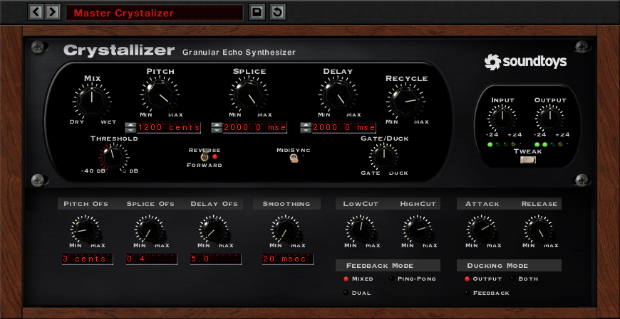
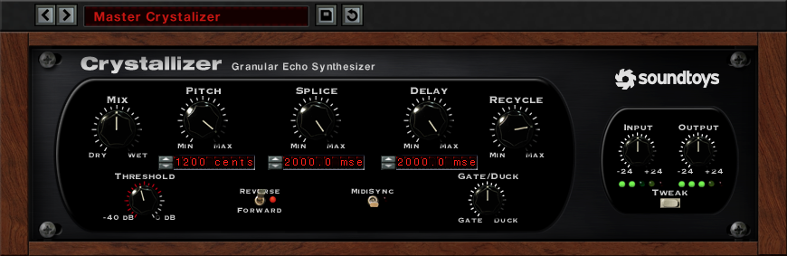
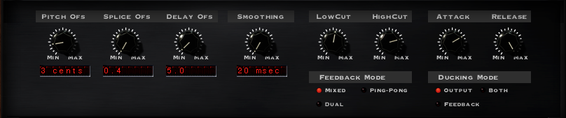

# Crystallizer

Soundtoys' **Crystallizer** ("Granular Echo Synthesizer"), from Soundtoys' own **Crystallizer User's Guide,
Version 5** (`soundtoys.com/wp-content/uploads/Crystallizer-Manual.pdf`, © 2015, 16 pages: "the manual"),
its screenshots (below), the Soundtoys 5 Effect Rack guide, Soundtoys' product page and release log, Sam
Inglis's Sound On Sound review (December 2007), user reviews, and on the lineage: Eventide's own H3000
preset list (which names every Reverse Shift preset and the Crystal Echoes ones), Eventide's H90 manual
and product page for **Crystals** (its descendant), Sound On Sound's 1993 H3000 workshop and Ken
Bogdanowicz's interview about building the H3000. The DSP is reconstructed: Soundtoys never published it.

What the marks mean:

| Mark | Meaning |
| --- | --- |
| **not stated** | None of the sources says it |
| **(inferred)** | Worked out from what the sources say, the screenshots or the physics, not read |
| **[P]** | In the DSP section: published (the manual, a paper, a product page) |
| **[D]** | In the DSP section: derived here, the working shown |
| **[E]** | In the DSP section: an informed choice, to tune by ear or by measuring Crystallizer (see [Measuring it](#514-measuring-crystallizer-yourself)) |

The last sections are ours: [proposed for Vaudio](#6-proposed-for-vaudio), [how it'd be built
here](#7-how-itd-be-built-here) and [open questions for Théo](#8-open-questions-for-théo).

The pictures in `img/` are the manual's own screenshots, © Soundtoys, kept here only as a private reference
for building this app. Don't ship them, and don't copy Soundtoys' artwork: we copy how it works and how it's
laid out, in our own visual style.



**Contents.** [1. What it is](#1-what-it-is) · [2. The panel](#2-the-panel) · [3. The factory
presets](#3-the-factory-presets) · [4. The sound](#4-the-sound) · [5. How it works](#5-how-it-works-the-dsp)
· [6. Proposed for Vaudio](#6-proposed-for-vaudio) · [7. How it'd be built](#7-how-itd-be-built-here) ·
[8. Open questions](#8-open-questions-for-théo) · [Sources](#sources)

---

## 1. What it is

### 1.1 In one paragraph

"What Crystallizer does essentially is that it grabs a 'slice' of stereo or mono audio coming in from the
input and plays it back (either forward or in reverse) with the ability to shift the pitch of the audio
slice (4) octaves up, or (4) octaves down. It also includes the ability to delay the playback of the audio
by up to (2) seconds and most importantly use regeneration or 'Recycle' to feed the output back into the
input" (the manual). Soundtoys' own one-liner: "Pitch shifting granular reverse echo. A mind-warping sound
design trip" (product page). The manual jokes that it's really a
"granular-pitch-splice-forward/backward-echo-plus-space-drive-shimmer-accumulator-effect-device".

So it's four things in a loop:

1. **A splicer**: the input is cut into slices of a set length (**Splice**, 0–2050 ms), one after another.
2. **A grain player**: each slice is played back, **forward or reversed**, at a **pitch** up to four octaves
   either way, crossfaded into the next (**Smoothing**).
3. **A delay**: a fixed extra **Delay** (0–2050 ms) before it's heard.
4. **A feedback loop**: **Recycle** sends what comes out back in, so every pass is spliced, pitched and
   delayed again: the pitch climbs (or falls) a step per pass, the "stairway of echoes".

Around it: a Mix, Input and Output (on the effect only), Low / High Cut on the effect, a level-keyed
**Gate / Duck**, per-side offsets for stereo (the left and right can have different pitches, splices and
delays), three feedback routings and MIDI (host tempo) sync.

What it is **not**: no LFO or pitch modulation, no Tap Tempo, no Width knob, no Groove or Feel, no
saturation styles, no rhythm editor, no reverb. The Tweak menu has offsets, Smoothing, the cuts, the
envelope times and two mode switches, nothing else (checked against the manual's Tweak chapter and its
screenshot).

### 1.2 History and lineage

**The H3000 and Reverse Shift.** Soundtoys' founders (as Wave Mechanics) came from Eventide: Ken
Bogdanowicz "was hired at Eventide right after I graduated university, in 1984" and designed the H3000's
DSP algorithms ("Pretty much everything in the H3000 was done from scratch, including all the signal
processing algorithms"); Bob Belcher designed its hardware (AudioNewsRoom interview). The manual: "these
geniuses created the now world-famous H-3000 Harmonizer® which contained a new type of algorithm they called
Reverse Shift. That new algorithm remained largely unused until a sound designer by the name of Andrew
Schlesinger had a realization ... by using the algorithm, coupled with generous feedback and delay, one
could create lush 'Crystal-Like' echoes and shimmering effects that sounded absolutely incredible,
especially on guitar. And so, a preset was created for the H-3000 titled 'Crystal Echoes' which has
subsequently been used by hundreds of artists and producers on countless albums." Ken confirms: "Andrew
Schlesinger, for example, created the infamous Crystal Echoes preset for the H3000." The product page: "If
you listened to the radio in the late 80s, you've heard the Crystal Echoes effect".

**What Reverse Shift did**, from Eventide's descriptions (no H3000 manual text on it was reachable):

- Sound On Sound's 1993 workshop: "Your speech will be chopped up into segments and the segments played in
  reverse and pitch shifted", made more dramatic with "variable splice length and feedback".
- Eventide's preset list, for the B-series presets that name their knobs: **Avant-Garde**: "(pitch)
  controls amount of pitch shift, (length) controls reverse splice length, (mix) wet/dry effect mix".
  **Backwards**: "Turns the input around in one-second chunks: (length) controls length of reversed
  segments, (feedback) feeds back reversed output, (pitch) sets pitch of reversed signal". **More Aliens**:
  "(splice) controls the 'splice' rate". **Cuzzin It**: "(speed) makes output 'splice' faster".
- A forum post (seen only as a search excerpt; the page refused fetching): "Reverse Shift algos don't have a
  'delay' parameter, so you need to assign the MIDI clock period to the 'Left Length' and 'Right Length'
  individually". So the hardware's controls were per-side pitch and **length**, feedback and mix; there was
  no separate delay (the delay comes from the splice itself, as in Crystallizer: see 5.3).

**Crystal Echoes itself.** Eventide's own list (H3000-SE / H3500 numbering) has **642 CRYSTAL ECHOES**:
"Words fail. A stairway of echoes reaching for heaven", and **163 CRYSTAL ECHO 2**, REVERSE SHIFT: "An H3000
original, slightly modified. A shimmering, hypnotic ambience. Derivative of H3000-SE preset 642". Oddly the
same list files 642 under **MULTI-SHIFT**, not Reverse Shift. Soundtoys (who wrote both algorithms) say
Reverse Shift; the list is probably wrong, or 642 was rebuilt for the SE **(inferred)**. Either way, the
sound the plug-in recreates is the Reverse Shift one.

Other Reverse Shift presets show the algorithm's range (all Eventide's descriptions):

| Preset | What Eventide says |
| --- | --- |
| Jimi James | "Basic reverse delays - like playing backwards in one-second snippets" |
| Heavenly Pad DM | "High, reversed echoes" |
| High Swells | "High shimmer for synth pads" |
| Heaven | "Play anything into this. It will sound good." |
| Anti-Ambience | "A reverb-like sound created from REVERSE SHIFT ... Mr. Cooder's favorite" |
| Drunk Room | "Unusual small-room ambience, built from reversed and slightly shifted delays" |
| Lo & Behold | "Octaves up and down, reversed, then re-reversed" |
| My Bloody Val | "Evil, reversed and down shifted delays" |
| Avant-Garde | "Generates descending, chromatic lines" |
| Cannons | "A unique, sweeping sound that's great on drums" |
| Aliens, Scary Movie, Dolphin Talk, Planet Zorgon | Voices turned alien, evil, aquatic |

**Crystallizer.** Reviewed by Sound On Sound in December 2007 as part of SoundToys' Native Effects (the
first release date is **not stated** in our sources). Version 5 came with Soundtoys 5 (2015, the manual's
date). The release log since: 5.0.1 (October 2015) "Fixes issue where Crystallizer's GUI would not display
'Direction' and 'MidiSync' values correctly ... upon recall" (so those are the parameters' names); 5.1.0
(2016) the integrated bypass and help menus (every plug-in); 5.3.2 (December 2019) "Fixes possible pops on
instantiation in ... Crystallizer"; 5.3.7 / 5.3.8 Apple silicon and VST3; 5.5.2 a resizable UI. No control
has changed in Version 5's life. Formats: AAX Native and AudioSuite, VST 2, VST 3, AU; 44.1–192 kHz.

**Eventide's own descendant: Crystals** (H9, H90, a plug-in): "a classic Eventide effect combining twin
reverse pitch shifters, delays, feedback, and reverb". Its controls (H90 manual): Mix, Pitch A / Pitch B
Mix, Pitch Shift A and B (cents), Reverse Delay Buffer A and B (ms or a note value), Reverb Mix Level,
Reverb Decay Rate, Feedback A and B, and FLEX "shifts both voices up one octave". The product page: each
pitch shifter has "a four-octave range from two octaves down to two octaves up", "two independently
adjustable delays, up to 4 seconds each, with their own individual feedback", "reverb with 100 seconds of
decay". Eventide's **H3000 Factory** plug-in does *not* include Reverse Shift ("I don't know of any plugins
from Eventide that do Reverse Shift", KVR, 2024).

### 1.3 Relatives, for context

| Effect | What it shares | What differs |
| --- | --- | --- |
| **Eventide H3000 Reverse Shift** | The algorithm: reversed, pitch-shifted splices, per-side length, feedback | No separate Delay; no gate/duck, cuts or offsets; hardware |
| **Eventide Crystals** (H9, H90, plug-in) | Twin reverse pitch shifters in feedback, delay buffers in ms or notes | Reverse only (inferred from "reverse pitch shifters"); ±2 octaves; two voices A / B with their own feedback rather than L / R offsets; a reverb in the path; FLEX |
| **Valhalla Shimmer** | Pitch shifting inside a feedback loop: the climbing octaves | A reverb (diffusion), not splices you hear; no reverse grains (from general knowledge, not re-read here) |
| **Red Panda Particle 2** | "Chops your signal into small grains and then rearranges, shifts, and mangles it"; a reverse delay mode; pitch to ±1 octave; delay to 2.5 s; feedback options including ping-pong | A pedal; random and LFO grain modes; density |
| **Ableton Grain Delay** | A delay whose output is granular and pitched, with feedback | Grain rate (Frequency) and random pitch / Spray rather than splices and reverse (from general knowledge) |
| **Output Portal**, **Chase Bliss Mood** | Granular textures, reverse | Many grains, modulation, sequencing: a different, denser sound (from general knowledge) |

What sets Crystallizer apart is the **long splice** (a whole phrase, up to 2 s, not a few ms grain) played
**backwards** and **pitched**, and the loop compounding all three: it sounds like an echo, not a cloud.

### 1.4 Why producers reach for it

- **The Crystal Echoes sound**: chords and single notes turned into a "stairway" of reversed echoes, each an
  octave (or fifth) higher. "Transform simple chords into epic soundscapes" (product page);
  "Words fail. A stairway of echoes reaching for heaven" (Eventide).
- **Pads from anything**: "some of the presets can take a dynamic or even percussive signal such as an
  acoustic guitar and turn it into something resembling a synth pad" (SOS). Mac Quayle: "my go to for
  creating weird, sonically interesting high pads. A little goes a long way with this plug-in."
- **Thickening**: "Small Pitch adjustments can be used to create useful, subtle thickening and doubling
  effects" (SOS); the manual's Pitch Offset example is ±11 cents for "thick stereo detune effects".
- **Vocal throws, transitions, risers**: "pitched repeats, reverse swells, and strange melodic trails";
  pitch automated across eight bars turns "a simple loop into a riser or a washed-out soundbed"; chopped
  vocals through two in tandem (Magnetic Magazine's review).
- **Sound design**: short splices are "crunchy, metallic" (SOS); "capable of producing some very glitchy
  sounds" (KVR user).

---

## 2. The panel



Soundtoys' house layout (the screenshots are 870 × 283 px closed, 870 × 449 open):

1. **The main section** (a rounded black panel): **Mix**, **Pitch**, **Splice**, **Delay**, **Recycle** in a
   row, the last four with LCDs (Pitch, Splice and Delay with up / down nudge arrows) under the first three;
   under them **Threshold** (with a ring of level LEDs), the **Reverse / Forward** toggle (a red LED),
   **MidiSync** (a toggle, a small LED) and **Gate / Duck**.
2. **The right section**: **Input** and **Output** (−24 … +24) each with five LEDs, and the **Tweak** button.
3. **The Tweak menu** slides out underneath (below).

Over it is Soundtoys 5's preset bar: previous / next preset, the preset's name (a click: the preset menu),
Save (a disk) and a circular arrow (revert, **(inferred)**: what it does exactly is **not stated**, as for
EchoBoy). Bypass and help are integrated since 5.1.0. **There's no Width, Tap Tempo, Groove or Feel.**

### 2.1 The main controls

| Control | On the panel | Range | Default | Scale | What it does (the manual) |
| --- | --- | --- | --- | --- | --- |
| **Mix** | DRY … WET | not stated in % | **not stated** (12 o'clock in the screenshot) | not stated | "The balance between the shifted sounds ... (wet) and the dry". On a send, "leave the mix at 100%" |
| **Pitch** | MIN … MAX, LCD "1200 cents" | **±3600 cents** says the Pitch section; **4 octaves** each way say the manual's introduction and SOS | **not stated** | 1 cent steps on the LCD; the knob's taper is **not stated** (at +1200 its pointer is near 4 o'clock: not linear over ±3600, **(inferred)**) | The pitch of the effect, in cents: 100 a semitone; "slight detuning effects by setting the Pitch value to say + or – 10, or set the pitch between notes, i.e. +750" |
| **Splice** | MIN … MAX, LCD "2000.0 msec" | **0–2050 ms** | **not stated** | 0.1 ms on the LCD | "The length of the section of audio that is captured and played back". Below ~30 ms: "will not have a discernible pitch and be somewhat metallic"; keep it above 30 ms to keep the source's pitch, "especially ... as you add more pitch shift". At 300 ms: a slice "grabbed and played back each 300ms", with "approximately the same amount of delay (300ms) inserted between the original audio and the onset of the effect". "The delay time within the spliced section is being modulated so the actual onset of the playback may not be exactly 1000ms and depending on when your input signal occurs within the 1000ms 'grab' will also affect how and when the playback will occur" |
| **Delay** | MIN … MAX, LCD "2000.0 msec" | **0–2050 ms** | **not stated** | 0.1 ms | A fixed extra delay: "not modulated ... It is added to any delay that might be inherent based on the Splice setting" |
| **Recycle** | MIN … MAX | not stated | **not stated** | not stated | "Essentially a feedback control ... Turning the control up will generate repeating, spiraling pitch effects and depending on the setting, the Pitch knob can create upward or downward spirals." Longer splices (and more Delay) space the repeats further apart. Whether it can run away is **not stated** |
| **Threshold** | −40 dB … 0 dB, a ring of LEDs | −40 … 0 dB | **not stated** | dB | The level the input must pass for Gate / Duck to act. "The LED ring around the Threshold knob displays the level of the input signal." Lowest: always on; highest: never |
| **Gate / Duck** | GATE … DUCK, 12 o'clock off | bipolar | **12 o'clock (off)** ("the 'off' position") | not stated | Clockwise: **duck**: the effect lowered while the input is above the Threshold; all the way, it "will totally disappear until the input signal drops below". Anticlockwise: **gate**: the effect lowered while the input is *below* the Threshold; all the way, zero below it, back while above |
| **Reverse / Forward** | a toggle, a red LED | two | **not stated** (Reverse in the screenshot) | | The effect played backwards or forwards; "any pitch shifting will be imparted on the effect signal regardless" |
| **MidiSync** | a toggle | on / off | off in the screenshot | | Locks to the host's tempo: "the Splice and Delay control readouts will change from milliseconds to note values". "The Splice will be forced to restart at each downbeat based on the selected note length, similar to how oscillator sync works ... your splice cannot be longer than the downbeat." The note values on offer are **not stated** |
| **Input** | −24 … +24, 5 LEDs | ±24 dB **(inferred from the labels)** | about unity ("the default setting ... approximates 'unity gain'") | dB | Into the effect only: "the input and output level only affects the shifted signal and leaves the dry signal unchanged" |
| **Output** | −24 … +24, 5 LEDs | ±24 dB | about unity | dB | Out of the effect only |
| **Tweak** | a button | | closed | | Opens the Tweak menu |


**The LEDs** under Input and Output: five each, three green, a **yellow** ("6dB below clipping") and a
**red** ("maximum signal level, and possible audible clipping (which you may or may not wish to have as
part of your sound)"). The green ones' levels are **not stated**. Whether anything inside clips or
saturates is **not stated**; the red LED's wording suggests the output can clip **(inferred)**.

### 2.2 The Tweak menu



| Control | Range | Default | What it does (the manual) |
| --- | --- | --- | --- |
| **Pitch Ofs** (Pitch Offset) | "4 octaves (or +/- 4800 cents)" | **not stated** (3 cents in the screenshot) | Detunes the **left down and the right up** by its amount: "whatever the setting of the main Pitch control, the value set on the Pitch Offset will subtract the selected amount from the pitch of the left channel and add the selected amount to the pitch of the right channel". Pitch 0 and offset 11: left −11, right +11 cents. "You could conceivably have the left channel shifted down 4 octaves and the right side shifted up 4 octaves" |
| **Splice Ofs** | 0 … 100 (%) | **not stated** (0.4 in the screenshot) | **Right side only**: shortens its splice by the percentage. 25: 25% shorter; 50: half; "A splice setting of 100 indicates that the right side will be 1/100th of the left side splice length" |
| **Delay Ofs** | 0 … 100 (%) | **not stated** (5.0) | **Right side only**: shortens its delay by the percentage, "same as with Splice Offset" (the manual's text says "splice length" here twice: a copy-paste slip; it means the delay) |
| **Smoothing** | from **20 ms**; maximum **not stated** | **not stated** (20 ms in the screenshot) | "How fast or slow the crossfade will be between splices ... At higher settings, the Smoothing control can impart a very ethereal or washy feeling to the echoes. At the minimum setting for this control (20ms) a 20 millisecond crossfade is being applied to any changes in the delay signal" |
| **Low Cut** | **1.00 Hz … 5000 Hz** | **not stated** | A **12 dB per octave** high-pass on the effect |
| **High Cut** | **500 Hz … 20 kHz** | **not stated** | A **12 dB per octave** low-pass on the effect. "These filters do not apply to the dry (unprocessed) signal." Whether they're inside the Recycle loop is **not stated** |
| **Attack** | **not stated** | **not stated** | How fast the effect is gated or ducked once the input passes the Threshold. Long attacks need the input held above the threshold long enough |
| **Release** | **not stated** | **not stated** | How fast it comes back once the input falls below: with Ducking, back "up to its normalized level"; with Gating, "back down to the level set on the Gate knob" |
| **Feedback Mode** | **Mixed**, **Ping-Pong**, **Dual** (radio LEDs) | Mixed in the screenshot | How the repeats sit in stereo. **Mixed**: "both the left and right channels of the feedback signal are mixed and can be heard in both"; with Recycle and Delay Offset "a more diffused sound". **Dual**: "the feedback path for the left and right channels are independent". **Ping-Pong**: "the repeats will alternate between the left and right channels" |
| **Ducking Mode** | **Output**, **Both**, **Feedback** (radio LEDs) | Output in the screenshot | Where Gate / Duck acts. **Output**: "ducks or gates the initial effected signal before it hits feedback"; **Feedback**: "ducks or gates only the Feedback"; **Both** |

The manual's oddities, all to settle by ear or by measuring (5.14): the Pitch range (±3600 or ±4800);
Pitch Offset's sign range (only positive amounts are described); Splice Offset at 100 being 1/100 and not
zero (so its scale isn't linear at the top, or the readout isn't a plain percentage); the tapers of every
knob (the screenshot's pointers don't match linear scales).

### 2.3 Gestures, keys, sizing

- Mouse and keyboard gestures (fine adjust, reset to default, typing into the LCDs) are **not stated** in
  the manual. The LCDs have nudge arrows on Pitch, Splice and Delay (seen).
- The window is resizable since 5.5.2 (every plug-in but Effect Rack).
- In Soundtoys' Effect Rack, a module's preset menu is a button beside it instead of the bar on top, and a
  bypassed module "is still being processed internally ... Reactivating a bypassed item will output any
  signal still being processed by the effect (such as a long delay trail)" (Effect Rack guide).

### 2.4 The screenshot's settings: "Master Crystalizer"

The only full set of values the sources give (the preset's name is misspelt on the panel):

| Control | Value | Control | Value |
| --- | --- | --- | --- |
| Mix | ~12 o'clock | Pitch Ofs | 3 cents |
| Pitch | +1200 cents | Splice Ofs | 0.4 |
| Splice | 2000.0 ms | Delay Ofs | 5.0 |
| Delay | 2000.0 ms | Smoothing | 20 ms |
| Recycle | ~2–3 o'clock | Low Cut / High Cut | ~12 / ~2 o'clock (values not shown) |
| Reverse / Forward | Reverse (lever up, LED lit) **(inferred)** | Attack / Release | ~2 / ~5 o'clock |
| MidiSync | off | Feedback Mode | Mixed |
| Threshold, Gate / Duck | ~12 o'clock, off | Ducking Mode | Output |

---

## 3. The factory presets

"Over 200 ready-made presets in organized categories" (product page). **No list is published**, and the
categories are **not stated**. Names seen in the sources:

| Name | Where | What it suggests |
| --- | --- | --- |
| **Master Crystalizer** | The manual's screenshots | +1 octave, 2 s splices, reversed, long recycle: the slow, huge Crystal Echoes |
| **Akwards Pong Hecho** | Magnetic Magazine | A ping-pong of reversed echoes ("backwards ping-pong echo" spelt as it sounds) |
| **Wet Pad** | Magnetic Magazine ("'Crystals' presets favored, particularly 'Wet Pad'", so "Crystals" may be a category) | A 100% wet pad maker |
| Presets with **"detune"** or **"Grantacular"** in the name | Magnetic Magazine | Detuned doublers; granular ("grain" + "spectacular") textures |

Our own set, made to these purposes, is in [6.4](#64-our-presets).

---

## 4. The sound

### 4.1 What each control sounds like

| Setting | What you hear |
| --- | --- |
| **Splice under ~30 ms** | No pitch of its own: a buzzing, metallic, robotic texture; the splice rate itself becomes a pitch (10 ms ≈ a 100 Hz buzz) and the source's pitch blurs. "Crunchy, metallic" (SOS) |
| **Splice 50–150 ms** | Grains short enough to sound continuous: a glassy, chorused or "harmonised" double of the source, the splices heard as a slight flutter. Forward and pitched, this is the classic Harmonizer sound |
| **Splice 300–2000 ms** | Phrases: whole words or chords played back (backwards in Reverse) after about a splice's delay. Reverse here is the "backwards guitar" swell: every slice ends on its own attack |
| **Pitch ±5–20 cents** (with Pitch Ofs) | Thickening, doubling, a wide detuned chorus. Small enough not to sound pitched |
| **Pitch +700 / +500 / −500** | Fifths and fourths: organ-like, "harmonised" chimes |
| **Pitch +1200** | The octave-up "crystal" chime: glassy, bell-like, angelic |
| **Pitch +2400 and over** | Tiny, fizzy, "chipmunk" sparkle; past +3600 it's mostly air and grain noise |
| **Pitch −1200 and under** | Dark, growling, "evil" (My Bloody Val, Scary Movie); far down, rumbles and gurgles, and much of the input is skipped (5.3) |
| **Reverse** | Swells instead of attacks: each slice fades *up* into its last moment. The defining sound of Reverse Shift |
| **Delay** | Pushes the effect later, like a pre-delay; with Recycle, spaces the stairway's steps |
| **Recycle** | The stairway: each repeat a further Pitch step up (or down), each later; high settings blur the steps into a continuous rising (or falling) cascade |
| **Smoothing up** | Softer, washier, more "ethereal" (the manual), less rhythmic: splices fade into one another. At the minimum the splices are articulate and rhythmic |
| **Low / High Cut** | Keep the effect out of the vocal's body (Low Cut 200–500 Hz on vocals) and tame the fizz of high steps |
| **Pitch Ofs, Splice Ofs, Delay Ofs** | Stereo: the two sides out of step in pitch, grain rhythm and delay, so the effect is wide and shimmering rather than a point in the middle |
| **Gate / Duck** | Duck: the effect "move[s] out of the way while you are playing and then reappear[s] when you stop". Gate: "swirly, echo wash effects that will only appear when you hit a loud note" (the manual) |
| **Feedback Mode** | Dual: the sides' stairways stay apart; Mixed: they merge, more diffuse; Ping-Pong: each step jumps to the other side |

### 4.2 The stairway (Crystal Echoes)

The manual's recipe: "a Splice of say 500ms and above, along with a Pitch setting of 1200 and a decent
amount of recycle will create sounds similar to the classic 'Crystal Echoes'". And its Gate / Duck example:
"Pitch to 1200, Splice to 500, Delay to 500 and Recycle to around 11 o'clock ... a repeating echo one
octave above the original signal that becomes increasingly higher in pitch with each repeat."

Each pass through the loop multiplies the pitch by the same ratio, so a sung A3 (220 Hz) climbs:

| Pass | Pitch | Fundamental | When its copies arrive (Splice 500, Delay 500, Reverse; the first copies early in the range) **(inferred, 5.8)** | Level (Recycle 0.5) |
| --- | --- | --- | --- | --- |
| dry | 0 | 220 Hz | 0 | 0 dB |
| 1 | +1 octave | 440 Hz | 0.5–2.0 s | 0 dB (Mix aside) |
| 2 | +2 octaves | 880 Hz | 1.0–4.0 s | −6 dB |
| 3 | +3 octaves | 1760 Hz | 1.5–6.0 s | −12 dB |
| 4 | +4 octaves | 3520 Hz | 2.0–8.0 s | −18 dB |
| 5 | +5 octaves | 7040 Hz (harmonics past 20 kHz) | 2.5–10 s | −24 dB, mostly cut by High Cut |

The stairway stops on its own: each step's harmonics go past the High Cut and the top of the band, and
each is quieter by the Recycle. With a negative Pitch it walks down into the lows until the Low Cut takes
it.

### 4.3 On vocals

How producers use it (reviews, the manual's examples, and common practice **(inferred)**):

| Use | Typical settings |
| --- | --- |
| **The shimmer throw**: the last word of a phrase blooms into octave-up reversed chimes | Send, 100% wet; Reverse; +1200; Splice 250–500 ms (or 1/8–1/4 synced); Delay 0–1/8; Recycle 30–50%; Low Cut 300–500 Hz; High Cut 8–12 kHz; automate the send on the word |
| **The angelic bed under a chorus** | +1200 (or +700 for a fifth), Pitch Ofs 5–15 cents, Splice Ofs and Delay Ofs a few %, Smoothing 100–300 ms, Recycle 50–70%, ducked (Output) so it fills the gaps |
| **Reverse swells into a phrase** | Pitch 0, Reverse, Splice ≈ the phrase's lead-in (1/4–1/2 synced), Recycle 0–20%: the classic reverse-echo pre-swell |
| **The dark ad-lib** | −1200, Reverse, Splice 1/8, Recycle 20%, High Cut 3–5 kHz: a demonic answer to an ad-lib |
| **Doubling and width** | Pitch 0, Pitch Ofs 8–12 cents, Splice 40–80 ms, Delay 10–20 ms, Recycle 0, Forward, Dual, Mix low: a wide, "harmonised" double (SOS's "subtle thickening and doubling") |
| **Risers and transitions** | Pitch automated over 4–8 bars, Recycle high, Mix automated up into the drop (Magnetic Magazine) |
| **Glitch and robot** | Splice 5–20 ms, Reverse, Recycle 30–60%: a metallic, buzzing voice |

Elsewhere: **guitar** (where Crystal Echoes was born: arpeggios and chords into a cascade), **pads and
keys** (Mac Quayle's "high pads"), **drums** (Cannons' "sweeping sound ... Try playing a tom solo through
this"; short splices for metallic percussion). **808s and sub-bass**: not a good fit **(inferred)**: a
sustained low sine is exactly where splice crossfades are most audible (a slow amplitude flutter and phase
jumps), pitching it down skips half of it, and pitching it up moves it out of the 808's register. Use it
on the 808 only with Low Cut up, as a high texture.

### 4.4 What bad versions sound like, and why

| Symptom | Cause | What we do (5.x) |
| --- | --- | --- |
| **Clicks or ticks at every splice** | A splice jumps the read position with no crossfade, or too short a one; or the crossfade window has a corner (linear ramps) | Raised-cosine crossfades, at least 20 ms, never longer than the splice (5.4) |
| **Pumping or flutter at the splice rate** | The wrong crossfade law: equal-gain (sums to 1 in amplitude) dips about 3 dB in the middle of a fade between *unrelated* grains; equal-power bumps 3 dB between *identical* ones | The law chosen by how far apart the two grains read (5.4) |
| **Phasey, comb-filtered, "warbly" small shifts** | Two overlapping grains a few ms apart in the source sum as a comb filter whose notches sweep each splice | Inherent to the method at small shifts; kept short by short Smoothing; the per-side offsets decorrelate it in stereo |
| **Harsh, fizzy, inharmonic highs on big upward shifts** | Reading a buffer faster than real time folds everything above `fs / (2r)` back down (aliasing); the loop compounds it every pass | A band-limited read whose cut-off falls with the ratio (5.5); High Cut in the loop |
| **Dull, grainy pitch-down** | Linear interpolation's images and droop | Hermite at ratios up to 1 (5.5) |
| **Rumble and DC build-up when pitching down with Recycle** | Each pass halves the frequencies: energy marches down into the sub-sonic and DC | Low Cut in the loop, and a DC blocker in it (5.8) |
| **Runaway or a loud whine at high Recycle** | Loop gain over 1 at some frequency (pitch 0 makes it an ordinary feedback delay); crossfade bumps adding gain each pass | Recycle's gain at most 1, the law's bump removed, a soft safety in the loop (5.8) |
| **CPU spikes on silent tails** | Denormal numbers in the decaying loop | Flush-to-zero on the audio thread (`ScopedNoDenormals`) (5.12) |
| **Zipper noise or clicks when turning knobs** | Gains stepped per block; the delay read jumped | Gains smoothed per sample; a new Delay crossfades; a new Pitch glides in the grain; a new Splice waits for the next splice (5.6, 5.7) |
| **A mono-sounding effect** | Both sides splicing on the same grid at the same pitch | The offsets (Pitch, Splice, Delay), which presets use |
| **Echoes that land late or wander off the beat when synced** | Splice boundaries rounded per block, or a grid counted from play rather than from the bar | The grid is the song's position, each boundary on its own sample (5.11) |

---

## 5. How it works (the DSP)

Soundtoys publish nothing of the inside. What follows is a reconstruction that does exactly what the manual
describes, built from the standard methods (delay-line pitch shifting and granulation: DAFX, chapter 6;
crossfaded read pointers: Smith, *Physical Audio Signal Processing*, "Large Delay Changes"), with every
equation derived here. Where a choice had to be made it's marked [E] and listed in [6.1](#61-decided).

### 5.1 The signal flow

```
                         ┌──────────────── Recycle (feedback) ─────────────────────────────┐
                         │                                                                  │
 x_L, x_R ──┬─► Input ─►(+)─► write ║ ring buffer, a side each ║                           │
            │                       ║  (up to ~54 s)           ║                           │
            │                       ║                          ║ ◄── grain reads:          │
            │                       ║                          ║     Delay + splice delay, │
            │                       ║                          ║     forward or reversed,  │
            │                       ║                          ║     at the pitch ratio,   │
            │                       ║                          ║     crossfaded (Smoothing)│
            │                                 │                                             │
            │                                 ▼                                             │
            │                     Low Cut ─► High Cut   (12 dB/oct each: "the effect")      │
            │                                 │                                             │
            │                                 ├──► × duck(fb) ─► feedback matrix ─► × Recycle ─► DC block ─► safety ─┘
            │                                 │                  (Mixed / Dual / Ping-Pong)
            │                                 └──► × duck(out) ─► Output ─► × wet ─┐
            │                                                                       ▼
            ├───────────────────────────────────────────────────────► × dry ────► (+) ─► out
            │
            └─► level detector (the dry input) ─► vs Threshold ─► Attack / Release ─► duck(out), duck(fb)
```

Why each block sits where it does:

- **Input** scales only what goes into the effect, **Output** only what comes out of it: "the input and
  output level only affects the shifted signal" [P]. Output is after the feedback tap, so turning it doesn't
  change the loop [E].
- **Delay is inside the loop** [P: "adding Delay can also increase the space between each repeat"]: it's an
  extra, unmodulated offset added to every grain's read (5.6).
- **The cuts are on the effect, and inside the loop** [P that they're on the effect; E that they're in the
  loop]: each pass is filtered again, so the stairway darkens and thins as it climbs (as EchoBoy's do, and
  as every shimmer reverb does to keep the octaves from piling up).
- **Gate / Duck** listens to the dry input (the manual's "original signal") and acts on the output, the
  feedback or both, as the Ducking Mode says [P].
- **One buffer a side**, written with the input plus the feedback, read by the grains. A slice is never
  copied out: a "slice" is just where a grain reads [D].

### 5.2 The splice clock

Each side has a clock that marks **splice boundaries** `t₀, t₁, t₂, …`, a Splice apart: `t_{k+1} = t_k + S`.
At each boundary a new grain starts and the last one fades out (the manual's "grab a slice ... every
1000ms"). [P for the behaviour, D for the clock.]

- In **ms**, the clock runs from when the effect started (play, or the song made) at the side's Splice
  (`S_R = S × f`, below).
- With **MidiSync**, the boundaries are on the song's grid: `t_k = bar + k × S_ticks`, **restarting at each
  bar line** ("forced to restart at each downbeat ... similar to how oscillator sync works" [P]). A splice
  that doesn't divide the bar (a dotted eighth in 4/4) has a short last grain before the bar; a Splice longer
  than the bar is held to the bar ("your splice cannot be longer than the downbeat" [P]; we read "downbeat"
  as the bar [E]).
- **Splice Offset** shortens the right side's splice: `S_R = S × max(0.01, 1 − p/100)` (at 100 it's 1/100
  of the left's, as the manual says) [P]. The right side then splices on its own grid: in sync, its own grid
  restarted at each bar too.
- A Splice change takes effect **at the next boundary** [E]: a grain that's playing finishes as it began.
  (Turning Splice while it plays therefore never clicks; it can lag by up to one splice, 2 s at most.)
- Boundaries fall on fractional sample times (a 1/8 at 97 BPM is 14 845.36 samples). The grain starts on
  the first sample at or after `t_k`, and its read position is computed from the exact `t_k`, so the
  pitch and the timing are exact and nothing drifts [D].

### 5.3 A grain

Notation: `fs` the sample rate; `r = 2^(c/1200)` the side's pitch ratio (`c` its cents); `S` the grain's
splice (to the next boundary); `X` the crossfade (Smoothing, at most `S`); `L = S + X` the grain's length
(it fades in over its first `X`, plays, and fades out over `X` while the next grain fades in); `D` the
side's Delay; `u = t − t_k` the time since the grain started. Everything is in seconds; samples are
`× fs`.

A grain reads the buffer at **delay** `d(u)` behind the newest sample, so it reads the input written at
time `p(u) = t − D − d(u)`. Its read speed is `dp/du = 1 − d′(u)`. To play at ratio `r`:

- **Forward**: `dp/du = +r`, so `d′(u) = 1 − r`.
- **Reverse**: `dp/du = −r`, so `d′(u) = 1 + r`.

And it may never read the future: `d(u) ≥ 0`. The choice that does what the manual describes [D]:

```
Reverse:   d(u) = (1 + r) · u                                  0 at the start, (1 + r)·L at the end
Forward:   d(u) = d₀ + (r − 1) · (L − u),   d₀ = max(S, (1 − r)·L)
```

- **Reverse** starts reading at "now" (the newest sample, plus Delay) and runs backwards at `r` times
  speed: the slice just captured, reversed. At `r = 1` the delay sweeps 0 → 2S: an input at a point `a`
  into a splice comes out reversed at `2(S − a)` after it, between 0 and 2S, **S on average**: exactly
  the manual's "approximately the same amount of delay (300ms) ... as each new slice is taken", and its
  warning that the onset depends "on when your input signal occurs within the ... 'grab'" [P matches D].
- **Forward** at `r = 1` is a constant delay of `S`: a plain echo one splice late, every grain reading
  exactly where the last left off, so the splices can't be heard at all (5.4). Above `r = 1` the delay
  falls from `S + (r − 1)·L` to `S` over the grain (it starts reading far enough back to finish at "S
  ago"); below 1 it rises from `d₀ − (1 − r)·L` to `d₀`, which is `S` unless Smoothing is long and the shift
  large (then `d₀ = (1 − r)·L` keeps the start at 0 rather than reading the future).

What every grain covers [D]: `r·L` of input. Grains start every `S`, so each moment of the input is heard
`r·L / S` times on average: **an octave up repeats everything about twice, an octave down skips about
half**. That's not a flaw of this design: any pitch shifter that keeps time must repeat or drop material,
and the splices are where it does.

The delay against time, for a few splices (`r = 1`; `D = 0`):

```
 delay                    Reverse                                   Forward, r = 2
  2S ┤      ╱       ╱       ╱                3S ┤╲       ╲       ╲
     │    ╱  ┊    ╱  ┊    ╱  ┊                  │  ╲       ╲       ╲
   S ┤  ╱    ┊  ╱    ┊  ╱    ┊                2S ┤    ╲  ┊    ╲  ┊    ╲  ┊
     │╱      ┊╱      ┊╱      ┊                  │      ╲┊      ╲┊      ╲┊
   0 ┼───────┼───────┼───────┼──► t           S ┤───────┼───────┼───────┼──► t
     t₀      t₁      t₂      t₃                  t₀      t₁      t₂      t₃
   each grain: delay rises at 1 + r              each grain: delay falls at r − 1
   (┊ the next grain fades in while this         (shown with X = 0; with Smoothing each
    one fades out over X)                         line runs X past the boundary)
```

**Splice and Delay together.** The total read delay is `D + d(u)`. So the effect's onset is "Delay, plus
whatever the splice inherently adds" [P], and the time between Recycle's repeats is about `D + S` (forward:
`D + S` exactly at `r = 1`; reverse: `D + S` on average) [D].

**The buffer it needs** [D]: the longest read is a reversed grain at the highest ratio:
`D_max + (1 + r_max) · L_max`. With `D_max = S_max = 2.05 s`, Smoothing at most 1 s and `r_max = 16`
(+4 octaves): `2.05 + 17 × 3.05 ≈ 54 s` a side. At 48 kHz that's 10.4 MB a side in floats (EchoBoy keeps
four 16.5 s lines: 12.7 MB); at 192 kHz, 41.5 MB a side. Allocated once, on the message thread (5.12).
A smaller alternative is in 5.5.

### 5.4 The crossfade (Smoothing)

Each grain's gain is a window: a fade-in over `X`, flat, a fade-out over `X`, overlapping the next grain's
fade-in. The fades are raised cosines (no corners, so no clicks: a linear ramp's corners splash a little
high-frequency energy at both ends) [E]. `X` is Smoothing, at least 20 ms [P], at most the splice (then
every moment is a crossfade: Hann-like grains overlapping by half, the manual's "ethereal or washy" end) [E].

**The law depends on how alike the two grains are** [D]. During a crossfade the outgoing grain `k` and the
incoming grain `k+1` read the same source at a distance `Δ` apart:

```
Forward:  Δ = |r − 1| · S          (0 at r = 1: they read the very same samples)
Reverse:  Δ = (1 + r) · S          (always far apart)
```

- If they read the same thing (forward, `r` near 1, `Δ` under a millisecond or so), gains that **add to 1**
  keep the level exactly: `g_out = cos²θ`, `g_in = sin²θ`, θ from 0 to π/2. At `r = 1` exactly, both read
  the very same samples and the output is the input delayed, sample for sample: a test (7.6).
- If they're unrelated (reverse, or big shifts), gains whose **squares add to 1** keep the power: `g_out =
  cos θ`, `g_in = sin θ`. With the add-to-1 law the level would dip 3 dB mid-fade, a flutter at the splice
  rate; with the power law on identical grains it would bump +3 dB, and in the loop that bump compounds.
- Between: blend by `w = clamp((Δ − 1 ms) / 9 ms, 0, 1)`: `g = (1 − w)·sin²θ + w·sin θ` (and the mirror
  for `g_out`) [E]. A later refinement: measure the two reads' correlation `ρ` as the fade begins and solve
  `g_in² + g_out² + 2ρ·g_in·g_out = 1` (three multiply-adds a sample) [E].

```
gain
 1 ┤────────╮         ╭───────────────╮         ╭──────    one side's grains, Smoothing X,
   │  grain ╲  k+1   ╱     grain k+1   ╲  k+2  ╱           raised-cosine fades overlapping
   │   k     ╲      ╱                   ╲     ╱
 0 ┤          ╲____╱                     ╲___╱
   └────────┼──X──┼───────────────────┼──X──┼──────► t
           t₁                        t₂
```

Changing Smoothing takes effect at the next boundary [E].

### 5.5 Reading between samples

A grain's read position is fractional and moves at `r` samples a sample.

- **Up to `r = 1`** (pitch down, and pitch 0): 4-point Hermite (the one `EchoDsp.h`'s `DelayLine::read`
  and `Resampling.h` already use): cheap, smooth, clean enough when slowing down [P].
- **Above `r = 1`**: reading faster than real time folds everything above `fs / (2r)` back into the audible
  band. A +2-octave shift aliases everything above 6 kHz at 48 kHz, and in the loop it's folded again every
  pass. So read with a **windowed sinc whose cut-off is `1/r`** of Nyquist (it widens with `r`): exactly
  `Resampling.h`'s `sinc` (Kaiser, its cut-off `rolloff / rate`, widening capped at 8×) [P], made to read
  a ring buffer. Its width: `2 × ⌈Z / f_c⌉` taps, `Z` zero crossings. `Z = 16` (the export's) costs 68 taps
  at `r = 2` and 266 at `r ≥ 8`; for a granular effect `Z = 8` (≈ 70 dB down) is ample and halves it [E].
  Past ×8 a little aliasing remains (as `Resampling.h` accepts), and the High Cut in the loop takes the rest.
- Crystallizer uses these **whatever the song's Resampling setting**, so playback and the export sound
  the same (the export's Sinc setting is for samplers) [E].

**The smaller alternative** [D/E]: keep a pyramid of the buffer, each level half-band filtered and
decimated from the one above (as a mip-mapped texture), and read level `k = ⌈log₂ r⌉` with Hermite at
`r / 2^k ≤ 1`. Level `k` only needs `(1 + 2^k)·L` seconds at `fs / 2^k` samples a second, so the whole
pyramid is ~13 MB a side-pair at 48 kHz instead of ~21, and every read is 4 taps. The cost: the
decimators' delay (with minimum-phase polyphase IIR half-bands, a few samples per level), which reverse
grains must wait out at their start, and a crossfade when a grain changes level. Not needed for the first
version.

### 5.6 The Delay knob

The total read is `D + d(u)`, so Delay adds directly. **A Delay change is heard at once, crossfaded** [E,
from the manual's "a 20 millisecond crossfade is being applied to any changes in the delay signal" [P]]:
each grain playing gets a second read at the new `D` and fades to it over Smoothing (two read pointers on
one buffer, Smith's "Large Delay Changes" [P]); no glide, no pitch bend ("This delay is not modulated"
[P]). Automated or turned continuously, a fade starts whenever the last has finished and the target has
moved by more than half a millisecond (EchoBoy's note-value crossfade, `readLine`). At most four reads a
side for those 20 ms.

**Delay Offset** shortens the right side's Delay: `D_R = D × max(0.01, 1 − p/100)` [P, "same as with Splice
Offset"].

### 5.7 Pitch

- **Per side**: `c_L = Pitch − Pitch Offset`, `c_R = Pitch + Pitch Offset` [P], each held to ±4800 cents
  (±4 octaves) [E].
- **Changing it**: the ratio applies to the grains playing at once, smoothed per sample over ~10 ms [E], so
  automation glides the pitch inside a grain (useful for risers) rather than stepping. Each grain keeps its
  own read position and advances it by `±r` a sample (it doesn't recompute `d(u)` from `u`), so the read is
  continuous; a forward grain whose ratio rose so far that it would reach "now" is held at zero delay
  (it plays at the source's speed until the next splice) [E].

### 5.8 The loop (Recycle)

**Topology** [P for the parts, E for the order]: the wet signal after the cuts is split: one branch to the
output, one back to the input through the feedback matrix, Recycle, a DC blocker and a soft safety.

**Feedback Mode as a 2 × 2 matrix** (`fb_L`, `fb_R` from the wet `w_L`, `w_R`) [P behaviour, D matrix]:

| Mode | `fb_L` | `fb_R` | Input |
| --- | --- | --- | --- |
| Dual | `w_L` | `w_R` | stereo, each side its own |
| Mixed | `(w_L + w_R) / 2` | `(w_L + w_R) / 2` | stereo |
| Ping-Pong | `w_R` | `w_L` | **summed to mono into the left** [E, as EchoBoy's Ping-Pong; open question 3]: otherwise a centred vocal's first pass is centred and only the offsets show the bounce |

**Ducking Mode** [P]: Output multiplies the output branch by the gate / duck gain, Feedback the feedback
branch, Both both.

**The stairway** [D]: pass `n` has gone through the grain player `n` times: its pitch is `r^n` (`n × c`
cents), its delay about `n·(D + S)` on average (reverse: each pass anywhere from `n·D` to
`n·(D + (1 + r)·L)`), its level `g^n` (`g` Recycle's gain) times the cuts' response `n` times. The cuts
compound: after `n` passes a 12 dB/oct Butterworth's −3 dB point has moved to `f_c·(2^{1/n} − 1)^{1/4}`
(0.80 f_c at 2 passes, 0.66 at 4, 0.55 at 8), so the climb darkens [D, as in echoboy-dsp.md 3.6].

**Stability** [D]:

- Pitch shifting by splices keeps power (the crossfades are power-preserving by 5.4; the read is unity
  gain), so the loop's power gain is `g²·|H_cuts|²`. With `g ≤ 1` and the cuts' gain ≤ 1 it can't grow.
- At `r ≠ 1` the loop also *moves* energy: up past the High Cut and the read's cut-off, or down into the
  Low Cut and the DC blocker. So even at `g = 1` a pitched loop dies away by itself: the stairway leaves
  the band.
- At `r = 1` (pitch 0) and `g = 1` the loop holds what's in it for ever: a **freeze** (forward: a looped
  delay; reverse: the slice reversed, then the right way, then reversed...). Whether Recycle's top should
  freeze or stop just short (0.98) is open question 1.
- Guards: a DC blocker in the loop (~5 Hz) [E]; `echo::safety` (transparent under ±1, held under ±2) after
  Recycle [P, in our code]; a non-finite sample clears the side's buffer [E]; flush-to-zero.

**Recycle's scale**: linear gain, 0 … 1 (0 … 100%) [E]. Its default 0.4 is the manual's "11 o'clock"
**(inferred: 11 o'clock on a 7-to-5 knob is 40%)**.

### 5.9 Gate / Duck

[P for the behaviour, E for the numbers]

```
level  = peak follower of the dry input (instant up, 30 ms down), in dBFS (the larger side)
on     = level > Threshold           (−40 … 0 dB; a little hysteresis: off again 2 dB under)
duck   = max(knob, 0)      gate = max(−knob, 0)        knob −1 (gate) … 0 (off) … +1 (duck)
target = on ? 1 − duck : 1 − gate
gain   → target: straight lines, Attack to go all the way when `on` turns on, Release when it turns off
```

- The manual's Attack is how fast the effect is gated **or** ducked when the input passes the Threshold,
  Release how fast it goes back when it falls below. So Attack runs when `on` rises (a duck falls, a gate
  opens) and Release when it falls (a duck recovers, a gate closes) [P].
- At knob +1 the ducked effect "will totally disappear" [P]: the gain reaches 0, exactly.
- Ranges (not stated): Attack 0.1–1000 ms (default 10), Release 10–5000 ms (default 250) [E]. Straight
  lines in gain, as PanMan's dynamics [E].

### 5.10 Stereo

- Each side has its own clock, Splice, Delay, pitch, grains, cuts and detector-shared gain [P per-side
  offsets, E the rest]. A mono source on our stereo tracks is just two equal sides.
- With all offsets at 0, Dual and both sides alike, the effect is mono: the offsets are what make it wide.
- Mixed feeds the average back to both sides; with the Delay Offset the two sides' repeats drift apart and
  smear (the manual's "more diffused sound") [P].

### 5.11 Tempo sync

- MidiSync on: Splice and Delay are note values at the song's tempo [P]. Ours: 1/64 to 1 bar, straight,
  dotted, triplet (the same set as EchoBoy's note values, plus the bar), and **Delay also has 0** (the
  Crystal Echoes recipe needs a Delay of 0 or a note) [E]. A value longer than 2050 ms at the tempo is held
  to 2050 ms [E].
- The grid comes from the song's position while it plays (`gross::Clock`: the song's tick on the block's
  first sample and ticks per sample, as Gross Beat and PanMan use), so the bar lines are the song's, through
  loops and jumps; stopped, it runs on at the song's tempo [E, as PanMan].
- A tempo change takes effect at the next boundary [E].

### 5.12 Sample rates, latency, CPU, the audio thread

- **Sample-rate independence**: every time is in seconds or ticks; filter coefficients from `fs`; the
  crossfade tables in fractions of the fade. Only the buffer's size depends on `fs`. A state is made for
  its sample rate (the registry makes a new one if the rate changes), as EchoBoy's.
- **Latency: none**. The dry passes untouched; the effect is an echo, and reverse grains read only the past
  by construction (5.3). Nothing to report to `Song::compensate`.
- **Denormals**: `juce::ScopedNoDenormals` around `process`.
- **CPU** (per side, per sample) [D]:

| Part | Cost |
| --- | --- |
| Writing the buffer | 1 store |
| Grain reads | 1 (2 during a splice's crossfade, up to 4 during a Delay change) × Hermite (4 taps) at `r ≤ 1`, or sinc at `r > 1`: `Z = 8`: ~34 taps at `r = 2`, ~133 at `r ≥ 8` |
| Crossfade gains | A table lookup each |
| Cuts | 2 biquads |
| Loop | A matrix, a DC blocker, `safety` |
| Detector, gate / duck | A follower, a comparison, a line |

  Worst case (+4 octaves, a crossfade on both sides): ~550 multiply-adds a sample, ~26 M a second at
  48 kHz: around 1–2% of one modern core [E]. Typical settings (an octave, mostly one read): a fraction of
  that.
- **The audio thread** (the engine's rules): the buffers, filters and tables are made on the message thread
  when the state is made (`crystal::Registry::get`); `process` allocates nothing, takes no lock and does no
  I/O; settings come as an immutable `Settings` the song owns; automation lanes write into it with `set`
  (audio thread, plain stores into fixed arrays), as EchoBoy's.

### 5.13 Real-time checklist

- Preallocate the ring buffers (5.3's size), the sinc kernel (`resampling::Kernel::get()` at startup), the
  crossfade tables.
- Gains smoothed per sample (5 ms, EchoBoy's `gainSeconds`); filters redesigned only when their values
  change (EchoBoy's `designed` array); a Splice, Smoothing or tempo change at the next boundary; Delay by
  crossfade; Pitch by a 10 ms glide.
- A bypass forgets: the buffers are cleared (`validFrom`, as `echo::DelayLine::clear`) and it starts empty
  when it's next run, as EchoBoy's `skipped`.
- Non-finite guard on every write.

### 5.14 Measuring Crystallizer yourself

Nobody has published measurements of Crystallizer. With a copy, at 48 kHz, Mix fully wet, cuts open,
Gate / Duck off, Recycle 0 unless said, each by rendering through it:

1. **Forward at pitch 0**: an impulse train in. Is the output the input delayed by exactly Splice (+
   Delay)? Is there any trace of the splices (level ripple, a click) on a steady sine? (Tests 5.3's forward
   model and the crossfade law.)
2. **Reverse at pitch 0**: single impulses at known times inside a 500 ms splice. Each should come out at
   `2·t_k − t` (5.3). The arrival times give the grid and whether it starts at play or at the bar.
3. **Splice rate against pitch**: a sine, Pitch +1200 and −1200: the splice ripple's period should stay
   the Splice (5.3's choice) rather than change with the pitch.
4. **Smoothing**: a sine with Splice 200 ms, Smoothing 20 / 100 / max: the envelope of the crossfades
   (raised cosine?), its length, its maximum, and whether the level dips or bumps (the law).
5. **Pitch accuracy and the range**: sines at each knob extreme; the LCD's ±3600 or ±4800; the knob's taper
   from automation values.
6. **The cuts**: a sweep through the first pass and through passes 2–4 with Recycle: are they in the loop
   (each pass darker by the filter again)? Their corners and slopes.
7. **Recycle at maximum, pitch 0**: does it hold (gain 1), decay or run away? Its gain at the knob's points.
8. **Mix**: a sine with the effect's Output at −∞: the dry level against the knob; then the wet's.
9. **Gate / Duck**: tone bursts above and below the Threshold: Attack and Release ranges and curves, the
   hysteresis, the depth at each end.
10. **Ping-Pong**: a left-only and a centred impulse: where does each pass land?
11. **Saturation**: sines from −30 to +12 dBFS into Input: anything but clean gain?

---

## 6. Proposed for Vaudio

### 6.1 Decided

Not yet talked through with Théo (2026-10-02, from his request: "really deep research ... Soundtoys is the
peak. Base it around it."). What's chosen, to check with him:

- **A stock effect of ours**, chosen from an effect slot's picker (Built in → **Crystallizer**:
  "Reversed, pitch-shifted granular echoes"), as Gross Beat, EchoBoy and PanMan are. Its settings are **in
  the song** (`MixerEffect.crystallizer`): every change is undone, saved, and read and set by the
  assistant.
- **Its window is ours**: Soundtoys' layout (preset bar, the main row, Threshold / Reverse / MidiSync /
  Gate-Duck under it, Input and Output with their LEDs, the Tweak drawer) in the app's look. No wood, no
  Soundtoys artwork.
- **The model is 5.3's**: a splice clock a side; grains reversed from "now" or forward ending a splice ago,
  at the side's ratio; `r·L` of input a grain; zero latency.
- **A new Crystallizer is Crystal Echoes**: Pitch +1200, Splice 500 ms, Delay 500 ms, Recycle 40%,
  **Reverse**, Mix 40%, Smoothing 20 ms, offsets 0 except Delay Offset 5% (so it's not mono), Low Cut 1 Hz
  (off), High Cut 20 kHz (off), Mixed, Gate / Duck off (Threshold −20 dB, Attack 10 ms, Release 250 ms,
  Output).
- **Ranges**: Pitch ±4800 cents (the manual says both ±3600 and ±4 octaves; Pitch Offset reaches ±4800
  anyway), each side held to ±4800; Pitch Offset ±4800 (negative swaps the sides); Splice **1**–2050 ms
  (0 means nothing); Delay 0–2050 ms; Splice and Delay Offset 0–100%; Smoothing 20–1000 ms (held to the
  Splice); Low Cut 1 Hz–5 kHz; High Cut 500 Hz–20 kHz; Threshold −40–0 dB; Input and Output ±24 dB;
  Attack 0.1–1000 ms; Release 10–5000 ms.
- **Mix**: EchoBoy's law (two half-ranges: below 12 o'clock the effect rises with the dry full; above it
  the dry falls with the effect full), so Soundtoys' Mix knobs behave alike here. Plus the slot's own mix,
  as every effect.
- **Tapers**: Pitch turns along a curve that's fine near 0 (a cubic: ±11 cents is easy to set, the ends
  are ±4800), with Shift-drag snapping to semitones; Splice and Delay along a log taper (fine at short
  times; Delay's 0 at the bottom); the cuts log; the rest linear.
- **The cuts are in the loop**, 12 dB/oct (Q 0.707), at 1 Hz and 20 kHz they're bypassed exactly.
- **The crossfade law** depends on how far apart the grains read (5.4).
- **Recycle's top is gain 1.0**: at pitch 0 it freezes; pitched, it climbs (or falls) out of the band.
- **Ping-Pong** sums the input to mono into the left side.
- **Sync** (MidiSync, on per Crystallizer): Splice and Delay as note values at the song's tempo, 1/64 to
  a bar (Delay: 0 too), the grid restarted at each bar line, held to 2050 ms.
- **Pitch glides** (10 ms) and **Delay crossfades** (Smoothing) when they change; **Splice and Smoothing**
  at the next boundary.
- **No saturation**: the LEDs warn as the manual's do; the mixer is floating point. The loop has its
  safety.

### 6.2 First, and later

| First version | Later |
| --- | --- |
| Every control of the manual, both modes, sync, Gate / Duck | The **grain view** (ours): each side's splice grid scrolling, each grain an arrow (◀ reversed, ▶ forward) coloured by its pass, so the stairway is seen; a small pitch ladder of the passes |
| The window, the Tweak drawer, the preset bar, ~24 presets of ours | Saving user presets; Copy / Paste of the whole Crystallizer (PanMan's) is in the first |
| Automation of 12 controls (6.3) | Automating Splice in sync (stepping note values) |
| Hermite + band-limited sinc reads, one buffer a side | The pyramid (5.5) if memory matters at 192 kHz; the correlation-solved crossfade (5.4) |
| Assistant tools at parity | A "freeze" button (Recycle to 1, pitch 0, input off) if Théo wants one |

### 6.3 Where Vaudio differs

| What | Crystallizer | Vaudio |
| --- | --- | --- |
| Look | Black panel, walnut cheeks, red LCDs | The app's surfaces, knobs and LCDs; LEDs in its colours |
| The DSP | Soundtoys' own, unpublished | 5.3–5.9's reconstruction; to be checked against the real one (5.14) if a copy is to hand |
| Pitch range | ±3600 or ±4800 (the manual says both) | ±4800 |
| Recycle's maximum | Not stated | Gain 1: a freeze at pitch 0 |
| Where the cuts sit | Not stated | In the loop |
| Ping-Pong's input | Not stated | Summed to mono into the left |
| MidiSync's note values | Not stated | 1/64 to 1 bar, straight, dotted, triplet; Delay 0 too |
| Automation | Any parameter (the host's) | Mix, Pitch, Splice (ms), Delay (ms), Recycle, Gate / Duck, Threshold, Input, Output, Pitch Offset, Low Cut, High Cut (song mode, as all automation) |
| Save preset, user presets | The preset bar | Factory presets; Copy / Paste state; the app's undo |
| Resizable window | Since 5.5.2 | No: the size of what's in it |
| Bypass | Keeps processing (in Effect Rack, tails continue) | Forgets (as EchoBoy here): a bypassed Crystallizer starts empty |

### 6.4 Our presets

Ours, made to the purposes the sources describe (names ours; values to tune by ear). Unlisted controls
are the defaults (6.1).

| Name | For | Pitch | Splice | Delay | Recycle | Dir | Also |
| --- | --- | --- | --- | --- | --- | --- | --- |
| **Crystal Echoes** | The H3000 recipe, the default | +1200 | 500 | 500 | 40% | Rev | |
| **Master Crystal** | The manual's screenshot: slow and huge | +1200 | 2000 | 2000 | 75% | Rev | Mix 50%, Pitch Ofs 3, Splice Ofs 0.4%, Delay Ofs 5% |
| **Stairway Down** | Descending octaves | −1200 | 500 | 250 | 50% | Rev | High Cut 6 kHz |
| **Fifth Ascension** | Organ-like fifths climbing | +700 | 400 | 200 | 55% | Fwd | Ping-Pong |
| **Fourths Cascade** | Falling fourths, Avant-Garde's chromatic lines' cousin | −500 | 300 | 0 | 50% | Rev | |
| **Backwards** | Plain reverse echo (Jimi James) | 0 | 1000 | 0 | 0% | Rev | Mix 50% |
| **Reverse Swell 1/4** | Synced pre-swells into each beat | 0 | 1/4 | 0 | 20% | Rev | Sync, Low Cut 200 |
| **Vox Shimmer Throw** | The vocal throw (4.3) | +1200 | 1/8 | 0 | 35% | Rev | Sync, Mix 100%, Low Cut 400, High Cut 10 k, Duck +60% |
| **Angel Bed** | A ducked octave bed under a chorus | +1200 | 700 | 0 | 60% | Rev | Pitch Ofs 9, Splice Ofs 7%, Delay Ofs 11%, Smoothing 200, Duck +80%, Release 600 |
| **Ghost Choir** | Fifth and octave-and-fifth | +1200 | 700 | 100 | 50% | Rev | Pitch Ofs 500 (L +700, R +1700), Smoothing 250 |
| **Dark Ad-lib** | A demonic answer | −1200 | 1/8 | 1/16 | 25% | Rev | Sync, High Cut 4 k |
| **Wet Pad** | Pads from anything (send) | +1200 | 900 | 0 | 70% | Rev | Mix 100%, Smoothing 400, Mixed |
| **Wide Double** | Thickening, doubling | 0 | 60 | 15 | 0% | Fwd | Pitch Ofs 11, Dual, Mix 30% |
| **Micro Crystals** | A short, bright shimmer | +12 | 40 | 0 | 30% | Fwd | Pitch Ofs 12, Splice Ofs 20% |
| **Detune Spiral** | A slowly rising flange-like spiral | +10 | 300 | 0 | 85% | Fwd | Mixed |
| **Semitone Fall** | A falling, Shepard-like staircase | −100 | 120 | 0 | 90% | Rev | High Cut 8 k |
| **Metal Grains** | Short splices: "metallic" | 0 | 12 | 0 | 60% | Rev | Dual, Splice Ofs 30% |
| **Robot** | A buzzing voice | 0 | 8 | 0 | 0% | Rev | Mix 100% |
| **Chipmunk Sparkle** | Two octaves up, fizzy | +2400 | 150 | 80 | 30% | Fwd | High Cut 12 k |
| **Gated Crystals** | Echo wash only on loud notes (the manual) | +1200 | 500 | 250 | 50% | Rev | Gate −100%, Threshold −18 |
| **Ducking Crystals** | Out of the way while playing (the manual) | +1200 | 500 | 500 | 45% | Rev | Duck +100%, Output |
| **Climb In The Gaps** | First echo always, the climb only in gaps | +1200 | 400 | 200 | 55% | Rev | Duck +100%, Feedback |
| **Backwards Pong** | Reversed ping-pong (a nod to "Akwards Pong Hecho") | 0 | 1/8 dot | 1/8 | 45% | Rev | Sync, Ping-Pong |
| **Freeze** | Holds what's in it | 0 | 1000 | 0 | 100% | Fwd | Low Cut 120 (only if Recycle 100% stays a freeze: open question 1) |

---

## 7. How it'd be built here

The pattern is EchoBoy's and PanMan's: settings in the song, what they mean decided in TypeScript, a
native effect in the engine whose sound survives song edits, its own window, tools at parity.

### 7.1 The document

`shared/music/types.ts`:

```ts
export const CRYSTAL_FEEDBACK = ["mixed", "dual", "pingPong"] as const;
export type CrystalFeedback = (typeof CRYSTAL_FEEDBACK)[number];
export const CRYSTAL_DUCKING = ["output", "feedback", "both"] as const;
export type CrystalDucking = (typeof CRYSTAL_DUCKING)[number];

/** A note value for Splice or Delay with MidiSync on: its denominator (1 = a bar) and kind; 0 is none (Delay only). */
export interface CrystalNote { note: 0 | 1 | 2 | 4 | 8 | 16 | 32 | 64; kind: "straight" | "dot" | "trip" }

/** Soundtoys Crystallizer's settings (`docs/soundtoys/crystallizer.md`), each in its own units. */
export interface Crystallizer {
  mix: number;            // 0..1, EchoBoy's law
  pitch: number;          // cents, -4800..4800
  spliceMs: number;       // 1..2050
  delayMs: number;        // 0..2050
  sync: boolean;          // MidiSync: the notes below instead of the ms
  spliceNote: CrystalNote;
  delayNote: CrystalNote;
  recycle: number;        // 0..1, the loop's gain
  reverse: boolean;
  threshold: number;      // dB, -40..0
  gateDuck: number;       // -1 gate .. 0 off .. 1 duck
  input: number;          // dB, -24..24
  output: number;         // dB, -24..24
  pitchOffset: number;    // cents, -4800..4800: left down, right up
  spliceOffset: number;   // %, 0..100: the right's splice shorter
  delayOffset: number;    // %, 0..100: the right's delay shorter
  smoothing: number;      // ms, 20..1000
  lowCut: number;         // Hz, 1..5000 (1: off)
  highCut: number;        // Hz, 500..20000 (20000: off)
  attack: number;         // ms, 0.1..1000
  release: number;        // ms, 10..5000
  feedback: CrystalFeedback;
  ducking: CrystalDucking;
  /** The preset last loaded (the preset bar's name), or null. */
  preset: string | null;
}
```

`MixerEffect.crystallizer?: Crystallizer`; `AutomationTarget` gains
`{ kind: "crystallizer"; effect: string; control: CrystalControl }` with
`CrystalControl = "mix" | "pitch" | "splice" | "delay" | "recycle" | "gateDuck" | "threshold" | "input" |
"output" | "pitchOffset" | "lowCut" | "highCut"`. Both validated in `normalizeMusicProject` (`project.ts`),
or they're dropped on load.

### 7.2 The files

| File | What's in it |
| --- | --- |
| `shared/music/crystallizer-presets.ts` | `CRYSTALLIZER_PLUGIN` (`{ id: "vaudio:crystallizer", name: "Crystallizer", format: "Vaudio" }`), `isCrystallizer`, the ranges, `DEFAULT_CRYSTALLIZER`, `normalizeCrystallizer`, `CRYSTAL_CONTROLS` (each automatable control's range, scale and format: the knob's and the assistant's), the presets (6.4) |
| `shared/music/crystallizer.ts` | `findCrystallizer`, `crystallizers`, `editCrystallizer` / `updateCrystallizer` (the same song when nothing changes), `loadCrystalPreset`, `revertCrystalPreset`; the knobs' tapers (`pitchToKnob` / `knobToPitch`...); what it means: `crystalSides` (each side's cents, ratio, splice, delay), `noteSeconds`, the mix law, `feedbackMatrix`; `engineCrystallizer` (below); `CRYSTAL_LANES`, `LANES_OF` |
| `shared/music/crystallizer.test.ts` | All of it (7.6) |
| `shared/music/compile.ts` | `EngineEffect.crystallizer`; lanes `kind: "crystal"` |
| `shared/music/engine.ts` | `EngineTransport.crystallizers: Record<id, EngineCrystalLevels>` |
| `shared/music/mixer.ts`, `project.ts` | `setEffect` makes one with `DEFAULT_CRYSTALLIZER`; normalising |
| `engine/src/Crystallizer.h`, `.cpp` | `crystal::Settings` (`parse`, `set` / `get` for lanes), `crystal::State` (`process`, `skipped`, `describe`), `crystal::Registry` |
| `engine/src/CrystalDsp.h` | `GrainBuffer` (a ring buffer with `write`, Hermite `read` and a band-limited `readFast` on `resampling::Kernel`), `SpliceClock`, the crossfade law and tables |
| `engine/src/Song.h`, `Song.cpp` | `Effect::crystal`, `crystalSettings`; parsing `slot["crystallizer"]`; lanes' bases |
| `engine/src/Sequencer.cpp` | `runCrystallizer` (EchoBoy's `runEchoBoy`: its own Mix inside, the slot's outside), the lanes' `set`, the `gross::Clock` it's given |
| `engine/src/Engine.cpp`, `Export.cpp` | The registry (`keepOnly` the song's ids; the export's own), `describe` into the transport event |
| `engine/CMakeLists.txt` | The new sources |
| `src/suites/music/crystallizer/` | `crystallizer-window.tsx` (the window), `controls.tsx` (its knobs, the Threshold ring, the radio LEDs; EchoBoy's `EchoKnob`, `Toggle`, `Leds`, `Caption`, `Lcd` reused), `geometry.ts` (knob tapers' display, the LED ring's maths; tested), `actions.ts` (open / close, presets, Revert, Copy / Paste), `store.ts` (open windows, each one's Tweak), `tool-edits.ts` (+ test) |
| `src/suites/music/mixer/inspector.tsx` | The picker's Built in item |
| `src/suites/music/tools.ts`, `shared/music/tools.ts` | The tools (7.5) |
| `src/gallery/` | A section: the window's controls in each state |
| `e2e/music.spec.ts` | Add one from the picker, turn Pitch, undo, load a preset, reopen |
| `CLAUDE.md` | A bullet in "The music suite", as EchoBoy's |

`fake-engine.mjs` needs nothing new (no new command; it may leave `crystallizers` out of its events).

### 7.3 What TypeScript decides, what the engine does

**TypeScript** (`engineCrystallizer`, tested) sends the engine numbers it only has to play:

```ts
interface EngineCrystallizer {
  sides: [EngineCrystalSide, EngineCrystalSide];
  reverse: boolean;
  smoothing: number;            // seconds
  recycle: number;              // the loop's gain
  matrix: [number, number, number, number];   // fb_L = m0·w_L + m1·w_R, fb_R = m2·w_L + m3·w_R
  monoIn: boolean;              // Ping-Pong: input summed into the left
  dry: number; wet: number;     // the mix law's two gains
  input: number; output: number;              // linear
  lowCut: number; highCut: number;            // Hz, 0: off
  threshold: number;            // linear
  duck: number; gate: number;   // 0..1 depths
  attack: number; release: number;            // seconds
  duckOut: boolean; duckFeedback: boolean;
}
interface EngineCrystalSide {
  ratio: number;                // 2^(cents/1200), the side's (offset included, held to ±4800)
  splice: number;               // seconds (sync: 0, and `spliceTicks` instead)
  spliceTicks: number;          // ticks with MidiSync (the bar restarts the grid), else 0
  delay: number;                // seconds (sync: worked out at the tempo, Delay Offset included)
}
```

**The engine** decides only what needs the sound or the clock: where the grid is (the song's tick or its
own count), grains, reads, crossfades, the detector, the loop.

### 7.4 Automation

`AutomationTarget` `crystallizer`, its controls' curves compiled into lanes `kind: "crystal"`, in the
engine's units, each within the lanes' ±64 and sampled to 1e-3 (`sampleLane`):

| Control | Lane values |
| --- | --- |
| Mix | `[dry, wet]` |
| Pitch, Pitch Offset | `[semitones_L, semitones_R]` (±48: 1e-3 is 0.1 cent) |
| Splice (ms mode) | `[seconds_L, seconds_R]` (taken at the next boundary) |
| Delay | `[seconds_L, seconds_R]` (crossfaded) |
| Recycle | `[gain]` |
| Gate / Duck | `[duck, gate]` |
| Threshold | `[linear]` |
| Input, Output | `[linear]` |
| Low Cut, High Cut | `[log₂ Hz]` (as Pro-Q's) |

Set at each 256-sample slice's start (the engine's lane grid), so live and the export sound the same.

### 7.5 The assistant's tools

- `get_crystallizer { effect }`: the settings, plus what they mean per side (each side's cents, splice and
  delay in ms at the tempo), and the preset; in `describeMixer` a line per Crystallizer.
- `update_crystallizer { effect, ...patch }`: any setting by name, a `preset` by name; MidiSync note values
  as "1/8", "1/8 dot", "1/4 trip", "1 bar", "0"; errors that list what's allowed ("pitch is in cents,
  −4800 to 4800; 1200 is an octave up").
- `add_mixer_effect` takes "Crystallizer"; `add_automation` its "crystallizer pitch", "crystallizer
  splice", "crystallizer delay", "crystallizer recycle", "crystallizer mix", "crystallizer gate/duck",
  "crystallizer threshold", "crystallizer input", "crystallizer output", "crystallizer pitch offset",
  "crystallizer low cut", "crystallizer high cut".
- Their edits pure in `src/suites/music/crystallizer/tool-edits.ts`, tested; a label in
  `describeToolCall` and an icon.

### 7.6 Tests

**Pure** (`shared/music/crystallizer.test.ts`, `tool-edits.test.ts`, `geometry.test.ts`):

- `normalizeCrystallizer` clamps every range, fills defaults, drops junk; presets all normalise to
  themselves.
- `crystalSides`: Pitch 0 / Offset 11 → −11, +11 cents; Pitch +4000 / Offset 2000 → +2000, +4800 (held);
  Splice Offset 25 → 0.75×, 100 → 0.01×; Delay Offset likewise; sync notes at 120 BPM (1/8 = 0.25 s,
  1/8 dot = 0.375, 1/4 trip = 0.3333, 1 bar = 2.0) and 2050 ms held.
- The mix law's two gains at 0, 0.25, 0.5, 0.75, 1; the feedback matrix and `monoIn` per mode.
- Edits return the same song when nothing changes; `loadCrystalPreset` sets the name; an edit after it
  keeps the name and Revert goes back.
- Lanes: every `CrystalControl` makes the lanes `LANES_OF` says, within ±64.

**The sound, offline** (`server/music/crystallizer.integration.test.ts`): the real engine (`--offline`,
skipped when it isn't built), at 48 kHz and 120 BPM (a beat 24 000 samples), songs made with the app's
own edits, a Crystallizer on the master, Mix fully wet unless said, cuts off, Gate / Duck off. Each test
says exactly what's measured and what passes:

| # | Test | Input and settings | Measured | Passes when |
| --- | --- | --- | --- | --- |
| 1 | **Forward at pitch 0 is a delay** | Impulses every 7001 samples; Forward, Pitch 0, Splice 250 ms, Delay 100 ms, Smoothing 20 | Each output impulse's position and height | Every impulse lands at exactly `t + 16 800` samples (350 ms), height within 1e-6 of the input's; nothing else above −120 dBFS (the splices are inaudible: the crossfaded reads are the same samples) |
| 2 | **Each grain's pitch, to the cent** | Sines: 220 Hz for shifts up, 1760 Hz for shifts down; Forward and Reverse; Pitch −2400, −1200, −700, −11, +11, +700, +1200, +2400, +4800 (at 220 Hz: 3520 Hz); Splice 200 ms | Frequency over each grain's flat part (between the fades, 2 ms margins), by a Hann-windowed, 8× zero-padded FFT with parabolic interpolation, for 20 grains | Every grain within ±1 cent of `f·2^(c/1200)` |
| 3 | **The sides' offsets** | 440 Hz; Pitch +300, Pitch Offset 50 | Left's and right's frequency, as test 2 | Left +250, right +350 cents, ±1 cent |
| 4 | **Reverse is reversed** | A linear chirp 300 → 600 Hz over 2 s; Reverse; Pitch 0 and +1200; Splice 200 ms | Instantaneous frequency (zero crossings, interpolated) across each grain's flat part; and correlation of each grain with the source span `[t_k − r·L, t_k]` time-reversed and resampled by `r` (in the test, a long sinc) | Slope −150 Hz/s at Pitch 0 and −600 Hz/s at +1200 (×r²), each ±2%; Forward gives +150 / +600; correlation ≥ 0.999 |
| 5 | **Reverse timing** | One impulse at 3000 samples past a boundary; Reverse, Pitch 0, Splice 1/8 synced (12 000 samples), Delay 0 | The output impulse's sample | At exactly `2·t_k − t` (the boundary 12 000: sample 21 000) |
| 6 | **Locked to the tempo, to the sample** | MidiSync, Splice 1/8 dot (18 000 samples), Forward, Pitch 0, a click on every beat for 4 bars; then the same at 97 BPM | Each click's echo; and the grain boundaries (from a steady sine's crossfade markers, test-only describe of the boundaries the engine used) | Boundaries at 0, 18 000, … 90 000, then **96 000** (the bar) not 108 000; every echo exactly 18 000 later (120 BPM) and within ±1 sample of the exact time at 97 BPM; the same after a loop round the song |
| 7 | **The stairway** | A 100 ms 220 Hz tone burst (10 ms Hann ends); Pitch +1200, Reverse, Splice 300, Delay 300, Recycle 0.5, cuts off; 8 s rendered | Spectrum of the tail (2¹⁷ points); each pass's energy (band around `220·2^n`); each band's first arrival (its envelope over −40 dB of its peak) | Peaks at 440, 880, 1760, 3520 Hz ±1 cent; pass `n+1` is −6.0 ± 1.5 dB under pass `n` (`g²` in power); pass `n` first arrives no earlier than `n × 300 ms` and before `n × (300 + 3 × 320) ms` (Delay plus a reversed grain's longest delay, `(1 + r)·L`). And Pitch −1200 from 1760 Hz: 880, 440, 220 |
| 8 | **No clicks at splices** | A −6 dBFS sine at 440 Hz; Forward +700, Reverse 0 and Reverse +1200; Splice 100 ms; Smoothing 20 ms | The output high-passed (8th-order Butterworth, 8 kHz: far above anything the shifted sine makes); its energy in 5 ms windows centred on every boundary | Each window's energy ≤ −80 dB relative to the sine's level |
| 9 | **No pumping** | Pink noise (decorrelated grains); Reverse +1200, Splice 100, Smoothing 20; 100 grains | RMS in 2 ms windows at the crossfades' middles against the grains' middles, averaged over the grains | Within ±0.75 dB (the power law); and test 1's sine at Forward 0 within ±0.01 dB (the amplitude law) |
| 10 | **Stable at the most Recycle, for minutes** | 1 s of pink noise at −3 dBFS, then silence; Recycle 1.0; for Forward 0 (a freeze), Reverse 0, ±1200 Forward and Reverse; each Feedback Mode; 5 minutes rendered in 10 s measured chunks | Each chunk's peak and RMS; non-finite samples; the render's time per chunk | Never a non-finite sample; peak ≤ +6 dBFS (`safety`'s ceiling); pitched: RMS falls chunk after chunk and is under −120 dBFS by 60 s; the freeze: RMS after 5 minutes within ±1 dB of after 10 s; the silent chunks render no slower than 1.5× the loud ones (no denormals) |
| 11 | **Gate / Duck** | A 440 Hz tone at −10 dBFS for 1 s, then −40 dBFS for 1 s; Threshold −20; Duck +1, Attack 10 ms, Release 200 ms; then Gate −1 | The effect's level against time | Ducked: the effect under −80 dBFS from 10 ms after the loud part starts until it ends, back to full 200 ± 10 ms after; Gate: silent during the quiet part. Ducking Mode Feedback: the first pass full, later passes ducked |
| 12 | **Feedback Modes** | A left-only impulse; Recycle 0.5, Pitch 0, Forward | Each pass's energy in each side | Dual: nothing in the right (< −120 dBFS); Ping-Pong: passes alternate left, right, left (each > 40 dB over the other side); Mixed: pass 2 on in both at −6 dB each |
| 13 | **The cuts** | A sine sweep; Forward 0, Recycle 0; Low Cut 200, High Cut 5000; then Recycle 0.5 | First pass's response; passes 1–4 | −3 dB within 2% of 200 Hz and 5 kHz, 12 dB/oct; pass `n`'s −3 dB points where `n` passes of the filter put them (5.8), ±3% |
| 14 | **Input / Output only on the effect; the Mix** | A sine; Input −6, Output +6, then Mix at 0, 0.25, 0.5, 1 | Dry and wet levels (Pitch +1200 tells them apart) | The dry unchanged by Input and Output; the wet −6 + 6 = 0 dB; the Mix's gains as `crystalSides` says, ±0.05 dB |
| 15 | **No latency** | Anything, Mix 0 | The output against the input | Identical, sample for sample; nothing reported to delay compensation |
| 16 | **Edits keep the sound going; a bypass forgets** | Recycle 0.6, a burst, then mid-tail a new Mix and a new Pitch; then bypass and back | The tail across the edits | No gap and no step over −60 dB in the high-passed signal at the edit; after the bypass, silence |
| 17 | **Playback and the export are the same** | A one-bar song with a Crystallizer, Recycle 0.5 | Two offline renders from a fresh engine, and the export's mix | Identical, sample for sample |

**The window** (`e2e/music.spec.ts`): add a Crystallizer from the picker; its window opens; turning Pitch
changes the LCD and one undo step brings it back; a preset loads (its name in the bar); Tweak opens the
drawer; MidiSync turns the LCDs into note values; the song reloads with it as it was.

### 7.7 What we reuse

| From | What |
| --- | --- |
| EchoBoy (`EchoBoy.cpp`, `EchoDsp.h`) | The state-by-effect-id registry and its life (`keepOnly`, the export's own, `skipped` clearing, `describe` for LEDs); `Biquad` for the cuts; `OnePole`; `safety`; the gains' per-sample glide; the crossfade between two reads (`readLine`); the `designed` cache; the `dryBuffer` and slot-mix handling in `runEchoBoy` |
| `Resampling.h` | The Kaiser sinc kernel and its cut-off widening with the rate, for reads above `r = 1` |
| Gross Beat, PanMan | `gross::Clock` for the song's position and tempo; PanMan's sync-or-free-running logic |
| Auto-Tune (`AutoTune.cpp`) | Its fractional-position thinking (grains placed to a fraction of a sample, so no cents drift); its test style (to the cent) |
| `shared/music/echo-boy.ts` | Note values at a tempo, the time knob's log taper, the mix law, tapped-tempo maths if ever wanted |
| `src/suites/music/echo-boy/controls.tsx` | `EchoKnob`, `Toggle`, `Leds`, `Caption`, `LcdMenu`; the window's skeleton (preset bar, Tweak drawer) |
| PanMan's window | The Trigger's ring of level ticks (for Threshold's LED ring), the preset bar's actions, Copy / Paste state |
| `server/music/echo-boy.integration.test.ts` | Its harness (`play`, `hear`, `fresh`, a hit WAV, onsets) |

### 7.8 The order of work

1. The document, normalising, defaults, presets, `engineCrystallizer`, lanes: pure, tested.
2. The engine: `GrainBuffer` and `SpliceClock` first, tests 1, 2, 4, 5 and 8 passing; then the loop, the
   modes, Gate / Duck, the cuts, sync; tests 6–17.
3. The window, the picker, automation, the gallery section, e2e.
4. The tools.
5. Listening: Crystal Echoes on a vocal and a guitar; the presets tuned by ear; if a real Crystallizer is
   at hand, 5.14's measurements and any differences written into this document.

---

## 8. Open questions for Théo

1. **Recycle's top**: gain 1.0 (at pitch 0 it **freezes** for ever; pitched, it still climbs out and dies)
   or just short (0.98, never a freeze)? And if a freeze is welcome, a Freeze button too?
2. **The default**: Crystal Echoes **reversed** (+1200, 500 / 500, Recycle 40%), or forward? Reverse is
   Reverse Shift's identity; forward octaves sound more like a plain shimmer.
3. **Ping-Pong's input**: summed to mono into the left (repeats clearly bounce, as EchoBoy's Ping-Pong), or
   left stereo (true to "the feedback alternates", but a centred vocal's first pass stays centred)?
4. **Pitch range**: ±4800 (the intro, SOS and Pitch Offset) or ±3600 (the Pitch section)?
5. **Mix law**: EchoBoy's two half-ranges (both full at 12 o'clock: loud on an insert), or an
   equal-power crossfade (level-steady, unlike EchoBoy's)?
6. **The cuts in the loop** (each step of the stairway darker, as shimmer effects do) or once on the
   output (every step as bright as the first)?
7. **Bypass**: forget the tails (as EchoBoy here) or keep processing so a re-enabled Crystallizer comes
   back mid-tail (as Soundtoys' Effect Rack does)?
8. **The grain view** (each side's splices drawn, reversed grains as ◀, coloured by pass): wanted in the
   first version, or later?
9. **Memory**: ~21 MB per Crystallizer at 48 kHz (42 at 96, 83 at 192): fine, or build the smaller
   pyramid (5.5) from the start?
10. **Presets**: our ~24 (6.4) fine as names and purposes, including the nods ("Backwards Pong", "Master
    Crystal")?

---

## Sources

Crystallizer and Soundtoys

- Crystallizer User's Guide, Version 5 (© 2015, 16 pages; read in full, its screenshots in `img/`):
  https://www.soundtoys.com/wp-content/uploads/Crystallizer-Manual.pdf
- Soundtoys Effect Rack User's Guide, Version 5: https://www.soundtoys.com/wp-content/uploads/Soundtoys-Effect-Rack-Manual.pdf
- Product page: https://www.soundtoys.com/product/crystallizer/
- Release log: https://www.soundtoys.com/release-log/
- Mac Quayle on Crystallizer: https://www.soundtoys.com/artist/mac-quayle/
- Sam Inglis, "Sound Toys Crystallizer", Sound On Sound, December 2007: https://www.soundonsound.com/node/4909575
- Magnetic Magazine, "Soundtoys Crystallizer review" (2024): https://magneticmag.com/2024/08/soundtoys-crystallizer-review/
- KVR user reviews: https://www.kvraudio.com/product/crystallizer-by-soundtoys/reviews
- Thomann user reviews: https://www.thomannmusic.com/soundtoys_crystallizer_reviews.htm
- This repo: [panman.md](panman.md), [echoboy-manual.md](echoboy-manual.md), [echoboy-dsp.md](echoboy-dsp.md)

Eventide and the lineage

- Eventide H3000 Harmonizer Preset Info (Eventide's list, every preset's algorithm and description; mirror):
  https://m.barryrudolph.com/recall/manuals/eventideh3000presets.pdf (also
  https://thehistoryofrecording.com/Manuals/Eventide/Eventide%20H3000%20presets.pdf)
- Eclipse / H3000 presets cross-reference: https://www.eventideaudio.com/support/eclipse-h3000-presets-cross-reference/
- "Hands On: Eventide H3000 Series", Sound On Sound, April 1993: https://www.muzines.co.uk/articles/hands-on-eventide-h3000-series/10556
- Ken Bogdanowicz interview, "Off-the-record: Soundtoys", AudioNewsRoom, 2008: https://audionewsroom.net/2008/09/off-the-record-soundtoys.html
- Eventide H90 manual, Pitch algorithms (Crystals): https://cdn.eventideaudio.com/manuals/h90/1.7.5/content/algorithms/pitch.html
- Eventide Crystals plug-in: https://www.eventideaudio.com/plug-ins/crystals/
- Gearnews, "Eventide Crystals: twisted pitched delays and reverbs from the iconic H3000": https://www.gearnews.com/eventide-crystals-twisted-pitched-delays-and-reverbs-from-the-iconic-h3000/
- KVR forum, "Eventide updates H3000 Factory and Band Delays" (Reverse Shift not in Eventide's plug-ins):
  https://www.kvraudio.com/forum/viewtopic.php?t=609800&start=45
- The "Left Length / Right Length" post (seen only as a search excerpt; the page refused fetching):
  https://modwiggler.com/forum/viewtopic.php?t=39903&start=15

Relatives

- Red Panda Particle 2: https://redpandalab.com/products/particle/
- Output Portal: https://output.com/products/portal
- Valhalla Shimmer, Ableton Grain Delay, Chase Bliss Mood: described from general knowledge, not re-read
  here (their pages refused fetching or were truncated): https://valhalladsp.com/shop/reverb/valhalla-shimmer/,
  https://www.ableton.com/en/manual/live-audio-effect-reference/

DSP

- U. Zölzer (ed.), *DAFX: Digital Audio Effects*, 2nd ed., chapter 6, "Time-segment processing" (variable
  speed replay, the Harmonizer, pitch shifting by delay-line modulation, granulation):
  https://dafx.de/DAFX_Book_Page_2nd_edition/chapter6.html
- J. O. Smith III, *Physical Audio Signal Processing*, "Delay-Line Interpolation" and "Large Delay Changes"
  (crossfading between two read pointers on one delay line):
  https://ccrma.stanford.edu/~jos/pasp/Delay_Line_Interpolation.html,
  https://ccrma.stanford.edu/~jos/pasp/Large_Delay_Changes.html
- J. O. Smith III, *Spectral Audio Signal Processing*, "Constant Overlap-Add": https://ccrma.stanford.edu/~jos/sasp/Constant_Overlap_Add_COLA_Cases.html
- This repo's engine: `engine/src/Resampling.h` (the sinc kernel), `engine/src/EchoDsp.h`,
  `engine/src/EchoBoy.cpp`, `engine/src/GrossBeat.h` (`gross::Clock`)
