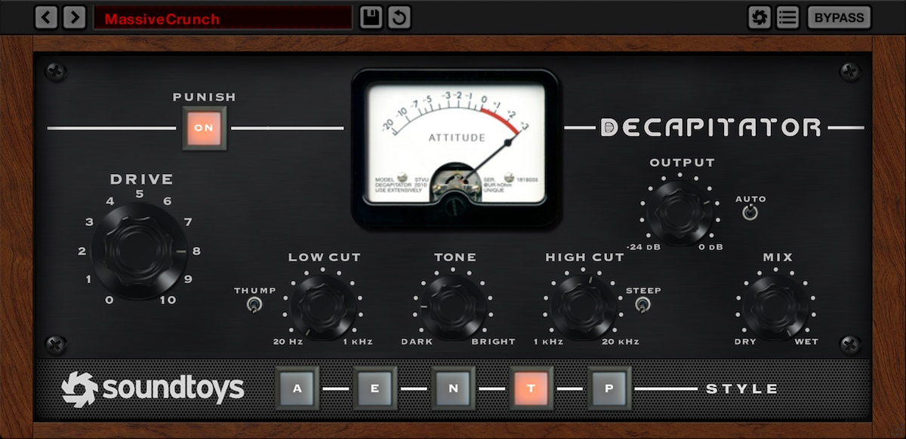
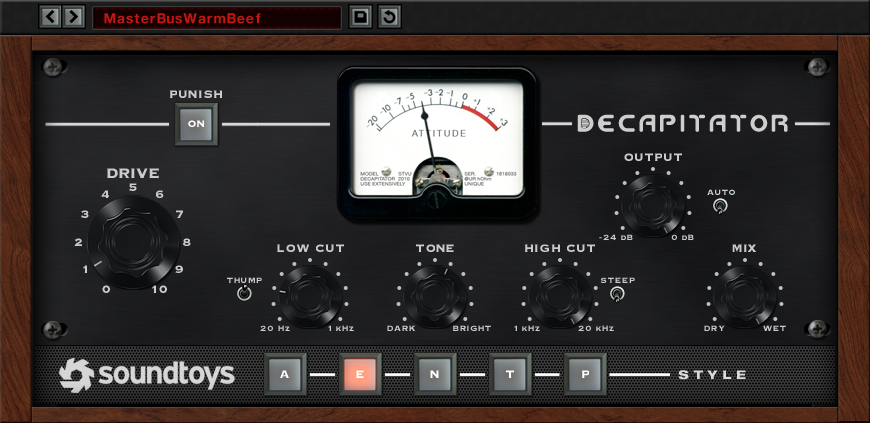
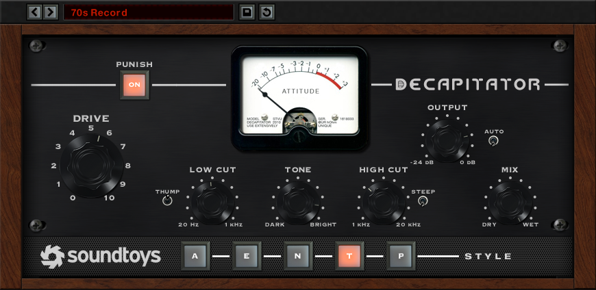

# Decapitator

Soundtoys' **Decapitator** ("Analog Saturation Modeler"), from Soundtoys' own **Decapitator User's Guide,
Version 5** (`soundtoys.com/wp-content/uploads/Decapitator-Manual.pdf`, © 2015, 12 pages: "the manual"), the
original March 2010 manual, the **Soundtoys 5 User Guide** (version 5.5: knobs, presets, resizing), Soundtoys'
product page and release log, reviews (Sound On Sound 2010 and 2016, Tape Op, Barry Rudolph, Splice, Audio
Plugin News), the engineers who've said how they use it, and the circuit and DSP literature behind its five
styles. Anything the sources don't give is marked **not stated**; anything worked out rather than read is marked
**(inferred)**. The last sections are ours: a [decimation stage](#6-decimation-the-crush-stage-ours) Soundtoys
doesn't have, [what we'd build](#7-proposed-for-ytstudio), [how it'd be built here](#8-how-itd-be-built-here) and
[the questions for Théo](#9-open-questions-for-théo).

The pictures in `img/` are Soundtoys' own screenshots, © Soundtoys, kept here only as a private reference for
building this app. Don't ship them, and don't copy Soundtoys' artwork: we copy how it works and how it's laid
out, in our own visual style.



> **What was asked, and how it's read (an open question).** Théo asked for "a decimator/distorter that should
> be really good for vocals and shit like that". We suggested Decapitator; he replied "I do like Decimator. I'm
> a big fan." That was dictated, and there is no well-known plugin called Decimator he could mean in this
> context, so this document reads it as **Decapitator**. Because he asked for a *decimator* as well as a
> distorter, it also proposes a full decimation stage of ours (bit depth and sample-rate reduction, after the
> classic samplers), [section 6](#6-decimation-the-crush-stage-ours). If he meant a dedicated bit crusher
> instead (D16's Decimort, say), section 6 is that plugin, and sections 1 to 5 still describe the distortion.

## Contents

1. [What it is](#1-what-it-is)
2. [The panel](#2-the-panel)
3. [The factory presets](#3-the-factory-presets)
4. [The sound](#4-the-sound)
5. [How it works: the DSP](#5-how-it-works-the-dsp)
6. [Decimation: the Crush stage (ours)](#6-decimation-the-crush-stage-ours)
7. [Proposed for YTStudio](#7-proposed-for-ytstudio)
8. [How it'd be built here](#8-how-itd-be-built-here)
9. [Open questions for Théo](#9-open-questions-for-théo)
10. [Sources](#10-sources)

---

## 1. What it is

### What it's for

- An **analogue saturation** effect: it drives the sound into one of five models of studio hardware "pushed
  beyond its normal limits", from barely there to "all-out chaos and screaming distortion". Soundtoys:
  "Saturation has been used to beef things up, thin them out, give them edge, fry them up nicely, add warmth,
  smooth over, pull elements out of the mix, and create signature sounds."
- It's **not a guitar amp simulator** and **not a tape emulation**: the 2010 manual opens with "it's NOT a guitar
  amp modeler, and it's not a tape saturation plug-in". It models *channels*: preamps, an input module, a studio
  distortion box.
- **Its claim is dynamics**: "not a static convolution-style snapshot of saturation, but rather changing,
  responsive models … it has the analog feel and responds to the dynamics of the audio that is passed through
  it." The models were made "to very closely match the harmonic structure, frequency response, and dynamic
  response of analog gear as it is being pushed beyond its normal limits."
- One window, few controls. Sound On Sound's verdict: "a near-perfect balance between versatility and ease of
  use". Cons: "None."

### History and lineage

| When | What |
| --- | --- |
| March 2010 | Decapitator 1.0, with PanMan, in SoundToys Native Effects V4. The 2010 manual is 11 pages. $179 native, $349 TDM |
| July 2010 | Sound On Sound reviews it with PanMan (Sam Inglis) |
| Nov 2010 | Ken Bogdanowicz: "We learned so much developing the modeling technology that's in Decapitator, and we plan to take it even further with Juice" (an input channel modeller then in public beta; **not stated** whether it shipped) |
| 2015 | Soundtoys 5: AAX, the Effect Rack, a preset manager with Compare; the 12-page V5 manual. 5.0.1 fixes Output not recalling |
| 2018 | 5.2.4: "Adjusted levels of Decapitator's 'Dark Drive' preset" |
| 2020 | 5.3.3: fixes AutoGain changes flooding Ableton's undo history (Auto moves a parameter the host sees) |
| 2022–23 | Native Apple Silicon (5.3.7); high-resolution graphics (5.4) |
| July 2025 | 5.5.2: a resizable window for every plug-in |
| 2026 | 5.5.5 (build 19885 on KVR): nothing for Decapitator. $199. KVR Readers' Choice, saturation, 2024 and 2025 |

No control has changed since 2010: the 2010 and 2015 manuals describe the same knobs in nearly the same words.

**The hardware** (all of it, Soundtoys say, in their lab in Burlington, Vermont; Bogdanowicz also names preamps
from Universal Audio and API among what they studied, though no style is named after them):

| Style | Modelled on | What the hardware is |
| --- | --- | --- |
| **A** | The **Ampex 350** tape recorder's preamp | 1950s valve electronics (octal **12SJ7** pentodes; the later 351 used 12AX7s), big input and output transformers, a single-ended output stage, about **90 dB of gain**. "Often, the preamp sections were pulled out, rewired, and used as stand-alone mic pres." Found at "Sun, Stax, Motown, and Chess Records" |
| **E** | The **Chandler Limited / EMI TG Channel** | Wade Goeke's licensed recreation of the EMI TG12345 consoles of Abbey Road (late 1960s, the first transistorised EMI desks). Its preamp, the TG2, recreates the EMI **TG12428**: "discrete transformer balanced amplifiers … warmth and punch … small rise in its top-end frequency response and some warmth inducing distortion" (Chandler) |
| **N** | The **Neve 1057** input channel | Early Neve, **germanium** transistors (the manual: "think vintage FuzzFace") and Gardner transformers. First fitted in the 80 Series console Rupert Neve built for Chicago Sound Studios in 1968. The later, better-known 1073 (1970) is silicon: the BC107 (1966) was more consistent and quieter than germanium |
| **T** | The **Thermionic Culture Culture Vulture**, triode setting | "The first dedicated studio (meaning 'not just for guitar') distortion device" (the manual). Its distortion valve is a **6AS6 / 5725 pentode**; "T" runs it triode-strapped, "all even harmonics" (its manual). Input valve EF86 (EF95 on the Mastering model), output 5963 (12AU7 family) |
| **P** | The same, **pentode** setting ("P1") | The 6AS6 as a pentode: "odd harmonics". The Culture Vulture's other modes (P2's inverted dynamics, P3's octave-up rectification) aren't in Decapitator |

The Culture Vulture's own numbers give a sense of scale: 0.2 % THD clean, up to **98 % THD**, up to 76 dB of
gain; "Drive" adds +10 dB with some top boost, "Overdrive" **+28 dB**; a 12 dB/octave filter at 4 or 7 kHz;
bias from 0.25 mA (cleanest) to 0.4 mA ("warmer and fatter").

### Why producers reach for it

- **It's fast and it flatters.** Fab Dupont calls it "instavibe-in-a-box"; Tchad Blake: "I like it on everything."
  Tape Op's reviewer uses it "on nearly every one of my mix projects".
- **Harmonics instead of EQ.** Bassy Bob Brockmann (Soundtoys): "Recently I've been replacing the EQ with the
  Decapitator … it adds harmonics to the vocal, and that equates to more high or low frequency detail."
- **808s and bass on small speakers.** Konstantin Kersting (Tones And I, "Dance Monkey"): "There's a Decapitator
  on the 808, because you need a bit of distortion on them to make them cut through on small speakers." Sound On
  Sound: bass is "the killer application".
- **The parallel Mix.** The dry sound brings back the transients the saturation shaves off, "similar to 'Parallel
  Compression'", without a send.
- **Punish.** One button turns a colour box into a fuzz.

### What makes it sound the way it does

Five things, each of which this document turns into DSP:

1. **Each style's curve and its bias.** Even harmonics from asymmetric (single-ended valve, germanium) stages,
   odd from symmetric or pentode ones; the curves converge at extreme drive, so…
2. **…the frequency shaping around the curve decides most of what you hear.** Low Cut, Thump and Tone go *before*
   the saturation ("it will affect which frequencies get distorted, and can have a dramatic effect"); High Cut
   *after* (to "tame any 'fizzy' frequencies"). Each hardware unit has its own shaping too (the TG's top lift,
   the Culture Vulture's top-boosted Drive).
3. **Dynamics.** Bias that shifts with the signal (a valve's grid conduction charging its coupling capacitor,
   "blocking"), transformer cores that saturate first in the lows: the sound blooms and breathes instead of
   being a fixed curve.
4. **Gain staging.** A Drive that's a real input gain plus 20 dB more, and an Auto that turns the output down to
   match.
5. **The parallel Mix.**

---

## 2. The panel



One fixed panel, no Tweak drawer (Sound On Sound, 2016: Decapitator has none). The V5 manual's screenshots are
870 × 423 px; Soundtoys' 5.5 product shot is 1200 × 583.

- **Top row**: **Punish** (a lit button) on a line leading to the **Attitude meter** (a VU, centre), then the
  **DECAPITATOR** name.
- **Left**: **Drive**, the big chicken-head knob, numbered 0 to 10 round it.
- **Right**: **Output** (−24 dB … 0 dB) with the **Auto** switch beside it.
- **Middle row**: **Thump** (a small toggle) and **Low Cut**; **Tone**; **High Cut** and **Steep** (a toggle);
  **Mix**.
- **Bottom strip**: the five **Style** buttons **A – E – N – T – P**, joined by a line, labelled STYLE.
- **Above it**, Soundtoys 5's preset bar: ◀ ▶, the preset's name in a red LCD (a click: the preset menu), Save,
  Compare (the circular arrow, red once the preset is edited); in 5.5 also a settings cog, a menu (Interface
  Size, help) and **Bypass**.

### The controls

| Control | Range (as marked) | Default | Scale | What it does |
| --- | --- | --- | --- | --- |
| **Drive** | 0 … 10 | **not stated** | Numbered, linear in its numbers **(inferred)** | The input gain into the saturation: "operates just like an input control into an analog circuit: the harder the signal is pushed, the more it will saturate." It raises the output level too |
| **Punish** | Off / On | Off | Button | "Adds an extra 20db of gain to the signal being sent through Decapitator." Raises the output level too |
| **Low Cut** | 20 Hz … 1 kHz | **not stated** (screenshots: at or near 20 Hz) | Log **(inferred)** | A high-pass **before** the saturation: removes the lows "before they hit the (virtual) saturation circuit … to prevent any 'flabbiness'". Slope **not stated**. "At extreme settings you can get some very low-fi telephone and AM radio effects, especially when used together with the High Cut" |
| **Thump** | Off / On | Off | Toggle | "A few dB of low frequency boost right at the Low Cut frequency", like tape's head bump: Sound On Sound calls it "an optional resonant hump at the cutoff frequency". Before the saturation, so it feeds it more lows |
| **Tone** | Dark … Bright | Centre **(inferred)** | Bipolar | "A very gentle sloping equalizer, similar to the old tone control on AM radios or a tilt EQ." Dark: lows up, highs down; Bright: the reverse. **Before** the saturation. Pivot and range **not stated** |
| **High Cut** | 1 kHz … 20 kHz | **not stated** (screenshots: mostly at 20 kHz) | Log **(inferred)** | A low-pass **after** the saturation, to "remove high frequencies from the distorted sound … the amount of 'Fizz' you'd like to leave in" |
| **Steep** | Off / On | Off | Toggle | The High Cut's slope: off "a very gentle 6 dB per octave rolloff", on "a super-steep 30 dB per octave". For a guitar-cabinet sound: Steep on, High Cut "somewhere in the 4kHz to 5 kHz range" |
| **Output** | −24 dB … 0 dB | **not stated** | dB | The output level. Whether it goes above 0 dB is **not stated** (the markings end there) |
| **Auto** | Off / On | **not stated** (one site says on) | Toggle | Auto-Gain: "will automatically turn down the output as you increase the drive level. Notice that as you adjust the Drive control, the Output control will move in the opposite direction." A static link to Drive, not a level follower **(inferred)**: the knob moves when Drive moves |
| **Mix** | Dry … Wet | Wet **(inferred)** | 0 … 100 % | The original against the processed: "restore the transients of your original sound that get chopped off by the saturation stage" |
| **Style** | A, E, N, T, P | **not stated** | Radio buttons | The saturation model ([section 1](#history-and-lineage)) |

Not on the panel, and **not stated** anywhere: an input level control or input/output meters, oversampling or
a quality setting, stereo link or mid/side, a noise floor. Soundtoys' Output knob is a parameter Auto moves, so
hosts see Auto's changes as automation (the 5.3.3 Ableton fix).

### The Attitude meter



- "A highly responsive VU meter useful as a visual indicator of the audio level in relation to the Drive
  control. **The Attitude Meter does not measure output** from Decapitator." So it reads what the saturation is
  being fed: the level after Drive (and Punish).
- Its look is a vintage Simpson VU "as featured in the Ampex 35X series", in bakelite. Scale **−20 −10 −7 −5 −3
  −2 −1 0 +1 +2 +3**, red from 0 to +3, labelled ATTITUDE. The nameplate's small print: "MODEL DECAPITATOR 2010 …
  USE EXTENSIVELY … UNIQUE".
- "Highly responsive" suggests faster than a true VU (300 ms to 99 %); its actual ballistics and its 0 VU
  reference are **not stated**.

### Mouse and keyboard (Soundtoys 5)

| Gesture | Does |
| --- | --- |
| Drag up or right / down or left | Turn a knob |
| Click a knob's text marking (some knobs) | Jump to that value |
| Double-click | The knob's default |
| Click the knob's title | Show its exact value (clicking again toggles back) |
| ⌘-drag (Shift on Windows) | Fine control |
| Ctrl+⌥-click (Ctrl+Alt) | **Parameter lock**: the title goes red and loading presets leaves the knob alone (not saved with the session) |
| Click a switch | Toggle it; style buttons are a radio group |
| Drag the lower-right corner (5.5.2+) | Resize; or Interface Size: 75, 100, 150 (default), 175, 200 % |

### Presets and A/B

- ◀ ▶ step through presets; the name opens the preset menu (folders, Save, Save As, Organize).
- **Compare**: once a preset is edited the button lights red; clicking it toggles between the preset as saved
  and the edits. "You need to save changes to a preset before selecting another preset, otherwise the edits
  will be lost!"
- There's no A/B of two edits of your own beyond Compare.

---

## 3. The factory presets

Soundtoys publishes no list. A snippet (unverified) puts it at about 45. Names seen in screenshots, the release
log and Soundtoys' pages:

| Preset | Seen with | Purpose (from the name and settings) |
| --- | --- | --- |
| **MasterBusWarmBeef** | E, Drive ≈ 1, Punish off | A touch of console warmth on a mix bus |
| **70s Record** | T, Punish on, Drive ≈ 5.5, High Cut ≈ 5 kHz | A darker, saturated record |
| **MassiveCrunch** | T, Punish on, Drive ≈ 8, fully wet | Fuzz |
| **BlitzedOut** | E, Punish on | Destroyed |
| **DrumFattener2** | A, Punish off | Drums, bigger |
| **Dark Drive** | (its levels changed in 5.2.4) | Darker distortion |
| **Dash of Culture** | | A little Culture Vulture |
| Beefy, Punchy, MixInSomeEdge | (unverified snippets) | |

Artist preset packs (Preset Expanders, 2010–11): **Tchad Blake** (Vol. 12, all Decapitator, from his mix of the
Black Keys' *Brothers*), Morgan Page, Emmett Farley, Mark Ronson. Not in the product.

---

## 4. The sound

### 4.1 Each style, in a producer's words

| Style | Soundtoys | Others | What we aim for |
| --- | --- | --- | --- |
| **A** | "Ultra-ultra-smooth" tube distortion; "We like this one A LOT!" (2010) | "A monster of thick harmonics and breaks up after a steep compression curve" (forum, unverified). Barry Rudolph on guitar: A, Drive 3.5, Thump: "very thick and well-saturated". Stu White on an 808 layer: A, Punish, Drive 7 | Round and warm. Rises gently from clean, mostly 2nd harmonic at low drive, never edgy; compresses as it's driven. The safest style on a vocal |
| **E** | "A beefy low end coupled with a smooth but airy top-end sheen" | "Full, rich and airy vintage sound" (Splice); "the most transparent at light touches" (forum, unverified). Trevor Wright, drum bus: "beefing things up while still keeping the top-end nice" | Weight in the lows, a lift in the air; clean longest, then a firm transistor edge. A bus and drum style |
| **N** | "A weighty but solid low end with focused but not narrow mids, just begging for the needle to be pegged to hear those Germaniums sing" | "Nice warm midrange" (Splice); "Neve dullness" (forum, unverified) | Mid-forward and a bit dark; the richest high harmonics of the five (germanium's "fizz-fuzz" when pushed); sputters a little under Punish |
| **T** | "Loads of even harmonic distortion … warm and punchy … especially useful to add some attitude to drums" | Rudolph on drums: T, Drive ≈ 5, Tone a little past noon | Even harmonics up front (the octave above), punch on transients: the bias moves on each hit, so attacks bloom |
| **P** | "Usually characterized by odd harmonic distortion" | Rudolph on a lead vocal: P, Punish, Low Cut ≈ 800 Hz, Drive 1: "angry" | Harder knee, odd harmonics, rasp in the upper mids; the aggressive vocal style |

### 4.2 What each control does to the sound

- **Drive**: louder and denser together; with Auto off the level rises until the curve's ceiling, then mostly the
  density rises.
- **Punish**: into fuzz. "Each analog style screams out in beautiful agony differently when punished." At that
  much gain every curve is close to a square wave (the harmonic tables in 5.4 converge), so what still tells the
  styles apart under Punish is their **frequency shaping and dynamics** (inferred): where the emphasis sits,
  how the bias sags and recovers.
- **Low Cut**: less mud and IMD (bass and vocal beating against each other in the curve), thinner, more
  "telephone" at its top. Rudolph's 800 Hz on a vocal is the classic aggressive-vocal trick: only mids and highs
  distort, the body comes back through Mix.
- **Thump**: a fatter, rounder low end into the curve (and distortion of it): kick and 808 weight.
- **Tone**: Dark distorts the body (warm, woolly), Bright distorts the edge (crunch, presence, sibilance).
- **High Cut / Steep**: gentle at 6 dB/oct (a darker record), a cabinet at 30 dB/oct and 4–5 kHz. It's *the*
  fizz control.
- **Mix**: parallel saturation: density and harmonics without losing the attack.

### 4.3 On vocals

What engineers have said they do:

- **Illangelo** (The Weeknd, "The Hills", chorus vocal): "I pressed the Punish button and drove it just a touch",
  then FabFilter Volcano after it "to filter out some of the harmonics the Decapitator adds".
- **Barry Rudolph**: P, Punish, Low Cut ≈ 800 Hz, Drive 1, an "angry" lead vocal.
- **Machine** (Lamb of God vocals): Punish on, Low Cut and Tone shaping the distorted low end, almost fully wet,
  the highs cut.
- **Tape Op's reviewer**: on vocals often to *reduce* harshness while keeping the transients.
- **Sound On Sound**: "Low to moderate settings work nicely on rock vocals." Bassy Bob replaces EQ with it.

Recipes we'd ship as presets (ours, **(inferred)** from the above):

| Use | Style | Drive / Punish | Filters | Mix |
| --- | --- | --- | --- | --- |
| Warmth and presence, any vocal | A or E | 2–4, off; Auto on | Low Cut 80–150 Hz, High Cut 12–16 kHz | 30–60 % |
| Aggressive rap or rock vocal | P | 1–3, **on** | Low Cut 300–800 Hz, Tone a little Bright, High Cut 6–9 kHz, Steep off | 20–40 %, or 100 % on a send |
| Hook doubles, ad-libs (gritty, small) | N or T | 4–6, off | Low Cut 400 Hz, High Cut 5 kHz Steep | 100 % |
| Telephone / radio | T or P | 5, off | Low Cut ≈ 1 kHz, High Cut 3–3.5 kHz Steep | 100 % |
| Lo-fi vocal (with the Crush stage, section 6) | N | 3, off | Low Cut 300 Hz, High Cut 7 kHz | 60–100 % |

Why it works on vocals: saturation is fast compression (peaks rounded) plus harmonics where the ear is most
sensitive, so a vocal sits forward at the same level. What goes wrong on vocals: **sibilance** (a broadband
"s" through a curve becomes splatter: an alias-free design matters most here), breaths and room noise brought
up by the compression, and harshness at 2–5 kHz from odd harmonics of the mids.

### 4.4 Drums, bass and 808s, buses

- **808s**: harmonics at 2f and 3f land at 80–200 Hz, which phones and laptops play when they can't play a 45 Hz
  fundamental. Kersting, Stu White ("a life-saver when I get a weak bass or 808"), Calin Enache ("can make any
  bass or 808 sound massive").
- **Drum bus**: E or T, Drive 3–5, Mix 40–70 %. Trevor Wright puts it first on his drum bus. Sound On Sound: from
  "beef up a wimpy drum sound in a very natural and engaging way" to "savage yet somehow inviting distortion
  beloved of bands like Flaming Lips".
- **Mix bus**: MasterBusWarmBeef: E, Drive ≈ 1.

### 4.5 What bad distortion sounds like, and why

| Symptom | What it is | Cause | Our cure |
| --- | --- | --- | --- |
| **Aliasing**: inharmonic whistles, a "digital grit" not in tune with the note, tones that fall as a note rises, sibilants turned to crackle | Harmonics above Nyquist folding back down | A nonlinearity run at the host rate. Decapitator itself is reported not to oversample (Audio Plugin News; forum reports of aliasing at 44.1/48 kHz that's gone at 96 kHz, unverified) | 8× linear-phase oversampling plus first-order antiderivative anti-aliasing: 5.7 |
| **Fizz**: a papery, buzzy top, 6–15 kHz | High-order harmonics of the upper mids and of sibilance | Hard curves fed broadband | Soft curves at moderate drive; the emphasis pairs choose what distorts; High Cut after |
| **Harshness** at 2–5 kHz | Odd harmonics of the mids, IMD | Symmetric hard clipping of the whole mix | Asymmetric styles, Tone Dark, Low Cut |
| **Mud, "flabbiness"** | Bass intermodulating with everything | Lows driven into the curve | Low Cut before the curve (the manual's reason for it) |
| **Plastic, static** | The same curve at every level and moment | A memoryless waveshaper | Bias shift and transformer saturation: 5.5 |
| **Louder = better** illusions | Comparing at different levels | Drive raises the level | Auto, calibrated so it matches within 0.5 dB |
| **Thumps** after loud hits | DC from an asymmetric curve, moving bias | No DC blocking | DC blocker after the curve; bias moves at audio-safe speeds |
| **Zipper noise** on automation | Gain or coefficients stepping per block | No smoothing | Every control glides: 5.10 |
| **Phasey parallel mix** | The wet path late or phase-shifted against the dry | Oversampling filters that aren't linear-phase, latency not matched | Linear-phase filters, the dry delayed by exactly the latency: 5.8 |

---

## 5. How it works: the DSP

Soundtoys publish nothing of Decapitator's internals and nobody has published measurements of it (no
harmonic plots, THD curves or Plugin Doctor analyses turned up). So this section reconstructs it from what the
manual states about the signal flow, what the hardware is and does, and the literature. How sure each value is:

| Tag | Meaning |
| --- | --- |
| **[P]** | Published: the manual, a paper, a datasheet, a standard. In [Sources](#10-sources) |
| **[D]** | Derived: worked out here from published facts or by simulation (the working is shown or described) |
| **[E]** | Estimate: what the hardware is known to sound like, put into numbers. Tune by ear |

### 5.1 The chain

The manual fixes the order of the user's controls [P]: Low Cut, Thump and Tone before the saturation, High Cut
and Steep after, Drive and Punish as the input gain, Output and Auto after, Mix around it all. The rest is ours.

```
 input (each channel alike)
   │
   ├────────────────────────────────────────────────┐
   ▼                                                │
 ↑ upsample ×R  (R = 8 at 44.1/48 kHz)              │
   ┆ ── inner rate, 352.8 or 384 kHz ──             │
   ▼                                                │
 [Crush, Pre]                                       │
 Drive + Punish            (0 … +30 dB, +20)        │
 Low Cut (+ Thump)         before the saturation    │
 Tone (tilt)               before the saturation    │  dry, delayed by exactly
 style emphasis (boost)                             │  the latency (a whole
 iron (transformer)                                 │  number of samples)
 CURVE: ADAA, moving bias  ───► Attitude meter      │
 style de-emphasis (its inverse)                    │
 style colour                                       │
 DC block                                           │
 [Crush, Post]                                      │
 High Cut (6 or 30 dB/oct) after the saturation     │
   ┆                                                │
   ▼                                                │
 ↓ downsample ×R                                    │
 Output (or Auto)          on the wet only          │
   │                                                │
   ▼                                                ▼
 Mix ─────────────────────── wet × mix + dry × (1 − mix) ───► output
```

Why each block is where it is:

- **Everything between ↑R and ↓R runs oversampled**, filters included: no cramping of a 20 kHz High Cut or a
  bright Tone at 44.1 kHz, and the sound is the same at every host rate (5.7) [D].
- **Drive before the filters** makes no difference to a linear filter, but the meter reads after them, at the
  curve's input: "the audio level in relation to the Drive control" [P/D].
- **The emphasis pair** (a boost before the curve, its exact inverse after) decides *what distorts first*
  without changing the small-signal response: the same trick as tape's pre-emphasis in EchoBoy's Tape
  saturation (`echoboy-dsp.md` 3.4) [D].
- **The style's colour** (its small-signal frequency response, within ±1.5 dB) is separate from the emphasis, so
  Drive 0 sounds like the hardware passing a quiet signal [D].
- **Iron** (transformer saturation) before the stage curve: an input transformer is the first thing a hot signal
  meets in A, E and N [E].
- **DC block** after the curve: asymmetric curves and moving bias make DC [P: standard practice].
- **High Cut last inside the oversampled section**: it's the manual's post-saturation filter, and running it
  oversampled means its 6 dB/oct slope is the analogue one to 20 kHz [P/D].
- **Output after ↓R, on the wet only; Mix last** against the latency-aligned dry: Mix 0 is the input, untouched
  (5.8) [D].

### 5.2 Gain staging and calibration

Soundtoys don't publish Drive's gain, the meter's reference or where the curves sit. Ours:

| Quantity | Value | Basis |
| --- | --- | --- |
| Drive gain | **G = 3 dB × Drive**: 0 … +30 dB, linear in dB along the numbers | E (Rudolph's "Drive 1 + Punish" makes an angry vocal; MassiveCrunch's Drive 8 + Punish is fuzz: both fit) |
| Punish | **+20 dB** on top: +50 dB at most | P |
| Curve scale | The curves are written in **dBFS units**: u = 1 is digital full scale, each curve's ceiling is near ±1 | D (so a hot track at Drive 0 already colours, as the hardware would at line level) |
| **0 VU** | **−18 dBFS RMS** of a sine at the curve's input (after Drive, Punish, Low Cut, Tone and emphasis) | E (the usual plug-in alignment of 0 VU = +4 dBu = −18 dBFS); a vocal at −18 dBFS RMS sits at 0 VU at Drive 0 |
| Small-signal gain | **1 (0 dB)** at every style's centre frequency: Drive changes distortion, not level, until the curve compresses | D |
| Output | −24 … 0 dB on the wet | P (the markings) |

With these, a vocal at −18 dBFS RMS: Drive 0 is colour (0.4–3 % THD by style), Drive 5 (+15 dB) is clearly
saturated, Drive 10 (+30 dB) is distortion, and any Punish is fuzz. Drive's level gain is bounded by the
curves' ceilings, which is why an Output that only turns *down* by 24 dB is enough to match it (inferred from
the markings): at worst a −18 dBFS signal comes out near full scale, ≈ +17 dB louder.

### 5.3 The curves

Every style's static nonlinearity is one of four families, each **normalised to slope 1 at 0** (and its bias's
offset subtracted, so silence stays silent), each with a **closed-form antiderivative** for ADAA (5.7) [D]:

| Family | f(u) | F₀(u) = ∫f (constant dropped) | Character |
| --- | --- | --- | --- |
| **Biased tanh** (valve) | `(tanh(s·u + b) − tanh(b)) / (s·sech²(b))` | `(ln cosh(s·u + b) − s·u·tanh(b)) / (s²·sech²(b))` | Soft. b ≠ 0 gives a quadratic term, so **2nd harmonic ∝ level** (H2/H1 ≈ ½·s·tanh(b)·a for amplitude a), then 3rd as it's driven: a triode's order [D] |
| **Biased algebraic** (transistor + transformer) | `(g(s·u + b) − g(b)) / (s·g′(b))`, `g(v) = v/√(1+v²)`, `g′(b) = (1+b²)^(−3/2)` | `(√(1+(s·u+b)²) − s·u·g(b)) / (s²·g′(b))` | Softer onset than tanh, harmonics close to tanh's (Vicanek: b₃ = −a³/8 vs −a³/12); first-order ADAA on it needs no fallback branch [P] |
| **Germanium exponential** | u ≥ 0: `(1 − e^(−kₚ·u))/kₚ`; u < 0: `−(1 − e^(kₙ·u))/kₙ` | u ≥ 0: `u/kₚ − (1 − e^(−kₚ·u))/kₚ²`, u < 0: `−u/kₙ − (1 − e^(kₙ·u))/kₙ²` (F₀(0) = 0, continuous at 0) | Its curvature jumps at 0 (a u·\|u\| term): 2nd **and** a long tail of odd harmonics at low levels, the "buzz" of germanium; kₚ ≠ kₙ for asymmetry [D] |
| **Biased cubic** (pentode) | `(c(s·u + b) − c(b)) / (s·c′(b))`, `c(v) = v − v³/3` for \|v\| ≤ 1, `±2/3` beyond | `c`'s antiderivative: `v²/2 − v⁴/12` inside, 5/12 + 2/3·(\|v\| − 1) outside, chained through s and b | Pure 3rd harmonic until the knee, then all the odd harmonics at once: the pentode's "sudden onset" (the Culture Vulture manual on P2) [D/P] |

Note: each F₀ above is for the curve as written; with the normalisation `f(u) = (h(s·u+b) − h(b))/(s·h′(b))`
the antiderivative is `F₀(u) = (H(s·u+b) − H(b) − s·u·h(b)) / (s²·h′(b))` where H = ∫h (the `− H(b)` makes
F₀(0) = 0, which keeps ADAA's subtraction precise: Parker et al.). Write that once, generically, and every
family only supplies `h`, `h′(b)` and `H` [D]. Evaluate `ln cosh` as `|x| + log1p(e^(−2|x|)) − ln 2` (no
overflow) [D].

**Harmonics of the four, as tuned for the five styles** (a 1 kHz sine, the static curve alone, before any
filters; levels are sine RMS dBFS at the curve's input; H2…H5 in dB re the fundamental) [D: computed]:

| Style | Curve | 0 VU (−18): THD, H2 / H3 / H4 / H5 | +10 VU (−8): THD, H2 / H3 | +20 (+2) THD | Punish (+22) THD | Gain at +10 VU |
| --- | --- | --- | --- | --- | --- | --- |
| **A** | tanh, s = 0.5, b = 0.15 | 0.66 %, −44 / −64 / −102 / −127 | 2.1 %, −34 / −44 | 7.3 % | 39 % | −0.2 dB |
| **E** | algebraic, s = 0.8, b = 0.06 | 0.67 %, −44 / −52 / −88 / −101 | 2.8 %, −35 / −33 | 13 % | 40 % | −0.6 dB |
| **N** | germanium, kₚ = 1.0, kₙ = 0.55 | 1.5 %, −40 / −39 / −78 / **−55** | 4.6 %, −31 / −29 | 12 % | 38 % | −1.5 dB |
| **T** | tanh, s = 1.0, b = 0.35 | 3.0 %, **−31** / −55 / −78 / −114 | 8.6 %, −22 / −35 | 19 % | 42 % | −0.5 dB |
| **P** | cubic, s = 1.1, b = 0.02 | 0.38 %, −54 / **−50** / — / — | 3.6 %, −43 / **−29** | 28 % | 43 % | −0.9 dB |

Read across: T is the even-harmonic style (H2 25 dB above H3 at 0 VU), P the odd one (H3 above H2 at every
level, and the steepest rise: 0.4 % to 28 % over 20 dB), A the smoothest (H4, H5 below −100 dB), N the one with
the high-order tail (H5 at −55 dB where the others are below −100). By +22 dB all five are near 40 % THD and
H3 ≈ −10 dB: the square wave. These parameters are a starting point to tune by ear; the tests in 8.6 hold them
to relations (which harmonic leads, how THD rises), not exact numbers, until a tuning is approved.

### 5.4 The styles

Each style is a table of values for the same blocks (as EchoBoy's styles are). Values are [E] unless marked.

| Block | **A** (Ampex 350) | **E** (TG Channel) | **N** (Neve 1057) | **T** (CV triode) | **P** (CV pentode) |
| --- | --- | --- | --- | --- | --- |
| Emphasis (before; exact inverse after) | Low shelf +3 dB at 150 Hz, Q 0.7: the lows saturate first ("tape-preamp warmth") | Low shelf +4 dB at 100 Hz: "beefy low end" driven | Peaking +4 dB at 1.2 kHz, Q 0.6: "focused but not narrow mids" | High shelf +4 dB at 2.5 kHz: the Culture Vulture's Drive "with some top boost" [P] | Peaking +6 dB at 2 kHz, Q 0.8: the pentode's rasp |
| Iron (5.5) | Input transformer, amount 0.3, a little DC flux (single-ended output: 2nd harmonic in the lows) | Amount 0.5 (transformer-balanced amplifiers [P]) | Amount 0.35 (Gardner transformers [P]) | Amount 0.15 (output transformer only) | Amount 0.15 |
| Curve | tanh s 0.5, b 0.15 | algebraic s 0.8, b 0.06 | germanium kₚ 1.0, kₙ 0.55 | tanh s 1.0, b 0.35 | cubic s 1.1, b 0.02 |
| Bias shift β, attack, release (5.5) | 0.15, 5 ms, 300 ms (slow bloom, "breathing") | 0.05, 2 ms, 100 ms (silicon, feedback-stabilised: barely moves) | 0.25, 1 ms, 80 ms (germanium "sputter" under Punish) | 0.35, 2 ms, 120 ms (the punch) | 0.20, 1 ms, 60 ms (spits) |
| Colour (small-signal response, after) | 1-pole low-pass at 18 kHz; low shelf +0.5 dB at 80 Hz | High shelf +1.5 dB above 10 kHz ("airy top-end sheen", Chandler's "small rise in its top end" [P]); low shelf +0.5 dB at 80 Hz | Low shelf +1 dB at 80 Hz ("weighty"); 1-pole low-pass at 14 kHz | Flat | Flat; 2-pole high-pass at 40 Hz (the CV's coupling) |
| Harmonic aim | H2 > H3 at low level, very low H4+ | H2 ≈ H3, clean longest at low level | H2 ≈ H3, the richest H5–H9 | H2 ≫ H3 | H3 > H2 everywhere |

The Culture Vulture's own **filter** (4 or 7 kHz, 12 dB/oct) is left to Decapitator's High Cut, as Soundtoys did
[P: no such control in Decapitator].

### 5.5 Dynamics: bias shift and iron

**Bias shift ("blocking distortion")** [P: Pakarinen & Yeh, the mechanism; D/E: this model]. In a valve stage
driven past grid conduction, grid current charges the coupling capacitor, which moves the stage's bias negative
while the signal is loud and lets it back over the capacitor's time constant: loud hits briefly change the curve
(less gain, more asymmetry), then it recovers. That's the "responds to the dynamics" and the punch on drums. The
germanium stage's bias drifts with its collector current in a similar way. Model it feed-forward, so the
curve's input is still a plain function of the signal plus a slow offset (ADAA stays valid):

```cpp
// per oversampled sample, per channel; v0 = s*u + b0 is the stage's input at its static bias
const float drive = std::max (v0 - conduct, 0.0f);      // grid conduction above `conduct` (0.3 for valves, 0.5 for germanium)
env += (drive > env ? attackCoef : releaseCoef) * (drive - env);
const float b = b0 - beta * env;                         // the bias right now
y = curveAdaa (s * u + b, ...) - h (b) ...;              // the curve at the moving bias; its offset h(b) taken off
```

Subtracting `h(b)` (the curve's output at the current bias) keeps the moving bias from appearing as a step at
the output; the DC blocker removes what's left. Attack 1–5 ms, release 60–300 ms (the coupling RC: 0.1 µF ×
1 MΩ = 100 ms [D]). β is the style's amount (5.4). Under Punish, N's large β and fast release make the negative
half drop into cutoff on decays: a gated "sputter", the Fuzz Face's character, the manual's own comparison.

**Iron (transformer saturation)** [P: Whitlock/Jensen, the behaviour; D: this model]. A transformer's core flux
is the integral of the voltage, so it halves for every octave up: distortion "roughly quarters for every
doubling of frequency" (84 % nickel cores), is mostly 3rd harmonic, and turns to 2nd with DC magnetisation (a
single-ended stage's standing current). Cheap model:

```cpp
phi += lpCoef * (x - phi);                              // flux: a 1-pole low-pass at ~20 Hz, gain set so |phi| = |x| at 40 Hz
const float p = phi + dcFlux;                            // A only: the single-ended stage's standing flux (0.1)
const float excess = amount * p * p * p / (1.0f + p * p);// magnetising current beyond linear: cubic, then growing only linearly
y = x - (excess - amount * dcFlux * dcFlux * dcFlux / (1.0f + dcFlux * dcFlux));
```

At 40 Hz the cubic term gives 3rd harmonic ∝ amount·a²; at 1 kHz the flux is 25× smaller, so its distortion
is ~600× (56 dB) lower: the lows thicken and the mids pass clean, as iron does. It's polynomial-then-linear,
so it adds little aliasing; it isn't run through ADAA [D].

### 5.6 Filters

All are analogue prototypes discretised by the bilinear transform at the **oversampled** rate (warping is
negligible at 352.8 kHz: a 20 kHz corner lands 1 % low unwarped; pre-warp anyway), run as **TPT state-variable
filters** (Simper/Zavalishin), so they can move every sample without clicks [P].

| Filter | Design | Basis |
| --- | --- | --- |
| **Low Cut** | 2nd-order high-pass, Butterworth (Q 0.707), 20 Hz – 1 kHz on a log taper | Slope not stated; 12 dB/oct is the console standard [E] |
| **Thump** | The same high-pass with **Q 1.6**: +4.1 dB at the corner, a +4.5 dB peak at 1.11 × the corner | "A few dB … right at the Low Cut frequency" [P]; Q computed [D] |
| **Tone** | A first-order tilt about **1 kHz** (a pole and a zero two octaves apart, the pivot between them): lows −t, highs +t, `t = 6 dB × Tone` (Tone −1 … +1): 12 dB from end to end, 11.7 dB between 100 Hz and 10 kHz | "Very gentle sloping" [P]; pivot and range [E]; response computed [D] |
| **High Cut** | 1-pole low-pass, 1 – 20 kHz on a log taper: −3 dB at the corner, −7 dB an octave above | 6 dB/oct [P] |
| **Steep** | 5th-order Butterworth (two SVF sections, Q 0.618 and 1.618, and a 1-pole): −3 dB at the corner, **−30.1 dB an octave above** | 30 dB/oct = 5 poles [P/D] |
| **DC block** | 1-pole high-pass at 5 Hz, `y = x − x₁ + R·y₁`, R = e^(−2π·5/fs) | [P: Smith, CCRMA] |

Thump and Steep switch by crossfading over 10 ms between the old and the new filter's output (both run during
the fade) [D].

### 5.7 Aliasing: oversampling and ADAA

A saturator's harmonics run past Nyquist and fold back as inharmonic tones. Two tools, used together:

- **Oversampling** pushes Nyquist up so the harmonics fade before they fold; the decimation filter must then
  remove everything that would fold *into the audible band*.
- **First-order ADAA** (Parker, Zavalishin & Le Bivic, DAFx-16; Bilbao, Esqueda, Parker & Välimäki, 2017):
  replace `y[n] = f(x[n])` by `y[n] = (F₀(x[n]) − F₀(x[n−1])) / (x[n] − x[n−1])`, and by `f((x[n] + x[n−1])/2)`
  when `|x[n] − x[n−1]| < 1e-5`. It's the curve's output convolved with a one-sample box, which attenuates the
  harmonics that fold to low frequencies most. It costs half a sample of delay and a gentle low-pass (on small
  signals it's `(x[n] + x[n−1]) / 2`: a zero at the inner Nyquist, −0.14 dB at 20 kHz at 8×, which the
  style's colour can take back) [P/D].

Parker et al.'s measurement [P]: to match the aliasing of a hard clipper with first-order ADAA at 4×, plain
oversampling needs 12×. Vicanek: "ADAA combined with 4x oversampling makes aliasing practically a non-issue
even for a hard clipper." FabFilter Saturn's "Good" quality is 8×; Yeh's thesis: "for high quality distortion
effects, an oversampling factor of 8× is sufficient".

**What it does here** [D: simulated for this document, 44.1 kHz, the P and tanh curves above, a sine at
−18 dBFS RMS; "worst" = the loudest component below 20 kHz that isn't a harmonic, in dB re the fundamental]:

| Gain into the curve | Sine | No oversampling | 4× | 4× + ADAA | **8× + ADAA** |
| --- | --- | --- | --- | --- | --- |
| +15 dB (Drive 5) | 10 kHz (P) | −23 | −147 | −147 | **−147** (none found) |
| +30 dB (Drive 10) | 5 kHz (P) | −19 | −56 | −79 | **−100** |
| +30 dB (Drive 10) | 10 kHz (P) | −14 | −38 | −63 | **−86** |
| +50 dB (Punish) | 1 kHz (P) | −32 | −55 | −74 | **−100** |
| +50 dB (Punish) | 5 kHz (P) | −18 | −35 | −57 | **−67** |
| +50 dB (Punish) | 10 kHz (P) | −13 | −29 | −52 | **−62** |

The other curves, with their styles' emphasis (+4 dB) added to the gain, land close to P's: with Punish, N
(germanium, whose `u·|u|` kink makes the slowest-falling harmonics) gives −107 / −73 / −65 dB at 1 / 5 / 10 kHz
and T −109 / −68 / −63; at Drive 10 without Punish both are at −88 dB or better at every frequency.

Read: no oversampling (what Decapitator reportedly does) puts the fold-back of a punished 5 kHz component
18 dB under it, plainly audible; 8× with ADAA puts it 67 dB under, where a punished vocal's own harmonics mask
it. At ordinary drive it's gone.

**The decimation filter is as important as the factor.** The first simulation used a short filter and every
case stuck near −35 dB: the 5th harmonic of 4987 Hz, at 24.9 kHz, passed the filter's transition band and
folded to 19.2 kHz. The rule [D]: **the passband ends at 20 kHz and the stopband starts at fs − 20 kHz** (24.1
kHz at 44.1 kHz), so whatever leaks folds above 20 kHz. Those two edges are symmetric about fs/2, which is
exactly a **half-band** filter's shape at 2×: the first 2× stage is a steep half-band FIR (≈ 155 taps for 110 dB
at 44.1 kHz, ≈ 85 at 48 kHz, every other tap zero), the later stages are short (their transition bands are
wide).

**The design** [D]:

| Host rate | Factor R | Inner rate | Stages (linear-phase half-band FIRs, up and down) | Latency (estimate) |
| --- | --- | --- | --- | --- |
| 44.1 kHz | 8 | 352.8 kHz | 2× steep (20.0 → 24.1 kHz, 110 dB), 4× (≈ 19 taps), 8× (≈ 11 taps) | ≈ 83 samples, 1.9 ms |
| 48 kHz | 8 | 384 kHz | 2× (20 → 28 kHz), 4×, 8× | ≈ 48 samples, 1.0 ms |
| 88.2 / 96 kHz | 4 | 352.8 / 384 kHz | 2× (20 → 68 / 76 kHz: short), 4× | ≈ 10 samples |
| 176.4 / 192 kHz | 2 | 352.8 / 384 kHz | 2× (short) | ≈ 4 samples |

- **The inner rate is always 352.8 or 384 kHz**, so the curves, bias shift, filters and the Crush stage behave
  the same at every host rate: a song sounds the same exported at 44.1 or 48 kHz [D].
- **Linear phase, not IIR.** A polyphase IIR half-band (HIIR, JUCE's `filterHalfBandPolyphaseIIR`) is cheaper
  and has less latency, but its phase isn't linear: mixed with the dry sound at Mix 50 % it comb-filters the
  top octave. Linear-phase FIRs and a dry delayed by the same whole number of samples make Mix exact [D].
- **Latency is a whole number of samples.** Sum each stage's delay (up and down), ADAA's half sample and the
  Crush stage's one sample (both at the inner rate: 1/16 and 1/8 of a host sample), and pad at the inner rate
  up to the next whole host sample [D]. The engine reports it; `Song::compensate` delays everything else by it.
- JUCE's `juce::dsp::Oversampling` (FIR equiripple; `getLatencyInSamples()`, `useIntegerLatency`) would do,
  but its default stage specs (transition width 0.05 on the first stage, −90/−75 dB) don't follow the fs − 20
  kHz rule exactly; designing our own half-bands (Kaiser-windowed, at prepare time on the message thread) is
  little code and lets the rule hold at every rate [P: JUCE source; D].

### 5.8 Output, Auto and Mix

- **Output** is a gain on the wet after ↓R, −24 … 0 dB, smoothed over 20 ms [P/D].
- **Auto** sets Output from Drive and Punish (and the style), so the wet's loudness matches the input's: on
  pink noise at **−18 dBFS RMS** (0 VU), the wet's RMS (20 Hz – 20 kHz) equals the input's. Soundtoys' Auto is a
  link (the knob moves opposite to Drive) [P], so ours is a table: `autoOutput(style, punish, drive)`, 21
  points per style and Punish state, measured from the engine by a calibration script (8.3) and interpolated
  linearly in dB [D]. A static table can only be exact at one level: a much quieter track is turned down more
  than it was raised, a louder one less (it compresses more). That's what the hardware's trim would do too.
- **Mix** (0 … 100 %) blends the wet with the **dry delayed by exactly the latency L**: `out = mix·wet + (1 −
  mix)·dry[n − L]`, a linear crossfade (wet and dry are correlated, so equal-gain, not equal-power) [D]. Output
  applies to the wet only, so **Mix 0 is the input, bit for bit, whatever else is set** (Soundtoys don't say
  whether their Output is before or after Mix: **not stated**).
- FL's **slot mix** (every effect slot has one) is a second, outer blend, and also needs the latency-held dry:
  the way `runProQ` does it with `mixDry` [D: engine code].

### 5.9 The Attitude meter's ballistics

A true VU reaches 99 % of a step in 300 ms with 1–1.5 % overshoot (ANSI C16.5, IEC 60268-17) [P]. As a
second-order system: **ζ = 0.80, fₙ = 2.09 Hz** (ωₙ = 13.13 rad/s) gives 1.5 % overshoot and 99 % at 300 ms [D:
computed]. "Highly responsive" [P] suggests faster; ours: the same damping at **fₙ = 4 Hz** (99 % in ≈ 160 ms),
an open question.

The engine runs the meter (so live and export agree and nothing is lost between events): the curve's input,
full-wave rectified (a VU's rectifier averages), through the second-order filter at the host rate, per channel,
the louder of the two reported with each transport event as `VU = 20·log10(a · 1.1107 / 0.1259)`, where `a`
is the filtered level, 1.1107 (π / 2√2) makes a sine's average read as its RMS, and 0.1259 is −18 dBFS: 0 VU
for a −18 dBFS RMS sine. The tab draws the needle at that position; it pegs at +3 (its stop) [D].

### 5.10 Stereo, smoothing, denormals, safety

- **Stereo**: two independent channels (dual mono, like two hardware units), the same settings, each with its
  own bias shift, iron and filter states. A mono sound stays mono, exactly [D].
- **Smoothing** [D]:
  - Drive and Punish: the total gain in dB, ramped linearly over 30 ms (so per sample it's multiplicative),
    computed at the inner rate. Punish's 20 dB step takes 30 ms.
  - Filter corners (Low Cut, Tone, High Cut, Crush rate): smoothed in log-frequency over 20 ms, coefficients
    recomputed once per host sample (every R inner samples).
  - **Style**: a 20 ms linear crossfade between the old and the new style's chain, both running during it
    (each channel keeps two chains, preallocated; the second idles otherwise). Curves can't be interpolated
    safely between families.
  - Output and Mix: linear over 20 ms.
- **Denormals**: `juce::ScopedNoDenormals` around `process` (FTZ/DAZ) [P]; the slow envelopes and the DC blocker
  would otherwise fall into denormals on silence.
- **Safety**: after ↓R, a transparent guard (`echo::safety`: untouched below ±1, held under ±2) catches anything
  a bad setting could make; a non-finite sample resets the state (and is counted for the tests) [D].
- **The audio thread** never allocates, locks or does I/O: the half-band kernels, both style chains, the Crush
  buffers and the dry delay line are made on the message thread when the song is parsed or the effect is first
  made (at its sample rate and the song's longest block) [P: the engine's rules].

### 5.11 CPU budget

Per channel per host sample at 48 kHz, 8× [D: counted]:

| Part | Cost |
| --- | --- |
| Up and down sampling (half-band FIRs, symmetric, half the taps zero) | ≈ 2 × (43 + 2·10 + 4·6) ≈ 175 multiply-adds |
| Linear filters at 8× (Low Cut, Tone, emphasis ×2, colour ≤ 2, DC, High Cut ≤ 3 sections, iron's pole) | ≈ 8 × 11 × 5 ≈ 440 |
| Curve with ADAA at 8×: one `log1p`/`exp`-class call each | ≈ 8 transcendental calls (or a 4096-point table with cubic interpolation, Bilbao et al.'s choice) |
| Bias shift, meter, smoothing | ≈ 8 × 6 |

About 1000 flops per sample per channel: ≈ 100 Mflop/s for a stereo instance, around **2–4 % of one core** (a
reasonable target for a release build; the export runs tracks on every core). During a style crossfade, twice
that for 20 ms.

---

## 6. Decimation: the Crush stage (ours)

Soundtoys' Decapitator has no decimation. Théo asked for a decimator too, so we add one: a **Crush** stage
inside Decapitator, done the way the classic samplers did it and the best plugins do it, oversampled with the
rest so its aliasing is the *intended* kind only.

### 6.1 What the classics are

| Unit | Rate | Depth | Filters | What it sounds like, and why |
| --- | --- | --- | --- | --- |
| **E-mu SP-1200** (1987) | **26.04 kHz** | 12-bit linear (no companding) | **An input anti-alias filter** (op-amp, rolling off above ~15 kHz: a little aliasing between 13 and 15 kHz). **Outputs**: 1–2 through SSM2044 4-pole low-passes with a decaying cutoff; 3–4 and 5–6 fixed low-passes; **7–8 none** ("raw DAC") | Its sound is **imaging and drop-sample pitching**, not input aliasing: "the primary sonic characteristic of the SP-12 is aliasing due to its poor output filters and its rudimentary tuning algorithm" (Yeh, Nolting & Smith, who measured one). The popular "no anti-alias filter" story conflates the missing *reconstruction* filter with the input |
| **E-mu SP-12** (1985) | 27.5 kHz nominal; **26 kHz measured** | 12-bit | As the SP-1200 | |
| **Akai S950** (1988) | **7.5 – 48 kHz**, continuously variable | 12-bit | An anti-alias filter that **tracks the rate** (bandwidth = rate / 2.5: 19.2 kHz at 48 kHz, 10 kHz at 25 kHz); a switched-capacitor filter (contested: 36 dB/oct or 2-pole) | Producers sampled at low rates for longer sample times, and got the darker, softer sound with it |
| **Akai MPC60** (1988) | **40 kHz** | 16-bit converters, **"special non-linear 12-bit" storage** (manual) | 20 Hz – 18 kHz | Companded 12-bit: quiet details keep more resolution than linear 12-bit, loud ones get coarser steps |
| **E-mu Emulator II** (1984) | **27.7 kHz** | **8-bit, μ-255 companded** (DPCM by some accounts: unresolved) | SSM2045 24 dB/oct resonant low-passes | Crunchy transients, grainy decays |
| **Roland SP-404 MkII** | — | — | Lo-fi: Pre Filt (6 types), Lofi Type (1–9), Tone, Cutoff (200 Hz – 8 kHz) | Character presets rather than numbers |
| **D16 Decimort 2** | 44 Hz – 44.1 kHz, Jitter | Resolution in bits, **DC Shift** (mid-riser / mid-tread), Dithering | **Approximative filter** (pre, at the new Nyquist, its offset sets how much aliases) and **Images filter** (post); a filter LP/BP/HP/BR pre or post | "Ultra low aliasing": the aliasing is only the intended kind |
| **Ableton Redux** (Live 12) | 40 Hz – 40 kHz, Jitter 0–1 | 1–16 bits, **Shape** (linear → A-law), DC Shift | Pre filter on/off, Post filter with **Octave** (its corner around the new Nyquist) | |
| **FL Studio Fruity Squeeze** | — | **Squarize** (bit reduction) | Filter pre/post, a "Puncher" | Image-Line's; no sample-rate reduction |
| **Airwindows DeRez2** | Fractional rate | Fractional bits; at "Hard" 0, **μ-law** encode/decode | Holds the previous sample at a transition: "eerily reminiscent of old digital hardware" | |
| **TAL-Sampler** | Real resampling | DAC modes: Emu II, AM6070, S1000… | A steep 96 dB reconstruction filter, or none | "We don't make cheap bit crushing … We really down-sample" |
| Soundtoys **Radiator**, **Devil-Loc** (context) | | | | Soundtoys' other grit: an Altec 1567A valve mixer (97 dB of gain) and the Shure Level-Loc brick-wall limiter. Neither decimates |

### 6.2 What makes a decimator good

- **Exact timing.** A naive hold that changes value only on host samples (or rounds the period to whole host
  samples) beats against the host rate: the sound changes between 44.1 and 48 kHz and adds inharmonic tones.
  The hold's steps must land at their exact fractional times, band-limited [D; Yeh et al. on interpolating onto
  the target clock].
- **Only the intended aliasing.** Two kinds: the fold *about the new rate* (what makes it a decimator: keep, with
  an optional anti-alias filter to control it) and images folding a second time *about the host's Nyquist* (an
  artefact of doing it at the host rate: remove). Running the stage at the inner rate with the half-band
  decimators after it removes the second kind.
- **Quantisation that behaves**: mid-tread (silence stays silent; small signals gate to zero, the 8-bit
  "breathing"), optional TPDF dither (no distortion, a steady hiss), companding for the old samplers' grain.
- **The filters are the character.** No reconstruction filter: bright, metallic images (SP-1200 outputs 7–8);
  a tracking anti-alias filter: dark and soft (S950).

### 6.3 Its controls

The Crush panel slides out under the main panel (a button **CRUSH** in the style strip, lit when it's on), as
PanMan's Tweak does.

| Control | Range | Default | What it does |
| --- | --- | --- | --- |
| **Crush** | Off / On | Off | The stage, in or out (crossfaded over 20 ms) |
| **Rate** | 1 kHz … 48 kHz, log | 26.04 kHz | The sampler's clock |
| **Bits** | 1 … 24, continuous | 12 | The quantiser: 2^Bits levels (fractional bits allowed, as Airwindows and Decimort do) |
| **Law** | Linear … μ-law (0 … 100 %) | 0 % | Companding before the quantiser: μ = 255^Law − 1 (0 linear, 254 at the top); 8 bits at 100 % is the Emulator II's grain |
| **Jitter** | 0 … 100 % | 0 % | Each sample period varies at random by up to ±25 % (repeatable: seeded by the effect's id) |
| **Anti-alias** | Off / Soft / Steep | Off | Before sampling, a low-pass that tracks the rate: Soft 2-pole at 0.45 × rate (cheap samplers), Steep 6-pole Butterworth at 0.4 × rate (the S950's tracking filter) |
| **Images** | Raw / Filtered | Raw | After the hold: Raw is the zero-order hold's staircase (SP-1200 outputs 7–8); Filtered is a 4-pole Butterworth at 0.45 × rate (its filtered outputs) |
| **Dither** | Off / On | Off | TPDF dither, ±1 LSB, before the quantiser |
| **Position** | Pre / Post | Pre | **Pre**: the sampler first, then the console (in, Crush, Drive …): how sampled beats were made, an SP-1200 into a desk. **Post**: after the saturation, before High Cut: the saturated sound sampled, High Cut (with Steep) as its reconstruction filter |
| **Machine** | menu | Custom | Sets the controls above to a sampler's: see 6.4. Any change after shows "Custom" |

### 6.4 Machines

| Machine | Rate | Bits | Law | Anti-alias | Images | Basis |
| --- | --- | --- | --- | --- | --- | --- |
| **SP-1200 (raw out)** | 26.04 kHz | 12 | 0 % | Soft (its input filter above ~15 kHz is near Nyquist: little effect) | Raw | P (rate, depth, outputs 7–8); E (filter as Soft) |
| **SP-1200 (filtered out)** | 26.04 kHz | 12 | 0 % | Soft | Filtered | P (outputs 3–6 are filtered; their corners not found: E) |
| **SP-12** | 26.0 kHz (as measured) | 12 | 0 % | Soft | Raw | P (Yeh's measurement) |
| **S950 (long sample)** | 20 kHz | 12 | 0 % | Steep | Filtered | P (variable rate, tracking filter); E (the rate chosen) |
| **MPC60** | 40 kHz | 12 | 35 % | Steep | Filtered | P (40 kHz, non-linear 12-bit); E (its curve, unpublished, as partial μ-law) |
| **Emulator II** | 27.7 kHz | 8 | 100 % | Steep | Filtered | P (27.7 kHz, 8-bit μ-255); E (filters) |
| **Telephone (G.711)** | 8 kHz | 8 | 100 % | Steep | Filtered | P (G.711 μ-law at 8 kHz) |
| **Toy** | 6 kHz | 6 | 0 % | Off | Raw | E |
| **Digital (no filters)** | 11.025 kHz | 8 | 0 % | Off | Raw | E |

### 6.5 The DSP

At the inner rate fᵢ (352.8 or 384 kHz), per channel, the two channels sharing one clock (a stereo sampler has
one clock; independent jitter per channel would widen a mono sound, as Ableton notes of Redux) [P/D]:

```cpp
// Runs one inner sample late, so the input around a capture instant (x[n-2] .. x[n+1]) is known and
// the step's correction can still be added to the sample before it. Before it: the anti-alias filter
// (Soft / Steep) tracking `rate`; after it: the Images filter (Filtered) tracking `rate`.
// period: the current sample period in inner samples, fi / rate * (1 + jitter * 0.25 * u), u in [-1, 1].
float y = held;                                         // the naive staircase at sample n
phase += 1.0 / period;
if (phase >= 1.0)                                       // a capture between samples n-1 and n
{
    phase -= 1.0;
    const float d = (float) (phase * period);          // inner samples from the capture instant to n (0 <= d < 1)
    const float at = hermite (1.0f - d, x[n-2], x[n-1], x[n], x[n+1]);  // the input at the instant itself
    float c = compand (at, mu);                         // sgn(x) * ln(1 + mu|x|) / ln(1 + mu); x itself when mu = 0
    if (dither)
        c += lsb * (uniform (rng) - uniform (rng));     // TPDF: two uniforms in [0, 1), ±1 LSB
    c = lsb * std::floor (c / lsb + 0.5f);              // mid-tread; lsb = 2 / 2^bits
    const float next = expand (juce::jlimit (-1.0f, 1.0f, c), mu);
    const float h = next - held;                        // a step of h, d samples before n
    previous += h * d * d * 0.5f;                       // 2-point polyBLEP: the sample before the step...
    y = next - h * (1.0f - d) * (1.0f - d) * 0.5f;     // ...and the one after it
    held = next;
    period = fi / rate * (1.0 + jitter * 0.25 * (2.0 * uniform (rng) - 1.0));
}
emit (previous);                                        // one inner sample late
previous = y;
```

- **The capture instant is interpolated**: the input is read *at* the sample instant, between inner samples, by
  4-point Hermite. At 8× the input is already band-limited to 20 kHz, so Hermite is accurate (Yeh: splines need
  4× oversampling, which we exceed) [P/D].
- **The step is band-limited** with a 2-point polyBLEP: a step of height h at fraction d before sample n adds
  `h·d²/2` to sample n − 1 and `−h·(1 − d)²/2` to sample n (relative to the naive staircase). One inner sample
  of delay [D: standard polyBLEP; applying it to a sample-and-hold is our inference].
- **The images it makes** follow the zero-order hold's `sinc(f / rate)` [D]: with Rate 8 kHz and a 3 kHz tone
  (Images Raw), the tone is −2.1 dB, its image at 5 kHz −6.5 dB (−4.4 dB re the tone), at 11 kHz −13.4, 13 kHz
  −14.8, 19 kHz −18.1. These exact figures are what the tests check.
- **Companding** is G.711's continuous μ-law [P]: `F(x) = sgn(x)·ln(1 + μ|x|)/ln(1 + μ)`,
  `F⁻¹(y) = sgn(y)·((1 + μ)^|y| − 1)/μ`. Measured here [D]: a −30 dBFS sine through 8 bits is 22 dB above
  its quantisation noise linear, **38 dB** with μ-law (and 47 dB at 12 bits linear); at −6 dBFS, linear 8-bit
  wins (47 against 39 dB). That trade is the old samplers' sound: grainy loud parts, clean quiet ones.
- **Dither** is TPDF, ±1 LSB (two uniforms subtracted); it turns quantisation's level-dependent distortion into
  a steady hiss [P].
- **Jitter** comes from a xorshift32 seeded by the effect's id, restarted when play starts: a render is the same
  every time (as PanMan's Random) [D].
- **Fractional bits**: lsb = 2 / 2^bits for any real bits, so Bits glides without steps when automated [D].
- **DC**: mid-tread keeps silence silent; no DC is added, so no extra blocking is needed [D].
- **Rate changes** are glided in log-frequency over 20 ms (the period follows) [D].

### 6.6 Where it goes, and why Pre by default

```
 Pre:   in ─► ↑R ─► [anti-alias ─► sample & hold ─► quantise ─► images] ─► Drive ─► Low Cut … CURVE … ─► High Cut ─► ↓R
 Post:  in ─► ↑R ─► Drive ─► Low Cut … CURVE … DC ─► [anti-alias ─► S&H ─► quantise ─► images] ─► High Cut ─► ↓R
```

Pre is how the records were made (the sampler's output into a console and its saturation), and the saturation
rounds the staircase's edges. Post makes Decapitator's harmonics part of what's sampled and folded: harsher,
more digital, with High Cut + Steep as the reconstruction filter. In Pre the quantiser sees the input's own
level, so a quiet track uses fewer of the bits, exactly as sampling a quiet record did.

---

## 7. Proposed for YTStudio

### Decided (to check with Théo)

Built from his request (2026-10-02: "a decimator/distorter that should be really good for vocals"; "I do like
Decimator. I'm a big fan."). What's chosen:

- **A stock effect of ours**, chosen from an effect slot's picker (Built in → Decapitator), as Gross Beat and
  PanMan are. Its settings are **in the song** (`MixerEffect.decapitator`): every change is undone, saved, and
  read and set by the assistant.
- **Its window is ours**, Decapitator's layout in the app's look: the preset bar, Punish and the meter on top,
  Drive left, Output and Auto right, the four small knobs in a row, the style buttons at the bottom, and the
  **Crush** panel sliding out under it. No wood, no chicken-heads, no Soundtoys artwork. The meter is drawn on
  a canvas in the app's colours, a needle on a scale −20 … +3 with its red zone.
- **A new Decapitator** is A, Drive 3, Punish off, Low Cut 20 Hz, Thump off, Tone centre, High Cut 20 kHz,
  Steep off, Auto on, Mix 100 %, Crush off: warm, and safe on anything.
- **Oversampled and alias-free**, unlike the original: 8× (4× at 88.2/96, 2× above) with linear-phase half-band
  filters and first-order ADAA; latency ≈ 1–2 ms at 44.1/48 kHz, reported to delay compensation.
- **Auto** follows Drive, Punish and the style; turning Output by hand turns Auto off (keeping the value).
- **Mix** is in it, latency-aligned; Output is on the wet. The slot's mix works too.
- **The Crush stage** (section 6), off by default, Pre by default, with its Machines.
- **Automatable**: Drive, Low Cut, Tone, High Cut, Output, Mix, Crush Rate, Crush Bits (Create automation clip
  from their menus). Punish, Style and the switches aren't (the lanes glide; a switch has nothing to glide).
- **Factory presets**: ours, with the names Soundtoys' screenshots show where we know the idea
  (MasterBusWarmBeef, 70s Record, MassiveCrunch, BlitzedOut, DrumFattener2, Dark Drive, Dash of Culture), plus
  vocal, 808 and Crush ones (4.3): about 24.

### First, then later

| Step | What |
| --- | --- |
| **1** | The five styles, every control, the meter, Auto, Mix, oversampling + ADAA, presets, automation, tools, tests |
| **2** | The Crush stage and its Machines |
| Later | A **harmonics display** (H1…H9 bars of the current setting, measured by the engine on a test tone it runs aside, or a live spectrum): Decapitator has none, and it would show *why* styles differ. Mid-riser quantising (Decimort's DC Shift). An SP-1200 "drop-sample" pitch mode (a Crush that also repitches, Yeh's tuning algorithm). Parameter lock while browsing presets. Upgrading EchoBoy's and PanMan's saturations to the same oversampling and ADAA |

### Where YTStudio differs

| What | Soundtoys | YTStudio |
| --- | --- | --- |
| Look | Black panel, walnut cheeks, bakelite VU, chicken-head knobs | The app's surfaces, knobs and LCDs; the VU on a canvas in its colours |
| Aliasing | Reportedly none of oversampling: aliasing at 44.1/48 kHz | 8× + ADAA, linear phase; measured in tests |
| Latency | **Not stated** (none, if it doesn't oversample) | ≈ 1–2 ms at 44.1/48 kHz, compensated by the mixer |
| Decimation | None | The Crush stage |
| Auto | Moves Output; hosts see it as automation | Output is computed in TypeScript from Drive; an automated Drive with Auto on makes a matching Output lane |
| Knob gestures | Double-click default, ⌘-drag fine, click title for value, Ctrl+⌥ lock | The app's: Alt-click or middle-click default, Ctrl fine, right-click menu (Reset, Create automation clip), values on the hint bar |
| Presets | Files; Save, Save As, Organize; Compare | The factory presets; Revert; Copy / Paste of the whole effect. No saving yet (as PanMan) |
| Resizing | 75–200 % (5.5.2) | No: the window is the size of what's in it |
| Undo | The host's | The app's: every change is one step |
| The models | Soundtoys' measurements of their hardware | Ours, from the hardware's circuits and the manuals' descriptions; not measured against Decapitator |

---

## 8. How it'd be built here

As PanMan and Pro-Q are: settings in the song, what the controls *mean* decided in TypeScript, the sound made
natively in the engine, state kept by effect id.

### 8.1 The files

| File | What |
| --- | --- |
| `shared/music/types.ts` | `Decapitator`, `DecapStyle`, `DecapCrush`, `DecapControl`; `MixerEffect.decapitator`; `AutomationTarget` `{ kind: "decapitator"; effect; control }` |
| `shared/music/decapitator-presets.ts` | `DECAPITATOR_PLUGIN = { id: "vaudio:decapitator", name: "Decapitator", format: "YTStudio" }`, `isDecapitator`, the constants and ranges, `DECAP_STYLES` (names and one-line details), `DECAP_MACHINES`, `DECAP_CONTROLS` (automatable: name, range, log, format), `DECAP_LANE_SCALE`, `normalizeDecapitator`, `DECAPITATOR_PRESETS`, `DEFAULT_DECAPITATOR`, and `AUTO_GAIN` (the calibration table, generated) |
| `shared/music/decapitator.ts` | The edits (`updateDecapitator`, `loadDecapPreset`, `setDecapStyle`, `decapEdited`, `adjacentPreset`), `autoOutput`, and `engineDecapitator` (what the engine plays) |
| `shared/music/compile.ts` | `EngineEffect.decapitator`; the lanes of kind `decap`, and the derived Output lane when Auto is on and Drive is automated |
| `shared/music/engine.ts` | `EngineTransport.decapitators: Record<effectId, { vu: number }>` (the needle, in VU) |
| `engine/src/Oversampler.h/.cpp` | The half-band FIR cascade (design at prepare, process per block, integer latency). The engine's first; reusable |
| `engine/src/Saturation.h` | The four curve families, their antiderivatives and first-order ADAA (header-only, inline) |
| `engine/src/Crusher.h` | The Crush stage (clock, capture, compand, quantise, dither, polyBLEP hold, tracking filters) |
| `engine/src/Decapitator.h/.cpp` | `decap::Settings` (parsed), `decap::State` (per effect: oversampler, two chains per channel, the dry delay, meters), `decap::Registry` |
| `engine/src/Song.cpp/.h`, `Sequencer.cpp/.h` | Parse `vaudio:decapitator`; `Song::compensate` adds `effect.decap->latency()`; `Sequencer::runDecapitator` (its own Mix inside; the slot's mix against a latency-held dry, as `runProQ`); `Lane::Kind::decap` and `setDecapControl` |
| `server/music/fake-engine.mjs` | Accepts the effect, reports a latency and a quiet meter |
| `src/suites/music/decapitator/` | `decapitator-window.tsx`, `vu.ts` (the needle on a canvas, from `useTransport().decapitators`), `crush-panel.tsx`, `actions.ts` (open, presets, Revert, Copy / Paste), `store.ts` (open windows, Crush panel open), `tool-edits.ts` (+ test) |
| `src/suites/music/mixer/inspector.tsx` | The Built in picker item ("Analogue saturation, five styles, and a sampler's crush"), the slot's name opening the window |
| `src/suites/music/tools.ts`, `shared/music/tools.ts` | The tools (8.5) |
| `scripts/decapitator-calibrate.ts` | Renders pink noise through the offline engine for every style, Punish state and 21 Drive values; writes `AUTO_GAIN` |
| `server/music/decapitator.integration.test.ts` | The sound, offline (8.6) |

### 8.2 The document

```ts
export type DecapStyle = "A" | "E" | "N" | "T" | "P";
export type DecapAntiAlias = "off" | "soft" | "steep";

export interface DecapCrush {
  on: boolean;
  position: "pre" | "post";
  /** Hz, 1000..48000. */
  rate: number;
  /** 1..24, fractional allowed. */
  bits: number;
  /** 0..1: linear to μ-law. */
  law: number;
  /** 0..1: up to ±25 % of a period. */
  jitter: number;
  antiAlias: DecapAntiAlias;
  /** false: the raw zero-order hold; true: filtered. */
  imageFilter: boolean;
  dither: boolean;
  /** The Machine last chosen (`DECAP_MACHINES` by name), or "Custom". */
  machine: string;
}

/** Decapitator's settings (`docs/soundtoys/decapitator.md`), Soundtoys' saturation, ours, with a sampler's crush. */
export interface Decapitator {
  /** The factory preset last chosen: the preset bar's name, what Revert goes back to. */
  preset: string;
  style: DecapStyle;
  /** 0..10: 3 dB a step into the saturation. */
  drive: number;
  /** +20 dB more. */
  punish: boolean;
  /** Hz, 20..1000, before the saturation. */
  lowCut: number;
  thump: boolean;
  /** -1 (Dark) .. 1 (Bright): ±6 dB of tilt about 1 kHz, before the saturation. */
  tone: number;
  /** Hz, 1000..20000, after the saturation. */
  highCut: number;
  /** 30 dB/oct instead of 6. */
  steep: boolean;
  /** dB, -24..0, on the wet. Ignored while `auto` (the knob shows `autoOutput`). */
  output: number;
  auto: boolean;
  /** 0..1, dry to wet. */
  mix: number;
  crush: DecapCrush;
}

export type DecapControl = "drive" | "lowCut" | "tone" | "highCut" | "output" | "mix" | "crushRate" | "crushBits";
```

`normalizeDecapitator` clamps every number to its range and replaces unknown enums with the defaults (or it's
dropped on load and save).

### 8.3 TypeScript decides, the engine plays

| Decided in TypeScript (tested) | Done in the engine |
| --- | --- |
| Drive → dB (3 dB a step), + Punish's 20 | The gain, smoothed, at the inner rate |
| Auto: Output from `AUTO_GAIN[style][punish]` at Drive, in dB | Output as a gain |
| The style → its whole table (emphasis, iron, curve family and parameters, bias shift, colour): `engineDecapitator` sends numbers, the engine knows no style names | Running the blocks with those numbers |
| Tone → ±dB; filter corners in Hz; Steep, Thump | The filters (TPT SVFs), their crossfades |
| Crush: Machine → its settings; Law → μ; Jitter → fraction; the seed from the effect id | Clock, capture, quantise, polyBLEP, filters |
| Lanes: values in the engine's units (Hz as log2, so they fit the lanes' ±64) | `setDecapControl` per 256-sample slice, as every lane |

Sending the style as numbers keeps every sound-defining value in tested TypeScript, as `CLAUDE.md` asks
("Add musical rules there, not in C++"), and lets a style be tuned without rebuilding the engine. The C++
defines only the four curve families (each needs its antiderivative in native code).

`EngineDecapitator` (sketch): `{ driveDb, outputDb, mix, emphasis: Section[], colour: Section[], iron: { amount,
dcFlux }, curve: { family, s, b, kp, kn }, bias: { conduct, beta, attack, release }, lowCut: { hz, q }, toneDb,
highCut: { hz, steep }, crush: { on, position, rate, bits, mu, jitter, antiAlias, imageFilter, dither, seed } }`.

**Auto's calibration** (`scripts/decapitator-calibrate.ts`, run by hand when a style is retuned, like
`make-kit.ts`): for each style, Punish off and on, Drive 0, 0.5 … 10: 10 s of seeded pink noise at −18 dBFS
RMS through the offline engine, Auto off, Output 0 dB, Low Cut 20 Hz, Tone 0, High Cut 20 kHz, Mix 100 %; the
output's RMS against the input's gives the dB to turn down. Written into `decapitator-presets.ts` as 2 × 5 ×
21 numbers. A unit test checks it's monotonic (never turns up as Drive rises) and within −24 … 0.

### 8.4 The engine

- `decap::State` per effect (kept across songs by effect id in `decap::Registry`, as PanMan's; the export makes
  its own registry, so it starts afresh): the oversampler's histories, per channel two `Chain`s (the second for
  style crossfades), the dry delay line (L samples plus the longest block), the bias envelopes, the Crush clock,
  the meter's filter states, the smoothed values. Everything is sized at construction (on the message thread)
  for the sample rate and the song's longest block. A new song with different settings keeps the state, so
  turning a knob never empties the filters or restarts the meter.
- **Latency**: `State::latency()` is fixed by the sample rate alone (R and the half-band lengths), so it never
  changes with settings, and toggling Crush or Punish never makes the song again. `Song::compensate` adds it for
  an enabled Decapitator, exactly as `tune->latency()` and `eqSettings->latency` are added now.
- **Bypassed** (`skipped()`): it costs nothing and adds no latency (`Song::compensate` counts enabled effects
  only, as for Pro-Q); its state stays. Re-enabling it makes the song again with its latency, exactly as
  toggling a linear-phase Pro-Q does now.
- **Reports**: the needle (VU) per effect in each transport event (`EngineTransport.decapitators`), only for the
  effects whose windows are open (as Pro-Q's analyser is asked for by `eqWatch`), so closed ones cost nothing.
- **Real-time rules**: no allocation, locks or I/O in `process`; parameters arrive with the song (an atomic
  pointer swap) and through lanes; the jitter's generator is a member xorshift.

### 8.5 The assistant's tools

| Tool | Kind | What |
| --- | --- | --- |
| `add_mixer_effect` | edit | Takes "Decapitator" (and "decap"), as it takes "PanMan" |
| `get_decapitator` | look | Its settings in words and numbers, the computed Output when Auto, the latency, and (if its window is open) the meter's VU |
| `update_decapitator` | edit | Any of: `style`, `drive`, `punish`, `lowCut`, `thump`, `tone`, `highCut`, `steep`, `output`, `auto`, `mix`, `preset`, and `crush` (any of its fields, or `machine` by name). The description tells the model the recipes (vocals, 808s, drum bus, lo-fi) and what each style is |
| `add_automation` | edit | "decapitator drive", "… low cut", "… tone", "… high cut", "… output", "… mix", "… crush rate", "… crush bits" |

`describeMixer` lists a Decapitator with its style and Drive ("Decapitator: P, Drive 2 + Punish, Mix 35 %").
Error messages name the allowed values ("style must be one of A, E, N, T, P: A is the Ampex 350 …").

### 8.6 Tests

**Offline, the real engine** (`server/music/decapitator.integration.test.ts`; songs built with the app's own
edits, a Decapitator on the master, rendered to WAV and measured; 48 kHz unless said; keep every level under
full scale, as the rendered WAV clips there). Spectra: 1 s windows (Blackman-Harris), harmonics read ±3 bins.

| # | Test | Pass when |
| --- | --- | --- |
| 1 | **Latency is exact.** An impulse (0.25) through every style at Drive 0, Crush off and on | The output's peak is at sample **L** (the reported latency); the response is symmetric about L to 1e-4 (linear phase); `outputLatencyMs` includes L. Also at 44.1 kHz |
| 2 | **Delay compensation.** The same sound on two tracks, one with a Decapitator at Mix 0, the other inverted, both to the master | The master is silent: peak below −120 dBFS |
| 3 | **Mix 0 nulls.** Drive 10, Punish, P, Crush on, Mix 0 | Output − input delayed by L: peak below −120 dBFS (bit-exact expected) |
| 4 | **Mix is aligned.** Renders at Mix 0, 100 and 37 % | The 37 % render equals 0.37·wet + 0.63·dry to 1e-5 (no comb filtering) |
| 5 | **Harmonic profiles.** A 1 kHz sine at −18 dBFS RMS; every style at Drive 0, 3, 6, 10, Punish off; filters at their open ends | **T**: H2 − H3 ≥ 15 dB at Drive 0 and ≥ 8 dB at Drive 3. **P**: H3 > H2 at every Drive, by ≥ 3 dB at Drive 0 and ≥ 10 dB at Drive 3. **A**: THD ≤ 1 % at Drive 0; H4…H9 ≤ −70 dB at Drive 0. **N**: the largest H5 + H7 of the five at Drive 3. **E**: THD at Drive 3 between A's and T's. **Every style**: THD never falls as Drive rises (0 to 10 in steps of 1). Then, once a tuning is approved, H2…H5 within ±1 dB of `decapitator-golden.json` |
| 6 | **Dynamics.** T: a 1 kHz burst at −6 dBFS for 200 ms, then −24 dBFS | In the first 20 ms after the step, H2 (re H1) differs from its value 1 s later by ≥ 3 dB; by 500 ms it's within 0.5 dB. A: the same with ≥ 1.5 dB. E: < 1 dB (barely moves) |
| 7 | **Aliasing, 44.1 kHz.** Sines at 1, 4.987 and 9.973 kHz, −18 dBFS RMS; every style; Drive 10 Punish off, and Drive 10 Punish on | The loudest non-harmonic component below 20 kHz, re the fundamental: Punish off **≤ −75 dB** at every frequency; Punish on **≤ −85 dB** at 1 kHz, **≤ −58 dB** at 5 kHz, **≤ −55 dB** at 10 kHz (5.7's simulation gave −86 or better, and −100 / −67 / −62 at worst: about 7 dB of margin). And a comparison render with oversampling forced off (a test-only setting) is ≥ 30 dB worse at 5 kHz, so the test proves it measures something |
| 8 | **The same at every rate.** Test 5's settings at 44.1 and 48 kHz | H2…H5 within 0.3 dB of each other |
| 9 | **Auto matches.** Seeded pink noise at −18 dBFS RMS, 10 s; every style, Drive 0…10 in steps of 1, Auto on | Output RMS within **±0.5 dB** of the input's with Punish off; **±1.0 dB** with Punish on |
| 10 | **Low Cut, Thump.** A −40 dBFS sweep (linear region), Drive 0, the response with the filter against without | At the corner: −3.0 ± 0.3 dB; Thump: +4.1 ± 0.5 dB at the corner, peak +4.5 ± 0.5 dB |
| 11 | **High Cut, Steep.** As 10 | At the corner −3.0 ± 0.3 dB both; an octave above: −7.0 ± 0.5 dB (6 dB/oct), **−30.1 ± 1 dB** (Steep) |
| 12 | **Before and after the curve.** A 300 Hz sine, Drive 8, High Cut 1 kHz Steep; a 100 Hz sine, Drive 8, Low Cut 1 kHz | High Cut attenuates the 7th harmonic (2.1 kHz) by ≥ 30 dB more than the 3rd (900 Hz): it's after. Low Cut lowers the 100 Hz sine's THD by ≥ 20 dB: it's before |
| 13 | **Tone.** Small signal, Tone −1 and +1, each against Tone 0 | The first-order tilt's: response at 100 Hz minus at 10 kHz **+11.7 ± 0.3 dB** (Dark), −11.7 ± 0.3 dB (Bright); 0 ± 0.1 dB at 1 kHz |
| 14 | **Crush images.** Crush Pre, Rate 8 kHz, Bits 24, Images Raw, Anti-alias off, Drive 0, A; a 3 kHz sine | Components at 5, 11, 13, 19 kHz at −4.4, −11.3, −12.7, −16.0 dB re the 3 kHz (± 0.3 dB, after dividing out A's small-signal colour); nothing else below 20 kHz above −80 dB (exact timing, no host-rate fold) |
| 15 | **Crush is rate-independent.** Test 14 at 44.1 and 48 kHz | The four image levels within 0.2 dB of each other |
| 16 | **Bits and Law.** A 997 Hz sine; Bits 8 | Signal to quantisation noise: at −6 dBFS linear 47 ± 1.5 dB; at −30 dBFS linear 22 ± 2 dB, μ-law (Law 100 %) 38 ± 2 dB |
| 17 | **Anti-alias.** Rate 8 kHz, a 7 kHz sine | Its alias at 1 kHz: Steep ≥ 40 dB lower than Off |
| 18 | **Jitter is repeatable.** Jitter 50 %, two renders | Identical sample for sample; and different from Jitter 0 |
| 19 | **No clicks.** A 220 Hz sine; mid-render: style A → P, Punish on, Steep on, Crush on (song edits), and an automation clip sweeping Drive 0 → 10 in 50 ms | No sample-to-sample step larger than 2 × the largest in the steady signal either side; energy above 15 kHz in the 50 ms around each change ≤ −50 dB re the signal |
| 20 | **Silence and safety.** Silence in, after a loud passage; full-scale noise at Drive 10 + Punish for 10 s, every style | Silence decays below −140 dBFS within 2 s with no DC; the noise render is finite throughout and its peaks ≤ +6 dBFS before Output |
| 21 | **Export = playback.** A short song, rendered live (offline engine) and exported | Identical (as the other built-ins' tests) |

**Unit tests (vitest, no engine)**: `normalizeDecapitator` (ranges, unknown enums, missing fields); every edit
returns the same song when nothing changes; `autoOutput` monotonic and in range; `engineDecapitator` (each
style's table, Punish's +20, Tone's dB, the Machine's settings, the seed stable per effect id); the lanes'
scaling within ±64; presets all valid; the Auto-derived Output lane when Drive is automated; the tool edits
(`tool-edits.test.ts`: names, errors, partial updates, Crush by Machine name).

**e2e** (`e2e/music.spec.ts`): add a Decapitator from an effect slot's picker, open its window, change style
and Drive, open the Crush panel, undo.

### 8.7 What's reused

| From | Reused for |
| --- | --- |
| PanMan (`panman.ts`, `PanMan.cpp`, its window) | The whole shape: settings in the song, `Registry` by effect id, the preset bar and Revert, Copy / Paste of state, the built-in picker item, tools and their tests |
| Pro-Q (`ProQ.cpp`, `runProQ`, `eqWatch`) | Latency reported to `Song::compensate`; the latency-held dry for the slot's mix; only measuring for open windows; log2-Hz lanes |
| `EchoDsp.h` | `OnePole`, `Biquad`, the DC blocker, `echo::safety`; its Tape saturation's emphasis idea |
| `Resampling.h` | The Hermite read for the Crush capture |
| `knob.tsx`, `lcd.tsx`, `meters.ts` | Every knob (log taper for the frequencies), LCD values, one animation loop for the needle |
| `gross::Clock` | Knowing when play starts (the jitter's generator restarts there) |

And what it gives back: `Oversampler` and `Saturation.h` can later make EchoBoy's saturations and PanMan's
Analog Styles alias-free too.

### 8.8 Order of work

1. TypeScript: types, normalise, presets (without `AUTO_GAIN`), `engineDecapitator`, unit tests.
2. Engine: `Oversampler` with its own unit-level integration test (an impulse's latency, a sine's passband
   flatness ±0.01 dB to 20 kHz, stopband ≥ 110 dB); `Saturation.h`; `Decapitator.cpp`; parse, run, lanes,
   compensate; fake engine. Tests 1–13, 19–21.
3. Calibrate Auto; test 9.
4. The window, the meter, the tools, e2e.
5. Tune the styles by ear against the 5.4 tables; record the golden harmonics.
6. The Crush stage: tests 14–18; its panel and Machines; its tools.

---

## 9. Open questions for Théo

1. **Decapitator, or a Decimator?** We read "Decimator" as Decapitator (dictation) and added a decimation stage.
   Was it Decapitator you meant? And should Crush live inside it (proposed) or be a separate effect of its own
   (a "Decimator" next to it in the picker)?
2. **Latency.** Alias-free at 44.1/48 kHz costs ≈ 1–2 ms (compensated in the mix, but felt when monitoring a
   live vocal through it while recording). Fine, or do you want a "Low latency" switch (IIR filters: near zero
   latency, but Mix below 100 % then phases the top octave)?
3. **Crush's default position**: Pre (the sampler, then the console: classic sampled beats) or Post (the
   distortion, then sampled: harsher)?
4. **Drive's calibration.** Drive 0 = 0 dB means a hot track (a mix bus) already saturates T and N at Drive 0, as
   driving real hardware at line level would. Or should Drive 0 be cleaner (−6 dB)?
5. **Output's range**: Soundtoys' −24 … 0 dB (only down, to match Drive), or let it boost (+12 dB) for when Low
   Cut and High Cut take level away?
6. **The meter**: a true VU's speed (300 ms) or faster ("highly responsive", proposed ≈ 160 ms)? And how
   skeuomorphic: a drawn needle meter, or something flatter in the app's style?
7. **Automating Punish and Style**: Soundtoys lets a host automate them (as steps). Do you want that (it would
   add step lanes), or are knobs enough?
8. **Presets**: ours with Soundtoys' names where we know the idea (MasterBusWarmBeef, MassiveCrunch…), or all
   our own names?
9. **A harmonics display** (what each style adds, live): worth building, or keep it as minimal as Soundtoys'?

---

## 10. Sources

Decapitator and Soundtoys

- Decapitator User's Guide, Version 5 (2015): https://www.soundtoys.com/wp-content/uploads/Decapitator-Manual.pdf
  (its Figures 1 and 2 are `img/decapitator-panel.png` and `img/decapitator-punish.png`)
- Decapitator manual, March 2010 (v1, scanned): https://static.bhphoto.com/lit_files/89645.pdf
- Soundtoys 5 User's Guide (version 5.5: knobs, presets, Compare, resizing):
  https://store.soundtoys.com/wp-content/uploads/Soundtoys-Users-Guide.pdf
- Product page (and `img/decapitator-massive-crunch.png`): https://www.soundtoys.com/product/decapitator/;
  https://www.soundtoys.com/wp-content/uploads/Soundtoys_5.5_Decapitator_MassiveCrunch.png
- Release log: https://www.soundtoys.com/release-log/
- KVR product page: https://www.kvraudio.com/product/4103; 5.5.2 news:
  https://www.kvraudio.com/news/soundtoys-plugins-updated-to-v5-5-2---resizable-uis-64385; Preset Expanders and
  Juice (Bogdanowicz's quote): https://www.kvraudio.com/news/soundtoys_announces_preset_expanders_vol_11_13_peter_wade_tchad_blake_and_morgan_page_and_announces_juice_input_channel_modeler_public_beta_15376
- CDM on 5.5: https://cdm.link/soundtoys-5-5-update-free-window-resizing-everything-explained/
- Bassy Bob Brockmann, "Decapitator in the mix": https://www.soundtoys.com/decapitator-in-the-mix-with-bassy-bob/;
  SonicScoop: https://sonicscoop.com/elements-of-mixing-with-bassy-bob-the-decapitator-small-but-mighty-mix-tool/
- Trevor Wright's drum preset: https://www.soundtoys.com/trevor-wright-drums-preset/; bass processing (Stu
  White, Calin Enache): https://www.soundtoys.com/bass-processing/; creative drum presets:
  https://www.soundtoys.com/creative-drum-presets/
- Seven Days (Dan Rome): https://www.sevendaysvt.com/music/burlingtons-soundtoys-corners-the-creative-audio-market-9192004/

Reviews and engineers

- Sound On Sound, Decapitator & PanMan (Sam Inglis, July 2010): https://www.soundonsound.com/reviews/sound-toys-decapitator-panman
- Sound On Sound, Soundtoys 5 (2016): https://www.soundonsound.com/reviews/soundtoys-5
- Tape Op #105 (Pete Weiss): https://tapeop.com/reviews/gear/105/decapitator-saturation-plug-in
- Barry Rudolph: https://barryrudolph.com/newtoys/toys7/soundtoysdecapitator.html
- Splice: https://splice.com/blog/get-creative-distortion-using-soundtoys-decapitator/
- Delicious Audio: https://delicious-audio.com/review-decapitator-plugin-by-soundtoys/
- Audio Plugin News (no oversampling): https://audiopluginnews.com/in-depth-review-of-soundtoys-decapitator-tips-for-saturation/
- Electronic Production UK: https://www.electronicproduction.co.uk/post/soundtoys-decapitator-review-why-this-saturation-plugin-still-holds-up
- Audiofanzine user reviews (CPU): https://en.audiofanzine.com/plugin-distortion-overdrive/soundtoys/decapitator/user_reviews/
- KVR forum on its aliasing: https://www.kvraudio.com/forum/viewtopic.php?t=528301; on T/P against the
  Culture Vulture: https://www.kvraudio.com/forum/viewtopic.php?t=476984
- Gearspace threads seen only as search snippets (403 when fetched):
  https://gearspace.com/board/music-computers/1385528-why-its-worth-upsampling-decapitator-reaper.html,
  https://gearspace.com/board/music-computers/1290957-decapitator-oversampled-x4-x1-find-difference.html,
  https://gearspace.com/threads/the-decapitator-alphabet.723475/
- Inside Track, Beyoncé & Jay-Z "Apeshit" (Stu White): https://www.soundonsound.com/techniques/inside-track-beyonce-and-jay-z-apeshit
- Inside Track, The Weeknd (Illangelo): https://www.soundonsound.com/techniques/inside-track-weeknd
- Inside Track, Tones And I "Dance Monkey" (Konstantin Kersting): https://www.soundonsound.com/techniques/inside-track-tones-and-dance-monkey?page=2
- Nail The Mix, Lamb of God vocals (Machine): https://nailthemix.com/lamb-of-god-vocals-machine-decapitator
- Music Guy Mixing: https://www.musicguymixing.com/decapitator-style/

The hardware

- Ampex 350/351 preamps (12SJ7, transformers, gain): https://www.fixthatmix.com/using_ampex_preamp.php;
  http://www.analogrules.com/350index.html; https://groupdiy.com/threads/ampex-350s-conversion-info-requested.83003
- Chandler TG2 (EMI TG12428): https://chandlerlimited.com/tg2-pre-amp-di/; EMI TG12345:
  https://en.wikipedia.org/wiki/EMI_TG12345
- Neve 1057 (germanium, 1968, Chicago Sound): https://www.soundonsound.com/news/first-neve-1057-modules-sale;
  https://postfade.co.uk/early-rupert-neve-consoles-and-their-stories-part-two-1962-1968-a-revolution-has-occurred/;
  https://en.wikipedia.org/wiki/Neve_Electronics
- Thermionic Culture Culture Vulture Mastering PLUS manual (valves, modes, bias, drive, THD):
  https://www.musiciansfriend.com/derivates/25/001/563/691/DV040_PDF_Copy_thermionic_CV_Mastering_PLUS_manual_H73308.pdf;
  Sound On Sound review: https://www.soundonsound.com/reviews/thermionic-culture-culture-vulture
- B. Whitlock, "Audio Transformers" (Jensen; flux and distortion against frequency):
  https://www.jensen-transformers.com/wp-content/uploads/2014/08/Audio-Transformers-Chapter.pdf
- VU meter (ANSI C16.5, IEC 60268-17; 300 ms, 1–1.5 % overshoot): https://en.wikipedia.org/wiki/VU_meter

DSP

- J. Parker, V. Zavalishin, E. Le Bivic, "Reducing the Aliasing of Nonlinear Waveshaping Using Continuous-Time
  Convolution", DAFx-16: https://dafx.de/paper-archive/2016/dafxpapers/20-DAFx-16_paper_41-PN.pdf
- S. Bilbao, F. Esqueda, J. Parker, V. Välimäki, "Antiderivative Antialiasing for Memoryless Nonlinearities",
  IEEE SPL 24(7), 2017: https://aaltodoc.aalto.fi/items/470aab15-1702-4ccf-a148-24e6173079fb
- F. Esqueda, S. Bilbao, V. Välimäki, "Aliasing Reduction in Clipped Signals", IEEE TSP 64(20), 2016:
  https://www.pure.ed.ac.uk/ws/files/26997332/07499828.pdf
- M. Holters, "Antiderivative Antialiasing for Stateful Systems", DAFx-19:
  https://www.hsu-hh.de/ant/wp-content/uploads/sites/699/2020/10/DAFx2019_paper_4.pdf
- M. Vicanek, "Antialiased Distortion": https://www.vicanek.de/articles/AADistortion.pdf; "Waveshaper
  Harmonics": https://vicanek.de/articles/WaveshaperHarmonix.pdf
- J. Chowdhury, ADAA notebook: https://ccrma.stanford.edu/~jatin/Notebooks/adaa.html; "Real-Time Physical
  Modelling for Analog Tape Machines", DAFx-19: https://dafx.de/paper-archive/2019/DAFx2019_paper_3.pdf
- L. de Soras, HIIR: https://github.com/unevens/hiir
- JUCE `dsp::Oversampling`: https://docs.juce.com/master/classdsp_1_1Oversampling.html and its source,
  https://raw.githubusercontent.com/juce-framework/JUCE/master/modules/juce_dsp/processors/juce_Oversampling.cpp;
  `SmoothedValue`: https://docs.juce.com/master/classSmoothedValue.html; `ScopedNoDenormals`:
  https://docs.juce.com/master/classScopedNoDenormals.html
- FabFilter Saturn 2, oversampling: https://fabfilter.com/help/saturn/using/inputoutput
- N. Koren, "Improved VT models for SPICE": https://normankoren.com/Audio/Tubemodspice_article.html
- K. Dempwolf, U. Zölzer, "A Physically-Motivated Triode Model for Circuit Simulations", DAFx-11:
  https://www.dafx.de/paper-archive/2011/Papers/76_e.pdf
- J. Pakarinen, D. T. Yeh, "A Review of Digital Techniques for Modeling Vacuum-Tube Guitar Amplifiers", CMJ
  33(2), 2009: https://www.effectrode.com/wp-content/uploads/2018/08/a_review_of_digital_techniques_for_modeling_guitar_amplifiers.pdf
- D. T. Yeh, "Digital Implementation of Musical Distortion Circuits by Analysis and Simulation" (thesis, 2009):
  https://ccrma.stanford.edu/~dtyeh/papers/DavidYehThesissinglesided.pdf
- J. O. Smith, DC blocker: https://ccrma.stanford.edu/~jos/filters/DC_Blocker.html
- A. Simper, "Linear Trapezoidal Integrated SVF": https://cytomic.com/files/dsp/SvfLinearTrapOptimised2.pdf
- M. Finke, polyBLEP: https://www.martin-finke.de/articles/audio-plugins-018-polyblep-oscillator/
- μ-law and A-law (G.711): https://en.wikipedia.org/wiki/%CE%9C-law_algorithm,
  https://en.wikipedia.org/wiki/A-law_algorithm; quantisation and dither:
  https://en.wikipedia.org/wiki/Quantization_(signal_processing), https://en.wikipedia.org/wiki/Dither

Samplers and decimators

- D. T. Yeh, J. Nolting, J. O. Smith, "Physical and Behavioral Circuit Modeling of the SP-12 Sampler", ICMC 2007:
  https://ccrma.stanford.edu/~dtyeh/papers/yeh07_icmc_sp12.pdf
- E-mu SP-1200: https://en.wikipedia.org/wiki/E-mu_SP-1200; Rossum Electro-Music's reissue:
  https://www.rossum-electro.com/products/sp-1200/; GroupDIY rebuild thread:
  https://groupdiy.com/threads/vintage-sampler-e-mu-sp1200-re-creation-and-improvement.57711/; `pitcher`
  emulation: https://github.com/mwcm/pitcher; Inphonik RX1200: https://www.inphonik.com/products/rx1200-12bit-sampler-instrument/
- Akai S950: https://www.muzines.co.uk/articles/akai-s950/1372; https://www.polynominal.com/akai-s950/;
  https://en.wikipedia.org/wiki/Akai_S900
- Akai MPC60 operator's manual v3.10:
  https://uploads-ssl.webflow.com/5ad24a891dee8925107423d0/5e6a62824b8ea67027e11b8f_mpc60_v310_manual.pdf;
  Music Technology review: https://www.muzines.co.uk/articles/akai-mpc60/1079
- E-mu Emulator II: https://en.wikipedia.org/wiki/E-mu_Emulator; https://www.soundonsound.com/reviews/emu-systems-emulator-ii-part-1-retro;
  Arturia Emulator II V manual: https://dl.arturia.net/products/emulator-ii-v/manual/emulator-II-v_Manual_1_0_1_EN.pdf
- Roland SP-404MKII reference manual (Lo-fi, Crusher, VinylSim):
  https://static.roland.com/manuals/sp-404mk2_reference_v300/eng/62589085.html
- D16 Decimort 2 manual: https://d16.pl/pub/manuals/Decimort%202-manual-gb.pdf
- Ableton Live 12 audio effects (Redux): https://www.ableton.com/en/live-manual/12/live-audio-effect-reference/;
  Cycling '74 `abl.device.redux~`: https://docs.cycling74.com/reference/abl.device.redux~
- Image-Line, Fruity Squeeze: https://www.image-line.com/fl-studio-learning/fl-studio-online-manual/html/plugins/Fruity%20Squeeze.htm
- Airwindows DeRez2, DeRez4: https://www.airwindows.com/derez2/, https://www.airwindows.com/derez4/
- TAL-Sampler: https://tal-software.com/products/tal-sampler
- Goodhertz Lossy: https://manuals.goodhertz.com/3.13/lossy/; Tritik Krush: https://www.tritik.com/product/krush/
- Soundtoys Radiator and Devil-Loc Deluxe: https://www.soundtoys.com/product/radiator/,
  https://www.soundtoys.com/product/devil-loc-deluxe/

This repo

- `docs/soundtoys/panman.md`, `docs/soundtoys/echoboy-dsp.md` (3.4: saturation and its tape emphasis),
  `docs/fabfilter/pro-q.md` (latency and the held dry), `CLAUDE.md` ("The music suite", "The audio engine")
