# EchoBoy

Soundtoys' **EchoBoy** (the full version, 5.x; 5.5 is current), from Soundtoys' own **EchoBoy User's Guide,
Version 5** (`soundtoys.com/wp-content/uploads/EchoBoy-Manual.pdf`, © 2015, 40 pages: "the v5 manual"), the
original **EchoBoy 1.0 manual** (Pro Tools era, 63 pages: "the v1 manual", which explains several things
in more detail and is still accurate where v5 doesn't contradict it), the **EchoBoy Jr. manual**, Soundtoys'
product page, release log and "What's new in Soundtoys 5" page, and reviews (Sound On Sound 2006, KVR,
SonicScoop, Barry Rudolph). The screenshots are the manuals' own. [Sources](#sources) are at the end.

Anything the sources don't give is marked **not stated**; anything worked out rather than read is marked
**(inferred)**.

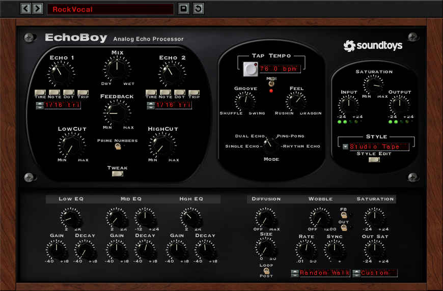

## What it is

- A stereo **delay / echo** with four **Echo Modes** (Single Echo, Dual Echo, Ping-Pong, Rhythm Echo), each a
  different algorithm "with differing numbers of delay outputs and signal routing" (v1).
- Its character comes from an **Echo Style**: one of about 30 presets of a hidden set of tone parameters (an EQ
  that changes with each repeat, saturation, diffusion, wobble), modelled on hardware in the Soundtoys lab. The
  **Style Editor** shows those parameters, so a style can be edited or made from scratch.
- "Echoes sound better when the repeat does NOT sound exactly like the input signal" (v5 manual): the point
  of EchoBoy is repeats that degrade the way tape and analogue delays' did (darker, dirtier, wobblier with
  each pass), not a clean copy.
- Released in 2006. "30 built-in echo styles" (product page). Up to **15 seconds** of delay since Soundtoys 5
  ("Extra delay time—now supports up to 15 seconds"). The Soundtoys 5.5 release (July 2025) made the UI
  resizable. The latest fix (5.5.5, July 2026) is to Rhythm Echo edits not being heard.
- Formats: AAX Native, AAX AudioSuite, VST 2, VST 3, AU; 64-bit; 44.1–192 kHz.

## Mono and stereo

| Mode | Input | Output |
| --- | --- | --- |
| Single Echo | True stereo on a stereo track (left and right have their own delay paths). On a mono track: pseudo-stereo out | Stereo |
| Dual Echo | Left input → Echo 1, right input → Echo 2. A mono input feeds both | Stereo: Echo 1 left, Echo 2 right |
| Ping-Pong | **Always summed to mono** | Stereo |
| Rhythm Echo | **Always summed to mono** | Stereo (taps panned by Pan Shape) |

There were mono, mono-to-stereo and stereo versions of the plug-in (v1). The mono-to-stereo one is
"highly recommended" on mono tracks.

## The main panel

The panel has three sections: **the echo section** on the left (it changes with the mode), **the centre**
(tempo, Groove, Feel, Mode) and **the right** (Saturation, Input, Output, Style). Over it is Soundtoys 5's
preset bar.

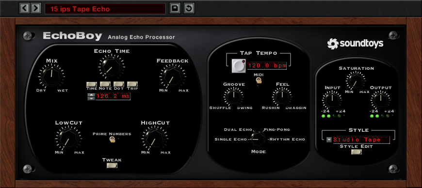

### The preset bar (Soundtoys 5)

From the screenshots: **previous / next preset** arrows, the **preset name** (click: the preset menu), a
**save** button (a disk icon) and a **revert / reload** button (a circular arrow). What the last does exactly
is **not stated**. There's no A/B compare, mix lock or other lock button in the v5 manual or screenshots (in
the Pro Tools era, the host's own Compare and Bypass were used). **Bypass** is the host's.

### Common controls (every mode)

| Control | Labels on the panel | Range / units | Default | What it does |
| --- | --- | --- | --- | --- |
| **Mix** | Dry … Wet | not stated in %; 12 o'clock is "50/50" | not stated | Dry/wet balance. "At 12 o'clock the mix balance is 50/50. As the control is increased beyond 12 o'clock the level of dry signal is decreased until you have just delay." So above centre the dry falls while the wet stays; below centre the wet falls (inferred: the dry stays at full there, which makes it two half-ranges rather than a linear crossfade; the exact law is not stated). Used at 100% wet on a send |
| **Feedback** | Min … Max | not stated in % | not stated | Feeds the echo back to its input: more repeats. "Setting the Feedback value too high or near maximum can easily drive EchoBoy into 'runaway' mode", "the kind of self-oscillation achievable in units like the RE-201 Space Echo". High settings "can boost the output level from EchoBoy significantly". So yes, it self-oscillates (inferred: its maximum is above unity gain, and the style's saturation/limiting is what holds runaway repeats). In Rhythm Echo it repeats the whole pattern |
| **Low Cut** | Min … Max | not stated (no Hz) | not stated | "Used for attenuating bass frequencies" of the echoes. New in v5 (v1 had only High Cut) |
| **High Cut** | Min … Max | not stated (no Hz) | not stated | "Darkening" of the delay, like the high roll-off of analogue delays and tape echoes. SOS: it "rolls off the high frequencies of the wet signal" |
| **Prime Numbers** | a toggle switch, up = on (a red LED lights) | on / off | off in the screenshots | "Delay repeats are slightly altered in time in a very special way to minimize resonance effects." Most noticeable in Dual and Rhythm modes; for short times with feedback, chorus, flanging and reverb-like sounds. SOS: it "subtly shifts the echoes so that they don't fall in phase" |
| **Tweak** | a button | | closed | Opens the mode's Tweak menu (below) |

Both cut filters' effect "will depend greatly on the Echo Style selected" (both manuals). **Where they sit**
(inside the feedback loop, so each repeat is cut again, or once on the output) is **not stated**. Inferred:
since they're said to work "based on the currently selected Echo Style" and the style's own EQ is in the
loop, they most likely act on the style's tone (in the loop). Treat that as a decision to make, not a fact.

### Echo time (Single: Echo Time; Dual: Echo 1, Echo 2; Ping-Pong: Ping, Pong; Rhythm: Rhythm)

Each echo time has a knob, four (Rhythm: five) beige buttons under it, **Time, Note, Dot, Trip** (Rhythm adds
**Patt**), and an LCD with up/down nudge arrows.

| | What it does |
| --- | --- |
| **Time** | The time in **milliseconds**, set by the knob, the nudge arrows, or typed into the LCD. Turning it while sound plays **changes the pitch**, "just like in an old analog delay box" (a tape-style glide: the read point slides). Automating it gives "pitch slide transition effects" |
| **Note** | Straight note values at the current tempo, from **1/2 note to 1/64 note** |
| **Dot** | Dotted note values (×1.5), same range |
| **Trip** | Triplet note values (×2/3), same range |
| Changing note value | "EchoBoy will smoothly crossfade to any new note values" (no pitch glide). v1: "extremely useful when automating echo rhythm changes" |
| Range | 0 ms upwards ("very short delay times (0 to 10 milliseconds) can produce some really cool flanging effects"). Max **15 s** (Soundtoys 5); "the maximum echo time depends on the specific Echo Mode in use" (per-mode maxima **not stated**) |

The LCD reads e.g. `126.2 ms`, `1/16 tri`, `1/8th`, `1/4 note` (v1). The tempo only affects Note, Dot and Trip
values, never ms. In Dual and Ping-Pong each side has its own buttons, so one side can be in ms while the
other is synced.

The v1 manual's automation list shows each echo storing its **mode, note and time separately**
(`Echo1Mode`, `Echo1Note`, `Echo1Time`, likewise `RhythmMode`, `RhythmNote`, `RhythmTime`, and `Tempo`): so
switching Time ↔ Note returns to the last ms value or note value rather than converting (inferred from the
parameter names).

"What's new in Soundtoys 5" also says "Pitch-slewing on delay time adjustments is now automatable": the
parameter's name and range are **not stated** (EchoBoy Jr has a **Glide** on/off: on, changing the time
shifts the pitch; off, it doesn't).

### The centre: tempo, Groove, Feel, Mode

| Control | Labels | Range | Default | What it does |
| --- | --- | --- | --- | --- |
| **Tap Tempo** | a grey button beside the bpm LCD | | | Click in time; the LCD shows the tapped bpm. "It will not be EXACTLY in sync but will get you into the ballpark" (v1). How many taps it averages and when it resets are not stated ("simply tap the button a couple of times") |
| **bpm LCD** | e.g. `120.0 bpm` | **30–300** bpm when typed (v1) | 120.0 in the screenshots | Type a value and Return; or drag on it |
| **MIDI** | a toggle switch with a red LED | on / off | | On: the host's tempo (MIDI clock) "takes over as the master rate control", the LCD shows it, and Tap Tempo is disabled. Off: the typed or tapped tempo |
| **Groove** | Shuffle … Swing, bipolar | not stated (no %) | 12 o'clock, no groove | Moves **every other repeat**: towards **Shuffle** (counter-clockwise) "every other repeat getting delayed a bit MORE, giving you a kind of syncopated triplet feel"; towards **Swing** (clockwise) "every other repeat getting delayed a bit LESS" (v1). "Relative to the currently set Rhythm" (the note value). How far it goes at the ends is not stated (inferred: up to a triplet feel, as the v5 manual says groove shifts "towards a triplet type groove") |
| **Feel** | Rushin' … Draggin' | not stated in ms | 12 o'clock (inferred) | Shifts the **whole echo output** against the beat. Towards **Draggin'** "an increasing amount of delay is imparted on both left and right channels before echoes are heard, similar to pre-delay in reverb"; towards **Rushin'**, "negative pre-delay": echoes earlier than the beat. Inferred: it adds or takes a fixed time from the first echo (and every echo with it) |
| **Mode** | a rotary selector: Single Echo, Dual Echo, Ping-Pong, Rhythm Echo | 4 positions | | The algorithm. The left section and the Tweak menu change with it |

Note: the v5 manual's Groove paragraph says groove is "imparted on the tremolo sound... regardless of the type
of modulation used": a sentence copied from Tremolator's manual. Ignore it.

What happens to the echo times when the mode changes (whether Echo 1's value carries over to Single's Echo Time
or to Rhythm) is **not stated**.

### The right-hand section: Saturation, Input, Output, Style

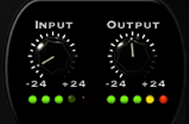

| Control | Labels | Range | Default | What it does |
| --- | --- | --- | --- | --- |
| **Saturation** | Min … Max | not stated | **12 o'clock** ("the default setting") | "Tube or tape-like compression, emphasis, and subtle distortion" on the delay. What it does depends on the style: with Studio Tape, "odd harmonic distortion in the low and mid-range, and ... a high frequency compression effect" (automatic de-essing on the echo of loud vocals); with Limited, "more like a limiter threshold", a "pumping limiter effect". It works **with** the style's own saturation (the Style Editor's Decay Sat and Out Sat); at 12 o'clock the style is as designed (inferred: the knob offsets the style's saturation drive up or down) |
| **Input** | −24 … +24 | dB (inferred) | 12 o'clock / 0 (inferred) | The level into the echo circuit. Designed "to replicate the way true analog input sections respond": pushing it makes the echo dirtier, depending on the style |
| **Output** | −24 … +24 | dB (inferred) | 12 o'clock / 0 (inferred) | The echo's level out |
| **LEDs** | six under each knob: four green, a yellow, a red | | | Yellow: the signal is **6 dB below clipping**. Red: maximum level, possible clipping |
| **Style** | an LCD with a drop-down arrow | 31 styles | not stated (Studio Tape in most screenshots) | The Echo Style (below). Shows **Custom** once the style has been edited (v1 screenshot) |
| **Style Edit** | a button under the Style LCD | | closed | Opens the Style Editor below the panel |

**Input and Output affect only the echo, never the dry signal** (both manuals). SonicScoop: "you can turn the
mix almost all the way to dry and turn up the output and bring back the delay without affecting your dry".

### Knobs and displays (v1 manual)

- Drag up or right to turn a knob up; down or left to turn it down (circles don't work).
- Clicking a knob's text marking (Min, Max...) jumps it there.
- **Option-click**: back to its default. **Control-click**: shows its exact value (again: its name).
  **Cmd-drag**: fine adjustment.
- LCDs: nudge arrows step by one; numeric ones can be clicked and typed into (Return) or dragged; text ones
  (Style, Pan Shape...) open a menu.

## The modes

### Single Echo

"Our favorite Mode": the common controls plus one **Echo Time**. Layout: Mix left, Echo Time centre, Feedback
right, then Low Cut, Prime Numbers, High Cut, and Tweak.

**Tweak menu** (three knobs):

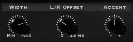

| Control | Labels | Range | Default | What it does |
| --- | --- | --- | --- | --- |
| **Width** | Min … Max | not stated | not stated | Stereo spread. At minimum the left and right delay times are the same and the echo is centred. Turned up, wider. **Past 3 o'clock "out of phase" information** pushes the echo "outside the speakers in a pseudo-super-stereo spread". The width comes from L/R Offset and from the style's Diffusion and Wobble, so styles have their own stereo flavours |
| **L/R Offset** | 0 … 25 ms | **0–25 ms** | **8 ms** | A small time difference between left and right. Smaller: tighter, but may phase; larger: less phasing, looser. **Only heard with Width up** |
| **Accent** | − … +, bipolar | not stated | 12 o'clock, no effect | "Does for amplitude what the Groove knob does for timing": repeats alternate louder and softer. Clockwise emphasises the **1st, 3rd, 5th...** repeats; counter-clockwise the **2nd, 4th, 6th...** (off-beat, syncopated) |

Inferred from the above: Width blends between the same echo in both channels (mono) and the two channels
offset by L/R Offset, then on into mid/side widening past 3 o'clock.

### Dual Echo

Two independent echoes: **Echo 1 is the left channel, Echo 2 the right**, each with its own time knob, buttons
and LCD. Layout: Echo 1 left, Mix centre top, Echo 2 right, Feedback under Mix. Feedback, the cuts, Saturation
"and the like affect both channels the same".

**Tweak menu**:

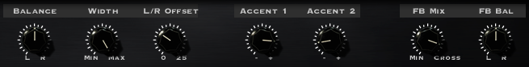

| Control | Labels | What it does |
| --- | --- | --- |
| **Balance** | L … R | The relative loudness of the left and right echoes |
| **Width** | Min … Max | As Single's |
| **L/R Offset** | 0 … 25 | As Single's |
| **Accent 1**, **Accent 2** | − … + | Accent, for each echo |
| **FB Mix** (Feedback Mix) | Min … Cross | How much of each echo feeds back into the other. At minimum (inferred from "normally, the two echo channels ... are completely independent") each feeds only itself; "at the zero position (12 o'clock), equal amounts of Echo 1 and Echo 2 will be fed into both channels" (dense, reverb-like); at maximum ("Cross") "Echo 1 will get all of its feedback from Echo 2, and vice-versa" |
| **FB Bal** (Feedback Balance) | L … R | Shares the Feedback knob's amount between the sides: right, more feedback on the right; left, more on the left |

FB Mix and FB Bal do nothing with Feedback at zero.

### Ping-Pong

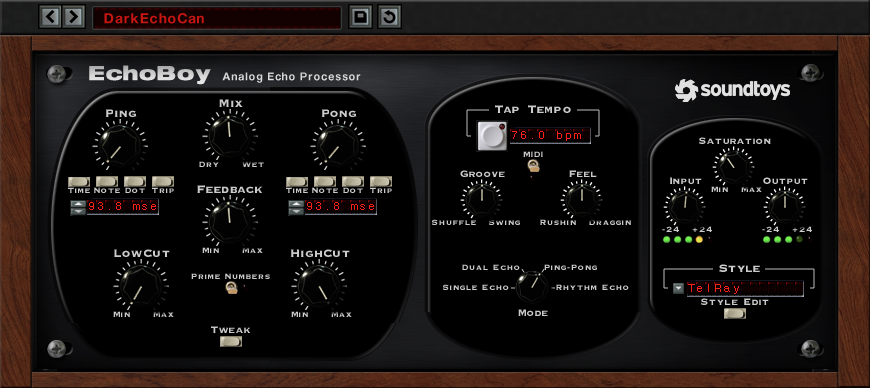

The input (summed to mono) goes to the left **Ping** delay, which feeds the right **Pong** delay, which feeds
Ping again through the feedback. The panel is Dual's with the knobs named **Ping** and **Pong**.

- The first echo is **always** on the left, after the Ping time; the second **always** on the right, after
  **Ping + Pong**, even when Pong is shorter than Ping.
- With Ping 500 ms and Pong 250 ms: left at 500, right at 750, left at 1250, right at 1500 ms, and so on.
- With Feedback at zero you hear **two** repeats, Ping then Pong (v1).
- Feedback, the cuts and Saturation act on both sides alike.

**Tweak menu**: **Width** (Min … Max, as Single's) and **Balance** (L … R).

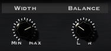

### Rhythm Echo

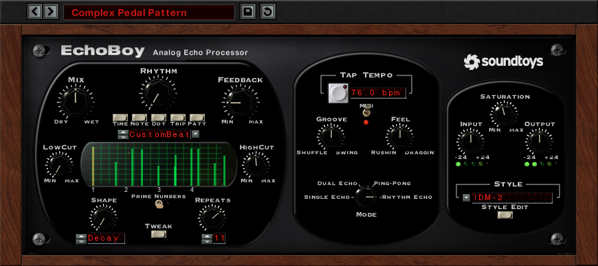

One delay line with **up to 16 taps** ("a tape echo with sixteen read heads"), placed on a beat grid: "a
pattern-based drum machine for echo". The input is summed to mono; the taps are panned (Pan Shape).

Panel layout: Mix, **Rhythm** (the time knob, with Time / Note / Dot / Trip / **Patt** and the pattern LCD),
Feedback; Low Cut, **the Rhythm Editor**, High Cut; **Shape** (knob + shape LCD), Prime Numbers, Tweak,
**Repeats** (knob + LCD).

- **The Rhythm Editor**: a green grid. Each tap is a bright green bar: left to right is time, height is
  level. **Only the taps visible on the grid are heard**: the grid is the whole pattern, **2 beats long by
  default** (Length, in the Tweak menu). Beat numbers run along the bottom.
- **Rhythm knob**: quickly makes a simple pattern of evenly spaced taps at a note value (or ms with Time).
  Example: 1/16 with Repeats at 4 → four taps a sixteenth apart. Dot and Trip make dotted / triplet
  patterns; Time makes them in ms (the knob then glides pitch); note values crossfade.
- **Repeats** (knob, LCD with nudge buttons): how many taps. Lowering it hides the taps above the number
  (they come back when it's raised); raising it adds a tap "at the next logical location based on the
  selected grid value". Range up to 16 (the minimum is not stated).
- **Feedback** repeats **the whole pattern**: "the pattern must complete a full cycle (all the echoes being
  heard) before it will play the pattern again". Repeats is taps within the pattern; Feedback is how many
  times the pattern plays.
- **Patt** (the pattern menu, the arrow beside the LCD): **Save...**, **Presets...** (the factory patterns,
  then the user's), and the groups **bars, notes, dotted, triplet** ("a bunch of standard Bar and Note based
  presets with various types of Dotted and Triplet patterns"). Editing any tap makes the LCD read **Custom
  Time** (v1; `CustomBeat` in the v5 screenshot). Saving asks for a name (a Save Rhythm dialog). Patterns
  are **shared by every Soundtoys plug-in with a rhythm mode** (FilterFreak, Tremolator...).
- **Shape** (knob = how much; LCD = which): an amplitude shape across the taps, scaled by the knob:

| Shape | Taps' levels | |
| --- | --- | --- |
| **Decay** | Each lower than the last, left to right: a natural decay | 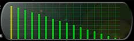 |
| **Reverse** | Each louder: the "'80s backwards echo" | 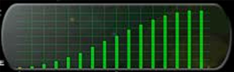 |
| **Swell** | Low, loud in the middle, low again | 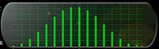 |
| **Fade** | Loud, a dip in the middle, loud | 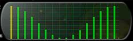 |
| **NonLin** | A semi-random cluster, peaks and valleys, after the AMS RMX16's NonLinear | 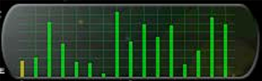 |

#### Editing taps

| Mouse | What |
| --- | --- |
| Click on the grid | Add a tap, on the nearest grid line (while there are fewer than 16) |
| Option-click a tap | Delete it |
| Drag a tap | Move it (snaps to the grid lines) and up/down to change its level |
| **Cmd-click** (Windows: **Shift**) and drag | Move it **off the grid**, freely. Two readouts appear beside it: its position **in fractions of a beat** and its level **in dB** |
| Click the grid's left edge | Restore the "One" |

- **Two taps can't share a time**: a tap dropped onto another goes back where it was, and a click on an
  existing tap's place makes nothing.
- **The "One"**: a tap exactly at beat one (0 ms) is **yellow**. It isn't heard without feedback (it *is*
  the dry note); with feedback it's heard each time the pattern starts again. Moved off zero, it turns green
  and is an ordinary echo.
- **Running out of delay**: a long pattern at a slow tempo can exceed the delay memory; the taps past it
  **grey out** and aren't heard, until the tempo rises or they're removed.

#### Rhythm Echo's Tweak menu

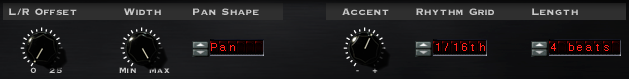

| Control | Range | What it does |
| --- | --- | --- |
| **L/R Offset** | 0 … 25 (ms) | **Only active with Pan Shape on Double**: the left/right time difference of each tap (v1) |
| **Width** | Min … Max | As Single's |
| **Pan Shape** | Double, Center, Alt 1, Alt 2, Alt 3, Sweep L, Sweep R, Pan | Pans the taps to preset positions. **Double** halves the taps to **8**, each a stereo pair "with independent modulation" (thick chorus) |
| **Accent** / **Warp** | − … + | With Note / Dot / Trip: Accent. The v5 manual says here it "places emphasis on even taps when set to the right and odd taps when set to the left" (the opposite of Single's description: one of them is wrong; not resolved). With **Time** selected the knob becomes **Warp**: a "time bias" or "time clustering" that moves all the taps together towards the pattern's start (left) or end (right), shown on the grid |
| **Rhythm Grid** | 1/2 note … 1/64 note | The grid lines' spacing. Changing it doesn't move taps already placed; a tap moved or added afterwards snaps to the new grid |
| **Length** | 1 … 8 beats | The pattern's length: "3 Beats" repeats every third beat (like 3/4) |

## The Style Editor

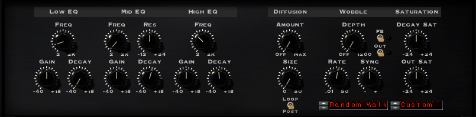

Opened with **Style Edit**, it drops down below the main panel. "These control parameters were used to create
the included style presets": every style is a setting of these. Three groups: **EQ**, **Diffusion**, **Wobble**,
and **Saturation**.

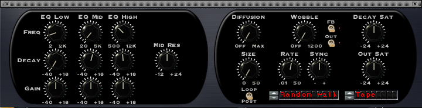

### EQ (three bands, on the echo only, both channels)

| Band | Controls | Labels as printed | Filter |
| --- | --- | --- | --- |
| **Low EQ** | Freq, Gain, Decay | Freq: v1 **2 … 2K**; v5 2 … 2K | A **gentle shelf**: Gain and Decay act **below** the frequency |
| **Mid EQ** | Freq, **Res**, Gain, Decay | Freq: v1 **20 … 5K** (v5's art prints 2 … 2K); Res **−12 … +24** | A **peaking** filter (semi-parametric) at the frequency. **Res** narrows it and deepens it ("akin to turning up the resonance on an analog synth"); lower, broader and gentler |
| **High EQ** | Freq, Gain, Decay | Freq: v1 **500 … 12K** (v5's art prints 2 … 2K) | A **gentle shelf**: Gain and Decay act **above** the frequency |

- Units of Freq are Hz (inferred; an LCD shows the exact frequency while turning). The v1 labels are taken as
  right; the v5 artwork's "2 … 2K" on all three looks like a drawing error (inferred). Low's "2" is
  presumably 20 Hz (not stated).
- **Gain**: labelled **−40 … +18** (dB, inferred); the v1 text says "up to 18dB of boost or cut". Gain sets
  how the **first repeat** sounds.
- **Decay**: labelled **−40 … +18**. Sets how the tone **changes with each further repeat**: negative "EQ
  out", each repeat losing more of that band (a negative High Decay: "successive echo repeats will get darker
  and darker"); positive, each gaining more. **At centre the EQ is a fixed EQ and every repeat sounds the
  same.** Only heard with feedback. "The higher you set the Decay, the greater the increase/decrease in the EQ
  with each successive delay repeat."
- SOS: the Decay knobs are "delta values" that work "cumulatively on each repeat": this is how EchoBoy
  emulates tape generation loss. Inferred implementation: Gain is an EQ on the echo's output (or on its first
  pass), and Decay is the same band as a second EQ **inside the feedback loop**, so its effect compounds per
  repeat.

### Diffusion

| Control | Labels | What it does |
| --- | --- | --- |
| **Amount** | Off … Max | A "smear" filter, as in reverbs: each pass makes the echo less distinct. Short times: a room; long times with feedback: plate or hall. Also brings resonance (metallic, like a flanger with feedback) as it rises |
| **Size** | 0 … 50 | The character of the diffusion: small is subtle, phasing at the very smallest; large is more reverb-like. Unit not stated (inferred: ms) |
| **Loop / Post** | a switch: up Loop, down Post | **Post**: diffusion at the end of the chain, every repeat diffused equally. **Loop**: in the feedback loop, each repeat **more diffused** than the last |

In Dual, Ping-Pong and Rhythm the diffusion sounds denser (several delays diffused). Inferred: a chain of
all-pass filters whose delays scale with Size, with Amount as their coefficient.

### Wobble (wow / flutter)

| Control | Labels | What it does |
| --- | --- | --- |
| **Depth** (the "main Wobble control") | Off … 1200 | How much pitch variation ("vari-speed", like tape wow): off fully counter-clockwise; at the top "extreme modulation". Unit not stated (inferred: cents, so 1200 = an octave) |
| **Rate** | .01 … 50 | The wobble's speed (inferred: Hz) |
| **Sync** | − … +, centre 0 | Each echo path (left, right, the feedback paths) can wobble independently. **Centre**: all identical in rate and phase. **Counter-clockwise**: more and more **different rates**. **Clockwise**: same rate, **phase offsets** between paths (right up while left goes down), more the further it's turned |
| **Shape** (LCD) | Triangle, Sine, Square, Random Walk, Random S/H | Triangle ramps up and down; Sine is smoother; Square jumps between two values; **Random Walk** "smoothly ramps between random values"; **Random S/H** jumps between random values |
| **FB** switch (+ LED) | on / off | Wobble on the initial echo **and** the echoes from feedback (so in the loop, inferred: it compounds) |
| **Out** switch (+ LED) | on / off | Wobble on the wet output, the dry untouched: "very resonant and pronounced" at high settings |

Slow Random Walk with a little depth is the manual's recipe for the "sauntering randomness" of vintage tape.

### Saturation

| Control | Labels | What it does |
| --- | --- | --- |
| **Decay Sat** | −24 … +24 | Saturation of "just the delay" (inferred from its name and Decay's: inside the feedback loop, so each repeat is driven again and gets dirtier) |
| **Out Sat** | −24 … +24 | Saturation "for the total overall signal" (inferred: of the echo output, once) |
| **Type** (LCD under them) | see below | The kind of saturation. The v5 screenshot reads **Custom**, the v1 **Tape**. One menu for both knobs (the manual says "Below both controls is an LCD-style menu") |

The types:

| Type | Description |
| --- | --- |
| **Clean** | "Basically a clean sound, with some limiting as saturation or levels are turned up" |
| **Tape** | "High frequency compression and low-end distortion typical of high quality tape" |
| **Warm** | "A more dramatic warm distortion" |
| **Pump** | "A dramatic popping, pumping limiter effect" |
| **Dirt** | "Grungy and dirty, a little harder edged" |
| **Hard Limit** | "Hard limiting, will pump if you hit it hard" |
| **Soft Limit** | "A fairly smooth limiter" |
| **Warm Limit** | "Smooth and warm as you turn up the saturation and levels" |
| **Bright Limit** | "A bright-sounding limiter that will enhance air and breathiness" |

These knobs "work in conjunction with" the front-panel Saturation. "If you are creating your own style preset be
sure to set the front panel saturation knob to the default setting (12 o'clock, or straight up)".

## The Echo Styles

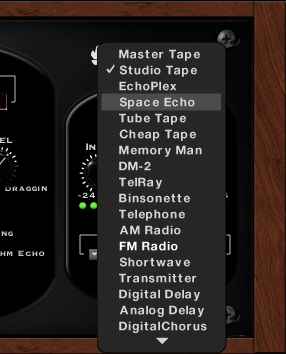

The v5 manual describes **31** styles (the product page says "30"; KVR's reviewer counted "31 (!!)"). The menu
order, from the screenshot (first 18) and the v1 list (the rest, in the same order):

| # | Style | Modelled on | Described as (v5 manual; v1 in brackets where it adds) |
| --- | --- | --- | --- |
| 1 | **Master Tape** | Ampex **ATR-102** (Soundtoys' own) at **30 ips** | "Subtle tape compression and distortion ... High-Fidelity, but smooth and musically pleasing, saturates very nicely" |
| 2 | **Studio Tape** | ATR-102 at **15 ips** (half-inch two-track, per the product page) | "Subtle distortion and high frequency compression ..., typical of the sound of tracking to studio tape". Shown in most screenshots; whether it's the default is not stated |
| 3 | **EchoPlex** | **Echoplex EP-3**, solid-state tape echo | "One of the true classics" |
| 4 | **Space Echo** | **Roland RE-201** Space Echo (the lab's) | "Warm and gritty ... a staple sound of dub and reggae". Its self-oscillation is reachable with Feedback |
| 5 | **Tube Tape** | "a modern tape echo" | "Lot's of high mids and distortion" |
| 6 | **Cheap Tape** | A Soundtoys original: "a variety of vintage consumer-grade tape stock" | "Bright and very compressed sounding" |
| 7 | **Memory Man** | **Electro-Harmonix Memory Man** pedal | "Warm low-bandwidth chorus echo" |
| 8 | **DM-2** | **Boss DM-2** (1981–84), bucket-brigade | "THE guitar echo sound ... the quintessential bucket-brigade delay. Warm, resonant, punchy, but clean" |
| 9 | **TelRay** | **Tel-Ray Adineko** oil-can delay (later Morley), 1960s | "A dark and warbling/wavering echo" (v1: "the ultra-dark liquid sound of vintage oil can echo") |
| 10 | **Binsonette** | A Soundtoys original, from several **Binson Echorec** and Echorec II units | "A wonderful warbly, compressed echo sound ... perfect for guitar and keys" (Pink Floyd) |
| 11 | **Telephone** | | "The narrowband telephone-effect", for vocals |
| 12 | **AM Radio** | | "The compressed medium bandwidth of AM radio" |
| 13 | **FM Radio** | | "Ultra-compressed and loud sounding, like a morning show DJ" |
| 14 | **Shortwave** | | "An exaggerated long-distance radio sound, very narrow and staccato" |
| 15 | **Transmitter** | CB radio-like | "Very distorted and resonant in mid-frequencies. Good for adding echo grit to synth sounds" |
| 16 | **Digital Delay** | | "Just clean and clear digital delay" |
| 17 | **Analog Delay** | 1970s–80s rack analogue delays | "Warm and lightly distorted" |
| 18 | **Digital Chorus** (menu: DigitalChorus) | 1980s digital chorus | "Present and clear but compromised by the limitations of digital processing power in just the right way" |
| 19 | **Analog Chorus** | | "A great all-around warm chorus" |
| 20 | **CE-1 Chorus** | **Boss CE-1 Chorus Ensemble** (1970s) | "Absolutely beautiful on guitar tracks" |
| 21 | **Vibrato** | | "True pitch vibrato" (keys, guitar) |
| 22 | **Saturated** | | "Exaggerated tape distortion" (vocals, drums) |
| 23 | **Fat** | | "Super-warm distorted echoes" (a thick bed of echo) |
| 24 | **Distressed** | | "Highly compressed and distorted echoes" |
| 25 | **Limited** | | "A built-in limiter, great when coupled with high feedback settings"; the Saturation knob becomes like a limiter threshold, pumping |
| 26 | **Distorted** | | "Distortion, and lots of it!" |
| 27 | **Queeked** | | "An odd but very cool multi-band compression echo, very effect-laden" |
| 28 | **Ambient** | | "Distortion and diffusion together. Great for long feedback loops and solo instruments" |
| 29 | **Diffused** | | "Ambient reverb-like echo effects" |
| 30 | **Splattered** | | "Highly reflective reverb effect" (v1: "a cool sort of verby reflection effect") |
| 31 | **Verbed** | | "Echo with a cheap verb chaser afterwards, very responsive to the Feedback and Saturation controls" |

No source gives the styles' parameter values (EQ, saturation type and drive, diffusion, wobble): they'd have to
be designed to the descriptions (and, for the hardware ones, to the hardware). Noise is not mentioned as a
parameter anywhere: no style or control adds hiss (inferred: EchoBoy has no noise generator).

## Factory presets

No complete list is published. What the sources show:

- **v1 (2006) folders**, from the preset menu screenshot: **Basic, Bass, Chorus, Classic, Drums, Effected,
  Guitar, MultiTap, Rhythmic, Spacy, Verbs, Vocal, WayOut**, and `<factory default>`.
- **v1's Chorus folder**: Chorus Deep, Chorus Light, Chorus Ping-Pong Wash, Chorus Wash, DoubleJumper,
  DualChorus, DualWarbler, Rich Chorus, Rich Feedback Chorus.
- SOS (2006) mentions folders Guitar, Classic, Chorus, Solo and Drum; its drum patches use "distortion,
  flanging, small chambers, nasty old reverbs, gated reflections".
- Names seen elsewhere: **RockVocal** (Dual, 1/16 triplets, Studio Tape), **15 ips Tape Echo** (Single, 126.2
  ms, Studio Tape), **AnaLogged** (Dual, 1/8 both, DM-2, Prime Numbers on), **DarkEchoCan** (Ping-Pong, 93.8 ms
  both, TelRay), **Complex Pedal Pattern** (Rhythm, DM-2, Decay shape, 11 repeats), **PopStarRadioEcho**,
  **DirtyFaderSolo** (SOS: a hard lead into "a fat Oberheim string patch"), **HallwayVocal** (SonicScoop:
  "a heavily diffused 'splattered' sound with a very short stereo slap").
- Count: "more than 300 factory presets" (Barry Rudolph's review). The current (5.5) folder list is **not
  stated**.

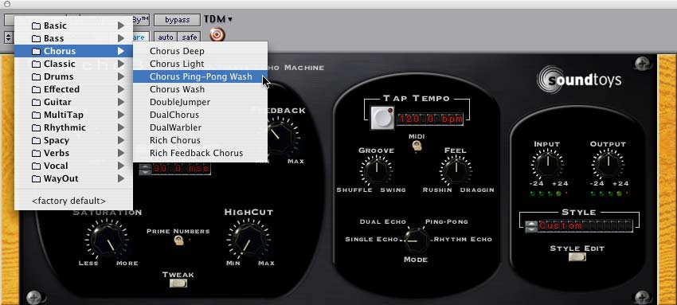

## What it doesn't have

None of these appear in either manual, the product page or the reviews:

- **Ducking** (no threshold or amount: the echo isn't turned down under the dry signal).
- **Freeze / infinite hold** (only Feedback taken into runaway).
- A **Mix lock**, or locks of any kind (the Effect Rack has global controls; not EchoBoy).
- A **"Leveled"** style or control (the nearest is the **Limited** style and the limiter saturation types).
- A **noise** control.
- Reverse delay (apart from Rhythm's Reverse *shape*, which is a level ramp).

## What makes it sound like EchoBoy

From the manuals and reviews:

- **Every repeat is changed again**: the per-band **Decay** EQ in the loop (darker, thinner, or brighter
  per repeat), **Decay Sat** driving each repeat, and optionally **diffusion** and **wobble** in the loop. The
  v5 manual: real tape repeats came back "with increasing amount of distortion, noise, wobble ... and loss of
  high end".
- **Saturation as compression**: tape styles compress the highs as they're driven (de-essing the echo of loud
  vocals); limiter types hold high feedback and pump.
- **Input and Output only drive the wet path**, as an analogue input stage would.
- **Time changes glide the pitch** like a tape speed change; note-value changes crossfade.
- **Musical timing**: Groove, Feel and Accent shift and accent repeats, not just the tempo division.
- Reviewers: "smooth analogue roundedness", "a creamy analogue warmth" (SOS); "not cold harsh or digital at
  all" (KVR). A common tip: 0 ms and a low mix, cycling styles, as a "subtle analog character box" (Hyperbits).

## Gaps (not in any source found)

- The numeric ranges of **Mix, Feedback, Low Cut, High Cut, Saturation, Width, Groove, Feel, Accent, FB Mix,
  FB Bal, Balance, Shape, Diffusion Amount**: only their end labels are printed. Feedback's maximum gain.
- Where **Low Cut / High Cut** sit (in the loop or after), and their slopes.
- Each mode's **maximum delay** (only "up to 15 seconds" overall).
- The automatable **pitch-slew** parameter's name and behaviour.
- Tap Tempo's averaging; what the times do when the **mode changes**.
- Each style's **internal settings**; the 5.5 **factory preset list**.
- Which way Accent emphasises in Rhythm Echo (the v5 manual contradicts itself).

## Decided

Not yet talked through with Théo (2026-10-02, built from his request: "an exact clone of EchoBoy… keep it our
UI": its layout, Gross Beat's look). Where the sources are silent, what was chosen, to check with him:

- **A stock effect of ours**, chosen from an effect slot's picker (Built in → EchoBoy), not a plugin. Its
  settings are **in the song** (every edit is undone, the assistant sets it), as Gross Beat's are.
- **The styles are Style Editor settings** (as Soundtoys say theirs are), voiced from what each models and how
  it's described (`echoboy-dsp.md`): nobody has published EchoBoy's own values. A style left as it's made
  isn't stored: it's its name (`custom` is null).
- **Low Cut and High Cut are in the loop**, 12 dB/oct on everything written to the delay (input and
  feedback), so repeat *n* is cut *n* times: the first repeat is already cut, and each later one darker.
- **Gain and Decay**: the Gain EQ is on the echo's output (the first repeat); the Decay EQ on the feedback
  only, so repeat *n* is `Gain + (n - 1) * Decay`. The Decay knob (-40..18) is about ±6 dB a repeat at its
  ends, fine near 0 (-16 is about -1 dB).
- **Decay Sat is the record stage** (everything written, so the input drives it too); Out Sat is once on the
  output. The front Saturation knob moves both drives ±18 dB (12 o'clock: the style as it's made).
- **Feedback** reaches 115% (past about 87% it runs away, held by the saturation and a soft guard at ±2).
- **Mix**: two half-ranges, both full at 12 o'clock (below it the echo falls; above it the dry).
- **Groove** moves every other repeat up to a triplet's feel (Shuffle: later; Swing: earlier); **Feel** moves
  every echo up to 30 ms either way; **Accent** softens the other repeats (odd ones loud to the right).
- **Width**: up to 3 o'clock the sides grow to as they are, past it twice as wide (mid / side); L/R Offset
  delays the right side's echoes, scaled with Width up to 3 o'clock.
- **Prime Numbers** rounds each line's time to the nearest prime number of ms that's still free.
- **Time changes**: in Time a new time glides there (200 ms, never faster than 0.75 of a sample a sample:
  the pitch bends, as tape); a note value crossfades over 40 ms (equal power).
- **Tap Tempo** averages the last taps (up to 5, a gap over 2 s starts again) and turns MIDI off; MIDI on
  (the default) keeps EchoBoy to the song's tempo.
- **Rhythm Echo**: Repeats and the Rhythm knob lay the taps out again evenly (from the One), growing the
  pattern to hold them; Accent in Rhythm emphasises the odd taps to the right (one of the manual's two
  readings). Taps past what the delay holds (16.25 s) are grey and silent.
- **The factory presets** are ours, in v1's folders, the ones the sources show made to their settings.
- **Defaults**: Single Echo, an eighth note, Studio Tape, Mix 0.4, Feedback 0.35, Width 0.5, L/R Offset 8 ms.

## Where Vaudio differs

| What | EchoBoy | Vaudio |
| --- | --- | --- |
| The styles' settings | Soundtoys' own, unpublished | Ours, voiced from the hardware and the descriptions |
| Hysteresis, BBD clocking, a tape transport | Not stated (likely more modelled) | Curves (tanh, asymmetric, cubic, limiters) with pre- and de-emphasis for Tape; the delay read with Hermite, its length glided |
| Low Cut / High Cut | Where they sit is not stated | In the loop, 12 dB/oct |
| Save preset, user presets, Revert | The preset bar | Factory presets; Copy / Paste state (and style) in its menus; the app's undo |
| Pitch slewing as a parameter | Automatable since Soundtoys 5 | Time mode always glides; note values always crossfade |
| Automating | Any parameter | Every knob: Mix, Feedback, Echo 1 / 2, the cuts, Saturation, Input, Output, Groove, Feel, Width; Tweak's (L/R Offset, Balance, Accents, FB Mix, FB Bal), Rhythm Echo's (Rhythm, Shape, Accent: the Rhythm knob lays the taps out again as it moves) and the Style Editor's seventeen. Not the switches and menus (mode, sync, style, saturation type, wobble shape) |
| Rhythm Echo's Accent | The manual contradicts itself | Right: odd taps louder |
| Resizable UI | Since 5.5 | Fixed, as Gross Beat's window (its drawer grows it) |

## How it's built

- **The document**: `MixerEffect.echoBoy` (`shared/music/types.ts`) on an effect whose plugin is
  `ECHO_BOY_PLUGIN` (`vaudio:echo-boy`): its mode, echo times (`EchoTime`: sync, ms and note kept apart),
  knobs, Tweak, Rhythm Echo (`EchoRhythm`: taps in beats, the pattern's length...), the style's name and
  its edit (`custom`, or null). Validated in `normalizeEchoBoy` (`echo-boy-presets.ts`, with the
  constants); the 31 styles in `echo-boy-styles.ts`; the factory presets in `echo-boy-library.ts`; what
  its controls mean and its edits in `echo-boy.ts`. All tested.
- **Compiling** (`engineEchoBoy`, `compile.ts`): every mode becomes delay lines: up to four, what each takes
  from the input, a feedback matrix between them (`fixed + amount * feedback`), where each is heard, and
  Rhythm Echo's taps. Groove is a pair of lines a side (T + g and T - g, feeding each other, so the repeats
  alternate), Ping-Pong two lines in series, Dual's FB Mix the matrix's cross terms. The style goes in the
  engine's units (Hz, dB, dB a repeat, cents). Automated controls are lanes (`kind: "echo"`): a lane per
  engine value (the mix's two gains, the lines' delays...), worked out from the settings at each tick.
- **The engine** (`engine/src/EchoBoy.cpp`, its parts in `EchoDsp.h`): `echo::State` keeps the lines
  (16.5 s each), their filters, saturations, diffusers and LFOs, kept across songs by the effect's id in an
  `echo::Registry` (the export has its own), so a knob turned doesn't cut the echoes off. Each sample: the
  lines read (Hermite; the wobble moving them; a crossfade if a note value changed), each line's feedback
  through the Decay EQ, a DC blocker and the loop's diffusion, the record stage (input + feedback through
  Decay Sat, the cuts, a guard), the wet sound through the Gain EQ, Out Sat, the diffusion after the loop,
  the output's wobble and Width, mixed with the dry. A bypass forgets the echoes. It reports its levels
  (`EngineTransport.echoBoys`) for the LEDs. Tested offline to the sample: `echo-boy.integration.test.ts`.
- **The tab** (`src/suites/music/echo-boy/`): `echo-boy-window.tsx` (the window: preset bar, echo section,
  centre, right), `panels.tsx` (Tweak, the Style Editor), `controls.tsx` (its knobs, keys, LCDs, LEDs, the
  Mode dial), `rhythm-grid.tsx` (the tap editor; its maths in `rhythm-geometry.ts`, tested), `store.ts`,
  `actions.ts`, `tool-edits.ts` (the assistant's `get_echo_boy`, `update_echo_boy`; `add_mixer_effect`
  takes "EchoBoy", `add_automation` its "echo ..." controls). The One's colour is `--echo-one`.

## Sources

- EchoBoy User's Guide, Version 5: https://www.soundtoys.com/wp-content/uploads/EchoBoy-Manual.pdf
- EchoBoy 1.0 Manual: https://static.bhphoto.com/lit_files/89644.pdf (also
  https://barryrudolph.com/recall/manuals/echoboy.pdf)
- EchoBoy Jr. User's Guide, Version 5: https://www.soundtoys.com/wp-content/uploads/EchoBoyJr-Manual.pdf
- Product page: https://www.soundtoys.com/product/echoboy/
- Release log: https://www.soundtoys.com/release-log/
- What's new in Soundtoys 5: https://www.soundtoys.com/whats-new-in-soundtoys-5/
- Sound On Sound review (2006): https://www.soundonsound.com/reviews/sound-toys-echoboy
- KVR user reviews: https://www.kvraudio.com/product/2732/review
- Barry Rudolph's review: https://barryrudolph.com/mix/soundtoysechoboy.html
- SonicScoop, "My go-to delay": https://sonicscoop.com/2014/04/21/my-go-to-delay-three-pros-share-their-secret-weapons
- Soundtoys, Vocal Processing Week: https://www.soundtoys.com/vocal-processing-week/
- Hyperbits, Soundtoys plugins: https://hyperbits.com/blog/soundtoys-plugins/
