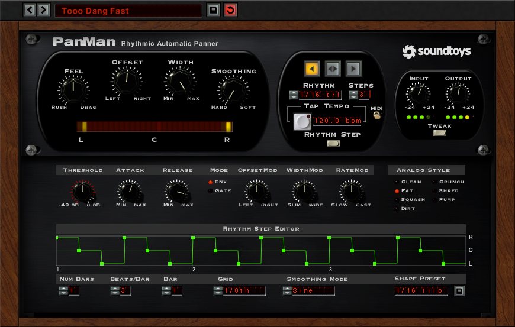
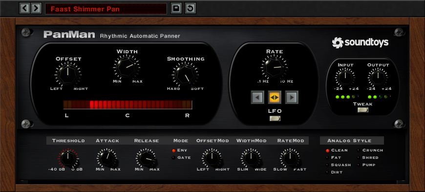
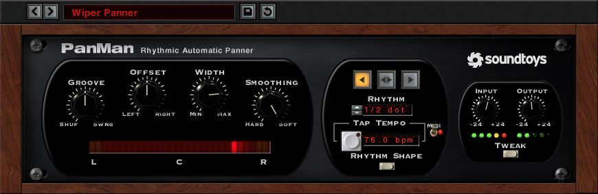
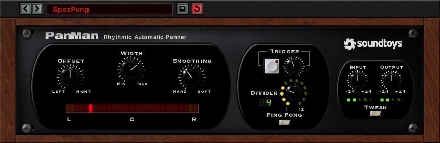
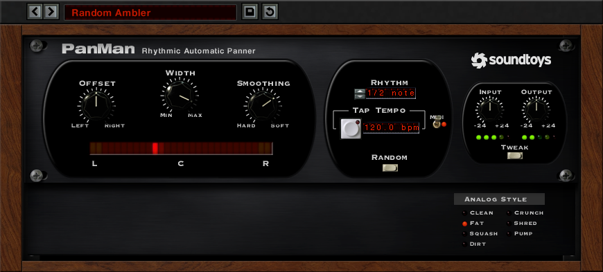
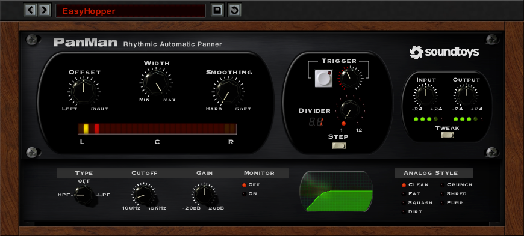
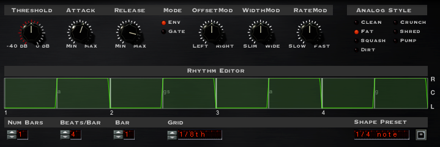

# PanMan

Soundtoys' **PanMan** ("Rhythmic Automatic Panner"), from Soundtoys' own **PanMan User's Guide, Version 5**
(`soundtoys.com/wp-content/uploads/PanMan-Manual.pdf`, © 2015, 28 pages: "the manual") and its screenshots
(below), the Tremolator manual (whose Groove PanMan shares), Soundtoys' product page and release log, and
reviews (Sound On Sound 2010, MusicRadar, Resident Advisor, Barry Rudolph). Anything the sources don't give
is marked **not stated**; anything worked out rather than read is marked **(inferred)**. The last sections
are ours: [what's decided](#decided), [where Vaudio differs](#where-vaudio-differs) and
[how it's built](#how-its-built).

The pictures in `img/` are the manual's own screenshots, © Soundtoys, kept here only as a private
reference for building this app. Don't ship them, and don't copy Soundtoys' artwork: we copy how it works
and how it's laid out, in our own visual style.

## What it is

- An **auto-panner**: it moves the sound across the stereo field, by an LFO, by a rhythm in time with
  the song, at random, or each time the sound hits a level. "PanMan allows you to move your audio around
  dynamically in ways you just can't do with automation."
- Built by studying hardware auto-panners: Audio & Design's **PanScan** (its Trigger Divider is PanMan's),
  the **Cyclosonic FS-1** and the Electrospace **Spanner**. Not modelled on one unit: its look is
  Soundtoys' house style (a black panel between walnut cheeks, as Tremolator's and FilterFreak's).
- It pans **"beyond the speakers"**: positions go to ±105° where ±90° is hard left / right.
- History: announced at AES in October 2009, shipped in March 2010 with SoundToys Native Effects V4 (with
  Decapitator). PanMan 5 came with Soundtoys 5 (2015): AAX, a module of the Effect Rack. Since: bypass and
  help (5.1.0), multi-bar rhythms fixed and a "balance offset in Random & Triggered modes" fixed (5.2.x), a
  resizable window and an LFO down to 0.01 Hz (5.5.2), stereo drop-outs fixed (5.5.5, July 2026). No
  control or mode changed between V4 and 5.

## The panel

Three rounded sections on the black faceplate (the screenshots are 870 × 283 px closed, 870 × 553 open):

1. **Left**: the common knobs (with **Feel** or **Groove** first in the rhythm modes) and, under them, the
   **Pan Position Meter**.
2. **Centre**: the mode's own controls, and under them the **mode button** with the mode's name over it.
3. **Right**: **Input** and **Output** with their LEDs, and the **Tweak** button.

Over it, Soundtoys 5's preset bar: previous / next preset, the preset's name (a click: the preset menu),
Save, and a circular arrow that goes red once the preset is edited (revert to it, **(inferred)**). Bypass
is the host's. **There's no Mix knob.**

### Common controls (every mode)

| Control | Scale | Range | Default | What it does |
| --- | --- | --- | --- | --- |
| **Offset** | LEFT … RIGHT | −105° … +105° | 0° (centre) | The base pan position. ±90° is wholly in one channel; past it is "beyond the speaker" |
| **Width** | MIN … MAX | 0 … 210° | **180°** | How far around the Offset the position moves. 210° is −105 … +105 |
| **Smoothing** | HARD … SOFT | **not stated** | **not stated** | How smoothly the position goes from one place to the next: Hard jumps, Soft glides. "If a left-to-right or right-to-left direction is selected, smoothing will control how hard the snap-back will be" |

The position never goes past ±105°: "if you set the Offset to say, +90 degrees, and Width to 180, the
position of the audio will never go beyond 105 degrees."

**The Pan Position Meter**: a row of LEDs under the knobs, labelled **L C R**. Red ones are the normal
range (−90 … +90°); a yellow one at each end is the extended range ("if you see the meter lighting up the
yellow LEDs, that means you are panning beyond the speakers"). "The LEDs charge and discharge like real
LEDs and will create trails when the pan position moves quickly." About 29 LEDs (counted).

**Input and Output**: knobs from −24 to +24 dB, about unity gain by default, each with five LEDs under it
(three green, a yellow 6 dB below clipping, a red at the most). They set how hard the **Analog Style**
saturation is driven.

### The modes

The mode button: a press and hold opens a menu of the six modes, **LFO, Rhythm Step, Rhythm Shape,
PingPong, Random, Step** (the manual's chapter calls the last "Random Step"). The centre section and the
Tweak panel change with it.

**LFO**: repeats one of three basic shapes at **Rate** (0.1 … 10 Hz; 0.01 Hz since 5.5.2), not in time with
the song. **Direction**, three buttons, the one picked lit amber: **◀ right to left** (a ramp down), **◀▶
back and forth**, **▶ left to right** (a ramp up). (The manual lists them "Left-to-Right, Back-and-Forth,
Right-to-Left", but the Rhythm Step screenshot has ◀ lit stepping R, C, L: the arrows say which way.)

**Rhythm Step** (the top screenshot): steps through positions, a new one at each **Rhythm** interval.

- **Feel** (RUSH … DRAG) shifts the whole pattern earlier or later; what's pushed past an end wraps round
  to the other: "think of the Feel control as adjusting the phase of your pattern."
- **Direction**: the same three buttons.
- **Rhythm**: an LCD menu of note lengths (seen: "1/16 trip", "1/2 dot", "1/2 note", "1/4 note"), plus
  **Custom** (or a saved rhythm's name) and **Edit…**. With a custom rhythm, Direction and Steps do nothing.
- **Steps**: how many positions before the pattern repeats (seen: 3; the range is **not stated**: a review
  says up to five).
- **Tap Tempo**, its BPM LCD ("120.0 bpm") and the **MIDI** switch: on, the host's tempo sets the rate; off,
  the BPM does.

**Rhythm Shape**: "a more sophisticated version of LFO Mode" in time with the song. **Groove** (SHUF …
SWNG) in Feel's place: from Tremolator's manual, 12 o'clock is straight, one way adds shuffle and the
other swing, "towards a triplet type groove". Direction (here named **Ramp-Down, Triangle, Ramp-Up**),
Rhythm, Tap Tempo, MIDI. Each event of its rhythm plays one whole cycle of the shape.

**PingPong**: alternates between two positions (by default hard left and hard right: Offset ± Width / 2)
each time the sound crosses a level.

- **Trigger**: the threshold; the ticks round it light red with the sound's level. All the way up turns
  the sound's triggering off.
- **Manual Trigger** (the button beside it): a trigger, only while the sound is *below* the threshold. It
  can be automated or played from MIDI.
- **Divider** (1 … 12): how many triggers make a move ("move from left to right every third trigger"),
  PanScan's. A two-digit LCD shows it and a ring of 12 LEDs the count so far.

**Random**: a new random position (inside Offset ± Width / 2) at every Rhythm interval. Rhythm, Tap Tempo,
MIDI. "Use Smoothing to control how hard the jump is." No direction.

**Step** (Random Step): random positions as Random's, moved by triggers as PingPong's (Trigger, Manual
Trigger, Divider).

### The Tweak panel

Slides out under the panel; what's in it depends on the mode.

**Dynamics** (LFO, Rhythm Step, Rhythm Shape): the sound's level moves the panning.

| Control | Scale | Range | What it does |
| --- | --- | --- | --- |
| **Threshold** | −40 dB … 0 dB | dB | Below it, no modulation; above it, "how far the input signal goes above the Threshold setting determines how deep the modulation will go". Its ticks light red with the level |
| **Attack** | MIN … MAX | 0 … 5000 ms | How long the mods take to reach their full amount |
| **Release** | MIN … MAX | 0 … 5000 ms | How long they take to go back once the sound falls below the threshold |
| **Mode** | Env / Gate | | **Env**: as far above the threshold as the sound is. **Gate**: on or off, to the full amount at the Attack's pace |
| **OffsetMod** | LEFT … RIGHT | bipolar | Moves the Offset with the level ("a dynamically controlled pan for the auto-pan") |
| **WidthMod** | SLIM … WIDE | bipolar, degrees | +45 adds 45° of width; the limits still hold |
| **RateMod** | SLOW … FAST | bipolar, octaves | 1.00 doubles the rate, 2.00 is ×4. In sync, the rate leaves the tempo while it's modulated and "grabs hold again" when the mod goes back to 0 |

**Analog Style** (every mode): seven choices of saturation, "a certain amount of distortion at all signal
levels", driven by the Input knob: **Clean** (maximum undistorted range, fairly hard clipping), **Fat**
(smooth low-frequency distortion), **Squash** (like Fat, more compressed), **Dirt** (smooth broadband
saturation), **Crunch** (exaggerated high-end clipping), **Shred** (lots of asymmetrical clipping),
**Pump** (extreme pumping compression). The default is **not stated** (the screenshots show Fat and Clean).

**The trigger filter** (PingPong, Step, in the Dynamics' place): what the trigger listens to, not what's
heard. **Type** HPF / OFF / LPF, **Cutoff** 100 Hz … 15 kHz, **Gain** ±20 dB (the detector's level after
filtering), **Monitor** Off / On (hear the filtered sound, unpanned), and a picture of the filter's curve.

**The Rhythm Step Editor** (Rhythm Step): a graph of the pattern, **R** at the top, **C**, **L** at the
bottom, bar numbers under it; green square points joined by a green line.

- Click an empty vertical grid line: a point. Drag a point: up and down is its position, sideways its time,
  on the grid (Cmd-drag, Alt on Windows: off it). Option-click (right-click on Windows): delete it. Two
  points can't share a time: one dropped on another goes back.
- Under it: **Num Bars**, **Beats/Bar**, **Bar** (which bar is shown), **Grid** ("1/8th"), **Smoothing
  Mode** and **Shape Preset** (factory or saved: a floppy disk saves).
- **Smoothing Mode**, the shape of the moves between points: **Linear**, **Sine** ("very smooth"), **Exp**
  (rises fast, then levels off), **Sym** (even, symmetrical), **Rev** (slow, then faster and faster).
- The screenshot (1 bar of 3/4, rhythm 1/16 trip, 3 steps, ◀) has 18 points stepping R, C, L, R…: the
  pattern the knobs make is written into the editor **(inferred)**.

**The Rhythm Editor** (Rhythm Shape): "works a bit like a simple drum machine": each event plays one whole
cycle of the shape over its length. Click empty space: an event; click an event: delete it. Option-drag
resizes it (its left side held), Shift-drag from its right side, Option+Shift-drag moves it. The same menus
(Num Bars, Beats/Bar, Bar, Grid, Shape Preset). Faint letters inside some events ("a", "gs", "g") aren't
explained anywhere.

## The factory presets

There's no published list. Names seen: **Tooo Dang Fast** (Rhythm Step), **Pendulum Pan** and **Faast
Shimmer Pan** (LFO), **Wiper Panner** (Rhythm Shape), **SpazPong** (PingPong), **Random Ambler** (Random),
**EasyHopper** (Step); shape presets **1/16 trip**, **1/4 note** (named by their note lengths).

## The sound

- **Pan law: not stated**, and nobody has published measurements. The degrees (±90° hard) suggest a
  sine / cosine (constant power) panner; carried past 90° that formula gives a little of the sound,
  polarity-inverted, in the far channel: the classic way to sound "beyond the speakers" **(inferred)**.
- **No delay (Haas), Doppler or filtering** in the panning; the only spatial trick is the ±105° range.
- **Stereo in: not stated.** "Any mono or stereo track" (product page); reviews describe pushing a mono
  signal from side to side.
- **Analog modelling**: the Analog Style saturations, driven by Input.
- **No latency** is stated; Feel and Groove move the pattern, not the sound, so none is needed
  **(inferred)**.

## Decided

Not yet talked through with Théo (2026-10-02, built from his request: a PanMan "similar to Gross Beat",
researched closely, in our UI). What was chosen, to check with him:

- **A stock effect of ours**, chosen from an effect slot's picker (Built in → PanMan), as Gross Beat is. Its
  settings are **in the song** (every change is undone, the assistant can set it), not a plugin's file.
- **Its window is ours**, Soundtoys' layout in the app's look: the three sections, the meter, the preset
  bar, the Tweak panel sliding out under them with the editors. No wood, no Soundtoys artwork.
- **A new PanMan pans slowly**: LFO, back and forth, 0.5 Hz, Width 180°, Smoothing 50%, Clean.
- **Smoothing**, as the manual says it behaves: on the steps of Rhythm Step (and its editor), the move into
  each point takes the last *Smoothing* of the time since the one before, in the Smoothing Mode's curve
  (Hard: a jump on the point; Soft: a glide from point to point). On the ramps it's the snap-back: up to
  half the cycle, a sine-shaped return. On back-and-forth it rounds the triangle into a sine. In Random a
  new position is glided into over the last *Smoothing* of the step before; in PingPong and Step (which
  can't know when the next move is), a move glides over Smoothing² × 1 s.
- **The pan law** is sine / cosine over the angle, carried past ±90° (the far channel gets a little of the
  sound, inverted), scaled by √2 so the centre is unity: the sound's power is the same wherever it is.
- **Stereo in is summed to mono** ((L + R) / 2), as the hardware panners were mono in: a stereo source
  becomes one point that moves. A mono sound on a stereo track is unchanged at the centre.
- **Feel** shifts the pattern by up to a 16th note either way. **Groove** moves every second rhythm event
  later (Swing) or earlier (Shuffle), all the way to a triplet (2:1, or 1:2).
- **Steps**: 2 to 16. Back and forth goes L … R … L over 2 × steps − 2 moves.
- **The rhythms**: 1/32, 1/16 trip, 1/16, 1/16 dot, 1/8 trip, 1/8, 1/8 dot, 1/4 trip, 1/4, 1/4 dot, 1/2
  trip, 1/2, 1/2 dot, 1 bar, 2 bars, 4 bars.
- **In time with the song** (the MIDI switch, on by default) the pattern follows the song's position while
  it plays, so a bar's pattern starts on the bar; stopped, it runs on at the song's tempo. Off, it runs at
  the BPM (tapped or typed) from when play starts. LFO always runs at its Rate, from when play starts.
  So an export sounds like playback.
- **Random** positions are random but repeatable: each rhythm step of the song (and each trigger since play
  started) has its own, from the effect's id, so a render is the same every time.
- **Dynamics**: the level is a peak follower (instant up, 50 ms down) in dB. Env: the amount is how far
  above the threshold it is, out of the way from the threshold to 0 dBFS; Gate: all or nothing. Attack and
  Release are the time the amount takes to go all the way up or down (straight lines). OffsetMod ±105°,
  WidthMod ±210°, RateMod ±4 octaves. Out of the tempo, a modulated rate drifts away and comes back to the
  beat (within a quarter of a second) once the mod is over.
- **Triggers**: the trigger filter (12 dB / octave), then a peak follower (instant up, 30 ms down); a trigger
  when it rises over the threshold, and again only once it has fallen 6 dB under it. The Trigger knob runs
  −40 … 0 dB: at 0 dB, Off. PingPong starts at the left of its two places when play starts.
- **The Analog Styles**, ours: each a gentle curve that's the sound itself at low levels and adds harmonics
  as it's driven (at unity gain, Clean changes nothing until it nears full scale).
- **Moves don't click**: the position glides over 1 ms whatever the Smoothing, as a VCA's control would.

## Where Vaudio differs

| What | Soundtoys | Vaudio |
| --- | --- | --- |
| Look | Black panel, walnut cheeks, red LCDs, amber buttons | The app's surfaces, knobs and LCDs; the meter's LEDs in its colours |
| Manual Trigger from MIDI | Yes | A click on its button (live: not recorded or exported). There's no MIDI routing to effects |
| Automation | Any parameter (the host's) | Every knob (Offset, Width, Smoothing, Feel, Groove, Rate, Trigger, Divider, the filter's Cutoff and Gain, the dynamics' Threshold, Attack, Release and mods, Input, Output): Create automation clip from their menus. Not the switches and menus |
| Saving shape presets and plugin presets (the floppy) | Files | Not yet: the factory presets, and Copy / Paste of the whole PanMan |
| Shape presets | Factory files | The rhythms: picking one makes the pattern the knobs make for it |
| Undo | Host's | The app's: every change is one step |
| Resizable window | Since 5.5.2 | No: it's the size of what's in it |
| Analog Styles | Soundtoys' (not published) | Ours, made to their descriptions; not measured against the real ones |

## How it's built

- **The document**: `MixerEffect.panMan` (`shared/music/types.ts`, `PanMan`) on an effect whose plugin is
  `PANMAN_PLUGIN` (`vaudio:panman`): every control in its own units (degrees, Hz, dB, seconds), the preset
  last loaded, and the two editors' patterns (`stepPattern`: points, a tick and a position -1..1 each;
  `shapePattern`: events). Validated in `normalizePanMan` (`panman-presets.ts`, with the constants, the
  rhythms, the automatable controls' ranges `PAN_CONTROLS` and the 27 factory presets).
- **What it plays** (`shared/music/panman.ts`, tested): the pattern modes are a function of where the
  pattern is (`panPattern`: `cycleValue` for the shapes, `stepValue` for steps with Smoothing in the
  Smoothing Mode's `panCurve`, Feel's shift, Groove's `ungroove`), sent to the engine as lines over 0..1 of
  the pattern (`enginePanMan`, `sampleLane`, within a 500th of the width). The edits (`updatePanMan`,
  `loadPanPreset`, `editStepPoints` and `editShapeEvents`, which make the knobs' pattern the PanMan's own
  the first time, and the editors' pure point and event edits) all return the same song when nothing changes.
- **Automation**: `AutomationTarget` `panMan`, every knob (`PAN_CONTROLS`: ranges, the rate's and cutoff's
  log scales); lanes of kind `panman` set at each slice's start, the offset, width and mods as fractions of
  105° and 210°, the cutoff in kHz (`PAN_LANE_SCALE`: lanes hold values within ±64). Feel and Groove only
  shape the pattern, as Smoothing does in the pattern modes: automated, the pattern itself is a lane
  (`shape`, `PAN_SHAPE_POINTS` evenly over it, `panShape`), and the song's comes back when it stops
  (`panman::Settings::setShape`, `restoreShape`, in room made when the song is parsed).
- **The engine** (`engine/src/PanMan.cpp`): a native effect in its slot (bypass, the slot's mix; no delay).
  `panman::State`, kept across songs by the effect's id (`panman::Registry`; the export has its own), runs
  per sample: Input, the mono sum, the dynamics' follower and amount, the trigger's filter (RBJ) and
  follower (a trigger on the rise, ready again 6 dB under), where the rhythm is (`gross::Clock`: the
  song's tick while in sync and playing, else counted; RateMod's drift and its return to the beat), the
  position (the pattern's line, Random's `chance`, a trigger mode's sine glide), the 1 ms de-click, the pan
  law, the Analog Style (`saturate`; a change of style starts its filters afresh) and Output. It reports
  where it is and its levels (`EngineTransport.panMen`); the Manual Trigger is the `panMan` command.
  Tested offline: `server/music/panman.integration.test.ts` (positions read from the two sides of a
  steady sound, to a fraction of a degree).
- **The tab** (`src/suites/music/panman/`): `panman-window.tsx` (the window, opened from the slot's name,
  chosen from an effect slot's picker under Built in), `draw.ts` (the editors' and the meter's canvases),
  `pointer.ts` (the editors' mouse, a drag drawn through the edit it commits), `geometry.ts` (their maths
  and the meters', tested), `actions.ts` (presets, Revert, Copy / Paste state, Tap Tempo, the Manual
  Trigger), `store.ts` (open windows, each one's Tweak, bar and grid), `tool-edits.ts` (the assistant's
  `get_panman`, `update_panman`, `set_panman_pattern`; `add_mixer_effect` takes "PanMan", and
  `add_automation` its "panman ..." controls, every knob).
  The Rate and Cutoff knobs turn along a log scale (`Knob`'s `taper`).
